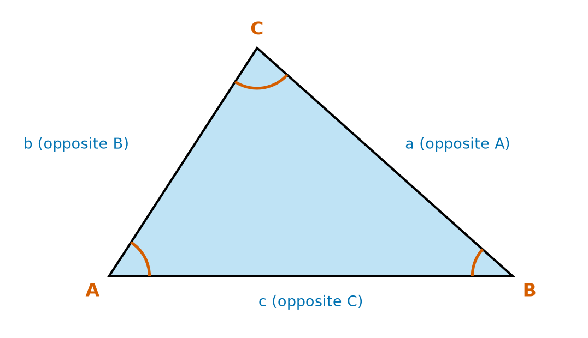
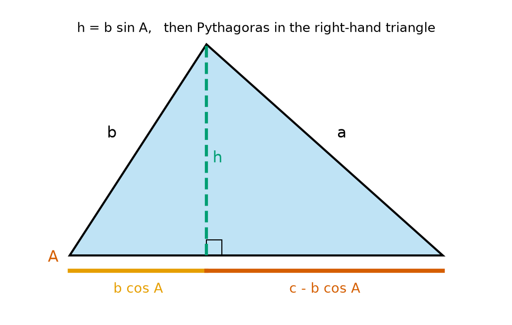
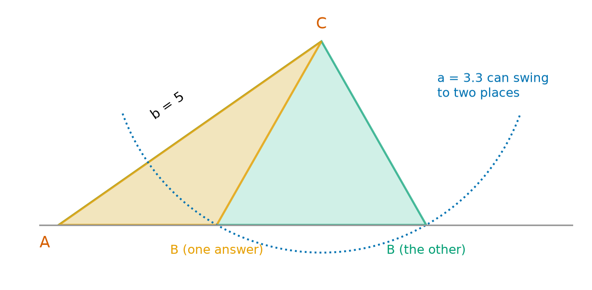
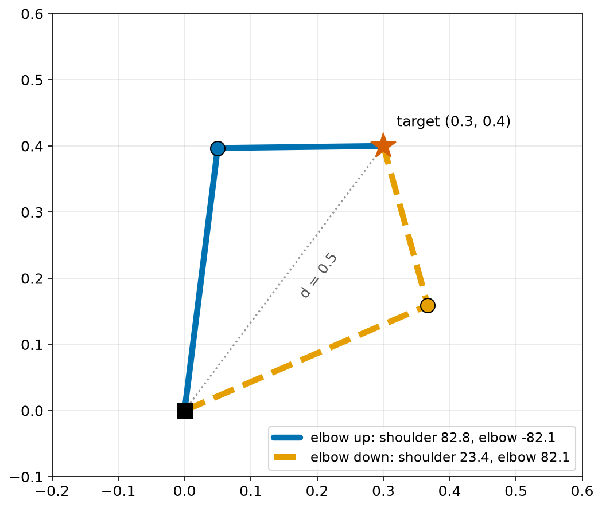
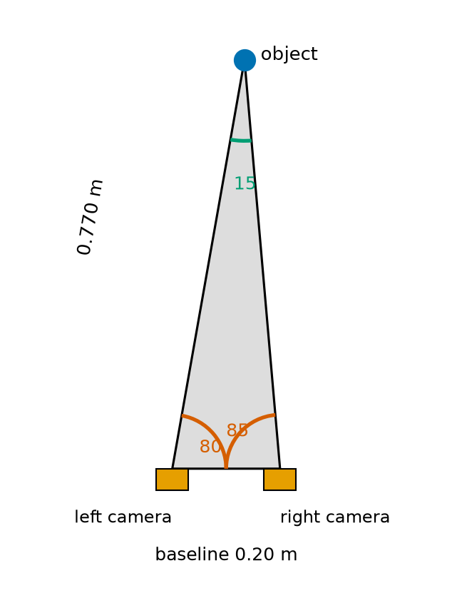
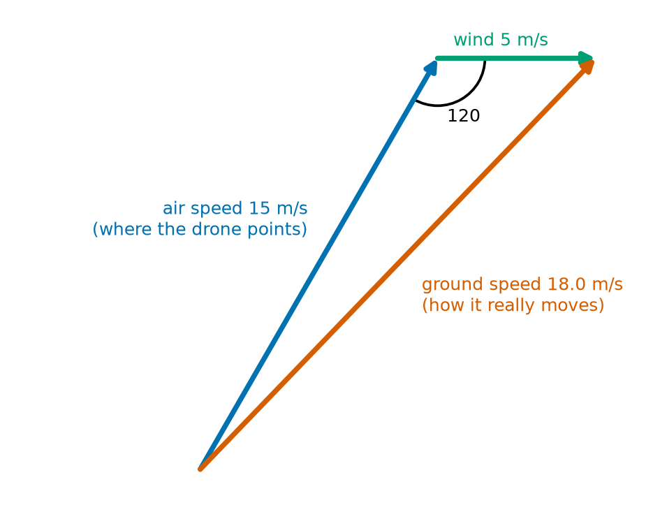

# Chapter 51 — Trigonometry Part 3: the Law of Sines and the Law of Cosines

> **Part 3 · Chapter 51 of 749**
> **You need:** Chapter 48 (Pythagoras), Chapter 49 (sin, cos, tan) and Chapter 50 (atan2).
> **You will make:** a solver for any triangle, the joint angles of a two-link robot arm (both answers), a distance finder for a pair of cameras, and a wind calculator for a drone.

---

## What you will learn

- How to name the sides and angles of any triangle.
- The **law of cosines**, how it comes from Pythagoras, and when to use it.
- The **law of sines**, where it comes from, and when to use it.
- Why some triangles have two answers.
- How to find the area of any triangle from two sides and the angle between them.
- How a robot arm finds its elbow angle.
- How two cameras, or two observers, can measure distance.

---

## New words in this chapter

| Word | Simple meaning |
|---|---|
| **law of cosines** | c² = a² + b² − 2ab cos C, for any triangle. |
| **law of sines** | a/sin A = b/sin B = c/sin C, for any triangle. |
| **solve a triangle** | Find all its missing sides and angles. |
| **included angle** | The angle between two given sides. |
| **ambiguous case** | When the given facts fit two different triangles. |
| **inverse kinematics** | Finding the joint angles that put a robot's tip at a given point. |
| **baseline** | The known distance between two observers or two cameras. |
| **triangulation** | Finding where something is from the angles at the two ends of a baseline. |

---

## 51.1 Naming any triangle

Chapter 49 needed a right angle. Most triangles in robots do not have one: the triangle made by an arm's two links, the triangle between two cameras and an object, the triangle of two cables and a ceiling.

We need rules for **every** triangle. First, a standard way to name its parts.



*Figure 51.1 — Each side is named after the corner it faces.*

**How to read this picture:** The corners are A, B and C, in capital letters. The angles at those corners are also called A, B and C. Each side has the small letter of the corner **opposite** it: side a is across from corner A, and so on.

This naming makes the rules easy to remember.

📖 **New word: solve a triangle** — find all its missing sides and angles.

A triangle is fixed by three facts, as long as at least one is a side. Which rule to use depends on what you know:

| You know | Short name | Use |
|---|---|---|
| three sides | SSS | law of cosines, to find an angle |
| two sides and the angle between them | SAS | law of cosines, to find the third side |
| two angles and a side | AAS or ASA | law of sines |
| two sides and an angle not between them | SSA | law of sines, but be careful (section 51.4) |

---

## 51.2 The law of cosines

📖 **New word: law of cosines** —

```
a² = b² + c² − 2bc cos A
```

and the same pattern for the other sides:

```
b² = a² + c² − 2ac cos B
c² = a² + b² − 2ab cos C
```

In words: the square of a side equals the sum of the squares of the other two sides, minus a correction that depends on the angle **opposite** it.

### Where it comes from



*Figure 51.2 — A height splits the triangle into two right-angled triangles.*

**How to read this picture:** The green dashed line is a height h, dropped from the top corner to side c at a right angle. In the left-hand triangle, the hypotenuse is b, so its bottom part is b cos A and its height is h = b sin A (Chapter 49). The rest of the bottom is c − b cos A. The right-hand triangle has hypotenuse a.

Use Pythagoras in the right-hand triangle. Each line says what changed.

```
a² = h² + (c − b cos A)²                         Pythagoras
a² = (b sin A)² + (c − b cos A)²                 put in h = b sin A
a² = b² sin² A + c² − 2bc cos A + b² cos² A      expand the bracket (Chapter 40)
a² = b² (sin² A + cos² A) + c² − 2bc cos A       collect the b² terms
a² = b² + c² − 2bc cos A                         sin² A + cos² A = 1 (Chapter 49)
```

### It contains Pythagoras

If A = 90°, then cos A = 0, and the correction disappears: a² = b² + c². Pythagoras is the special case of the law of cosines for a right angle.

The correction also makes sense:

- If A is **less** than 90°, cos A is positive, so a is **shorter** than in a right-angled triangle.
- If A is **more** than 90°, cos A is negative, so a is **longer**.

### Using it

📖 **New word: included angle** — the angle between two given sides.

🔢 **Maths (SAS).** Two sides are 5 and 7, with an included angle of 60°. Find the third side.

```
c² = 5² + 7² − 2 × 5 × 7 × cos 60°
   = 25 + 49 − 70 × 0.5
   = 74 − 35 = 39
c  = √39 = 6.245
```

🔢 **Maths (SSS).** A triangle has sides 5, 6 and 7. Find the angle opposite 5. Rearrange (Chapter 41):

```
cos A = (b² + c² − a²) / (2bc)
      = (36 + 49 − 25) / (2 × 6 × 7)
      = 60 / 84 = 0.714
A     = acos(0.714) = 44.42°
```

💡 **Tip.** With three sides, the law of cosines never gives a wrong angle, because acos gives values from 0° to 180°, exactly the range of angles in a triangle.

---

## 51.3 The law of sines

📖 **New word: law of sines** —

```
  a         b         c
------- = ------- = -------
 sin A     sin B     sin C
```

In words: each side divided by the sine of its opposite angle gives the same number. The biggest side is always opposite the biggest angle.

### Where it comes from

Look at Figure 51.2 again. The height h can be found from either of the two small triangles:

```
From the left triangle:   h = b sin A
From the right triangle:  h = a sin B

So: b sin A = a sin B
Divide both sides by sin A sin B:   b / sin B = a / sin A
```

Dropping a height from a different corner gives the same result for c.

### Using it

🔢 **Maths (AAS).** A = 40°, B = 75°, and a = 10. Find b and c.

```
C = 180 − 40 − 75 = 65°                      (Chapter 48)
b = a × sin B / sin A = 10 × 0.966 / 0.643 = 15.03
c = a × sin C / sin A = 10 × 0.906 / 0.643 = 14.10
```

---

## 51.4 Two answers: the ambiguous case

📖 **New word: ambiguous case** — when the given facts fit two different triangles.

Suppose you know A = 35°, b = 5 and a = 3.3. Side a is attached at C and must reach the base line. It can swing to two different places.



*Figure 51.3 — The same side a can meet the base line in two places.*

**How to read this picture:** Side b goes from A up to C at 35°. Side a hangs from C and must touch the grey base line. The blue dotted arc shows everywhere it could reach. It crosses the line twice, so there are two triangles: the orange one and the green one.

The law of sines shows this too. sin B = b sin A / a. But two angles share every sine: B and 180° − B (Chapter 50). Both may be possible.

🔢 **Maths.** A = 30°, b = 10, a = 6.

```
sin B = 10 × sin 30° / 6 = 0.833
B = 56.4°   or   B = 180 − 56.4 = 123.6°
```

Both work, because in each case A + B is less than 180°.

🤖 **Robot link.** A robot arm has the same problem: there are often two ways to reach a point. We will see it in the next section, and Chapter 353 studies it in full.

---

## 51.5 The area of any triangle

From Chapter 48, the area is ½ × base × height. In Figure 51.2, the base is c and the height is b sin A:

```
area = ½ b c sin A
```

In words: half the product of two sides times the sine of the angle between them.

🔢 **Maths.** Sides 5 and 7 with an included angle of 60°: area = ½ × 5 × 7 × 0.866 = 15.16.

If all three sides are known, find one angle with the law of cosines first. For sides 5, 6 and 7 the area is 14.70.

---

## Code

File `code/ch051/solve_triangle.py`:

```python
# solve_triangle.py - any triangle: law of cosines and law of sines
import math


def angles_from_sides(a, b, c):
    A = math.acos((b * b + c * c - a * a) / (2 * b * c))
    B = math.acos((a * a + c * c - b * b) / (2 * a * c))
    C = math.pi - A - B
    return math.degrees(A), math.degrees(B), math.degrees(C)


def side_from_two_sides(a, b, C_deg):
    C = math.radians(C_deg)
    return math.sqrt(a * a + b * b - 2 * a * b * math.cos(C))


def side_from_sines(known_side, known_angle_deg, other_angle_deg):
    return known_side * math.sin(math.radians(other_angle_deg)) / math.sin(math.radians(known_angle_deg))


print("sides 3, 4, 5      -> angles", [round(x, 2) for x in angles_from_sides(3, 4, 5)])
print("sides 5, 6, 7      -> angles", [round(x, 2) for x in angles_from_sides(5, 6, 7)])
print("a=5, b=7, C=60     -> c =", round(side_from_two_sides(5, 7, 60), 4))
print("a=3, b=4, C=90     -> c =", round(side_from_two_sides(3, 4, 90), 4))
print("a=10 opposite 40, B=75 -> b =", round(side_from_sines(10, 40, 75), 4))
```

| Line | Code | What it does (simple English) |
|---|---|---|
| 1 | `# solve_triangle.py …` | A comment. |
| 2 | `import math` | For acos, cos, sin, sqrt. |
| 3–4 | (blank) | Spacing. |
| 5 | `def angles_from_sides(a, b, c):` | SSS: three sides in, three angles out. |
| 6 | `A = math.acos((b * b + c * c - a * a) / (2 * b * c))` | The law of cosines, rearranged for cos A. |
| 7 | `B = math.acos(…)` | The same for B. |
| 8 | `C = math.pi - A - B` | The angles add up to π (180°). |
| 9 | `return math.degrees(A), …` | All three, in degrees. |
| 10–11 | (blank) | Spacing. |
| 12 | `def side_from_two_sides(a, b, C_deg):` | SAS: two sides and the angle between them. |
| 13 | `C = math.radians(C_deg)` | Radians for `math.cos`. |
| 14 | `return math.sqrt(a * a + b * b - 2 * a * b * math.cos(C))` | The law of cosines. |
| 15–16 | (blank) | Spacing. |
| 17 | `def side_from_sines(…):` | AAS: one side, its opposite angle, and another angle. |
| 18 | `return known_side * math.sin(…) / math.sin(…)` | The law of sines, rearranged. |
| 19–20 | (blank) | Spacing. |
| 21–25 | `print(…)` | Five tests from this chapter. |

Output:

```
sides 3, 4, 5      -> angles [36.87, 53.13, 90.0]
sides 5, 6, 7      -> angles [44.42, 57.12, 78.46]
a=5, b=7, C=60     -> c = 6.245
a=3, b=4, C=90     -> c = 5.0
a=10 opposite 40, B=75 -> b = 15.0271
```

The 3-4-5 triangle has a right angle, as in Chapter 48, and the law of cosines with 90° gives Pythagoras. The other lines match our hand calculations.

---

## Small examples

**Example 1.** Sides 4 and 4 with an included angle of 60°: c² = 16 + 16 − 32 × 0.5 = 16, so c = 4. An equilateral triangle.

**Example 2.** Sides 4 and 4 with an angle of 120°: c² = 32 + 16 = 48, so c = 6.93.

**Example 3.** Sides 7, 7 and 7: every angle is 60°.

**Example 4.** A = 30°, B = 60°, so C = 90°.

**Example 5.** a = 4, A = 30°: then a/sin A = 8. If B = 90°, b = 8 × 1 = 8.

**Example 6.** Area with sides 6 and 8 and an included angle of 30°: ½ × 48 × 0.5 = 12.

**Example 7.** Sides 2, 3 and 6 cannot make a triangle: 2 + 3 is less than 6. The law of cosines would give cos of more than 1, and `math.acos` would raise a `ValueError`.

---

## 🏭 Real robot applications

### Application 1 (worked in full) — 🏭 The elbow angle of a robot arm

**1. The real problem.** In Chapter 48, we found that the arm (links 0.40 m and 0.25 m) **can** reach (0.3, 0.4). Now the controller needs the actual joint angles: how far to turn the shoulder, and how far to bend the elbow.

📖 **New word: inverse kinematics** — finding the joint angles that put a robot's tip at a given point. (Part 16 is all about it.)

**2. Why this theory.** The shoulder, the elbow and the tip make a triangle. We know all three sides: the two links, and the distance d from the shoulder to the target. That is SSS: the law of cosines gives every angle.

**3. The numbers.** L1 = 0.40 m, L2 = 0.25 m, target (0.3, 0.4).

**4. The maths.**

```
d = √(0.3² + 0.4²) = 0.5 m                                   (Pythagoras)

Inside angle at the elbow (opposite d):
cos E = (L1² + L2² − d²) / (2 L1 L2) = (0.16 + 0.0625 − 0.25) / 0.2 = −0.1375
E = 97.90°
The elbow bends by 180° − 97.90° = 82.10° from straight.

Angle at the shoulder, between the first link and the line to the target (opposite L2):
cos S = (L1² + d² − L2²) / (2 L1 d) = (0.16 + 0.25 − 0.0625) / 0.4 = 0.86875
S = 29.69°

Direction to the target: atan2(0.4, 0.3) = 53.13°             (Chapter 50)

Elbow down: shoulder = 53.13 − 29.69 = 23.44°, elbow = +82.10°
Elbow up:   shoulder = 53.13 + 29.69 = 82.82°, elbow = −82.10°
```

There are two answers, one on each side of the line to the target: the ambiguous case again.



*Figure 51.4 — Elbow up and elbow down both reach the target.*

**How to read this picture:** The black square is the shoulder, and the red star is the target. The blue arm bends with its elbow up. The orange dashed arm bends with its elbow down. Both tips meet at the star. The grey dotted line is the distance d, the third side of both triangles.

**5. The code.** File `code/ch051/two_link_ik.py`:

```python
# two_link_ik.py - the joint angles a two-link arm needs to reach a point (law of cosines)
import math

UPPER_M = 0.40
FORE_M = 0.25


def solve_arm(x, y, elbow_up=True):
    d = math.hypot(x, y)
    if d > UPPER_M + FORE_M or d < abs(UPPER_M - FORE_M):
        return None
    inside_elbow = math.acos((UPPER_M ** 2 + FORE_M ** 2 - d ** 2) / (2 * UPPER_M * FORE_M))
    bend = math.pi - inside_elbow
    at_shoulder = math.acos((UPPER_M ** 2 + d ** 2 - FORE_M ** 2) / (2 * UPPER_M * d))
    direction = math.atan2(y, x)
    if elbow_up:
        return direction + at_shoulder, -bend
    return direction - at_shoulder, bend


def tip(shoulder, elbow):
    ex = UPPER_M * math.cos(shoulder)
    ey = UPPER_M * math.sin(shoulder)
    return ex + FORE_M * math.cos(shoulder + elbow), ey + FORE_M * math.sin(shoulder + elbow)


for target in [(0.30, 0.40), (0.60, 0.20), (0.5, 0.5)]:
    for up in [True, False]:
        answer = solve_arm(target[0], target[1], up)
        if answer is None:
            print(f"{target}: out of reach")
            break
        s, e = answer
        tx, ty = tip(s, e)
        print(f"{target} elbow {'up  ' if up else 'down'}: shoulder {math.degrees(s):7.2f}, "
              f"elbow {math.degrees(e):7.2f}  -> tip ({tx:.3f}, {ty:.3f})")
```

| Line | Code | What it does (simple English) |
|---|---|---|
| 1 | `# two_link_ik.py …` | A comment. |
| 2 | `import math` | For hypot, acos, atan2, cos, sin. |
| 3 | (blank) | Spacing. |
| 4 | `UPPER_M = 0.40` | First link. |
| 5 | `FORE_M = 0.25` | Second link. |
| 6–7 | (blank) | Spacing. |
| 8 | `def solve_arm(x, y, elbow_up=True):` | Target in, two joint angles out. |
| 9 | `d = math.hypot(x, y)` | The third side of the triangle. |
| 10 | `if d > … or d < …:` | Outside the reachable ring (Chapter 48)? Then acos would get a value beyond ±1. |
| 11 | `return None` | No answer. |
| 12 | `inside_elbow = math.acos(…)` | Law of cosines for the angle opposite d. |
| 13 | `bend = math.pi - inside_elbow` | How far the elbow bends from straight. |
| 14 | `at_shoulder = math.acos(…)` | Law of cosines for the angle opposite L2. |
| 15 | `direction = math.atan2(y, x)` | Direction from shoulder to target. |
| 16 | `if elbow_up:` | Which of the two answers? |
| 17 | `return direction + at_shoulder, -bend` | The first link above the target line, elbow bending clockwise. |
| 18 | `return direction - at_shoulder, bend` | The first link below the line, elbow bending anticlockwise. |
| 19–20 | (blank) | Spacing. |
| 21 | `def tip(shoulder, elbow):` | The check: from angles back to the tip (forward kinematics, Chapter 337). |
| 22 | `ex = UPPER_M * math.cos(shoulder)` | Elbow position, x (Chapter 49). |
| 23 | `ey = UPPER_M * math.sin(shoulder)` | Elbow position, y. |
| 24 | `return ex + FORE_M * math.cos(shoulder + elbow), …` | The second link points at shoulder + elbow. |
| 25–26 | (blank) | Spacing. |
| 27 | `for target in […]:` | Three targets. |
| 28 | `for up in [True, False]:` | Both answers. |
| 29 | `answer = solve_arm(…)` | Solve. |
| 30–32 | `if answer is None: … break` | Out of reach: say so once, and skip the other answer. |
| 33 | `s, e = answer` | Unpack the angles. |
| 34 | `tx, ty = tip(s, e)` | Where they really put the tip. |
| 35–36 | `print(…)` | Shows the angles and the check. |

Output:

```
(0.3, 0.4) elbow up  : shoulder   82.82, elbow  -82.10  -> tip (0.300, 0.400)
(0.3, 0.4) elbow down: shoulder   23.44, elbow   82.10  -> tip (0.300, 0.400)
(0.6, 0.2) elbow up  : shoulder   28.93, elbow  -27.44  -> tip (0.600, 0.200)
(0.6, 0.2) elbow down: shoulder    7.94, elbow   27.44  -> tip (0.600, 0.200)
(0.5, 0.5): out of reach
```

**6. The result.** Every answer puts the tip exactly on the target. The check with `tip` is important: it proves the inverse calculation using the much simpler forward one. The arm's software can now choose the elbow position that avoids obstacles, or the one closer to its current pose. Notice that for (0.6, 0.2), close to full reach, the elbow bends only 27°: the arm is almost straight.

**7. Going further.** Chapter 351 derives this with geometry and Chapter 352 with algebra. For arms with more joints, there is often no neat formula, and robots search for the answer step by step (Chapter 361).

### Application 2 (worked in full) — 📷 Measuring distance with two cameras

**1. The real problem.** A robot has two cameras side by side, 0.20 m apart. Both see the same object. Each camera measures the angle to the object from the line joining the cameras. How far away is the object?

📖 **New word: baseline** — the known distance between two observers or two cameras.

📖 **New word: triangulation** — finding where something is from the angles at the two ends of a baseline. Surveyors have mapped whole countries this way.

**2. Why this theory.** The two cameras and the object make a triangle. We know one side (the baseline) and two angles. That is ASA: the law of sines finds the other sides.

**3. The numbers.** Baseline c = 0.20 m. In the first sighting, the left camera measures 80° and the right camera measures 85°.

**4. The maths.**

```
Angle at the object:  180 − 80 − 85 = 15°
Distance from the left camera (the side opposite the right camera's angle):
  b = c × sin 85° / sin 15° = 0.20 × 0.9962 / 0.2588 = 0.770 m
Position, with the left camera at (0, 0) and the right one at (0.2, 0):
  x = 0.770 × cos 80° = 0.134 m
  y = 0.770 × sin 80° = 0.758 m
```



*Figure 51.5 — A tall, thin triangle made by two cameras and an object.*

**How to read this picture:** The two orange boxes are the cameras, 0.20 m apart. Each measures an angle (red). The angle at the object (green) is what is left from 180°: only 15°. The long side from the left camera to the object is 0.770 m.

**5. The code.** File `code/ch051/stereo_range.py`:

```python
# stereo_range.py - two cameras a known distance apart both see the same object
import math

BASELINE_M = 0.20          # distance between the two cameras

sightings = [(80.0, 85.0), (88.0, 89.0), (70.0, 72.0)]   # angles at the left and right camera, in degrees

print(" left  right  angle at object   distance from left   position (x, y)")
for left_deg, right_deg in sightings:
    at_object = 180.0 - left_deg - right_deg
    from_left = BASELINE_M * math.sin(math.radians(right_deg)) / math.sin(math.radians(at_object))
    x = from_left * math.cos(math.radians(left_deg))
    y = from_left * math.sin(math.radians(left_deg))
    print(f"{left_deg:5.1f} {right_deg:6.1f} {at_object:12.1f} {from_left:18.3f} m     ({x:.3f}, {y:.3f})")
```

| Line | Code | What it does (simple English) |
|---|---|---|
| 1 | `# stereo_range.py …` | A comment. |
| 2 | `import math` | For sin, cos, radians. |
| 3 | (blank) | Spacing. |
| 4 | `BASELINE_M = 0.20` | The known side. |
| 5 | (blank) | Spacing. |
| 6 | `sightings = […]` | Three pairs of angles. |
| 7 | (blank) | Spacing. |
| 8 | `print(…)` | The heading. |
| 9 | `for left_deg, right_deg in sightings:` | Each sighting. |
| 10 | `at_object = 180.0 - left_deg - right_deg` | The third angle. |
| 11 | `from_left = BASELINE_M * … / …` | The law of sines. |
| 12 | `x = from_left * math.cos(…)` | Polar to x and y (Chapter 49). |
| 13 | `y = from_left * math.sin(…)` | |
| 14 | `print(f"…")` | Prints the row. |

Output:

```
 left  right  angle at object   distance from left   position (x, y)
 80.0   85.0         15.0              0.770 m     (0.134, 0.758)
 88.0   89.0          3.0              3.821 m     (0.133, 3.819)
 70.0   72.0         38.0              0.309 m     (0.106, 0.290)
```

**6. The result.** The robot now knows where each object is. Look at the second row: the angle at the object is only 3°. A tiny error in one camera's angle changes the answer a lot: if the right camera read 89.5° instead of 89.0°, the angle at the object would be 2.5° and the distance would jump to about 4.6 m. Far objects make thin triangles, and thin triangles are sensitive. A wider baseline makes them less thin, which is why cameras far apart measure far distances better.

**7. Going further.** Real stereo cameras measure pixel positions, not angles, and use the camera model (Chapter 488) to turn them into angles. Chapter 493 builds stereo depth from images. Your own two eyes use exactly this triangle to judge distance.

### Application 3 — 🦿 The knee of a walking robot

A robot leg has a thigh of 0.20 m and a shin of 0.20 m. To put its foot 0.30 m from its hip, the knee's inside angle must be acos((0.04 + 0.04 − 0.09)/0.08) = acos(−0.125) = 97.2°. When the leg is straight (0.40 m), the knee is at 180°. As the robot crouches, the hip-to-foot distance falls, and the law of cosines gives the knee angle at every moment (Chapter 670).

### Application 4 — 🚁 Flying in a crosswind

A drone points one way and flies at an air speed of 15 m/s. A wind of 5 m/s blows at 60° to its path. The ground speed is the third side of a triangle with these two sides and an angle of 120° between them, because the wind arrow continues from the tip of the air-speed arrow.



*Figure 51.6 — Air speed plus wind makes the ground speed.*

**How to read this picture:** The blue arrow is where the drone points. The green arrow is the wind, added on to its tip. The red arrow, from the start to the end, is how the drone really moves over the ground. The angle inside the triangle, between the blue and green arrows, is 120°.

ground speed² = 15² + 5² − 2 × 15 × 5 × cos 120° = 225 + 25 + 75 = 325, so the ground speed is 18.03 m/s. The law of sines gives the angle between the air-speed and ground-speed arrows: sin θ = 5 × sin 120° / 18.03, so θ = 13.9°. A flight controller uses this to point the drone slightly into the wind, so that it travels where it should (Chapter 650).

### Application 5 — 🏟️ A camera hanging from two cables

Sports stadiums use cable-driven cameras that fly above the field. In a simple version, two winches 40 m apart at the same height let out two cables to one camera. If the cables are 25 m and 30 m long, the angle at the left winch is acos((25² + 40² − 30²)/(2 × 25 × 40)) = acos(0.6625) = 48.5°. So the camera is 25 × cos 48.5° = 16.56 m along from the left winch, and 25 × sin 48.5° = 18.73 m below the winches. The controller does this the other way round as well: for each place the camera should go, it works out the cable lengths, and the winches let them out.

---

## 🔧 Hands-on lab

### Lab 51.1 — Check the law of cosines with string (hardware)

You need three sticks or straws, tape, a ruler and a protractor.

1. Tape two sticks together at one end, at any angle. Measure their lengths (b and c) and the angle between them (A).
2. Measure the distance between their free ends (a).
3. Compute a with `side_from_two_sides(b, c, A)`.
4. Repeat with a wider and a narrower angle.

**What you should see:** The computed and measured distances agree to within a few millimetres. A wider angle gives a longer third side.

| If it does not work | Likely cause | Fix |
|---|---|---|
| Far apart | The angle was read from the wrong side of the protractor | Small angles look small: check that 30° looks narrow |
| Close, but always too long | Measured from the outside edges of the sticks | Measure along their centre lines |

**Challenge:** Use the corner from Lab 48.2: with sides 30 and 40 cm and your measured third side, find the real angle of the corner.

### Lab 51.2 — Move the arm (simulation)

Copy `two_link_ik.py`.

1. Add targets (0.15, 0.0), (0.0, 0.65) and (−0.3, 0.3).
2. For each answer, draw the arm with matplotlib (see Figure 51.4).
3. Print the elbow angle for targets along a line from (0.6, 0) to (0.2, 0) in steps of 0.05.

**What you should see:** (0.15, 0.0) is the inner edge: the elbow is folded right back (bend 180°). (0.0, 0.65) is the outer edge: bend 0°, and both answers are the same. Along the line, the bend grows as the target comes closer.

| If it does not work | Likely cause | Fix |
|---|---|---|
| `ValueError: math domain error` | A rounding error puts the acos input just past ±1 at the edge | Clip it: `max(-1.0, min(1.0, value))` |
| The tip check is wrong | The second link angle should be shoulder + elbow | Check line 24 |

**Challenge:** Choose automatically the answer whose shoulder angle is closer to the arm's current shoulder angle, so that the arm moves as little as possible.

### Lab 51.3 — Make a stereo rangefinder with your eyes (hardware)

1. Hold a pencil at arm's length. Close one eye, then the other. The pencil seems to jump against the background.
2. Hold it closer. The jump is bigger.
3. Measure the distance between your eyes (about 6 cm) and use `stereo_range.py` with angles you estimate.

**What you should see:** Close objects jump a lot, far ones hardly at all. This is the same thin-triangle effect as in Application 2.

| If it does not work | Likely cause | Fix |
|---|---|---|
| No jump at all | The object is very far away | Use something within 1 m |

**Challenge:** Set up two phones a measured distance apart, photograph the same object, and estimate the two angles from the photos.

---

## Common mistakes

⚠️ **Using the angle that is not opposite the side** in the law of cosines.

⚠️ **Forgetting the minus sign** in −2bc cos A.

⚠️ **Forgetting the second answer** in the ambiguous case.

⚠️ **Using the law of sines for an angle near 90°.** asin cannot tell 80° from 100°. Use the law of cosines when you can.

⚠️ **Giving acos a value just past 1** at the edge of the reach. Clip it.

⚠️ **Trusting thin triangles.** A tiny angle error gives a big distance error.

⚠️ **Mixing degrees and radians.**

---

## Practice

🏋️ **1.** Two sides are 5 and 7 with an included angle of 60°. Find the third side.

🏋️ **2.** Find all the angles of a triangle with sides 5, 6 and 7.

🏋️ **3.** A = 40°, B = 75°, a = 10. Find b and c.

🏋️ **4.** Show that the law of cosines gives 90° for the triangle 3, 4, 5.

🏋️ **5.** Find the area of a triangle with sides 5 and 7 and an included angle of 60°.

🏋️ **6.** An arm has links of 0.3 m and 0.3 m. Find the elbow bend needed to reach (0.4, 0.2).

🏋️ **7.** Two cameras 0.20 m apart both measure 89.5°. How far away is the object? Why is this answer not very reliable?

🏋️ **8.** A drone has an air speed of 20 m/s, and the wind is 6 m/s at right angles to it. What is its ground speed?

🏋️ **9.** A = 30°, b = 10, a = 6. Find both possible values of B.

🏋️ **10.** Why does the law of cosines become Pythagoras for a right angle?

🏋️ **11.** Write `triangle_area(a, b, c)` that finds the area from three sides, using the law of cosines and then ½ab sin C. Test it with (3, 4, 5) and (5, 6, 7).

---

## Answers

**1.** √39 = 6.245.

**2.** 44.42°, 57.12°, 78.46°.

**3.** C = 65°. b = 15.03. c = 14.10.

**4.** cos C = (9 + 16 − 25)/(2 × 3 × 4) = 0, so C = 90°.

**5.** ½ × 5 × 7 × sin 60° = 15.16.

**6.** d = √(0.16 + 0.04) = 0.4472. cos E = (0.09 + 0.09 − 0.2)/(2 × 0.09) = −0.111, so E = 96.38°. The bend is 180 − 96.38 = 83.62°.

**7.** The angle at the object is 1°. Distance = 0.20 × sin 89.5° / sin 1° = 11.46 m. An error of only 0.5° in either angle would change the answer by several metres, because the triangle is so thin.

**8.** The angle between them is 90°, so √(400 + 36) = 20.88 m/s.

**9.** sin B = 10 × 0.5 / 6 = 0.833. B = 56.4° or 123.6°.

**10.** cos 90° = 0, so the term −2ab cos C disappears.

**11.**

```python
import math

def triangle_area(a, b, c):
    C = math.acos((a * a + b * b - c * c) / (2 * a * b))
    return 0.5 * a * b * math.sin(C)

print(round(triangle_area(3, 4, 5), 3))    # 6.0
print(round(triangle_area(5, 6, 7), 3))    # 14.697
```

---

## Summary

🧠 In any triangle, side a is opposite angle A, and so on.

🧠 Law of cosines: a² = b² + c² − 2bc cos A. Use it with three sides, or two sides and the angle between them.

🧠 For a right angle, the law of cosines becomes Pythagoras.

🧠 Law of sines: a/sin A = b/sin B = c/sin C. Use it with two angles and a side.

🧠 Two sides and a non-included angle can give two triangles.

🧠 Area = ½ ab sin C.

🧠 A two-link arm's elbow angle comes from the law of cosines, and there are usually two answers.

---

## Next chapter

In Chapter 52 we meet **exponentials and logarithms**. They describe things that grow or shrink by the same fraction each step: a battery running down, a motor cooling, a filter smoothing a sensor, and the log scale that Chapter 2 promised to explain.
