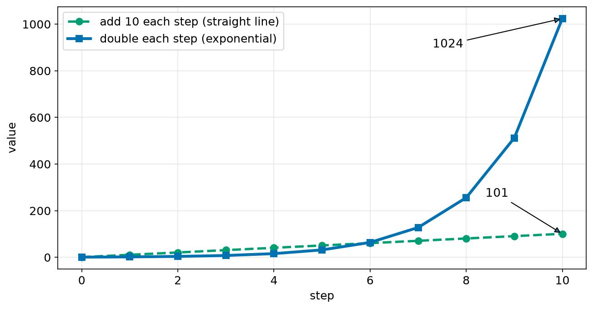
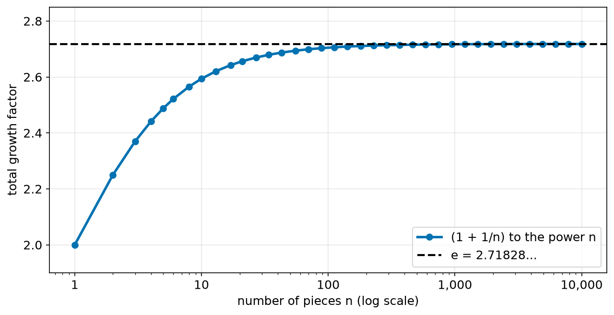
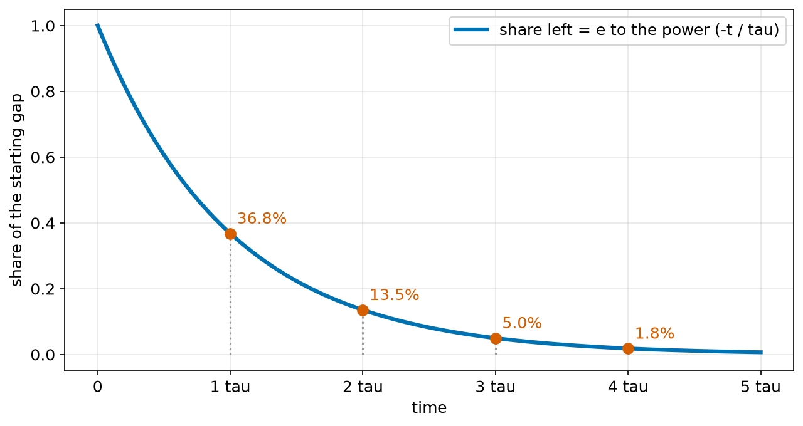
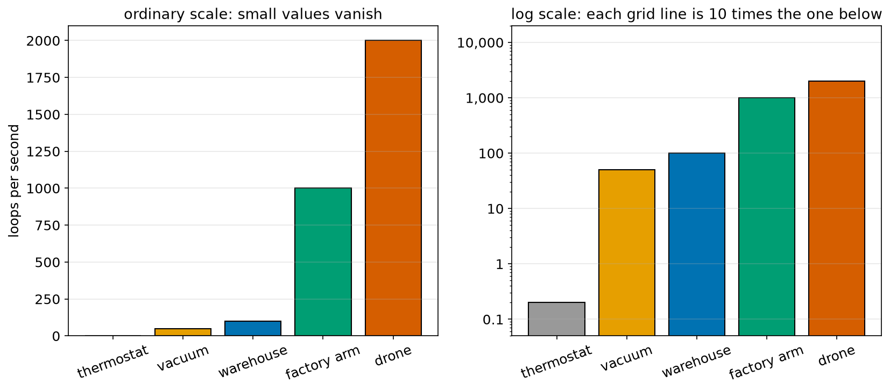
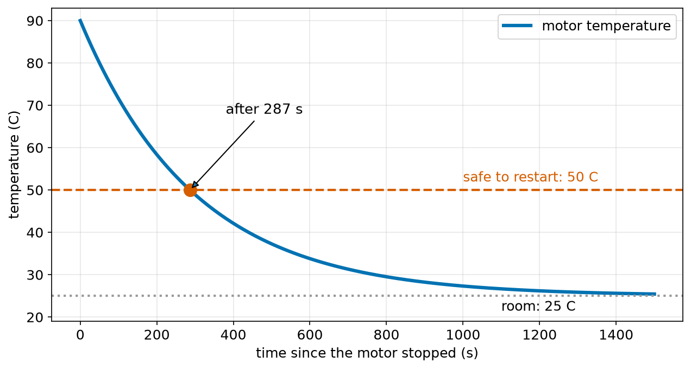
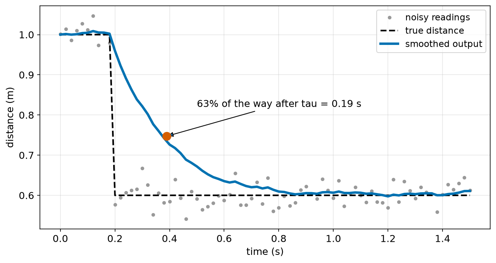

# Chapter 52 — Exponentials and Logarithms (Battery Discharge, Filters)

> **Part 3 · Chapter 52 of 749**
> **You need:** Chapter 38 (powers), Chapter 41 (rearranging) and Chapter 44 (functions and inverse functions).
> **You will make:** a table of doubling and halving, a program that finds the number e, a calculator for how long a hot motor must rest, and a smoothing filter for a noisy sensor, with its time constant.

---

## What you will learn

- The difference between growing by **adding** and growing by **multiplying**.
- What an **exponential** function is, for growth and for decay.
- Where the special number **e** comes from.
- What a **time constant** is, and the 63% rule.
- What a **logarithm** is: the function that undoes a power.
- The rules of logarithms, and how they solve "how long until …?" questions.
- How to read a **log scale**, as Chapter 2 promised.
- How a simple smoothing filter works, and why it behaves exponentially.

---

## New words in this chapter

| Word | Simple meaning |
|---|---|
| **exponential growth** | Growing by the same factor each step, such as doubling. |
| **exponential decay** | Shrinking by the same factor each step, such as halving. |
| **growth factor** | The number we multiply by each step. |
| **doubling time** / **half-life** | How long it takes to double / to halve. |
| **e** | A special number, about 2.71828, that appears in all smooth growth and decay. |
| **time constant (τ)** | The time for a decay to cover 63% of the way to its final value. |
| **logarithm** | The power you need: log₁₀ 1000 = 3, because 10³ = 1000. |
| **natural logarithm (ln)** | The logarithm with base e. |
| **log scale** | An axis on which each step multiplies by the same factor. |
| **decibel (dB)** | A log way of comparing two sizes, used for sound and signals. |
| **exponential moving average** | A filter that moves a fixed fraction of the way towards each new reading. |

---

## 52.1 Adding against multiplying

Two robots start with a battery reading of 1 unit and grow their savings in two different ways.

- Robot A **adds 10** every step.
- Robot B **doubles** every step.



*Figure 52.1 — At first, adding wins. Then multiplying wins by far.*

**How to read this picture:** Across the bottom is the step. The green dashed line adds 10 each step: a straight line (Chapter 43). The blue line doubles each step. Up to step 6 the green line is higher. After step 10, the blue line is ten times higher.

📖 **New word: exponential growth** — growing by the same **factor** each step. The number we multiply by is the **growth factor**.

```
value after n steps = start × factorⁿ
```

This is a power (Chapter 38), but now the **step number is in the exponent**. That is where the name "exponential" comes from.

📖 **New word: exponential decay** — shrinking by the same factor each step, with a factor below 1.

```
halving:  1, 0.5, 0.25, 0.125, …  = 0.5ⁿ
```

🔢 **Maths.** Something grows by 5% each step. Its factor is 1.05. After 10 steps: 1.05¹⁰ = 1.629, so it has grown by 62.9%, not 50%. Each step's 5% is taken of a bigger amount.

📖 **New word: doubling time** — how long it takes to double. 📖 **New word: half-life** — how long it takes to halve.

🤖 **Robot link.** Exponential decay is everywhere in robots: a hot motor cooling (Application 1), a filter forgetting old readings (Application 2), a capacitor discharging (Chapter 84), a ball's bounces getting smaller, and a battery slowly losing capacity as it ages (Application 3).

---

## 52.2 The number e

Here is a puzzle about growth. Something grows by 100% in one year. If that happens all at once, it doubles: ×2.

What if it grows 50% twice in the year? (1.5)² = 2.25. A little more.

What if it grows by 1/12 every month? (1 + 1/12)¹² = 2.613.

What if it grows in n tiny pieces? (1 + 1/n)ⁿ. Does it grow without end?



*Figure 52.2 — More and smaller steps get closer and closer to one number.*

**How to read this picture:** Across the bottom is the number of pieces, on a log scale (section 52.6). Up the side is the total growth. It rises quickly at first, then levels off, closer and closer to the dashed line at 2.71828.

📖 **New word: e** — the number that (1 + 1/n)ⁿ gets closer to as n grows: e = 2.718281828…. Like π, its digits never end.

e is the growth factor for change that happens **smoothly**, all the time, instead of in steps. That is how nature behaves: a motor does not cool in jumps, it cools a little every instant. So formulas for smooth growth and decay use e.

```
smooth growth:  x(t) = x₀ × e^(kt)
smooth decay:   x(t) = x₀ × e^(−t/τ)
```

In Python, e is `math.e`, and e to the power x is `math.exp(x)`.

⚠️ **Careful.** This e has nothing to do with the e in `3e8` (Chapter 38), which means "× 10 to the power".

---

## 52.3 The time constant and the 63% rule

📖 **New word: time constant** — written τ (the Greek letter tau). It sets how fast a smooth decay happens.

```
share of the gap still left = e^(−t/τ)
```



*Figure 52.3 — Each time constant leaves 36.8% of what was left before.*

**How to read this picture:** Across the bottom is time, in steps of τ. Up the side is the share of the gap that is still left. After one τ, 36.8% is left: 63.2% of the change has happened. After 2τ, 13.5% is left. After 3τ, 5%. After 5τ, less than 1%.

| Time | Share left | Share done |
|---|---|---|
| 1 τ | 36.8% | 63.2% |
| 2 τ | 13.5% | 86.5% |
| 3 τ | 5.0% | 95.0% |
| 5 τ | 0.7% | 99.3% |

🧠 **Remember:** after one time constant, 63% of the change has happened. After about 5 time constants, it is practically finished. Engineers use this rule every day.

Notice that an exponential decay **never quite** reaches the end. Each τ only removes 63% of what is left. That is why we say "practically finished".

Many things approach a final value this way, not only zero. A motor cools towards room temperature:

```
T(t) = T_room + (T_start − T_room) × e^(−t/τ)
```

In words: the gap between the motor and the room shrinks exponentially.

---

## 52.4 Logarithms: undoing a power

"10 to which power is 1000?" The answer is 3. A logarithm is the function that answers this kind of question.

📖 **New word: logarithm** —

```
log_b(x) = the power you need to raise b to, to get x

log₁₀(1000) = 3     because 10³ = 1000
log₂(256)   = 8     because 2⁸ = 256       (8 bits make 256 patterns, Chapter 38)
log₂(1024)  = 10
```

b is called the **base**. The logarithm is the **inverse function** of the power (Chapter 44): it undoes it.

📖 **New word: natural logarithm** — the logarithm with base e, written ln. ln(e) = 1. ln(1) = 0.

| Python | Meaning |
|---|---|
| `math.log10(x)` | base 10 |
| `math.log2(x)` | base 2 |
| `math.log(x)` | base e (ln) |
| `math.log(x, b)` | any base b |

### The rules of logarithms

They come straight from the rules of powers in Chapter 38. Multiplying powers adds the exponents, so:

```
log(a × b) = log a + log b
log(a / b) = log a − log b
log(aⁿ)    = n × log a
```

The last rule is the one we use most. It brings an exponent down so that we can solve for it.

⚠️ **Careful.** log(a + b) is **not** log a + log b. There is no simple rule for a sum, just as with √ in Chapter 38.

⚠️ **Careful.** The log of 0 or of a negative number does not exist. `math.log(0)` gives a `ValueError`.

### Solving "how many steps?"

🔢 **Maths.** Something grows by 5% each step. After how many steps has it doubled?

```
1.05ⁿ = 2
ln(1.05ⁿ) = ln 2              take ln of both sides
n × ln 1.05 = ln 2            bring the exponent down
n = ln 2 / ln 1.05 = 0.6931 / 0.04879 = 14.21 steps
```

🔢 **Maths.** A motor cools from 90 °C towards a 25 °C room with τ = 300 s. When is it at 50 °C?

```
50 = 25 + 65 × e^(−t/300)
25 = 65 × e^(−t/300)            subtract 25
25/65 = e^(−t/300)              divide by 65
ln(25/65) = −t/300              take ln of both sides (ln undoes e^)
t = 300 × ln(65/25) = 300 × 0.9555 = 286.7 s
```

A general rule comes out of this: the time to shrink a gap from G₀ to G is τ × ln(G₀/G).

---

## 52.5 The log scale

Chapter 2 drew a picture of how often robots run their loops, with a strange axis. Now we can explain it.

📖 **New word: log scale** — an axis on which each equal step **multiplies** by the same factor, instead of adding the same amount.



*Figure 52.4 — The same five numbers on two kinds of axis.*

**How to read this picture:** Both charts show loops per second for five robots, from 0.2 to 2000. On the left, an ordinary axis: the thermostat's bar is too small to see, and the vacuum and warehouse robots look almost the same. On the right, a log scale: each grid line is 10 times the one below. Every bar is now easy to read, and equal gaps mean equal ratios.

A log scale really plots log₁₀ of each value. 1 sits at 0, 10 at 1, 100 at 2, and so on. Halfway between the grid lines for 10 and 100 is not 55, but 10^1.5 = 31.6.

Use a log scale when values cover many powers of 10, or when you care about **ratios** ("twice as fast") rather than differences. Bode plots for control (Chapter 244) use log scales on both axes.

### Decibels

📖 **New word: decibel (dB)** — a log way of comparing two sizes:

```
for power:      dB = 10 × log₁₀(P₂ / P₁)
for amplitude:  dB = 20 × log₁₀(A₂ / A₁)
```

Halving a signal's amplitude is 20 × log₁₀(0.5) = −6.0 dB. Sound levels, radio signals and control systems all use decibels.

---

## Code

File `code/ch052/growth_and_decay.py`:

```python
# growth_and_decay.py - multiply by the same factor every step, and how logs undo it
import math

print("step  doubling  halving")
value_up = 1.0
value_down = 1.0
for step in range(0, 9):
    print(f"{step:4d} {value_up:9.0f} {value_down:9.4f}")
    value_up = value_up * 2
    value_down = value_down * 0.5

print()
print("formula 2 ** 8   =", 2 ** 8, "    log2(256) =", math.log2(256))
print("formula 10 ** 3  =", 10 ** 3, "   log10(1000) =", math.log10(1000))
print("e                =", math.e, "   ln(e) =", math.log(math.e))

rate = 0.05
doubling_steps = math.log(2) / math.log(1 + rate)
print(f"growing 5% per step doubles after {doubling_steps:.2f} steps")
```

| Line | Code | What it does (simple English) |
|---|---|---|
| 1 | `# growth_and_decay.py …` | A comment. |
| 2 | `import math` | For the logarithms and e. |
| 3 | (blank) | Spacing. |
| 4 | `print("step  doubling  halving")` | The heading. |
| 5 | `value_up = 1.0` | Starts at 1. |
| 6 | `value_down = 1.0` | Also starts at 1. |
| 7 | `for step in range(0, 9):` | Steps 0 to 8. |
| 8 | `print(f"…")` | Prints this step. |
| 9 | `value_up = value_up * 2` | Multiply by 2: growth. |
| 10 | `value_down = value_down * 0.5` | Multiply by 0.5: decay. |
| 11 | (blank) | Spacing. |
| 12 | `print()` | An empty line. |
| 13 | `print("formula 2 ** 8 …", math.log2(256))` | The power and its inverse. |
| 14 | `print("formula 10 ** 3 …", math.log10(1000))` | Base 10. |
| 15 | `print("e …", math.log(math.e))` | `math.log` with one input is ln. |
| 16 | (blank) | Spacing. |
| 17 | `rate = 0.05` | 5% per step. |
| 18 | `doubling_steps = math.log(2) / math.log(1 + rate)` | n = ln 2 / ln 1.05, from section 52.4. |
| 19 | `print(f"…")` | Shows it. |

Output:

```
step  doubling  halving
   0         1    1.0000
   1         2    0.5000
   2         4    0.2500
   3         8    0.1250
   4        16    0.0625
   5        32    0.0312
   6        64    0.0156
   7       128    0.0078
   8       256    0.0039

formula 2 ** 8   = 256     log2(256) = 8.0
formula 10 ** 3  = 1000    log10(1000) = 3.0
e                = 2.718281828459045    ln(e) = 1.0
growing 5% per step doubles after 14.21 steps
```

File `code/ch052/find_e.py`:

```python
# find_e.py - grow by 100% in total, but in smaller and smaller pieces
import math

print("        pieces n      (1 + 1/n) ** n")
for n in [1, 2, 4, 12, 365, 10_000, 1_000_000]:
    print(f"{n:15,d}   {(1 + 1 / n) ** n:.6f}")
print(f"{'math.e':>15}   {math.e:.6f}")
```

| Line | Code | What it does (simple English) |
|---|---|---|
| 1 | `# find_e.py …` | A comment. |
| 2 | `import math` | For `math.e`. |
| 3 | (blank) | Spacing. |
| 4 | `print(…)` | The heading. |
| 5 | `for n in […]:` | More and more pieces. |
| 6 | `print(f"{n:15,d}   {(1 + 1 / n) ** n:.6f}")` | `,d` puts commas in big whole numbers. Then the growth from n pieces. |
| 7 | `print(f"{'math.e':>15} …")` | Python's value, for comparison. |

Output:

```
        pieces n      (1 + 1/n) ** n
              1   2.000000
              2   2.250000
              4   2.441406
             12   2.613035
            365   2.714567
         10,000   2.718146
      1,000,000   2.718280
         math.e   2.718282
```

Growth in a million tiny steps is almost exactly e. Growth that never stops, in endlessly small steps, is exactly e.

---

## Small examples

**Example 1.** 3 × 1.5⁴ = 15.19.

**Example 2.** 1000 halved 5 times is 1000 × 0.5⁵ = 31.25.

**Example 3.** log₁₀(0.01) = −2, because 10⁻² = 0.01.

**Example 4.** ln(e³) = 3.

**Example 5.** log(8) = log(2³) = 3 log 2, in any base.

**Example 6.** e⁰ = 1, so every decay starts at 100% of the gap.

**Example 7.** A capacitor charging through a resistor has τ = R × C. With R = 10 kΩ and C = 10 μF, τ = 10,000 × 0.000010 = 0.1 s (Chapter 84).

**Example 8.** Halving a sound's amplitude lowers it by 6 dB.

---

## 🏭 Real robot applications

### Application 1 (worked in full) — 🏭 When may a hot motor run again?

**1. The real problem.** A factory arm works hard and its joint motor reaches 90 °C. The safety rule says it must cool to 50 °C before it starts again. The room is at 25 °C. How long must it rest?

**2. Why this theory.** A hot object cools so that the **gap** to the room shrinks by the same share every second. That is exponential decay, with a time constant τ. To find the time, we need a logarithm.

**3. The numbers.** Room 25 °C, start 90 °C, limit 50 °C. τ = 300 s, found by a test: in one test, the motor's temperature gap fell to 36.8% after 300 s.

**4. The maths.** From section 52.4:

```
t = τ × ln(gap at start / gap at the end)
  = 300 × ln((90 − 25) / (50 − 25))
  = 300 × ln(65 / 25)
  = 300 × ln(2.6)
  = 300 × 0.9555
  = 286.7 s, about 4.8 minutes
```

**5. The code.** File `code/ch052/motor_cooling.py`:

```python
# motor_cooling.py - how long must a hot motor rest before it may run again?
import math

ROOM_C = 25.0
TAU_S = 300.0            # time constant of this motor, from a test
START_C = 90.0
SAFE_C = 50.0


def temperature(t_s):
    return ROOM_C + (START_C - ROOM_C) * math.exp(-t_s / TAU_S)


wait_s = TAU_S * math.log((START_C - ROOM_C) / (SAFE_C - ROOM_C))
print(f"wait {wait_s:.1f} s ({wait_s / 60:.1f} min) to cool from {START_C} to {SAFE_C} C")

print("  time (s)   temperature (C)   share of the gap still left")
for t in [0, 150, 300, 600, 900, 1500]:
    left = (temperature(t) - ROOM_C) / (START_C - ROOM_C)
    print(f"{t:10d} {temperature(t):17.1f} {left:20.1%}")
```

| Line | Code | What it does (simple English) |
|---|---|---|
| 1 | `# motor_cooling.py …` | A comment. |
| 2 | `import math` | For `exp` and `log`. |
| 3 | (blank) | Spacing. |
| 4–7 | `ROOM_C = 25.0` and so on | The numbers, with units in the names. |
| 8–9 | (blank) | Spacing. |
| 10 | `def temperature(t_s):` | The cooling formula as a function. |
| 11 | `return ROOM_C + (START_C - ROOM_C) * math.exp(-t_s / TAU_S)` | Room temperature plus the shrinking gap. |
| 12–13 | (blank) | Spacing. |
| 14 | `wait_s = TAU_S * math.log(…)` | τ × ln(start gap / end gap). |
| 15 | `print(f"wait …")` | In seconds and minutes. |
| 16 | (blank) | Spacing. |
| 17 | `print(…)` | The heading of the table. |
| 18 | `for t in […]:` | Some times, including τ and 5τ. |
| 19 | `left = (temperature(t) - ROOM_C) / (START_C - ROOM_C)` | The share of the gap left. |
| 20 | `print(f"…")` | `.1%` prints a percentage. |

Output:

```
wait 286.7 s (4.8 min) to cool from 90.0 to 50.0 C
  time (s)   temperature (C)   share of the gap still left
         0              90.0               100.0%
       150              64.4                60.7%
       300              48.9                36.8%
       600              33.8                13.5%
       900              28.2                 5.0%
      1500              25.4                 0.7%
```



*Figure 52.5 — The temperature falls quickly at first, then more and more slowly.*

**How to read this picture:** The blue curve is the motor's temperature. It falls fast at first, when the gap to the room is big. The red dashed line is the safe limit, reached at the red dot after 287 s. The grey dotted line is the room temperature, which the curve approaches but never quite reaches.

**6. The result.** The controller can show "ready in 4.8 minutes" instead of guessing, and the share-left column matches the 63% rule exactly: 36.8% left at τ, 13.5% at 2τ. A rule like "wait 2 minutes" would restart the motor at 64 °C, too hot. A rule like "wait 15 minutes" would waste 10 minutes of production every time.

**7. Going further.** Real drives model temperature while the motor is running, too, and reduce the current before the motor overheats (Chapter 223 models a motor in full). The time constant itself is found by fitting the curve to measured temperatures (Chapter 171).

### Application 2 (worked in full) — 🤖 Smoothing a noisy distance sensor

**1. The real problem.** Rover's distance sensor is noisy: the reading jumps by a few centimetres from one reading to the next, even when nothing moves. We want a smooth value, but it must still follow real changes, such as a person stepping in front of Rover.

📖 **New word: exponential moving average** — a filter that moves a fixed fraction α (alpha) of the way from its current value towards each new reading:

```
smooth = smooth + α × (reading − smooth)
```

**2. Why this theory.** After a sudden change, the gap between the smooth value and the new truth shrinks by the factor (1 − α) at every reading. That is exponential decay, so the filter has a time constant.

**3. The numbers.** 50 readings per second (dt = 0.02 s). α = 0.1. Noise of about 3 cm. At t = 0.2 s, an object appears, and the true distance jumps from 1.00 m to 0.60 m.

**4. The maths.**

```
After n readings, the share of the gap left is (1 − α)ⁿ = 0.9ⁿ.
Set this equal to e^(−t/τ) with t = n × dt:
  n × ln(0.9) = −n × dt / τ
  τ = −dt / ln(1 − α) = −0.02 / ln(0.9) = −0.02 / −0.10536 = 0.190 s
```

For small α, ln(1 − α) is close to −α, so τ ≈ dt/α = 0.2 s: a handy shortcut. So after about 0.19 s, the smooth value should have moved 63% of the way from 1.00 to 0.60, to about 0.75 m.

**5. The code.** File `code/ch052/ema_filter.py`:

```python
# ema_filter.py - an exponential moving average smooths a noisy distance sensor
import math
import random

random.seed(4)
DT = 0.02                  # 50 readings per second
ALPHA = 0.1                # how much of each new reading to trust

tau = -DT / math.log(1 - ALPHA)
print(f"alpha {ALPHA}: time constant {tau:.3f} s")

smooth = 1.00
print(" time   true   reading   smoothed")
for i in range(0, 51):
    t = i * DT
    true = 1.00 if t < 0.2 else 0.60          # an object steps in at t = 0.2 s
    reading = true + random.gauss(0, 0.03)
    smooth = smooth + ALPHA * (reading - smooth)
    if i % 5 == 0:
        print(f"{t:5.2f} {true:6.2f} {reading:9.3f} {smooth:10.3f}")

print(f"after one time constant the filter should have moved {1 - math.exp(-1):.1%} of the way")
```

| Line | Code | What it does (simple English) |
|---|---|---|
| 1 | `# ema_filter.py …` | A comment. |
| 2 | `import math` | For `log` and `exp`. |
| 3 | `import random` | For the pretend noise. |
| 4 | `random.seed(4)` | The same noise on every run (Chapter 31). |
| 5 | `DT = 0.02` | Time between readings. |
| 6 | `ALPHA = 0.1` | The filter's setting. |
| 7 | (blank) | Spacing. |
| 8 | `tau = -DT / math.log(1 - ALPHA)` | The time constant, from section 4 above. |
| 9 | `print(f"alpha …")` | Shows it. |
| 10 | (blank) | Spacing. |
| 11 | `smooth = 1.00` | The filter starts at the first true value. |
| 12 | `print(…)` | The heading. |
| 13 | `for i in range(0, 51):` | 51 readings: one second. |
| 14 | `t = i * DT` | Time of this reading. |
| 15 | `true = 1.00 if t < 0.2 else 0.60` | The object steps in at 0.2 s. |
| 16 | `reading = true + random.gauss(0, 0.03)` | The sensor adds noise of about 3 cm (Chapter 31). |
| 17 | `smooth = smooth + ALPHA * (reading - smooth)` | The filter: move 10% of the way to the new reading. |
| 18 | `if i % 5 == 0:` | Print only every fifth reading. |
| 19 | `print(f"…")` | Shows the truth, the reading and the smooth value. |
| 20 | (blank) | Spacing. |
| 21 | `print(f"after one time constant …")` | 1 − e⁻¹ = 63.2%. |

Output:

```
alpha 0.1: time constant 0.190 s
 time   true   reading   smoothed
 0.00   1.00     1.001      1.000
 0.10   1.00     1.012      1.005
 0.20   0.60     0.576      0.960
 0.30   0.60     0.667      0.822
 0.40   0.60     0.585      0.726
 0.50   0.60     0.591      0.672
 0.60   0.60     0.587      0.635
 0.70   0.60     0.593      0.620
 0.80   0.60     0.569      0.609
 0.90   0.60     0.622      0.605
 1.00   0.60     0.593      0.606
after one time constant the filter should have moved 63.2% of the way
```



*Figure 52.6 — The filter removes most of the noise, but reacts later.*

**How to read this picture:** The grey dots are the noisy readings. The black dashed line is the true distance, which drops at 0.2 s. The blue line is the filter's output: smooth, but it takes time to follow the drop. The red dot marks one time constant after the drop, where the output has moved 63% of the way.

**6. The result.** The smooth value wobbles by about 1 cm instead of 3 cm. But it needs about 5τ ≈ 1 s to fully catch up with the real change. This is the price of every smoothing filter: **less noise means a slower reaction**. A bigger α reacts faster but smooths less. For a robot about to hit something, a slow reaction can be dangerous, so the filter must be chosen with the robot's speed in mind (Lab 52.3).

**7. Going further.** This filter, also called a low-pass filter, is one line of code and is used everywhere: in sensors, controllers and battery gauges. Chapter 412 studies it fully, and the Kalman filter (Chapter 416) chooses α automatically, from how noisy the sensor is.

### Application 3 — 🚚 A delivery fleet's ageing batteries

A simple model says that a lithium battery loses a fixed share of its capacity with each full charge cycle, for example 0.05%. After n cycles, the capacity is 0.9995ⁿ of new. After 500 cycles: 0.9995⁵⁰⁰ = 0.779, or 77.9%. When does it fall to 80%, a common point to replace it? n = ln(0.8)/ln(0.9995) = 446 cycles. A fleet manager with 50 robots charging once a day can plan to replace batteries after about 15 months. Real batteries age less evenly than this, and also lose capacity with time and heat (Chapter 89).

### Application 4 — 🔌 Charging a capacitor

When a capacitor charges through a resistor, its voltage rises towards the supply voltage with τ = RC: 63% after RC, and practically full after 5RC. This is how a microcontroller's reset circuit waits for the power to settle, and how simple circuits smooth noisy signals. With 10 kΩ and 10 μF, τ = 0.1 s. Chapter 84 builds this circuit.

### Application 5 — 🏠 A home robot listens

A home robot's microphone measures sound level in decibels, because the ear works on a log scale: 10 times the sound power sounds only "about twice as loud". If a person speaks from twice as far away, the amplitude at the microphone halves, which is a drop of 6 dB. A robot that hears 60 dB at 1 m can expect about 54 dB at 2 m and 48 dB at 4 m. The robot uses these steps to guess whether the voice is near or far.

---

## 🔧 Hands-on lab

### Lab 52.1 — Watch a hot drink cool (hardware)

You need a cup of hot water, a kitchen thermometer, and a clock.

1. Write down the room temperature.
2. Measure the water's temperature every 2 minutes for 30 minutes.
3. For each reading, compute the gap to the room temperature, and the share of the starting gap that is left.
4. Find the time when about 36.8% of the gap is left: that is τ for your cup.
5. Plot your readings and the formula `room + gap0 * math.exp(-t / tau)` together.

**What you should see:** The temperature falls fast, then slowly. The formula with your τ follows your readings closely. A typical cup has τ of 15 to 40 minutes.

| If it does not work | Likely cause | Fix |
|---|---|---|
| The curve is not smooth | The thermometer was moved, or the water was stirred | Leave it in the same place |
| The formula drops too fast | τ too small | Find τ again, from the 36.8% point |
| `ValueError` from `math.log` | A gap became zero or negative | Stop measuring before the water reaches room temperature |

**Challenge:** Put a lid on the cup and measure again. How does τ change, and why?

### Lab 52.2 — Count your own bits (simulation)

1. Use `math.log2` to find how many bits are needed for 100, 1000 and 1,000,000 different values.
2. Round each answer up.
3. Compare with `bits_needed` from Chapter 38.

**What you should see:** log₂ gives 6.64, 9.97 and 19.93. Rounded up: 7, 10 and 20 bits, the same as `bits_needed`.

| If it does not work | Likely cause | Fix |
|---|---|---|
| 7 for 128 values | `math.ceil(math.log2(128))` is 7: exactly 7 bits | Correct: 2⁷ = 128 |

**Challenge:** Explain why `math.ceil(math.log2(n))` can give a wrong answer for some very large n (Chapter 54).

### Lab 52.3 — Tune the filter (simulation)

Copy `ema_filter.py`.

1. Try `ALPHA = 0.3`, then `ALPHA = 0.03`.
2. For each, write down τ and how wobbly the output is after 0.8 s.
3. If Rover drives at 0.5 m/s, how far does it travel during 3τ, before the filter has nearly caught up?

**What you should see:** α = 0.3 gives τ = 0.056 s, fast but still a little noisy. α = 0.03 gives τ = 0.657 s, very smooth but slow: at 1.0 s it is still well above 0.6. At 0.5 m/s, 3τ is about 0.29 m for α = 0.1, and 0.99 m for α = 0.03: almost a whole metre.

| If it does not work | Likely cause | Fix |
|---|---|---|
| The output never changes | α = 0 | α must be between 0 and 1 |
| `ValueError` | α = 1 makes log(0) | α = 1 means "no filter": τ is 0 |

**Challenge:** Use the exact τ formula to choose α for a time constant of exactly 0.1 s at 50 Hz.

---

## Common mistakes

⚠️ **Treating growth by a percentage as adding.** 5% for 10 steps is 62.9%, not 50%.

⚠️ **Thinking an exponential decay reaches zero.** It gets closer and closer. Use "5τ" for practically done.

⚠️ **Using log for a sum.** log(a + b) is not log a + log b.

⚠️ **Taking the log of zero or a negative number.**

⚠️ **Mixing up `math.log` (ln) and `math.log10`.**

⚠️ **Mixing up the two e's.** `math.e` is 2.718. `3e8` is 3 × 10⁸.

⚠️ **Reading a log scale as if it were ordinary.** Halfway between 10 and 100 is 31.6, not 55.

⚠️ **Smoothing too much.** A heavily smoothed sensor reacts too late.

---

## Practice

🏋️ **1.** Work out 3 × 1.5⁴.

🏋️ **2.** 1000 is halved 5 times. What is left?

🏋️ **3.** Work out log₁₀(10,000), log₂(1024) and ln(1).

🏋️ **4.** Solve 2ˣ = 50.

🏋️ **5.** Something grows by 7% each year. How long until it doubles?

🏋️ **6.** A decay has τ = 2 s. What share of the gap is left after 2 s, and after 6 s?

🏋️ **7.** A motor at 80 °C cools in a 20 °C room with τ = 400 s. When is it at 40 °C?

🏋️ **8.** A filter at 100 Hz has α = 0.2. What is its time constant?

🏋️ **9.** A battery loses 0.05% of its capacity per cycle. After how many cycles is it at 80%?

🏋️ **10.** On a log scale, what number is exactly halfway between the grid lines for 10 and 100?

🏋️ **11.** Write `time_to_reach(start, final, target, tau)` that returns how long an exponential approach from `start` towards `final` takes to reach `target`, or `None` if it never will. Test it with the motor of Application 1.

---

## Answers

**1.** 15.19.

**2.** 1000 × 0.5⁵ = 31.25.

**3.** 4, 10, 0.

**4.** x = ln 50 / ln 2 = 5.644.

**5.** ln 2 / ln 1.07 = 10.24 years.

**6.** After 2 s (one τ): 36.8%. After 6 s (3τ): 5.0%.

**7.** t = 400 × ln(60/20) = 400 × 1.0986 = 439.4 s.

**8.** τ = −0.01 / ln(0.8) = 0.0448 s.

**9.** n = ln(0.8) / ln(0.9995) = 446 cycles.

**10.** 10^1.5 = 31.6.

**11.**

```python
import math

def time_to_reach(start, final, target, tau):
    gap_start = start - final
    gap_end = target - final
    if gap_start == 0 or gap_end / gap_start <= 0 or abs(gap_end) > abs(gap_start):
        return None
    return tau * math.log(gap_start / gap_end)

print(round(time_to_reach(90, 25, 50, 300), 1))    # 286.7
print(time_to_reach(90, 25, 20, 300))              # None: it never goes below the room
```

The approach never passes the final value, so a target on the other side of it, or further away than the start, is never reached.

---

## Summary

🧠 Adding the same amount makes a straight line. Multiplying by the same factor makes an exponential.

🧠 e ≈ 2.718 is the growth factor for smooth, continuous change.

🧠 Smooth decay: gap left = e^(−t/τ). After τ, 63% of the change is done. After 5τ, practically all of it.

🧠 A logarithm undoes a power: log₁₀ 1000 = 3. ln is the log with base e.

🧠 log(aⁿ) = n log a brings an exponent down, which solves "how long until …?".

🧠 On a log scale, each grid step multiplies by the same factor.

🧠 An exponential moving average is a one-line filter with τ = −dt/ln(1 − α). Less noise always means a slower reaction.

---

## Next chapter

In Chapter 53 we learn to add up long lists of numbers neatly, with **sequences, sums and the Σ (sigma) sign**. It is the notation used in almost every robotics paper, and it is exactly what a Python `for` loop does.
