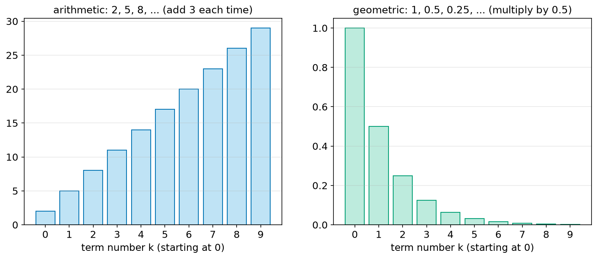
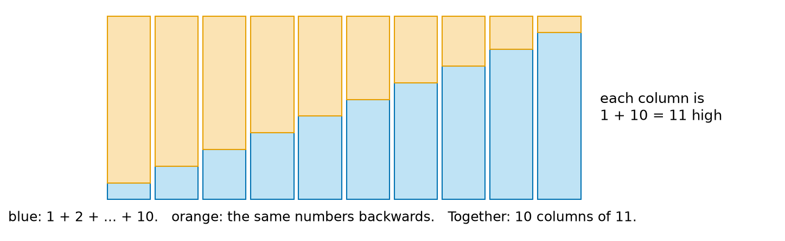
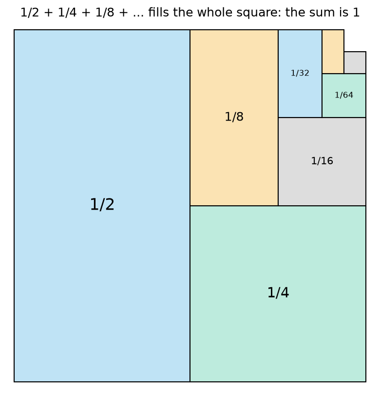
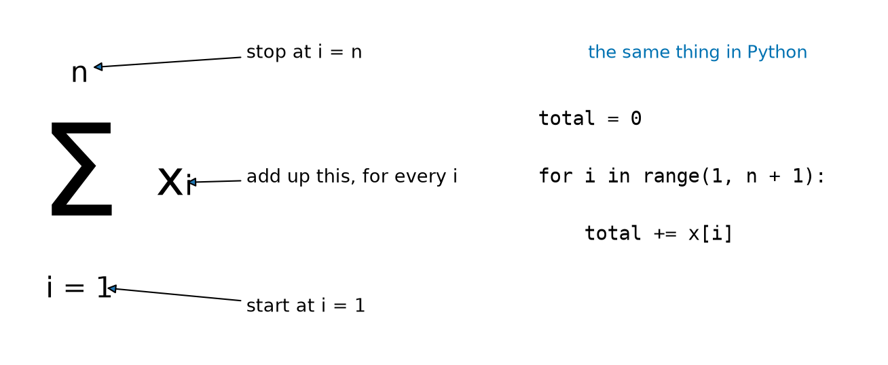
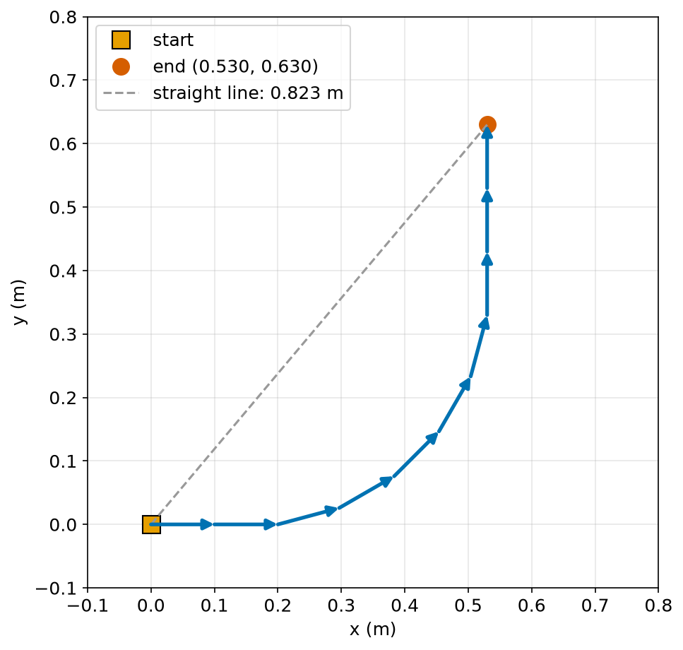
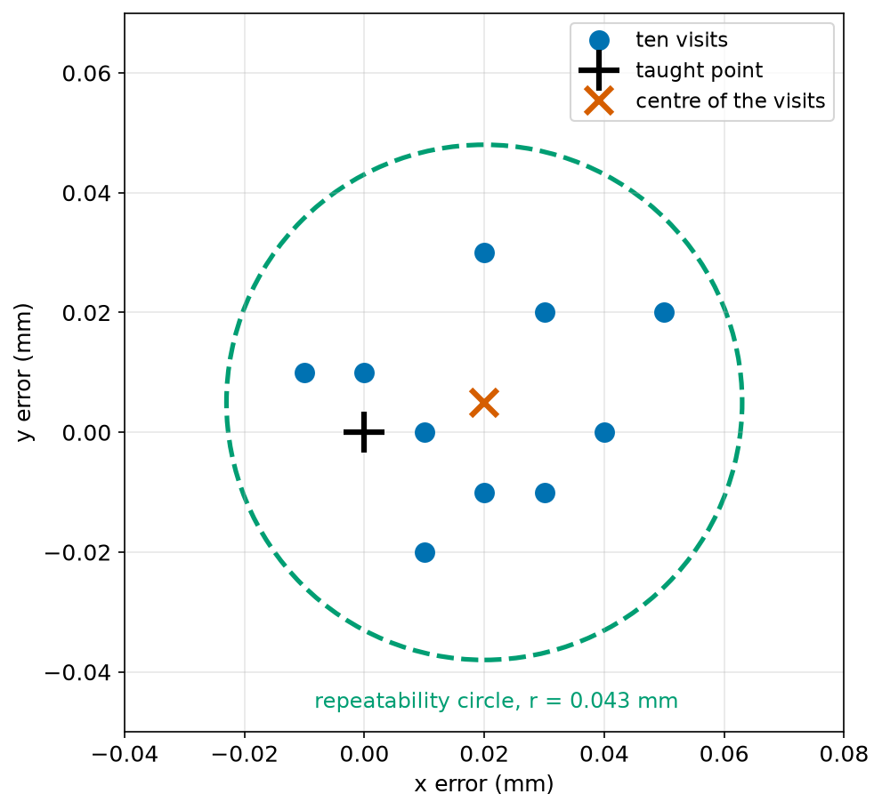
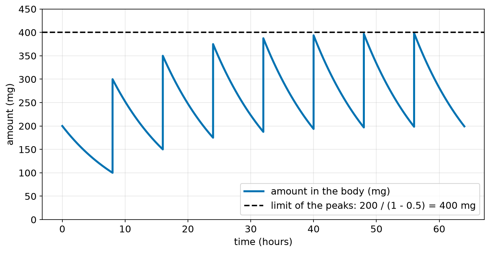

# Chapter 53 — Sequences, Sums and Sigma (Σ) Notation

> **Part 3 · Chapter 53 of 749**
> **You need:** Chapter 20 (`for` loops), Chapter 21 (lists), Chapter 49 (sin and cos) and Chapter 52 (exponentials).
> **You will make:** a program that checks sum formulas against loops, an error report with the mean and the RMS, Rover's position as a sum of small steps, and a repeatability test for a factory arm.

---

## What you will learn

- What a **sequence** is, and the two most common kinds.
- How to find any term of an **arithmetic** or a **geometric** sequence.
- How to add them up quickly, with formulas.
- Why some sums that never end still have a finite total.
- How to read and write the **Σ (sigma)** sign, and why it is just a `for` loop.
- How to compute a mean and an RMS error with Σ.
- How a robot's position is the sum of many small steps.

---

## New words in this chapter

| Word | Simple meaning |
|---|---|
| **sequence** | A list of numbers in a fixed order. |
| **term** | One number in a sequence. |
| **arithmetic sequence** | Each term is the last one plus the same number. |
| **common difference (d)** | The number added each time. |
| **geometric sequence** | Each term is the last one times the same number. |
| **common ratio (r)** | The number multiplied each time. |
| **series** | The sum of the terms of a sequence. |
| **converge** | Get closer and closer to one fixed value. |
| **Σ (sigma)** | The Greek capital S, meaning "add up". |
| **index** | The counting letter in a sum, such as i. |
| **RMS** | Root mean square: the square root of the mean of the squares. |
| **recurrence** | A rule that gives each term from the one before it. |

---

## 53.1 Sequences

📖 **New word: sequence** — a list of numbers in a fixed order. Each number is a **term**.

You have met many already: the readings from a sensor, one per loop; the positions of Rover after each step; the guesses in Heron's method (Chapter 38).

Two kinds of sequence are especially simple, and especially common.



*Figure 53.1 — One grows by adding, the other shrinks by multiplying.*

**How to read this picture:** Each bar is one term. On the left, every bar is 3 taller than the one before: an arithmetic sequence. On the right, every bar is half the one before: a geometric sequence.

### Arithmetic sequences

📖 **New word: arithmetic sequence** — each term is the last one plus the same number, the **common difference** d.

```
2, 5, 8, 11, 14, …      (start a = 2, d = 3)
```

If we count the terms from k = 0, the term number k is:

```
term_k = a + k × d
```

🔢 **Maths.** The term number 9 (the tenth term): 2 + 9 × 3 = 29.

This is a straight line (Chapter 43), sampled at whole numbers. Rover driving at a steady speed and recording its position every loop makes an arithmetic sequence.

### Geometric sequences

📖 **New word: geometric sequence** — each term is the last one times the same number, the **common ratio** r.

```
1, 0.5, 0.25, 0.125, …      (start a = 1, r = 0.5)
```

```
term_k = a × r^k
```

This is the exponential of Chapter 52, sampled at whole steps.

### Rules that make a sequence

📖 **New word: recurrence** — a rule that gives each term from the one before it.

```
arithmetic:   x_next = x + d
geometric:    x_next = x × r
filter:       smooth_next = smooth + α × (reading − smooth)     (Chapter 52)
```

Almost every robot program is a recurrence: in each loop, the new state is made from the old state and the new readings.

---

## 53.2 Adding up an arithmetic sequence

📖 **New word: series** — the sum of the terms of a sequence.

A famous story says that when the mathematician Gauss was a child, his teacher asked the class to add all the numbers from 1 to 100. Gauss answered in seconds.



*Figure 53.2 — Write the sum forwards and backwards, and pair them up.*

**How to read this picture:** The blue bars are 1, 2, 3, … 10. The orange bars, on top, are the same numbers in the opposite order: 10, 9, 8, … 1. Every column adds up to 11. There are 10 columns, so blue plus orange is 110, and the blue part alone is half: 55.

```
1 + 2 + … + n = n(n + 1)/2

For n = 100:  100 × 101 / 2 = 5050
```

The same trick works for any arithmetic sequence: pair the first term with the last.

```
sum = n × (first + last) / 2 = n × (2a + (n − 1)d) / 2
```

🔢 **Maths.** 2 + 5 + 8 + … + 29 (10 terms): 10 × (2 + 29)/2 = 155.

---

## 53.3 Adding up a geometric sequence

There is a trick here too. Call the sum S, and multiply it by r:

```
S     = a + ar + ar² + … + ar^(n−1)
r × S =     ar + ar² + … + ar^(n−1) + ar^n
```

Subtract. Almost everything cancels:

```
S − rS = a − ar^n
S (1 − r) = a (1 − r^n)
S = a (1 − r^n) / (1 − r)
```

🔢 **Maths.** 1 + 0.5 + 0.25 + … (10 terms): 1 × (1 − 0.5¹⁰)/(1 − 0.5) = 1.998.

### A sum that never ends

📖 **New word: converge** — get closer and closer to one fixed value.

What if the terms go on for ever? If r is between −1 and 1, r^n shrinks towards zero, and the formula becomes:

```
S = a / (1 − r)            (only when −1 < r < 1)
```



*Figure 53.3 — An endless sum with a finite total.*

**How to read this picture:** A square of area 1 is cut in half, then the remaining half is cut in half, and so on. The pieces are 1/2, 1/4, 1/8, 1/16 … They never stop, but they never go outside the square. So their total is exactly 1.

1/2 + 1/4 + 1/8 + … = (1/2) / (1 − 1/2) = 1.

🤖 **Robot link.** A simple controller that closes half of the remaining gap each loop moves 50 mm, then 25, then 12.5 … The total distance converges to the whole gap, 100 mm. After 7 loops it is within 1 mm, because 100 × 0.5⁷ = 0.78 mm. Chapter 251 studies such controllers.

⚠️ **Careful.** If r is 1 or more, the terms do not shrink, and the sum grows without limit. The formula a/(1 − r) then gives nonsense.

---

## 53.4 The Σ sign

Writing "x₁ + x₂ + x₃ + … + xₙ" every time is slow. Mathematicians use a short sign.

📖 **New word: Σ (sigma)** — the Greek capital letter S, for "sum". It means "add up".



*Figure 53.4 — The sigma sign, and the same thing in Python.*

**How to read this picture:** The big Σ means "add up". Below it, i = 1 says where the counting starts. Above it, n says where it stops. To its right is what to add for each i. On the right, the same instructions are written as a Python loop.

📖 **New word: index** — the counting letter in a sum, here i. It is like the loop variable in a `for` loop.

```
  n
  Σ  xᵢ   =   x₁ + x₂ + … + xₙ
 i=1
```

In plain text, people write it as `sum(i = 1 to n) of x_i`. In Python:

```python
total = 0
for i in range(1, n + 1):
    total += x[i]
```

or, more simply, `sum(x)` for a whole list.

🔢 **Maths.** Write out Σ from i = 1 to 4 of i²:

```
1² + 2² + 3² + 4² = 1 + 4 + 9 + 16 = 30
```

### Rules of Σ

These come straight from ordinary adding (Chapter 40).

| Rule | Example |
|---|---|
| A constant can come outside | Σ 3xᵢ = 3 Σ xᵢ |
| A sum can be split | Σ (xᵢ + yᵢ) = Σ xᵢ + Σ yᵢ |
| Adding a constant n times | Σ (from 1 to n) of c = n × c |

⚠️ **Careful.** Σ (xᵢ × yᵢ) is **not** (Σ xᵢ) × (Σ yᵢ). Products do not split.

### Useful sums in Σ form

```
mean           = (1/N) Σ xᵢ
mean size      = (1/N) Σ |xᵢ|
RMS            = √( (1/N) Σ xᵢ² )
path length    = Σ dᵢ
```

📖 **New word: RMS** — root mean square: square every value, take the mean, then take the square root. It measures the typical size of values that can be positive or negative, and it punishes big values more than the mean size does.

---

## Code

File `code/ch053/sequences.py`:

```python
# sequences.py - arithmetic and geometric sequences: terms and sums, by loop and by formula
a, d, n = 2, 3, 10              # arithmetic: start 2, add 3 each time, 10 terms
terms = [a + k * d for k in range(n)]
print("arithmetic terms:", terms)
print("  sum by loop   :", sum(terms))
print("  sum by formula:", n * (2 * a + (n - 1) * d) // 2)

a, r, n = 1, 0.5, 10            # geometric: start 1, multiply by 0.5 each time
terms = [a * r ** k for k in range(n)]
print("geometric terms :", [round(t, 4) for t in terms])
print("  sum by loop   :", sum(terms))
print("  sum by formula:", a * (1 - r ** n) / (1 - r))
print("  if it never ended, the sum would be", a / (1 - r))
```

| Line | Code | What it does (simple English) |
|---|---|---|
| 1 | `# sequences.py …` | A comment. |
| 2 | `a, d, n = 2, 3, 10` | Start, common difference, number of terms. |
| 3 | `terms = [a + k * d for k in range(n)]` | Term k = a + k d, for k = 0 to 9. |
| 4 | `print("arithmetic terms:", terms)` | Shows the terms. |
| 5 | `print("  sum by loop   :", sum(terms))` | Python adds them one by one. |
| 6 | `print("  sum by formula:", n * (2 * a + (n - 1) * d) // 2)` | Gauss's formula. `//` keeps a whole number: the top is always even. |
| 7 | (blank) | Spacing. |
| 8 | `a, r, n = 1, 0.5, 10` | Start, common ratio, number of terms. |
| 9 | `terms = [a * r ** k for k in range(n)]` | Term k = a r^k. |
| 10 | `print("geometric terms :", …)` | Rounded, for neat printing. |
| 11 | `print("  sum by loop   :", sum(terms))` | Adds them. |
| 12 | `print("  sum by formula:", a * (1 - r ** n) / (1 - r))` | The geometric sum formula. |
| 13 | `print("  if it never ended …", a / (1 - r))` | The endless sum. |

Output:

```
arithmetic terms: [2, 5, 8, 11, 14, 17, 20, 23, 26, 29]
  sum by loop   : 155
  sum by formula: 155
geometric terms : [1.0, 0.5, 0.25, 0.125, 0.0625, 0.0312, 0.0156, 0.0078, 0.0039, 0.002]
  sum by loop   : 1.998046875
  sum by formula: 1.998046875
  if it never ended, the sum would be 2.0
```

File `code/ch053/sigma.py`:

```python
# sigma.py - the sigma sign is a for loop
import math

n = 100
total = 0
for i in range(1, n + 1):          # sum of i, for i = 1 to 100
    total = total + i
print("sum of i     :", total, "  formula n(n+1)/2       =", n * (n + 1) // 2)

squares = sum(i * i for i in range(1, n + 1))
print("sum of i*i   :", squares, "formula n(n+1)(2n+1)/6 =", n * (n + 1) * (2 * n + 1) // 6)

errors = [0.012, -0.008, 0.015, -0.003, 0.009, -0.011]     # metres
N = len(errors)
mean = sum(errors) / N
mean_abs = sum(abs(e) for e in errors) / N
rms = math.sqrt(sum(e * e for e in errors) / N)
print(f"mean error {mean * 1000:.2f} mm, mean size {mean_abs * 1000:.2f} mm, RMS {rms * 1000:.2f} mm")
```

| Line | Code | What it does (simple English) |
|---|---|---|
| 1 | `# sigma.py …` | A comment. |
| 2 | `import math` | For `sqrt`. |
| 3 | (blank) | Spacing. |
| 4 | `n = 100` | The top of the sum. |
| 5 | `total = 0` | Start the total at zero. |
| 6 | `for i in range(1, n + 1):` | i = 1, 2, … 100. `range` stops **before** its end, so we write n + 1 (Chapter 20). |
| 7 | `total = total + i` | Add this term. |
| 8 | `print(…)` | Compares with Gauss's formula. |
| 9 | (blank) | Spacing. |
| 10 | `squares = sum(i * i for i in range(1, n + 1))` | Σ i², in one line. |
| 11 | `print(…)` | Compares with its formula. |
| 12 | (blank) | Spacing. |
| 13 | `errors = […]` | Six position errors from a line follower, in metres. |
| 14 | `N = len(errors)` | How many. |
| 15 | `mean = sum(errors) / N` | (1/N) Σ eᵢ. |
| 16 | `mean_abs = sum(abs(e) for e in errors) / N` | (1/N) Σ \|eᵢ\|. |
| 17 | `rms = math.sqrt(sum(e * e for e in errors) / N)` | √((1/N) Σ eᵢ²). |
| 18 | `print(f"…")` | × 1000 shows millimetres. |

Output:

```
sum of i     : 5050   formula n(n+1)/2       = 5050
sum of i*i   : 338350 formula n(n+1)(2n+1)/6 = 338350
mean error 2.33 mm, mean size 9.67 mm, RMS 10.36 mm
```

The **mean** error is only 2.33 mm, because positive and negative errors cancel. But the robot was never that close: the typical size was about 10 mm. That is why robots are judged by the mean size or the RMS, not by the plain mean.

---

## Small examples

**Example 1.** 1 + 2 + … + 10 = 10 × 11/2 = 55.

**Example 2.** 5 + 10 + 15 + … + 100 = 20 terms, 20 × (5 + 100)/2 = 1050.

**Example 3.** The term number 5 of 3, 6, 12, … (r = 2), counting from 0: 3 × 2⁵ = 96.

**Example 4.** 1 + 1/3 + 1/9 + … for ever = 1/(1 − 1/3) = 1.5.

**Example 5.** Σ from i = 1 to 3 of (2i + 1) = 3 + 5 + 7 = 15.

**Example 6.** Σ from i = 1 to 50 of 4 = 50 × 4 = 200.

**Example 7.** The RMS of 3 and −4 is √((9 + 16)/2) = √12.5 = 3.54.

**Example 8.** A ball dropped from 2 m bounces back to 60% of its height each time. The total distance down is 2 + 1.2 + 0.72 + … = 2/(1 − 0.6) = 5 m.

---

## 🏭 Real robot applications

### Application 1 (worked in full) — 🤖 Rover's position is a sum

**1. The real problem.** Rover cannot see where it is. It only knows, at every loop, how far it moved and which way it was facing. Where is it after many loops?

**2. Why this theory.** Each loop's small move has an x part, d cos θ, and a y part, d sin θ (Chapter 49). The position is the sum of all of them. This is called **dead reckoning** or **odometry** (Chapter 288).

```
x = Σ dᵢ cos θᵢ
y = Σ dᵢ sin θᵢ
path length = Σ dᵢ
```

**3. The numbers.** Ten steps of 0.10 m. The heading goes 0°, 0°, 15°, 30°, 45°, 60°, 75°, 90°, 90°, 90°: Rover drives forward, then curves left, then drives straight up.

**4. The maths.** For example, the step at 30°: x part = 0.1 × 0.866 = 0.0866, y part = 0.1 × 0.5 = 0.05. Adding all ten gives the result below.

**5. The code.** File `code/ch053/odometry_sum.py`:

```python
# odometry_sum.py - Rover's position is a sum of small steps
import math

steps = [(0.10, 0), (0.10, 0), (0.10, 15), (0.10, 30), (0.10, 45),
         (0.10, 60), (0.10, 75), (0.10, 90), (0.10, 90), (0.10, 90)]   # (distance m, heading deg)

x = sum(d * math.cos(math.radians(h)) for d, h in steps)
y = sum(d * math.sin(math.radians(h)) for d, h in steps)
path = sum(d for d, h in steps)

print(f"path length (sum of d_i)          : {path:.3f} m")
print(f"x = sum of d_i cos(theta_i)       : {x:.3f} m")
print(f"y = sum of d_i sin(theta_i)       : {y:.3f} m")
print(f"straight-line distance from start : {math.hypot(x, y):.3f} m")
```

| Line | Code | What it does (simple English) |
|---|---|---|
| 1 | `# odometry_sum.py …` | A comment. |
| 2 | `import math` | For cos, sin, radians and hypot. |
| 3 | (blank) | Spacing. |
| 4–5 | `steps = […]` | Ten (distance, heading) pairs. |
| 6 | (blank) | Spacing. |
| 7 | `x = sum(d * math.cos(math.radians(h)) for d, h in steps)` | Σ dᵢ cos θᵢ. |
| 8 | `y = sum(d * math.sin(math.radians(h)) for d, h in steps)` | Σ dᵢ sin θᵢ. |
| 9 | `path = sum(d for d, h in steps)` | Σ dᵢ: the distance driven. |
| 10 | (blank) | Spacing. |
| 11–14 | `print(…)` | The results, and the straight-line distance (Chapter 48). |

Output:

```
path length (sum of d_i)          : 1.000 m
x = sum of d_i cos(theta_i)       : 0.530 m
y = sum of d_i sin(theta_i)       : 0.630 m
straight-line distance from start : 0.823 m
```



*Figure 53.5 — Ten small arrows, end to end.*

**How to read this picture:** Each blue arrow is one step, pointing in Rover's heading at that time. Placed end to end, they make the path. The red dot, where the last arrow ends, is the sum of all of them. The grey dashed line is the straight distance back to the start.

**6. The result.** Rover drove 1.000 m along its path and is now at (0.530, 0.630), 0.823 m from where it started. Without the sums, it would only know "I drove 1 m", not where it is. But every small error in d or θ is added in too, so odometry slowly drifts away from the truth over a long trip (Chapter 289).

**7. Going further.** Real robots do exactly this at 50 to 100 Hz, using encoder ticks for d and the difference between the wheels, or an IMU, for θ. Chapter 183 shows that, as the steps get smaller, this sum becomes an **integral**.

### Application 2 (worked in full) — 🏭 How repeatable is a factory arm?

**1. The real problem.** A factory arm is taught a point and sent back to it again and again. It never lands in exactly the same place twice. How tightly do its visits cluster? This number, its **repeatability**, appears on every arm's data sheet.

**2. Why this theory.** The centre of the cluster is a mean, Σ ÷ N. The spread is measured by sums of distances and squared differences. The international test for arms (ISO 9283) defines repeatability as the mean distance from the centre, plus three times the spread of those distances.

**3. The numbers.** Ten visits, measured with a precise sensor, in millimetres from the taught point.

**4. The maths.**

```
centre:  x̄ = (1/N) Σ xᵢ,  ȳ = (1/N) Σ yᵢ
distances to the centre:  lᵢ = √((xᵢ − x̄)² + (yᵢ − ȳ)²)
mean distance:  l̄ = (1/N) Σ lᵢ
spread:  S = √( Σ (lᵢ − l̄)² / (N − 1) )
repeatability = l̄ + 3S
```

(The spread divides by N − 1 rather than N. Chapter 197 explains why.)

**5. The code.** File `code/ch053/repeatability.py`:

```python
# repeatability.py - how close together does an arm put its tip, time after time?
import math

# tip positions measured in mm, relative to the taught point, after 10 visits
visits = [(0.02, -0.01), (0.03, 0.02), (-0.01, 0.01), (0.04, 0.00), (0.01, -0.02),
          (0.02, 0.03), (0.00, 0.01), (0.03, -0.01), (0.05, 0.02), (0.01, 0.00)]

N = len(visits)
mean_x = sum(x for x, y in visits) / N
mean_y = sum(y for x, y in visits) / N
distances = [math.hypot(x - mean_x, y - mean_y) for x, y in visits]
mean_d = sum(distances) / N
spread = math.sqrt(sum((d - mean_d) ** 2 for d in distances) / (N - 1))
repeatability = mean_d + 3 * spread

print(f"centre of the visits : ({mean_x:.3f}, {mean_y:.3f}) mm")
print(f"offset from target   : {math.hypot(mean_x, mean_y):.3f} mm  (accuracy)")
print(f"mean distance to centre: {mean_d:.4f} mm, spread {spread:.4f} mm")
print(f"repeatability (mean + 3 x spread): {repeatability:.3f} mm")
```

| Line | Code | What it does (simple English) |
|---|---|---|
| 1 | `# repeatability.py …` | A comment. |
| 2 | `import math` | For `hypot` and `sqrt`. |
| 3 | (blank) | Spacing. |
| 4 | `# tip positions …` | What the numbers mean. |
| 5–6 | `visits = […]` | Ten (x, y) errors in mm. |
| 7 | (blank) | Spacing. |
| 8 | `N = len(visits)` | 10. |
| 9 | `mean_x = sum(x for x, y in visits) / N` | x̄ = (1/N) Σ xᵢ. |
| 10 | `mean_y = sum(y for x, y in visits) / N` | ȳ. |
| 11 | `distances = [math.hypot(…) for x, y in visits]` | Each visit's distance from the centre. |
| 12 | `mean_d = sum(distances) / N` | l̄. |
| 13 | `spread = math.sqrt(sum((d - mean_d) ** 2 for d in distances) / (N - 1))` | S. |
| 14 | `repeatability = mean_d + 3 * spread` | The ISO 9283 number. |
| 15 | (blank) | Spacing. |
| 16–19 | `print(…)` | The results. |

Output:

```
centre of the visits : (0.020, 0.005) mm
offset from target   : 0.021 mm  (accuracy)
mean distance to centre: 0.0219 mm, spread 0.0070 mm
repeatability (mean + 3 x spread): 0.043 mm
```



*Figure 53.6 — Ten visits cluster tightly, but not around the taught point.*

**How to read this picture:** The black cross is the point the arm was taught. The blue dots are the ten visits. The red cross is their centre, the mean. The green dashed circle has a radius equal to the repeatability. Nearly all visits fall inside it.

**6. The result.** This arm's repeatability is ±0.043 mm: it returns to the same place within less than the width of a human hair. Its **accuracy** is a different number: the centre of its visits is 0.021 mm away from the taught point. A robot can be very repeatable but not very accurate, like an archer whose arrows all land close together, but to one side of the target (Chapter 114).

**7. Going further.** Real tests are done in 3D, at several points across the workspace, and with different loads. Small industrial arms are often quoted with a repeatability of about ±0.02 mm. Chapter 197 explains means and spreads properly, and Chapter 133 shows how calibration finds such errors so that they can be corrected.

### Application 3 — 🚁 The energy of a whole flight

A drone's log records its power every 0.1 s. The energy used is the sum of power × time over the whole flight: E = Σ Pᵢ × Δt. If 3000 readings average 180 W, E = 3000 × 180 × 0.1 = 54,000 J = 15 Wh. The flight controller does this sum as it flies, to know how much battery is left (Chapter 621).

### Application 4 — 🏭 A controller that halves its error

A simple position controller for a slide moves half of the remaining error in each loop. From an error of 100 mm, it moves 50, 25, 12.5 … mm. The total moved converges to 100 mm (a geometric series with a = 50, r = 0.5: 50/(1 − 0.5) = 100). After 7 loops, the error is 100 × 0.5⁷ = 0.78 mm. At 1000 loops per second, that takes only 7 ms. Real controllers are designed with this idea (Chapter 251).

### Application 5 — 💊 A medicine-dispensing robot

A robot in a care home gives a patient 200 mg of a medicine every 8 hours. The body removes half of it in each 8 hours. Just after each dose, the amount is 200, then 200 + 100 = 300, then 350, then 375 … a geometric series that converges to 200/(1 − 0.5) = 400 mg. The dispensing robot's software uses this kind of sum, with the drug's real numbers, to warn a nurse if a missed or doubled dose would push the amount out of the safe range.



*Figure 53.7 — Each dose adds 200 mg, and half fades before the next.*

**How to read this picture:** Every 8 hours the line jumps up by 200 mg (a dose), and then falls along an exponential curve (Chapter 52). The peaks rise, 200, 300, 350, …, closer and closer to the dashed line at 400 mg, but never above it.

---

## 🔧 Hands-on lab

### Lab 53.1 — Bouncing ball (hardware, a ball and a tape measure)

1. Drop a ball from 1.00 m next to a tape measure, and film it with a phone.
2. From the video, read the height of the first three bounces.
3. Find the ratio r = (bounce height) ÷ (previous height). Is it about the same each time?
4. Predict the total distance the ball travels: down 1 m, then up and down for each bounce: 1 + 2 × (r + r² + …) = 1 + 2r/(1 − r).

**What you should see:** A rubber ball has r of about 0.6 to 0.8. With r = 0.7, the total distance is 1 + 1.4/0.3 = 5.67 m. The ratio stays roughly the same from bounce to bounce.

| If it does not work | Likely cause | Fix |
|---|---|---|
| Heights are hard to read | The phone was too close, or tilted | Film from 2 m away, level with the middle of the bounces |
| r changes a lot | The ball spins, or hits an uneven floor | Drop straight down onto a hard floor |

**Challenge:** How many bounces until the ball rises less than 1 cm? Use a logarithm (Chapter 52).

### Lab 53.2 — Σ by hand and by loop (simulation)

1. Work out Σ from i = 1 to 5 of (3i − 1) by hand.
2. Write a `for` loop that does the same.
3. Write it as a single `sum(…)` expression.
4. Check that Σ (3i − 1) = 3 Σ i − Σ 1, using the formulas.

**What you should see:** 2 + 5 + 8 + 11 + 14 = 40 in all three ways. Also 3 × 15 − 5 = 40.

| If it does not work | Likely cause | Fix |
|---|---|---|
| The loop gives 26 | `range(1, 5)` stops at 4 | Use `range(1, 6)` |
| The loop gives 39 or 41 | Started at 0 or wrote `3 * i + 1` | Read the formula again |

**Challenge:** Write `arith_sum(a, d, n)` and `geo_sum(a, r, n)` with the formulas, and test them against loops for 20 random inputs.

### Lab 53.3 — Drive a square with odometry (simulation)

Copy `odometry_sum.py`.

1. Change `steps` to 40 steps of 0.05 m: 10 at 0°, 10 at 90°, 10 at 180° and 10 at 270°.
2. Run it. Rover should end exactly where it started.
3. Now let the heading error grow, as if a gyroscope were drifting: give step number k an extra k × 0.1°. Run it again.

**What you should see:** In step 2, the path is 2.000 m and the end is (0.000, 0.000). In step 3, the end is about (0.018, −0.017), 2.4 cm from the start: a small error that grows with every step has been added up. (Adding the **same** 1° to every heading would not do this: it only turns the whole square, which still closes.)

| If it does not work | Likely cause | Fix |
|---|---|---|
| The end is far from zero in step 2 | One side has 9 or 11 steps | Count the steps: `[(0.05, 0)] * 10 + …` |

**Challenge:** Make the last side's heading 271° instead of 270°, so that only one corner is wrong. How far off is Rover now? (About 9 mm.)

---

## Common mistakes

⚠️ **Counting the terms wrongly.** From 2 to 29 in steps of 3 is 10 terms, not 9 (and not 27/3).

⚠️ **Using a/(1 − r) when r is 1 or more.** The sum does not converge.

⚠️ **Starting a Python loop at the wrong number.** Σ from i = 1 to n is `range(1, n + 1)`.

⚠️ **Splitting a product.** Σ xᵢyᵢ is not (Σ xᵢ)(Σ yᵢ).

⚠️ **Reporting the mean error alone.** Positive and negative errors cancel. Report the mean size or the RMS too.

⚠️ **Mixing up accuracy and repeatability.**

---

## Practice

🏋️ **1.** Find the term number 7 (counting from 0) of 4, 9, 14, …

🏋️ **2.** Add 1 + 2 + … + 200.

🏋️ **3.** Add 5 + 10 + 15 + … + 100.

🏋️ **4.** Find the term number 5 of 3, 6, 12, … (counting from 0).

🏋️ **5.** Add 1 + 1/3 + 1/9 + … for ever.

🏋️ **6.** Write out Σ from i = 1 to 4 of i², and its value.

🏋️ **7.** Find the mean, the mean size and the RMS of the errors 3, −4, 2, −1 mm.

🏋️ **8.** A controller closes 40% of the remaining error each loop, starting from 50 mm. What is the error after 5 loops?

🏋️ **9.** A ball dropped from 2 m bounces to 60% of each height. What total distance does it travel downward?

🏋️ **10.** Rover makes three steps: 1 m at 0°, 1 m at 90°, 1 m at 180°. Where does it end?

🏋️ **11.** Write `rms(values)` and `mean_abs(values)` and test them on the errors in `sigma.py`.

---

## Answers

**1.** 4 + 7 × 5 = 39.

**2.** 200 × 201 / 2 = 20,100.

**3.** 20 terms: 20 × (5 + 100)/2 = 1050.

**4.** 3 × 2⁵ = 96.

**5.** 1/(1 − 1/3) = 1.5.

**6.** 1 + 4 + 9 + 16 = 30.

**7.** Mean = (3 − 4 + 2 − 1)/4 = 0. Mean size = (3 + 4 + 2 + 1)/4 = 2.5 mm. RMS = √((9 + 16 + 4 + 1)/4) = √7.5 = 2.74 mm. The mean says "perfect", which is misleading.

**8.** Each loop leaves 60%: 50 × 0.6⁵ = 3.89 mm.

**9.** 2 + 1.2 + 0.72 + … = 2/(1 − 0.6) = 5 m.

**10.** x = 1 + 0 − 1 = 0, y = 0 + 1 + 0 = 1. It ends at (0, 1).

**11.**

```python
import math

def rms(values):
    return math.sqrt(sum(v * v for v in values) / len(values))

def mean_abs(values):
    return sum(abs(v) for v in values) / len(values)

errors = [0.012, -0.008, 0.015, -0.003, 0.009, -0.011]
print(round(rms(errors) * 1000, 2), round(mean_abs(errors) * 1000, 2))    # 10.36 9.67
```

---

## Summary

🧠 A sequence is an ordered list of numbers. Arithmetic: add d each time. Geometric: multiply by r.

🧠 Arithmetic sum = n × (first + last)/2. Gauss paired the terms.

🧠 Geometric sum = a(1 − rⁿ)/(1 − r). If −1 < r < 1, the endless sum is a/(1 − r).

🧠 Σ means "add up". Σ from i = 1 to n is a `for` loop over `range(1, n + 1)`.

🧠 A constant comes outside a Σ, and a sum splits, but a product does not.

🧠 Mean = (1/N) Σ xᵢ. RMS = √((1/N) Σ xᵢ²). Report the RMS or the mean size, not just the mean.

🧠 A robot's position from odometry is the sum of all its small steps.

---

## Next chapter

In Chapter 54 we finally explain the strange numbers that have appeared since Chapter 1, such as `0.30000000000000004`. You will learn how computers store numbers, why they are almost but not quite right, and when this matters for a robot.
