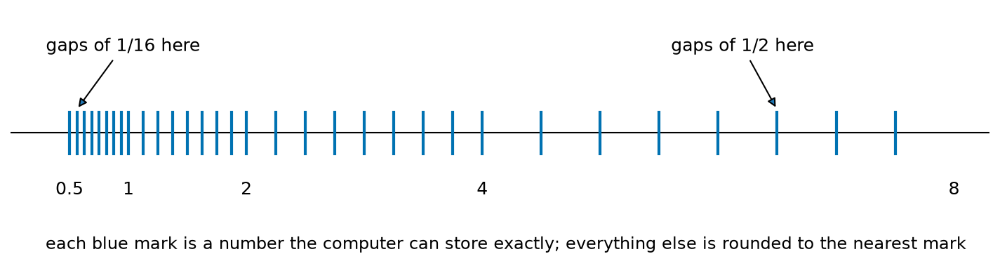
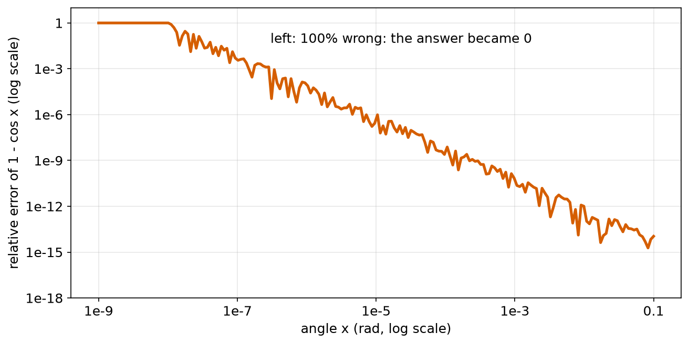
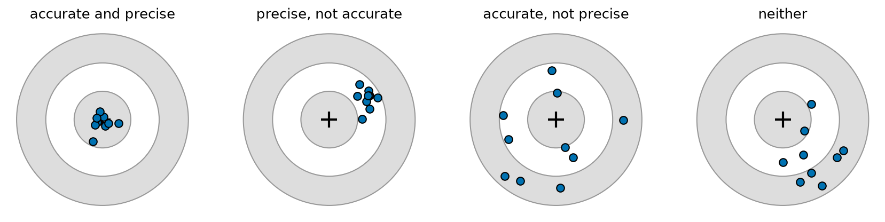
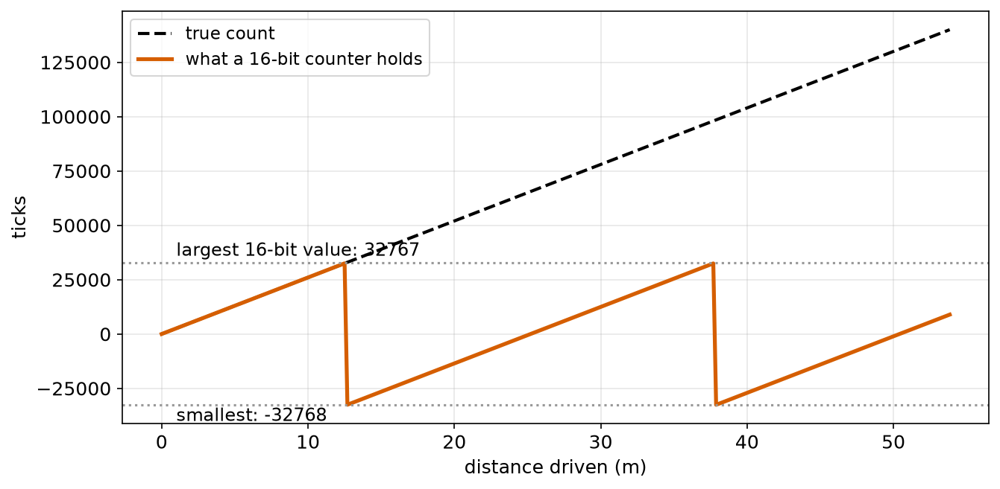
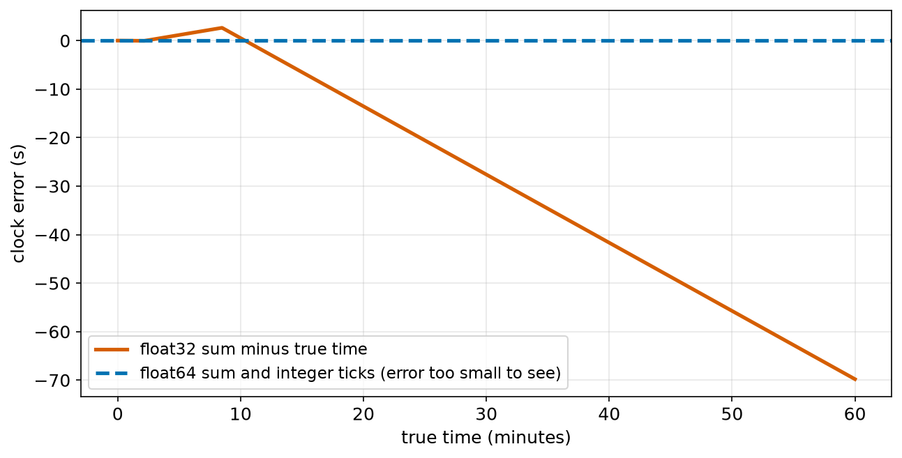

# Chapter 54 — Error, Accuracy, Precision and Rounding in Computers

> **Part 3 · Chapter 54 of 749**
> **You need:** Chapter 13 (numbers in Python), Chapter 37 (fractions), Chapter 38 (powers of 2 and bits) and Chapter 39 (measurement).
> **You will make:** a tour of the surprises inside floating-point numbers, a clock that drifts by more than a minute an hour, an encoder count that survives being wrapped, and two ways to avoid losing digits.

---

## What you will learn

- Why `0.1 + 0.2` gives `0.30000000000000004`, as promised since Chapter 1.
- How a computer stores decimal numbers, and why most of them are slightly wrong.
- Why the gaps between stored numbers grow as the numbers grow.
- Why Python rounds 2.5 to 2 and 2.675 to 2.67.
- How to compare decimal numbers safely.
- What **overflow** is, and how to handle a counter that wraps around.
- How adding many small numbers, or subtracting nearly equal ones, loses accuracy.
- The difference between **accuracy**, **precision** and **resolution**, and how errors grow when we calculate with measurements.

---

## New words in this chapter

| Word | Simple meaning |
|---|---|
| **binary fraction** | A fraction written with digits 0 and 1 after the point, in base 2. |
| **floating point** | The way computers store decimals: some digits, and a power of 2 that places the point. |
| **float32 / float64** | Floating-point numbers stored in 32 bits (about 7 digits) or 64 bits (about 16 digits). |
| **rounding error** | The small difference between a number and the nearest number the computer can store. |
| **ulp** | "Unit in the last place": the gap from one stored number to the next. |
| **overflow** | A result too big for the space it is stored in. |
| **wrap around** | When a counter that overflows starts again from the other end. |
| **cancellation** | Losing correct digits by subtracting two nearly equal numbers. |
| **absolute error** | How far a value is from the truth, in its own units. |
| **relative error** | The absolute error divided by the size of the value. |
| **accuracy** | How close measurements are to the true value, on average. |
| **precision** | How close repeated measurements are to each other. |
| **error propagation** | How errors in inputs make errors in a result. |

---

## 54.1 Why 0.1 cannot be stored exactly

In Chapter 37 we saw that 1/3 = 0.3333… never ends in base 10, because 3 does not divide into 10. Computers count in base 2 (Chapter 38). In base 2, places after the point are worth 1/2, 1/4, 1/8, 1/16 and so on.

📖 **New word: binary fraction** — a fraction written in base 2.

| Decimal | Binary | Exact? |
|---|---|---|
| 0.5 | 0.1 | yes (1/2) |
| 0.25 | 0.01 | yes (1/4) |
| 0.75 | 0.11 | yes (1/2 + 1/4) |
| 0.1 | 0.000110011001100110011… | **never ends** |

Only fractions whose bottom is a power of 2 end in binary. 1/10 has a 5 in its bottom (10 = 2 × 5), so in binary it repeats for ever, just like 1/3 in decimal.

The computer must cut it off somewhere. So `0.1` in Python is not one tenth, but the nearest number it can store:

```
0.1000000000000000055511151231257827021181583404541015625
```

That is wrong by about 5.5 × 10⁻¹⁸. Tiny, but not zero. When we add 0.1 and 0.2, the two tiny errors add up and show in the 17th digit:

```
0.1 + 0.2 = 0.30000000000000004
```

📖 **New word: rounding error** — the small difference between a number and the nearest number the computer can store.

🧠 **Remember:** This is not a bug in Python. Every language, every calculator and every robot stores numbers this way. It is a property of base 2.

---

## 54.2 How floating-point numbers work

📖 **New word: floating point** — the way computers store decimals: a fixed number of binary digits, and a power of 2 that says where the point goes. It is scientific notation (Chapter 38), but in base 2.

```
value = (1.binary digits) × 2^exponent
```

The point "floats" to wherever it is needed, which lets the same format hold tiny and huge numbers.

📖 **New word: float32 / float64** —

| Type | Bits | Correct decimal digits | Largest | Where you meet it |
|---|---|---|---|---|
| float32 | 32 | about 7 | 3.4 × 10³⁸ | many microcontrollers, graphics cards, NumPy `float32` |
| float64 | 64 | about 15 to 16 | 1.8 × 10³⁰⁸ | Python's `float`, NumPy's default |

### The gaps grow

A float has a fixed number of digits. Near 1, those digits can describe very small steps. Near a million, the same number of digits must cover bigger values, so the steps are bigger.



*Figure 54.1 — A pretend computer with only 3 binary digits after the point.*

**How to read this picture:** Each blue mark is a number this tiny system can store exactly. Between 0.5 and 1 the marks are 1/16 apart. Between 1 and 2 they are 1/8 apart, between 2 and 4 they are 1/4 apart, and between 4 and 8 they are 1/2 apart. Each time the number doubles, the gap doubles. Real floats work the same way, with 52 digits instead of 3.

📖 **New word: ulp** — "unit in the last place": the gap from one stored number to the next. `math.ulp(1.0)` is 2.2 × 10⁻¹⁶. `math.ulp(1e6)` is 1.2 × 10⁻¹⁰.

So the **relative** error of a float64 is always about the same, around 10⁻¹⁶. But the **absolute** error grows with the size of the number.

🤖 **Robot link.** A float32 has steps of about 1 part in 17 million. A GPS position stored in metres from the centre of the Earth (about 6,400,000 m) would then have steps of about 0.5 m. That is far too coarse to drive a robot. This is why robots store positions relative to a nearby origin (Chapter 42), or use float64.

---

## 54.3 Rounding: 2.675 and 2.5

Chapter 13 asked why `round(2.675, 2)` gives 2.67, not 2.68. Now we can see. 2.675 is really stored as:

```
2.67499999999999982236431605997495353221893310546875
```

That is just below 2.675, so it rounds down. The computer is rounding correctly. It is rounding the number it really has.

Another surprise:

```
round(0.5) = 0
round(1.5) = 2
round(2.5) = 2
```

When a number is **exactly** halfway, Python rounds to the **even** neighbour. This is called "round half to even", or banker's rounding. Always rounding halves up would push long sums slightly upward. Rounding to even pushes up half the time and down half the time, so the errors cancel over many numbers.

💡 **Tip.** For showing numbers to people, use formatting: `f"{x:.2f}"`. For money or anything that must be exact in decimal, Python has the `decimal` module. Robots rarely need it.

---

## 54.4 Comparing decimals safely

Because of rounding errors, two calculations that should give the same answer often differ in the last digit:

```python
0.1 + 0.2 == 0.3          # False
```

Never test decimals for exact equality. Test whether they are **close enough**:

```python
abs(a - b) < 1e-9                       # close in absolute terms
math.isclose(a, b)                      # close in relative terms (Python's tool)
math.isclose(a, b, abs_tol=1e-9)        # close in either sense
```

You saw this rule in Chapter 13 and Chapter 17. Now you know why.

⚠️ **Careful.** Whole numbers stored as `int` are always exact in Python. Use them for counting: ticks, steps and loop numbers. Chapter 30's watchdog counted whole ticks for exactly this reason.

### Rounding down can surprise you too

In Chapter 42, `2.0 // 0.05` gave 39, not 40. Here is why: 0.05 is stored as a number very slightly **bigger** than 0.05. So 2.0 contains it a little fewer than 40 times, and `//` rounds down to 39. But `2.0 / 0.05` is rounded to the nearest float, which is exactly 40.0. Rounding down is unforgiving: a tiny error just below a whole number drops a whole step.

---

## 54.5 Overflow and wrapping

Python's `int` can grow as large as you like. But a microcontroller stores whole numbers in a fixed number of bits (Chapter 38).

| Type | Bits | Range |
|---|---|---|
| unsigned 8-bit | 8 | 0 to 255 |
| signed 16-bit | 16 | −32,768 to 32,767 |
| signed 32-bit | 32 | −2,147,483,648 to 2,147,483,647 |

📖 **New word: overflow** — a result too big for the space it is stored in.

📖 **New word: wrap around** — when a counter that overflows starts again from the other end, like a car's distance counter going from 999999 back to 000000.

On many microcontrollers, a signed 16-bit counter at 32,767 that counts one more becomes −32,768. Mathematically it is "the count modulo 65,536", shifted so that it stays between −32,768 and 32,767. In Python we can copy this with `%`:

```
as_int16(n) = (n + 32768) % 65536 − 32768
```

This is exactly the same trick as wrapping an angle (Chapter 47)! And the same cure works: the **difference** between two readings, wrapped, is still correct, as long as the counter has not moved by more than half its range between readings (as with unwrapping angles in Chapter 50).

Floats can overflow too: a float64 bigger than about 1.8 × 10³⁰⁸ becomes `inf`, which means "infinity". Python prints `inf` and carries on.

---

## 54.6 Losing digits: adding many small numbers

When you add a very small number to a big one, the small one's last digits fall off the end, because the big one's gaps (section 54.2) are wider. Each time, a little is lost. Over millions of additions, the losses pile up.

The worst case: a loop that adds its time step, again and again, to keep track of time. Section 54.9 (Application 2) shows that with float32, a 1000 Hz loop loses more than a minute every hour.

The cure is simple: **count whole ticks, and multiply only when you need the time.** `time = ticks × dt` has just one rounding error, not millions.

---

## 54.7 Losing digits: subtracting nearly equal numbers

📖 **New word: cancellation** — losing correct digits by subtracting two nearly equal numbers.

Imagine two measurements with 7 correct digits: 1.234567 and 1.234561. Their difference is 0.000006. It has only **one** correct digit left. The six digits that matched have cancelled out, and only the doubtful last digits remain.

Computers do the same with their 16 digits. Two places where this bites robot code:

**The small root of a quadratic** (Chapter 45, Lab 45.2). For x² − 10⁸x + 1 = 0, the small root is about 10⁻⁸. The formula computes (−b − √(b² − 4ac)) / 2a, but √(b² − 4ac) is almost exactly equal to −b, so the subtraction cancels nearly every digit. The fix: find the big root first, and then use the fact that the two roots multiply to c/a.

**1 − cos x for a small angle x.** cos x is very close to 1, so 1 − cos x cancels. The fix: an equal formula with no subtraction, 2 sin²(x/2).



*Figure 54.2 — The relative error of 1 − cos x grows as x gets smaller.*

**How to read this picture:** Both axes are log scales (Chapter 52). Across the bottom is the angle, from tiny on the left to 0.1 rad on the right. Up the side is the relative error of the plain formula. On the right, it is tiny. Moving left, it grows steadily. Below about 10⁻⁸ rad, the answer is 100% wrong: it comes out as exactly 0.

---

## 54.8 Accuracy, precision and resolution

These three words are often confused. They mean different things.

📖 **New word: accuracy** — how close measurements are to the true value, on average.

📖 **New word: precision** — how close repeated measurements are to each other.

**Resolution** (Chapter 38) is the smallest change an instrument can show.



*Figure 54.3 — Ten measurements of the same thing, four times.*

**How to read this picture:** The cross is the true value. The blue dots are measurements. In the first target, they are close together and around the centre: accurate and precise. In the second, close together but off to one side: precise but not accurate, like the factory arm in Chapter 53. In the third, spread out, but centred on the truth on average. In the last, neither.

Precision errors are **random**: they differ each time, and averaging helps (Chapter 31). Accuracy errors are often **systematic**: the same every time, and averaging does not help. Only calibration fixes them (Chapter 43).

A sensor can show 6 digits (fine resolution) and still be inaccurate. And float64 can store 16 digits of a number that came from a sensor with only 3 correct digits. **Do not believe digits just because the computer prints them** (Chapter 39).

### Absolute and relative error

📖 **New word: absolute error** — how far a value is from the truth, in its units: "2 cm off".

📖 **New word: relative error** — the absolute error divided by the size of the value: "1% off". A 2 cm error is 1% of 2 m, but 20% of 10 cm.

### Errors in calculations

📖 **New word: error propagation** — how errors in inputs make errors in a result. Two simple rules give the worst case:

```
For a sum or a difference:  the ABSOLUTE errors add
For a product or a quotient: the RELATIVE errors add
```

🔢 **Maths.** A rectangle is measured as 2.00 ± 0.01 m by 3.00 ± 0.01 m.

```
perimeter = 2(2.00 + 3.00) = 10.00 m,   error = 2(0.01 + 0.01) = ±0.04 m
area = 6.00 m²,  relative errors 0.5% + 0.33% = 0.83%,  so ±0.05 m²
```

⚠️ **Careful.** Subtracting two close measurements can give a huge relative error: 2.03 ± 0.01 minus 2.00 ± 0.01 is 0.03 ± 0.02, which is ±67%. This is cancellation again, now with measurements.

---

## Code

File `code/ch054/float_surprises.py`:

```python
# float_surprises.py - why 0.1 + 0.2 is not exactly 0.3, and what the computer really stores
import math
from decimal import Decimal

print("0.1 + 0.2       =", 0.1 + 0.2)
print("0.1 + 0.2 == 0.3:", 0.1 + 0.2 == 0.3)
print("isclose         :", math.isclose(0.1 + 0.2, 0.3))
print("0.1 is really    :", Decimal(0.1))
print("2.675 is really  :", Decimal(2.675))
print("round(2.675, 2)  =", round(2.675, 2))
print("0.5 is really    :", Decimal(0.5), "(exact: a power of 2)")

total = 0.0
for _ in range(10):
    total += 0.1
print("0.1 added 10 times:", total)

print("2.0 // 0.05       =", 2.0 // 0.05, "  but 2.0 / 0.05 =", 2.0 / 0.05)
print("round(0.5), round(1.5), round(2.5):", round(0.5), round(1.5), round(2.5))
print("biggest float     :", 1.7976931348623157e308, "  times 10 =", 1.7976931348623157e308 * 10)
print("gap after 1.0     :", math.ulp(1.0), "  gap after 1e6:", math.ulp(1e6))
```

| Line | Code | What it does (simple English) |
|---|---|---|
| 1 | `# float_surprises.py …` | A comment. |
| 2 | `import math` | For `isclose` and `ulp`. |
| 3 | `from decimal import Decimal` | `Decimal(x)` shows every digit of the number that is really stored. |
| 4 | (blank) | Spacing. |
| 5 | `print("0.1 + 0.2 …")` | The famous surprise. |
| 6 | `print("… == 0.3:", …)` | Exact comparison fails. |
| 7 | `print("isclose …", math.isclose(…))` | A safe comparison passes. |
| 8 | `print("0.1 is really …", Decimal(0.1))` | The true stored value of 0.1. |
| 9 | `print("2.675 is really …")` | Just below 2.675. |
| 10 | `print("round(2.675, 2) …")` | So it rounds down. |
| 11 | `print("0.5 is really …")` | A power of 2 is stored exactly. |
| 12 | (blank) | Spacing. |
| 13 | `total = 0.0` | Start a sum. |
| 14 | `for _ in range(10):` | Ten times … |
| 15 | `total += 0.1` | … add 0.1. |
| 16 | `print("0.1 added 10 times:", total)` | Not exactly 1. |
| 17 | (blank) | Spacing. |
| 18 | `print("2.0 // 0.05 …")` | The puzzle from Chapter 42. |
| 19 | `print("round(0.5) …")` | Round half to even. |
| 20 | `print("biggest float …")` | Overflow to `inf`. |
| 21 | `print("gap after 1.0 …")` | The ulp grows with the size of the number. |

Output:

```
0.1 + 0.2       = 0.30000000000000004
0.1 + 0.2 == 0.3: False
isclose         : True
0.1 is really    : 0.1000000000000000055511151231257827021181583404541015625
2.675 is really  : 2.67499999999999982236431605997495353221893310546875
round(2.675, 2)  = 2.67
0.5 is really    : 0.5 (exact: a power of 2)
0.1 added 10 times: 0.9999999999999999
2.0 // 0.05       = 39.0   but 2.0 / 0.05 = 40.0
round(0.5), round(1.5), round(2.5): 0 2 2
biggest float     : 1.7976931348623157e+308   times 10 = inf
gap after 1.0     : 2.220446049250313e-16   gap after 1e6: 1.1641532182693481e-10
```

Every strange number in this book so far is explained by these lines.

File `code/ch054/cancellation.py`:

```python
# cancellation.py - subtracting two nearly equal numbers loses digits
import math

a, b, c = 1.0, -1e8, 1.0
root = math.sqrt(b * b - 4 * a * c)
small_naive = (-b - root) / (2 * a)
big = (-b + root) / (2 * a)
small_safe = c / (a * big)
print("small root, plain formula :", small_naive)
print("small root, using c/(a*big):", small_safe)
print("true small root is about   : 1.00000000000000000e-08")

for x in [1e-2, 1e-4, 1e-6, 1e-8]:
    naive = 1 - math.cos(x)
    safe = 2 * math.sin(x / 2) ** 2
    print(f"x = {x:7.0e}: 1 - cos x = {naive:.6e}   2 sin^2(x/2) = {safe:.6e}")
```

| Line | Code | What it does (simple English) |
|---|---|---|
| 1 | `# cancellation.py …` | A comment. |
| 2 | `import math` | For sqrt, cos, sin. |
| 3 | (blank) | Spacing. |
| 4 | `a, b, c = 1.0, -1e8, 1.0` | The quadratic x² − 10⁸x + 1 = 0. |
| 5 | `root = math.sqrt(b * b - 4 * a * c)` | Almost exactly 10⁸. |
| 6 | `small_naive = (-b - root) / (2 * a)` | 10⁸ minus almost 10⁸: cancellation. |
| 7 | `big = (-b + root) / (2 * a)` | 10⁸ plus almost 10⁸: no problem. |
| 8 | `small_safe = c / (a * big)` | The roots multiply to c/a, so small = c/(a × big). No subtraction. |
| 9–11 | `print(…)` | Compare. |
| 12 | (blank) | Spacing. |
| 13 | `for x in [1e-2, 1e-4, 1e-6, 1e-8]:` | Smaller and smaller angles. |
| 14 | `naive = 1 - math.cos(x)` | Cancellation. |
| 15 | `safe = 2 * math.sin(x / 2) ** 2` | The same value, by a trig rule, with no subtraction. |
| 16 | `print(f"…")` | Compare them. |

Output:

```
small root, plain formula : 7.450580596923828e-09
small root, using c/(a*big): 1e-08
true small root is about   : 1.00000000000000000e-08
x =   1e-02: 1 - cos x = 4.999958e-05   2 sin^2(x/2) = 4.999958e-05
x =   1e-04: 1 - cos x = 5.000000e-09   2 sin^2(x/2) = 5.000000e-09
x =   1e-06: 1 - cos x = 5.000445e-13   2 sin^2(x/2) = 5.000000e-13
x =   1e-08: 1 - cos x = 0.000000e+00   2 sin^2(x/2) = 5.000000e-17
```

The plain formula for the small root is 25% wrong. At x = 10⁻⁸, 1 − cos x gives 0, which is completely wrong. Each fix is one line.

---

## Small examples

**Example 1.** 0.25 + 0.5 == 0.75 is True, because all three are exact in binary.

**Example 2.** 0.1 × 3 == 0.3 is False.

**Example 3.** `round(0.125, 2)` gives 0.12: 0.125 is exact (1/8) and exactly halfway, so it rounds to the even 2.

**Example 4.** A signed 16-bit counter with 2600 ticks per metre overflows after 32,767 ÷ 2600 = 12.6 m.

**Example 5.** A signed 32-bit counter lasts 2,147,483,647 ÷ 2600 = 826 km.

**Example 6.** An unsigned 8-bit value of 250 plus 10 wraps to 4.

**Example 7.** In float32, 16,777,216 + 1 is still 16,777,216: the gap there is 2.

**Example 8.** A length of 2.00 m with an error of 1 cm has a relative error of 0.5%.

---

## 🏭 Real robot applications

### Application 1 (worked in full) — 🤖 Rover's encoder count wraps around

**1. The real problem.** Rover's motor controller is a small microcontroller that counts encoder ticks in a signed 16-bit number. Rover drives 2 m every few seconds. After a while, its position jumps from +12 m to −11 m, and it thinks it has driven backward.

**2. Why this theory.** 2 m is 5200 ticks (2600 per metre, Chapter 37). The count overflows past 32,767 and wraps to −32,768. But the **change** between two readings, wrapped in the same way, is still correct, just like the wrapped heading error in Chapter 47.

**3. The numbers.** 2600 ticks per metre. A 16-bit signed counter: −32,768 to 32,767. The main computer reads the counter once per period, and Rover moves 5200 ticks per period.

**4. The maths.** At the 7th reading:

```
true count     = 7 × 5200 = 36,400
stored count   = (36,400 + 32,768) % 65,536 − 32,768 = −29,136
naive position = −29,136 ÷ 2600 = −11.21 m       wrong

change since last reading = −29,136 − 31,200 = −60,336
wrapped change            = (−60,336 + 32,768) % 65,536 − 32,768 = 5200   correct
safe position = 12.00 + 5200 ÷ 2600 = 14.00 m
```



*Figure 54.4 — The true count climbs for ever. The 16-bit counter falls off a cliff every 65,536 ticks.*

**How to read this picture:** Across the bottom is the distance driven. The black dashed line is the true count. The red line is what the 16-bit counter holds. It rises with the true count until 32,767, then jumps to −32,768 and starts climbing again. Every 25.2 m the pattern repeats.

**5. The code.** File `code/ch054/encoder_overflow.py`:

```python
# encoder_overflow.py - a 16-bit tick counter wraps round; differences still work
TICKS_PER_METRE = 2600


def as_int16(n):
    return (n + 32768) % 65536 - 32768


def tick_change(new, old):
    return as_int16(new - old)


true_ticks = 0
stored = 0
position_naive = 0.0
position_safe = 0.0
last_stored = 0

print("  true ticks   stored (16-bit)   naive metres   safe metres")
for _ in range(10):
    true_ticks += 5200                      # 2 m forward each period
    stored = as_int16(true_ticks)
    position_naive = stored / TICKS_PER_METRE
    position_safe += tick_change(stored, last_stored) / TICKS_PER_METRE
    last_stored = stored
    print(f"{true_ticks:12d} {stored:17d} {position_naive:14.2f} {position_safe:13.2f}")
```

| Line | Code | What it does (simple English) |
|---|---|---|
| 1 | `# encoder_overflow.py …` | A comment. |
| 2 | `TICKS_PER_METRE = 2600` | Rover's conversion (round number, Chapter 37). |
| 3–4 | (blank) | Spacing. |
| 5–6 | `def as_int16(n): …` | Copies how a 16-bit signed number wraps. Same pattern as `wrap_180`. |
| 7–8 | (blank) | Spacing. |
| 9–10 | `def tick_change(new, old): …` | The change between two readings, wrapped. |
| 11–12 | (blank) | Spacing. |
| 13 | `true_ticks = 0` | The real count, which Python can hold however big it gets. |
| 14 | `stored = 0` | What the 16-bit counter holds. |
| 15 | `position_naive = 0.0` | Position from the stored count directly. |
| 16 | `position_safe = 0.0` | Position from added-up changes. |
| 17 | `last_stored = 0` | The previous reading. |
| 18 | (blank) | Spacing. |
| 19 | `print(…)` | The heading. |
| 20 | `for _ in range(10):` | Ten periods. |
| 21 | `true_ticks += 5200` | 2 m more. |
| 22 | `stored = as_int16(true_ticks)` | What the microcontroller really has. |
| 23 | `position_naive = stored / TICKS_PER_METRE` | The wrong way. |
| 24 | `position_safe += tick_change(stored, last_stored) / TICKS_PER_METRE` | The right way: add wrapped changes. |
| 25 | `last_stored = stored` | Remember this reading for next time. |
| 26 | `print(f"…")` | Prints the row. |

Output:

```
  true ticks   stored (16-bit)   naive metres   safe metres
        5200              5200           2.00          2.00
       10400             10400           4.00          4.00
       15600             15600           6.00          6.00
       20800             20800           8.00          8.00
       26000             26000          10.00         10.00
       31200             31200          12.00         12.00
       36400            -29136         -11.21         14.00
       41600            -23936          -9.21         16.00
       46800            -18736          -7.21         18.00
       52000            -13536          -5.21         20.00
```

**6. The result.** The naive position jumps from +12 m to −11.21 m: Rover would believe it had jumped 23 m backward, and its map would be ruined. The safe position counts on smoothly to 20 m. The fix works as long as Rover moves less than half the range, 32,767 ticks (12.6 m), between two readings, which is easy at normal reading rates.

**7. Going further.** Arduino's `millis()` timer is an unsigned 32-bit count that wraps after about 49.7 days. The safe way to measure time with it, `millis() - start`, works for exactly the same reason (Chapter 103).

### Application 2 (worked in full) — 🚁 A drone's clock that loses a minute

**1. The real problem.** A flight controller runs its loop 1000 times a second and keeps track of time by adding 0.001 s on each loop. Its processor uses float32 for speed. After an hour of hovering in a test, its logs show a time of about 3530 s instead of 3600 s.

**2. Why this theory.** As the total time grows, the gaps between float32 numbers grow (section 54.2). 0.001 is not exact in binary, and each addition is rounded to the nearest gap. Millions of additions add millions of rounding errors (section 54.6).

**3. The numbers.** 3,600,000 additions of 0.001 s. A float32 has about 7 digits. Near 3500 s, the gap between float32 numbers is 0.000244 s, a quarter of the step being added.

**4. The maths.** Each addition must round 3530.xxx + 0.001 to the nearest multiple of 0.000244. The result is 0.000977 or 0.001221 instead of 0.001: an error of a few percent on every step. Over an hour, these errors add up to minutes. With float64, the gap near 3600 is about 5 × 10⁻¹³ s, so the error stays under a microsecond.

**5. The code.** File `code/ch054/clock_drift.py`:

```python
# clock_drift.py - adding up a small time step for an hour, in different ways
import numpy as np

DT = 0.001                 # a 1000 Hz control loop
STEPS = 3_600_000          # one hour

t32 = np.float32(0.0)
dt32 = np.float32(DT)
t64 = 0.0
ticks = 0
checkpoints = {60_000, 600_000, 3_600_000}

print("  true time (s)   float32 sum   float64 sum    integer ticks")
for step in range(1, STEPS + 1):
    t32 = t32 + dt32
    t64 = t64 + DT
    ticks += 1
    if step in checkpoints:
        true = step * DT
        print(f"{true:15.0f} {float(t32):13.3f} {t64:13.6f} {ticks / 1000:16.3f}")
```

| Line | Code | What it does (simple English) |
|---|---|---|
| 1 | `# clock_drift.py …` | A comment. |
| 2 | `import numpy as np` | NumPy has a real 32-bit float type (Chapter 34). |
| 3 | (blank) | Spacing. |
| 4 | `DT = 0.001` | One loop: 1 ms. |
| 5 | `STEPS = 3_600_000` | One hour of loops. |
| 6 | (blank) | Spacing. |
| 7 | `t32 = np.float32(0.0)` | A clock kept in float32. |
| 8 | `dt32 = np.float32(DT)` | The step, also in float32. |
| 9 | `t64 = 0.0` | A clock kept in Python's float64. |
| 10 | `ticks = 0` | A clock kept as a whole-number count. |
| 11 | `checkpoints = {60_000, 600_000, 3_600_000}` | A set (Chapter 22): print at 1 min, 10 min and 1 hour. |
| 12 | (blank) | Spacing. |
| 13 | `print(…)` | The heading. |
| 14 | `for step in range(1, STEPS + 1):` | 3.6 million loops. This takes a few seconds. |
| 15 | `t32 = t32 + dt32` | Add in float32. |
| 16 | `t64 = t64 + DT` | Add in float64. |
| 17 | `ticks += 1` | Count, exactly. |
| 18 | `if step in checkpoints:` | Fast test for membership in a set. |
| 19 | `true = step * DT` | The true time. |
| 20 | `print(f"…")` | Time from each clock. `ticks / 1000` turns the count into seconds with one rounding. |

Output:

```
  true time (s)   float32 sum   float64 sum    integer ticks
             60        59.979     60.000000           60.000
            600       600.517    600.000000          600.000
           3600      3530.204   3600.000000         3600.000
```



*Figure 54.5 — The float32 clock wanders, then falls steadily behind.*

**How to read this picture:** Across the bottom is the true time in minutes. Up the side is the clock's error. The red line is the float32 clock: a little fast at first, then falling steadily behind, by almost 70 s after an hour. The blue dashed line is both the float64 clock and the counted ticks. Their error is far too small to see: the float64 clock is off by only 0.27 microseconds after an hour.

**6. The result.** After one hour, the float32 clock says 3530 s: 70 seconds wrong. Anything that uses this time, such as speeds worked out as distance ÷ time, or the timing of a flight plan, is wrong too. Counting whole ticks is exact, and costs nothing.

**7. Going further.** In 1991, during the Gulf War, a Patriot missile defence battery had kept time by counting tenths of a second in a 24-bit fixed-point number. 0.1 cannot be stored exactly in binary, and after about 100 hours of running, the clock was off by about 0.34 s. In that time, an incoming missile travels more than half a kilometre. The system looked in the wrong place, failed to intercept a missile, and 28 soldiers were killed. The official report traced it to exactly this kind of rounding error. Real flight software counts time in whole microseconds (Chapter 523).

### Application 3 — 🚀 A rocket lost to an overflow

In 1996, on its first flight, the European Ariane 5 rocket broke up about 40 seconds after launch. Its guidance software converted a 64-bit floating-point measurement of horizontal speed into a 16-bit signed integer. Ariane 5 was faster than the older Ariane 4 the code was written for, so the number was larger than 32,767. The conversion failed, the guidance computers shut down, and the rocket turned sharply and was destroyed. One unchecked conversion, the same overflow as Application 1, cost a mission worth hundreds of millions.

### Application 4 — 🏭 How exact must an arm's angle be?

An arm link is 0.8 m long. If the joint angle has an error of ±0.1° (0.00175 rad), the tip is wrong by about r × θ = 0.8 × 0.00175 = 1.4 mm (Chapter 47). A second joint with the same error adds up to another 1.4 mm in the worst case: absolute errors in a sum add. A designer uses this to decide how accurate each joint's encoder and gears must be (Chapter 38 compared encoder bits).

### Application 5 — 🗺️ A GPS map that shakes

A robot stores its GPS position as float32 numbers of metres from the centre of the Earth, around 6,400,000 m. The gap between float32 numbers there is 0.5 m. Every position the robot computes is rounded to the nearest half metre, so its path on the map jumps in steps of half a metre, even though the GPS is better than that. Storing positions relative to a nearby start point (Chapter 42), or using float64, makes the steps vanish.

---

## 🔧 Hands-on lab

### Lab 54.1 — Find the edges of the numbers (simulation)

1. In the Python shell, try `1e308 * 10`, `-1e308 * 10` and `1e-320 / 1e10`.
2. Try `2.0 ** 53 + 1 == 2.0 ** 53`.
3. Try `math.ulp(x)` for x = 1, 1000, 1,000,000 and 10¹⁶.

**What you should see:** `inf`, `-inf` and `0.0`. At 2⁵³ (about 9 × 10¹⁵), adding 1 makes no difference: the gap there is 2. The ulp grows in proportion to the number, and at 10¹⁶ it is 2.0.

| If it does not work | Likely cause | Fix |
|---|---|---|
| `NameError: math` | Not imported | `import math` |
| `OverflowError` | You used `**` with whole numbers: `10 ** 400` is fine, but `10.0 ** 400` overflows | This is expected: floats have a limit |

**Challenge:** Use `np.float32` to find the smallest whole number n for which `np.float32(n) + np.float32(1) == np.float32(n)`.

### Lab 54.2 — Measure precision and accuracy (hardware)

Use the ultrasonic or infrared distance sensor from earlier labs, or a ruler and a friend.

1. Measure the same distance (for example a wall at 50 cm) 20 times, without moving anything.
2. Compute the mean and the spread (Chapter 53) of your readings.
3. Measure the true distance carefully with a tape measure.
4. Which is worse for your sensor: its precision (spread) or its accuracy (mean minus truth)?

**What you should see:** Most cheap sensors are more precise than accurate: the readings agree with each other to a few millimetres, but their mean is off by a centimetre or more. Calibration (Chapter 43) fixes the accuracy. Averaging improves the precision.

| If it does not work | Likely cause | Fix |
|---|---|---|
| All 20 readings identical | The sensor's resolution is coarser than its noise | Report the resolution as the limit |
| Huge spread | The target moves, or echoes from other objects | Use a flat, still wall |

**Challenge:** Measure at 20, 50 and 100 cm. Is the error a fixed number of centimetres, or a fixed percentage?

### Lab 54.3 — Break and fix a clock (simulation)

Copy `clock_drift.py`.

1. Change `DT` to 0.0005 (2000 Hz) and `STEPS` to 7,200,000. How large is the float32 error after an hour now?
2. Change `DT` to 0.001953125 (exactly 2⁻⁹) and `STEPS` to 1,843,200, which is still one hour. What happens?
3. Replace the float32 clock with a float32 **count of ticks**, multiplied by `dt32` only for printing.

**What you should see:** (1) At 2000 Hz, the float32 clock reads about 3522.9 s after an hour: even worse, because each step is smaller compared with the growing gaps. (2) With a power of 2, the step is exact in binary, and every addition is exact while the gaps stay smaller than the step: the clock reads exactly 3600.0 s. (Run it much longer, and the gaps eventually grow past the step, and the clock stops growing completely.) (3) A float32 count stays exact up to 16,777,216 ticks (about 4.7 hours at 1000 Hz), then fails too. A Python `int`, or a 32-bit or 64-bit integer on a microcontroller, is the right choice.

| If it does not work | Likely cause | Fix |
|---|---|---|
| It takes very long | 7 million loops at 2000 Hz | Wait about 10 s, or reduce `STEPS` |

**Challenge:** Find, by experiment, after how many hours a float64 clock at 1000 Hz is off by 1 ms.

---

## Common mistakes

⚠️ **Comparing floats with `==`.** Use `math.isclose` or a tolerance.

⚠️ **Keeping time by adding small steps.** Count whole ticks and multiply.

⚠️ **Forgetting that microcontroller integers overflow.** Check the range of your types (Chapter 96).

⚠️ **Using a raw counter value after it may have wrapped.** Use wrapped differences.

⚠️ **Subtracting nearly equal numbers** when an equal formula without the subtraction exists.

⚠️ **Storing large coordinates in float32.** Use a nearby origin or float64.

⚠️ **Believing printed digits.** The result can never be better than the measurements.

⚠️ **Confusing accuracy with precision.**

---

## Practice

🏋️ **1.** Is 0.25 stored exactly? Is 0.2? Explain.

🏋️ **2.** What does `0.1 * 3 == 0.3` give? How should you compare them?

🏋️ **3.** What does `round(0.125, 2)` give, and why?

🏋️ **4.** A signed 16-bit counter counts 2600 ticks per metre. After how far does it overflow?

🏋️ **5.** How far would a signed 32-bit counter last?

🏋️ **6.** An unsigned 8-bit value is 250. You add 10. What does it hold now?

🏋️ **7.** A length of 2.00 m is measured with an error of ±0.01 m. What is the relative error?

🏋️ **8.** A rectangle measures 2.00 ± 0.01 m by 3.00 ± 0.01 m. Find its area and the worst-case error of the area.

🏋️ **9.** Why should a robot count time in whole ticks?

🏋️ **10.** A 16-bit counter reads 32,000, then −32,000. Using `tick_change`, how far did the wheel move?

🏋️ **11.** Write `close_enough(a, b, abs_tol=1e-9, rel_tol=1e-9)` that returns True when a and b differ by less than `abs_tol`, **or** by less than `rel_tol` times the larger of their sizes. Test it on 0.1 + 0.2 and 0.3, and on 1e20 + 1 and 1e20.

---

## Answers

**1.** 0.25 = 1/4 is exact, because 4 is a power of 2. 0.2 = 1/5 is not: in binary it repeats for ever.

**2.** False. Use `math.isclose(0.1 * 3, 0.3)`, which gives True.

**3.** 0.12. 0.125 is 1/8, exact in binary, and exactly halfway between 0.12 and 0.13. Python rounds halves to the even digit, 2.

**4.** 32,767 ÷ 2600 = 12.6 m.

**5.** 2,147,483,647 ÷ 2600 = 825,955 m, about 826 km.

**6.** (250 + 10) % 256 = 4.

**7.** 0.01 ÷ 2.00 = 0.5%.

**8.** Area = 6.00 m². Relative errors add: 0.5% + 0.33% = 0.83%. So ±0.05 m².

**9.** Whole numbers are exact, so counting never drifts. Adding a decimal step adds a small rounding error every time, and millions of them add up.

**10.** −32,000 − 32,000 = −64,000. Wrapped: (−64,000 + 32,768) % 65,536 − 32,768 = 1536. The wheel moved 1536 ticks forward. The counter wrapped past 32,767.

**11.**

```python
def close_enough(a, b, abs_tol=1e-9, rel_tol=1e-9):
    diff = abs(a - b)
    return diff <= abs_tol or diff <= rel_tol * max(abs(a), abs(b))

print(close_enough(0.1 + 0.2, 0.3))     # True
print(close_enough(1e20 + 1, 1e20))     # True
```

In fact `1e20 + 1` is stored as exactly `1e20`, because the gap between floats there is 16,384.

---

## Summary

🧠 Computers store decimals in binary. Only fractions with a power of 2 at the bottom are exact. 0.1 is not.

🧠 float64 has about 16 correct digits, float32 about 7. The gaps between stored numbers grow with the numbers.

🧠 Never compare floats with `==`. Use `math.isclose` or a tolerance.

🧠 Python rounds exact halves to the even neighbour.

🧠 Fixed-size integers overflow and wrap. Wrapped differences still give the right change.

🧠 Count time in whole ticks. Avoid subtracting nearly equal numbers.

🧠 Accuracy is closeness to the truth. Precision is closeness to each other. Neither is the number of digits printed.

🧠 For sums, absolute errors add. For products, relative errors add.

---

## Next chapter

Chapter 55 is the project that ends Part 3. You will **measure a whole room** with a tape measure and trigonometry, using almost every idea from Chapters 37 to 54, and check your answers with Python, including how big your errors are.
