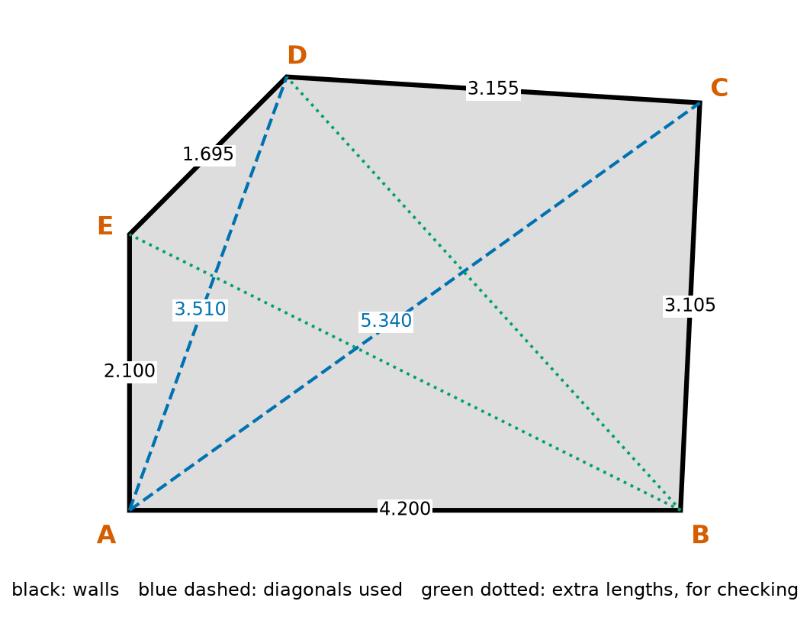
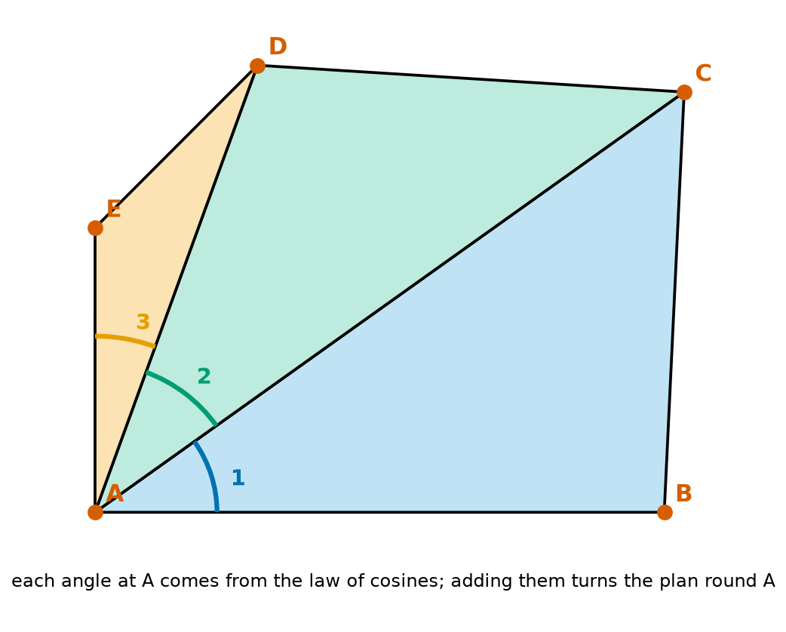
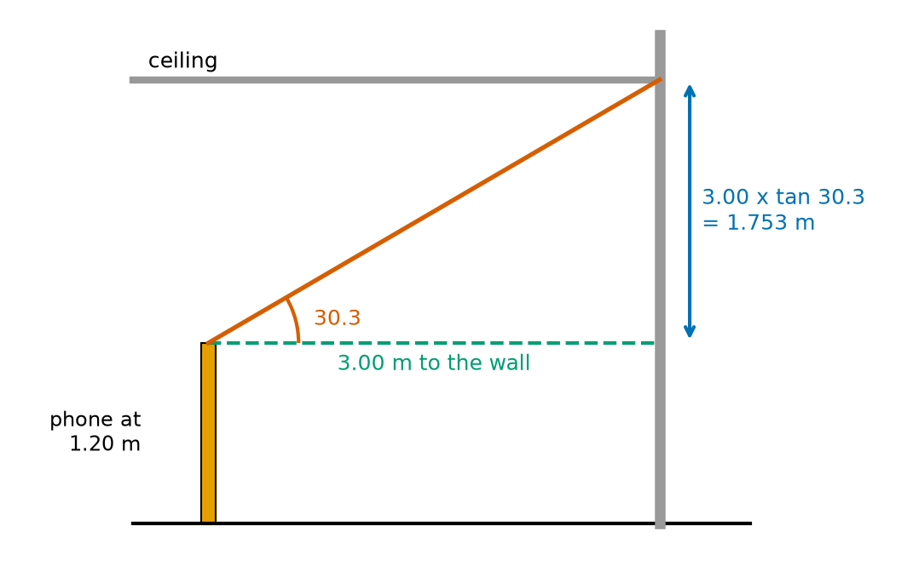
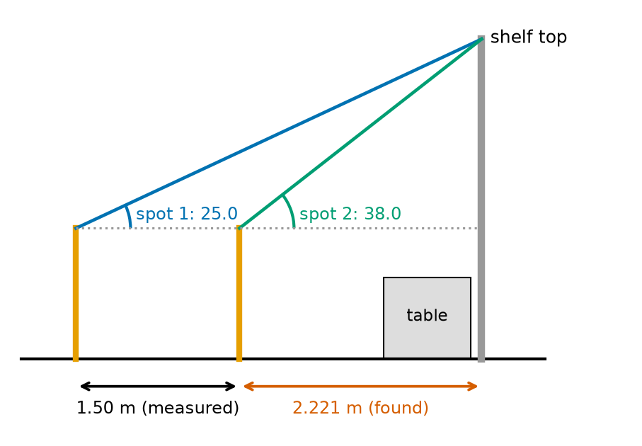
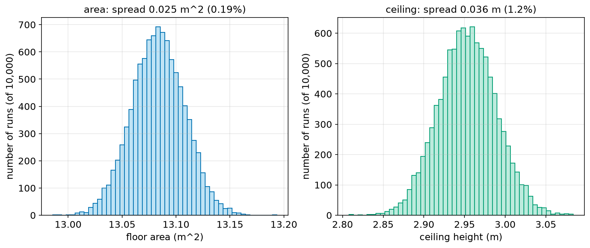
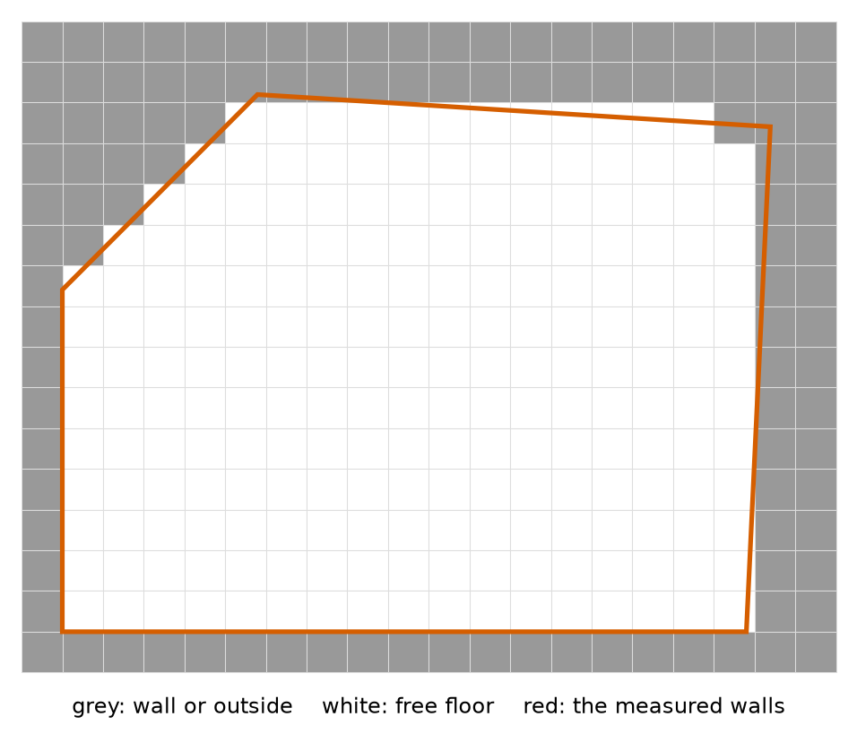
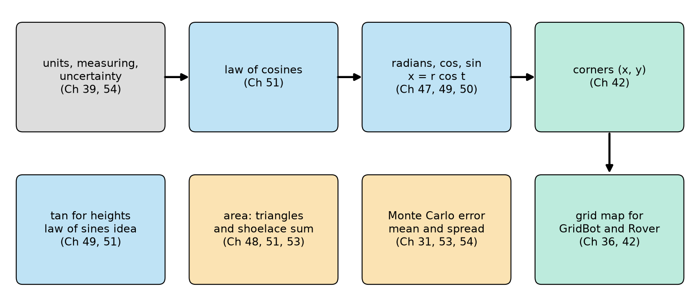

# Chapter 55 — Project: Measuring a Room with a Tape and Trigonometry

> **Part 3 · Chapter 55 of 749**
> **You need:** Chapters 37–54. A tape measure (5 m or more), a phone with a level or angle app, a pencil, paper, and a helper if possible.
> **You will make:** a complete survey of a real room: a floor plan with the coordinates of every corner, the floor area found two different ways, the height of the ceiling and of a shelf you cannot reach, an honest error for every answer, and a grid map in GridBot's format, ready for a robot.

---

## What you will learn

- How surveyors measure a shape that is not a rectangle, using only lengths.
- How to turn tape measurements into corner coordinates with the law of cosines.
- How to find an area in two independent ways, and why that is a good check.
- How to measure a height you cannot reach, with one angle or with two.
- How to find out how sure you are, by repeating the calculation thousands of times with small random errors.
- How to turn a floor plan into a map that a robot can use.
- How all the maths of Part 3 fits together in one real task.

---

## New words in this chapter

| Word | Simple meaning |
|---|---|
| **survey** | Measuring a place carefully, to make an accurate plan of it. |
| **floor plan** | A drawing of a room from above, to scale. |
| **triangulate** (a shape) | Split a shape into triangles, which are fixed by their three sides. |
| **check measurement** | An extra measurement, not used in the calculation, used only to test the result. |
| **closing error** | How far a calculated length differs from a measured check length. |
| **shoelace formula** | A sum that gives the area of any polygon from its corner coordinates. |
| **convex** | A shape with no corners pointing inward. |
| **error budget** | A list of where the errors in a result come from, and how big each one is. |

---

## 55.1 The goal

Rover will soon drive around real rooms (Part 6 onwards). It needs a map. Robots usually build maps with their own sensors (Chapter 432), but they are always checked against careful measurements made by people.

In this project you make such a map yourself, of a real room, with nothing more than a tape measure, a phone and Python. You will answer five questions:

1. Where exactly is each corner of the room?
2. What is the floor area?
3. How high is the ceiling?
4. How high is something you cannot reach, such as the top of a tall shelf?
5. **How sure are you of each answer?**

📖 **New word: survey** — measuring a place carefully, to make an accurate plan of it.

📖 **New word: floor plan** — a drawing of a room from above, to scale.

The last question is the one most people forget. A number without an error is only half an answer (Chapter 39).

---

## 55.2 Parts list

| Item | Why | Notes |
|---|---|---|
| Tape measure, 5 m or longer | All the lengths | A steel tape is better than a cloth one, which stretches |
| Phone with a level or angle app | Angles for heights | Most phones have one built in (Lab 49.1) |
| A stack of books, or a tripod | Holds the phone still at a known height | Measure its height once |
| Masking tape and a pen | Marks the corners on the floor | Label them A, B, C … |
| Paper and pencil | A sketch, and a table of readings | Write every reading down at once |
| A helper | Holds the other end of the tape | Not essential, but much easier |
| A computer with Python, NumPy and matplotlib | The calculations | As set up in Chapter 8 |

Total cost: nothing, if you already have a tape measure.

---

## 55.3 The plan: triangles

A rectangle is easy: two lengths give everything. But real rooms are rarely perfect rectangles. The corners are a little more or less than 90°, and many rooms have an extra corner, a cut-off wall, or a chimney.

Measuring the four walls of a room is **not enough** to fix its shape. A frame of four sticks can be squashed into a diamond (Chapter 48). A triangle cannot: three sides fix it completely.

📖 **New word: triangulate** (a shape) — split it into triangles, each fixed by its three sides.

Our example room has five corners, A to E. It is split into three triangles that share corner A, like a fan: ABC, ACD and ADE. To fix all three, we measure the five walls and two diagonals, AC and AD.



*Figure 55.1 — The room, with every length measured.*

**How to read this picture:** The corners are the red letters. The black lines are the walls, each labelled with its measured length in metres. The blue dashed lines are the two diagonals used to make the triangles. The green dotted lines are two more lengths, BE and BD, measured only to check the answer later.

📖 **New word: check measurement** — an extra measurement, not used in the calculation, used only to test the result.

A good surveyor always measures more than the minimum. If the plan predicts a check length correctly, the plan can be trusted. If not, a reading is wrong, and you go back.

---

## 55.4 Step by step: taking the measurements

These are the steps for your own room. Our example numbers are in Figure 55.1 and in the file `survey_data.py` below.

**Step 1. Sketch.** Draw the room roughly on paper, as seen from above. Mark every corner with a letter, going **anticlockwise** round the room (Chapter 47). Choose corner A so that you can see all the other corners from it.

**Step 2. Mark the corners.** Put a piece of masking tape on the floor at each corner, about 1 cm from each wall, so that skirting boards do not get in the way. Measure every length between tape marks.

**Step 3. Walls.** Measure AB, BC, CD, DE and EA, each to the nearest 0.5 cm. Keep the tape straight and tight, flat on the floor. Write each reading in a table immediately.

**Step 4. Diagonals.** Measure AC and AD. For long diagonals, the helper holds the tape at the far mark. If a piece of furniture is in the way, lift the tape over it, keeping it straight.

**Step 5. Checks.** Measure BE and BD.

**Step 6. The ceiling.** Put the phone on the stack of books 3.00 m from a wall. Measure the height of the phone's camera from the floor. Use the angle app to measure the angle up to the line where the wall meets the ceiling.

**Step 7. The shelf.** Choose something tall that you cannot walk up to, for example the top of a bookcase behind a table. Measure the angle up to its top edge from one spot. Move the phone 1.50 m straight towards it, and measure the angle again.

**Step 8. Repeat.** Measure each length twice. If two readings differ by more than 1 cm, measure a third time.

⚠️ **Careful.** Never stand on furniture to reach a corner or a ceiling. The whole point of trigonometry is that you do not need to (Chapter 7).

---

## 55.5 The maths of the floor plan

### Corner positions

Put A at the origin, and B on the x axis: A = (0, 0), B = (4.200, 0).

The angle at A in triangle ABC comes from the law of cosines (Chapter 51), using the side **opposite** it, BC:

```
cos(angle 1) = (AB² + AC² − BC²) / (2 × AB × AC)
             = (4.200² + 5.340² − 3.105²) / (2 × 4.200 × 5.340)
             = (17.640 + 28.516 − 9.641) / 44.856
             = 0.8140
angle 1      = 35.51°
```

C is 5.340 m from A, at 35.51°. Polar to x and y (Chapter 49):

```
C = (5.340 cos 35.51°, 5.340 sin 35.51°) = (4.347, 3.102)
```

Then the next triangle, ACD, gives angle 2 between AC and AD: 34.53°. D is 3.510 m from A, at 35.51° + 34.53° = 70.04°. The last triangle, ADE, gives angle 3: 19.95°. E is 2.100 m from A at 89.99°.



*Figure 55.2 — Three triangles, opened like a fan around corner A.*

**How to read this picture:** The three coloured triangles share corner A. Each arc shows the angle at A inside one triangle. The angles add up, one after another, to give the direction from A to each corner.

Look at the total: 35.51 + 34.53 + 19.95 = 89.99°. Corner A of the real room is a square corner, and our measurements say 89.99°. That is already a good sign.

### The area, two ways

**Way 1: add the triangles.** Each triangle's area is ½ × side × side × sin(angle between them) (Chapter 51):

```
ABC: 6.513 m²     ACD: 5.313 m²     ADE: 1.258 m²     total: 13.083 m²
```

**Way 2: the shoelace formula.**

📖 **New word: shoelace formula** — a sum that gives the area of any polygon from its corner coordinates (x₁, y₁), (x₂, y₂) … (xₙ, yₙ), listed in order round the shape:

```
area = ½ | Σ (xᵢ yᵢ₊₁ − xᵢ₊₁ yᵢ) |
```

(Chapter 53's Σ, where the corner after the last is the first one again.) It is called the shoelace formula because, if you write the coordinates in two columns and draw lines for the products, they cross like the laces of a shoe.

Why does it work? Each term ½(xᵢ yᵢ₊₁ − xᵢ₊₁ yᵢ) is the area of the triangle between the origin and one wall, with a sign: positive for walls that go anticlockwise around the origin, negative for the others. Adding them all, the parts outside the room cancel, and only the room's area is left.

Both ways must agree. Way 1 uses the lengths directly. Way 2 uses the corner coordinates, which came from several steps of calculation. If the two disagree, there is a mistake in the code.

### The closing error

📖 **New word: closing error** — how far a calculated length differs from a measured check length.

The plan gives the distance BE, using Pythagoras on the corner coordinates (Chapter 48). The tape measured it too. If they agree within a few millimetres, every step before was right.

---

## 55.6 The maths of the heights

### One angle

From Chapter 49: if the phone is at height e, a horizontal distance d from the wall, and the angle up to the ceiling line is θ:

```
height = e + d × tan θ
       = 1.20 + 3.00 × tan 30.3°
       = 1.20 + 3.00 × 0.5844
       = 1.20 + 1.753 = 2.953 m
```



*Figure 55.3 — One right-angled triangle gives the ceiling height.*

**How to read this picture:** Seen from the side. The orange post is the phone at 1.20 m. The green dashed line is the 3.00 m to the wall. The red line goes up to where the wall meets the ceiling, at 30.3°. The blue arrow is the part of the height above the phone: 3.00 × tan 30.3° = 1.753 m.

### Two angles: when you cannot measure the distance

Sometimes you cannot measure the horizontal distance d, because a table, a fence or a river is in the way. Measure the angle from two spots, a known distance s apart, both in line with the target:



*Figure 55.4 — Two angles and one step give the height, without reaching the base.*

**How to read this picture:** The table stops us from reaching the shelf. From spot 1 the angle up to the shelf top is 25.0°. We step 1.50 m closer, to spot 2, and the angle is 38.0°. The distance from spot 2 to the shelf (red) is not measured. It is calculated.

Let x be the unknown distance from spot 2, and h the height of the shelf above the phone. From the two right-angled triangles:

```
h = x × tan 38°              (from spot 2)
h = (x + 1.50) × tan 25°     (from spot 1)
```

Two equations, two unknowns: simultaneous equations (Chapter 46). Set them equal and solve for x (Chapter 41):

```
x tan 38° = (x + 1.50) tan 25°
x (tan 38° − tan 25°) = 1.50 tan 25°
x = 1.50 tan 25° / (tan 38° − tan 25°)
  = 1.50 × 0.4663 / (0.7813 − 0.4663)
  = 0.6995 / 0.3150 = 2.221 m

h = 2.221 × 0.7813 = 1.735 m above the phone,  so 1.20 + 1.735 = 2.935 m above the floor
```

You could also use the law of sines (Chapter 51), on the triangle with corners at the two spots and the shelf top. The answer is the same.

---

## 55.7 How sure are we?

Every reading has an error. The tape is read to the nearest 0.5 cm, so its typical error is about 0.5 cm. A phone's angle app is good to about 0.5°.

How do these small errors affect the area and the heights? Working out the error formulas by hand for a five-sided room would be long (Chapter 186 shows how). There is an easier way, which you met in Chapter 31: the **Monte Carlo** method.

1. Take every measurement, and add a small random error to it, of the typical size (Chapter 31's `random.gauss`).
2. Do the whole calculation again with these "slightly wrong" measurements.
3. Repeat 10,000 times.
4. The spread of the 10,000 answers (Chapter 53) shows how sure you can be.

📖 **New word: error budget** — a list of where the errors in a result come from, and how big each one is. The Monte Carlo test lets you build one: switch off one error at a time, and see how much the spread shrinks (Lab 55.3).

---

## 55.8 The code

The project has five files in `code/ch055/`:

| File | Job |
|---|---|
| `survey_data.py` | All the measurements, in one place |
| `room_survey.py` | Corners, area (two ways) and checks |
| `heights.py` | Ceiling and shelf heights |
| `survey_errors.py` | The Monte Carlo error test |
| `room_map.py` | A grid map in GridBot's format |

Keeping the data separate from the calculations means you only change one file for your own room (Chapter 26).

### The data

File `code/ch055/survey_data.py`:

```python
# survey_data.py - the measurements taken in one example room (replace them with your own)

# tape measurements in metres, read to the nearest 0.5 cm
SIDES = {"AB": 4.200, "BC": 3.105, "CD": 3.155, "DE": 1.695, "EA": 2.100}
DIAGONALS = {"AC": 5.340, "AD": 3.510}
CHECKS = {"BE": 4.695, "BD": 4.460}          # extra lengths, used only to check the result

# ceiling: phone held 1.20 m above the floor, 3.00 m from the wall, angle up to the ceiling line
EYE_M = 1.20
WALL_DISTANCE_M = 3.00
CEILING_ANGLE_DEG = 30.3

# a high shelf behind a table: two angles to its top edge, 1.50 m apart
SHELF_ANGLES_DEG = (25.0, 38.0)
SHELF_STEP_M = 1.50

# how good our tools are (one standard deviation)
TAPE_ERROR_M = 0.005
ANGLE_ERROR_DEG = 0.5
```

| Line | Code | What it does (simple English) |
|---|---|---|
| 1 | `# survey_data.py …` | A comment: this file only holds data. |
| 2 | (blank) | Spacing. |
| 3 | `# tape measurements …` | Units and how they were read. |
| 4 | `SIDES = {…}` | A dictionary (Chapter 22): the name of each wall, and its length. |
| 5 | `DIAGONALS = {…}` | The two diagonals from A. |
| 6 | `CHECKS = {…}` | Lengths kept back for checking. |
| 7 | (blank) | Spacing. |
| 8 | `# ceiling: …` | How the ceiling angle was measured. |
| 9 | `EYE_M = 1.20` | Height of the phone. |
| 10 | `WALL_DISTANCE_M = 3.00` | Horizontal distance to the wall. |
| 11 | `CEILING_ANGLE_DEG = 30.3` | The angle from the app. |
| 12 | (blank) | Spacing. |
| 13 | `# a high shelf …` | The two-angle measurement. |
| 14 | `SHELF_ANGLES_DEG = (25.0, 38.0)` | A tuple: far spot first, near spot second. |
| 15 | `SHELF_STEP_M = 1.50` | How far apart the two spots are. |
| 16 | (blank) | Spacing. |
| 17 | `# how good our tools are …` | The typical errors, used by the Monte Carlo test. |
| 18 | `TAPE_ERROR_M = 0.005` | 0.5 cm. |
| 19 | `ANGLE_ERROR_DEG = 0.5` | 0.5°. |

### The floor plan

File `code/ch055/room_survey.py`:

```python
# room_survey.py - from tape measurements to a floor plan, an area and a check
import math

from survey_data import CHECKS, DIAGONALS, SIDES


def angle_from_sides(opposite, side1, side2):
    cos_angle = (side1 ** 2 + side2 ** 2 - opposite ** 2) / (2 * side1 * side2)
    return math.acos(max(-1.0, min(1.0, cos_angle)))


def place_corners(sides, diagonals):
    corners = {"A": (0.0, 0.0), "B": (sides["AB"], 0.0)}
    direction = 0.0
    fan = [("B", "C", sides["AB"], diagonals["AC"], sides["BC"]),
           ("C", "D", diagonals["AC"], diagonals["AD"], sides["CD"]),
           ("D", "E", diagonals["AD"], sides["EA"], sides["DE"])]
    for _, new, near, far, across in fan:
        direction += angle_from_sides(across, near, far)
        corners[new] = (far * math.cos(direction), far * math.sin(direction))
    return corners


def shoelace_area(points):
    total = 0.0
    for i in range(len(points)):
        x1, y1 = points[i]
        x2, y2 = points[(i + 1) % len(points)]
        total += x1 * y2 - x2 * y1
    return abs(total) / 2


def triangle_area(a, b, c):
    angle = angle_from_sides(c, a, b)
    return 0.5 * a * b * math.sin(angle)


if __name__ == "__main__":
    corners = place_corners(SIDES, DIAGONALS)
    for name, (x, y) in corners.items():
        print(f"corner {name}: ({x:6.3f}, {y:6.3f}) m")

    ring = [corners[k] for k in "ABCDE"]
    by_triangles = (triangle_area(SIDES["AB"], SIDES["BC"], DIAGONALS["AC"])
                    + triangle_area(DIAGONALS["AC"], SIDES["CD"], DIAGONALS["AD"])
                    + triangle_area(DIAGONALS["AD"], SIDES["DE"], SIDES["EA"]))
    print(f"perimeter         : {sum(SIDES.values()):.3f} m")
    print(f"area, 3 triangles : {by_triangles:.3f} m^2")
    print(f"area, shoelace    : {shoelace_area(ring):.3f} m^2")

    for pair, measured in CHECKS.items():
        computed = math.dist(corners[pair[0]], corners[pair[1]])
        print(f"check {pair}: measured {measured:.3f}, from the plan {computed:.3f}, "
              f"difference {1000 * (computed - measured):+.1f} mm")
```

| Line | Code | What it does (simple English) |
|---|---|---|
| 1 | `# room_survey.py …` | A comment. |
| 2 | `import math` | For acos, cos, sin and dist. |
| 3 | (blank) | Spacing. |
| 4 | `from survey_data import CHECKS, DIAGONALS, SIDES` | The measurements. |
| 5–6 | (blank) | Spacing. |
| 7 | `def angle_from_sides(opposite, side1, side2):` | The law of cosines: the angle between side1 and side2. |
| 8 | `cos_angle = (…) / (2 * side1 * side2)` | cos of the angle (Chapter 51). |
| 9 | `return math.acos(max(-1.0, min(1.0, cos_angle)))` | Clip to −1…1 first, in case rounding pushes it just outside (Chapter 54), then acos. |
| 10–11 | (blank) | Spacing. |
| 12 | `def place_corners(sides, diagonals):` | Lengths in, corner coordinates out. |
| 13 | `corners = {"A": (0.0, 0.0), "B": (sides["AB"], 0.0)}` | A at the origin, B along the x axis. |
| 14 | `direction = 0.0` | The direction from A, in radians, starts along AB. |
| 15–17 | `fan = [ … ]` | One row per triangle: the old corner, the new corner, the side from A to the old corner, the side from A to the new corner, and the side opposite A. |
| 18 | `for _, new, near, far, across in fan:` | Each triangle in turn. `_` means "not needed". |
| 19 | `direction += angle_from_sides(across, near, far)` | Turn by this triangle's angle at A. |
| 20 | `corners[new] = (far * math.cos(direction), far * math.sin(direction))` | Polar to x and y (Chapter 49). |
| 21 | `return corners` | A dictionary of all five corners. |
| 22–23 | (blank) | Spacing. |
| 24 | `def shoelace_area(points):` | Area of any polygon. |
| 25 | `total = 0.0` | Start the sum. |
| 26 | `for i in range(len(points)):` | Every wall. |
| 27 | `x1, y1 = points[i]` | This corner. |
| 28 | `x2, y2 = points[(i + 1) % len(points)]` | The next corner. `%` makes the last one wrap round to the first (Chapter 13). |
| 29 | `total += x1 * y2 - x2 * y1` | One term of the shoelace sum. |
| 30 | `return abs(total) / 2` | Half of the size of the sum. `abs` handles clockwise lists. |
| 31–32 | (blank) | Spacing. |
| 33 | `def triangle_area(a, b, c):` | Area from three sides. |
| 34 | `angle = angle_from_sides(c, a, b)` | The angle between a and b. |
| 35 | `return 0.5 * a * b * math.sin(angle)` | ½ab sin C. |
| 36–37 | (blank) | Spacing. |
| 38 | `if __name__ == "__main__":` | The report runs only when this file is run directly, so other files can import the functions. |
| 39 | `corners = place_corners(SIDES, DIAGONALS)` | Make the plan. |
| 40 | `for name, (x, y) in corners.items():` | Each corner (Chapter 22). |
| 41 | `print(f"corner …")` | Its coordinates. |
| 42 | (blank) | Spacing. |
| 43 | `ring = [corners[k] for k in "ABCDE"]` | Corners in order round the room. |
| 44–46 | `by_triangles = (…)` | Way 1: the three triangles, straight from the lengths. Brackets let the sum continue over three lines. |
| 47 | `print(f"perimeter …")` | The sum of the walls. |
| 48 | `print(f"area, 3 triangles …")` | Way 1. |
| 49 | `print(f"area, shoelace …")` | Way 2. |
| 50 | (blank) | Spacing. |
| 51 | `for pair, measured in CHECKS.items():` | Each check length. |
| 52 | `computed = math.dist(corners[pair[0]], corners[pair[1]])` | The length the plan predicts. |
| 53–54 | `print(f"check …" f"difference …")` | The closing error, in millimetres, with its sign. |

Output:

```
corner A: ( 0.000,  0.000) m
corner B: ( 4.200,  0.000) m
corner C: ( 4.347,  3.102) m
corner D: ( 1.198,  3.299) m
corner E: ( 0.000,  2.100) m
perimeter         : 14.255 m
area, 3 triangles : 13.083 m^2
area, shoelace    : 13.083 m^2
check BE: measured 4.695, from the plan 4.696, difference +0.5 mm
check BD: measured 4.460, from the plan 4.460, difference +0.4 mm
```

Both areas are 13.083 m². Both checks agree within half a millimetre. Corner E came out at x = 0.000: the wall EA is exactly vertical on the plan, so the corner at A is square, as it looks in the room.

### The heights

File `code/ch055/heights.py`:

```python
# heights.py - heights we cannot reach, from angles
import math

from survey_data import CEILING_ANGLE_DEG, EYE_M, SHELF_ANGLES_DEG, SHELF_STEP_M, WALL_DISTANCE_M


def height_from_one_angle(eye_m, distance_m, angle_deg):
    return eye_m + distance_m * math.tan(math.radians(angle_deg))


def height_from_two_angles(eye_m, step_m, far_deg, near_deg):
    t_far = math.tan(math.radians(far_deg))
    t_near = math.tan(math.radians(near_deg))
    near_distance = step_m * t_far / (t_near - t_far)
    return eye_m + near_distance * t_near, near_distance


if __name__ == "__main__":
    ceiling = height_from_one_angle(EYE_M, WALL_DISTANCE_M, CEILING_ANGLE_DEG)
    print(f"ceiling height: {ceiling:.3f} m")

    shelf, distance = height_from_two_angles(EYE_M, SHELF_STEP_M, *SHELF_ANGLES_DEG)
    print(f"shelf top     : {shelf:.3f} m, found {distance:.3f} m in front of the second spot")
```

| Line | Code | What it does (simple English) |
|---|---|---|
| 1 | `# heights.py …` | A comment. |
| 2 | `import math` | For tan and radians. |
| 3 | (blank) | Spacing. |
| 4 | `from survey_data import …` | The height measurements. |
| 5–6 | (blank) | Spacing. |
| 7 | `def height_from_one_angle(eye_m, distance_m, angle_deg):` | Section 55.6, one angle. |
| 8 | `return eye_m + distance_m * math.tan(math.radians(angle_deg))` | e + d tan θ. |
| 9–10 | (blank) | Spacing. |
| 11 | `def height_from_two_angles(eye_m, step_m, far_deg, near_deg):` | Section 55.6, two angles. |
| 12 | `t_far = math.tan(math.radians(far_deg))` | tan of the smaller, farther angle. |
| 13 | `t_near = math.tan(math.radians(near_deg))` | tan of the bigger, nearer angle. |
| 14 | `near_distance = step_m * t_far / (t_near - t_far)` | x, from the simultaneous equations. If the angles were equal, this would divide by zero, so the spots must be far enough apart. |
| 15 | `return eye_m + near_distance * t_near, near_distance` | The height, and the distance as a bonus. |
| 16–17 | (blank) | Spacing. |
| 18 | `if __name__ == "__main__":` | The report. |
| 19 | `ceiling = height_from_one_angle(…)` | The ceiling. |
| 20 | `print(…)` | Show it. |
| 21 | (blank) | Spacing. |
| 22 | `shelf, distance = height_from_two_angles(EYE_M, SHELF_STEP_M, *SHELF_ANGLES_DEG)` | `*` unpacks the tuple into the last two inputs (Chapter 24). |
| 23 | `print(…)` | Show both answers. |

Output:

```
ceiling height: 2.953 m
shelf top     : 2.935 m, found 2.221 m in front of the second spot
```

### How sure are we?

File `code/ch055/survey_errors.py`:

```python
# survey_errors.py - how sure are we? Repeat the survey 10,000 times with small random errors
import math
import random

from heights import height_from_one_angle
from room_survey import place_corners, shoelace_area
from survey_data import (ANGLE_ERROR_DEG, CEILING_ANGLE_DEG, DIAGONALS, EYE_M, SIDES,
                         TAPE_ERROR_M, WALL_DISTANCE_M)

random.seed(55)
RUNS = 10_000


def jitter(lengths):
    return {k: v + random.gauss(0, TAPE_ERROR_M) for k, v in lengths.items()}


areas = []
ceilings = []
for _ in range(RUNS):
    corners = place_corners(jitter(SIDES), jitter(DIAGONALS))
    areas.append(shoelace_area([corners[k] for k in "ABCDE"]))
    ceilings.append(height_from_one_angle(EYE_M + random.gauss(0, TAPE_ERROR_M),
                                          WALL_DISTANCE_M + random.gauss(0, TAPE_ERROR_M),
                                          CEILING_ANGLE_DEG + random.gauss(0, ANGLE_ERROR_DEG)))


def mean_and_spread(values):
    m = sum(values) / len(values)
    s = math.sqrt(sum((v - m) ** 2 for v in values) / (len(values) - 1))
    return m, s


area_m, area_s = mean_and_spread(areas)
ceil_m, ceil_s = mean_and_spread(ceilings)
print(f"area   : {area_m:.3f} m^2, spread {area_s:.3f} m^2 ({100 * area_s / area_m:.2f}%)")
print(f"ceiling: {ceil_m:.3f} m,   spread {ceil_s:.3f} m   ({100 * ceil_s / ceil_m:.2f}%)")
print(f"so we report: area {area_m:.2f} +/- {2 * area_s:.2f} m^2, ceiling {ceil_m:.2f} +/- {2 * ceil_s:.2f} m")
```

| Line | Code | What it does (simple English) |
|---|---|---|
| 1 | `# survey_errors.py …` | A comment. |
| 2 | `import math` | For sqrt. |
| 3 | `import random` | For random errors (Chapter 31). |
| 4 | (blank) | Spacing. |
| 5 | `from heights import height_from_one_angle` | We reuse our own functions … |
| 6 | `from room_survey import place_corners, shoelace_area` | … so the test checks the real code. |
| 7–8 | `from survey_data import (…)` | Brackets let an import go over two lines. |
| 9 | (blank) | Spacing. |
| 10 | `random.seed(55)` | Same results on every run. |
| 11 | `RUNS = 10_000` | How many pretend surveys. |
| 12–13 | (blank) | Spacing. |
| 14 | `def jitter(lengths):` | Copies a dictionary of lengths, with a small random error added to each. |
| 15 | `return {k: v + random.gauss(0, TAPE_ERROR_M) for k, v in lengths.items()}` | A **dictionary comprehension**: like a list comprehension (Chapter 21), but it makes a dictionary. |
| 16–17 | (blank) | Spacing. |
| 18 | `areas = []` | All the areas. |
| 19 | `ceilings = []` | All the ceiling heights. |
| 20 | `for _ in range(RUNS):` | 10,000 surveys. |
| 21 | `corners = place_corners(jitter(SIDES), jitter(DIAGONALS))` | A plan from slightly wrong lengths. |
| 22 | `areas.append(shoelace_area(…))` | Its area. |
| 23–25 | `ceilings.append(height_from_one_angle(…))` | A ceiling height with all three inputs slightly wrong. |
| 26–27 | (blank) | Spacing. |
| 28 | `def mean_and_spread(values):` | The mean and the spread (Chapter 53). |
| 29 | `m = sum(values) / len(values)` | Mean. |
| 30 | `s = math.sqrt(…)` | Spread, dividing by N − 1. |
| 31 | `return m, s` | Both. |
| 32–33 | (blank) | Spacing. |
| 34 | `area_m, area_s = mean_and_spread(areas)` | For the area. |
| 35 | `ceil_m, ceil_s = mean_and_spread(ceilings)` | For the ceiling. |
| 36–38 | `print(…)` | Results. We report ± two spreads, which covers about 95% of the runs (Chapter 198). |

Output:

```
area   : 13.084 m^2, spread 0.025 m^2 (0.19%)
ceiling: 2.954 m,   spread 0.036 m   (1.21%)
so we report: area 13.08 +/- 0.05 m^2, ceiling 2.95 +/- 0.07 m
```



*Figure 55.5 — 10,000 pretend surveys, each with small random errors.*

**How to read this picture:** Each bar counts how many of the 10,000 runs gave an answer in that range. Both shapes are bell curves. The left one, for the area, is narrow compared with its value: 0.19%. The right one, for the ceiling, is much wider: 1.2%.

### The map

Finally, the plan becomes a map for a robot. We cut the floor into squares of 25 cm (Chapter 42), and mark each square as free floor or wall, in the same text style as the GridBot worlds of Chapter 36.

To decide whether the centre of a square is inside the room, we use areas again. Our room is **convex**: it has no corners pointing inward.

📖 **New word: convex** — a shape with no corners pointing inward. A straight line between any two points inside it stays inside it.

For a convex shape, a point is inside exactly when the triangles from the point to each wall add up to the room's area. If the point is outside, the triangles overlap the room and add up to more.

File `code/ch055/room_map.py`:

```python
# room_map.py - turn the measured room into a grid map, in the same text style as GridBot (Chapter 36)
import math

from room_survey import place_corners, shoelace_area
from survey_data import DIAGONALS, SIDES

CELL_M = 0.25


def inside(point, ring, area):
    pieces = 0.0
    for i in range(len(ring)):
        pieces += shoelace_area([point, ring[i], ring[(i + 1) % len(ring)]])
    return math.isclose(pieces, area, rel_tol=1e-9)


corners = place_corners(SIDES, DIAGONALS)
ring = [corners[k] for k in "ABCDE"]
area = shoelace_area(ring)
width = max(x for x, y in ring)
height = max(y for x, y in ring)
cols = math.ceil(width / CELL_M)
rows = math.ceil(height / CELL_M)

free = 0
lines = []
for row in range(rows - 1, -1, -1):
    text = ""
    for col in range(cols):
        centre = ((col + 0.5) * CELL_M, (row + 0.5) * CELL_M)
        if inside(centre, ring, area):
            text += "."
            free += 1
        else:
            text += "#"
    lines.append("#" + text + "#")

border = "#" * (cols + 2)
print("\n".join([border] + lines + [border]))
print(f"{cols} x {rows} cells of {CELL_M} m; {free} free cells = {free * CELL_M ** 2:.2f} m^2 (true area {area:.2f} m^2)")
```

| Line | Code | What it does (simple English) |
|---|---|---|
| 1 | `# room_map.py …` | A comment. |
| 2 | `import math` | For `ceil` and `isclose`. |
| 3 | (blank) | Spacing. |
| 4 | `from room_survey import place_corners, shoelace_area` | Reuse the plan. |
| 5 | `from survey_data import DIAGONALS, SIDES` | The lengths. |
| 6 | (blank) | Spacing. |
| 7 | `CELL_M = 0.25` | Map resolution (Chapter 42). |
| 8–9 | (blank) | Spacing. |
| 10 | `def inside(point, ring, area):` | Is the point in the room? |
| 11 | `pieces = 0.0` | The total of the small triangles. |
| 12 | `for i in range(len(ring)):` | One triangle per wall. |
| 13 | `pieces += shoelace_area([point, ring[i], ring[(i + 1) % len(ring)]])` | The triangle from the point to this wall. Its area always comes out positive. |
| 14 | `return math.isclose(pieces, area, rel_tol=1e-9)` | Equal to the room's area? Never use `==` with decimals (Chapter 54). |
| 15–16 | (blank) | Spacing. |
| 17 | `corners = place_corners(SIDES, DIAGONALS)` | The plan. |
| 18 | `ring = [corners[k] for k in "ABCDE"]` | In order. |
| 19 | `area = shoelace_area(ring)` | The room's area. |
| 20 | `width = max(x for x, y in ring)` | How far the room goes in x. |
| 21 | `height = max(y for x, y in ring)` | And in y (on the floor, not up). |
| 22 | `cols = math.ceil(width / CELL_M)` | Enough columns to cover it. `ceil` rounds up. |
| 23 | `rows = math.ceil(height / CELL_M)` | Enough rows. |
| 24 | (blank) | Spacing. |
| 25 | `free = 0` | Count of free cells. |
| 26 | `lines = []` | The rows of the map, as text. |
| 27 | `for row in range(rows - 1, -1, -1):` | From the top row down, because text is printed top first (Chapter 42). |
| 28 | `text = ""` | One row of text. |
| 29 | `for col in range(cols):` | Across the row. |
| 30 | `centre = ((col + 0.5) * CELL_M, (row + 0.5) * CELL_M)` | The centre of the cell in metres. |
| 31 | `if inside(centre, ring, area):` | In the room? |
| 32 | `text += "."` | Free floor, as in GridBot. |
| 33 | `free += 1` | Count it. |
| 34 | `else:` | Otherwise … |
| 35 | `text += "#"` | … wall or outside. |
| 36 | `lines.append("#" + text + "#")` | Add a wall on each side, so the map is closed. |
| 37 | (blank) | Spacing. |
| 38 | `border = "#" * (cols + 2)` | A full row of wall (Chapter 15: `*` repeats text). |
| 39 | `print("\n".join([border] + lines + [border]))` | The whole map, with a wall at the top and bottom. |
| 40 | `print(f"…")` | A summary. |

Output:

```
####################
####################
#####............###
####..............##
###...............##
##................##
#.................##
#.................##
#.................##
#.................##
#.................##
#.................##
#.................##
#.................##
#.................##
####################
18 x 14 cells of 0.25 m; 210 free cells = 13.12 m^2 (true area 13.08 m^2)
```



*Figure 55.6 — The measured walls on top of the grid map.*

**How to read this picture:** Each square is one 25 cm cell. White cells are free floor and grey cells are wall or outside. The red outline is the room from the plan. Along the slanted walls, a cell is white when its centre is inside, so the map's edge is a staircase.

The free cells add up to 13.12 m², close to the true 13.08 m². The difference comes from cells that are cut by a wall: half-in, half-out. Smaller cells would follow the walls more closely, at the cost of more cells (Lab 55.2).

---

## 55.9 Testing the project

A program that gives an answer is not the same as a program that gives the **right** answer. Here are four tests, each checking a different part.

**Test 1: a room you can do in your head.** Give the program a shape whose answer you already know. For example, `place_corners` with AB = 4, AC = 5 and BC = 3 must put C at (4, 3), and `shoelace_area([(0, 0), (4, 0), (4, 3), (0, 3)])` must give 12. If a known answer comes out wrong, the code is wrong.

**Test 2: two ways agree.** The triangle area and the shoelace area use different paths through the maths. They agree to the last printed digit.

**Test 3: check lengths.** The plan predicts BE and BD within 0.5 mm of the tape. A mistake in any reading, or any sign error in the code, would show up here as centimetres or metres.

**Test 4: the square corner.** The angles at A add up to 89.99°, and the room's corner A really is square. Independent physical knowledge agrees with the calculation.

⚠️ **Careful.** In a real survey, a check that fails by a few centimetres usually means one bad reading. Find it by measuring each length again, starting with the longest ones, which are the hardest to measure well.

---

## 55.10 Measure, compare, improve

Here is our example room, reported properly:

| Quantity | Result | ± (two spreads) |
|---|---|---|
| Floor area | 13.08 m² | 0.05 m² |
| Perimeter | 14.26 m | about 0.01 m |
| Ceiling height | 2.95 m | 0.07 m |
| Shelf top | 2.94 m | (Lab 55.3) |

### The error budget

Why is the ceiling so much less certain than the floor (1.2% against 0.19%)? Because of the angle. An error of 0.5° at 30° changes tan θ by about 1.5%, and multiplied by 3 m that is about 3.5 cm. The tape errors in the 3.00 m and 1.20 m add only a few millimetres.

**Improvements**, in order of how much they help:

1. **Measure the angle more carefully.** Rest the phone on something solid, and take 5 readings and average them (Chapter 31). Five readings cut the angle spread by √5, to about 0.22°.
2. **Stand further back, so that the angle is near 45°.** The error in tan θ for a given error in θ is smallest in percentage terms between about 30° and 60°.
3. **Measure the ceiling directly**, if you can do it safely, with a long tape held up from the floor by a helper, as a check.

For the floor area, the error is already small. The biggest gain would come from measuring the long diagonals twice and averaging.

### What a robot would do

A cleaning robot or delivery robot builds its map with a LiDAR (Chapter 132), which measures thousands of distances and angles every second, and fits them together with the same geometry you used here (Chapters 430–446). Your hand-made map is a **ground truth**: a careful, independent answer to test the robot's map against.



*Figure 55.7 — The chapters of Part 3 that this project used.*

**How to read this picture:** The top row is the main path: measure carefully, find angles with the law of cosines, turn angles and distances into x and y, and get corner coordinates. The bottom row shows the other tools: tan for heights, sums for area, Monte Carlo for errors, and the grid map. Every box names the chapters it came from.

---

## 🏭 Real robot applications

### Application 1 — 🏗️ Robots that lay out buildings

On building sites, layout robots drive across a bare concrete floor and print the positions of walls, doors and pipes from the architect's plan. A surveying instrument called a total station measures the robot's distance and angle, many times per second, and turns them into x and y, exactly as in section 55.5. The robot steers to stay on the line, with an accuracy of a few millimetres. Before the robot starts, a person checks a few control points with a tape, just as we checked BE and BD.

### Application 2 — 🏠 A robot vacuum's map

A robot vacuum with a LiDAR measures distances in all directions as it moves, and builds a floor plan like Figure 55.6, with cells of about 5 cm. It uses the plan to clean in neat lanes and to report the area it has cleaned. Many apps show the room's area in square metres, worked out by counting free cells, the same way as `room_map.py`. That count is slightly too big or too small near walls, for the same reason as ours.

### Application 3 — 🌲 Measuring tree heights in a forest

Forest surveyors and forest robots measure tree heights with the one-angle method of section 55.6, using a laser rangefinder for the distance. Where the base of a tree is hidden by bushes, they use two angles. The measured heights go into a growth model, a geometric sequence like those of Chapter 53, to predict the timber in the forest in 10 or 20 years.

### Application 4 — 🛰️ Mapping Mars from orbit

Spacecraft around Mars measure the heights of mountains and the depths of craters from the length of the shadows they cast, using tan of the Sun's angle: height = shadow length × tan(Sun elevation). The same method was used for the Moon's mountains as long ago as the 1600s. Rover landing sites are chosen using such maps, with error bars worked out much as in section 55.7.

### Application 5 — 🏭 Placing a robot cell in a factory

Before a new robot arm is installed, engineers survey the floor: the positions of the fixing points, the conveyor and the safety fence, and how level the floor is. The arm's reach ring from Chapter 48 is drawn on the plan to check that it can reach every pick point, and that the fence is far enough away. A wrong measurement found after the concrete is drilled costs days. Measuring twice and checking with extra lengths, as in this project, is cheap insurance.

---

## 🔧 Hands-on lab

### Lab 55.1 — Survey your own room (hardware, the main task)

1. Follow the steps of section 55.4 in a room at home or at school. If the room has four corners, delete D from the code (see the challenge below) or treat a doorway as a fifth corner.
2. Type your measurements into `survey_data.py`.
3. Run `room_survey.py`, `heights.py`, `survey_errors.py` and `room_map.py`.
4. Check: do the two areas agree? Are the check lengths within 1 cm? Does the plan look like the room?

**What you should see:** Areas that agree to the last printed digit. Check lengths within a few millimetres if you measured carefully, or within 1–2 cm with a cloth tape. A ceiling height of 2.4 to 3.0 m in most homes.

| If it does not work | Likely cause | Fix |
|---|---|---|
| A check differs by many centimetres | One reading is wrong, or the tape was not straight | Measure the longest lengths again |
| `ValueError` from acos, or a strange shape | Three lengths cannot form a triangle (one is longer than the other two together) | Check that the letters match the corners |
| The plan is a mirror image | Corners were lettered clockwise | Letter them anticlockwise, or accept the mirror image |
| The ceiling is too high or low by about 1 m | The angle was measured to the wrong point | Aim at the line where wall meets ceiling |

**Challenge:** Change `place_corners` so that it works for any number of corners: give it a list of side lengths and a list of diagonals from A, and loop over them.

### Lab 55.2 — Finer maps (simulation)

1. In `room_map.py`, change `CELL_M` to 0.10, then to 0.05.
2. Write down the free area each time, and the number of cells.
3. Plot the free area against the cell size.

**What you should see:** 18 × 14 cells give 13.12 m², 44 × 33 cells (0.10 m) give 13.10 m², and 87 × 66 cells (0.05 m) give 13.10 m². The map follows the walls more closely, and the free area gets closer to 13.08 m², but the number of cells grows with the square of 1/(cell size) (Chapter 38): a fifth of the cell size means about 25 times the cells.

| If it does not work | Likely cause | Fix |
|---|---|---|
| It is slow with tiny cells | Many `inside` tests | 0.05 m is about 5,700 cells: fine. 0.005 m would be about 570,000 |

**Challenge:** Load your map into GridBot (Chapter 36): add an S and a G in two free cells, save the text to `worlds/myroom.txt`, and let GridBot find the shortest path across your room.

### Lab 55.3 — Build the error budget (simulation)

Copy `survey_errors.py`.

1. Set `ANGLE_ERROR_DEG` to 0. How big is the ceiling's spread now?
2. Put it back, and set `TAPE_ERROR_M` to 0 instead.
3. Add the shelf height to the Monte Carlo test, using `height_from_two_angles`.

**What you should see:** (1) Without angle errors, the ceiling spread falls to under a centimetre: almost all of it came from the angle. (2) Without tape errors, the ceiling spread is almost unchanged, and the area spread becomes 0. (3) The shelf's spread is about 0.11 m, three times the ceiling's, because the two-angle method divides by a difference of two tangents, and errors in a difference are large (Chapter 54).

| If it does not work | Likely cause | Fix |
|---|---|---|
| `NameError` for the shelf numbers | They are not imported | Add `SHELF_ANGLES_DEG, SHELF_STEP_M` to the import |
| The spread is exactly 0 for everything | Both errors set to 0 | Change only one at a time |

**Challenge:** Find the step between the two shelf spots that gives the smallest spread in the shelf height. Try 0.5, 1.0, 1.5, 2.0 and 2.5 m.

---

## Common mistakes

⚠️ **Measuring only the walls.** Four walls do not fix a shape. Add diagonals.

⚠️ **Mixing up which side is opposite which angle** in the law of cosines.

⚠️ **Lettering the corners in different orders** in the sketch and in the code.

⚠️ **Letting the tape sag or bend round furniture.** It must be straight.

⚠️ **Measuring the angle to the wrong point,** such as a light fitting instead of the ceiling line.

⚠️ **Forgetting the height of the phone** when computing heights.

⚠️ **Giving an answer without an error.** Always say how sure you are.

⚠️ **Trusting a result that has not been checked** against an extra measurement.

---

## Practice

🏋️ **1.** A room is a rectangle measured as 4.00 m by 3.00 m. What diagonal should you measure, if the corners are square?

🏋️ **2.** You measure that diagonal as 5.03 m. Use the law of cosines to find the real corner angle.

🏋️ **3.** Find the area of the triangle with sides 4.200, 3.105 and 5.340 m.

🏋️ **4.** Use the shoelace formula for the square with corners (0, 0), (2, 0), (2, 2), (0, 2).

🏋️ **5.** A phone at 1.10 m, 4.00 m from a wall, measures 25° up to the ceiling line. How high is the ceiling?

🏋️ **6.** From two spots 2.00 m apart, a tower top is at 20° and 30°. How high is it above the phone, and how far is it from the nearer spot?

🏋️ **7.** A cell of 0.25 m has an area of how many square metres? How many cells cover 13 m²?

🏋️ **8.** An angle error of 0.5° at 30°: how much does tan change, in percent?

🏋️ **9.** Why do we report ± two spreads?

🏋️ **10.** Why must the room be convex for our `inside` test?

🏋️ **11.** Write `perimeter(ring)` that sums the distances between neighbouring corners (Chapter 48), and check that it gives 14.255 m for the plan of `room_survey.py`.

---

## Answers

**1.** √(16 + 9) = 5.00 m.

**2.** cos C = (16 + 9 − 25.3009)/(2 × 4 × 3) = −0.3009/24 = −0.01254. C = 90.72°. The corner is 0.72° more than a right angle.

**3.** cos A = 0.8140 (section 55.5), so sin A = 0.5808. Area = ½ × 4.200 × 5.340 × 0.5808 = 6.513 m².

**4.** Σ = (0×0 − 2×0) + (2×2 − 2×0) + (2×2 − 0×2) + (0×0 − 0×2) = 0 + 4 + 4 + 0 = 8. Area = 8/2 = 4.

**5.** 1.10 + 4.00 × tan 25° = 1.10 + 4.00 × 0.4663 = 2.97 m.

**6.** x = 2.00 × tan 20°/(tan 30° − tan 20°) = 2 × 0.3640/(0.5774 − 0.3640) = 0.7279/0.2134 = 3.41 m. Height above the phone = 3.41 × 0.5774 = 1.97 m.

**7.** 0.25² = 0.0625 m². 13 ÷ 0.0625 = 208 cells.

**8.** tan 30° = 0.5774 and tan 30.5° = 0.5890, so about 2.0%. (Smaller angle errors give proportionally smaller changes.)

**9.** For a bell-shaped spread, about 95% of the results lie within two spreads of the mean (Chapter 198). It is a common, honest choice.

**10.** In a room with an inward corner, some of the triangles from a point that is really inside would stick out of the room, so their areas would add up to more than the room's area, and the point would wrongly be marked as outside. Chapter 433 gives a test that works for every shape.

**11.**

```python
import math
from room_survey import place_corners
from survey_data import SIDES, DIAGONALS

def perimeter(ring):
    return sum(math.dist(ring[i], ring[(i + 1) % len(ring)]) for i in range(len(ring)))

corners = place_corners(SIDES, DIAGONALS)
print(round(perimeter([corners[k] for k in "ABCDE"]), 3))     # 14.255
```

---

## Summary

🧠 A shape is fixed by triangles. Measure walls **and** diagonals.

🧠 The law of cosines gives each angle. Polar to x and y gives each corner.

🧠 Find the area two ways (triangles and the shoelace sum), and check with extra lengths.

🧠 Heights come from tan: one angle if you know the distance, two angles if you do not.

🧠 A Monte Carlo test with small random errors shows how sure every answer is.

🧠 The angle error dominated the ceiling height. The error budget tells you what to improve.

🧠 A floor plan becomes a robot's grid map by testing each cell's centre.

---

## Part 3 review

You have finished Part 3. Here is what you can now do, and where each skill will be used.

| You can now … | Chapters | Used again in |
|---|---|---|
| Work with fractions, percentages and negative numbers | 37 | gears, PWM, every error |
| Use powers, roots, bits and scientific notation | 38 | sensors, ADCs, thrust |
| Convert units and report measurements honestly | 39, 54 | everywhere |
| Rearrange and solve equations | 40, 41, 46 | every formula in the course |
| Use coordinates, lines, slopes and functions | 42, 43, 44 | maps, calibration, control |
| Solve quadratics | 45 | stopping, throwing, IK |
| Use angles, sin, cos, tan, atan2 and wrapping | 47, 49, 50 | every moving robot |
| Use Pythagoras, circles and the laws of sines and cosines | 48, 51 | distance, reach, arms |
| Use exponentials, logs and simple filters | 52 | filters, batteries, control |
| Use sums and Σ | 53 | odometry, statistics, papers |

### Quiz

🏋️ **R1.** A gear train has stages 15→45 and 10→50. What is the total ratio?

🏋️ **R2.** How many bits does a sensor need for 3000 levels?

🏋️ **R3.** Convert 90 km/h to m/s.

🏋️ **R4.** Make t the subject of s = ut + ½at² when u = 0.

🏋️ **R5.** Find the line through (1, 2) and (3, 8).

🏋️ **R6.** Solve 2x² − 3x − 2 = 0.

🏋️ **R7.** A robot at (0, 0) facing 170° must face the point (−1, −1). What is the shortest turn?

🏋️ **R8.** A filter has α = 0.05 at 100 Hz. What is its time constant?

🏋️ **R9.** Write Σ from i = 1 to 5 of 2i, and its value.

🏋️ **R10.** Why should a robot never compare two floats with `==`?

### Quiz answers

**R1.** 15/45 × 10/50 = 1/3 × 1/5 = 1/15.

**R2.** 2¹¹ = 2048 is too few, 2¹² = 4096 is enough: 12 bits.

**R3.** 90 ÷ 3.6 = 25 m/s.

**R4.** s = ½at², so t² = 2s/a, so t = √(2s/a).

**R5.** m = (8 − 2)/(3 − 1) = 3, c = 2 − 3 = −1: y = 3x − 1.

**R6.** x = (3 ± √(9 + 16))/4 = (3 ± 5)/4, so x = 2 or x = −0.5.

**R7.** The direction is atan2(−1, −1) = −135°. wrap(−135 − 170) = wrap(−305) = 55°: turn 55° to the left.

**R8.** τ = −0.01/ln(0.95) = 0.195 s.

**R9.** 2 + 4 + 6 + 8 + 10 = 30.

**R10.** Most decimals cannot be stored exactly in binary, so two calculations that should be equal can differ in the last digit. Compare with a tolerance, such as `math.isclose`.

---

## Next chapter

Part 4 begins with Chapter 56: **position, distance and displacement**. With the maths of Part 3 in your hands, we start the physics that makes robots move: speed, acceleration, forces and energy, one small step at a time.
