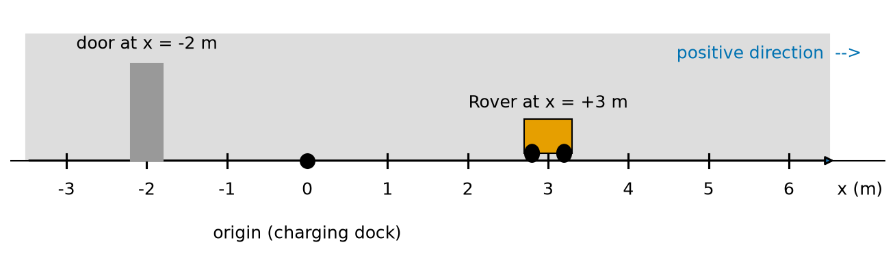
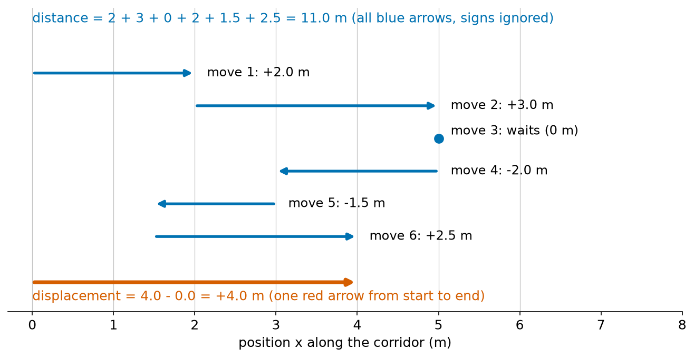
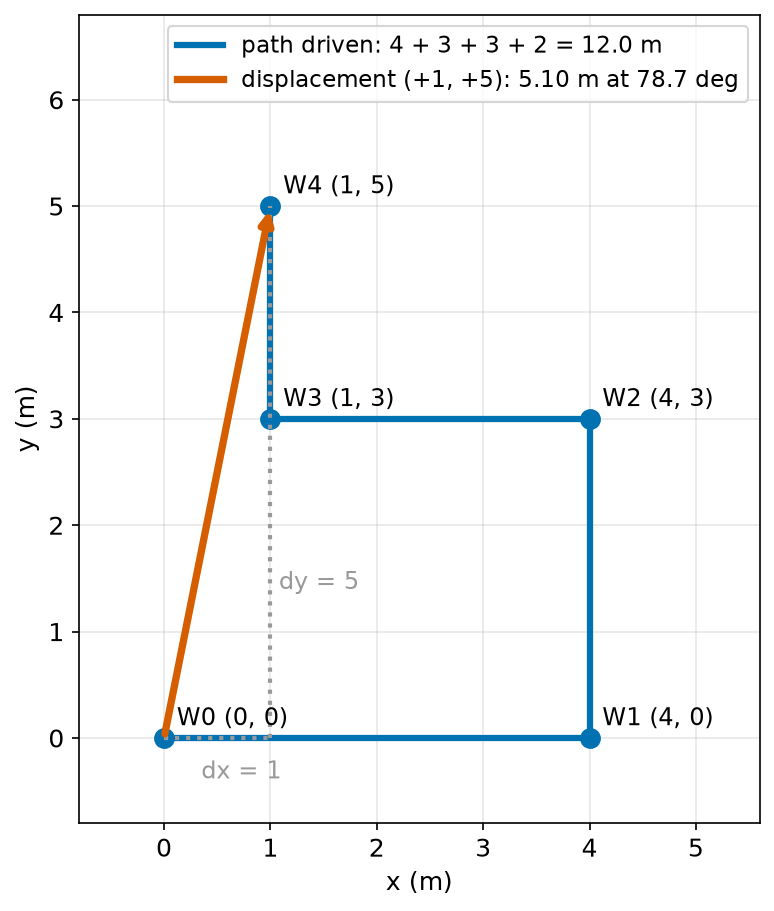
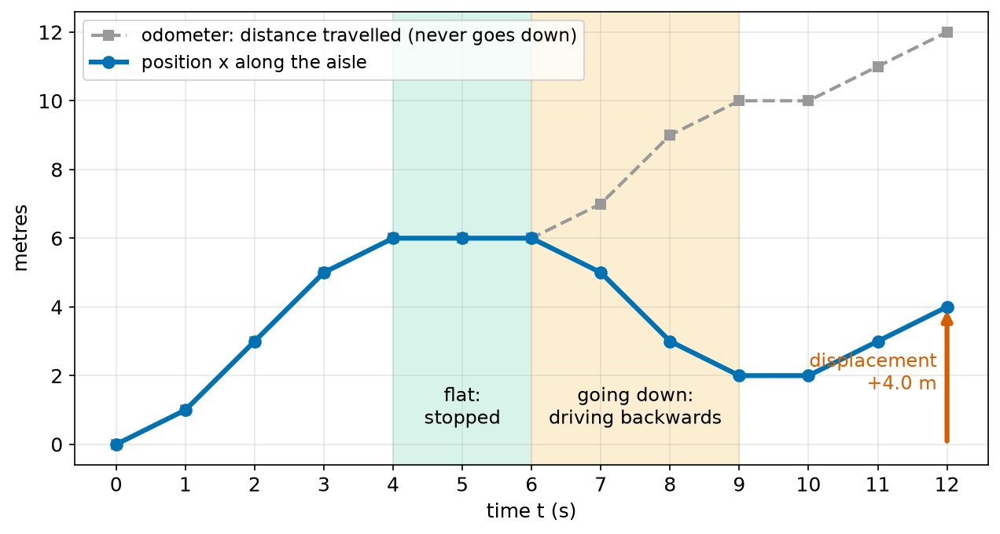
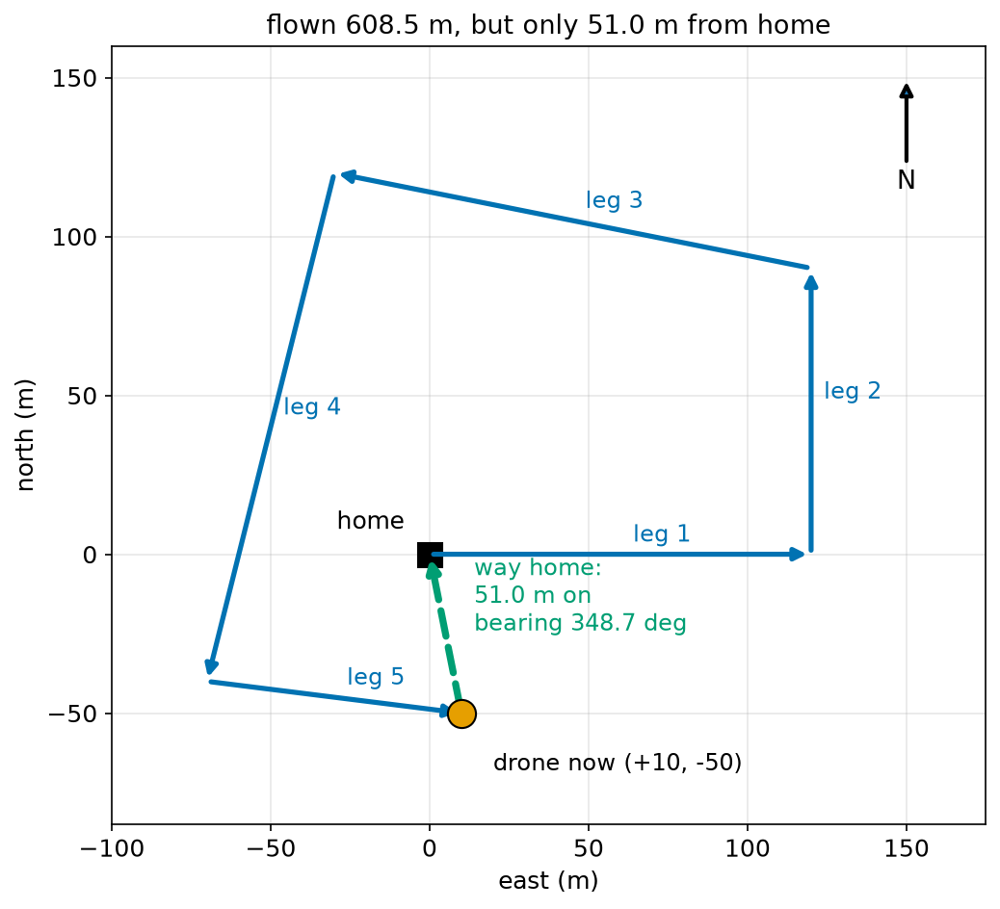
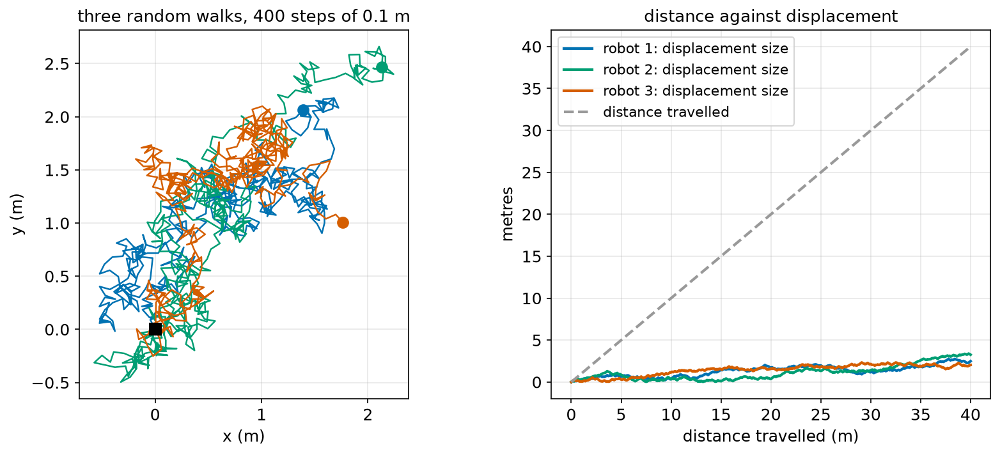

# Chapter 56 — Position, Distance and Displacement

> **Part 4 · Chapter 56 of 749**
> **You need:** Chapter 42 (coordinates), Chapter 48 (Pythagoras), Chapter 50 (`atan2`) and Chapter 53 (sums).
> **You will make:** a program that finds how far a robot travelled and where it ended up, a path-length calculator for waypoints, an odometer for a warehouse robot built from encoder ticks, and a "return home" calculator for a drone.

---

## What you will learn

- What **physics** is, and why a robot builder needs it.
- What **position** means, and why it always needs an **origin** and a **direction**.
- The difference between **distance travelled** and **displacement**.
- Why displacement has a **sign** (in a line) or a **direction** (on a flat floor).
- How to find the length of a path through many waypoints.
- How to read a **position–time graph**.
- How real robots measure position: wheel encoders, markers and satellites.
- Why a robot that only adds up small steps slowly becomes less sure where it is.

---

## New words in this chapter

| Word | Simple meaning |
|---|---|
| **physics** | The science of how things move, push, pull, heat up and store energy. |
| **position** | Where something is, measured from a chosen point. |
| **origin** | The chosen point where position is 0. |
| **reference frame** | The origin plus the chosen directions. Every position is measured in one. |
| **distance travelled** | The total length of the path, all steps counted as positive. |
| **displacement** | The change in position: end minus start. It has a direction. |
| **scalar** | A quantity that is only a size, such as 11 m or 20 °C. |
| **vector** | A quantity that has a size **and** a direction, such as "5 m north". |
| **path length** | The distance travelled along a path made of straight legs. |
| **position–time graph** | A graph with time across the bottom and position up the side. |
| **odometer** | A counter that adds up the distance travelled. |
| **odometry** | Working out where a robot is by adding up its own small movements. |
| **drift** | Small errors that add up, so the estimated position slowly moves away from the true one. |

---

## 56.1 Welcome to physics

Parts 1 to 3 gave you two tools: Python to tell a robot what to do, and maths to work out numbers. But a robot is not only a program. It is a **thing** with weight. It rolls, slips, tips over, gets hot and runs out of battery. To make it do what we want, we must understand how real things move.

📖 **New word: physics** — the science of how things move, push, pull, heat up and store energy.

Part 4 is physics for robots. We go in small steps:

| Chapters | Question |
|---|---|
| 56–60 | **Where** is it, and how is it moving? (position, speed, acceleration) |
| 61–63 | **Why** does it move? (forces, weight, friction) |
| 64–66 | How does it **turn**? (angles, torque, how hard it is to spin) |
| 67–69 | How much **energy** does it use, and how do gears and wheels change things? |
| 70 | Why does it **fall over**? |
| 71–72 | How do we **simulate** all of this in Python? |

This chapter starts at the very beginning: the question "where is it?".

🤖 **Robot link.** Almost every robot program asks "where am I?" many times a second. A robot vacuum must know where it has cleaned. A factory arm must know where its gripper is. A drone must know where home is. All of it starts with position.

---

## 56.2 Position needs an origin and a direction

Imagine you phone a friend and say: "I am at 3 metres." Your friend cannot find you. 3 metres from **what**? In **which** direction?

A position only makes sense when we agree two things:

1. **The origin**: the point we measure from. There, the position is 0.
2. **The positive direction**: which way the numbers grow.

📖 **New word: origin** — the chosen point where the position is 0.

Think of Rover in a long, straight corridor. We choose its charging dock as the origin, and "towards the kitchen" as the positive direction. We call the position **x** and measure it in metres.

```
   door                dock (origin)              Rover
    |                     |                         |
 ---+----+----+----+------+----+----+----+----+-----+----+----+---->  x (m)
   -2        -1          0         1         2      3         4
```



*Figure 56.1 — Rover's position in a corridor is a single number, measured from the dock.*

**How to read this picture:** The grey band is the corridor. The black line under it is a number line (Chapter 42), marked in metres. The black dot at 0 is the origin, the charging dock. The arrow on the right shows the positive direction. Rover, in orange, is at x = +3 m: 3 metres from the dock, towards the kitchen. The door is at x = −2 m: 2 metres from the dock in the **other** direction. The minus sign means "the other side of the origin".

🔢 **Maths.** Positions on a line are just numbers, so all the rules of Chapter 37 apply. The gap between Rover and the door is

```
gap = 3 − (−2) = 5 m
```

In words: "the gap is the bigger position minus the smaller one".

📖 **New word: reference frame** — the origin together with the chosen directions. Every position is measured "in" some reference frame.

The same Rover can have different positions in different frames:

| Frame | Origin | Rover's position |
|---|---|---|
| Dock frame | the charging dock | x = +3 m |
| Door frame | the door | x = +5 m |
| Kitchen frame | the kitchen, 8 m from the dock, positive towards the dock | x = +5 m |

None of these is "wrong". They are different frames. What matters is that everyone working with a number knows which frame it is in.

⚠️ **Watch out.** Many robot bugs come from mixing frames: one program measures from the dock, another from the door, and the robot drives into a wall. Part 16 (Chapter 314 onwards) gives robots a careful way to keep track of many frames, and ROS 2 has a whole tool for it (Chapter 570). For now, always write down the origin and the positive direction.

**Small example.** A lift (elevator) robot measures its height from the ground floor, with up as positive. The basement is at −3 m. Floor 2 is at +6 m. Going from the basement to floor 2, the lift rises 6 − (−3) = 9 m.

---

## 56.3 Distance travelled and displacement

Now Rover moves. It drives from the dock (x = 0) to x = 5 m, then back to x = 3 m.

- How far did Rover **drive**? 5 m out and 2 m back: **7 m**.
- How far is Rover **from where it started**? It is at 3 m, it started at 0: **3 m**, on the positive side.

These are two different questions with two different answers. Physics gives each one a name.

📖 **New word: distance travelled** — the total length of the path. Every bit of movement adds to it, forwards or backwards. It can never be negative and never goes down.

📖 **New word: displacement** — the change in position: **end position minus start position**. It can be positive, negative or zero.

🔢 **Maths.** For a robot that starts at x_start and ends at x_end:

```
displacement   Δx = x_end − x_start
```

In words: "delta x equals the end position minus the start position".

📖 **New word: Δ (delta)** — the Greek capital letter D. In physics, Δ means "the change in". Δx is "the change in x". It is **not** Δ times x. It is one name.

For the distance travelled, we add up the size of every step, ignoring the signs. In the Σ notation of Chapter 53:

```
distance = Σ |x_(i) − x_(i−1)|      for i = 1 to n
```

In words: "add up, for every step, the size of the change in position".

A longer trip shows the difference clearly. Rover's positions after each move are: 0, 2, 5, 5, 3, 1.5, 4 (in metres).



*Figure 56.2 — Each blue arrow is one move. The red arrow is the displacement.*

**How to read this picture:** Across the bottom is the position along the corridor. Each blue arrow is one move, drawn one below the other so they do not hide each other. Arrows pointing right are positive moves. Arrows pointing left are negative moves. Move 3 is a dot: Rover waited. The **distance** is the total length of all the blue arrows, which is 11.0 m. The **displacement** is the single red arrow from the start (0) to the end (4). It is only +4.0 m, because the backward moves cancel part of the forward moves.

| Move | From | To | Step (signed) | Size of step |
|---|---|---|---|---|
| 1 | 0.0 | 2.0 | +2.0 | 2.0 |
| 2 | 2.0 | 5.0 | +3.0 | 3.0 |
| 3 | 5.0 | 5.0 | 0.0 | 0.0 |
| 4 | 5.0 | 3.0 | −2.0 | 2.0 |
| 5 | 3.0 | 1.5 | −1.5 | 1.5 |
| 6 | 1.5 | 4.0 | +2.5 | 2.5 |
| **Total** | | | **+4.0** (displacement) | **11.0** (distance) |

Look at the totals. If you add the **signed** steps, you get the displacement: +4.0 m. If you add the **sizes** of the steps, you get the distance: 11.0 m.

🧠 **Remember:** the sum of the signed steps is the displacement. The sum of the sizes is the distance travelled. The displacement can never be bigger than the distance, because backward steps can only cancel, never add extra.

**Special case.** A robot that drives a full lap of a room and comes back to its dock has a displacement of **zero**, even if it drove 50 m. The robot vacuum's odometer says 50 m, but its displacement says "you are home".

🤖 **Robot link.** Both numbers matter, for different jobs:

| Number | Who uses it | Why |
|---|---|---|
| Distance travelled | maintenance | Wheels, tyres and gearboxes wear out with distance. "Change the wheels every 500 km." |
| Distance travelled | battery planning | Energy use depends on how far you drive, not where you end. |
| Displacement | navigation | "Where am I now?" is the start position plus the displacement. |
| Displacement | the next move | "How do I get back?" is the displacement with the sign flipped. |

---

## 56.4 Scalars and vectors

The distance travelled is just a number with a unit: 11.0 m. The displacement is a number **with a direction**: +4.0 m, which means "4 m towards the kitchen". This difference is so important that physics gives it names.

📖 **New word: scalar** — a quantity that is only a size, such as 11 m, 3 kg or 20 °C.

📖 **New word: vector** — a quantity that has a size **and** a direction, such as "4 m towards the kitchen" or "5 m north".

| Scalar | Vector |
|---|---|
| distance travelled | displacement |
| speed (Chapter 57) | velocity (Chapter 57) |
| mass (Chapter 62) | force (Chapter 61) |
| energy (Chapter 67) | acceleration (Chapter 58) |

On a straight line, a vector is easy: the **sign** gives the direction. +4 m means "forwards", −4 m means "backwards".

On a flat floor, the robot can move in any direction. Now a displacement needs **two** numbers: how far it moved in x and how far in y. We write it as a pair, like a coordinate (Chapter 42):

```
displacement = (Δx, Δy) = (x_end − x_start, y_end − y_start)
```

From this pair we can get the **size** (how far, in a straight line) with Pythagoras (Chapter 48), and the **direction** with `atan2` (Chapter 50):

```
size       = √(Δx² + Δy²)
direction  = atan2(Δy, Δx)
```

🔢 **Maths.** A robot drives from (1, 2) to (4, 6).

```
Δx = 4 − 1 = 3 m
Δy = 6 − 2 = 4 m
size = √(3² + 4²) = √25 = 5 m
direction = atan2(4, 3) = 53.1°   (measured from the x axis, anticlockwise)
```

In words: "the robot is now 5 metres from where it started, in the direction 53.1° from the x axis".

💡 **Tip.** You have already met a vector: the "arrow" from Rover to its goal in Chapter 50's go-to-goal program was exactly a displacement vector. Chapter 60 looks at vectors more carefully, and Part 9 (Chapter 154 onwards) teaches all of vector maths.

---

## 56.5 Paths with many legs

Real robots rarely drive in one straight line. A warehouse robot follows aisles. A robot vacuum drives in rows. Their path is made of straight pieces.

📖 **New word: leg** — one straight piece of a path, from one waypoint to the next.

📖 **New word: path length** — the distance travelled along all the legs, added up.

🔢 **Maths.** For waypoints W₀, W₁, …, Wₙ:

```
path length = Σ |W_i − W_(i−1)|       for i = 1 to n
            = Σ √((x_i − x_(i−1))² + (y_i − y_(i−1))²)
```

In words: "for every leg, find its straight-line length with Pythagoras, then add up all the legs". The displacement only uses the **first** and **last** waypoints:

```
displacement = W_n − W_0 = (x_n − x_0, y_n − y_0)
```

Rover drives through W0 (0, 0), W1 (4, 0), W2 (4, 3), W3 (1, 3) and W4 (1, 5).



*Figure 56.3 — The blue path is 12.0 m long. The red displacement arrow is only 5.10 m.*

**How to read this picture:** The blue line is the path Rover drove, leg by leg: 4 m right, 3 m up, 3 m left, 2 m up. The legs add up to 12.0 m. The red arrow goes straight from W0 to W4: that is the displacement. The grey dotted lines show its two parts: 1 m in x and 5 m in y. By Pythagoras, the red arrow is √(1² + 5²) = 5.10 m long.

📖 **New word: straightness** — displacement size ÷ path length. A perfectly straight drive has straightness 1 (100%). A path that wanders has a small straightness. Here it is 5.10 / 12.0 = 42%. This is not a standard physics word, but it is a useful number for comparing routes.

🤖 **Robot link.** Route planners (Part 23) try to make the path as short as possible. The displacement gives the shortest possible path length when nothing is in the way, so "path length ÷ straight-line distance" tells you how much a route costs extra because of walls and shelves.

---

## 56.6 Position over time

So far we only listed positions. But robots move **in time**. To describe a trip fully, we record the position **and the time** when it was measured.

📖 **New word: position–time graph** — a graph with time across the bottom and position up the side. It is a function (Chapter 44): for each time, there is exactly one position.

Reading a position–time graph is a skill every robot engineer uses daily, when they look at logged data:

| What the line does | What the robot does |
|---|---|
| goes **up** | moves in the positive direction |
| goes **down** | moves in the negative direction |
| is **flat** | stands still |
| is **steep** | moves fast |
| is **gentle** | moves slowly |
| is **higher** than another point | is further in the positive direction |

The steepness is the **slope** of Chapter 43. Chapter 57 shows that the slope of a position–time graph **is** the velocity. For now, "steeper means faster" is enough.



*Figure 56.4 — The blue line is the warehouse robot's position. The grey line is its odometer.*

**How to read this picture:** Across the bottom is time in seconds. The blue line is the position along the aisle. It rises for 4 s (driving forwards), stays flat for 2 s (green band: stopped), falls for 3 s (orange band: driving backwards), is flat again for 1 s, and rises again. The grey dashed line is the odometer: the distance travelled. It never goes down, and it rises even while the robot drives backwards. During the green band both lines are flat. At t = 12 s, the position is 4.0 m (the red arrow, the displacement) and the odometer shows 12.0 m. This picture comes from Application 1 below.

⚠️ **Watch out.** A position–time graph is **not** a picture of the path. The blue line goes up and down, but the robot did not climb a hill: it drove forwards and backwards along a flat aisle. The vertical axis is position, not height.

---

## 56.7 How robots measure position

There are two families of ways to know where a robot is.

**1. Count your own movements.** The robot measures each small movement of its own wheels, and adds them up.

📖 **New word: odometry** — working out where a robot is by adding up its own small movements. The word comes from the Greek for "way measuring".

The usual tool is the **wheel encoder** of Chapter 37: a disc on the wheel that gives a fixed number of **ticks** per turn. Chapter 47 turned ticks into distance:

```
distance per tick = π × wheel diameter / ticks per turn
```

With a direction signal (forwards or backwards), the encoder count is **signed**. Then:

- adding the **signed** steps gives the displacement, and
- adding the **sizes** of the steps gives the distance travelled.

That is exactly section 56.3 again, with ticks instead of metres.

**2. Measure from the outside world.** The robot sees something whose position is already known:

| Method | How it works | Typical accuracy |
|---|---|---|
| floor markers | a camera reads coded stickers on the floor (Chapter 491) | a few millimetres |
| satellite navigation (GNSS, such as GPS) | radio signals from satellites (Chapter 130) | 2–5 m alone, 2 cm with corrections |
| beacons | radio or ultrasonic beacons on the walls | a few centimetres |
| matching a map | a laser scanner compares what it sees with a map (Part 22) | a few centimetres |

📖 **New word: drift** — small errors that add up step after step, so the estimated position slowly moves away from the true one.

Odometry has a big weakness. Every small step has a small error: the wheel slips a little, the floor is uneven, the wheel is not exactly the size we think. Chapter 53 showed that adding many steps also adds their errors. After a long drive, the odometry position can be far from the truth. That is drift. Outside measurements do not drift, but they can be slow, noisy or missing (no GPS indoors). Real robots use **both** and blend them (Part 21, especially Chapter 426).

🤖 **Robot link.** This is one of the deepest questions in robotics: "where am I, really?". It is called **localisation**, and Part 22 is about it. It all starts with the simple idea of this chapter: position = start + sum of displacements.

---

## Code

File `code/ch056/corridor_trip.py`:

```python
# corridor_trip.py - distance travelled and displacement for a robot in a corridor
positions_m = [0.0, 2.0, 5.0, 5.0, 3.0, 1.5, 4.0]   # position after each move

distance_m = 0.0
for i in range(1, len(positions_m)):
    step_m = positions_m[i] - positions_m[i - 1]
    distance_m = distance_m + abs(step_m)
    print(f"move {i}: from {positions_m[i - 1]:4.1f} to {positions_m[i]:4.1f}   step {step_m:+5.1f} m")

displacement_m = positions_m[-1] - positions_m[0]
print(f"distance travelled: {distance_m:.1f} m")
print(f"displacement:       {displacement_m:+.1f} m")
```

| Line | Code | What it does (simple English) |
|---|---|---|
| 1 | `# corridor_trip.py …` | A comment: the file's name and job. |
| 2 | `positions_m = [0.0, 2.0, …]` | Rover's position after each move, in metres. The first is the start. |
| 3 | (blank) | Spacing. |
| 4 | `distance_m = 0.0` | The running total of the distance starts at 0. |
| 5 | `for i in range(1, len(positions_m)):` | i goes 1, 2, …, 6: one value for each move. We start at 1 because move i goes from position i − 1 to position i. |
| 6 | `step_m = positions_m[i] - positions_m[i - 1]` | The signed step: end of this move minus its start. |
| 7 | `distance_m = distance_m + abs(step_m)` | `abs` removes the sign, so a backward step adds a positive amount. |
| 8 | `print(f"move {i}: …")` | Shows each move. `:+5.1f` always prints a sign, so you can see the direction. |
| 9 | (blank) | Spacing. |
| 10 | `displacement_m = positions_m[-1] - positions_m[0]` | End minus start. `[-1]` is the last item (Chapter 21). |
| 11 | `print(f"distance travelled: …")` | The distance, one decimal place. |
| 12 | `print(f"displacement:       …")` | The displacement, with its sign. |

Output:

```
move 1: from  0.0 to  2.0   step  +2.0 m
move 2: from  2.0 to  5.0   step  +3.0 m
move 3: from  5.0 to  5.0   step  +0.0 m
move 4: from  5.0 to  3.0   step  -2.0 m
move 5: from  3.0 to  1.5   step  -1.5 m
move 6: from  1.5 to  4.0   step  +2.5 m
distance travelled: 11.0 m
displacement:       +4.0 m
```

The two totals match the table in section 56.3.

🧪 **Experiment.** Change the last position from 4.0 to −1.0 and run again. The distance grows to 13.5 m, but the displacement becomes −1.0 m: Rover ended up behind the dock.

File `code/ch056/path_2d.py`:

```python
# path_2d.py - path length and displacement for a robot driving through waypoints
import math

waypoints = [(0.0, 0.0), (4.0, 0.0), (4.0, 3.0), (1.0, 3.0), (1.0, 5.0)]

path_m = 0.0
for i in range(1, len(waypoints)):
    x0, y0 = waypoints[i - 1]
    x1, y1 = waypoints[i]
    leg_m = math.hypot(x1 - x0, y1 - y0)
    path_m = path_m + leg_m
    print(f"leg {i}: ({x0}, {y0}) -> ({x1}, {y1})   {leg_m:.2f} m")

dx = waypoints[-1][0] - waypoints[0][0]
dy = waypoints[-1][1] - waypoints[0][1]
straight_m = math.hypot(dx, dy)
heading_deg = math.degrees(math.atan2(dy, dx))

print(f"path length:   {path_m:.2f} m")
print(f"displacement:  ({dx:+.1f}, {dy:+.1f}) m, size {straight_m:.2f} m, direction {heading_deg:.1f} deg")
print(f"straightness:  {straight_m / path_m:.0%}")
```

| Line | Code | What it does (simple English) |
|---|---|---|
| 1 | `# path_2d.py …` | A comment. |
| 2 | `import math` | For `hypot`, `atan2` and `degrees`. |
| 3 | (blank) | Spacing. |
| 4 | `waypoints = [(0.0, 0.0), …]` | A list of (x, y) tuples (Chapter 22), in metres. |
| 5 | (blank) | Spacing. |
| 6 | `path_m = 0.0` | The running total of the path length. |
| 7 | `for i in range(1, len(waypoints)):` | One loop for each leg. |
| 8 | `x0, y0 = waypoints[i - 1]` | Unpacks the start of this leg into two names. |
| 9 | `x1, y1 = waypoints[i]` | The end of this leg. |
| 10 | `leg_m = math.hypot(x1 - x0, y1 - y0)` | Pythagoras: `hypot(a, b)` is √(a² + b²) (Chapter 48). |
| 11 | `path_m = path_m + leg_m` | Adds this leg to the total. |
| 12 | `print(f"leg {i}: …")` | Shows the leg. |
| 13 | (blank) | Spacing. |
| 14 | `dx = waypoints[-1][0] - waypoints[0][0]` | x of the last waypoint minus x of the first. `[-1][0]` means "last item, first number". |
| 15 | `dy = waypoints[-1][1] - waypoints[0][1]` | The same for y. |
| 16 | `straight_m = math.hypot(dx, dy)` | The size of the displacement. |
| 17 | `heading_deg = math.degrees(math.atan2(dy, dx))` | Its direction, from the x axis, in degrees (Chapter 50). |
| 18 | (blank) | Spacing. |
| 19 | `print(f"path length: …")` | The total. |
| 20 | `print(f"displacement: …")` | Both parts, the size and the direction. |
| 21 | `print(f"straightness: …")` | Displacement ÷ path. `.0%` prints it as a whole percentage. |

Output:

```
leg 1: (0.0, 0.0) -> (4.0, 0.0)   4.00 m
leg 2: (4.0, 0.0) -> (4.0, 3.0)   3.00 m
leg 3: (4.0, 3.0) -> (1.0, 3.0)   3.00 m
leg 4: (1.0, 3.0) -> (1.0, 5.0)   2.00 m
path length:   12.00 m
displacement:  (+1.0, +5.0) m, size 5.10 m, direction 78.7 deg
straightness:  42%
```

---

## Small examples

**Example 1.** A robot goes from x = 2 m to x = 7 m. Δx = 7 − 2 = +5 m.

**Example 2.** A robot goes from x = 7 m to x = 2 m. Δx = 2 − 7 = −5 m. Same distance, opposite displacement.

**Example 3.** A robot goes 6 m forwards and 6 m back. Distance 12 m, displacement 0 m.

**Example 4.** A robot drives from (0, 0) to (6, 8). The displacement is (6, 8), of size √(36 + 64) = 10 m.

**Example 5.** A robot drives around a square of side 2 m and stops at its start. Path length 8 m, displacement 0.

**Example 6.** A robot drives along half of a circle of radius 1 m (Chapter 48). Path length π × 1 = 3.14 m. Displacement: straight across the circle, 2 m.

**Example 7.** A lift goes from floor 5 (+15 m) down to floor 1 (+3 m). Δ height = 3 − 15 = −12 m. The minus sign says "down".

**Example 8.** An encoder has 0.5 mm per tick. It counts +4000, then −1000 ticks. Displacement: 3000 × 0.5 = 1500 mm = +1.5 m. Distance: 5000 × 0.5 = 2.5 m.

---

## 🏭 Real robot applications

### Application 1 (worked in full) — 📦 A warehouse robot's odometer and position

**1. The real problem.** A warehouse robot drives up and down a straight aisle, fetching boxes. The company wants two numbers from it: **where it is now**, so it can stop at the right shelf, and **how far it has driven in total**, so the mechanics know when to change its wheels. Both must come from the same wheel encoder.

**2. Why this theory.** "Where it is" is the start position plus the **displacement**: we add the signed steps. "How far it has driven" is the **distance travelled**: we add the sizes of the steps. One list of signed encoder counts gives both.

**3. The numbers.** The encoder gives 1024 ticks per wheel turn. The wheel is 0.20 m across. Every second, the robot reads how many ticks the wheel turned, with a sign: + towards the end of the aisle, − back towards the start. A 12-second log:

```
1630, 3260, 3260, 1630, 0, 0, −1630, −3260, −1630, 0, 1630, 1630
```

**4. The maths.**

```
metres per tick = π × 0.20 / 1024
                = 0.6283 / 1024
                = 0.0006136 m   (0.6136 mm)
```

So 1630 ticks is 1630 × 0.0006136 = 1.0002 m, almost exactly 1 m.

Adding the signed counts: 1630 + 3260 + 3260 + 1630 − 1630 − 3260 − 1630 + 1630 + 1630 = 6520 ticks, which is 6520 × 0.0006136 = 4.00 m. That is the displacement.

Adding the sizes: 1630 + 3260 + 3260 + 1630 + 1630 + 3260 + 1630 + 1630 + 1630 = 19,560 ticks = 12.00 m. That is the odometer reading.

**5. The code.** File `code/ch056/encoder_trip.py`:

```python
# encoder_trip.py - a warehouse robot's odometer (distance) and where it is (displacement)
import math

TICKS_PER_REV = 1024
WHEEL_DIAMETER_M = 0.20
M_PER_TICK = math.pi * WHEEL_DIAMETER_M / TICKS_PER_REV

# signed tick counts read every second: + forwards along the aisle, - backwards
tick_log = [1630, 3260, 3260, 1630, 0, 0, -1630, -3260, -1630, 0, 1630, 1630]

position_m = 0.0
odometer_m = 0.0
for second, ticks in enumerate(tick_log, start=1):
    step_m = ticks * M_PER_TICK
    position_m = position_m + step_m
    odometer_m = odometer_m + abs(step_m)
    print(f"t = {second:2d} s   step {step_m:+6.3f} m   position {position_m:6.3f} m   odometer {odometer_m:6.3f} m")

print(f"metres per tick: {M_PER_TICK * 1000:.4f} mm")
print(f"displacement after {len(tick_log)} s: {position_m:+.2f} m")
print(f"distance on the odometer:   {odometer_m:.2f} m")
```

| Line | Code | What it does (simple English) |
|---|---|---|
| 1 | `# encoder_trip.py …` | A comment. |
| 2 | `import math` | For `math.pi`. |
| 3 | (blank) | Spacing. |
| 4 | `TICKS_PER_REV = 1024` | Ticks for one full turn of the wheel. Capital letters: a constant (Chapter 14). |
| 5 | `WHEEL_DIAMETER_M = 0.20` | The wheel is 20 cm across. |
| 6 | `M_PER_TICK = math.pi * WHEEL_DIAMETER_M / TICKS_PER_REV` | The circumference (π × diameter, Chapter 48) shared between the ticks. |
| 7 | (blank) | Spacing. |
| 8 | `# signed tick counts …` | A comment that explains the sign. |
| 9 | `tick_log = [1630, …]` | The counts, one per second. |
| 10 | (blank) | Spacing. |
| 11 | `position_m = 0.0` | The robot starts at the origin, the start of the aisle. |
| 12 | `odometer_m = 0.0` | The odometer starts at 0 for this log. |
| 13 | `for second, ticks in enumerate(tick_log, start=1):` | Goes through the log. `enumerate` also gives a counter, starting at 1 (Chapter 21). |
| 14 | `step_m = ticks * M_PER_TICK` | Turns this second's ticks into metres, keeping the sign. |
| 15 | `position_m = position_m + step_m` | Signed sum: the displacement so far. |
| 16 | `odometer_m = odometer_m + abs(step_m)` | Sum of sizes: the distance so far. |
| 17 | `print(f"t = …")` | One line per second. |
| 18 | (blank) | Spacing. |
| 19 | `print(f"metres per tick: …")` | × 1000 shows it in millimetres. |
| 20 | `print(f"displacement after …")` | The final position, with its sign. |
| 21 | `print(f"distance on the odometer: …")` | The total distance. |

Output:

```
t =  1 s   step +1.000 m   position  1.000 m   odometer  1.000 m
t =  2 s   step +2.000 m   position  3.000 m   odometer  3.000 m
t =  3 s   step +2.000 m   position  5.001 m   odometer  5.001 m
t =  4 s   step +1.000 m   position  6.001 m   odometer  6.001 m
t =  5 s   step +0.000 m   position  6.001 m   odometer  6.001 m
t =  6 s   step +0.000 m   position  6.001 m   odometer  6.001 m
t =  7 s   step -1.000 m   position  5.001 m   odometer  7.001 m
t =  8 s   step -2.000 m   position  3.000 m   odometer  9.001 m
t =  9 s   step -1.000 m   position  2.000 m   odometer 10.002 m
t = 10 s   step +0.000 m   position  2.000 m   odometer 10.002 m
t = 11 s   step +1.000 m   position  3.000 m   odometer 11.002 m
t = 12 s   step +1.000 m   position  4.001 m   odometer 12.002 m
metres per tick: 0.6136 mm
displacement after 12 s: +4.00 m
distance on the odometer:   12.00 m
```

Notice the small "0.001"s. Each 1630 ticks is 1.0002 m, not exactly 1 m, so tiny extras build up. This is real: a whole number of ticks almost never makes an exact round number of metres.

Figure 56.4 (in section 56.6) is a plot of this output.

**6. The result.** After 12 seconds the robot is 4.00 m along the aisle, and it has driven 12.00 m. If the mechanics change the wheels every 500 km, they read the odometer, not the position. If the robot must stop at a shelf at 4.0 m, it reads the position, not the odometer. Using the wrong one would be a serious bug: a robot that used the odometer as its position would think it was 12 m down the aisle and drive past its shelf.

**7. Going further.** Real warehouse robots have two driven wheels and turn, so they need 2D odometry with a heading (Chapter 288). Because odometry drifts, many warehouse robots also read coded markers in the floor every metre or so, and reset their position each time they see one.

### Application 2 (worked in full) — 🚁 A drone finds its way home

**1. The real problem.** A small survey drone flies a route over a field. When its battery gets low, or when it loses the radio link to its pilot, it must **return home** by itself. To do that, it needs to know two things: how far away home is, and in which direction.

**2. Why this theory.** The drone keeps track of its position as the **sum of the displacements** of every leg it has flown. Home is at the origin, so the way home is simply the current position with the signs flipped. Its size (Pythagoras) is the distance home, and its direction (`atan2`) is the way to point.

**3. The numbers.** We use a frame with east as x and north as y, and the take-off point as the origin. The drone flies five legs (in metres): (120, 0), (0, 90), (−150, 30), (−40, −160), (80, −10).

📖 **New word: compass bearing** — a direction measured clockwise from north, from 0° to 360°. North is 0°, east 90°, south 180°, west 270°. Pilots and drones use bearings.

**4. The maths.** Adding the legs:

```
east  = 120 + 0 − 150 − 40 + 80  = +10 m
north = 0 + 90 + 30 − 160 − 10   = −50 m
```

The drone is at (+10, −50): 10 m east and 50 m south of home.

The way home is the opposite: (−10, +50).

```
distance home = √(10² + 50²) = √2600 = 51.0 m
```

The bearing is measured from north, clockwise. That swaps the roles of x and y compared with Chapter 50's angle: bearing = atan2(east part, north part).

```
bearing = atan2(−10, +50) = −11.3°   →   −11.3° + 360° = 348.7°
```

In words: "fly 51 m, a little west of north". 348.7° is just 11.3° to the left of north, which matches "10 m west and 50 m north".

The distance flown is the sum of the leg lengths:

```
120 + 90 + √(150² + 30²) + √(40² + 160²) + √(80² + 10²)
= 120 + 90 + 153.0 + 164.9 + 80.6
= 608.5 m
```

**5. The code.** File `code/ch056/drone_home.py`:

```python
# drone_home.py - add up a drone's legs, then find the straight way home
import math

# each leg: (metres east, metres north) flown during that leg
legs = [(120.0, 0.0), (0.0, 90.0), (-150.0, 30.0), (-40.0, -160.0), (80.0, -10.0)]

east_m, north_m = 0.0, 0.0
flown_m = 0.0
for n, (de, dn) in enumerate(legs, start=1):
    east_m = east_m + de
    north_m = north_m + dn
    flown_m = flown_m + math.hypot(de, dn)
    print(f"after leg {n}: east {east_m:7.1f} m, north {north_m:7.1f} m, flown {flown_m:6.1f} m")

home_m = math.hypot(east_m, north_m)
home_bearing = math.degrees(math.atan2(-east_m, -north_m)) % 360
print(f"displacement from home: ({east_m:+.1f}, {north_m:+.1f}) m, {home_m:.1f} m away")
print(f"fly {home_m:.1f} m on compass bearing {home_bearing:.1f} deg to get home")
print(f"the way home is {home_m / flown_m:.0%} of the distance already flown")
```

| Line | Code | What it does (simple English) |
|---|---|---|
| 1 | `# drone_home.py …` | A comment. |
| 2 | `import math` | For `hypot`, `atan2` and `degrees`. |
| 3 | (blank) | Spacing. |
| 4 | `# each leg: …` | Says what the two numbers mean, and in what order. |
| 5 | `legs = [(120.0, 0.0), …]` | The five legs, each a displacement (east, north). |
| 6 | (blank) | Spacing. |
| 7 | `east_m, north_m = 0.0, 0.0` | The drone starts at home, the origin. |
| 8 | `flown_m = 0.0` | The distance flown starts at 0. |
| 9 | `for n, (de, dn) in enumerate(legs, start=1):` | For each leg: `n` counts from 1, and the tuple is unpacked into `de` (change east) and `dn` (change north). |
| 10 | `east_m = east_m + de` | Adds this leg's east part to the position. |
| 11 | `north_m = north_m + dn` | Adds its north part. |
| 12 | `flown_m = flown_m + math.hypot(de, dn)` | Adds the length of this leg (always positive). |
| 13 | `print(f"after leg {n}: …")` | Shows the position and the distance after each leg. |
| 14 | (blank) | Spacing. |
| 15 | `home_m = math.hypot(east_m, north_m)` | The straight-line distance home: the size of the displacement. |
| 16 | `home_bearing = math.degrees(math.atan2(-east_m, -north_m)) % 360` | The way home is (−east, −north). `atan2(east part, north part)` gives an angle from north, clockwise. `% 360` turns −11.3 into 348.7 (Chapter 47). |
| 17 | `print(f"displacement from home: …")` | The position and how far away it is. |
| 18 | `print(f"fly …")` | The instruction for the flight controller. |
| 19 | `print(f"the way home is …")` | Compares the way home with the distance flown. |

Output:

```
after leg 1: east   120.0 m, north     0.0 m, flown  120.0 m
after leg 2: east   120.0 m, north    90.0 m, flown  210.0 m
after leg 3: east   -30.0 m, north   120.0 m, flown  363.0 m
after leg 4: east   -70.0 m, north   -40.0 m, flown  527.9 m
after leg 5: east    10.0 m, north   -50.0 m, flown  608.5 m
displacement from home: (+10.0, -50.0) m, 51.0 m away
fly 51.0 m on compass bearing 348.7 deg to get home
the way home is 8% of the distance already flown
```



*Figure 56.5 — The drone has flown 608.5 m, but home is only 51.0 m away.*

**How to read this picture:** East is to the right and north is up, as on a map (the arrow marked N). The black square is home, the take-off point. The blue arrows are the five legs, in order. The orange dot is the drone now, at (+10, −50). The green dashed arrow is the way home: short, and pointing a little to the left of straight up (north).

**6. The result.** The drone needs only 51.0 m to get home, which is 8% of the 608.5 m it has flown. A drone that tried to "fly the route backwards" would fly 608.5 m again and might run out of battery on the way. A drone that knows its displacement flies the short way. This is why the "return to home" button on real drones is safe even after a long, winding flight.

**7. Going further.** Real drones get their position from satellite navigation (Chapter 130) and blend it with their motion sensors (Chapter 633), because adding up legs alone would drift. Real return-to-home also climbs first to a safe height, to clear trees and buildings, so it moves in three directions, not two (Chapter 649). Wind blows the drone sideways, so the controller must keep correcting the direction it points.

### Application 3 — 🚀 Odometry on Mars

A planetary rover cannot use satellite navigation: there are no navigation satellites around Mars. Rovers on Mars have used wheel odometry, plus a better method called **visual odometry**: a camera takes a picture every short drive, and a computer measures how far the ground has moved between pictures (Chapter 497). Wheel odometry alone is badly wrong when the wheels slip in sand. If a rover's wheels turn enough for 10 m but the cameras say it moved 6 m, the wheels slipped 40% of the time, and the rover stops before it digs itself in. Here the **distance the wheels turned** and the **real displacement** are compared on purpose, to detect a dangerous situation.

### Application 4 — 🏭 A factory arm's gripper path

A pick-and-place arm moves a part from a conveyor to a box 0.6 m away. Its displacement is 0.6 m. But the gripper must first lift the part 0.15 m (to clear the box wall), move across, then lower it 0.15 m. The path is 0.15 + 0.6 + 0.15 = 0.9 m, a straightness of 67%. If the arm makes 20 picks per minute, the gripper travels 0.9 × 2 (there and back) × 20 = 36 m per minute, 2,160 m per hour. Engineers use exactly this kind of sum to estimate how fast the arm can work and how quickly its cables wear. Part 20 shows how to plan smooth, short gripper paths.

### Application 5 — 🌾 Covering a field

A robot lawn mower or farm robot must **cover** an area, not reach a point. A rectangle of 30 m × 20 m mowed in back-and-forth rows 0.25 m apart needs 20 / 0.25 = 80 rows of 30 m, plus 79 short turns of 0.25 m. That is 80 × 30 + 79 × 0.25 = 2,419.75 m of path, about 2.4 km. Yet the displacement after the job is tiny: the robot ends near the far corner, √(30² + 20²) = 36 m from where it started. For coverage robots, path length is everything: it decides the battery, the time and the wear. Part 23 plans robot paths, and Chapter 67 turns distance into battery energy.

---

## 🔧 Hands-on lab

### Lab 56.1 — Walk a trip and measure it (hardware)

You need a tape measure (or a long string marked every metre), some sticky notes, and a friend.

1. In a corridor or garden, mark a start point with a sticky note. Choose a positive direction and write it on the note.
2. Ask your friend to call out moves, such as "forward 3 steps", "back 1 step", "forward 2 steps", "wait", "back 4 steps".
3. After each move, measure your position from the start with the tape. Write it down with a sign.
4. At the end, work out the distance travelled and the displacement by hand, as in section 56.3.
5. Type your positions into `positions_m` in `corridor_trip.py` and run it.

**What you should see:** The program gives the same two numbers as your hand calculation. The distance is always bigger than or equal to the size of the displacement. If you ended behind the start, the displacement is negative.

| If it does not work | Likely cause | Fix |
|---|---|---|
| The displacement has the wrong sign | You measured some positions from where you stood, not from the start | Always measure from the start mark |
| Distance and displacement are equal | You never went backwards | Include at least one backward move |
| `SyntaxError` | A missing comma between numbers in the list | Put a comma between every two numbers |

**Challenge:** Repeat with a friend who walks while you measure only their **steps**, not their position. Use step counts × your step length. How far off is the final position after 10 moves? This is drift, and you have just measured it.

### Lab 56.2 — Distance against displacement for a random robot (simulation)

Some simple cleaning robots drive in a random direction until they bump into something (Chapter 31). Here we look at a robot that takes small steps in completely random directions.

1. Write a program that starts at (0, 0) and takes 400 steps of 0.1 m. For each step, choose a random angle with `random.uniform(0, 2 * math.pi)`, then move by `0.1 * math.cos(a)` in x and `0.1 * math.sin(a)` in y.
2. Keep track of the distance travelled and of the size of the displacement, `math.hypot(x, y)`.
3. Print both at the end. Run it several times.
4. Change the number of steps to 1600 and run it several times again.



*Figure 56.6 — Three random walks of 40 m each. None of them gets more than about 3.5 m from the start.*

**How to read this picture:** On the left are the paths of three random robots. Each starts at the black square and ends at a coloured dot. They wander a lot but do not get far. On the right, across the bottom is the distance travelled, which grows steadily to 40 m (the grey dashed line). The coloured lines are the size of each robot's displacement. They stay small, between 2 and 3.5 m.

**What you should see:** The distance is always exactly 40.0 m for 400 steps. The displacement is different every run, usually between 1 and 4 m, and about 2 m on average. With 1600 steps (four times as many), the distance is 160 m, but the displacement is usually only about twice as large, around 4 m. For random steps, the typical displacement grows with the **square root** of the number of steps (Chapter 38): √400 × 0.1 = 2 m, √1600 × 0.1 = 4 m. This is also how random errors in odometry grow (Chapter 53).

| If it does not work | Likely cause | Fix |
|---|---|---|
| Displacement is 40 m | The angle is not random, or is chosen only once before the loop | Choose a new angle inside the loop |
| `NameError: random` | Missing import | `import random` and `import math` at the top |
| The same numbers every run | `random.seed(...)` is set | Remove the seed to see different runs |

**Challenge:** Run 1000 random walks of 400 steps and find the average displacement. How close is it to 2 m? (The exact average for a 2D random walk is a little less: about 1.77 m.)

### Lab 56.3 — Plan your own drone route (simulation)

Copy `drone_home.py`.

1. Change the legs to a route of your own with at least six legs.
2. Before you run it, draw the route on squared paper and guess the way home.
3. Run the program and compare its bearing with your drawing.
4. Add a seventh leg that brings the drone **exactly** home. What must it be?

**What you should see:** The bearing the program prints matches your drawing to within a few degrees. A final leg equal to (−east, −north) brings the drone to (0.0, 0.0), and the program prints "0.0 m away". Then the bearing line shows 0.0 deg or 180.0 deg, because `atan2(0, 0)` returns an angle even though there is no direction to go.

| If it does not work | Likely cause | Fix |
|---|---|---|
| The bearing is 180° wrong | You used `atan2(east, north)` instead of `atan2(-east, -north)` | The way home is the opposite of the displacement |
| The bearing is 90° wrong | You used `atan2(north, east)`, the Chapter 50 order | Bearings are measured from north: `atan2(east, north)` |
| A bearing like −30 | You forgot `% 360` | Add `% 360` |

**Challenge:** A drone must never fly more than 300 m from home. Add a check that prints a warning after any leg that ends more than 300 m away.

---

## Common mistakes

⚠️ **Forgetting the origin.** "The robot is at 3 m" means nothing until you say "from where".

⚠️ **Mixing frames.** One number measured from the dock and another measured from the door cannot be added.

⚠️ **Adding signed steps for the odometer.** Then backward moves make the odometer go down. Use `abs` for the distance.

⚠️ **Adding sizes for the position.** Then the robot thinks it is further away after driving backwards. Keep the sign for the displacement.

⚠️ **Reading a position–time graph as a picture of the path.** "Going down" on the graph means moving in the negative direction, not driving downhill.

⚠️ **Adding the sizes of 2D displacements to find the final position.** 3 m east plus 4 m north is 5 m away, not 7 m. Add the x parts and the y parts separately, then use Pythagoras once.

⚠️ **Mixing up angle conventions.** Maths angles start at the x axis and go anticlockwise. Compass bearings start at north and go clockwise.

⚠️ **Trusting odometry forever.** Small errors add up. Check the position against something outside the robot whenever you can.

---

## Practice

🏋️ **1.** A robot starts at x = −2 m and ends at x = 5 m. What is its displacement?

🏋️ **2.** A robot's positions are 0, 4, 1, 1, 6 (m). Find the distance travelled and the displacement.

🏋️ **3.** A robot drives from (2, 1) to (8, 9). Find the size of its displacement.

🏋️ **4.** A robot drives around a rectangle 5 m × 3 m and stops back at its start. Give the path length and the displacement.

🏋️ **5.** A robot drives along a quarter of a circle of radius 2 m, from (2, 0) to (0, 2). Find the path length and the size of the displacement.

🏋️ **6.** An encoder gives 0.25 mm per tick. In one minute it counts +12,000 ticks, then −4,000 ticks. Find the displacement and the distance in metres.

🏋️ **7.** A drone is at 30 m east and 40 m north of home. How far is home, and on what compass bearing must it fly?

🏋️ **8.** A position–time graph is flat from t = 2 s to t = 5 s. What is the robot doing?

🏋️ **9.** Waypoints are (0, 0), (3, 0), (3, 4), (0, 4). Find the path length, the displacement, and the straightness.

🏋️ **10.** In a random walk of 900 steps of 0.2 m, what is the distance travelled, and roughly how big is a typical displacement?

🏋️ **11.** Write a function `trip_summary(positions)` that takes a list of 1D positions and returns a tuple `(distance, displacement, furthest)`, where `furthest` is the largest distance from the start reached at any time. Test it with `[0, 2, 5, 5, 3, 1.5, 4]`.

---

## Answers

**1.** Δx = 5 − (−2) = +7 m.

**2.** Steps: +4, −3, 0, +5. Distance = 4 + 3 + 0 + 5 = 12 m. Displacement = 6 − 0 = +6 m.

**3.** Δx = 6, Δy = 8. Size = √(36 + 64) = 10 m.

**4.** Path length 5 + 3 + 5 + 3 = 16 m. Displacement 0.

**5.** Path length = ¼ × 2π × 2 = π = 3.14 m. Displacement (−2, +2), size √8 = 2.83 m.

**6.** Displacement = (12,000 − 4,000) × 0.25 mm = 2000 mm = +2.0 m. Distance = 16,000 × 0.25 mm = 4.0 m.

**7.** √(30² + 40²) = 50 m. The way home is (−30, −40). Bearing = atan2(−30, −40) = −143.1°, + 360° = 216.9° (south-west, more south than west).

**8.** It is standing still.

**9.** Path 3 + 4 + 3 = 10 m. Displacement (0, 4), size 4 m. Straightness 4 / 10 = 40%.

**10.** Distance 900 × 0.2 = 180 m. Typical displacement about √900 × 0.2 = 30 × 0.2 = 6 m.

**11.**

```python
def trip_summary(positions):
    distance = 0.0
    furthest = 0.0
    for i in range(1, len(positions)):
        distance = distance + abs(positions[i] - positions[i - 1])
        furthest = max(furthest, abs(positions[i] - positions[0]))
    displacement = positions[-1] - positions[0]
    return distance, displacement, furthest

print(trip_summary([0, 2, 5, 5, 3, 1.5, 4]))    # (11.0, 4, 5)
```

The furthest point is 5 m, at moves 2 and 3. Note that `displacement` prints as `4` (a whole number), because the list holds the whole numbers 0 and 4 at its ends. The distance is a float because it started at `0.0`.

---

## Summary

🧠 A position needs an **origin** (where it is 0) and a **positive direction**. Together they are a **reference frame**.

🧠 **Displacement** = end position − start position. It has a sign on a line and a direction on a floor. It is a **vector**.

🧠 **Distance travelled** adds up the size of every step. It never goes down. It is a **scalar**.

🧠 The displacement can never be bigger than the distance travelled. A round trip has displacement 0.

🧠 On a floor, displacement = (Δx, Δy). Its size is √(Δx² + Δy²), its direction is `atan2(Δy, Δx)`.

🧠 Path length is the sum of the leg lengths. Straightness = displacement ÷ path length.

🧠 On a position–time graph, up means moving forwards, down means moving backwards, flat means standing still, and steeper means faster.

🧠 **Odometry** adds up a robot's own small movements. It is simple and fast, but its errors add up: it **drifts**.

---

## Next chapter

In Chapter 57 we ask **how fast** a robot moves. We meet **speed** and **velocity**, which are to distance and displacement what this chapter's two numbers are to each other. You will see that the slope of a position–time graph is the velocity, and you will measure a robot's speed from its encoder log.
