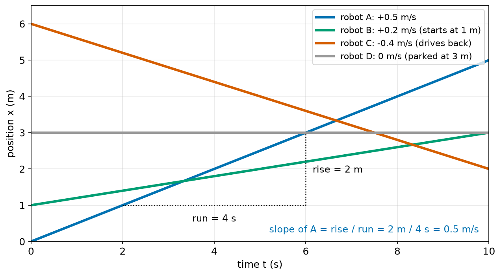
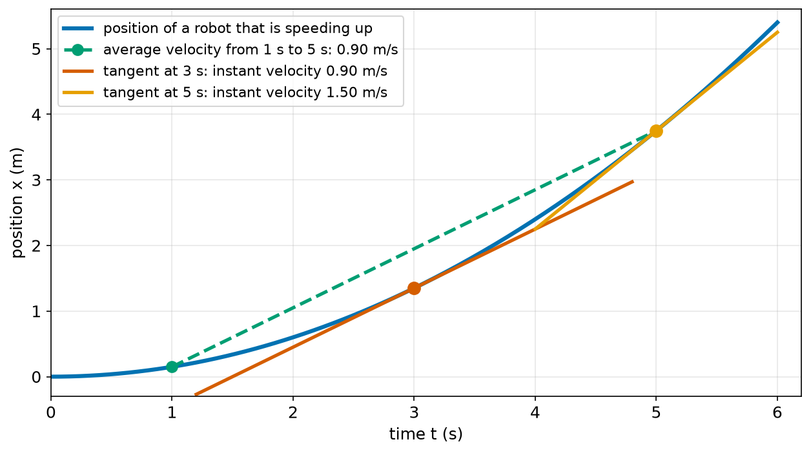
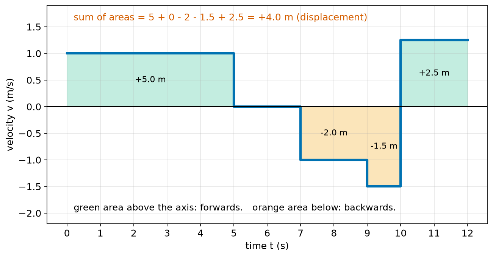
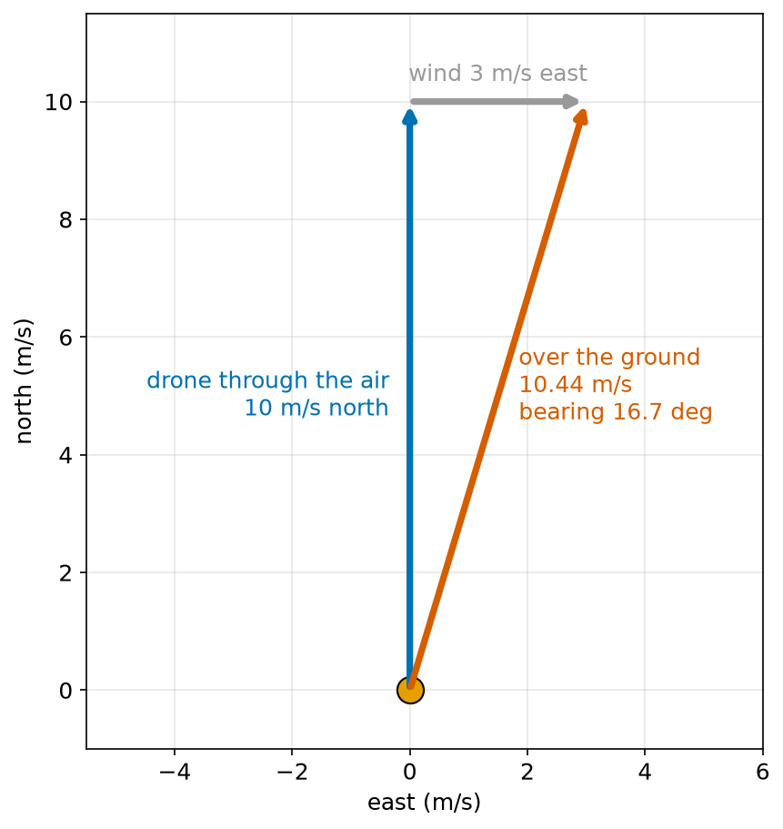
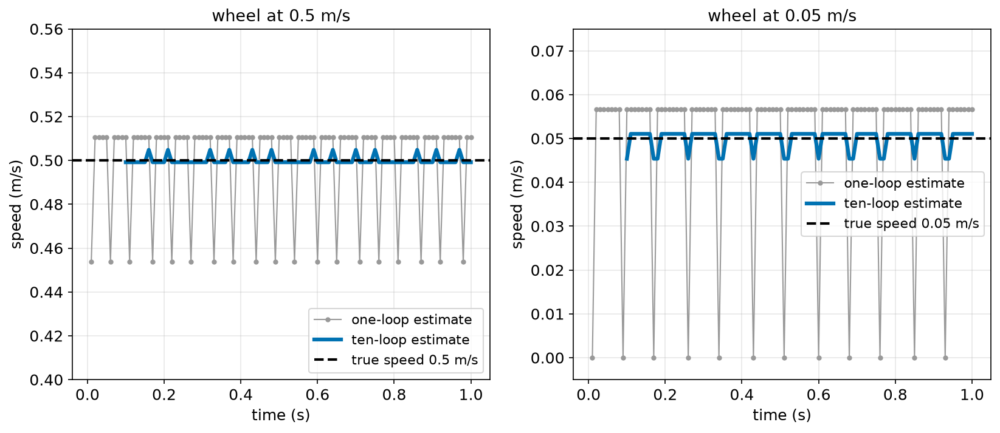
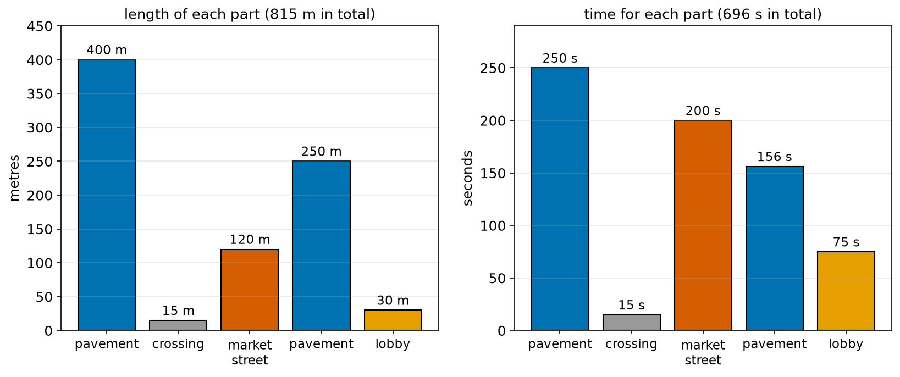

# Chapter 57 — Speed and Velocity

> **Part 4 · Chapter 57 of 749**
> **You need:** Chapter 39 (units), Chapter 43 (slope) and Chapter 56 (distance and displacement).
> **You will make:** a program that finds speed and velocity from a robot's log, a speed meter for a wheel encoder that works at slow speeds too, and a trip-time planner for a delivery robot with speed limits.

---

## What you will learn

- What **speed** is, and how to work it out from distance and time.
- How to change between m/s and km/h.
- The difference between **speed** and **velocity**.
- The difference between an **average** value and an **instant** value.
- Why the velocity is the **slope** of a position–time graph.
- Why the displacement is the **area** under a velocity–time graph.
- How a robot measures its own speed with a wheel encoder, and why slow speeds are hard to measure.
- How to work out the time for a trip with different speed limits, and why you must not simply average the speeds.
- How two velocities add, for example a drone in a wind.

---

## New words in this chapter

| Word | Simple meaning |
|---|---|
| **speed** | How fast something moves: distance travelled ÷ time. Never negative. |
| **velocity** | Speed **with a direction**: displacement ÷ time. Can be negative on a line. |
| **m/s** | Metres per second, the standard unit of speed. |
| **average speed** | Total distance ÷ total time. |
| **instant speed** | The speed at one moment, as a speedometer shows it. |
| **tangent** | A straight line that just touches a curve at one point, with the same slope there. |
| **velocity–time graph** | A graph with time across the bottom and velocity up the side. |
| **sample time** | The time between two measurements, such as 0.01 s in a 100 Hz loop. |
| **resolution** | The smallest change a measurement can show. |
| **relative velocity** | How fast one thing moves as seen from another moving thing. |
| **ground speed** / **airspeed** | A drone's speed over the ground / through the air. |

---

## 57.1 What is speed?

Two robots drive along a corridor. Robot A covers 10 m in 20 s. Robot B covers 10 m in 8 s. Which one is faster?

B, of course: it covers the same distance in less time. But what if A covers 12 m in 20 s and B covers 5 m in 8 s? Now it is harder to see. We need one number that says "how fast", so we can compare.

📖 **New word: speed** — how far something moves in each unit of time.

🔢 **Maths.**

```
speed = distance travelled / time taken
```

In words: "speed equals distance divided by time".

- Robot A: 12 m / 20 s = 0.6 m/s.
- Robot B: 5 m / 8 s = 0.625 m/s.

B is a little faster.

📖 **New word: m/s** — "metres per second". 0.6 m/s means "0.6 metres in every second". It is the SI unit of speed (Chapter 39).

Some speeds you can feel:

| What | Speed (m/s) | Speed (km/h) |
|---|---|---|
| a garden snail | 0.001 | 0.004 |
| a robot vacuum | 0.3 | 1.1 |
| a person walking | 1.4 | 5 |
| a sidewalk delivery robot | 1.5–2 | 5–7 |
| a warehouse robot | 1.5–2 | 5–7 |
| a person running | 3–5 | 11–18 |
| a racing drone | 30–40 | 110–140 |

### Changing units

People often give speeds in kilometres per hour. Chapter 39 showed how to change units by multiplying by "1" in a clever form:

```
1 m/s = 1 m/s × (3600 s / 1 h) × (1 km / 1000 m) = 3.6 km/h
```

So:

| To change | Do this |
|---|---|
| m/s → km/h | multiply by 3.6 |
| km/h → m/s | divide by 3.6 |

🔢 **Maths.** A delivery robot has a speed limit of 6 km/h. In m/s: 6 / 3.6 = 1.67 m/s.

### Using the formula three ways

The speed formula has three parts, so Chapter 41's rearranging gives three versions:

```
speed    = distance / time
distance = speed × time
time     = distance / speed
```

**Small example.** A robot vacuum at 0.3 m/s cleans for 30 minutes (1800 s) without stopping. It drives 0.3 × 1800 = 540 m.

**Small example.** A warehouse robot at 1.5 m/s must cross a 60 m hall. It needs 60 / 1.5 = 40 s.

💡 **Tip.** The "speed" in these formulas is the **average** speed over the whole time. If the robot speeds up and slows down, we need more care (sections 57.3 and 57.4).

---

## 57.2 Speed and velocity

In Chapter 56, a robot in a corridor had two answers to "how far?": the **distance travelled** (all movement counted) and the **displacement** (end minus start, with a sign). Speed has the same two versions.

📖 **New word: velocity** — the displacement per unit of time. It has a size **and** a direction. On a straight line, the direction is the sign: + forwards, − backwards.

| From Chapter 56 | Divide by time | You get |
|---|---|---|
| distance travelled (scalar) | ÷ time | **speed** (scalar, never negative) |
| displacement (vector) | ÷ time | **velocity** (vector, has a direction) |

🔢 **Maths.** For a robot that moves from x_start to x_end in a time Δt:

```
velocity v = Δx / Δt = (x_end − x_start) / (t_end − t_start)
```

In words: "velocity equals the change in position divided by the change in time".

**Small example.** Rover drives from x = 5 m back to x = 3 m in 2 s. Δx = 3 − 5 = −2 m. v = −2 / 2 = −1 m/s. Its **speed** is 1 m/s. Its **velocity** is −1 m/s: 1 m/s in the negative direction.

### Average speed and average velocity over a whole trip

Take the corridor trip of Chapter 56 again, now with times:

| Time (s) | 0 | 2 | 5 | 7 | 9 | 10 | 12 |
|---|---|---|---|---|---|---|---|
| Position (m) | 0 | 2 | 5 | 5 | 3 | 1.5 | 4 |

The distance travelled was 11.0 m. The displacement was +4.0 m. The whole trip took 12 s.

```
average speed    = 11.0 m / 12 s = 0.917 m/s
average velocity = +4.0 m / 12 s = +0.333 m/s
```

Two different numbers, both correct, answering different questions:

- **Average speed** answers "how busy were the wheels?" It is useful for battery use and wear.
- **Average velocity** answers "how fast did the robot make progress towards where it ended up?". It is useful for planning.

🧠 **Remember:** a robot that drives a full lap and comes back to its start has a positive average speed but an average velocity of **zero**.

---

## 57.3 The slope of a position–time graph

Chapter 56 said that on a position–time graph, "steeper means faster". Now we can make that exact.

On a straight-line position–time graph, the robot moves the same distance in every second. The **slope** of the line (Chapter 43) is

```
slope = rise / run = Δx / Δt
```

And Δx / Δt is the velocity. So:

🧠 **Remember:** the slope of a position–time graph **is** the velocity.



*Figure 57.1 — Four robots. Each line's slope is that robot's velocity.*

**How to read this picture:** Time is across the bottom, position up the side. Robot A (blue) climbs 2 m in every 4 s, shown by the dotted "run" and "rise" lines: slope 0.5 m/s. Robot B (green) climbs more gently: 0.2 m/s. Robot C (red) goes **down**: its slope is negative, −0.4 m/s, so it drives backwards. Robot D (grey) is flat: slope 0, parked. Where two lines cross, the two robots are at the same place at the same time. For example, A passes the parked robot D at t = 6 s.

**Small example.** Where do A and C meet? A is at x = 0.5t. C is at x = 6 − 0.4t. They meet when 0.5t = 6 − 0.4t, so 0.9t = 6 and t = 6.67 s (Chapter 41). Both are then at x = 3.33 m. In Figure 57.1 this is where the blue and red lines cross.

### When the line is curved

A robot that speeds up has a **curved** position–time graph: each second it moves a little more than the second before. Then the slope is different at every point. Which slope is "the" velocity?

📖 **New word: instant speed** (or instant velocity) — the speed at one single moment, like the number on a car's speedometer.

📖 **New word: tangent** — a straight line that just touches a curve at one point and has the same slope as the curve there.



*Figure 57.2 — The green chord gives an average velocity. The red and orange tangents give instant velocities.*

**How to read this picture:** The blue curve is the position of a robot that is speeding up: it gets steeper and steeper. The green dashed line joins the points at t = 1 s and t = 5 s. Its slope is the **average** velocity over those 4 seconds: (3.75 − 0.15) / 4 = 0.90 m/s. The red line touches the curve at t = 3 s: its slope is the **instant** velocity at that moment, also 0.90 m/s. The orange line touches at t = 5 s, where the curve is steeper: 1.50 m/s.

How do we find a tangent's slope with numbers? We take two points that are **very close together** and work out Δx / Δt between them. The closer the points, the closer we get to the instant value.

🔢 **Maths.** For the robot in Figure 57.2, x = 0.15 t². Let us estimate the instant velocity at t = 5 s:

| Δt | Points used | Δx / Δt |
|---|---|---|
| 1 s | t = 5 and 6 | (5.40 − 3.75) / 1 = 1.65 m/s |
| 0.1 s | t = 5 and 5.1 | (3.9015 − 3.75) / 0.1 = 1.515 m/s |
| 0.01 s | t = 5 and 5.01 | (3.765015 − 3.75) / 0.01 = 1.5015 m/s |
| 0.001 s | t = 5 and 5.001 | 1.50015 m/s |

The answers close in on **1.5 m/s**. That is the instant velocity. Part 10 (Chapter 177) turns this idea into the **derivative**, one of the most useful tools in robotics. For now, the idea is enough: **instant velocity = Δx / Δt over a very short time**.

🤖 **Robot link.** A robot never sees a smooth curve. It reads its position at fixed moments, perhaps 100 times a second, so Δt = 0.01 s. Its "instant" speed is really the average over the last 0.01 s. Section 57.6 shows what problems this causes.

---

## 57.4 The area under a velocity–time graph

We can also turn this around. If we know the velocity at every moment, can we find how far the robot went?

For a constant velocity, it is easy: displacement = velocity × time. On a **velocity–time graph**, velocity × time is the **area of a rectangle**: height v, width Δt.

📖 **New word: velocity–time graph** — a graph with time across the bottom and velocity up the side.



*Figure 57.3 — The corridor trip as a velocity–time graph. Each shaded area is one move.*

**How to read this picture:** The blue line is Rover's velocity during the corridor trip. From 0 to 5 s it drives forwards at 1 m/s: the green rectangle is 1 × 5 = 5 m. From 5 to 7 s it waits: velocity 0, no area. From 7 to 9 s it drives backwards at −1 m/s: the orange rectangle is **below** the axis, so it counts as −2 m. And so on. Adding all the areas, with the sign, gives +4.0 m: the displacement from Chapter 56.

🧠 **Remember:** the area under a velocity–time graph is the displacement. Area above the axis counts as positive, area below as negative. If you count every area as positive, you get the distance travelled.

When the velocity changes smoothly, the shape is not made of rectangles. But we can cut the time into many thin strips, treat each strip as a rectangle, and add them up. In the Σ notation of Chapter 53:

```
displacement ≈ Σ v_i × Δt
```

In words: "add up velocity times a short time, for every short time". This is exactly how a robot turns its speed into a position, and Chapter 58 uses it for acceleration too. Part 10 (Chapters 182–183) calls this the **integral**.

---

## 57.5 Velocity on a flat floor

On a line, velocity is one number with a sign. On a floor, the robot can move in any direction, so the velocity has two parts, just like the displacement in Chapter 56:

```
velocity = (vx, vy) = (Δx / Δt, Δy / Δt)
speed    = √(vx² + vy²)
heading  = atan2(vy, vx)
```

In words: "the velocity has an x part and a y part; the speed is its size, and the heading is its direction".

**Small example.** A robot moves from (1, 1) to (4, 5) in 2 s. Its velocity is (3/2, 4/2) = (1.5, 2.0) m/s. Its speed is √(1.5² + 2²) = 2.5 m/s, heading atan2(2, 1.5) = 53.1°.

### Adding velocities

What happens when something moves **on** something else that also moves? A person walks forwards at 1.4 m/s on a moving walkway that goes at 0.6 m/s. Seen from the ground, the person moves at 1.4 + 0.6 = 2.0 m/s.

The same is true in two directions: velocities add **part by part**, like displacements. This matters a lot for drones and boats, which move through air or water that is itself moving.

📖 **New word: airspeed** — how fast a drone moves through the air.
📖 **New word: ground speed** — how fast it moves over the ground.



*Figure 57.4 — The drone's velocity through the air plus the wind's velocity gives its velocity over the ground.*

**How to read this picture:** The blue arrow is the drone's velocity through the air: 10 m/s north. The grey arrow is the wind: 3 m/s east. We put the grey arrow at the tip of the blue one. The red arrow, from the start to the tip of the grey arrow, is the sum: the velocity over the ground. Its east part is 0 + 3 = 3 m/s and its north part is 10 + 0 = 10 m/s.

🔢 **Maths.**

```
ground velocity = (0 + 3, 10 + 0) = (3, 10) m/s
ground speed    = √(3² + 10²) = √109 = 10.44 m/s
bearing         = atan2(3, 10) = 16.7°   (from north, towards east)
```

The drone points north, but it actually travels 16.7° east of north. After 100 s it would be 300 m east of where its pilot expected. Chapter 60 adds velocities in a more general way.

📖 **New word: relative velocity** — how fast one thing moves as seen from another. If a robot drives at 1.5 m/s next to a conveyor belt moving at 0.5 m/s in the same direction, then **relative to the belt** the robot moves at 1.5 − 0.5 = 1.0 m/s.

---

## 57.6 How a robot measures its own speed

A robot cannot hold a stopwatch. It measures speed by reading its position (or encoder count) at regular times and dividing.

📖 **New word: sample time** — the time between two readings. A loop that runs 100 times a second has a sample time of 0.01 s (Chapter 30).

With an encoder (Chapter 37), the robot counts ticks. In each loop it does:

```
speed ≈ (ticks counted since the last loop) × (metres per tick) / (sample time)
```

This looks simple, but there is a catch. Ticks are **whole numbers**. In 0.01 s, a wheel can turn 8 ticks or 9 ticks, but never 8.8 ticks.

📖 **New word: resolution** — the smallest change a measurement can show. For speed from ticks, it is "one tick per loop": metres per tick ÷ sample time.

🔢 **Maths.** Rover's small wheel is 65 mm across. Its encoder has 360 ticks per turn. The loop runs at 100 Hz.

```
metres per tick  = π × 0.065 / 360 = 0.000567 m   (0.567 mm)
speed resolution = 0.000567 / 0.01  = 0.0567 m/s
```

So the speed estimate can only jump in steps of 0.0567 m/s. At 0.5 m/s that is an 11% step. At 0.05 m/s, it is bigger than the speed itself: the wheel moves less than one tick per loop, so the robot sees "0 ticks, 1 tick, 1 tick, 0 ticks…", and the speed estimate jumps between 0 and 0.057 m/s.

There are two simple cures:

1. **Count over a longer time.** Use the ticks from the last 10 loops (0.1 s). The resolution becomes 10 times finer: 0.00567 m/s. The price: the estimate is now an average over 0.1 s, so it reacts more slowly when the speed changes.
2. **Time the ticks instead of counting them.** At slow speeds, measure the time **between** two ticks. Chapter 123 does this with a microcontroller.

The Code section shows cure 1 working.

⚠️ **Watch out.** Working out a speed means dividing a small difference by a small time. Any small error in the positions becomes a big error in the speed. Chapter 54 called this cancellation. Speed estimates are always noisier than the positions they come from, so they usually need smoothing (Chapter 52's filter).

---

## Code

File `code/ch057/speed_basics.py`:

```python
# speed_basics.py - average speed, average velocity, and changing units
times_s = [0.0, 2.0, 5.0, 7.0, 9.0, 10.0, 12.0]
positions_m = [0.0, 2.0, 5.0, 5.0, 3.0, 1.5, 4.0]

distance_m = 0.0
for i in range(1, len(positions_m)):
    dt = times_s[i] - times_s[i - 1]
    dx = positions_m[i] - positions_m[i - 1]
    distance_m = distance_m + abs(dx)
    print(f"{times_s[i - 1]:4.1f} s to {times_s[i]:4.1f} s:  velocity {dx / dt:+5.2f} m/s   speed {abs(dx) / dt:4.2f} m/s")

total_time_s = times_s[-1] - times_s[0]
displacement_m = positions_m[-1] - positions_m[0]
avg_speed = distance_m / total_time_s
avg_velocity = displacement_m / total_time_s
print(f"average speed:    {distance_m:.1f} m / {total_time_s:.0f} s = {avg_speed:.3f} m/s = {avg_speed * 3.6:.2f} km/h")
print(f"average velocity: {displacement_m:+.1f} m / {total_time_s:.0f} s = {avg_velocity:+.3f} m/s")
```

| Line | Code | What it does (simple English) |
|---|---|---|
| 1 | `# speed_basics.py …` | A comment. |
| 2 | `times_s = [0.0, 2.0, …]` | The time of each reading, in seconds. |
| 3 | `positions_m = [0.0, 2.0, …]` | The position at each of those times. The two lists have the same length. |
| 4 | (blank) | Spacing. |
| 5 | `distance_m = 0.0` | The running total of the distance. |
| 6 | `for i in range(1, len(positions_m)):` | One loop for each move, from reading i − 1 to reading i. |
| 7 | `dt = times_s[i] - times_s[i - 1]` | How long this move took. |
| 8 | `dx = positions_m[i] - positions_m[i - 1]` | The signed change in position. |
| 9 | `distance_m = distance_m + abs(dx)` | Adds the size of this move. |
| 10 | `print(f"…velocity {dx / dt:+5.2f}…speed {abs(dx) / dt:4.2f}…")` | Velocity keeps the sign. Speed uses `abs`. |
| 11 | (blank) | Spacing. |
| 12 | `total_time_s = times_s[-1] - times_s[0]` | The whole trip's time. |
| 13 | `displacement_m = positions_m[-1] - positions_m[0]` | End minus start. |
| 14 | `avg_speed = distance_m / total_time_s` | Total distance ÷ total time. |
| 15 | `avg_velocity = displacement_m / total_time_s` | Displacement ÷ total time. |
| 16 | `print(f"average speed: … {avg_speed * 3.6:.2f} km/h")` | Also shows km/h: × 3.6. |
| 17 | `print(f"average velocity: …")` | With its sign. |

Output:

```
 0.0 s to  2.0 s:  velocity +1.00 m/s   speed 1.00 m/s
 2.0 s to  5.0 s:  velocity +1.00 m/s   speed 1.00 m/s
 5.0 s to  7.0 s:  velocity +0.00 m/s   speed 0.00 m/s
 7.0 s to  9.0 s:  velocity -1.00 m/s   speed 1.00 m/s
 9.0 s to 10.0 s:  velocity -1.50 m/s   speed 1.50 m/s
10.0 s to 12.0 s:  velocity +1.25 m/s   speed 1.25 m/s
average speed:    11.0 m / 12 s = 0.917 m/s = 3.30 km/h
average velocity: +4.0 m / 12 s = +0.333 m/s
```

These are the velocities in Figure 57.3.

File `code/ch057/encoder_speed.py`:

```python
# encoder_speed.py - measure a wheel's speed from encoder ticks, and see why slow speeds are hard
import math

TICKS_PER_REV = 360
WHEEL_DIAMETER_M = 0.065
M_PER_TICK = math.pi * WHEEL_DIAMETER_M / TICKS_PER_REV
LOOP_DT_S = 0.01                     # the control loop runs 100 times a second


def ticks_seen(true_speed, seconds):
    """Whole ticks counted in each loop when the wheel moves at a steady true speed."""
    counts = []
    last_total = 0
    for k in range(1, round(seconds / LOOP_DT_S) + 1):
        total = math.floor(true_speed * k * LOOP_DT_S / M_PER_TICK)
        counts.append(total - last_total)
        last_total = total
    return counts


for true_speed in [0.50, 0.05]:
    counts = ticks_seen(true_speed, 1.0)
    one_loop = [c * M_PER_TICK / LOOP_DT_S for c in counts]
    window = 10
    ten_loops = [sum(counts[i - window:i]) * M_PER_TICK / (window * LOOP_DT_S) for i in range(window, len(counts) + 1)]
    print(f"true speed {true_speed:.2f} m/s")
    print(f"  ticks in the first 12 loops: {counts[:12]}")
    print(f"  one-loop estimate:  min {min(one_loop):.3f}  max {max(one_loop):.3f} m/s")
    print(f"  ten-loop estimate:  min {min(ten_loops):.3f}  max {max(ten_loops):.3f} m/s")
print(f"one tick is {M_PER_TICK * 1000:.3f} mm, so one tick per loop means {M_PER_TICK / LOOP_DT_S:.4f} m/s")
```

| Line | Code | What it does (simple English) |
|---|---|---|
| 1 | `# encoder_speed.py …` | A comment. |
| 2 | `import math` | For `pi` and `floor`. |
| 3 | (blank) | Spacing. |
| 4 | `TICKS_PER_REV = 360` | Ticks in one wheel turn. |
| 5 | `WHEEL_DIAMETER_M = 0.065` | A 65 mm wheel. |
| 6 | `M_PER_TICK = …` | Circumference ÷ ticks: 0.567 mm per tick. |
| 7 | `LOOP_DT_S = 0.01` | The sample time: 100 loops per second. |
| 8–9 | (blank) | Spacing. |
| 10 | `def ticks_seen(true_speed, seconds):` | A function that pretends to be the encoder. |
| 11 | `"""Whole ticks …"""` | Its docstring (Chapter 23). |
| 12 | `counts = []` | One count per loop will go here. |
| 13 | `last_total = 0` | The total ticks at the previous loop. |
| 14 | `for k in range(1, round(seconds / LOOP_DT_S) + 1):` | Loops 1 to 100 for one second. `round` avoids a float surprise (Chapter 54). |
| 15 | `total = math.floor(true_speed * k * LOOP_DT_S / M_PER_TICK)` | The true distance so far, in ticks, rounded **down**: only whole ticks are ever seen. |
| 16 | `counts.append(total - last_total)` | The ticks counted during this loop. |
| 17 | `last_total = total` | Remember the total for the next loop. |
| 18 | `return counts` | The list of counts. |
| 19–20 | (blank) | Spacing. |
| 21 | `for true_speed in [0.50, 0.05]:` | Try a normal speed and a slow one. |
| 22 | `counts = ticks_seen(true_speed, 1.0)` | One second of encoder data. |
| 23 | `one_loop = [c * M_PER_TICK / LOOP_DT_S for c in counts]` | Speed from each single loop: ticks × metres per tick ÷ 0.01 s. A list comprehension (Chapter 21). |
| 24 | `window = 10` | How many loops to add together. |
| 25 | `ten_loops = [sum(counts[i - window:i]) * … for i in …]` | Speed from the last 10 loops: total ticks in 0.1 s, ÷ 0.1 s. |
| 26 | `print(f"true speed …")` | A heading. |
| 27 | `print(f"  ticks in the first 12 loops: …")` | Shows the raw counts. |
| 28 | `print(f"  one-loop estimate: …")` | The smallest and largest one-loop estimate. |
| 29 | `print(f"  ten-loop estimate: …")` | The same for the ten-loop estimate. |
| 30 | `print(f"one tick is …")` | The resolution of a one-loop estimate. |

Output:

```
true speed 0.50 m/s
  ticks in the first 12 loops: [8, 9, 9, 9, 9, 8, 9, 9, 9, 9, 8, 9]
  one-loop estimate:  min 0.454  max 0.511 m/s
  ten-loop estimate:  min 0.499  max 0.505 m/s
true speed 0.05 m/s
  ticks in the first 12 loops: [0, 1, 1, 1, 1, 1, 1, 1, 0, 1, 1, 1]
  one-loop estimate:  min 0.000  max 0.057 m/s
  ten-loop estimate:  min 0.045  max 0.051 m/s
one tick is 0.567 mm, so one tick per loop means 0.0567 m/s
```



*Figure 57.5 — One-loop estimates jump between whole numbers of ticks. Ten-loop estimates are much closer to the truth.*

**How to read this picture:** Each side shows one second of the program's estimates. The black dashed line is the true speed. The grey dots are the one-loop estimates: they can only take values that are whole numbers of ticks per loop, so they jump. On the left (0.5 m/s), they jump between 0.454 and 0.511 m/s, about ±6%. On the right (0.05 m/s), they jump between 0 and 0.057 m/s: sometimes the robot thinks it has stopped. The thick blue line is the ten-loop estimate. It stays within about 1% on the left, and within about 10% on the right.

🧪 **Experiment.** Change `window` to 50 and run again. The 0.05 m/s estimate gets even closer to the truth, but now each estimate is an average over half a second. If the robot suddenly stopped, it would take half a second for the estimate to reach zero.

---

## Small examples

**Example 1.** 18 km/h = 18 / 3.6 = 5 m/s.

**Example 2.** 2.5 m/s = 2.5 × 3.6 = 9 km/h.

**Example 3.** A robot drives 45 m in 30 s. Average speed 1.5 m/s.

**Example 4.** A robot moves from x = 8 m to x = 2 m in 4 s. Velocity −1.5 m/s, speed 1.5 m/s.

**Example 5.** A robot vacuum drives round a room and back to its dock: 60 m in 200 s. Average speed 0.3 m/s. Average velocity 0.

**Example 6.** On a position–time graph, a line goes from (2 s, 1 m) to (6 s, 9 m). Slope = 8 / 4 = 2 m/s.

**Example 7.** A velocity–time graph is flat at 0.4 m/s for 25 s. Area = 0.4 × 25 = 10 m.

**Example 8.** A boat robot goes 2 m/s east in a river that flows 0.5 m/s north. Speed over the ground: √(4 + 0.25) = 2.06 m/s.

---

## 🏭 Real robot applications

### Application 1 (worked in full) — 🤖 A speed meter for Rover's slow, careful driving

**1. The real problem.** Rover must drive very slowly, at 0.05 m/s, when it docks onto its charger. Its speed controller (Part 12) needs a speed reading 100 times a second. With a simple one-loop speed estimate, the reading jumps between 0 and 0.057 m/s, so the controller thinks Rover keeps stopping and starting. It pushes the motor harder, Rover jerks forward, and it bumps the dock.

**2. Why this theory.** Speed is distance ÷ time. With whole ticks, the distance in one short loop is too coarse. Measuring the distance over a **longer** time (several loops) makes the resolution finer, at the cost of a small delay.

**3. The numbers.** Wheel 65 mm, 360 ticks per turn, loop at 100 Hz. One tick = 0.567 mm. Docking speed 0.05 m/s. The controller can tolerate a delay of up to about 0.1 s.

**4. The maths.** At 0.05 m/s, the wheel moves 0.05 × 0.01 = 0.0005 m = 0.5 mm per loop: less than one tick (0.567 mm). So most loops see 1 tick, but some see 0.

Over a window of N loops, the resolution is

```
resolution = M_PER_TICK / (N × LOOP_DT_S)
N = 1:   0.000567 / 0.01 = 0.0567 m/s   (more than the speed itself)
N = 10:  0.000567 / 0.1  = 0.00567 m/s  (about 11% of 0.05 m/s)
N = 20:  0.000567 / 0.2  = 0.00284 m/s  (about 6%)
```

N = 10 gives a delay of about 0.1 s, the most the controller can tolerate, and an error of at most one tick: about 11% of the docking speed. The program's 0.045 to 0.051 m/s is inside that limit.

**5. The code.** The code is `encoder_speed.py` in the Code section. The important line is the window sum:

```python
ten_loops = [sum(counts[i - window:i]) * M_PER_TICK / (window * LOOP_DT_S) for i in range(window, len(counts) + 1)]
```

On the real robot, we do not keep a list of every count. We keep only the last 10 counts in a small list, add the newest one, and drop the oldest one, exactly like Chapter 21's moving average.

**6. The result.** With the ten-loop window, Rover's speed reading at 0.05 m/s stays between 0.045 and 0.051 m/s instead of jumping between 0 and 0.057. The controller sees a steady speed and stops pushing the motor in bursts, so Rover glides onto the dock. At normal speed (0.5 m/s), the same window gives a reading within about 1%.

**7. Going further.** Better encoders help most: a 2048-tick encoder on the motor shaft, before a 30:1 gearbox, gives 61,440 ticks per wheel turn, so even very slow speeds give many ticks per loop (Chapter 123). Many motor drivers measure the **time between ticks** at slow speed and switch to counting ticks at high speed. Chapter 181 compares ways to estimate speed from position, and Chapter 191 does it with a real encoder log.

### Application 2 (worked in full) — 🚚 How long will the delivery take?

**1. The real problem.** A sidewalk delivery robot must tell a customer when their parcel will arrive. Its route has five parts with different speed limits: open pavement, a road crossing, a busy market street, more pavement, and a building lobby. The company wants an accurate time, and an "average speed" for each route so they can compare routes.

**2. Why this theory.** For each part, time = distance ÷ speed. The total time is the sum of the parts (Chapter 53). The true average speed is total distance ÷ total time, **not** the average of the speed limits.

**3. The numbers.**

| Part | Length | Speed limit |
|---|---|---|
| pavement | 400 m | 1.6 m/s |
| crossing | 15 m | 1.0 m/s |
| market street | 120 m | 0.6 m/s |
| pavement | 250 m | 1.6 m/s |
| building lobby | 30 m | 0.4 m/s |

**4. The maths.**

```
400 / 1.6 = 250.0 s
 15 / 1.0 =  15.0 s
120 / 0.6 = 200.0 s
250 / 1.6 = 156.25 s
 30 / 0.4 =  75.0 s
total     = 696.25 s ≈ 11.6 minutes, for 815 m

true average speed = 815 / 696.25 = 1.171 m/s
average of the five limits = (1.6 + 1.0 + 0.6 + 1.6 + 0.4) / 5 = 1.04 m/s
```

The two "averages" differ. The true one is weighted by the **time** spent at each speed, and the robot spends most of its time on the long pavement parts.

**5. The code.** File `code/ch057/route_time.py`:

```python
# route_time.py - how long a delivery robot's route takes when each part has its own speed limit
route = [
    ("pavement", 400.0, 1.6),        # (name, length in m, speed in m/s)
    ("crossing", 15.0, 1.0),
    ("market street", 120.0, 0.6),
    ("pavement", 250.0, 1.6),
    ("building lobby", 30.0, 0.4),
]

total_m = 0.0
total_s = 0.0
for name, length_m, speed in route:
    part_s = length_m / speed
    total_m = total_m + length_m
    total_s = total_s + part_s
    print(f"{name:15s} {length_m:6.0f} m at {speed:.1f} m/s  ->  {part_s:6.1f} s")

speeds = [speed for name, length_m, speed in route]
print(f"total: {total_m:.0f} m in {total_s:.1f} s ({total_s / 60:.1f} min)")
print(f"true average speed:        {total_m / total_s:.3f} m/s")
print(f"average of the 5 limits:   {sum(speeds) / len(speeds):.3f} m/s  (wrong way to average)")
```

| Line | Code | What it does (simple English) |
|---|---|---|
| 1 | `# route_time.py …` | A comment. |
| 2 | `route = [` | A list of the route's parts. |
| 3 | `("pavement", 400.0, 1.6),` | One part: a tuple of name, length and speed limit. The comment says the order. |
| 4–7 | `("crossing", 15.0, 1.0),` and so on | The other four parts. |
| 8 | `]` | The end of the list. |
| 9 | (blank) | Spacing. |
| 10 | `total_m = 0.0` | The running total of distance. |
| 11 | `total_s = 0.0` | The running total of time. |
| 12 | `for name, length_m, speed in route:` | Unpacks each tuple into three names. |
| 13 | `part_s = length_m / speed` | time = distance ÷ speed. |
| 14 | `total_m = total_m + length_m` | Adds the distance. |
| 15 | `total_s = total_s + part_s` | Adds the time. |
| 16 | `print(f"{name:15s} …")` | `:15s` pads the name to 15 characters, so the columns line up. |
| 17 | (blank) | Spacing. |
| 18 | `speeds = [speed for name, length_m, speed in route]` | A list of only the speed limits. |
| 19 | `print(f"total: …")` | Total distance, total time, and the time in minutes. |
| 20 | `print(f"true average speed: …")` | Total distance ÷ total time. |
| 21 | `print(f"average of the 5 limits: …")` | The tempting but wrong average, to compare. |

Output:

```
pavement           400 m at 1.6 m/s  ->   250.0 s
crossing            15 m at 1.0 m/s  ->    15.0 s
market street      120 m at 0.6 m/s  ->   200.0 s
pavement           250 m at 1.6 m/s  ->   156.2 s
building lobby      30 m at 0.4 m/s  ->    75.0 s
total: 815 m in 696.2 s (11.6 min)
true average speed:        1.171 m/s
average of the 5 limits:   1.040 m/s  (wrong way to average)
```

(156.25 is printed as 156.2 because Python rounds an exact half to the even digit, Chapter 54.)



*Figure 57.6 — The market street is short but takes almost as long as the first pavement.*

**How to read this picture:** The left chart shows how long each part of the route is. The right chart shows how much time each part takes. The red market street is only 120 m, but at 0.6 m/s it takes 200 s. The orange lobby is only 30 m but takes 75 s. Slow parts take a bigger share of the time than of the distance.

**6. The result.** The robot tells the customer "about 12 minutes". If it had used the wrong average (1.04 m/s), it would have said 815 / 1.04 = 784 s, about 13 minutes: more than a minute too long. If it had used its top speed (1.6 m/s), it would have said 509 s, about 8.5 minutes, and arrived three minutes late. To speed up the route, the company should look at the market street first: it is 15% of the distance but 29% of the time.

**7. Going further.** Real robots also wait at crossings and slow down near people, so the company measures each part's real average speed from past trips and uses that instead of the speed limit. The robot also needs time to speed up and slow down, which Chapter 59 adds. Choosing between routes by their total time is exactly what the path planners of Part 23 do.

### Application 3 — 🏭 A collaborative arm slows down near people

A **collaborative robot arm** works next to people without a fence. Safety rules limit how fast its gripper may move when a person is close. A commonly used limit for a person guiding the arm by hand is 250 mm/s (0.25 m/s). The arm's controller works out the gripper's speed from the joint encoders 1000 times a second. If the measured gripper speed goes above the limit for even one loop, it stops the arm. Here a **speed estimate** is a safety signal, and the problems of section 57.6 really matter: a noisy estimate could stop the arm for nothing, and a slow, smoothed estimate could react too late. Chapter 356 shows how to get the gripper's velocity from the joints' velocities, and Chapter 744 covers safety rules.

### Application 4 — 🚁 A drone flying against the wind

A delivery drone has an airspeed of 15 m/s. It must fly 6 km east, then come back, in a 5 m/s wind blowing from the east (towards the west). Going east, its ground speed is 15 − 5 = 10 m/s: 600 s. Coming back west, it is 15 + 5 = 20 m/s: 300 s. Total 900 s. Without wind, the trip would take 12,000 / 15 = 800 s. The wind does **not** cancel out: the drone spends more time flying slowly against the wind than fast with it, so the round trip takes 12.5% longer and uses 12.5% more battery. Drone flight planners always add a wind margin for this reason (Chapter 650).

### Application 5 — 📦 Picking from a moving conveyor

A robot arm picks parcels from a conveyor belt that moves at 0.4 m/s. A camera sees each parcel 1.2 m before the arm's reach, so the arm has 1.2 / 0.4 = 3 s to get ready. To grab a parcel without a bump, the gripper must move **with** the belt at the moment it closes: its velocity must match the belt's, so the **relative velocity** between gripper and parcel is zero. A gripper that is still at rest when it closes would hit the parcel at 0.4 m/s, like a person catching a ball by standing still. This idea, matching velocities before touching, is used everywhere from parcel handling to spacecraft docking. Chapter 409 shows how an arm tracks a moving target.

---

## 🔧 Hands-on lab

### Lab 57.1 — Time a toy car or a walk (hardware)

You need a toy car (or a friend who walks), a tape measure, a phone stopwatch, and some tape.

1. Mark a start line and a finish line 5 m apart with tape. Mark the 1 m, 2 m, 3 m and 4 m points too.
2. Start the car (or the walker) at least 1 m **before** the start line, so it is already moving at a steady speed when it crosses.
3. Record the time it crosses each mark. A phone video is easiest: you can read the time of each frame later.
4. Make a table of time and position. Work out the velocity for each metre: Δx / Δt.
5. Work out the average speed over the 5 m, in m/s and in km/h.
6. Draw a position–time graph by hand or with matplotlib (Chapter 33).

**What you should see:** For a steady car, the points lie close to a straight line, and the five one-metre velocities are similar. A person walking normally gives about 1.2–1.5 m/s (4–5 km/h). Your one-metre velocities are noisier than the 5 m average, because a small timing error is a bigger share of a short time.

| If it does not work | Likely cause | Fix |
|---|---|---|
| The first metre is much slower | The car was still speeding up | Start further before the line |
| The one-metre velocities jump a lot | Pressing a stopwatch by hand adds about 0.1–0.2 s of error | Use a video and count frames |
| The km/h value looks far too big | Multiplied by 3600 instead of 3.6 | m/s × 3.6 = km/h |

**Challenge:** Use a 30 frames-per-second video. One frame is 1/30 s. How big is the speed error from one frame of timing error, over 1 m and over 5 m, for a car at 1 m/s?

### Lab 57.2 — Speed estimates at different speeds (simulation)

Copy `encoder_speed.py`.

1. Change the list of speeds to `[1.0, 0.5, 0.2, 0.1, 0.05, 0.02]`.
2. For each speed, write down the min and max of the one-loop and the ten-loop estimates.
3. Work out the error of each as a percentage of the true speed.
4. Change `TICKS_PER_REV` to 1440 and repeat.

**What you should see:** The error of the one-loop estimate is always about one tick per loop, 0.057 m/s, so it is a small share at 1.0 m/s and a huge share at 0.02 m/s. At 0.02 m/s the one-loop estimate is 0 in most loops. The ten-loop estimate is about 10 times better. With 1440 ticks per turn, everything is 4 times better.

| If it does not work | Likely cause | Fix |
|---|---|---|
| `ValueError: min() arg is an empty sequence` | `window` is bigger than the number of loops | Keep `window` below 100, or run for longer |
| All estimates are exact | `math.floor` was removed, so fractions of ticks are counted | Real encoders only count whole ticks: keep `floor` |

**Challenge:** Write a function `best_window(speed, max_error)` that returns the smallest window that keeps the error below `max_error` m/s.

### Lab 57.3 — Plan a faster route (simulation)

Copy `route_time.py`.

1. A second route is 950 m long: 900 m of pavement at 1.6 m/s and 50 m of lobby at 0.4 m/s. Add it as a second list and compare the times.
2. On the first route, what speed on the market street would cut 1 minute from the total?
3. Add a fixed 30 s wait at the crossing to the first route, and see how the true average speed changes.

**What you should see:** The second route is longer but faster: 562.5 + 125 = 687.5 s, against 696.2 s. To save 60 s on the market street, it must take 140 s instead of 200 s: 120 / 140 = 0.857 m/s. With the 30 s wait, the total becomes 726.2 s and the average falls to 1.122 m/s.

| If it does not work | Likely cause | Fix |
|---|---|---|
| `ZeroDivisionError` | A speed of 0 for a "wait" part | Add waits as a time, not as a part with speed 0 |
| The totals do not change | The new route is not in the loop | Loop over the new list as well |

**Challenge:** Write a function `route_time(route, waits)` that takes the route and a list of extra waiting times, and returns the total time and the true average speed.

---

## Common mistakes

⚠️ **Mixing up speed and velocity.** Speed is never negative. Velocity is negative when moving in the negative direction.

⚠️ **Averaging speed limits.** The true average speed is total distance ÷ total time. Slow parts take more time and count more.

⚠️ **Forgetting to change units.** 6 km/h is 1.67 m/s, not 6 m/s. Work in m/s and change only at the end.

⚠️ **Multiplying by 3600 to get km/h.** That gives metres per hour. Multiply by 3.6.

⚠️ **Reading the height of a position–time graph as the speed.** The speed is the **slope**, not the height. A robot high up on the graph can be standing still.

⚠️ **Trusting a speed from one short sample.** With whole ticks, a short sample is coarse. Count over a longer time, or time the ticks.

⚠️ **Adding speeds in different directions as plain numbers.** 10 m/s north plus 3 m/s east is 10.44 m/s, not 13 m/s. Add the parts, then use Pythagoras.

---

## Practice

🏋️ **1.** Change 36 km/h to m/s, and 0.3 m/s to km/h.

🏋️ **2.** A robot drives 84 m in 70 s. What is its average speed?

🏋️ **3.** A robot at 1.2 m/s must cover 150 m. How long does it take?

🏋️ **4.** A robot moves from x = 12 m to x = 3 m in 6 s. Find its velocity and its speed.

🏋️ **5.** A robot drives 20 m forwards in 10 s, then 20 m back in 15 s. Find the average speed and the average velocity.

🏋️ **6.** On a position–time graph, robot P is at x = 2 + 0.3t and robot Q at x = 8 − 0.5t. When and where do they meet?

🏋️ **7.** A velocity–time graph shows 0.8 m/s for 5 s, then −0.4 m/s for 3 s. Find the displacement and the distance.

🏋️ **8.** An encoder gives 0.2 mm per tick, read every 0.005 s. What is the speed resolution of a one-loop estimate?

🏋️ **9.** A drone flies at an airspeed of 12 m/s towards the east, in a wind of 5 m/s towards the north. What is its ground speed, and on what bearing does it travel?

🏋️ **10.** A robot drives 300 m at 1.5 m/s and then 300 m at 0.5 m/s. What is its average speed? Why is it not 1.0 m/s?

🏋️ **11.** Write a function `speeds_from_log(times, positions)` that returns a list of the velocities between each pair of readings, and the average speed of the whole log. Test it with the corridor trip.

---

## Answers

**1.** 36 / 3.6 = 10 m/s. 0.3 × 3.6 = 1.08 km/h.

**2.** 84 / 70 = 1.2 m/s.

**3.** 150 / 1.2 = 125 s.

**4.** Δx = 3 − 12 = −9 m. Velocity = −9 / 6 = −1.5 m/s. Speed 1.5 m/s.

**5.** Distance 40 m in 25 s: average speed 1.6 m/s. Displacement 0: average velocity 0.

**6.** 2 + 0.3t = 8 − 0.5t → 0.8t = 6 → t = 7.5 s. Position 2 + 0.3 × 7.5 = 4.25 m.

**7.** Areas: 0.8 × 5 = +4.0 m and −0.4 × 3 = −1.2 m. Displacement +2.8 m. Distance 5.2 m.

**8.** 0.0002 / 0.005 = 0.04 m/s.

**9.** √(12² + 5²) = 13 m/s. Bearing = atan2(east part, north part) = atan2(12, 5) = 67.4°.

**10.** Times: 200 s and 600 s. Average = 600 m / 800 s = 0.75 m/s. The robot spends three times as long at the slow speed, so the slow speed counts three times as much.

**11.**

```python
def speeds_from_log(times, positions):
    velocities = []
    distance = 0.0
    for i in range(1, len(times)):
        dx = positions[i] - positions[i - 1]
        dt = times[i] - times[i - 1]
        velocities.append(dx / dt)
        distance = distance + abs(dx)
    return velocities, distance / (times[-1] - times[0])

v, s = speeds_from_log([0, 2, 5, 7, 9, 10, 12], [0, 2, 5, 5, 3, 1.5, 4])
print(v)              # [1.0, 1.0, 0.0, -1.0, -1.5, 1.25]
print(round(s, 3))    # 0.917
```

---

## Summary

🧠 **Speed** = distance travelled ÷ time. It is never negative. The unit is m/s. Multiply by 3.6 for km/h.

🧠 **Velocity** = displacement ÷ time. It has a direction: on a line, a sign.

🧠 The **average** speed of a trip is total distance ÷ total time. Never average the speeds of the parts.

🧠 The **slope** of a position–time graph is the velocity. For a curved graph, the slope of the tangent is the **instant** velocity: Δx / Δt over a very short time.

🧠 The **area** under a velocity–time graph is the displacement: Σ v × Δt.

🧠 On a floor, velocity = (vx, vy). Velocities add part by part, so wind and moving belts change a robot's real velocity.

🧠 A robot finds its speed from encoder ticks ÷ sample time. Whole ticks make the estimate coarse at slow speeds. Counting over a longer time helps, but adds delay.

---

## Next chapter

In Chapter 58 we look at how velocity **changes**. That change is called **acceleration**. You will see why a robot cannot jump from 0 to full speed, how to read acceleration from a velocity–time graph, and how a phone's accelerometer measures it.
