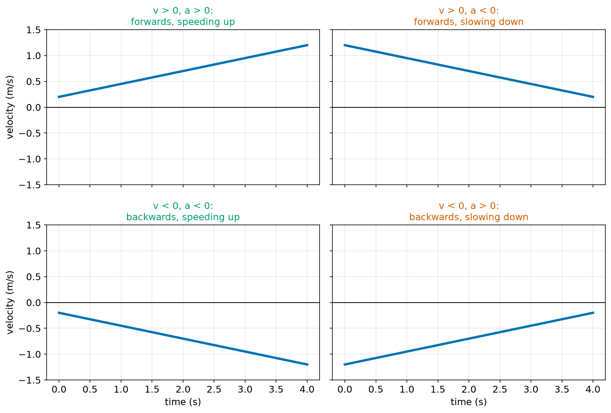
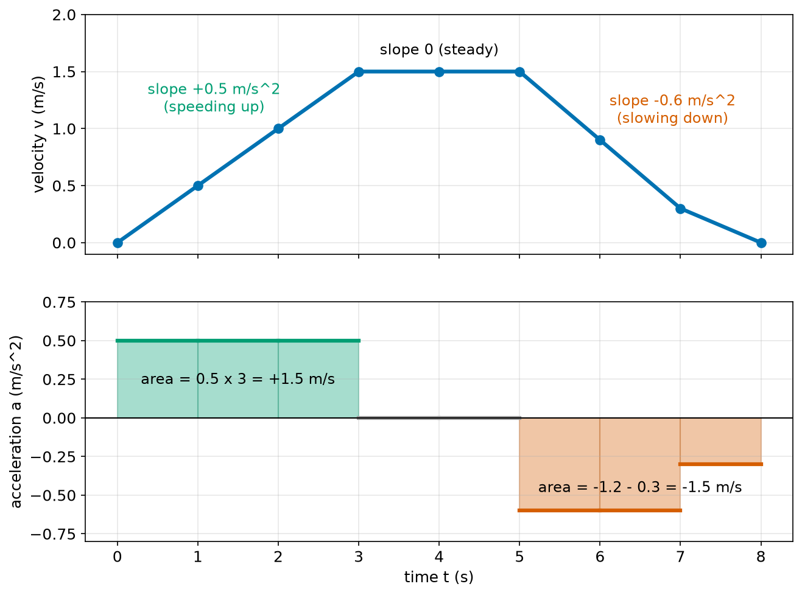
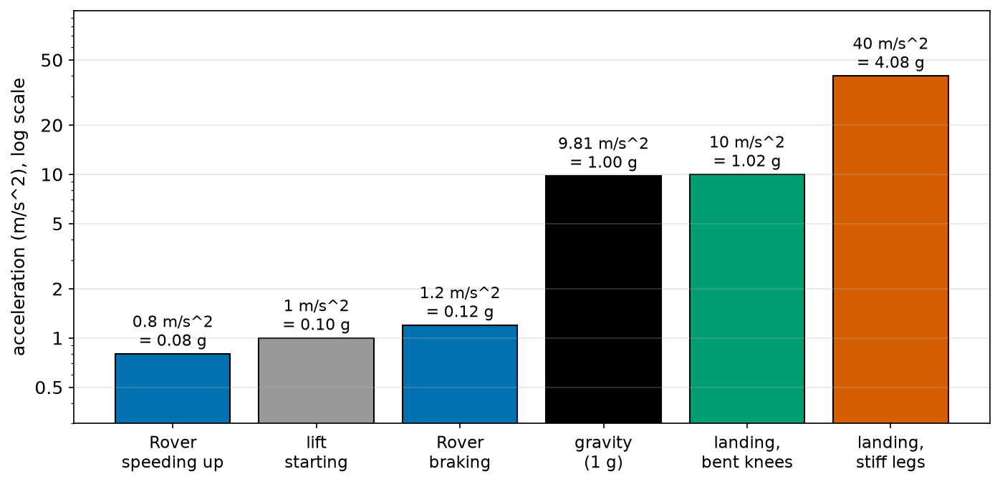
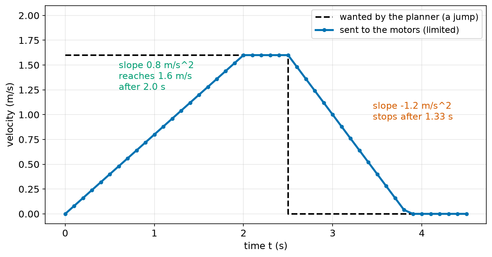
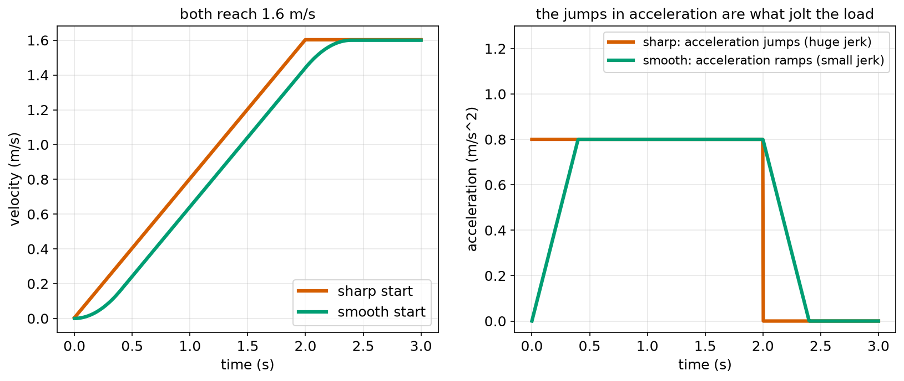
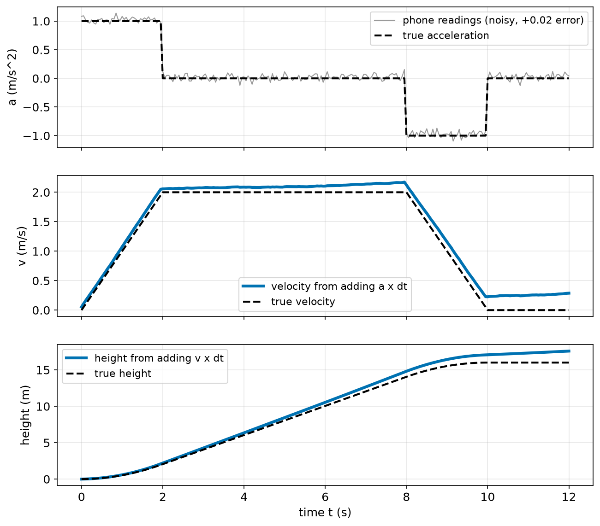

# Chapter 58 — Acceleration

> **Part 4 · Chapter 58 of 749**
> **You need:** Chapter 43 (slope), Chapter 53 (sums) and Chapter 57 (speed and velocity).
> **You will make:** a program that finds a robot's acceleration from its velocity log, a "ramp limiter" that stops a robot from speeding up or braking too hard, and a program that turns a phone's accelerometer readings from a lift ride into speed and height.

---

## What you will learn

- What **acceleration** is, and why its unit is m/s².
- Why a robot cannot jump from standing still to full speed.
- What the sign of an acceleration means, and why "negative acceleration" does not always mean "slowing down".
- Why the acceleration is the **slope** of a velocity–time graph, and the change in velocity is the **area** under an acceleration–time graph.
- What **g** is, and how to give an acceleration "in g".
- How a **ramp limiter** keeps a robot's acceleration safe.
- How an **accelerometer** measures acceleration, and why adding up its readings drifts.
- What **jerk** is, and why smooth starts protect the load.

---

## New words in this chapter

| Word | Simple meaning |
|---|---|
| **acceleration** | How fast the velocity changes: change in velocity ÷ time. |
| **m/s²** | "Metres per second, per second": the unit of acceleration. |
| **deceleration** | Slowing down. Often given as a positive number: "decelerate at 1.2 m/s²". |
| **velocity–time graph** | Time across the bottom, velocity up the side. Its slope is the acceleration. |
| **g** | The acceleration of a falling object near the Earth, about 9.81 m/s². Also used as a unit. |
| **ramp limiter** | A few lines of code that stop a command from changing faster than a set rate. |
| **accelerometer** | A sensor that measures acceleration. Every phone has one. |
| **bias** | A small, fixed error in a sensor's reading. |
| **integrate** | Add up many small pieces, such as a × Δt, to get a total. |
| **jerk** | How fast the acceleration changes. A sudden jump in acceleration is a big jerk. |

---

## 58.1 What is acceleration?

Sit in a bus. When it pulls away, you feel pushed back into your seat. When it brakes, you lean forward. When it drives at a steady speed on a straight road, you feel nothing, even at 80 km/h. What you feel is not the speed. It is the **change** of speed.

📖 **New word: acceleration** — how fast the velocity changes.

🔢 **Maths.**

```
acceleration a = change in velocity / time taken = Δv / Δt
```

In words: "acceleration equals the change in velocity divided by the time it took".

**Small example.** Rover starts from rest and reaches 1.5 m/s after 3 s.

```
a = (1.5 − 0) / 3 = 0.5 m/s²
```

### The unit m/s²

The unit looks strange at first. It comes straight from the formula: a velocity (m/s) divided by a time (s):

```
(m/s) / s = m/s²
```

📖 **New word: m/s²** — read it as "metres per second, per second". 0.5 m/s² means "the velocity grows by 0.5 m/s in every second".

| Time (s) | 0 | 1 | 2 | 3 |
|---|---|---|---|---|
| Velocity at 0.5 m/s² (m/s) | 0 | 0.5 | 1.0 | 1.5 |

Each second, 0.5 m/s more. That is all "m/s²" means.

### Why a robot cannot jump to full speed

Could Rover go from 0 to 1.5 m/s in **no** time? Then Δt = 0 and a = 1.5 / 0: an infinite acceleration. Real things cannot do that. Chapter 61 shows why: changing velocity needs a **force**, and a bigger acceleration needs a bigger force. A motor can only give so much force. So every real change of speed takes time.

Even when a motor **could** give a large force, we often do not want it to:

| Too much acceleration… | …causes | Chapter |
|---|---|---|
| the wheels spin or skid | lost grip, wrong odometry | 63 |
| a box on top slides off | lost load | 63 |
| a tall robot tips over | a fall | 70 |
| a big current from the battery | hot motors, battery stress | 89 |
| a sudden jolt for people nearby | discomfort and danger | 744 |

That is why nearly every robot has an **acceleration limit**, as well as a speed limit. Section 58.5 builds one.

---

## 58.2 The sign of acceleration

On a straight line, velocity has a sign: + forwards, − backwards (Chapter 57). Acceleration has a sign too, and it is easy to get confused.

🔢 **Maths.** Rover drives forwards at 1.5 m/s and brakes to 0.9 m/s in 1 s.

```
a = (0.9 − 1.5) / 1 = −0.6 m/s²
```

The minus sign says "the velocity is getting **more negative**", or here "less positive". Rover is slowing down.

📖 **New word: deceleration** — slowing down. People often say "decelerate at 0.6 m/s²", using a positive number, and mean "slow down by 0.6 m/s every second".

But now look at Rover driving **backwards**:

- It goes from −0.2 m/s to −1.2 m/s. a = (−1.2 − (−0.2)) / Δt is **negative**. But Rover is getting **faster** (backwards)!
- It goes from −1.2 m/s to −0.2 m/s. a is **positive**. But Rover is **slowing down**.



*Figure 58.1 — Whether a robot speeds up or slows down depends on the signs of both v and a.*

**How to read this picture:** Each small graph shows velocity against time for 4 seconds. The top two are above the zero line: the robot drives forwards. The bottom two are below it: the robot drives backwards. Lines that move **away** from zero (green titles) are speeding up. Lines that move **towards** zero (red titles) are slowing down. The slope of each line is the acceleration: up-slopes are positive, down-slopes are negative.

🧠 **Remember:**

| v and a | The robot is… |
|---|---|
| same sign | speeding up |
| opposite signs | slowing down |
| a = 0 | keeping a steady velocity |

**Small example.** A lift (elevator) going **down** has v = −2 m/s. It slows to a stop at the bottom floor with a = +1 m/s². v and a have opposite signs: slowing down. Correct.

⚠️ **Watch out.** "Positive acceleration" does not mean "speeding up", and "negative acceleration" does not mean "slowing down". Always compare the signs of v and a.

---

## 58.3 Velocity–time graphs: slopes and areas

Chapter 57 showed that the slope of a position–time graph is the velocity. The same idea works one level up.

📖 **New word: velocity–time graph** — time across the bottom, velocity up the side.

🧠 **Remember:** the **slope** of a velocity–time graph is the acceleration. The **area** under an acceleration–time graph is the change in velocity.



*Figure 58.2 — Top: Rover's velocity. Bottom: its acceleration. The slopes on top are the heights below.*

**How to read this picture:** The top graph is Rover's velocity during an 8-second trip. From 0 to 3 s the line rises with slope 0.5 m/s²: speeding up. From 3 to 5 s it is flat: steady speed, acceleration 0. From 5 to 7 s it falls with slope −0.6 m/s², and from 7 to 8 s with slope −0.3 m/s². The bottom graph shows those slopes as heights: green above zero, grey at zero, orange below zero. The green area is 0.5 × 3 = 1.5 m/s: the velocity **gained**. The orange area is −1.2 − 0.3 = −1.5 m/s: the velocity **lost**. They cancel, because Rover ends at rest, as it started.

And there is one more level: the **area under the velocity–time graph** (the top one) is the displacement (Chapter 57). For this trip:

```
0 to 3 s:  a triangle,    ½ × 3 × 1.5      = 2.25 m
3 to 5 s:  a rectangle,   2 × 1.5          = 3.00 m
5 to 8 s:  three pieces,  1.2 + 0.6 + 0.15 = 1.95 m
total                                      = 7.20 m
```

So the three graphs are linked in a chain:

```
position  --slope-->  velocity  --slope-->  acceleration
position  <--area---  velocity  <--area---  acceleration
```

In words: "going right, take slopes; going left, add up areas". Part 10 calls the slope a **derivative** and the area an **integral**. Robots use this chain all the time: an encoder measures position and the robot takes slopes to get speed; an accelerometer measures acceleration and the robot adds up areas to get speed.

---

## 58.4 g: the acceleration of falling

Drop a ball. It falls faster and faster: it accelerates. Near the Earth's surface, every falling object (if the air does not slow it much) gains about 9.81 m/s of speed every second.

📖 **New word: g** — the acceleration of a freely falling object near the Earth: about **9.81 m/s²**.

| Time falling (s) | 0 | 1 | 2 | 3 |
|---|---|---|---|---|
| Speed (m/s) | 0 | 9.81 | 19.62 | 29.43 |

Chapter 62 explains where g comes from, and why a heavy ball and a light ball fall with the same acceleration. For now, we use g as a handy **unit**: an acceleration "in g" is the acceleration divided by 9.81.

🔢 **Maths.** Rover's 0.5 m/s² is 0.5 / 9.81 = 0.051 g. A landing that stops a robot's leg from 2 m/s to 0 in 0.05 s is 40 m/s², about 4.1 g.



*Figure 58.3 — The accelerations in this chapter, on a log scale (Chapter 52).*

**How to read this picture:** Each bar is one acceleration from this chapter, with its value in m/s² and in g written on top. The scale is a log scale, so each grid line is a bigger step than the one below. Everyday robot driving (the blue and grey bars) is around 0.1 g. Gravity (black) is exactly 1 g. A robot landing on stiff legs (red) feels about 4 g, but bending its knees (green) brings it down to about 1 g. Application 5 works this out.

---

## 58.5 Limiting acceleration in code: the ramp limiter

A robot's planner often asks for sudden changes: "now drive at 1.6 m/s", "now stop". If we sent that straight to the motors, the robot would try to change speed in one loop: a huge acceleration.

📖 **New word: ramp limiter** — code that lets a command change by at most a fixed amount in each loop, so it ramps instead of jumping. It is also called a **slew-rate limiter**.

The idea is simple. If the loop runs every Δt seconds and the acceleration limit is a_max, the velocity may change by at most

```
max change per loop = a_max × Δt
```

🔢 **Maths.** Rover's loop runs at 10 Hz (Δt = 0.1 s). Its acceleration limit is 0.8 m/s².

```
max change per loop = 0.8 × 0.1 = 0.08 m/s
```

To go from 0 to 1.6 m/s takes 1.6 / 0.08 = 20 loops = 2.0 s.

Many robots allow a slightly larger limit for **braking** than for speeding up, because stopping quickly is often safer than going on. Rover brakes at up to 1.2 m/s²: 0.12 m/s per loop, so it stops from 1.6 m/s in 1.6 / 0.12 = 13.3 loops, about 1.33 s.



*Figure 58.4 — The planner asks for jumps. The ramp limiter turns them into ramps.*

**How to read this picture:** The black dashed line is what the planner wants: 1.6 m/s straight away, then 0 at t = 2.5 s. This is the setpoint (Chapter 6). The blue line with dots is what the ramp limiter sends to the motors, one dot per loop. It climbs with slope 0.8 m/s², reaching 1.6 m/s at t = 2.0 s. When the planner asks for 0, it falls with the steeper slope of −1.2 m/s² and reaches 0 about 1.33 s later.

The Code section builds this ramp limiter.

---

## 58.6 Measuring acceleration: accelerometers

📖 **New word: accelerometer** — a sensor that measures acceleration.

Every phone, drone, game controller and balancing robot has one. Inside the chip is a tiny weight on tiny springs. When the chip accelerates, the weight lags behind a little, and the chip measures how far the springs stretch. Chapter 124 looks inside.

There is one surprise. An accelerometer lying still on a table does **not** read 0. It reads about 9.81 m/s² **upwards**. In free fall it reads about 0. The reason is gravity, and Chapter 62 explains it. Phones offer a "linear acceleration" reading that has the 9.81 already taken away, and that is what we use in this chapter.

### From acceleration to velocity and position

If a robot measures its acceleration, it can find its velocity by adding up areas (section 58.3), and then its position by adding up areas again:

```
velocity_new = velocity_old + a × Δt
position_new = position_old + velocity × Δt
```

In words: "each loop, add acceleration × time to the velocity, then add velocity × time to the position". This is called **integrating**.

📖 **New word: integrate** — add up many small pieces to get a total.

It looks perfect. But there is a trap.

📖 **New word: bias** — a small, fixed error in a sensor's reading. A bias of 0.02 m/s² means the sensor always reads 0.02 too high.

A bias of 0.02 m/s² is tiny: 0.2% of g. But integrating adds it up every loop:

| After | Velocity error | Position error |
|---|---|---|
| 10 s | 0.02 × 10 = 0.2 m/s | ½ × 0.02 × 10² = 1 m |
| 60 s | 1.2 m/s | 36 m |
| 10 min | 12 m/s | 3,600 m |

The velocity error grows with time, and the position error grows with time **squared** (Chapter 59 shows why it is ½ × a × t²). This is why a phone cannot track where you walk using only its accelerometer, and why robots blend their accelerometer with other sensors (Chapter 413 and Chapter 426). Application 2 shows the problem with real numbers.

---

## 58.7 Jerk: how sudden is the change?

Look again at Figure 58.4. At t = 0, the acceleration jumps from 0 straight to 0.8 m/s². At t = 2.0 s it jumps straight back to 0. A sudden jump in acceleration is felt as a **jolt**: a cup of coffee spills, a tall load wobbles, a passenger's head nods.

📖 **New word: jerk** — how fast the acceleration changes. Its unit is m/s³ ("metres per second, per second, per second").

```
jerk = Δa / Δt
```

A jump in acceleration in one 0.1 s loop is a jerk of 0.8 / 0.1 = 8 m/s³. If the acceleration grows from 0 to 0.8 m/s² over 0.4 s instead, the jerk is only 0.8 / 0.4 = 2 m/s³.



*Figure 58.5 — Both starts reach 1.6 m/s. The smooth one avoids jumps in acceleration.*

**How to read this picture:** On the left are two velocity curves. The red one is the ramp of section 58.5: straight, with sharp corners at the start and at the top. The green one has rounded corners. On the right are their accelerations. The red acceleration jumps from 0 to 0.8 and back. The green acceleration rises and falls in 0.4 s ramps. Both areas are 1.6 m/s, so both reach the same speed. The green start takes 0.4 s longer, but it never jolts the load.

🤖 **Robot link.** Lifts, trains, robot arms that carry liquids, and passenger robots all limit jerk. Chapter 397 builds speed profiles with ramps, and Chapter 404 builds the "minimum-jerk" movements that look natural, like a human arm.

---

## Code

File `code/ch058/accel_basics.py`:

```python
# accel_basics.py - acceleration from a robot's velocity log
times_s = [0.0, 1.0, 2.0, 3.0, 4.0, 5.0, 6.0, 7.0, 8.0]
velocity = [0.0, 0.5, 1.0, 1.5, 1.5, 1.5, 0.9, 0.3, 0.0]     # m/s

for i in range(1, len(times_s)):
    dv = velocity[i] - velocity[i - 1]
    dt = times_s[i] - times_s[i - 1]
    a = dv / dt
    if a > 0:
        what = "speeding up"
    elif a < 0:
        what = "slowing down"
    else:
        what = "steady speed"
    print(f"{times_s[i - 1]:.0f} s to {times_s[i]:.0f} s:  v {velocity[i - 1]:.1f} -> {velocity[i]:.1f} m/s   a = {a:+.2f} m/s^2   {what}")

distance_m = 0.0
for i in range(1, len(times_s)):
    v_mid = (velocity[i] + velocity[i - 1]) / 2
    distance_m = distance_m + v_mid * (times_s[i] - times_s[i - 1])
print(f"distance travelled: {distance_m:.2f} m")
print(f"largest acceleration as a share of g: {0.5 / 9.81:.3f} g")
```

| Line | Code | What it does (simple English) |
|---|---|---|
| 1 | `# accel_basics.py …` | A comment. |
| 2 | `times_s = [0.0, 1.0, …]` | One reading each second. |
| 3 | `velocity = [0.0, 0.5, …]` | Rover's velocity at each time, in m/s. |
| 4 | (blank) | Spacing. |
| 5 | `for i in range(1, len(times_s)):` | One loop for each interval between two readings. |
| 6 | `dv = velocity[i] - velocity[i - 1]` | The change in velocity. |
| 7 | `dt = times_s[i] - times_s[i - 1]` | The time it took. |
| 8 | `a = dv / dt` | Acceleration = Δv / Δt. |
| 9–14 | `if a > 0: … else: what = "steady speed"` | A word for each case. This works here because every velocity in the log is positive or zero. For a robot that also drives backwards, we would compare the signs of v and a (section 58.2). |
| 15 | `print(f"…a = {a:+.2f} m/s^2 …")` | Shows the interval. In code, `m/s^2` is the usual way to type m/s². |
| 16 | (blank) | Spacing. |
| 17 | `distance_m = 0.0` | The running total for the area under the velocity graph. |
| 18 | `for i in range(1, len(times_s)):` | One loop for each interval again. |
| 19 | `v_mid = (velocity[i] + velocity[i - 1]) / 2` | The average of the start and end velocity. For a straight piece of graph, that is exactly the right height. |
| 20 | `distance_m = distance_m + v_mid * (…)` | Area of this piece = average height × width. This is the **trapezium rule**, which is exact for straight pieces. |
| 21 | `print(f"distance travelled: …")` | The total area. |
| 22 | `print(f"largest acceleration as a share of g: …")` | 0.5 m/s² in g. |

Output:

```
0 s to 1 s:  v 0.0 -> 0.5 m/s   a = +0.50 m/s^2   speeding up
1 s to 2 s:  v 0.5 -> 1.0 m/s   a = +0.50 m/s^2   speeding up
2 s to 3 s:  v 1.0 -> 1.5 m/s   a = +0.50 m/s^2   speeding up
3 s to 4 s:  v 1.5 -> 1.5 m/s   a = +0.00 m/s^2   steady speed
4 s to 5 s:  v 1.5 -> 1.5 m/s   a = +0.00 m/s^2   steady speed
5 s to 6 s:  v 1.5 -> 0.9 m/s   a = -0.60 m/s^2   slowing down
6 s to 7 s:  v 0.9 -> 0.3 m/s   a = -0.60 m/s^2   slowing down
7 s to 8 s:  v 0.3 -> 0.0 m/s   a = -0.30 m/s^2   slowing down
distance travelled: 7.20 m
largest acceleration as a share of g: 0.051 g
```

The 7.20 m matches the area we found by hand in section 58.3.

File `code/ch058/ramp_limiter.py`:

```python
# ramp_limiter.py - stop a velocity command from changing faster than a safe acceleration
DT_S = 0.1              # the loop runs 10 times a second
MAX_ACCEL = 0.8         # m/s^2, found by testing the robot with its load
MAX_DECEL = 1.2         # m/s^2, braking may be a little harder


def limit_step(current, wanted):
    """Move the velocity towards the wanted value, but by no more than one loop's allowed change."""
    if abs(wanted) > abs(current) and wanted * current >= 0:
        max_change = MAX_ACCEL * DT_S       # getting faster
    else:
        max_change = MAX_DECEL * DT_S       # getting slower, or changing direction
    change = wanted - current
    if change > max_change:
        change = max_change
    elif change < -max_change:
        change = -max_change
    return current + change


v = 0.0
for step in range(0, 41):
    t = step * DT_S
    wanted = 1.6 if t < 2.5 else 0.0      # the planner asks for full speed, then a stop
    if step % 4 == 0:
        print(f"t = {t:3.1f} s   wanted {wanted:3.1f} m/s   sent to motors {v:4.2f} m/s")
    v = limit_step(v, wanted)
```

| Line | Code | What it does (simple English) |
|---|---|---|
| 1 | `# ramp_limiter.py …` | A comment. |
| 2 | `DT_S = 0.1` | The loop time. |
| 3 | `MAX_ACCEL = 0.8` | The largest allowed acceleration when getting faster. The comment says where the number came from. |
| 4 | `MAX_DECEL = 1.2` | The largest allowed deceleration when slowing down. |
| 5–6 | (blank) | Spacing. |
| 7 | `def limit_step(current, wanted):` | Takes the velocity now and the velocity wanted. Returns the velocity to send this loop. |
| 8 | `"""Move the velocity …"""` | The docstring. |
| 9 | `if abs(wanted) > abs(current) and wanted * current >= 0:` | "Getting faster" means the wanted speed is bigger **and** in the same direction (the product of two numbers with the same sign is positive, Chapter 37). |
| 10 | `max_change = MAX_ACCEL * DT_S` | 0.08 m/s per loop. |
| 11 | `else:` | Slowing down, or reversing. |
| 12 | `max_change = MAX_DECEL * DT_S` | 0.12 m/s per loop. |
| 13 | `change = wanted - current` | The change we would like. |
| 14–15 | `if change > max_change: change = max_change` | Not more than the limit upwards… |
| 16–17 | `elif change < -max_change: change = -max_change` | …and not more than the limit downwards. This is a "clamp" (Chapter 18). |
| 18 | `return current + change` | The new, limited velocity. |
| 19–20 | (blank) | Spacing. |
| 21 | `v = 0.0` | Rover starts at rest. |
| 22 | `for step in range(0, 41):` | 41 loops: 0 to 4.0 s. |
| 23 | `t = step * DT_S` | The time of this loop. We multiply instead of adding 0.1 each time, to avoid the drift of Chapter 54. |
| 24 | `wanted = 1.6 if t < 2.5 else 0.0` | The planner's command: a one-line `if` (Chapter 18). |
| 25 | `if step % 4 == 0:` | Print only every 4th loop, to keep the output short. |
| 26 | `print(f"t = …")` | The time, the wish, and what is sent. |
| 27 | `v = limit_step(v, wanted)` | Works out the next velocity. |

Output:

```
t = 0.0 s   wanted 1.6 m/s   sent to motors 0.00 m/s
t = 0.4 s   wanted 1.6 m/s   sent to motors 0.32 m/s
t = 0.8 s   wanted 1.6 m/s   sent to motors 0.64 m/s
t = 1.2 s   wanted 1.6 m/s   sent to motors 0.96 m/s
t = 1.6 s   wanted 1.6 m/s   sent to motors 1.28 m/s
t = 2.0 s   wanted 1.6 m/s   sent to motors 1.60 m/s
t = 2.4 s   wanted 1.6 m/s   sent to motors 1.60 m/s
t = 2.8 s   wanted 0.0 m/s   sent to motors 1.24 m/s
t = 3.2 s   wanted 0.0 m/s   sent to motors 0.76 m/s
t = 3.6 s   wanted 0.0 m/s   sent to motors 0.28 m/s
t = 4.0 s   wanted 0.0 m/s   sent to motors 0.00 m/s
```

Each 0.4 s (4 loops), the velocity rises by 0.32 m/s: 0.8 m/s² × 0.4 s. When braking, it falls by 0.48 m/s per 0.4 s: 1.2 m/s² × 0.4 s.

---

## Small examples

**Example 1.** A drone climbs from 0 to 6 m/s in 2 s. a = 3 m/s².

**Example 2.** A cart slows from 2 m/s to 0.5 m/s in 3 s. a = −0.5 m/s².

**Example 3.** A robot at 0.4 m/s² for 5 s, starting at rest, reaches 2.0 m/s.

**Example 4.** A robot must stop from 1.2 m/s, and may brake at 0.8 m/s². It needs 1.2 / 0.8 = 1.5 s.

**Example 5.** 19.6 m/s² is 19.6 / 9.81 = 2.0 g.

**Example 6.** A ramp limiter has a limit of 2 m/s² at 50 Hz (Δt = 0.02 s). The largest change per loop is 0.04 m/s.

**Example 7.** An accelerometer has a bias of 0.05 m/s². After 20 s of integrating, the velocity is wrong by 1 m/s.

**Example 8.** An acceleration–time graph shows 1.5 m/s² for 2 s. The velocity changes by 1.5 × 2 = 3 m/s.

---

## 🏭 Real robot applications

### Application 1 (worked in full) — 📦 Carrying a tote without spilling it

**1. The real problem.** A warehouse robot carries a plastic tote (box) on its flat top. The tote is not fixed down. When the robot was tested, the tote slid off when the robot started or stopped too sharply. The engineers need an acceleration limit that keeps the tote in place, but still lets the robot reach its speed quickly.

**2. Why this theory.** The tote slides because the robot's top changes speed faster than friction can drag the tote along with it. Chapter 63 explains friction. Here we only need the result of a test: above a certain acceleration, the tote slides. A ramp limiter (section 58.5) keeps the acceleration below that value.

**3. The numbers.** In tests, an empty tote slid at about 2.5 m/s², and a full tote with a slippery bottom at about 2.0 m/s². The robot's top speed is 1.6 m/s. Its loop runs at 10 Hz. The engineers want a safety margin of more than 2: the tote must never get close to sliding, even on a dusty floor that makes the wheels jolt. So they choose 0.8 m/s² for speeding up, and 1.2 m/s² for normal braking. (An emergency stop may use more, Chapter 744.)

**4. The maths.**

```
margin when speeding up = 2.0 / 0.8 = 2.5
margin when braking     = 2.0 / 1.2 = 1.67

time to full speed = 1.6 / 0.8 = 2.0 s
time to stop       = 1.6 / 1.2 = 1.33 s
```

The braking margin is smaller. The engineers accept it, because a robot that stops sooner is safer for people. They will check it with a full tote on a test track.

**5. The code.** The code is `ramp_limiter.py` in the Code section. The two key lines are the limits:

```python
MAX_ACCEL = 0.8         # m/s^2, found by testing the robot with its load
MAX_DECEL = 1.2         # m/s^2, braking may be a little harder
```

and the clamp inside `limit_step`, which makes sure that no single loop changes the velocity by more than `max_change`.

**6. The result.** With the ramp limiter, the velocity sent to the motors never changes by more than 0.08 m/s (speeding up) or 0.12 m/s (braking) per 0.1 s loop. The output shows it reaching full speed in 2.0 s and stopping in about 1.33 s, as the maths said. The tote stays on. Without the limiter, a command jump from 0 to 1.6 m/s in one 0.1 s loop would ask for 16 m/s², eight times the sliding limit.

**7. Going further.** A real motor does not follow its command perfectly, so its true acceleration can briefly overshoot the limit. Chapter 61 adds the force the motor must give to reach a set acceleration. Chapter 63 turns the "tote slides at 2.0 m/s²" test result into a formula, a ≤ μ × g. Chapter 397 replaces the simple ramp with a full trapezoidal speed profile that also plans **when** to start braking to stop exactly at a shelf.

### Application 2 (worked in full) — 🏢 A phone measures a lift ride

**1. The real problem.** A building robot rides the lifts (elevators) to deliver parcels to different floors. It must know which floor it is on, even when the lift has no way to tell it. Can it use its accelerometer to work out how far the lift moved?

**2. Why this theory.** The accelerometer measures acceleration. Adding up a × Δt gives the velocity. Adding up v × Δt gives the height (section 58.6). But any bias in the accelerometer is added up too, so we must check how big the error gets.

**3. The numbers.** The lift accelerates upwards at 1.0 m/s² for 2 s, travels at a steady 2.0 m/s for 6 s, then slows at 1.0 m/s² for 2 s. True height gained: 16 m (about 5 floors of 3.2 m). The accelerometer gives 20 readings a second. Each reading has random noise (Chapter 31) of about 0.05 m/s², and a bias of +0.02 m/s².

**4. The maths.** The true height is the area under the true velocity graph: a triangle, a rectangle and a triangle:

```
½ × 2 × 2.0 + 6 × 2.0 + ½ × 2 × 2.0 = 2 + 12 + 2 = 16 m
```

The bias alone adds a velocity error of 0.02 × 12 = 0.24 m/s after 12 s, and a height error of about ½ × 0.02 × 12² = 1.44 m.

**5. The code.** File `code/ch058/lift_ride.py`:

```python
# lift_ride.py - turn a phone's accelerometer log from a lift ride into velocity and height
import random

DT_S = 0.05                                   # 20 readings per second
random.seed(1)


def true_accel(t):
    """The lift's real acceleration (m/s^2): speed up, cruise, slow down."""
    if t < 2.0:
        return 1.0
    if t < 8.0:
        return 0.0
    if t < 10.0:
        return -1.0
    return 0.0


readings = []
for k in range(0, 241):                       # 12 seconds
    t = k * DT_S
    readings.append(true_accel(t) + random.gauss(0, 0.05) + 0.02)   # noise plus a small fixed error

velocity = 0.0
height = 0.0
top_speed = 0.0
for k, a in enumerate(readings):
    velocity = velocity + a * DT_S
    height = height + velocity * DT_S
    top_speed = max(top_speed, velocity)
    if k % 40 == 0:
        print(f"t = {k * DT_S:4.1f} s   a = {a:+5.2f} m/s^2   v = {velocity:5.2f} m/s   height = {height:5.2f} m")

print(f"top speed {top_speed:.2f} m/s, final speed {velocity:.2f} m/s, height {height:.1f} m")
print("true values: top speed 2.00 m/s, final speed 0.00 m/s, height 16.0 m")
```

| Line | Code | What it does (simple English) |
|---|---|---|
| 1 | `# lift_ride.py …` | A comment. |
| 2 | `import random` | To make the noise (Chapter 31). |
| 3 | (blank) | Spacing. |
| 4 | `DT_S = 0.05` | 20 readings each second. |
| 5 | `random.seed(1)` | The same "random" noise every run, so the output matches this book. |
| 6–7 | (blank) | Spacing. |
| 8 | `def true_accel(t):` | What the lift really does, as a piecewise function (Chapter 44). |
| 9 | `"""The lift's real acceleration …"""` | The docstring. |
| 10–11 | `if t < 2.0: return 1.0` | Speeding up for the first 2 s. |
| 12–13 | `if t < 8.0: return 0.0` | Steady speed until 8 s. |
| 14–15 | `if t < 10.0: return -1.0` | Slowing down until 10 s. |
| 16 | `return 0.0` | Stopped after that. |
| 17–18 | (blank) | Spacing. |
| 19 | `readings = []` | The phone's log will go here. |
| 20 | `for k in range(0, 241):` | 241 readings: t = 0, 0.05, …, 12.0 s. |
| 21 | `t = k * DT_S` | The time of reading k. |
| 22 | `readings.append(true_accel(t) + random.gauss(0, 0.05) + 0.02)` | The true value, plus random noise (Chapter 31), plus the fixed bias of 0.02. |
| 23 | (blank) | Spacing. |
| 24 | `velocity = 0.0` | The lift starts at rest… |
| 25 | `height = 0.0` | …on the ground floor. |
| 26 | `top_speed = 0.0` | The largest velocity seen so far. |
| 27 | `for k, a in enumerate(readings):` | Goes through the log; `k` counts the readings. |
| 28 | `velocity = velocity + a * DT_S` | Adds this reading's area: a × Δt. |
| 29 | `height = height + velocity * DT_S` | Adds the velocity's area: v × Δt. |
| 30 | `top_speed = max(top_speed, velocity)` | Keeps the largest velocity. |
| 31 | `if k % 40 == 0:` | Prints every 40th reading: every 2 s. |
| 32 | `print(f"t = …")` | The time, the reading, and the two running totals. |
| 33 | (blank) | Spacing. |
| 34 | `print(f"top speed …")` | The results. |
| 35 | `print("true values: …")` | The truth, for comparison. |

Output:

```
t =  0.0 s   a = +1.08 m/s^2   v =  0.05 m/s   height =  0.00 m
t =  2.0 s   a = +0.12 m/s^2   v =  2.06 m/s   height =  2.20 m
t =  4.0 s   a = +0.03 m/s^2   v =  2.09 m/s   height =  6.35 m
t =  6.0 s   a = +0.02 m/s^2   v =  2.10 m/s   height = 10.54 m
t =  8.0 s   a = -0.96 m/s^2   v =  2.12 m/s   height = 14.81 m
t = 10.0 s   a = -0.03 m/s^2   v =  0.23 m/s   height = 17.07 m
t = 12.0 s   a = +0.04 m/s^2   v =  0.29 m/s   height = 17.58 m
top speed 2.17 m/s, final speed 0.29 m/s, height 17.6 m
true values: top speed 2.00 m/s, final speed 0.00 m/s, height 16.0 m
```



*Figure 58.6 — Small errors in acceleration grow into bigger errors in velocity, and bigger still in height.*

**How to read this picture:** The top graph shows the phone's readings (grey, noisy) and the true acceleration (black dashed). They look almost the same. The middle graph shows the velocity from adding up a × Δt (blue) and the true velocity (black dashed). The blue line slowly climbs away from the truth, and after the lift stops it still shows about 0.25 m/s: the phone "thinks" the lift is still moving. The bottom graph shows the height. The blue line ends 1.6 m too high, half a floor.

**6. The result.** The accelerometer alone gets the height wrong by 1.6 m, or 10%, in only 12 seconds, and the error keeps growing even after the lift has stopped. Most of the error comes from the bias (about 1.46 m). The rest (about 0.12 m) comes from the random noise. With no bias and no noise, the same program gives exactly 16.0 m. Half a floor is too much: the robot could get out on the wrong floor. But there is a useful trick. The robot **knows** the lift has stopped when the doors open, so it can reset its velocity to 0 at each stop. And it can round the height to the nearest floor (3.2 m apart). With 17.6 m, it would say floor 17.6 / 3.2 = 5.5: a dangerous tie. So the accelerometer alone is not enough.

**7. Going further.** Real building robots combine the accelerometer with a **barometer**, which measures air pressure: the pressure drops by about 12 pascals per metre of height, so it measures height without drift (Chapter 630). Some talk to the lift over a network. Chapter 426 shows how to blend a drifting sensor with a noisy but drift-free one.

### Application 3 — 🦿 Detecting a fall

A humanoid or a walking robot falling over is in **free fall** for a moment: its accelerometer reads close to 0 instead of 9.81 m/s² (section 58.6). Many robots watch for this. If the total acceleration reading drops below about 0.3 g (3 m/s²) for more than about 0.1 s, the robot decides it is falling and switches to a "safe fall" routine: it bends its knees, turns its head away, and makes its joints soft so they do not break on impact. Phones and smart watches use the same trick to detect a person falling. Chapter 729 covers safety in humanoids.

### Application 4 — 🚗 Crash and bump detection

Delivery robots and robot vacuums need to know when they hit something, even if no bumper switch is pressed. A collision stops part of the robot very quickly. If Rover hits a wall at 0.5 m/s and stops in 0.02 s, its acceleration is 0.5 / 0.02 = 25 m/s², about 2.5 g. Normal driving with a ramp limiter never goes above about 1.2 m/s². So a simple rule, "an acceleration above 5 m/s² that lasts for a few readings means a collision", catches crashes without false alarms. Bumpy floors make short spikes too, so the rule must check more than one reading. Chapter 291 builds a bump-and-turn behaviour.

### Application 5 — 🦿 Landing softly with bent knees

A legged robot jumps down from a step and hits the ground at 2 m/s. If its legs are stiff, it stops in about 0.05 s:

```
a = 2 / 0.05 = 40 m/s² ≈ 4.1 g
```

That is hard on its gears and motors. If it bends its knees while landing, it stops over 0.2 s instead:

```
a = 2 / 0.2 = 10 m/s² ≈ 1.0 g
```

The change in velocity is the same (2 m/s), but spread over four times as long, so the acceleration is four times smaller. Chapter 61 shows that the force on the legs is four times smaller too. This is why people bend their knees when they land, why cars have crumple zones, and why legged robots and exoskeletons control their knees during landing (Part 31).

---

## 🔧 Hands-on lab

### Lab 58.1 — Measure a lift or a car with your phone (hardware)

You need a phone with a free sensor app that shows "linear acceleration" and can save a log (many apps exist; search for "phyphox" or "sensor logger"). Do this only where it is safe and allowed: in a lift, or as a passenger in a car or bus.

1. Hold the phone flat and still, screen up. Start recording linear acceleration.
2. Ride a lift up several floors (or ride in a car as it pulls away from a stop and later stops).
3. Save the log as a CSV file (Chapter 27).
4. Load it in Python. Use the vertical axis for a lift (usually z) or the forward axis for a car.
5. Plot the acceleration against time. Find the speeding-up and slowing-down parts.
6. Integrate as in `lift_ride.py` to get velocity and height (or distance).

**What you should see:** For a lift, a positive bump at the start and a negative bump at the end (or the other way round going down), each lasting 1 to 3 s, with values around 0.5 to 1.5 m/s². The velocity rises, stays roughly flat, then falls. It probably does **not** end exactly at 0: that is bias. For a car, normal starts are around 1 to 3 m/s².

| If it does not work | Likely cause | Fix |
|---|---|---|
| The reading is about 9.8 all the time | You recorded plain acceleration, not linear acceleration | Choose "linear acceleration", or subtract 9.81 |
| No clear bumps | The wrong axis | Plot all three axes and pick the one that changes |
| The velocity keeps growing at the end | Bias | Subtract the average reading from a still part at the start |

**Challenge:** Before integrating, subtract the average of the first 2 s (when the lift is still) from every reading. How much closer does the final velocity get to 0?

### Lab 58.2 — Tune the ramp limiter (simulation)

Copy `ramp_limiter.py`.

1. Change `MAX_ACCEL` to 0.4, then to 2.0. For each, find how long Rover takes to reach 1.6 m/s.
2. Change the loop to 50 Hz (`DT_S = 0.02`) and the loop count to 201. Check that the times do not change.
3. Make the planner ask for −1.0 m/s (backwards) at t = 2.5 s instead of 0.

**What you should see:** With 0.4 m/s², Rover needs 4.0 s. With 2.0 m/s², 0.8 s. At 50 Hz, the steps are smaller but the slope, and so the times, are the same. With a command of −1.0 m/s, Rover first slows down at 1.2 m/s² (the `else` branch: the wanted value is in the other direction). Its velocity goes 0.16, 0.04, −0.08 m/s. From then on it is already moving backwards, and reaching −1.0 m/s means getting faster in the same direction, so the first branch takes over and it speeds up backwards at only 0.8 m/s². It reaches −1.0 m/s about 1.25 s after it passes 0.

| If it does not work | Likely cause | Fix |
|---|---|---|
| Rover jumps straight to the wanted value | `max_change` is too big, or the clamp was removed | Check lines 14–17 |
| The times change at 50 Hz | `max_change` was typed as a fixed number, such as 0.08 | Keep `max_change = MAX_ACCEL * DT_S`, so it follows `DT_S` |
| The output stops early | The loop count was not raised for 50 Hz | Use `range(0, 201)` for 4 s at 50 Hz |

**Challenge:** Change `limit_step` so that it also limits the **jerk**: the acceleration may change by at most 2 m/s² per loop. You will need to remember the last acceleration as well as the last velocity.

### Lab 58.3 — Fight the drift (simulation)

Copy `lift_ride.py`.

1. Set the bias to 0 (remove `+ 0.02`). How good is the height now?
2. Put the bias back. Add a "door open" correction: after t = 10.5 s, set `velocity = 0.0` every loop.
3. Estimate the bias from the first 0.5 s, when the lift is about to move. (In the real phone log, there is a still part before the lift starts. Here, add 20 readings of `0.0 + noise + bias` at the start to make one.)

**What you should see:** Without bias, the height comes out at 16.12 m: the small error left is from the noise. With the bias and the door-open correction, the velocity stays 0 after the stop, so the height stops growing: it ends at 17.19 m, and the error stays near 1.2 m instead of growing for ever. Subtracting a bias estimated from a still part removes most of the error.

| If it does not work | Likely cause | Fix |
|---|---|---|
| The height is still far off with bias 0 | The noise is too big | Check `random.gauss(0, 0.05)` |
| Height still grows after the stop | The correction is before the velocity update | Set `velocity = 0.0` **after** adding a × Δt |

**Challenge:** Make the noise 10 times bigger (0.5 m/s²) but the bias 0. Run it with 10 different seeds. Does the height error grow as fast as with the bias? (Chapter 56's random walk is the clue.)

---

## Common mistakes

⚠️ **Mixing up velocity and acceleration.** A robot driving fast at a steady speed has zero acceleration. A robot that is momentarily stopped can still have a large acceleration (for example, at the top of a throw).

⚠️ **Thinking "negative acceleration" always means "slowing down".** Compare the signs of v and a.

⚠️ **Forgetting the "per second" twice.** Acceleration is m/s², not m/s.

⚠️ **Integrating accelerometer readings for a long time without any correction.** A tiny bias becomes a big position error.

⚠️ **Sending sudden velocity jumps to the motors.** Use a ramp limiter.

⚠️ **Using the same limit for speeding up and braking without thinking.** Braking often needs to be quicker, for safety.

⚠️ **Forgetting gravity in accelerometer readings.** A still accelerometer reads 9.81 m/s² upwards (Chapter 62).

---

## Practice

🏋️ **1.** A robot goes from 0.4 m/s to 1.6 m/s in 2 s. What is its acceleration?

🏋️ **2.** A cart moving at 3 m/s brakes at 1.5 m/s². How long does it take to stop?

🏋️ **3.** A robot starts at rest and accelerates at 0.25 m/s² for 6 s. What is its velocity then?

🏋️ **4.** A robot has v = −0.8 m/s and a = +0.4 m/s². Is it speeding up or slowing down? When will it stop?

🏋️ **5.** Change 3 m/s² into g, and 0.5 g into m/s².

🏋️ **6.** A velocity–time graph rises in a straight line from (0 s, 0 m/s) to (4 s, 2 m/s), then stays flat until 10 s. Find the acceleration in the first part, and the total distance.

🏋️ **7.** A ramp limiter runs at 20 Hz with a limit of 1.5 m/s². What is the largest change of velocity in one loop? How many loops to go from 0 to 1.2 m/s?

🏋️ **8.** An accelerometer has a bias of 0.01 m/s². After 30 s of integrating, how wrong is the velocity, and roughly how wrong is the position?

🏋️ **9.** A robot's leg lands at 1.5 m/s and stops in 0.03 s. What is the acceleration, in m/s² and in g? How long must the landing take to keep it below 2 g?

🏋️ **10.** The acceleration of a lift rises from 0 to 1.2 m/s² in 0.6 s. What is the jerk?

🏋️ **11.** Write a function `accel_from_log(times, velocities)` that returns a list of accelerations, and a second list of words: "speeding up", "slowing down" or "steady", using the **sign rule** of section 58.2 so that it is also correct for backward driving. Test it with velocities `[0, -0.5, -1.0, -1.0, -0.4, 0]` at times `[0, 1, 2, 3, 4, 5]`.

---

## Answers

**1.** (1.6 − 0.4) / 2 = 0.6 m/s².

**2.** 3 / 1.5 = 2 s.

**3.** 0.25 × 6 = 1.5 m/s.

**4.** Opposite signs: slowing down. It reaches 0 after 0.8 / 0.4 = 2 s.

**5.** 3 / 9.81 = 0.31 g. 0.5 × 9.81 = 4.905 m/s².

**6.** a = 2 / 4 = 0.5 m/s². Distance = triangle ½ × 4 × 2 = 4 m, plus rectangle 6 × 2 = 12 m: 16 m.

**7.** 1.5 × 0.05 = 0.075 m/s per loop. 1.2 / 0.075 = 16 loops (0.8 s).

**8.** Velocity: 0.01 × 30 = 0.3 m/s. Position: about ½ × 0.01 × 30² = 4.5 m.

**9.** 1.5 / 0.03 = 50 m/s² = 5.1 g. For 2 g = 19.62 m/s²: Δt = 1.5 / 19.62 = 0.076 s or longer.

**10.** 1.2 / 0.6 = 2 m/s³.

**11.**

```python
def accel_from_log(times, velocities):
    accels, words = [], []
    for i in range(1, len(times)):
        a = (velocities[i] - velocities[i - 1]) / (times[i] - times[i - 1])
        v = velocities[i - 1]
        if a == 0:
            word = "steady"
        elif v == 0 or v * a > 0:
            word = "speeding up"
        else:
            word = "slowing down"
        accels.append(a)
        words.append(word)
    return accels, words

print(accel_from_log([0, 1, 2, 3, 4, 5], [0, -0.5, -1.0, -1.0, -0.4, 0]))
# ([-0.5, -0.5, 0.0, 0.6, 0.4], ['speeding up', 'speeding up', 'steady', 'slowing down', 'slowing down'])
```

The robot drives backwards. In the first two seconds a is negative and v is negative (or 0 at the start, when any push means speeding up): speeding up. In the last two seconds a is positive and v is negative: slowing down.

---

## Summary

🧠 **Acceleration** = change in velocity ÷ time. The unit is m/s²: "m/s gained per second".

🧠 Every real change of speed takes time. Too much acceleration makes wheels slip, loads slide and robots tip.

🧠 If v and a have the **same sign**, the robot speeds up. If they have **opposite signs**, it slows down.

🧠 The slope of a velocity–time graph is the acceleration. The area under an acceleration–time graph is the change in velocity.

🧠 **g** ≈ 9.81 m/s² is the acceleration of falling. Acceleration "in g" is a ÷ 9.81.

🧠 A **ramp limiter** stops a command from changing by more than a_max × Δt in one loop.

🧠 An **accelerometer** measures acceleration. Integrating its readings gives velocity and position, but a small **bias** makes the velocity drift with t and the position with t².

🧠 **Jerk** is how fast the acceleration changes. Smooth starts limit it and protect the load.

---

## Next chapter

In Chapter 59 we put position, velocity and acceleration together into the **equations of motion** for constant acceleration. With them you can answer questions like "how far does Rover travel while it brakes?" in one line. You will finally see where the stopping distance v²/(2a), used since Chapter 2, comes from.
