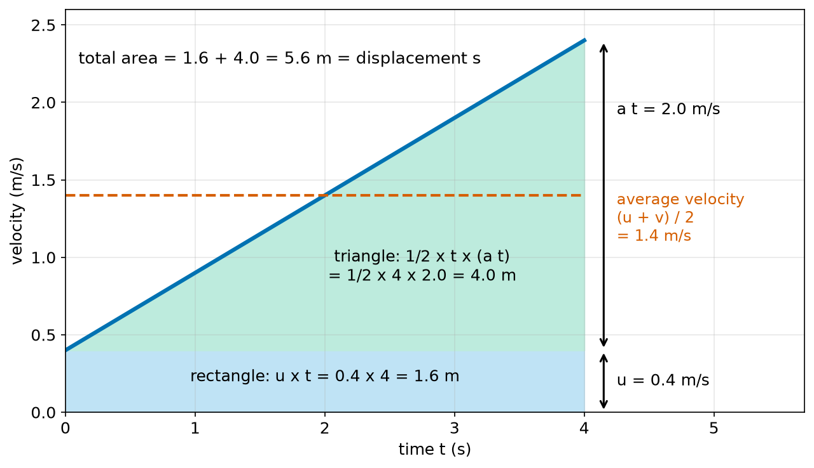
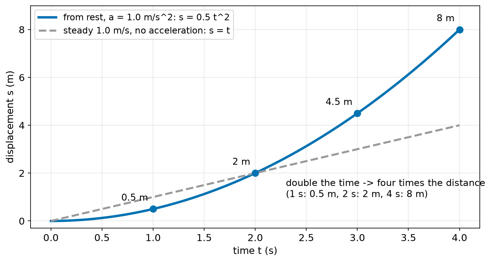
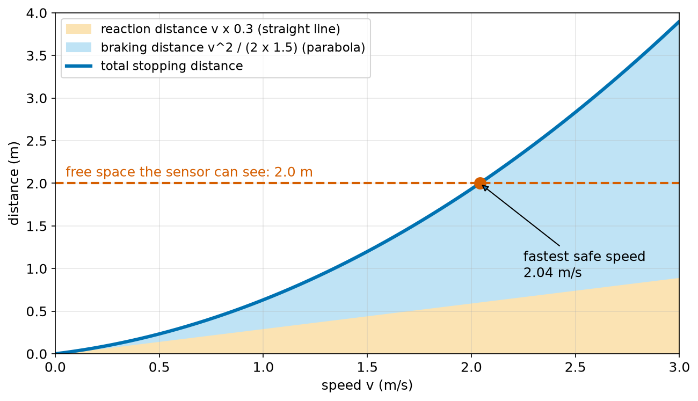
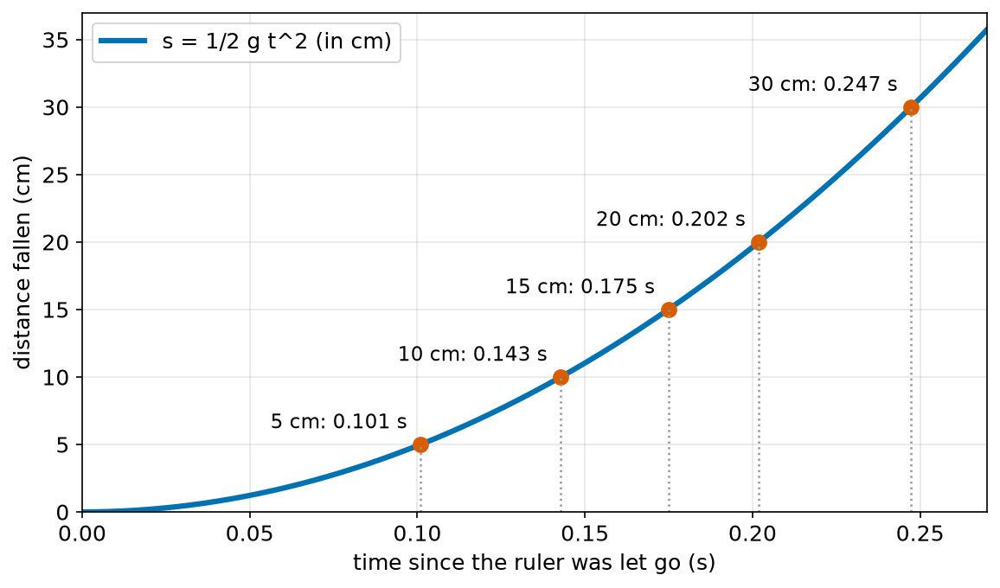
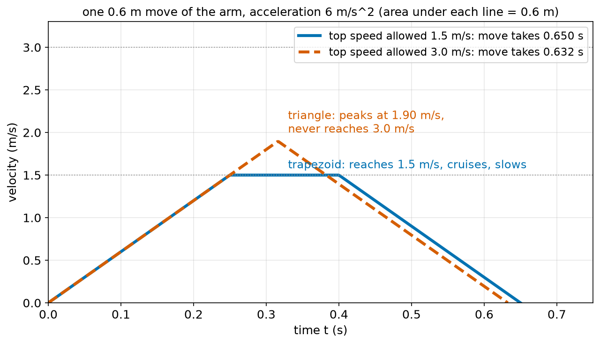
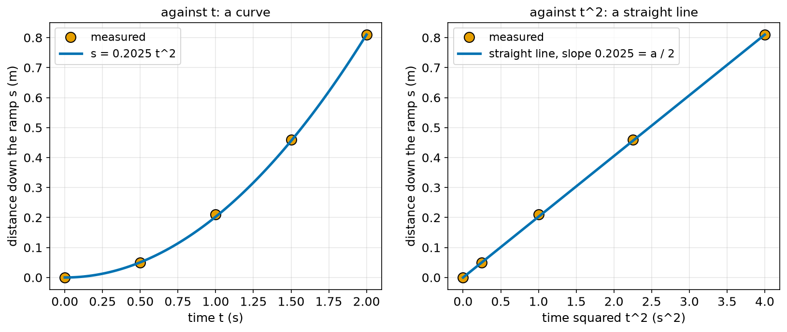

# Chapter 59 — Equations of Motion with Constant Acceleration

> **Part 4 · Chapter 59 of 749**
> **You need:** Chapter 41 (rearranging), Chapter 45 (quadratics), Chapter 57 (velocity and areas) and Chapter 58 (acceleration).
> **You will make:** a set of functions for the four equations of motion, checked against a step-by-step sum; a stopping-distance calculator that finds the fastest safe speed; and a move-time calculator that shows why a faster arm is often not faster at all.

---

## What you will learn

- What "constant acceleration" means, and why it is a useful model.
- The five quantities **s, u, v, a, t**.
- The four **equations of motion**, and where each one comes from.
- How to choose the right equation for a problem.
- Where the stopping distance **v²/(2a)** comes from, and why it grows with the **square** of the speed.
- How reaction time and braking add up to a total stopping distance.
- How far something falls in a given time.
- How long a move takes when a robot must speed up and slow down: the **trapezoid** and the **triangle**.

---

## New words in this chapter

| Word | Simple meaning |
|---|---|
| **constant acceleration** | An acceleration that stays the same the whole time. |
| **s** | Displacement during the motion (m). |
| **u** | Velocity at the start (m/s). |
| **v** | Velocity at the end (m/s). |
| **a** | The (constant) acceleration (m/s²). |
| **t** | The time the motion lasts (s). |
| **equations of motion** | Four formulas that link s, u, v, a and t when a is constant. |
| **braking distance** | How far a robot moves while braking, from its speed to a stop. |
| **reaction distance** | How far it moves before the brakes even start. |
| **stopping distance** | Reaction distance + braking distance. |
| **free fall** | Falling with only gravity acting, so a = g. |
| **trapezoidal profile** | A move that speeds up, cruises at top speed, then slows down. |
| **triangular profile** | A move that is too short to reach top speed: it speeds up, then at once slows down. |

---

## 59.1 Why constant acceleration?

In Chapter 58, Rover sped up at 0.5 m/s², drove steadily, then braked at 0.6 m/s². In each part the acceleration was a fixed number. Many real motions are like that, or close enough:

- a robot speeding up with a ramp limiter (Chapter 58),
- a robot braking with a set deceleration,
- a ball falling, at least for the first metres (a = g),
- a lift starting and stopping,
- a cart rolling down a straight ramp.

📖 **New word: constant acceleration** — an acceleration that stays the same during the whole motion.

When the acceleration is constant, the velocity–time graph is a **straight line** (its slope never changes). That makes everything easy to work out with a few formulas instead of a step-by-step sum. When the acceleration changes all the time, we need a computer and small steps (Chapter 71). But even then, the computer uses the formulas of this chapter inside each small step.

### The five quantities

Every constant-acceleration problem uses five quantities. Physicists use the same five letters all over the world:

| Letter | What it is | Unit |
|---|---|---|
| **s** | displacement during the motion | m |
| **u** | velocity at the **start** | m/s |
| **v** | velocity at the **end** | m/s |
| **a** | acceleration (constant) | m/s² |
| **t** | time the motion lasts | s |

💡 **Tip.** Remember them as "suvat". Many students call these the "suvat equations".

The big idea: **if you know any three of the five, the equations give you the other two.**

---

## 59.2 Equation 1: v = u + a t

This one comes straight from the meaning of acceleration (Chapter 58):

```
a = (v − u) / t
```

Multiply both sides by t and add u (Chapter 41):

```
v = u + a t
```

In words: "the end velocity is the start velocity plus the velocity gained". The velocity gained is a × t: so many m/s gained per second, times the number of seconds.

**Small example.** Rover starts at 0.4 m/s and speeds up at 0.5 m/s² for 4 s. v = 0.4 + 0.5 × 4 = 2.4 m/s.

**Small example.** A cart at 3 m/s brakes at −1.5 m/s² for 2 s. v = 3 + (−1.5) × 2 = 0. It has stopped.

---

## 59.3 Equation 2: s = (u + v) / 2 × t

Chapter 57 said: the displacement is the **area under the velocity–time graph**. With constant acceleration, that graph is a straight line from u to v.



*Figure 59.1 — The area is a rectangle plus a triangle. Its total is the displacement.*

**How to read this picture:** The blue line is the velocity of Rover from the small example: it starts at u = 0.4 m/s and rises in a straight line to v = 2.4 m/s after 4 s. The area under it is split into two pieces. The light blue rectangle at the bottom is u × t = 0.4 × 4 = 1.6 m. The green triangle on top has a base of t = 4 s and a height of a × t = 2.0 m/s, so its area is ½ × 4 × 2.0 = 4.0 m. The total is 5.6 m. The red dashed line is the average velocity, halfway between u and v: 1.4 m/s. A rectangle of that height has exactly the same area: 1.4 × 4 = 5.6 m.

That last fact gives Equation 2. When the velocity changes **steadily**, the average velocity is just halfway between the start and the end:

```
average velocity = (u + v) / 2
s = average velocity × time = (u + v) / 2 × t
```

In words: "the displacement is the average of the start and end velocity, times the time".

⚠️ **Watch out.** (u + v) / 2 is the average velocity **only** when the acceleration is constant. If a robot drives at 1 m/s for 9 s and then at 3 m/s for 1 s, its average velocity is 12 / 10 = 1.2 m/s, not (1 + 3) / 2 = 2 m/s. Chapter 57 warned about this.

---

## 59.4 Equation 3: s = u t + ½ a t²

Equation 2 needs v. Often we do not know v, only u, a and t. So we put Equation 1 (v = u + a t) into Equation 2:

```
s = (u + v) / 2 × t
  = (u + u + a t) / 2 × t
  = (2u + a t) / 2 × t
  = u t + ½ a t²
```

In words: "the displacement is what you would cover at the start velocity, plus the extra from speeding up". The two parts are exactly the rectangle (u t) and the triangle (½ a t²) of Figure 59.1.

🔢 **Maths.** Rover again: s = 0.4 × 4 + ½ × 0.5 × 4² = 1.6 + 4.0 = 5.6 m. The same as before.

### Starting from rest

When the object starts from rest, u = 0, and Equation 3 becomes very simple:

```
s = ½ a t²
```

The distance grows with the **square** of the time.



*Figure 59.2 — Starting from rest, the distance grows with time squared: a parabola.*

**How to read this picture:** The blue curve is s = ½ × 1.0 × t² for a robot that starts at rest and accelerates at 1.0 m/s². After 1 s it has gone 0.5 m, after 2 s 2 m, after 3 s 4.5 m, after 4 s 8 m. Doubling the time from 2 s to 4 s multiplies the distance by four. The grey dashed line is a robot that drives at a steady 1.0 m/s: a straight line, s = t. The curve is a parabola, the shape of Chapter 45.

This answers a question from Chapter 41's lab: "why does the rule distance = speed × time fail for a toy car rolling down a ramp?". The car **accelerates**: its speed is not constant, so distance is not proportional to time. It is proportional to time squared. Lab 59.1 tests this.

---

## 59.5 Equation 4: v² = u² + 2 a s

Sometimes there is no time in the problem at all. "A robot brakes at 1.5 m/s² from 2 m/s. How far does it go?" We do not know t and we do not need it. We want a formula without t.

From Equation 1, t = (v − u) / a. Put that into Equation 2:

```
s = (u + v) / 2 × (v − u) / a
  = (v + u)(v − u) / (2a)
  = (v² − u²) / (2a)          ← (v + u)(v − u) = v² − u², Chapter 41
```

Multiply both sides by 2a and add u²:

```
v² = u² + 2 a s
```

In words: "the end velocity squared equals the start velocity squared plus two times the acceleration times the displacement".

### The braking distance at last

📖 **New word: braking distance** — the distance a robot moves while braking from its speed u to a stop.

Now we can answer a question that this course has asked since Chapter 2: **why does the braking distance grow with the square of the speed?**

A robot at speed u brakes with deceleration b (so a = −b) until it stops (v = 0):

```
0 = u² + 2 × (−b) × s
2 b s = u²
s = u² / (2b)
```

So:

```
braking distance = u² / (2 × deceleration)
```

This is the v²/(2a) used in Chapters 2, 7, 38, 44 and 45. Here it is derived from nothing more than the meaning of acceleration and the area under a graph.

🧠 **Remember:** braking distance = speed² / (2 × deceleration). Twice the speed means **four** times the braking distance.

**Why four times?** Think of it in two steps. At twice the speed:

1. Braking takes **twice as long** (t = u / b, so double u means double t).
2. During that time, the **average** speed is twice as big ((u + 0)/2 doubles).

Twice as long at twice the average speed: 2 × 2 = 4 times the distance.

🔢 **Maths.** A farm robot brakes at 1.5 m/s² (Chapter 38's example):

| Speed | u² / (2 × 1.5) |
|---|---|
| 1 m/s | 0.33 m |
| 2 m/s | 1.33 m |
| 4 m/s | 5.33 m |

---

## 59.6 Stopping distance: reaction plus braking

A robot does not start braking the moment something appears. It first needs time to **notice** (the sensor must read, the program must decide) and to **start** braking (the motor driver must respond). During that time, it keeps going at full speed.

📖 **New word: reaction distance** — the distance travelled at full speed before braking starts.

📖 **New word: stopping distance** — reaction distance + braking distance.

```
stopping distance = u × t_reaction  +  u² / (2 × b)
                    reaction            braking
```

In words: "the robot first drives at full speed for the reaction time, then brakes".

The first part grows in a straight line with speed. The second grows with speed squared. At low speed, reaction dominates. At high speed, braking dominates.



*Figure 59.3 — The total stopping distance is a straight line (reaction) plus a parabola (braking).*

**How to read this picture:** Across the bottom is the robot's speed. The orange band at the bottom is the reaction distance: u × 0.3 s, a straight line. The blue band on top of it is the braking distance: u² / 3, a parabola. The thick blue line is the total. The red dashed line is the free space that the robot's sensor can promise: 2.0 m. The red dot is where the total reaches 2.0 m: at 2.04 m/s. Any faster, and the robot cannot always stop in time.

This is the exact problem of Chapters 44 and 45. Chapter 44 solved it by bisection, and Chapter 45 by the quadratic formula. Both gave 2.0405 m/s. Application 1 builds it again, now knowing where every part comes from.

🤖 **Robot link.** Chapter 7's exercise found 1.535 m at 1.5 m/s and 2.54 m at 2.0 m/s for a different robot: a third more speed gave 65% more stopping distance. Now you know why: the braking part grew with the square of the speed.

---

## 59.7 Falling

📖 **New word: free fall** — falling with only gravity acting. Then a = g ≈ 9.81 m/s² (Chapter 58), and the start velocity is usually 0.

The equations become:

```
v = g t
s = ½ g t²
v² = 2 g s
```

### The ruler drop

In Chapter 6's lab, you caught a falling ruler and read your reaction time from a table. Here is where the table comes from. Rearranging s = ½ g t² for t (Chapter 41):

```
t = √(2 s / g)
```

| Caught at | s (m) | t = √(2s / 9.81) |
|---|---|---|
| 5 cm | 0.05 | 0.101 s |
| 10 cm | 0.10 | 0.143 s |
| 15 cm | 0.15 | 0.175 s |
| 20 cm | 0.20 | 0.202 s |
| 30 cm | 0.30 | 0.247 s |



*Figure 59.4 — How far a ruler falls in a given time.*

**How to read this picture:** Across the bottom is the time since the ruler was let go. Up the side is how far it has fallen, in centimetres. The blue curve is s = ½ g t². Each red dot is one row of the table. Notice how the ruler falls only 5 cm in the first 0.1 s, but 25 cm more in the next 0.15 s: it keeps speeding up.

### A dropped drone

If a drone's motors stop at 30 m height, how long until it hits the ground, and how fast? Ignoring the air:

```
t = √(2 × 30 / 9.81) = √6.12 = 2.47 s
v = g t = 9.81 × 2.47 = 24.3 m/s   (87 km/h)
```

In reality the air slows it a little (Chapter 660 looks at air drag on flying robots), but the answer is close for a compact drone falling from this height. Either way, 2.5 s is very little time. That is why drone safety rules limit flights over people (Chapter 615), and why some drones carry a parachute.

---

## 59.8 Choosing the right equation

Here are all four together:

| # | Equation | Has no… |
|---|---|---|
| 1 | v = u + a t | s |
| 2 | s = (u + v) / 2 × t | a |
| 3 | s = u t + ½ a t² | v |
| 4 | v² = u² + 2 a s | t |

Each equation leaves out **one** of the five quantities. That is the key to choosing:

1. Write down the three quantities you know.
2. Write down the one you want.
3. Find the fifth one: the one you neither know nor want.
4. Use the equation that **does not have** that fifth one.

🔢 **Maths.** "A lift starts at rest and accelerates at 1.0 m/s² until it reaches 2.0 m/s. How far has it gone?"

- Known: u = 0, a = 1.0, v = 2.0.
- Wanted: s.
- Not known, not wanted: t.
- Use Equation 4 (no t): 2.0² = 0² + 2 × 1.0 × s → s = 4 / 2 = 2.0 m.

**Small example.** "A robot at 1.2 m/s brakes and stops in 0.8 m. What is its deceleration?" Known u = 1.2, v = 0, s = 0.8. Want a. Missing t: Equation 4. 0 = 1.44 + 2 a × 0.8 → a = −1.44 / 1.6 = −0.9 m/s².

⚠️ **Watch out.** Use a consistent sign. If "forwards" is positive, then braking while going forwards is a **negative** a. Mixing signs is the most common mistake with these equations.

---

## 59.9 How long does a move take?

Chapter 13 and Chapter 40 worked out trip times as distance ÷ speed, and promised to add speeding up and slowing down later. Now we can.

A robot must move a distance D, starting and ending at rest. It may not go faster than v_max, and it accelerates and brakes at a.

📖 **New word: trapezoidal profile** — speed up at a, cruise at v_max, slow down at a. The velocity–time graph is a trapezoid (a shape with two parallel sides).

Speeding up from 0 to v_max takes t₁ = v_max / a and covers v_max² / (2a) (Equation 4). Slowing down covers the same again. So the two ramps together cover

```
ramp distance = v_max² / a
```

**Case 1: D ≥ v_max² / a.** There is room to reach full speed:

```
cruise distance = D − v_max² / a
total time      = 2 × v_max / a  +  (D − v_max² / a) / v_max
```

📖 **New word: triangular profile** — the move is too short to reach v_max. The robot speeds up until halfway, then slows down at once. The graph is a triangle.

**Case 2: D < v_max² / a.** Each half covers D/2 from rest: D/2 = ½ a t₁², so t₁ = √(D/a), and

```
peak speed = a × t₁ = √(a D)
total time = 2 √(D / a)
```

In Case 2, **v_max does not appear at all**. Raising the speed limit cannot make a short move any faster. Only a bigger acceleration helps.



*Figure 59.5 — The same 0.6 m move with two different speed limits.*

**How to read this picture:** Both lines start at rest, end at rest, and accelerate at 6 m/s². The area under each is 0.6 m. The blue line may reach 1.5 m/s: it speeds up for 0.25 s, cruises for 0.15 s, and slows down for 0.25 s: a trapezoid, 0.650 s. The red dashed line may reach 3.0 m/s, but the move is too short: it peaks at 1.90 m/s and then slows down: a triangle, 0.632 s. Doubling the speed limit saved only 0.018 s. Application 2 shows what that means in a factory.

🤖 **Robot link.** Robot arms, 3D printers, CNC machines and lifts all plan their moves like this. Chapter 397 builds trapezoidal profiles properly, and Chapter 404 makes them smoother.

---

## Code

File `code/ch059/suvat.py`:

```python
# suvat.py - the four equations of motion for constant acceleration, checked against a step-by-step sum
import math


def final_velocity(u, a, t):
    return u + a * t                        # v = u + a t


def displacement(u, a, t):
    return u * t + 0.5 * a * t ** 2         # s = u t + 1/2 a t^2


def velocity_after_distance(u, a, s):
    v_squared = u ** 2 + 2 * a * s          # v^2 = u^2 + 2 a s
    if v_squared < 0:
        return None                         # it stops before covering s
    return math.sqrt(v_squared)


u, a, t = 0.4, 0.5, 4.0                     # start at 0.4 m/s, speed up at 0.5 m/s^2 for 4 s
v = final_velocity(u, a, t)
s = displacement(u, a, t)
print(f"v = u + a t            = {v:.3f} m/s")
print(f"s = u t + 1/2 a t^2    = {s:.3f} m")
print(f"s = (u + v) / 2 x t    = {(u + v) / 2 * t:.3f} m")
print(f"v from v^2 = u^2 + 2as = {velocity_after_distance(u, a, s):.3f} m/s")

dt = 0.001
x, vel = 0.0, u
for step in range(round(t / dt)):
    x = x + (vel + 0.5 * a * dt) * dt       # area of one thin strip: its average height times its width
    vel = vel + a * dt
print(f"step-by-step sum with dt = {dt}: s = {x:.3f} m, v = {vel:.3f} m/s")
```

| Line | Code | What it does (simple English) |
|---|---|---|
| 1 | `# suvat.py …` | A comment. |
| 2 | `import math` | For `sqrt`. |
| 3–4 | (blank) | Spacing. |
| 5 | `def final_velocity(u, a, t):` | Equation 1 as a function. |
| 6 | `return u + a * t` | v = u + a t. |
| 7–8 | (blank) | Spacing. |
| 9 | `def displacement(u, a, t):` | Equation 3. |
| 10 | `return u * t + 0.5 * a * t ** 2` | `**` is "to the power of" (Chapter 13). |
| 11–12 | (blank) | Spacing. |
| 13 | `def velocity_after_distance(u, a, s):` | Equation 4, solved for v. |
| 14 | `v_squared = u ** 2 + 2 * a * s` | v² first. |
| 15 | `if v_squared < 0:` | A negative v² means the robot stopped (and would turn back) before covering s. There is no real square root. |
| 16 | `return None` | Says "this never happens" (Chapter 24). |
| 17 | `return math.sqrt(v_squared)` | The speed at the end. |
| 18–19 | (blank) | Spacing. |
| 20 | `u, a, t = 0.4, 0.5, 4.0` | The example of sections 59.2 and 59.3. |
| 21 | `v = final_velocity(u, a, t)` | Equation 1. |
| 22 | `s = displacement(u, a, t)` | Equation 3. |
| 23–26 | `print(…)` | Shows v, then s three different ways: Equations 3, 2 and 4. They must agree. |
| 27 | (blank) | Spacing. |
| 28 | `dt = 0.001` | A small time step: 1 ms. |
| 29 | `x, vel = 0.0, u` | Start at 0, with the start velocity. |
| 30 | `for step in range(round(t / dt)):` | 4000 small steps. |
| 31 | `x = x + (vel + 0.5 * a * dt) * dt` | Adds the area of one thin strip under the velocity line: its height halfway along, times its width. |
| 32 | `vel = vel + a * dt` | The velocity grows by a × dt in each step. |
| 33 | `print(f"step-by-step …")` | The answer from adding 4000 thin strips. |

Output:

```
v = u + a t            = 2.400 m/s
s = u t + 1/2 a t^2    = 5.600 m
s = (u + v) / 2 x t    = 5.600 m
v from v^2 = u^2 + 2as = 2.400 m/s
step-by-step sum with dt = 0.001: s = 5.600 m, v = 2.400 m/s
```

All the equations agree with each other, and with the "brute force" sum of thin strips. That is a strong check that the algebra in sections 59.2 to 59.5 is right.

---

## Small examples

**Example 1.** u = 0, a = 2 m/s², t = 3 s. v = 6 m/s, s = ½ × 2 × 9 = 9 m.

**Example 2.** u = 1.5 m/s, v = 0, s = 0.9 m. a = −1.5² / (2 × 0.9) = −1.25 m/s².

**Example 3.** A robot brakes from 1.2 m/s at 0.8 m/s². Braking distance 1.44 / 1.6 = 0.9 m. Time 1.2 / 0.8 = 1.5 s.

**Example 4.** u = 0.5 m/s, v = 1.5 m/s, t = 4 s. s = (0.5 + 1.5) / 2 × 4 = 4 m.

**Example 5.** A ball dropped from 5 m: t = √(10 / 9.81) = 1.01 s, v = 9.9 m/s.

**Example 6.** A robot's speed doubles from 1 to 2 m/s. Its braking distance at 1 m/s² goes from 0.5 m to 2 m: four times.

**Example 7.** A 2 m move with v_max = 1 m/s and a = 1 m/s². Ramp distance 1 m ≤ 2 m: trapezoid. Time 2 × 1 + (2 − 1) / 1 = 3 s.

**Example 8.** A 0.25 m move with v_max = 1 m/s and a = 1 m/s². Ramp distance 1 m > 0.25 m: triangle. Time 2√0.25 = 1 s, peak 0.5 m/s.

---

## 🏭 Real robot applications

### Application 1 (worked in full) — 🛑 How fast may a factory robot drive?

**1. The real problem.** A mobile robot moves parts around a factory. Its safety laser scanner guarantees that the first 2.0 m in front of it are free. If a person steps into that zone, the robot must stop before it reaches them. What is the fastest speed at which it can always do that?

**2. Why this theory.** The robot keeps going at full speed during its reaction time (u × t_r), then brakes (u² / 2b). The total must not be more than 2.0 m. That gives a quadratic in u, which Chapter 45's formula solves.

**3. The numbers.** The same robot as Chapter 44: reaction time 0.3 s (scanner, computer and motor driver together), braking at 1.5 m/s², free space 2.0 m.

**4. The maths.**

```
stopping distance = 0.3 u + u² / 3 = 2.0
⇒ (1/3) u² + 0.3 u − 2.0 = 0
```

With the quadratic formula (Chapter 45), A = 1/3, B = 0.3, C = −2.0:

```
u = (−0.3 + √(0.09 + 4 × (1/3) × 2.0)) / (2 × 1/3)
  = (−0.3 + √(0.09 + 2.6667)) / 0.6667
  = (−0.3 + 1.6603) / 0.6667
  = 2.0405 m/s
```

**5. The code.** File `code/ch059/stopping.py`:

```python
# stopping.py - stopping distance = reaction distance + braking distance, and the fastest safe speed
import math

REACTION_S = 0.3          # time to notice and start braking
BRAKE = 1.5               # braking deceleration in m/s^2
FREE_SPACE_M = 2.0        # how far ahead the sensor guarantees free space


def stopping_distance(v):
    reaction_m = v * REACTION_S
    braking_m = v ** 2 / (2 * BRAKE)
    return reaction_m, braking_m


print(" speed   reaction   braking    total")
for v in [0.5, 1.0, 1.5, 2.0, 2.5, 3.0]:
    r, b = stopping_distance(v)
    print(f"{v:4.1f} m/s  {r:6.3f} m  {b:6.3f} m  {r + b:6.3f} m")

# fastest safe speed: v^2/(2 BRAKE) + REACTION_S v - FREE_SPACE_M = 0, a quadratic (Chapter 45)
qa = 1 / (2 * BRAKE)
qb = REACTION_S
qc = -FREE_SPACE_M
v_safe = (-qb + math.sqrt(qb ** 2 - 4 * qa * qc)) / (2 * qa)
print(f"fastest safe speed for {FREE_SPACE_M} m of free space: {v_safe:.4f} m/s")
print(f"check: stopping distance at that speed = {sum(stopping_distance(v_safe)):.4f} m")
```

| Line | Code | What it does (simple English) |
|---|---|---|
| 1 | `# stopping.py …` | A comment. |
| 2 | `import math` | For `sqrt`. |
| 3 | (blank) | Spacing. |
| 4 | `REACTION_S = 0.3` | The reaction time. |
| 5 | `BRAKE = 1.5` | The deceleration, as a positive number. |
| 6 | `FREE_SPACE_M = 2.0` | The free space ahead. |
| 7–8 | (blank) | Spacing. |
| 9 | `def stopping_distance(v):` | Returns the two parts separately. |
| 10 | `reaction_m = v * REACTION_S` | Full speed during the reaction time. |
| 11 | `braking_m = v ** 2 / (2 * BRAKE)` | v² / (2b), from Equation 4. |
| 12 | `return reaction_m, braking_m` | A tuple of two numbers (Chapter 22). |
| 13–14 | (blank) | Spacing. |
| 15 | `print(" speed …")` | The table heading. |
| 16 | `for v in [0.5, 1.0, …]:` | Some speeds to compare. |
| 17 | `r, b = stopping_distance(v)` | Unpacks the tuple. |
| 18 | `print(f"…{r + b:6.3f} m")` | One row: both parts and the total. |
| 19 | (blank) | Spacing. |
| 20 | `# fastest safe speed: …` | A comment that writes out the quadratic. |
| 21 | `qa = 1 / (2 * BRAKE)` | The number in front of v². |
| 22 | `qb = REACTION_S` | The number in front of v. |
| 23 | `qc = -FREE_SPACE_M` | The number on its own. |
| 24 | `v_safe = (-qb + math.sqrt(…)) / (2 * qa)` | The quadratic formula. We take the `+` root, because the `−` root is a negative speed. |
| 25 | `print(f"fastest safe speed …")` | The answer. |
| 26 | `print(f"check: …")` | `sum` adds the two parts of the tuple. It must give 2.0. |

Output:

```
 speed   reaction   braking    total
 0.5 m/s   0.150 m   0.083 m   0.233 m
 1.0 m/s   0.300 m   0.333 m   0.633 m
 1.5 m/s   0.450 m   0.750 m   1.200 m
 2.0 m/s   0.600 m   1.333 m   1.933 m
 2.5 m/s   0.750 m   2.083 m   2.833 m
 3.0 m/s   0.900 m   3.000 m   3.900 m
fastest safe speed for 2.0 m of free space: 2.0405 m/s
check: stopping distance at that speed = 2.0000 m
```

Figure 59.3 (section 59.6) is a plot of this table.

**6. The result.** The robot may drive at up to 2.04 m/s. In practice, engineers would set it a bit lower, for example 1.8 m/s, to leave a margin for a wet or dusty floor that brakes less well. The table shows clearly which part to improve. At 2 m/s, braking is 1.33 m of the 1.93 m: better brakes (or better grip) help most. At 0.5 m/s, reaction is the bigger part: a faster computer helps most.

**7. Going further.** Safety standards for mobile robots give a full version of this rule, with extra margins for sensor errors and for the person also moving towards the robot (Chapter 744). Many robots switch between several scanner zones: a large zone at high speed and a small one at low speed, so they can drive fast in open aisles and slowly near people. Chapter 63 shows how floor grip limits the braking deceleration.

### Application 2 (worked in full) — 🏭 Why doubling the arm's speed does almost nothing

**1. The real problem.** In Chapter 40, a factory arm moved parts 0.6 m from a belt to a box. Its manager wanted twice the output and asked for twice the speed. Chapter 40 showed that the gripper time does not change, so the gain is less than double. But Chapter 40 ignored speeding up and slowing down. What really happens?

**2. Why this theory.** Each move starts and ends at rest, so it follows a trapezoidal or triangular profile (section 59.9). A short move may never reach the speed limit, so raising the limit may not help at all.

**3. The numbers.** Move L = 0.6 m. Gripper time 0.3 s for each close or open. Top speed now 1.5 m/s, proposed 3.0 m/s. The arm accelerates and brakes at 6 m/s².

**4. The maths.** With v_max = 1.5 m/s:

```
ramp distance = 1.5² / 6 = 0.375 m ≤ 0.6 m    → trapezoid
move time     = 2 × 1.5 / 6 + (0.6 − 0.375) / 1.5 = 0.5 + 0.15 = 0.650 s
```

With v_max = 3.0 m/s:

```
ramp distance = 3.0² / 6 = 1.5 m > 0.6 m       → triangle
move time     = 2 × √(0.6 / 6) = 2 × 0.3162 = 0.632 s
peak speed    = √(6 × 0.6) = 1.90 m/s
```

A cycle is two moves and two gripper actions: 2 × move + 0.6 s.

**5. The code.** File `code/ch059/move_time.py`:

```python
# move_time.py - how long a point-to-point move takes when the robot must speed up and slow down
import math


def move_time(distance, v_max, accel):
    """Time to move `distance` from rest to rest, with top speed v_max and acceleration accel."""
    ramp_distance = v_max ** 2 / accel          # speeding up plus slowing down, each v_max^2 / (2 accel)
    if distance >= ramp_distance:
        cruise = distance - ramp_distance       # a trapezoid: speed up, cruise, slow down
        return 2 * v_max / accel + cruise / v_max, v_max
    v_peak = math.sqrt(accel * distance)        # a triangle: never reaches v_max
    return 2 * v_peak / accel, v_peak


L, GRIP_S, ACCEL = 0.6, 0.3, 6.0
for v_max in [1.5, 3.0]:
    t_move, v_top = move_time(L, v_max, ACCEL)
    cycle = 2 * t_move + 2 * GRIP_S
    print(f"v_max {v_max} m/s: one move {t_move:.3f} s (top speed reached {v_top:.2f} m/s), "
          f"cycle {cycle:.3f} s, {3600 / cycle:.0f} parts per hour")
print(f"ignoring acceleration (Chapter 40): one move {L / 1.5:.3f} s, cycle {2 * L / 1.5 + 2 * GRIP_S:.3f} s")
```

| Line | Code | What it does (simple English) |
|---|---|---|
| 1 | `# move_time.py …` | A comment. |
| 2 | `import math` | For `sqrt`. |
| 3–4 | (blank) | Spacing. |
| 5 | `def move_time(distance, v_max, accel):` | Returns the move time and the top speed actually reached. |
| 6 | `"""Time to move …"""` | The docstring. |
| 7 | `ramp_distance = v_max ** 2 / accel` | Distance used by speeding up and slowing down, together. |
| 8 | `if distance >= ramp_distance:` | Is there room to reach v_max? |
| 9 | `cruise = distance - ramp_distance` | What is left to cover at full speed. |
| 10 | `return 2 * v_max / accel + cruise / v_max, v_max` | Two ramps of v_max / a each, plus the cruise time. And the top speed is v_max. |
| 11 | `v_peak = math.sqrt(accel * distance)` | Not enough room: the peak of the triangle, √(a D). |
| 12 | `return 2 * v_peak / accel, v_peak` | Two ramps of v_peak / a each. This equals 2√(D/a). |
| 13–14 | (blank) | Spacing. |
| 15 | `L, GRIP_S, ACCEL = 0.6, 0.3, 6.0` | The arm's numbers. |
| 16 | `for v_max in [1.5, 3.0]:` | Now and proposed. |
| 17 | `t_move, v_top = move_time(L, v_max, ACCEL)` | One move. |
| 18 | `cycle = 2 * t_move + 2 * GRIP_S` | There and back, plus two gripper actions. |
| 19–20 | `print(f"…" f"…")` | Two f-strings next to each other are joined into one long string. This keeps the line short. |
| 21 | `print(f"ignoring acceleration …")` | Chapter 40's simpler answer, for comparison. |

Output:

```
v_max 1.5 m/s: one move 0.650 s (top speed reached 1.50 m/s), cycle 1.900 s, 1895 parts per hour
v_max 3.0 m/s: one move 0.632 s (top speed reached 1.90 m/s), cycle 1.865 s, 1930 parts per hour
ignoring acceleration (Chapter 40): one move 0.400 s, cycle 1.400 s
```

**6. The result.** Doubling the speed limit gives 1930 instead of 1895 parts per hour: under 2% more. The arm never even reaches 3.0 m/s on such a short move. The manager's money would be wasted. The output also shows that Chapter 40's simple answer (1.4 s per cycle) was far too hopeful: the real cycle is 1.9 s, because speeding up and slowing down take time. To really go faster, the arm needs a bigger **acceleration** (stronger motors or a lighter arm, Chapter 61), shorter moves (put the box closer to the belt), or a faster gripper.

**7. Going further.** Real arms move several joints at once, and each joint has its own speed and acceleration limits. Chapter 397 plans trapezoidal moves for a joint, Chapter 405 finds the fastest possible move within all the limits, and Chapter 410 builds a whole pick-and-place trajectory.

### Application 3 — 🏢 When should a lift start braking?

A lift travels at 2.0 m/s and brakes at 1.0 m/s². It must stop exactly level with a floor. Its controller works backwards from the floor: the braking distance is 2.0² / (2 × 1.0) = 2.0 m, so it starts braking exactly 2.0 m before the floor. Braking takes 2.0 / 1.0 = 2 s. If it started 10 cm too late, it would overshoot: from v² = u² − 2bs with s = 1.9 m, v² = 4 − 3.8 = 0.2, so it would still be moving at 0.45 m/s as it passed the floor. Robots that must stop at a shelf, a charging dock or a workstation use the same "start braking at u²/2b before the goal" rule. Chapter 397 builds it into a full motion profile.

### Application 4 — 🚁 A drone whose motors stop

A delivery drone flies at 30 m height. If its motors fail, section 59.7 shows it hits the ground in about 2.5 s at about 24 m/s. A parachute needs time to open: if it needs 1.5 s, the drone has already fallen ½ × 9.81 × 1.5² = 11 m and is moving at 14.7 m/s when the parachute opens. So a parachute that takes 1.5 s to open is useless below about 15 m: it would not have time to slow the drone down. Drone makers use exactly this calculation to set a minimum safe height for parachute systems. Chapter 615 covers drone safety rules.

### Application 5 — 🚂 Merging into a moving line

An automated cart must join a line of carts moving at 1.2 m/s on a track. It starts from rest on a side track, and its acceleration is 0.6 m/s². It needs t = 1.2 / 0.6 = 2 s and s = 1.2² / (2 × 0.6) = 1.2 m to match their speed (Equations 1 and 4). During those 2 s, the gap it must slot into moves 1.2 × 2 = 2.4 m. So the cart must start when the gap is 2.4 − 1.2 = 1.2 m **before** the merge point. Starting earlier means arriving before the gap; starting later means hitting the cart behind it. Traffic control for warehouse robots, trains and conveyor systems all use this kind of timing.

---

## 🔧 Hands-on lab

### Lab 59.1 — Does a cart on a ramp follow s = ½ a t²? (hardware)

You need a toy car or a ball, a long board (at least 1 m), some books to raise one end, a tape measure, and a phone that can record video.

1. Raise one end of the board by about 5 cm, so the car rolls slowly.
2. Put marks every 10 cm along the board.
3. Hold the car at the top, at rest, then let it go (do not push). Film it from the side.
4. In the video, find the time when the car passes each mark. Start the clock when you let go.
5. Make a table of t, t² and s. Plot s against t, and s against t² (Chapter 33).
6. Find the slope of the s–t² line. It equals ½ a, so a = 2 × slope.

Here is one example set of readings, to show what the plots should look like:

| t (s) | 0 | 0.5 | 1.0 | 1.5 | 2.0 |
|---|---|---|---|---|---|
| s (m) | 0 | 0.05 | 0.21 | 0.46 | 0.81 |



*Figure 59.6 — The example readings plotted against t (a curve) and against t² (a straight line).*

**How to read this picture:** On the left, distance against time: the orange points lie on a curve that gets steeper, because the cart speeds up. On the right, the same distances against time **squared**: now they lie on a straight line through 0. A straight line on an s–t² graph is the test for constant acceleration. Its slope is 0.2025, so a = 2 × 0.2025 = 0.405 m/s².

**What you should see:** Your s–t² points lie close to a straight line through the origin. A gentle ramp gives an acceleration of a few tenths of a m/s². If you double the time, the distance is about four times as big.

| If it does not work | Likely cause | Fix |
|---|---|---|
| The s–t² line does not go through 0 | The clock did not start exactly at release | Start the clock at the frame where the car first moves |
| The points curve down at the end | Friction or air slows the car, or the board bends | Use a stiffer board and a smaller angle |
| The car stops halfway | The angle is too small to beat friction (Chapter 63) | Raise the board a little more |

**Challenge:** Measure the speed at the bottom from the video (Δs / Δt over the last 10 cm) and compare it with v = a t and v = √(2 a s).

### Lab 59.2 — Equations against thin strips (simulation)

Copy `suvat.py`.

1. Change u, a and t to: u = 2.0, a = −0.5, t = 6.0. Run it. What does a negative s or v mean here?
2. Change the step-by-step update to the simpler `x = x + vel * dt` (use the velocity at the **start** of each strip). Run it with dt = 0.1, 0.01 and 0.001.
3. Compare each answer with Equation 3.

**What you should see:** With u = 2.0, a = −0.5, t = 6.0: v = −1.0 m/s and s = 3.0 m. The object slowed down, stopped after 4 s at 4.0 m, then came back 1.0 m. With the simpler update, the error is 0.15 m at dt = 0.1, 0.015 m at dt = 0.01, and 0.0015 m at dt = 0.001: ten times smaller each time. The original update, with the half-step term, is exact for constant acceleration.

| If it does not work | Likely cause | Fix |
|---|---|---|
| `TypeError: unsupported format string passed to NoneType` | `velocity_after_distance` returned `None` | The robot never covers that distance; check the signs of u, a and s |
| The step-by-step answer is far off | `round(t / dt)` gives the wrong number of steps | Print it and check: it should be t / dt |

**Challenge:** Chapter 71 is all about this kind of step-by-step update. Write down a guess now: why does the error get 10 times smaller when dt gets 10 times smaller?

### Lab 59.3 — Safe speed for your robot (simulation)

Copy `stopping.py`.

1. Your robot has a reaction time of 0.15 s, brakes at 2.5 m/s², and its sensor sees 1.2 m. Find its fastest safe speed.
2. Make a table of the fastest safe speed for free space of 0.5, 1, 2, 4 and 8 m.
3. On a wet floor, the braking falls to 1.2 m/s². How much must the robot slow down?

**What you should see:** For 1.2 m, about 2.10 m/s. The table gives 1.25, 1.89, 2.81, 4.11 and 5.96 m/s. The safe speed grows much more slowly than the free space: 8 m of free space allows only about 3.2 times the speed of 1 m, not 8 times, because the braking part grows with speed squared. On the wet floor, the safe speed for 1.2 m falls to about 1.53 m/s.

| If it does not work | Likely cause | Fix |
|---|---|---|
| A negative safe speed | The `−` root was used | Use `-qb + math.sqrt(...)` |
| `ValueError: math domain error` | A negative number inside the square root | Check that `qc` is negative (free space is subtracted) |

**Challenge:** The person also walks towards the robot at 1.6 m/s while it stops. Add their movement during the robot's whole stopping time to the stopping distance, and find the new safe speed.

---

## Common mistakes

⚠️ **Using the equations when the acceleration is not constant.** They only work while a stays the same. Split a trip into pieces where it is constant.

⚠️ **Mixing signs.** If forwards is +, braking while moving forwards is a negative a.

⚠️ **Using (u + v)/2 as the average velocity when a is not constant.**

⚠️ **Forgetting the reaction distance.** The robot keeps going at full speed until the brakes start.

⚠️ **Thinking braking distance grows in proportion to speed.** It grows with speed **squared**.

⚠️ **Choosing an equation with two unknowns.** Pick the one that leaves out the quantity you neither know nor want.

⚠️ **Assuming a faster speed limit means a faster move.** On short moves, the robot never reaches the limit. Acceleration decides.

---

## Practice

🏋️ **1.** A robot starts at rest and accelerates at 0.8 m/s² for 5 s. Find v and s.

🏋️ **2.** A cart goes from 0.5 m/s to 2.5 m/s in 4 s. How far does it travel?

🏋️ **3.** A robot at 1.8 m/s brakes at 1.2 m/s². Find the braking distance and the braking time.

🏋️ **4.** A robot stops from 2.0 m/s in 1.6 m. What is its deceleration?

🏋️ **5.** A robot has a reaction time of 0.4 s and brakes at 2 m/s². Find its stopping distance at 1 m/s and at 3 m/s.

🏋️ **6.** How long does a ball take to fall 1.25 m? How fast is it going at the end?

🏋️ **7.** A ruler is caught after falling 12 cm. What was the reaction time?

🏋️ **8.** A robot must move 3 m from rest to rest, with v_max = 1.2 m/s and a = 0.6 m/s². Trapezoid or triangle? How long does it take?

🏋️ **9.** The same robot must move only 1 m. How long now, and what peak speed does it reach?

🏋️ **10.** For each, say which equation you would use: (a) know u, a, t, want s; (b) know u, v, s, want a; (c) know u, v, a, want t; (d) know u, v, t, want s.

🏋️ **11.** Write a function `safe_speed(free_space, reaction, brake)` that returns the fastest safe speed, and use it to print a table for free space from 0.5 m to 4 m in steps of 0.5 m, with reaction 0.3 s and braking 1.5 m/s².

---

## Answers

**1.** v = 0.8 × 5 = 4.0 m/s. s = ½ × 0.8 × 25 = 10 m.

**2.** s = (0.5 + 2.5) / 2 × 4 = 6 m.

**3.** Distance 1.8² / (2 × 1.2) = 3.24 / 2.4 = 1.35 m. Time 1.8 / 1.2 = 1.5 s.

**4.** b = 2.0² / (2 × 1.6) = 4 / 3.2 = 1.25 m/s².

**5.** At 1 m/s: 0.4 + 1/4 = 0.65 m. At 3 m/s: 1.2 + 9/4 = 3.45 m.

**6.** t = √(2 × 1.25 / 9.81) = √0.2548 = 0.505 s. v = 9.81 × 0.505 = 4.95 m/s.

**7.** t = √(2 × 0.12 / 9.81) = 0.156 s.

**8.** Ramp distance 1.2² / 0.6 = 2.4 m ≤ 3 m: trapezoid. Time 2 × 1.2 / 0.6 + (3 − 2.4) / 1.2 = 4 + 0.5 = 4.5 s.

**9.** 1 m < 2.4 m: triangle. Time 2√(1 / 0.6) = 2.58 s. Peak √(0.6 × 1) = 0.775 m/s.

**10.** (a) Equation 3 (no v). (b) Equation 4 (no t). (c) Equation 1 (no s). (d) Equation 2 (no a).

**11.**

```python
import math

def safe_speed(free_space, reaction, brake):
    qa = 1 / (2 * brake)
    return (-reaction + math.sqrt(reaction ** 2 + 4 * qa * free_space)) / (2 * qa)

for k in range(1, 9):
    d = 0.5 * k
    print(f"{d:3.1f} m  ->  {safe_speed(d, 0.3, 1.5):.3f} m/s")
```

Output:

```
0.5 m  ->  0.855 m/s
1.0 m  ->  1.340 m/s
1.5 m  ->  1.719 m/s
2.0 m  ->  2.040 m/s
2.5 m  ->  2.325 m/s
3.0 m  ->  2.584 m/s
3.5 m  ->  2.821 m/s
4.0 m  ->  3.043 m/s
```

The `4 * qa * free_space` is −4 × qa × qc with qc = −free_space, written without the double minus.

---

## Summary

🧠 With **constant acceleration**, the velocity–time graph is a straight line, and four equations link **s, u, v, a, t**:

| Equation | Has no |
|---|---|
| v = u + a t | s |
| s = (u + v) / 2 × t | a |
| s = u t + ½ a t² | v |
| v² = u² + 2 a s | t |

🧠 Choose the equation that leaves out the one quantity you neither know nor want.

🧠 From rest, s = ½ a t²: double the time, four times the distance.

🧠 **Braking distance = u² / (2b).** Twice the speed: twice the time at twice the average speed, so four times the distance.

🧠 **Stopping distance = u × reaction time + u² / (2b).**

🧠 Falling from rest: s = ½ g t², so t = √(2s/g).

🧠 A move from rest to rest is a **trapezoid** if it is long enough to reach v_max, and a **triangle** if not. For short moves, only the acceleration matters.

---

## Next chapter

In Chapter 60 we move in **two directions at once**. You will see that the sideways motion and the up-and-down motion of a thrown ball are completely separate, each following this chapter's equations, and you will meet **vectors** properly: arrows that can be added, split into parts and scaled.
