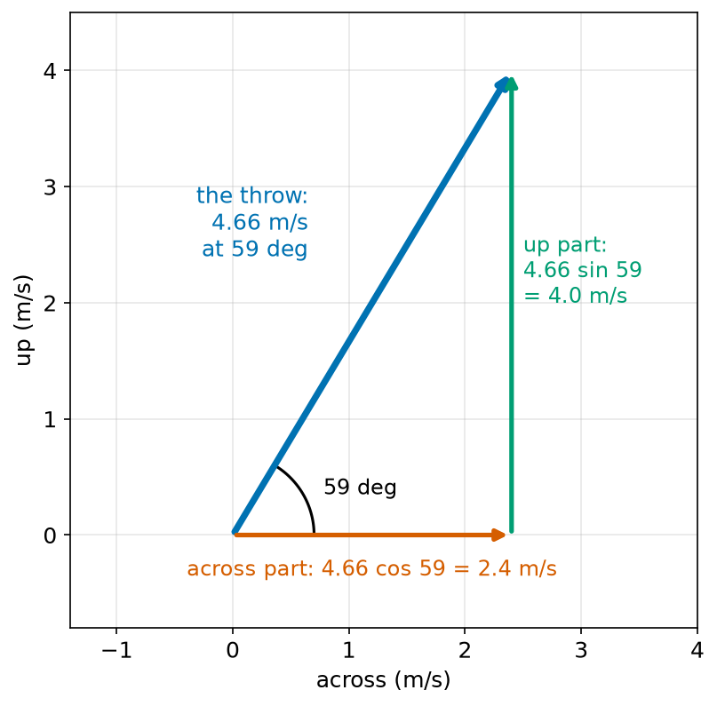
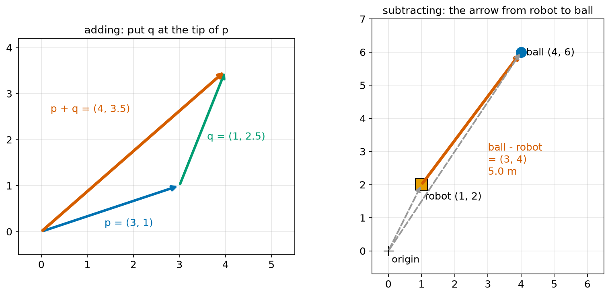
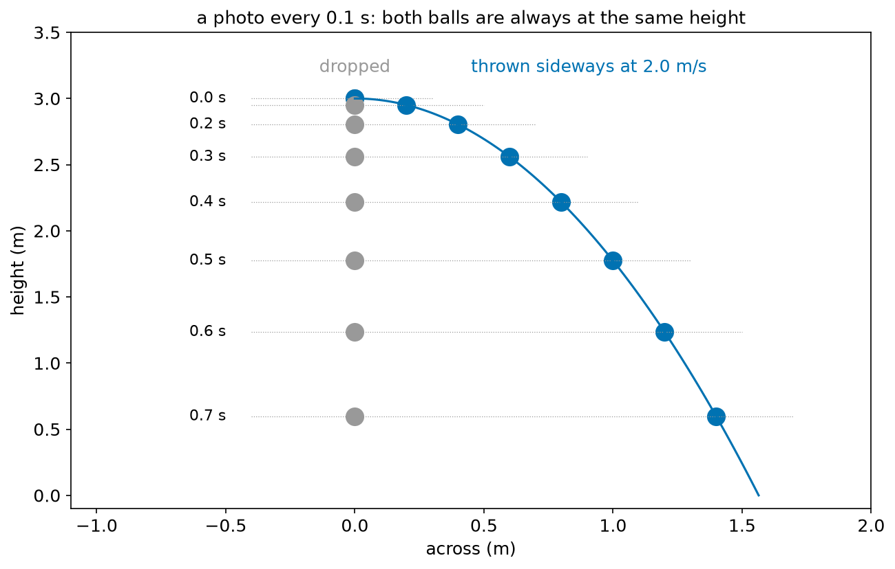
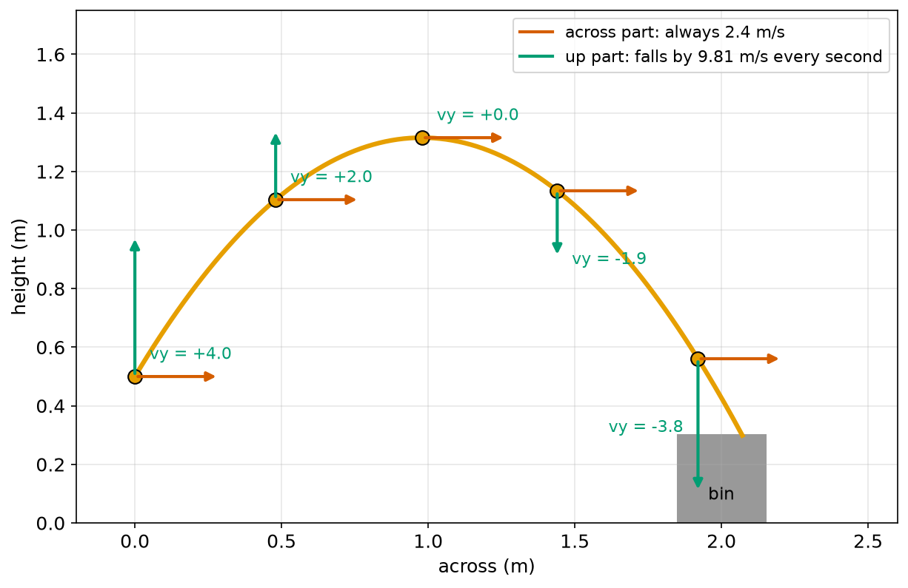
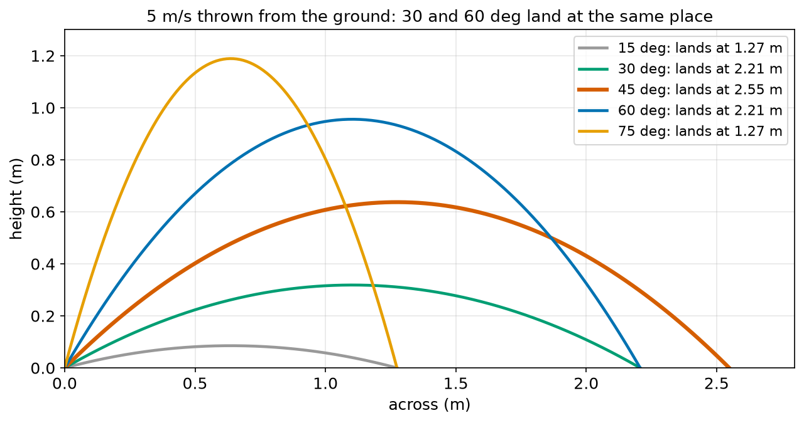
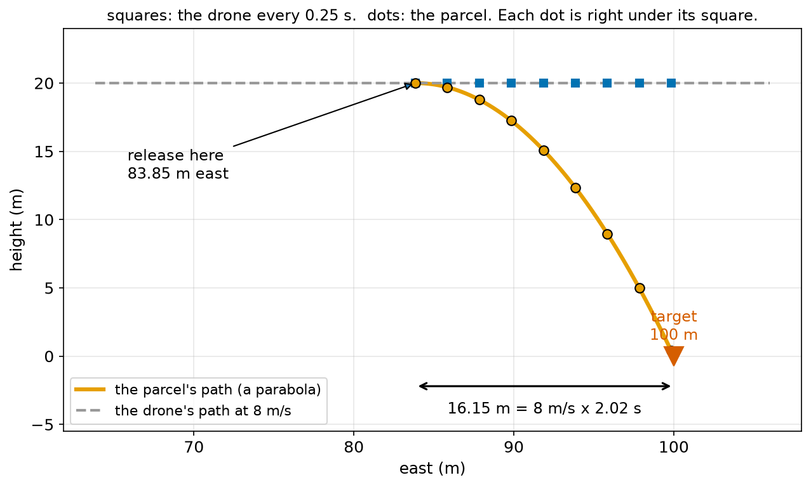

# Chapter 60 — Motion in Two Directions (First Look at Vectors)

> **Part 4 · Chapter 60 of 749**
> **You need:** Chapter 45 (the parcel throw), Chapter 49 (sin and cos), Chapter 56 (displacement in 2D), Chapter 57 (adding velocities) and Chapter 59 (equations of motion).
> **You will make:** a small set of vector functions, a program that works out any throw, a program that finds the two angles that land a parcel in a bin, and a program that tells a drone when to drop a parcel.

---

## What you will learn

- What a **vector** is, and the two ways to write one: as **parts** and as **size and direction**.
- How to change between the two ways with sin, cos, Pythagoras and `atan2`.
- How to **add**, **subtract** and **scale** vectors.
- The big idea of this chapter: **the sideways motion and the up-down motion do not affect each other**.
- How to work out a throw: how long it flies, how far it goes, and how high it gets.
- Why the same speed at two different angles can land in the same place.
- How a moving drone must release a parcel early so that it lands on the target.

---

## New words in this chapter

| Word | Simple meaning |
|---|---|
| **vector** | A quantity with a size and a direction, drawn as an arrow. |
| **component** | One part of a vector along one axis, such as its x part. |
| **magnitude** | The size (length) of a vector. |
| **resolve** | Split a vector into its parts. |
| **resultant** | The vector you get by adding other vectors. |
| **tip-to-tail** | A way to add vectors: draw the second one starting at the tip of the first. |
| **projectile** | Something that flies through the air with only gravity acting on it. |
| **trajectory** | The path a moving thing follows. |
| **range** | How far across a projectile goes before it lands. |
| **time of flight** | How long a projectile is in the air. |
| **independent** | Not affecting each other. |

---

## 60.1 Vectors: size and direction

Chapter 56 met two kinds of quantity:

- a **scalar** is only a size: 11 m, 3 kg, 20 °C;
- a **vector** has a size **and** a direction: "5 m north", "2.4 m/s to the right".

📖 **New word: vector** — a quantity with a size and a direction. We draw it as an arrow: the arrow's length shows the size, and its direction shows the direction.

So far, the vectors in this course were displacements (Chapter 56) and velocities (Chapter 57). Accelerations are vectors too, and in Chapter 61 forces will be the most important vectors of all.

### Two ways to write a vector

**Way 1: parts.** On a flat sheet, a vector has an x part and a y part. A throw that moves 2.4 m/s across and 4.0 m/s up is the vector (2.4, 4.0) m/s.

📖 **New word: component** — one part of a vector along one axis. (2.4, 4.0) has an x component of 2.4 and a y component of 4.0.

**Way 2: size and direction.** The same throw is "4.66 m/s at 59° above the horizontal".

📖 **New word: magnitude** — the size of a vector, without its direction. The magnitude of (2.4, 4.0) is 4.66.

Both ways describe the same arrow. Computers prefer parts, because parts are easy to add. People often prefer size and direction, because they are easy to picture.



*Figure 60.1 — The blue throw arrow is the same as its red "across" part plus its green "up" part.*

**How to read this picture:** The blue arrow is the parcel throw from Chapter 45: 4.66 m/s at 59° above the ground. The red arrow along the bottom is its "across" part: 2.4 m/s. The green arrow going up is its "up" part: 4.0 m/s. The three arrows make a right-angled triangle, so Chapter 48 and Chapter 49 give us all the links between them.

### From size and direction to parts

📖 **New word: resolve** — to split a vector into its parts.

Chapter 49 showed that in a right-angled triangle, the side next to the angle is hypotenuse × cos, and the side opposite is hypotenuse × sin:

```
x part = size × cos(angle)
y part = size × sin(angle)
```

In words: "the across part is the size times the cosine of the angle; the up part is the size times the sine".

🔢 **Maths.** 4.66 m/s at 59°:

```
x part = 4.66 × cos 59° = 4.66 × 0.515 = 2.40 m/s
y part = 4.66 × sin 59° = 4.66 × 0.857 = 3.99 m/s
```

(3.99 and not 4.0 only because 4.66 and 59° were rounded.)

### From parts to size and direction

This is Chapter 56 again:

```
size      = √(x² + y²)
direction = atan2(y, x)
```

🔢 **Maths.** (2.4, 4.0): size = √(5.76 + 16) = √21.76 = 4.66 m/s. Direction = atan2(4.0, 2.4) = 59.0°.

💡 **Tip.** Always use `atan2(y, x)`, not `atan(y / x)`. Chapter 50 showed that `atan` gives the wrong answer for vectors that point to the left.

---

## 60.2 Adding, subtracting and scaling

### Adding

Chapter 57 added the velocity of a drone through the air to the velocity of the wind. That was vector addition.

📖 **New word: resultant** — the vector you get by adding other vectors together.

📖 **New word: tip-to-tail** — to add two vectors, draw the second one starting at the tip of the first. The resultant goes from the tail of the first to the tip of the second.

With parts, adding is easy: **add the x parts, and add the y parts**.

```
p + q = (p_x + q_x, p_y + q_y)
```



*Figure 60.2 — Left: adding tip to tail. Right: subtracting two positions gives the arrow between them.*

**How to read this picture:** On the left, the blue arrow p = (3, 1) is drawn first. The green arrow q = (1, 2.5) starts at the tip of p. The red arrow goes from the start of p to the tip of q: that is p + q = (3 + 1, 1 + 2.5) = (4, 3.5). On the right, the grey dashed arrows go from the origin to a robot at (1, 2) and a ball at (4, 6). The red arrow from the robot to the ball is ball − robot = (4 − 1, 6 − 2) = (3, 4), and its length is 5.0 m.

⚠️ **Watch out.** You may **not** add the sizes. 3 m east plus 4 m north is 5 m, not 7 m. Only the parts may be added like plain numbers.

### Subtracting

```
p − q = (p_x − q_x, p_y − q_y)
```

The most useful subtraction in robotics is **target minus robot**: it gives the arrow from the robot to the target. Its length is how far away the target is, and its direction is which way to turn. Chapter 50's go-to-goal program did exactly this.

### Scaling

Multiplying a vector by a plain number k multiplies **both** parts by k:

```
k × (x, y) = (k x, k y)
```

The arrow gets k times longer and keeps its direction. If k is negative, it also flips round.

**Small example.** A robot moves with velocity (1.5, 0.5) m/s for 4 s. Its displacement is 4 × (1.5, 0.5) = (6.0, 2.0) m. "Velocity times time" works for vectors, part by part.

**Small example.** The way home for a drone at (+10, −50) is −1 × (10, −50) = (−10, 50): the same arrow, flipped (Chapter 56).

🤖 **Robot link.** Vectors are everywhere in robot code: positions, velocities, forces, the arrow to the next waypoint, the direction a camera looks. Part 9 (from Chapter 154) teaches vectors fully, in 2D and 3D. This chapter gives you the first tools.

---

## 60.3 The big idea: the two directions do not affect each other

Here is an experiment you can do with two coins at the edge of a table. Flick one coin so it flies off sideways, and at the same moment let the other coin drop straight down. Listen. You hear **one** click: they hit the floor at the same time.

That seems surprising. The flicked coin travels further, so surely it takes longer? No. Its sideways speed does not change how fast it falls.



*Figure 60.3 — Photos every 0.1 s. The thrown ball is always at the same height as the dropped one.*

**How to read this picture:** The grey balls on the left were dropped from 3 m. The blue balls were thrown sideways at 2.0 m/s from the same height at the same moment. The thin dotted lines join the two balls in each photo: they are always level. The blue ball moves 0.2 m further across in every 0.1 s photo: steady. Both fall faster and faster: the gaps between photos grow. The fall is the same for both.

📖 **New word: independent** — not affecting each other.

🧠 **Remember:** for a thrown object, the **sideways motion** and the **up-down motion** are **independent**.

- **Sideways:** nothing pushes it sideways (if we ignore the air), so the sideways velocity stays the same. Acceleration 0.
- **Up-down:** gravity pulls it down. The up-down velocity changes by 9.81 m/s every second. Acceleration −g (taking up as positive).

Chapter 61 explains why, with forces: gravity pulls straight down, so it can only change the downward part of the velocity.

This means we can solve any throw by solving **two simple one-direction problems**, one for each part, using the equations of Chapter 59:

| | Sideways (x) | Up-down (y) |
|---|---|---|
| acceleration | 0 | −g = −9.81 m/s² |
| velocity | u_x (never changes) | u_y − g t |
| position | x₀ + u_x t | y₀ + u_y t − ½ g t² |

The only thing the two directions share is **the time t**.

This is the promise from Chapter 45, where the parcel's height was a quadratic and its sideways distance was a straight line in time. Now you know why.

---

## 60.4 Projectiles

📖 **New word: projectile** — an object that flies through the air with only gravity acting on it: a thrown parcel, a kicked ball, a jet of water, a dropped package.

📖 **New word: trajectory** — the path a moving thing follows.

### The parcel throw again

The sorting robot of Chapter 45 throws a parcel from a height of 0.5 m, with 2.4 m/s across and 4.0 m/s up. The top of the bin is 0.3 m high, and the bin is between 1.85 m and 2.15 m across.

**Up-down part (Chapter 59).** The parcel rises until its upward velocity reaches 0:

```
0 = 4.0 − 9.81 t   →   t_top = 0.408 s
height at the top = 0.5 + 4.0² / (2 × 9.81) = 0.5 + 0.815 = 1.315 m   (v² = u² + 2as)
```

It reaches the bin's height (0.3 m) when

```
0.5 + 4.0 t − 4.905 t² = 0.3
4.905 t² − 4.0 t − 0.2 = 0
t = 0.863 s   (the positive root, Chapter 45)
```

**Sideways part.** In 0.863 s, at a steady 2.4 m/s:

```
x = 2.4 × 0.863 = 2.071 m
```

That is between 1.85 and 2.15: in the bin. Exactly the answer of Chapter 45.



*Figure 60.4 — The red arrows (across) never change. The green arrows (up) shrink, vanish at the top, then grow downwards.*

**How to read this picture:** The orange curve is the parcel's trajectory, a parabola. At five moments, two arrows show its velocity parts. The red "across" arrows all have the same length: 2.4 m/s. The green "up" arrows start long and pointing up (+4.0 m/s), get shorter (+2.0), vanish at the top (0), then point down and grow (−1.9, −3.8). The parcel lands in the grey bin.

⚠️ **Watch out.** At the highest point, the parcel is **still moving**: its up-down velocity is 0, but its sideways velocity is 2.4 m/s. Only the up-down part is zero there.

### Thrown from the ground: range and angle

For a throw that starts and ends at ground level, there are neat formulas. With speed u at angle θ:

```
time of flight = 2 u sin θ / g
range          = u cos θ × time of flight = u² × 2 sin θ cos θ / g
highest point  = (u sin θ)² / (2 g)
```

📖 **New word: range** — how far across a projectile goes before it lands.

📖 **New word: time of flight** — how long a projectile is in the air.

The first comes from y = u sin θ × t − ½ g t² = 0 (Chapter 59's Equation 3, solved for t). The second is "across speed × time". The third is v² = u² + 2as with v = 0.

🔢 **Maths.** u = 5 m/s, θ = 45°:

```
time of flight = 2 × 5 × 0.7071 / 9.81 = 0.721 s
range          = 5 × 0.7071 × 0.721 = 2.548 m
highest point  = (5 × 0.7071)² / 19.62 = 0.637 m
```



*Figure 60.5 — 45° goes furthest. 30° and 60° land in the same place, and so do 15° and 75°.*

**How to read this picture:** Each curve is a throw at 5 m/s from the ground, at a different angle. The thick red 45° curve lands furthest: 2.55 m. The green 30° and blue 60° curves land at the same point, 2.21 m, even though the 60° throw goes much higher. The grey 15° and orange 75° throws both land at 1.27 m. Low angles are fast and flat. High angles are slow and high.

Why do pairs land together? A lower angle gives more speed across but less time in the air. A higher angle gives less speed across but more time. For angles that add up to 90°, these exactly balance. (In the range formula, 2 sin θ cos θ is the same for θ and 90° − θ.)

🤖 **Robot link.** "Two angles hit the same spot" is useful. The flat one is quicker and less affected by wind. The high one can go **over** an obstacle. Application 1 uses both.

⚠️ **Watch out.** "45° goes furthest" is only true when the throw starts and ends at the **same height** and there is no air resistance. From a height, a lower angle goes further (Lab 60.2). With air, lower angles also do better.

---

## 60.5 Vectors with constant acceleration

The same "work out each part separately" idea works for any motion on a flat sheet with a constant acceleration, not only throws. The equations of Chapter 59 simply become vector equations:

```
velocity:  v = u + a t                (as vectors: do it for x and for y)
position:  p = p₀ + u t + ½ a t²      (as vectors: do it for x and for y)
```

For a throw, a = (0, −g). For a robot accelerating across a floor in some direction, a could be (0.3, 0.4) m/s².

**Small example.** A robot starts at (0, 0) at rest and accelerates at a = (0.3, 0.4) m/s² for 2 s.

```
v = (0.3 × 2, 0.4 × 2) = (0.6, 0.8) m/s          speed √(0.36 + 0.64) = 1.0 m/s
p = (½ × 0.3 × 4, ½ × 0.4 × 4) = (0.6, 0.8) m    distance 1.0 m
```

It moves in a straight line in the direction atan2(0.4, 0.3) = 53.1°, because it started at rest and the acceleration never changed direction.

**Small example.** A robot is already moving at u = (1.0, 0) m/s, and starts to accelerate sideways at a = (0, 0.5) m/s² for 2 s:

```
v = (1.0, 0 + 0.5 × 2) = (1.0, 1.0) m/s
p = (1.0 × 2, ½ × 0.5 × 4) = (2.0, 1.0) m
```

It does not move in a straight line: its path bends, like the parcel's, because the acceleration is not in the same direction as the velocity. Turning a moving robot always needs a sideways acceleration (Chapter 64 looks at turning).

---

## Code

File `code/ch060/vectors.py`:

```python
# vectors.py - small helper functions for 2D vectors written as (x, y) tuples
import math


def add(p, q):
    return (p[0] + q[0], p[1] + q[1])


def sub(p, q):
    return (p[0] - q[0], p[1] - q[1])


def scale(k, p):
    return (k * p[0], k * p[1])


def length(p):
    return math.hypot(p[0], p[1])


def angle_deg(p):
    return math.degrees(math.atan2(p[1], p[0]))


def from_polar(size, angle_degrees):
    a = math.radians(angle_degrees)
    return (size * math.cos(a), size * math.sin(a))


if __name__ == "__main__":
    v = from_polar(4.66, 59.0)
    print(f"4.66 m/s at 59 deg has parts ({v[0]:.2f}, {v[1]:.2f}) m/s")
    throw = (2.4, 4.0)
    print(f"parts (2.4, 4.0) m/s: size {length(throw):.2f} m/s, angle {angle_deg(throw):.1f} deg")
    air = (0.0, 10.0)
    wind = (3.0, 0.0)
    ground = add(air, wind)
    print(f"air {air} + wind {wind} = ground {ground}, speed {length(ground):.2f} m/s")
    robot, ball = (1.0, 2.0), (4.0, 6.0)
    gap = sub(ball, robot)
    print(f"from robot to ball: {gap}, distance {length(gap):.1f} m")
    print(f"velocity (1.5, 0.5) for 4 s moves the robot by {scale(4, (1.5, 0.5))}")
```

| Line | Code | What it does (simple English) |
|---|---|---|
| 1 | `# vectors.py …` | A comment. A vector is a tuple `(x, y)` (Chapter 22). |
| 2 | `import math` | For `hypot`, `atan2`, `cos`, `sin`. |
| 3–4 | (blank) | Spacing. |
| 5–6 | `def add(p, q): return (p[0] + q[0], p[1] + q[1])` | Adds the x parts and the y parts. `p[0]` is x, `p[1]` is y. |
| 7–8 | (blank) | Spacing. |
| 9–10 | `def sub(p, q): …` | Subtracts part by part: the arrow from q to p. |
| 11–12 | (blank) | Spacing. |
| 13–14 | `def scale(k, p): …` | Multiplies both parts by the number k. |
| 15–16 | (blank) | Spacing. |
| 17–18 | `def length(p): return math.hypot(p[0], p[1])` | The magnitude: √(x² + y²). |
| 19–20 | (blank) | Spacing. |
| 21–22 | `def angle_deg(p): …` | The direction, with `atan2(y, x)`, in degrees. |
| 23–24 | (blank) | Spacing. |
| 25 | `def from_polar(size, angle_degrees):` | Size and direction → parts. "Polar" is the name for the size-and-direction way. |
| 26 | `a = math.radians(angle_degrees)` | `cos` and `sin` need radians (Chapter 47). |
| 27 | `return (size * math.cos(a), size * math.sin(a))` | x = size × cos, y = size × sin. |
| 28–29 | (blank) | Spacing. |
| 30 | `if __name__ == "__main__":` | The tests below run only when this file is run directly, not when another file imports it (Chapter 26). |
| 31–32 | `v = from_polar(4.66, 59.0)` and `print(…)` | Resolves the throw into parts. |
| 33–34 | `throw = (2.4, 4.0)` and `print(…)` | Goes the other way: parts → size and angle. |
| 35–38 | `air`, `wind`, `ground = add(air, wind)`, `print(…)` | The drone of Chapter 57. |
| 39–41 | `robot, ball = …`, `gap = sub(ball, robot)`, `print(…)` | The arrow from robot to ball, and its length. |
| 42 | `print(… scale(4, (1.5, 0.5)) …)` | Velocity × time = displacement. |

Output:

```
4.66 m/s at 59 deg has parts (2.40, 3.99) m/s
parts (2.4, 4.0) m/s: size 4.66 m/s, angle 59.0 deg
air (0.0, 10.0) + wind (3.0, 0.0) = ground (3.0, 10.0), speed 10.44 m/s
from robot to ball: (3.0, 4.0), distance 5.0 m
velocity (1.5, 0.5) for 4 s moves the robot by (6.0, 2.0)
```

File `code/ch060/projectile.py`:

```python
# projectile.py - a throw: the sideways part and the up-down part, worked out separately
import math

G = 9.81


def throw(speed, angle_deg, start_height, land_height=0.0):
    """Return (flight time, distance across, highest point) for a throw without air resistance."""
    ux = speed * math.cos(math.radians(angle_deg))     # sideways part: never changes
    uy = speed * math.sin(math.radians(angle_deg))     # upward part: gravity changes it
    # land when start_height + uy t - 1/2 G t^2 = land_height  (a quadratic in t, Chapter 45)
    a, b, c = -0.5 * G, uy, start_height - land_height
    disc = b * b - 4 * a * c
    if disc < 0:
        return None                                    # never comes down to that height
    t_land = (-b - math.sqrt(disc)) / (2 * a)          # the later of the two roots
    highest = start_height + uy ** 2 / (2 * G)          # v^2 = u^2 + 2 a s at the top, where vy = 0
    return t_land, ux * t_land, highest


if __name__ == "__main__":
    speed = math.hypot(2.4, 4.0)                       # the Chapter 45 throw: 2.4 m/s across, 4.0 m/s up
    angle = math.degrees(math.atan2(4.0, 2.4))
    t, x, top = throw(speed, angle, 0.5, land_height=0.3)
    print(f"speed {speed:.3f} m/s at {angle:.2f} deg")
    print(f"Chapter 45 parcel: lands at bin height after {t:.3f} s, {x:.3f} m away, highest point {top:.3f} m")

    print("angle   time    range   highest   (5 m/s, thrown from the ground)")
    for angle in [15, 30, 45, 60, 75]:
        t, x, top = throw(5.0, angle, 0.0)
        print(f"{angle:4d}   {t:5.3f}  {x:6.3f}   {top:6.3f}")
```

| Line | Code | What it does (simple English) |
|---|---|---|
| 1 | `# projectile.py …` | A comment. |
| 2 | `import math` | For trig and square roots. |
| 3 | (blank) | Spacing. |
| 4 | `G = 9.81` | g, in m/s². |
| 5–6 | (blank) | Spacing. |
| 7 | `def throw(speed, angle_deg, start_height, land_height=0.0):` | One throw. `land_height` has a default of 0: the ground (Chapter 24). |
| 8 | `"""Return …"""` | The docstring says what comes back. |
| 9 | `ux = speed * math.cos(…)` | Resolves: the across part. |
| 10 | `uy = speed * math.sin(…)` | The up part. |
| 11 | `# land when …` | The equation we solve, written out in a comment. |
| 12 | `a, b, c = -0.5 * G, uy, start_height - land_height` | Moves everything to one side: −½g t² + u_y t + (start − land) = 0. |
| 13 | `disc = b * b - 4 * a * c` | The discriminant (Chapter 45). |
| 14–15 | `if disc < 0: return None` | Negative: the parcel never comes down to that height (it never even goes up to it). |
| 16 | `t_land = (-b - math.sqrt(disc)) / (2 * a)` | Because a is negative, the "−" root is the **later** one: the time it comes down, not the time it went up past that height. |
| 17 | `highest = start_height + uy ** 2 / (2 * G)` | The highest point, from v² = u² + 2as with v = 0. |
| 18 | `return t_land, ux * t_land, highest` | Three results. Across distance = steady across speed × time. |
| 19–20 | (blank) | Spacing. |
| 21 | `if __name__ == "__main__":` | Tests, only when run directly. `aim_throw.py` imports `throw` without running them. |
| 22–23 | `speed = math.hypot(2.4, 4.0)` and `angle = …` | The exact speed and angle of the Chapter 45 throw, from its parts. |
| 24 | `t, x, top = throw(speed, angle, 0.5, land_height=0.3)` | From 0.5 m, landing at the bin's top, 0.3 m. |
| 25–26 | `print(…)` | The results. |
| 27 | (blank) | Spacing. |
| 28 | `print("angle …")` | A table heading. |
| 29 | `for angle in [15, 30, 45, 60, 75]:` | Five angles. |
| 30 | `t, x, top = throw(5.0, angle, 0.0)` | 5 m/s from the ground. |
| 31 | `print(f"…")` | One row. |

Output:

```
speed 4.665 m/s at 59.04 deg
Chapter 45 parcel: lands at bin height after 0.863 s, 2.071 m away, highest point 1.315 m
angle   time    range   highest   (5 m/s, thrown from the ground)
  15   0.264   1.274    0.085
  30   0.510   2.207    0.319
  45   0.721   2.548    0.637
  60   0.883   2.207    0.956
  75   0.985   1.274    1.189
```

The first lines match Chapter 45 exactly (2.071 m, 1.315 m). The table matches Figure 60.5.

---

## Small examples

**Example 1.** 10 m/s at 30°: parts (10 cos 30°, 10 sin 30°) = (8.66, 5.0).

**Example 2.** Parts (−3, 4): size 5, direction atan2(4, −3) = 126.9°.

**Example 3.** (2, 5) + (−1, 3) = (1, 8).

**Example 4.** (7, 2) − (4, 6) = (3, −4), size 5.

**Example 5.** 3 × (0.5, −1.2) = (1.5, −3.6).

**Example 6.** A ball rolls off a 0.8 m table at 1.5 m/s. Fall time √(1.6 / 9.81) = 0.404 s. It lands 1.5 × 0.404 = 0.61 m from the table.

**Example 7.** A ball is kicked at 8 m/s at 45° from the ground. Range 8² × 1 / 9.81 = 6.52 m.

**Example 8.** At the top of any throw, the up part of the velocity is 0, but the across part is unchanged.

---

## 🏭 Real robot applications

### Application 1 (worked in full) — 📦 Aiming the parcel robot

**1. The real problem.** The sorting robot of Chapter 45 throws parcels with a launcher that always gives the same speed, 4.665 m/s. It can only change the **angle**. Now the bin has been moved so that its middle is exactly 2.0 m across. At what angle should the robot throw?

**2. Why this theory.** For each angle, the `throw` function (section 60.4) gives where the parcel lands. We want the angle where it lands at 2.0 m. Section 60.4 showed that there are usually **two** such angles: a flat one and a high one. We search through the angles and look for where "landed too short" changes to "landed too far", or the other way round.

**3. The numbers.** Speed 4.665 m/s. Start height 0.5 m. Bin top 0.3 m. Bin middle 2.0 m across. We try every angle from 10.00° to 89.00° in steps of 0.01°.

**4. The maths.** For each angle θ, the parcel's across part is 4.665 cos θ and its up part 4.665 sin θ. The landing time comes from the quadratic of section 60.4, and the landing distance is across part × time. We call the miss "landing distance − 2.0". It is negative when the throw is too short and positive when it is too far. When it **changes sign** between two neighbouring angles, the right angle is between them (this is the idea behind bisection in Chapter 44).

**5. The code.** File `code/ch060/aim_throw.py`:

```python
# aim_throw.py - find the throwing angles that land a parcel in the middle of the bin
from projectile import throw

SPEED = 4.665           # m/s, the launcher's fixed speed
START_HEIGHT = 0.5      # m
BIN_TOP = 0.3           # m
BIN_MIDDLE = 2.0        # m across

answers = []
previous = None
for k in range(1000, 8901):                  # angles 10.00 to 89.00 deg, in steps of 0.01 deg
    angle = k / 100
    result = throw(SPEED, angle, START_HEIGHT, BIN_TOP)
    miss = result[1] - BIN_MIDDLE            # + means too far, - means too short
    if previous is not None and (miss > 0) != (previous > 0):
        answers.append((angle, result))
    previous = miss

for angle, (t, x, top) in answers:
    print(f"aim at {angle:5.2f} deg: in the air {t:.3f} s, lands at {x:.3f} m, highest point {top:.2f} m")
```

| Line | Code | What it does (simple English) |
|---|---|---|
| 1 | `# aim_throw.py …` | A comment. |
| 2 | `from projectile import throw` | Uses the function from `projectile.py` in the same folder (Chapter 26). |
| 3 | (blank) | Spacing. |
| 4–7 | `SPEED = 4.665` and so on | The launcher and the bin. |
| 8 | (blank) | Spacing. |
| 9 | `answers = []` | The good angles will go here. |
| 10 | `previous = None` | The miss at the previous angle. `None` means "no previous angle yet". |
| 11 | `for k in range(1000, 8901):` | Whole numbers 1000 to 8900. Counting in whole numbers and dividing avoids float drift (Chapter 54). |
| 12 | `angle = k / 100` | 10.00, 10.01, …, 89.00 degrees. |
| 13 | `result = throw(SPEED, angle, START_HEIGHT, BIN_TOP)` | Where does this throw reach the bin's height? |
| 14 | `miss = result[1] - BIN_MIDDLE` | `result[1]` is the distance across. |
| 15 | `if previous is not None and (miss > 0) != (previous > 0):` | The sign changed between the last angle and this one: an answer lies between them. |
| 16 | `answers.append((angle, result))` | Keep this angle and its throw. |
| 17 | `previous = miss` | Remember this miss for the next angle. |
| 18 | (blank) | Spacing. |
| 19 | `for angle, (t, x, top) in answers:` | Unpacks each answer: the angle, and the three numbers from `throw`. |
| 20 | `print(f"aim at …")` | One line per answer. |

Output:

```
aim at 23.60 deg: in the air 0.468 s, lands at 2.000 m, highest point 0.68 m
aim at 60.70 deg: in the air 0.876 s, lands at 2.000 m, highest point 1.34 m
```

**6. The result.** There are two good angles. At 23.6°, the parcel flies flat and fast, and arrives in 0.47 s. At 60.7°, it flies high and slowly, and arrives in 0.88 s. The robot should usually choose the flat throw: it is nearly twice as quick, and a flat parcel is less disturbed by draughts. But if a person or a shelf stands between the robot and the bin, the high throw can go over it: it reaches 1.34 m, while the flat throw only reaches 0.68 m. A robot that knows both answers can pick the one that suits the moment.

**7. Going further.** Real parcels are not points: they tumble, and air resistance slows light, large parcels. Engineers start from this model and then correct it with measurements (Chapter 171 fits models to data). Research robots have even learned to throw objects by trial and error, starting from a physics model like this one (Chapter 513).

### Application 2 (worked in full) — 🚁 When should a drone drop a parcel?

**1. The real problem.** A delivery drone flies level at 20 m height and 8 m/s towards a landing pad. It does not stop: it drops the parcel (which has a small soft cushion) as it passes. Where must it release the parcel so that it lands on the pad?

**2. Why this theory.** When the parcel is released, it keeps the drone's sideways velocity, 8 m/s, and starts falling from rest in the up-down direction. The two parts are independent (section 60.3). The fall decides the time. The sideways speed times that time decides how far ahead of the release point it lands.

**3. The numbers.** Height 20 m. Drone speed 8 m/s east. Pad 100 m east of where the drone's run started. g = 9.81 m/s². We ignore air resistance on the parcel.

**4. The maths.**

```
fall time:          20 = ½ × 9.81 × t²   →   t = √(40 / 9.81) = 2.019 s
distance ahead:     8 × 2.019 = 16.15 m
release point:      100 − 16.15 = 83.85 m east
speed at the ground: across 8 m/s, down 9.81 × 2.019 = 19.81 m/s
                     √(8² + 19.81²) = 21.4 m/s, at atan2(19.81, 8) = 68° below the horizontal
```

**5. The code.** File `code/ch060/drone_drop.py`:

```python
# drone_drop.py - where must a moving drone release a parcel so it lands on the target?
import math

G = 9.81
HEIGHT_M = 20.0                 # the drone flies level at this height
SPEED = 8.0                     # m/s, flying east
TARGET_EAST_M = 100.0           # the landing pad is 100 m east of the start

fall_time = math.sqrt(2 * HEIGHT_M / G)          # s = 1/2 g t^2, so t = sqrt(2 s / g)
ahead_m = SPEED * fall_time                       # the parcel keeps the drone's sideways speed
release_east_m = TARGET_EAST_M - ahead_m
hit_speed = math.hypot(SPEED, G * fall_time)      # sideways part and downward part at the ground
hit_angle = math.degrees(math.atan2(G * fall_time, SPEED))

print(f"fall time {fall_time:.3f} s")
print(f"the parcel travels {ahead_m:.2f} m east while it falls")
print(f"release at {release_east_m:.2f} m east, {ahead_m:.2f} m before the target")
print(f"it hits the ground at {hit_speed:.1f} m/s, {hit_angle:.0f} deg below the horizontal")

dt = 0.25
x, y, vy = release_east_m, HEIGHT_M, 0.0
print("  t (s)   east (m)   height (m)")
t = 0.0
while y > 0:
    print(f"{t:6.2f}   {x:8.2f}   {y:8.2f}")
    t = t + dt
    x = release_east_m + SPEED * t
    y = HEIGHT_M - 0.5 * G * t ** 2
print(f"{fall_time:6.2f}   {TARGET_EAST_M:8.2f}   {0.0:8.2f}   <- lands")
```

| Line | Code | What it does (simple English) |
|---|---|---|
| 1 | `# drone_drop.py …` | A comment. |
| 2 | `import math` | For `sqrt`, `hypot`, `atan2`. |
| 3 | (blank) | Spacing. |
| 4–7 | `G`, `HEIGHT_M`, `SPEED`, `TARGET_EAST_M` | The numbers, with units in the names and comments. |
| 8 | (blank) | Spacing. |
| 9 | `fall_time = math.sqrt(2 * HEIGHT_M / G)` | The up-down part alone decides the time: t = √(2h/g) (Chapter 59). |
| 10 | `ahead_m = SPEED * fall_time` | The sideways part: steady speed × time. |
| 11 | `release_east_m = TARGET_EAST_M - ahead_m` | Release that far before the pad. |
| 12 | `hit_speed = math.hypot(SPEED, G * fall_time)` | At the ground: across part 8 m/s, down part g t. Their size by Pythagoras. |
| 13 | `hit_angle = math.degrees(math.atan2(G * fall_time, SPEED))` | How steeply it comes down. |
| 14 | (blank) | Spacing. |
| 15–18 | `print(…)` | The results. |
| 19 | (blank) | Spacing. |
| 20 | `dt = 0.25` | Print the path every 0.25 s. |
| 21 | `x, y, vy = release_east_m, HEIGHT_M, 0.0` | The parcel starts at the release point. (`vy` is not used later; it shows that the parcel starts with no up-down velocity.) |
| 22 | `print("  t (s) …")` | A heading. |
| 23 | `t = 0.0` | The time since release. |
| 24 | `while y > 0:` | Until it reaches the ground (Chapter 19). |
| 25 | `print(f"{t:6.2f} …")` | One row. |
| 26 | `t = t + dt` | The next moment. |
| 27 | `x = release_east_m + SPEED * t` | Across: steady. |
| 28 | `y = HEIGHT_M - 0.5 * G * t ** 2` | Down: falling from rest. |
| 29 | `print(f"{fall_time:6.2f} … <- lands")` | The exact landing moment, from line 9. |

Output:

```
fall time 2.019 s
the parcel travels 16.15 m east while it falls
release at 83.85 m east, 16.15 m before the target
it hits the ground at 21.4 m/s, 68 deg below the horizontal
  t (s)   east (m)   height (m)
  0.00      83.85      20.00
  0.25      85.85      19.69
  0.50      87.85      18.77
  0.75      89.85      17.24
  1.00      91.85      15.09
  1.25      93.85      12.34
  1.50      95.85       8.96
  1.75      97.85       4.98
  2.00      99.85       0.38
  2.02     100.00       0.00   <- lands
```



*Figure 60.6 — The parcel stays right under the drone the whole way down.*

**How to read this picture:** The grey dashed line is the drone's path, level at 20 m. The blue squares show the drone every 0.25 s. The orange dots show the parcel at the same moments, and the orange curve is its trajectory. Each orange dot is exactly below a blue square: the parcel keeps moving east as fast as the drone. It is released 16.15 m before the red target, and lands on it.

**6. The result.** The drone must release the parcel 16.15 m before the pad, about 2 seconds early. If it released it right above the pad, the parcel would land 16 m past it. A small timing error matters too: releasing 0.1 s late moves the landing point 0.8 m. The parcel hits the ground at 21.4 m/s (77 km/h). That is far too fast for most parcels, so real delivery drones lower parcels on a cable or hover low before dropping. This calculation is what tells the designers that.

**7. Going further.** Real parcels feel air resistance, which slows both parts of their motion, and the wind pushes them sideways. Drones that drop things (seeds, buoys, medicine in remote areas) correct for this using tables measured in tests. Chapter 650 plans drone missions with waypoints, and Chapter 71 shows how to simulate a fall with air resistance step by step, when there is no neat formula.

### Application 3 — 🔥 Aiming a firefighting robot's water jet

A firefighting robot sprays water from a nozzle at 1.0 m height, at 15 m/s. Water in a jet behaves like a stream of projectiles. To reach a window 12 m away and 6 m up, the robot searches for an angle, exactly as in Application 1, using `throw(15, angle, 1.0, land_height=6.0)` and asking where the water reaches 6 m on its way **down**. Again there are two angles: a flat jet that arrives fast and hits hard, and a high arc that falls in more gently. Real jets break up into drops and are slowed by the air, so robots measure where the water lands with a camera and correct the angle in a feedback loop (Chapter 6 and Part 12).

### Application 4 — ⚽ A robot goalkeeper

A ball is kicked along the ground towards a goal 6 m away at 4 m/s, at an angle. The goalkeeper robot sees it with a camera and works out its velocity vector, for example (−3.6, 1.7) m/s in the robot's frame (Chapter 56). Using "position = start + velocity × time" for each part separately, it finds when the ball crosses the goal line and how far along the line it will be. If the ball starts at (6, 0), it reaches x = 0 after 6 / 3.6 = 1.67 s, at y = 1.7 × 1.67 = 2.83 m along the line. The robot then has 1.67 s to move there, a problem for Chapter 59's move-time calculator. Chapter 46's goalkeeper predicted the ball's path from camera points; this is the same idea with vectors.

### Application 5 — 🌾 A crop-spraying drone and its droplets

A spraying drone flies at 5 m/s, 3 m above a field. Its spray leaves the nozzles with the drone's forward speed, so each droplet lands ahead of where it was released, like the parcel in Application 2: about 5 × √(6 / 9.81) = 3.9 m ahead, if air resistance were ignored. In reality, small droplets are slowed strongly by the air and fall much more slowly than a parcel, so a side wind can carry them metres away from the field. This is called **spray drift**, and it is a real environmental problem. Farmers use bigger droplets, fly lower, and do not spray in strong wind. The simple independent-parts model shows the direction of the problem; a step-by-step simulation with air resistance (Chapter 71) gives the size.

---

## 🔧 Hands-on lab

### Lab 60.1 — Measure a ball's speed from where it lands (hardware)

You need a table, a small ball or marble, a ramp (a book and a ruler with a groove), a tape measure, and some paper with carbon paper or a little flour to mark where the ball lands.

1. Measure the table's height h.
2. Put the ramp on the table so the ball rolls down it and then rolls off the table's edge.
3. Let the ball go from the same mark on the ramp 5 times. Mark where it lands on the floor each time.
4. Measure the distance d from the point on the floor right under the table edge to the middle of the landing marks.
5. Work out the fall time t = √(2h / g), and the speed off the table: u = d / t.

**What you should see:** The landing marks are close together if you always start the ball at the same point. For a 0.75 m table, the fall time is 0.391 s, so a landing distance of 0.6 m means the ball left the table at 1.53 m/s. Starting the ball higher on the ramp gives a larger d.

| If it does not work | Likely cause | Fix |
|---|---|---|
| The landing marks are spread out | The ball was pushed, or started from different points | Let it go from the same mark, without pushing |
| The speed seems too big | You measured d from the table leg, not from below the edge | Hang a string with a weight from the edge to find the point below it |
| The ball bounces on the edge | The ramp ends too high | Make the ramp end flat on the table |

**Challenge:** Use your measured speed to predict where the ball will land from a higher surface, such as a bench. Test your prediction.

### Lab 60.2 — Best angle from a height (simulation)

Use `projectile.py`.

1. Write a loop that tries every angle from 10° to 89° in steps of 0.1° for a throw at 5 m/s from **0.5 m** height, landing on the ground.
2. Find the angle that gives the longest range.
3. Repeat from the ground (height 0) and from 2 m.

**What you should see:** From the ground, the best angle is 45°, with a range of 2.548 m. From 0.5 m, the best angle is a little lower, about 40.3°, with a range of about 3.007 m. (At 45° from 0.5 m, the range is 2.977 m: shorter.) From 2 m the best angle is lower still: about 32°, with a range of about 4.09 m. A throw that starts higher has extra time to fall, so it pays to aim more across and less up.

| If it does not work | Likely cause | Fix |
|---|---|---|
| `TypeError: cannot unpack non-iterable NoneType` | `throw` returned `None` | Check that `land_height` is not above the highest point |
| The best angle is always 89° | You found the highest point, not the range | Use `result[1]`, the distance across |
| Angles like 40.300000000000004 | Adding 0.1 again and again (Chapter 54) | Loop over whole numbers and divide by 10 |

**Challenge:** Plot the range against the angle for the three heights on one graph (Chapter 33).

### Lab 60.3 — How exact must the drone be? (simulation)

Copy `drone_drop.py`.

1. Release the parcel 0.1 s too late. Where does it land?
2. The drone's height sensor says 20 m, but the true height is 21 m. Where does the parcel land?
3. Fly at 12 m/s instead of 8 m/s. Where must the drone release, and how fast does the parcel hit the ground?

**What you should see:** A 0.1 s delay moves the landing point 0.8 m past the pad. A 1 m height error gives a fall time of 2.069 s instead of 2.019 s, so the parcel lands 0.40 m past the pad. At 12 m/s the release point is 24.23 m before the pad, and the parcel hits the ground at 23.2 m/s.

| If it does not work | Likely cause | Fix |
|---|---|---|
| The parcel always lands exactly on the pad | You changed the numbers used to plan, as well as the "true" ones | Keep the plan at 20 m; change only the true height in the fall |
| The `while` loop never ends | `y` never becomes 0 or less | Check the sign in `y = HEIGHT_M - 0.5 * G * t ** 2` |

**Challenge:** Write a function `release_point(target, height, speed)` and use it to make a table of release distances for heights of 10, 20 and 40 m and speeds of 4, 8 and 12 m/s.

---

## Common mistakes

⚠️ **Adding the sizes of vectors.** Add the parts, then find the size.

⚠️ **Using degrees in `math.sin` and `math.cos`.** Convert with `math.radians` first.

⚠️ **Thinking a sideways throw falls more slowly than a drop.** The fall is the same; the two directions are independent.

⚠️ **Thinking the velocity is zero at the top of a throw.** Only the up-down part is zero.

⚠️ **Forgetting that a dropped object keeps the carrier's velocity.** A parcel dropped from a moving drone moves forward as fast as the drone.

⚠️ **Using "45° goes furthest" when the start and landing heights differ, or when the air matters.**

⚠️ **Using `atan(y / x)` for a direction.** Use `atan2(y, x)`.

---

## Practice

🏋️ **1.** Resolve 12 m/s at 40° into its x and y parts.

🏋️ **2.** Find the size and direction of the vector (−5, −12).

🏋️ **3.** Work out (3, −2) + (−1, 5), and (3, −2) − (−1, 5).

🏋️ **4.** A robot is at (2, 3) and its goal is at (8, 11). What vector points from the robot to the goal, and how far away is the goal?

🏋️ **5.** A ball rolls off a 1.2 m high shelf at 2 m/s. How long does it fall, and how far from the shelf does it land?

🏋️ **6.** A ball is thrown at 10 m/s at 30° from the ground. Find its time of flight, its range, and its highest point.

🏋️ **7.** Which other angle gives the same range as 20° for the same speed, from the ground?

🏋️ **8.** A drone flies level at 15 m height and 6 m/s. How far before the target must it drop a parcel?

🏋️ **9.** A robot moving at (0.8, 0) m/s accelerates at (0, 0.4) m/s² for 3 s. Find its velocity and its displacement.

🏋️ **10.** Why does a parcel thrown at 75° from the ground stay in the air longer than one thrown at 15° at the same speed, even though they land at the same place?

🏋️ **11.** Write a function `time_to_reach_height(speed, angle, start, target)` that returns the **first** time a throw reaches the target height on its way up, or `None` if it never gets that high. Test it with the Chapter 45 throw and a target of 1.0 m.

---

## Answers

**1.** x = 12 cos 40° = 9.19 m/s, y = 12 sin 40° = 7.71 m/s.

**2.** Size √(25 + 144) = 13. Direction atan2(−12, −5) = −112.6° (or 247.4°).

**3.** (2, 3) and (4, −7).

**4.** (8 − 2, 11 − 3) = (6, 8). Distance 10.

**5.** t = √(2.4 / 9.81) = 0.495 s. Distance 2 × 0.495 = 0.99 m.

**6.** Time 2 × 10 × 0.5 / 9.81 = 1.019 s. Range 10 × 0.866 × 1.019 = 8.83 m. Highest point 5² / 19.62 = 1.27 m.

**7.** 70° (they add up to 90°).

**8.** t = √(30 / 9.81) = 1.749 s. Distance 6 × 1.749 = 10.49 m.

**9.** v = (0.8, 0.4 × 3) = (0.8, 1.2) m/s. Displacement (0.8 × 3, ½ × 0.4 × 9) = (2.4, 1.8) m.

**10.** The 75° throw has a much bigger up part (5 sin 75° against 5 sin 15°), so it takes longer to stop rising and come back down. But its across part is much smaller, so in that longer time it goes the same distance across.

**11.**

```python
import math

G = 9.81

def time_to_reach_height(speed, angle, start, target):
    uy = speed * math.sin(math.radians(angle))
    a, b, c = -0.5 * G, uy, start - target
    disc = b * b - 4 * a * c
    if disc < 0:
        return None
    return (-b + math.sqrt(disc)) / (2 * a)      # the earlier root

print(round(time_to_reach_height(math.hypot(2.4, 4.0), math.degrees(math.atan2(4.0, 2.4)), 0.5, 1.0), 3))   # 0.154
print(time_to_reach_height(4.665, 59.04, 0.5, 2.0))                                                           # None
```

The parcel reaches 1.0 m after 0.154 s on its way up. It never reaches 2.0 m, because its highest point is 1.315 m.

---

## Summary

🧠 A **vector** has a size and a direction. Write it as **parts** (x, y) or as **size and direction**.

🧠 Parts from size and direction: x = size × cos θ, y = size × sin θ. Size and direction from parts: √(x² + y²) and atan2(y, x).

🧠 Add and subtract vectors **part by part**. Never add the sizes. Target − robot is the arrow from the robot to the target.

🧠 Scaling multiplies both parts: velocity × time = displacement.

🧠 For a projectile, the **sideways** motion (steady speed) and the **up-down** motion (acceleration −g) are **independent**. Only the time links them.

🧠 From the ground: time of flight 2u sin θ / g, range u² × 2 sin θ cos θ / g, highest point (u sin θ)² / 2g. 45° goes furthest; θ and 90° − θ land together.

🧠 Something dropped from a moving carrier keeps the carrier's sideways velocity, so it must be released early.

---

## Next chapter

So far we have described **how** things move. In Chapter 61 we ask **why** they move. We meet **forces** and **Newton's three laws of motion**, the most important ideas in all of robot physics. You will see why acceleration needs a force, what F = m × a means for a robot's motors, and why a robot pushing on the ground is pushed back by the ground.
