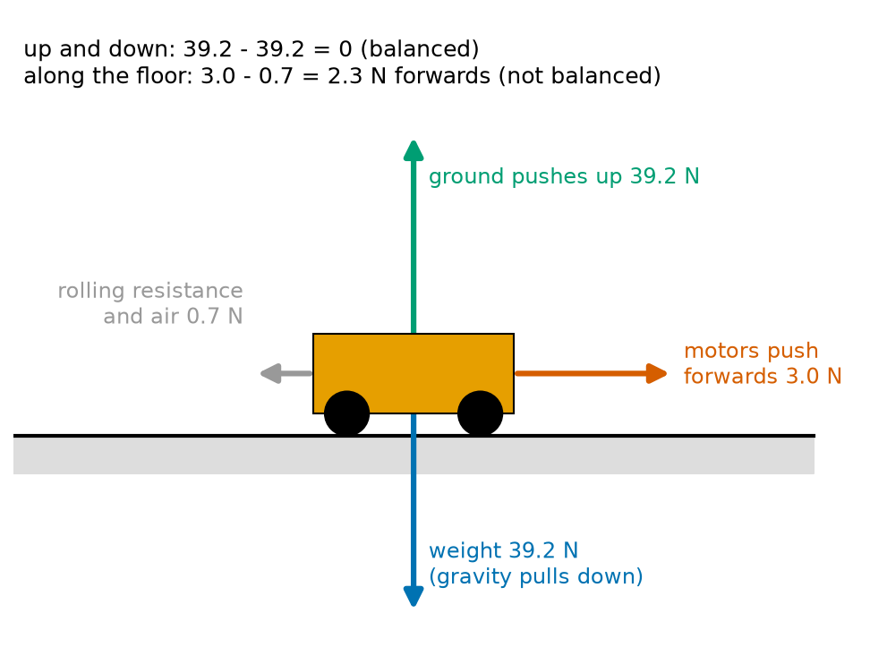
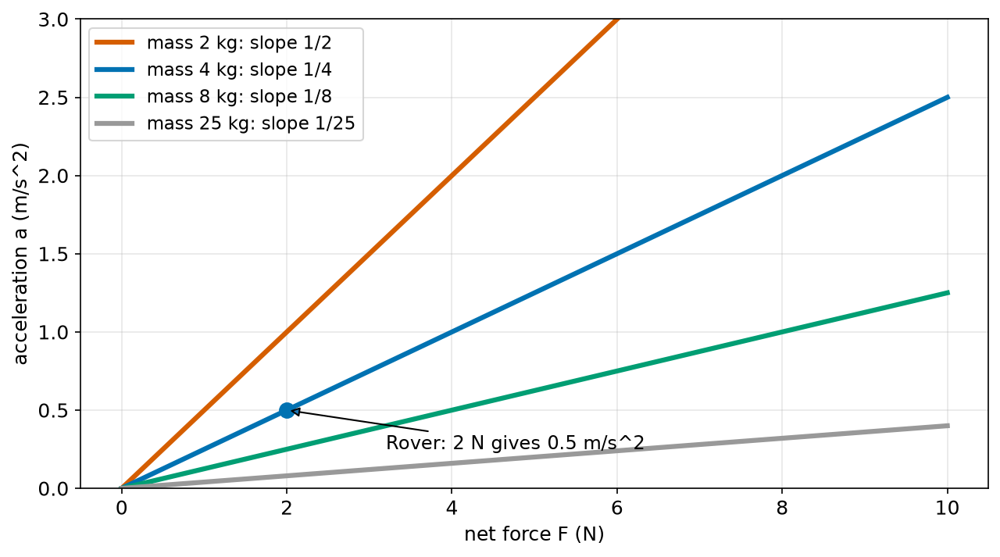
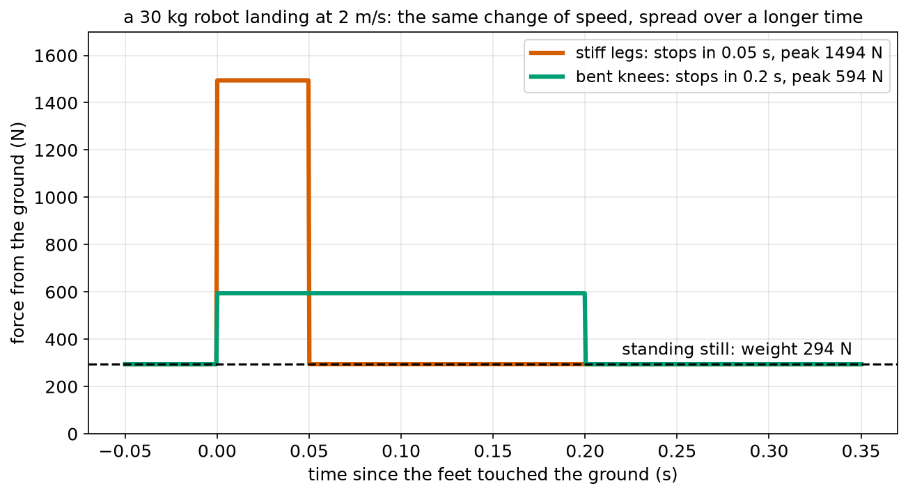
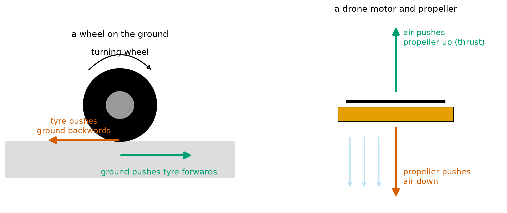
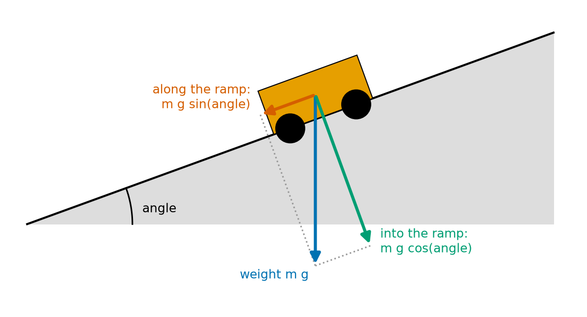
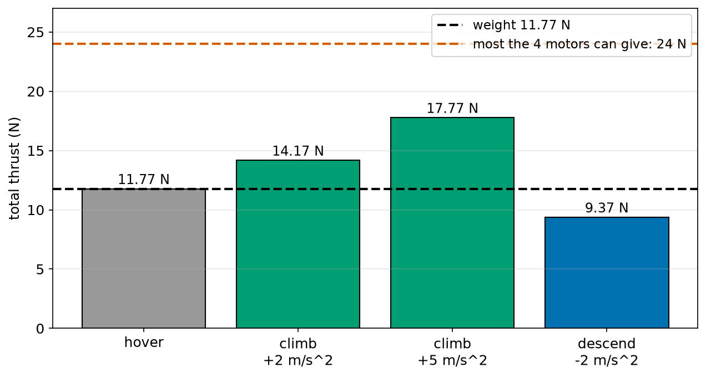

# Chapter 61 — Forces and Newton's Three Laws

> **Part 4 · Chapter 61 of 749**
> **You need:** Chapter 49 (the ramp triangle), Chapter 58 (acceleration), Chapter 59 (equations of motion) and Chapter 60 (vectors).
> **You will make:** a program that uses F = m × a in both directions, a thrust calculator for a drone that hovers, climbs and descends, and a program that finds whether a delivery robot can still speed up while it climbs a ramp.

---

## What you will learn

- What a **force** is, and how it is measured in **newtons**.
- What a **free-body diagram** is, and how to find the **net force**.
- **Newton's first law**: why things keep moving, or keep still, unless a force changes that.
- **Newton's second law**: F = m × a, the most used equation in robotics.
- **Newton's third law**: every push comes with an equal push back.
- Why gravity pulls a robot down a ramp with a force of m × g × sin(angle).
- How to work out the thrust a drone needs.
- Why bending the knees makes a landing force smaller.

---

## New words in this chapter

| Word | Simple meaning |
|---|---|
| **force** | A push or a pull. It has a size and a direction: a vector. |
| **newton (N)** | The unit of force. 1 N is about the weight of a small apple. |
| **mass** | How much "stuff" is in an object, in kilograms. It decides how hard the object is to speed up. |
| **weight** | The pull of gravity on an object, in newtons. Chapter 62 explains it fully. |
| **net force** | All the forces on an object added together, as vectors. |
| **balanced forces** | Forces whose net force is zero. |
| **free-body diagram** | A picture of one object with an arrow for every force on it. |
| **inertia** | The way an object keeps doing what it is doing unless a force changes it. |
| **normal force** | The push of a surface on an object, at right angles to the surface. |
| **thrust** | The push of a propeller or a jet. |
| **reaction force** | The "push back" in Newton's third law. |
| **thrust-to-weight ratio** | Total thrust ÷ weight, for a drone. |

---

## 61.1 What is a force?

Push a toy car and it starts to roll. Pull a drawer and it slides open. Let go of a ball and the Earth pulls it down. Each of these is a **force**.

📖 **New word: force** — a push or a pull on an object.

A force always has a **size** and a **direction**. Pushing a car forwards is not the same as pushing it backwards. So a force is a **vector** (Chapter 60), and we draw it as an arrow.

📖 **New word: newton (N)** — the unit of force, named after Isaac Newton, who wrote down the three laws of this chapter in 1687.

To get a feel for newtons:

| Force | About |
|---|---|
| holding a small apple (100 g) | 1 N |
| a 1 L bottle of water | 10 N |
| Rover's motors pushing it along | 2–5 N |
| a 1.2 kg drone's propellers when it hovers | 12 N |
| a person pushing a heavy door | 50–100 N |
| a 70 kg person's weight | 690 N |

The forces that matter most in robotics:

| Force | What makes it | Where you meet it |
|---|---|---|
| **weight** | gravity pulling down | every robot (Chapter 62) |
| **normal force** | a surface pushing back, at right angles to it | floors, ramps, tables |
| **friction** | surfaces rubbing, along the surface | wheels, grippers, brakes (Chapter 63) |
| **motor force** | wheels pushing on the ground | wheeled robots |
| **thrust** | propellers pushing air | drones, boats |
| **tension** | a rope, cable or belt pulling | cranes, tendons, belts (Chapter 68) |
| **spring force** | a spring being stretched or squeezed | legs, suspension, grippers |
| **drag** | air or water pushing back on a moving object | drones, underwater robots |

📖 **New word: normal force** — the push of a surface on an object that rests on it, at right angles to the surface. ("Normal" here is an old maths word for "at right angles".) A table holds up a cup with a normal force.

📖 **New word: thrust** — the push of a propeller or a jet.

### Measuring a force

A **spring scale** (also called a luggage scale or a force gauge) measures force. Pull on its hook and a spring stretches: the bigger the force, the bigger the stretch. Robots measure forces with **force sensors** and **load cells** (Chapter 43 calibrated one), which work in a similar way with tiny electrical stretch sensors (Chapter 133).

---

## 61.2 Net force and free-body diagrams

A robot usually has several forces on it at once. Rover driving along the floor has:

- its **weight**, pulling it down;
- the **normal force** of the floor, pushing it up;
- the **motors' push** (through the wheels), forwards;
- **rolling resistance** and **air**, backwards.

📖 **New word: free-body diagram** — a picture of **one** object, with an arrow for **every** force acting on it, and nothing else. It is the first thing an engineer draws when a robot does not move the way they expected.



*Figure 61.1 — Every force on Rover while it speeds up along a flat floor.*

**How to read this picture:** Rover is the orange box. Each arrow is one force on it. The blue arrow is its weight, 39.2 N down. The green arrow is the floor pushing up, also 39.2 N. These two are the same size and opposite, so up and down they cancel. Along the floor, the red arrow (motors, 3.0 N forwards) is bigger than the grey arrow (rolling resistance and air, 0.7 N backwards). The text at the top adds them up.

📖 **New word: net force** — all the forces on an object added together, as vectors (Chapter 60: add the parts). It is also called the **resultant force**.

🔢 **Maths.** For Rover, taking forwards and up as positive:

```
along the floor:  +3.0 − 0.7   = +2.3 N
up and down:      +39.2 − 39.2 = 0 N
net force = (2.3, 0) N: 2.3 N forwards
```

📖 **New word: balanced forces** — forces whose net force is zero. Up and down, Rover's forces are balanced. Along the floor they are not.

⚠️ **Watch out.** A free-body diagram shows forces **on** the object only. The force of Rover's wheels **on the floor** does not belong in Rover's free-body diagram (it acts on the floor). Mixing up "on me" and "by me" is the most common mistake with forces. Section 61.5 comes back to this.

---

## 61.3 Newton's first law: things keep doing what they are doing

Before Newton, people believed that a moving object needs a force to **keep** moving: push a box across a floor, stop pushing, and it stops. That seems obvious. But the box stops because **friction** pushes it backwards. On ice, a pushed box slides a long way. In space, with no friction and no air, a pushed box would slide for ever.

🧠 **Newton's first law:** if the net force on an object is zero, it keeps its velocity. A still object stays still. A moving object keeps moving in a straight line at the same speed.

📖 **New word: inertia** — the way an object keeps doing what it is doing unless a force changes it. "Inertia" comes from the Latin for "lazy".

This explains many things you feel every day:

- When a bus brakes, you lean forwards. Your body "wants" to keep moving. The bus slows down under you.
- A box on top of a robot that starts suddenly seems to slide **backwards**. Really it stays still while the robot moves forwards under it (Chapter 58's tote).
- A robot vacuum that drives off a step keeps moving forwards as it falls, like Chapter 60's dropped parcel.

🔢 **Maths.** Rover driving at a steady 1.0 m/s has zero acceleration. So by the first law, its net force is zero: the motors must push **exactly** as hard as rolling resistance and air push back. If the motors push 0.7 N and resistance is 0.7 N, Rover keeps going at 1.0 m/s. The motors are not there to "keep it moving"; they are there to cancel the resistance.

🤖 **Robot link.** A space robot arm on a space station must think about inertia all the time: anything it lets go of keeps drifting at the speed it was moving. Chapter 66 looks at inertia for turning.

---

## 61.4 Newton's second law: F = m × a

The first law says what happens when the net force is zero. The second law says what happens when it is **not**: the object accelerates.

Two things decide how much:

1. **The bigger the net force, the bigger the acceleration.** Push twice as hard, get twice the acceleration.
2. **The bigger the mass, the smaller the acceleration.** The same push on a robot twice as heavy gives half the acceleration.

📖 **New word: mass** — how much "stuff" is in an object, measured in kilograms (kg). Mass decides how hard an object is to speed up or slow down. (Mass is **not** the same as weight; Chapter 62 explains the difference.)

🧠 **Newton's second law:**

```
F_net = m × a
```

In words: "the net force equals the mass times the acceleration". The acceleration is in the **same direction** as the net force.

This is also where the newton comes from:

```
1 N = 1 kg × 1 m/s²
```

In words: "one newton is the force that gives one kilogram an acceleration of one metre per second squared".

Like every formula with three parts, it can be used three ways (Chapter 41):

```
F = m × a       how much force do I need?
a = F / m       how fast will it speed up?
m = F / a       how heavy is it? (from a measured force and acceleration)
```

🔢 **Maths.** Rover has a mass of 4.0 kg.

- To accelerate at 0.5 m/s², the net force must be 4.0 × 0.5 = 2.0 N.
- With the net force of 2.3 N from Figure 61.1, it accelerates at 2.3 / 4.0 = 0.575 m/s².
- With a 4 kg load on top (8 kg in total), the same 2.3 N gives only 0.29 m/s².



*Figure 61.2 — For each mass, acceleration grows in a straight line with force. Heavier robots have flatter lines.*

**How to read this picture:** Across the bottom is the net force, up the side the acceleration. Each line is one mass. The lines go through 0 (no force, no acceleration) and are straight (twice the force, twice the acceleration). Their slope is 1/m (Chapter 43): the 2 kg line is steep, the 25 kg line is almost flat. The blue dot is Rover: 2 N gives 0.5 m/s².

⚠️ **Watch out.** F in F = m × a is the **net** force, not any single force. A motor pushing 3.0 N against 0.7 N of resistance gives a net 2.3 N. Forgetting the other forces is a classic mistake.

### Where the force comes from, and why robots cannot jump

Chapter 58 said that a robot cannot jump from 0 to full speed, because that would need an infinite acceleration. Now we see why: an infinite acceleration needs an infinite force, and every motor has a limit. A robot's **largest possible acceleration** is

```
a_max = (largest motor push − resistance) / m
```

This is why designers care so much about **mass**. A lighter robot accelerates faster with the same motors, brakes faster with the same brakes, and needs less energy (Chapter 67).

### Slowing down needs a force too

Braking is just an acceleration in the backwards direction, so it also needs a force: F = m × (deceleration). A 25 kg robot braking at 1.5 m/s² needs a backwards force of 37.5 N, which must come from the wheels gripping the floor. If the floor cannot provide that much grip, the wheels skid. Chapter 63 finds the limit.

### Landing: force and time

Chapter 58 compared a robot landing on stiff legs (stopping from 2 m/s in 0.05 s) with landing on bent knees (stopping in 0.2 s). Now we can work out the forces. The ground must do two jobs: hold up the robot's weight, **and** give the deceleration. For a 30 kg robot, taking up as positive:

```
net force = ground force − weight = m × a
ground force = m × (g + a)

stiff legs:  a = 2 / 0.05 = 40 m/s²   →  30 × (9.81 + 40) = 1494 N
bent knees:  a = 2 / 0.2  = 10 m/s²   →  30 × (9.81 + 10) =  594 N
```



*Figure 61.3 — Stiff legs: a short, tall force. Bent knees: a long, low one.*

**How to read this picture:** Across the bottom is the time since the feet touched the ground. Up the side is the force from the ground. Before landing, and after stopping, the force is just the weight, 294 N (dashed line). The red pulse is a stiff landing: 1494 N for 0.05 s. The green pulse is a soft landing: 594 N for 0.2 s. Both stop the same robot from the same speed.

The force in the stiff landing is 2.5 times bigger. That is what breaks gears and motors. A legged robot that bends its knees on landing protects itself. Notice, too, that the area of each pulse **above** the dashed line is the same. For the stiff landing it is 1200 N × 0.05 s = 60 N s; for the soft landing, 300 N × 0.2 s = 60 N s. Both are equal to m × Δv = 30 × 2 = 60. Physicists call this area the **impulse**. Part 19 uses it for impacts.

---

## 61.5 Newton's third law: every push has a push back

Stand on a skateboard and push a wall. The wall does not move, but **you** roll backwards. You pushed the wall, and the wall pushed you.

🧠 **Newton's third law:** when object A pushes on object B, object B pushes on object A with a force of the **same size** in the **opposite direction**.

📖 **New word: reaction force** — the "push back" in the third law. The two forces of a pair are often called "action" and "reaction", but neither comes first: they always happen together.

This law explains how **every** robot moves:



*Figure 61.4 — Left: a wheel pushes the ground back, and the ground pushes the wheel forward. Right: a propeller pushes air down, and the air pushes the propeller up.*

**How to read this picture:** On the left, a wheel turns clockwise. Where it touches the ground, its tyre pushes the ground **backwards** (red). The ground pushes the tyre **forwards** with the same size of force (green). That green force is what moves the robot. On the right, a propeller throws air downwards (red, and the light blue arrows for the moving air). The air pushes the propeller **up** (green): that is thrust.

So a robot does not "push itself" forward. It pushes the world backwards, and the world pushes it forwards. That is why:

- a wheel on ice spins without moving the robot: it cannot push the ice backwards (Chapter 63);
- a drone cannot fly in a vacuum: there is no air to push down;
- a rocket works by pushing hot gas out of its back; the gas pushes the rocket forwards.

⚠️ **Watch out.** The two forces of a third-law pair act on **different** objects. That is why they do not cancel. In Figure 61.1, the floor's upward push on Rover and Rover's weight are equal and opposite, but they are **not** a third-law pair: both act on Rover, and they are equal only because Rover is not accelerating up or down. Rover's weight is paired with Rover pulling the **Earth** up (very slightly).

🤖 **Robot link.** When a robot arm pushes a drill into a wall, the wall pushes the arm back. If the arm is on a mobile robot, the whole robot is pushed backwards unless its wheels and brakes hold it. Engineers who build mobile manipulators must check that the base can resist the reaction force (Chapter 371 starts robot dynamics).

---

## 61.6 Forces on a ramp: m g sin(angle)

Chapter 49 found the force that pulls a robot down a ramp, using a triangle, and promised to explain it. Here it is.

On a flat floor, the weight pulls straight down, and the floor pushes straight up. On a ramp, the weight still pulls straight **down** (gravity always points to the centre of the Earth), but the ramp is tilted. So we split the weight into two parts (Chapter 60, "resolve"):

- one part **along** the ramp, which tries to pull the robot down the slope;
- one part **into** the ramp, which presses the robot onto the surface.



*Figure 61.5 — The weight (blue) is the sum of a part along the ramp (red) and a part into the ramp (green).*

**How to read this picture:** The robot stands on a ramp tilted at an angle. Its weight, m g, points straight down (blue). The red arrow is the part of the weight along the ramp, pointing down the slope. The green arrow is the part pushing into the ramp, at right angles to it. The grey dotted lines show that red + green = blue, tip to tail. The angle between the blue and green arrows is the same as the ramp's angle.

🔢 **Maths.** In the right-angled triangle of blue, red and green arrows, the blue arrow is the hypotenuse and the angle between blue and green is the ramp angle (Chapter 49). So:

```
along the ramp  = m g sin(angle)
into the ramp   = m g cos(angle)
```

In words: "the pull down the ramp is the weight times the sine of the angle; the push into the ramp is the weight times the cosine".

Check with the extreme cases:

| Angle | sin | cos | What happens |
|---|---|---|---|
| 0° (flat) | 0 | 1 | no pull along; the whole weight presses down |
| 90° (a wall) | 1 | 0 | the whole weight pulls "along" (down the wall); nothing presses in |

The ramp pushes back on the robot with a normal force equal to the "into" part, m g cos(angle). The "along" part is not cancelled by the ramp, so the robot's motors (or brakes, or friction) must cancel it.

**Small example.** Chapter 49's 25 kg robot on a 10% ramp (angle 5.71°): along = 25 × 9.81 × sin 5.71° = 24.4 N. On a flat floor, its motors only fight rolling resistance. On this ramp, they must give an extra 24.4 N just to stand still.

---

## Code

File `code/ch061/newton2.py`:

```python
# newton2.py - Newton's second law: net force = mass x acceleration
MASS_KG = 4.0            # Rover with its battery

print("force needed for each acceleration (Rover, 4.0 kg):")
for a in [0.25, 0.5, 1.0, 2.0]:
    print(f"  a = {a:4.2f} m/s^2  needs  F = {MASS_KG * a:4.1f} N")

print("acceleration from a 2.0 N net force, for different masses:")
for m in [2.0, 4.0, 8.0, 25.0]:
    print(f"  m = {m:4.1f} kg  ->  a = {2.0 / m:5.3f} m/s^2")

forces = {"motors forwards": 3.0, "rolling resistance": -0.6, "air": -0.1}
net = sum(forces.values())
print("forces along the floor:", forces)
print(f"net force {net:+.1f} N, so a = {net / MASS_KG:.3f} m/s^2")
```

| Line | Code | What it does (simple English) |
|---|---|---|
| 1 | `# newton2.py …` | A comment. |
| 2 | `MASS_KG = 4.0` | Rover's mass. |
| 3 | (blank) | Spacing. |
| 4 | `print("force needed …")` | A heading. |
| 5 | `for a in [0.25, 0.5, 1.0, 2.0]:` | Some accelerations. |
| 6 | `print(f"… F = {MASS_KG * a:4.1f} N")` | F = m × a. |
| 7 | (blank) | Spacing. |
| 8 | `print("acceleration from a 2.0 N …")` | A heading. |
| 9 | `for m in [2.0, 4.0, 8.0, 25.0]:` | Some masses. |
| 10 | `print(f"… a = {2.0 / m:5.3f} m/s^2")` | a = F / m. |
| 11 | (blank) | Spacing. |
| 12 | `forces = {"motors forwards": 3.0, …}` | A dictionary (Chapter 22): each force's name and its signed size along the floor. Backwards forces are negative. |
| 13 | `net = sum(forces.values())` | `.values()` gives just the numbers; `sum` adds them: the net force. |
| 14 | `print("forces along the floor:", forces)` | Shows the dictionary. |
| 15 | `print(f"net force … a = …")` | The net force, and a = F_net / m. |

Output:

```
force needed for each acceleration (Rover, 4.0 kg):
  a = 0.25 m/s^2  needs  F =  1.0 N
  a = 0.50 m/s^2  needs  F =  2.0 N
  a = 1.00 m/s^2  needs  F =  4.0 N
  a = 2.00 m/s^2  needs  F =  8.0 N
acceleration from a 2.0 N net force, for different masses:
  m =  2.0 kg  ->  a = 1.000 m/s^2
  m =  4.0 kg  ->  a = 0.500 m/s^2
  m =  8.0 kg  ->  a = 0.250 m/s^2
  m = 25.0 kg  ->  a = 0.080 m/s^2
forces along the floor: {'motors forwards': 3.0, 'rolling resistance': -0.6, 'air': -0.1}
net force +2.3 N, so a = 0.575 m/s^2
```

---

## Small examples

**Example 1.** A 10 kg robot accelerates at 0.3 m/s². Net force 3 N.

**Example 2.** A 6 N net force acts on a 1.5 kg drone. a = 4 m/s².

**Example 3.** A robot accelerates at 0.5 m/s² when the net force is 12 N. Its mass is 24 kg.

**Example 4.** Forces along a floor: +8 N, −3 N, −1 N. Net force +4 N.

**Example 5.** A robot drives at a steady 2 m/s against 5 N of resistance. Its motors push exactly 5 N (first law).

**Example 6.** A 50 kg cart on a 30° ramp. Along: 50 × 9.81 × 0.5 = 245 N. Into: 50 × 9.81 × 0.866 = 425 N.

**Example 7.** A wheel pushes the ground backwards with 20 N. The ground pushes the wheel forwards with 20 N.

**Example 8.** A 2 kg robot falls and stops in 0.01 s from 3 m/s. a = 300 m/s². Ground force ≈ 2 × (9.81 + 300) = 620 N.

---

## 🏭 Real robot applications

### Application 1 (worked in full) — 🚁 How much thrust does a drone need?

**1. The real problem.** A 1.2 kg quadcopter (four propellers) must hover, climb, and descend under control. Its designers must choose motors and propellers that give enough thrust, with a margin for climbing quickly, for wind, and for a heavier battery later. How much thrust does each motor need?

**2. Why this theory.** Up and down, two forces act on the drone: thrust up and weight down. Newton's second law says thrust − weight = m × a. To hover, a = 0, so thrust = weight (first law). To climb with acceleration a, thrust = m × (g + a).

**3. The numbers.** Mass 1.2 kg. g = 9.81 m/s². Four motors. Each motor with its propeller gives at most 6.0 N of thrust (from the maker's test table).

**4. The maths.**

```
weight = 1.2 × 9.81 = 11.77 N
hover:              thrust = 11.77 N, 2.94 N per motor
climb at 2 m/s²:    thrust = 1.2 × (9.81 + 2) = 14.17 N
climb at 5 m/s²:    thrust = 1.2 × (9.81 + 5) = 17.77 N
descend at 2 m/s²:  thrust = 1.2 × (9.81 − 2) =  9.37 N
maximum thrust = 4 × 6.0 = 24 N
thrust-to-weight ratio = 24 / 11.77 = 2.04
largest upward acceleration = 24 / 1.2 − 9.81 = 10.19 m/s²
```

📖 **New word: thrust-to-weight ratio** — the drone's largest total thrust divided by its weight. Chapter 38 mentioned that designers want it to be at least 2.

**5. The code.** File `code/ch061/hover.py`:

```python
# hover.py - how much thrust does a drone need to hover, climb and descend?
G = 9.81
MASS_KG = 1.2            # the whole drone with its battery
MOTORS = 4
MAX_THRUST_PER_MOTOR_N = 6.0

weight = MASS_KG * G
print(f"weight {weight:.2f} N, so hover needs {weight:.2f} N in total, {weight / MOTORS:.2f} N per motor")

for a in [0.0, 2.0, 5.0, -2.0]:
    thrust = MASS_KG * (G + a)              # net upward force = thrust - weight = m a
    share = thrust / (MOTORS * MAX_THRUST_PER_MOTOR_N)
    print(f"vertical acceleration {a:+4.1f} m/s^2 needs thrust {thrust:5.2f} N  ({share:.0%} of maximum)")

max_up = MOTORS * MAX_THRUST_PER_MOTOR_N / MASS_KG - G
print(f"thrust-to-weight ratio {MOTORS * MAX_THRUST_PER_MOTOR_N / weight:.2f}, fastest upward acceleration {max_up:.2f} m/s^2")
```

| Line | Code | What it does (simple English) |
|---|---|---|
| 1 | `# hover.py …` | A comment. |
| 2 | `G = 9.81` | g in m/s². |
| 3 | `MASS_KG = 1.2` | The whole drone. |
| 4 | `MOTORS = 4` | A quadcopter. |
| 5 | `MAX_THRUST_PER_MOTOR_N = 6.0` | From the maker's test table. |
| 6 | (blank) | Spacing. |
| 7 | `weight = MASS_KG * G` | Weight = m × g (Chapter 62). |
| 8 | `print(f"weight …")` | Hover thrust equals the weight; shared between 4 motors. |
| 9 | (blank) | Spacing. |
| 10 | `for a in [0.0, 2.0, 5.0, -2.0]:` | Hover, two climbs, and a controlled descent. |
| 11 | `thrust = MASS_KG * (G + a)` | From thrust − m g = m a. |
| 12 | `share = thrust / (MOTORS * MAX_THRUST_PER_MOTOR_N)` | How much of the maximum this uses. |
| 13 | `print(f"vertical acceleration …")` | `:.0%` prints a share as a whole percentage. |
| 14 | (blank) | Spacing. |
| 15 | `max_up = MOTORS * MAX_THRUST_PER_MOTOR_N / MASS_KG - G` | All motors at full power: a = (24 − 11.77) / 1.2. |
| 16 | `print(f"thrust-to-weight ratio …")` | The ratio and the largest climb acceleration. |

Output:

```
weight 11.77 N, so hover needs 11.77 N in total, 2.94 N per motor
vertical acceleration +0.0 m/s^2 needs thrust 11.77 N  (49% of maximum)
vertical acceleration +2.0 m/s^2 needs thrust 14.17 N  (59% of maximum)
vertical acceleration +5.0 m/s^2 needs thrust 17.77 N  (74% of maximum)
vertical acceleration -2.0 m/s^2 needs thrust  9.37 N  (39% of maximum)
thrust-to-weight ratio 2.04, fastest upward acceleration 10.19 m/s^2
```



*Figure 61.6 — Climbing needs more thrust than the weight. Descending under control needs less, but still most of it.*

**How to read this picture:** Each bar is the total thrust for one manoeuvre. The black dashed line is the weight, 11.77 N: the grey hover bar reaches exactly this. The green climbing bars go above it: the extra is m × a. The blue descending bar is below it, but still 9.37 N: a drone that descends under control does **not** switch its motors off; it only reduces them a little. The red dashed line is the most the motors can give, 24 N.

**6. The result.** The drone hovers at 49% of its maximum thrust, which is close to the common design rule "hover at about half throttle". It can climb at 5 m/s² using 74%, leaving a margin for wind gusts and for tilting (when a drone tilts to fly sideways, only part of its thrust points up, Chapter 60's resolving again). If the owner fits a 300 g heavier battery, the weight becomes 14.7 N and the hover uses 61%: still fine, but the climb margin shrinks.

**7. Going further.** The thrust of a propeller depends on its speed squared (Chapter 38's hover RPM example), so "half the thrust" does not mean "half the speed". Chapter 617 explains how propellers make thrust, Chapter 619 measures real thrust tables, and Chapter 622 sizes all the parts of a drone together.

### Application 2 (worked in full) — 🛗 Can the delivery robot speed up on a ramp?

**1. The real problem.** In Chapter 49, a 25 kg delivery robot checked which ramps it could climb, ignoring friction and acceleration. But a robot must also be able to **start** on a ramp (from standing at a door, for example) and reach its speed in a reasonable time. With rolling resistance included, how quickly can it speed up on each ramp?

**2. Why this theory.** Along the ramp, three forces act: the motors' push up the ramp, the weight's part down the ramp (m g sin angle, section 61.6), and rolling resistance (always against the motion). The net force gives the acceleration: a = F_net / m.

**3. The numbers.** Mass 25 kg. Largest motor push 27.5 N (Chapter 49's 2.2 N m of wheel torque on 0.08 m wheels: Chapter 65 explains this step). Rolling resistance 3.0 N, measured by towing the robot slowly with a spring scale. Ramps of 0%, 5%, 8.33% (1:12), 10% and 12%.

**4. The maths.** For a 10% ramp (angle = atan 0.10 = 5.71°):

```
weight along the ramp = 25 × 9.81 × sin 5.71° = 24.4 N
spare push = 27.5 − 24.4 − 3.0 = 0.1 N
a = 0.1 / 25 = 0.004 m/s²
time to reach 1 m/s = 1 / 0.004 ≈ 260 s
```

**5. The code.** File `code/ch061/ramp_accel.py`:

```python
# ramp_accel.py - can a delivery robot speed up while it climbs a ramp?
import math

G = 9.81
MASS_KG = 25.0
MAX_PUSH_N = 27.5            # 2.2 N m of wheel torque / 0.08 m wheel radius (Chapter 49)
ROLLING_N = 3.0              # rolling resistance, measured by towing the robot slowly

print(" slope   gravity along   spare push   best acceleration   0 to 1 m/s takes")
for percent in [0, 5, 8.33, 10, 12]:
    angle = math.atan(percent / 100)
    gravity_along = MASS_KG * G * math.sin(angle)
    spare = MAX_PUSH_N - gravity_along - ROLLING_N
    if spare > 0:
        a = spare / MASS_KG
        print(f"{percent:5.2f}%   {gravity_along:9.1f} N   {spare:8.1f} N   {a:12.3f} m/s^2   {1.0 / a:10.1f} s")
    else:
        print(f"{percent:5.2f}%   {gravity_along:9.1f} N   {spare:8.1f} N   cannot climb at all")
```

| Line | Code | What it does (simple English) |
|---|---|---|
| 1 | `# ramp_accel.py …` | A comment. |
| 2 | `import math` | For `atan` and `sin`. |
| 3 | (blank) | Spacing. |
| 4–7 | `G`, `MASS_KG`, `MAX_PUSH_N`, `ROLLING_N` | The numbers, with where they came from. |
| 8 | (blank) | Spacing. |
| 9 | `print(" slope …")` | The table heading. |
| 10 | `for percent in [0, 5, 8.33, 10, 12]:` | The ramps to check. |
| 11 | `angle = math.atan(percent / 100)` | A slope of 10% rises 10 m in 100 m: angle = atan(0.10) (Chapter 49). |
| 12 | `gravity_along = MASS_KG * G * math.sin(angle)` | m g sin(angle). |
| 13 | `spare = MAX_PUSH_N - gravity_along - ROLLING_N` | What is left of the motors' push after fighting gravity and resistance. |
| 14 | `if spare > 0:` | Some push is left to speed up with. |
| 15 | `a = spare / MASS_KG` | Newton's second law: a = F_net / m. |
| 16 | `print(f"…{1.0 / a:10.1f} s")` | Time from 0 to 1 m/s: t = v / a (Chapter 59). |
| 17 | `else:` | No push left. |
| 18 | `print(f"… cannot climb at all")` | The motors cannot even hold the robot still against gravity and resistance. |

Output:

```
 slope   gravity along   spare push   best acceleration   0 to 1 m/s takes
 0.00%         0.0 N       24.5 N          0.980 m/s^2          1.0 s
 5.00%        12.2 N       12.3 N          0.490 m/s^2          2.0 s
 8.33%        20.4 N        4.1 N          0.166 m/s^2          6.0 s
10.00%        24.4 N        0.1 N          0.004 m/s^2        258.5 s
12.00%        29.2 N       -4.7 N   cannot climb at all
```

**6. The result.** On flat floors and 5% ramps, the robot reaches 1 m/s in 1 to 2 s. On a 1:12 wheelchair ramp it takes 6 s: slow, but usable. On a 10% ramp it has almost nothing left: it would take over 4 minutes to reach 1 m/s, and any extra load or a slightly soft floor would stop it. Chapter 49's answer ("10% is fine") was too hopeful, because it ignored rolling resistance and the need to accelerate. The robot's map should mark 10% ramps as "avoid", and 12% as "forbidden".

**7. Going further.** The motor's push is not really fixed: it depends on speed, and the most a motor can give falls as it spins faster (Chapter 145). A real check also includes the extra load the robot carries. Chapter 150 chooses motors with all of these included, and Chapter 63 checks that the wheels can grip the ramp well enough to deliver the push without slipping.

### Application 3 — 📦 What holds a tote on a robot?

A warehouse robot carries a 12 kg tote and speeds up at 0.8 m/s² (Chapter 58). By the first law, the tote "wants" to stay still. To make it accelerate with the robot, something must push it forwards with F = m a = 12 × 0.8 = 9.6 N. The only thing that can push it is **friction** between the tote and the robot's top. In Chapter 58's tests the tote slid at about 2.0 m/s², which means friction could give it at most about 12 × 2.0 = 24 N. 9.6 N is well below that, so the tote stays on. Chapter 63 shows how friction depends on the weight and the surfaces, and turns this into the rule a ≤ μ g.

### Application 4 — 🛰️ A robot arm in space

On the International Space Station, robot arms move large objects that weigh nothing there but still have their full **mass**. A 1000 kg module still needs 1000 N of net force to accelerate at 1 m/s², and 1000 N of force to stop again. That is why space arms move very slowly: at 0.01 m/s², the arm needs only 10 N. Also, by the third law, every push on the module pushes the arm (and the station it is attached to) back the other way. Space robots must plan their moves so they do not make the whole station wobble. Chapter 66 looks at how hard things are to turn.

### Application 5 — 🦿 Landing forces in a legged robot

Section 61.4 found that a 30 kg legged robot landing at 2 m/s feels 1494 N from the ground with stiff legs, but only 594 N with bent knees. Real legged robots go further: their knee motors are controlled to behave like a spring and a damper (shock absorber), so the force rises smoothly instead of jumping. Their designers choose the gears and motors so that each leg can take a force of about 3 to 5 times the robot's weight without breaking. Some robots even have a spring in series with each motor, to protect the gears from sudden shocks (Chapter 694 covers these "series elastic actuators").

---

## 🔧 Hands-on lab

### Lab 61.1 — Measure forces with a spring scale (hardware)

You need a spring scale or a digital luggage scale, a toy car or a small box with wheels, some weights (bottles of water work), and a smooth floor.

1. Hang each weight on the scale and write down the force. A 1 L bottle of water should read about 10 N (or about 1 kg on a scale marked in kg; multiply by 9.81 for newtons).
2. Pull the empty car slowly and steadily along the floor with the scale. Read the force. This is the rolling resistance.
3. Add one bottle to the car and pull again. Then two bottles.
4. Now pull harder so the car speeds up. Watch the reading.

**What you should see:** Pulling at a steady speed needs a small, steady force, equal to the resistance (first law). The resistance grows when you add weight. When you pull harder to speed up, the reading is bigger than the resistance: the extra is m × a (second law). The scale pulls on the car, and you feel the car pulling back on your hand (third law).

| If it does not work | Likely cause | Fix |
|---|---|---|
| The reading jumps around | Pulling unevenly | Pull very slowly and steadily, and read the average |
| The scale reads 0 for the car | The resistance is smaller than the scale's smallest step | Add weight to the car, or use a more sensitive scale |
| The reading is much bigger at the start | It takes extra force to get it moving (Chapter 63) | Read the force once it is moving steadily |

**Challenge:** Measure the rolling resistance with 0, 1, 2 and 3 bottles in the car. Plot resistance against total weight. Is it a straight line through 0? (Chapter 63 explains.)

### Lab 61.2 — Design a drone (simulation)

Copy `hover.py`.

1. Add a 0.3 kg camera to the drone. What share of the maximum does hovering need now?
2. Find the heaviest drone (total mass) that still has a thrust-to-weight ratio of 2.
3. Write a loop that prints the hover share for masses from 1.0 to 2.4 kg in steps of 0.2 kg.

**What you should see:** With the camera (1.5 kg), hovering needs 61% of the maximum. A ratio of 2 allows a weight of 12 N, so a mass of 12 / 9.81 = 1.22 kg. The hover share rises from 41% at 1.0 kg to 98% at 2.4 kg: at 2.4 kg the drone can barely hover and cannot climb safely.

| If it does not work | Likely cause | Fix |
|---|---|---|
| Shares above 100% | The drone is too heavy to hover | It cannot fly: reduce the mass or use stronger motors |
| Masses like 1.4000000000000001 | Adding 0.2 again and again (Chapter 54) | Loop over whole numbers and divide |

**Challenge:** A drone tilts by 20° to fly forwards. Only thrust × cos(20°) points up. How much total thrust does it need to fly level at that tilt? (Use section 61.6's resolving.)

### Lab 61.3 — Free-body diagrams on paper (pencil and paper)

Draw a free-body diagram for each, with every force labelled, and find the net force:

1. A 3 kg robot standing still on a flat floor.
2. The same robot being pushed by its motors with 5 N, against 1 N of resistance.
3. A 2 kg drone hovering.
4. A 25 kg robot standing still on a 10% ramp, held by its brakes.

**What you should see:** (1) Weight 29.4 N down, normal force 29.4 N up: net 0. (2) As (1), plus 5 N forwards and 1 N back: net 4 N forwards, a = 1.33 m/s². (3) Weight 19.6 N down, thrust 19.6 N up: net 0. (4) Weight 245 N down; normal force 244 N into the ramp's surface (m g cos 5.71°); the brakes (through friction at the wheels) give 24.4 N up the ramp: net 0.

| If it does not work | Likely cause | Fix |
|---|---|---|
| A force from the robot onto the floor appears | That force acts on the floor, not on the robot | Draw only forces **on** the robot |
| The ramp's normal force points straight up | It must be at right angles to the ramp | Tilt it with the ramp |

**Challenge:** Draw the free-body diagram of a drone flying forwards at a steady speed, tilted by 15°. Which force does the forward part of the thrust balance?

---

## Common mistakes

⚠️ **Using one force in F = m a instead of the net force.** Add all the forces first.

⚠️ **Thinking a moving object needs a force to keep moving.** It needs a force only to cancel resistance, or to change its velocity.

⚠️ **Putting forces that act on other objects into a free-body diagram.** Only forces **on** the object.

⚠️ **Thinking third-law pairs cancel.** They act on different objects.

⚠️ **Forgetting gravity when working out a ground force or a thrust.** The ground or the propellers must hold up the weight **and** give the acceleration: m × (g + a).

⚠️ **Mixing up sin and cos on a ramp.** Along the ramp is sin; at a flat 0°, it must be zero.

⚠️ **Mixing up mass (kg) and weight (N).** A 4 kg robot weighs 39.2 N (Chapter 62).

---

## Practice

🏋️ **1.** A 6 kg robot speeds up at 0.4 m/s². What is the net force on it?

🏋️ **2.** A net force of 15 N acts on a 30 kg cart. What is its acceleration?

🏋️ **3.** A robot's motors push 9 N forwards. Rolling resistance is 2 N and air 0.5 N. The robot is 5 kg. Find the net force and the acceleration.

🏋️ **4.** A robot drives at a steady 1.5 m/s. Its motors push 4 N. What is the total resistance?

🏋️ **5.** A 2.0 kg drone needs to climb with an acceleration of 3 m/s². What total thrust does it need?

🏋️ **6.** A 40 kg robot stands on a 15° ramp. Find the parts of its weight along and into the ramp.

🏋️ **7.** A 25 kg robot must brake from 2 m/s to 0 in 1 s. What backwards force do the wheels need to give?

🏋️ **8.** A 50 kg robot lands at 1.5 m/s and stops in 0.1 s. What is the force from the ground (include its weight)?

🏋️ **9.** For each pair, say whether it is a third-law pair: (a) the Earth pulls a ball down, the ball pulls the Earth up; (b) the floor pushes a box up, gravity pulls the box down; (c) a propeller pushes air down, the air pushes the propeller up.

🏋️ **10.** Two robots have the same motors. Robot A is 3 kg, robot B is 4.5 kg. Ignoring resistance, how many times faster does A accelerate?

🏋️ **11.** Write a function `max_climb_acceleration(mass, max_push, rolling, percent)` that returns the best acceleration on a ramp, or 0 if the robot cannot climb. Use it to find the steepest ramp (to 0.1%) on which the 25 kg robot of Application 2 can still reach 0.1 m/s².

---

## Answers

**1.** 6 × 0.4 = 2.4 N.

**2.** 15 / 30 = 0.5 m/s².

**3.** Net 9 − 2 − 0.5 = 6.5 N. a = 6.5 / 5 = 1.3 m/s².

**4.** Steady speed: net force 0, so resistance = 4 N.

**5.** 2.0 × (9.81 + 3) = 25.6 N.

**6.** Along: 40 × 9.81 × sin 15° = 101.6 N. Into: 40 × 9.81 × cos 15° = 379.0 N.

**7.** a = 2 m/s². F = 25 × 2 = 50 N.

**8.** a = 1.5 / 0.1 = 15 m/s². Ground force = 50 × (9.81 + 15) = 1240.5 N.

**9.** (a) Yes: Earth on ball, ball on Earth. (b) No: both act on the box. (c) Yes: propeller on air, air on propeller.

**10.** a = F / m, so 4.5 / 3 = 1.5 times faster.

**11.**

```python
import math

def max_climb_acceleration(mass, max_push, rolling, percent):
    along = mass * 9.81 * math.sin(math.atan(percent / 100))
    spare = max_push - along - rolling
    return spare / mass if spare > 0 else 0.0

steepest = 0.0
for k in range(0, 200):
    p = k / 10
    if max_climb_acceleration(25.0, 27.5, 3.0, p) >= 0.1:
        steepest = p
print(steepest)    # 8.9
```

The robot can still reach 0.1 m/s² on ramps up to 8.9%.

---

## Summary

🧠 A **force** is a push or a pull, a vector, measured in **newtons**. 1 N = 1 kg × 1 m/s².

🧠 The **net force** is all the forces added as vectors. Draw a **free-body diagram** first: one object, every force **on** it.

🧠 **First law:** with zero net force, an object keeps its velocity (still, or moving straight at a steady speed).

🧠 **Second law:** F_net = m × a. More force, more acceleration. More mass, less acceleration.

🧠 **Third law:** if A pushes B, B pushes A equally hard the other way. Wheels push the ground back; the ground pushes the robot forward.

🧠 On a ramp, the weight splits into **m g sin(angle)** along the ramp and **m g cos(angle)** into it.

🧠 A drone needs thrust = m × (g + a). A landing robot feels m × (g + a) from the ground; spreading the stop over a longer time makes a smaller.

---

## Next chapter

In Chapter 62 we look closely at **mass**, **weight** and **gravity**: why a robot weighs less on the Moon but is just as hard to push, why heavy and light things fall together, what g = 9.81 really means, and why an accelerometer lying still reads 9.81 m/s² upwards.
