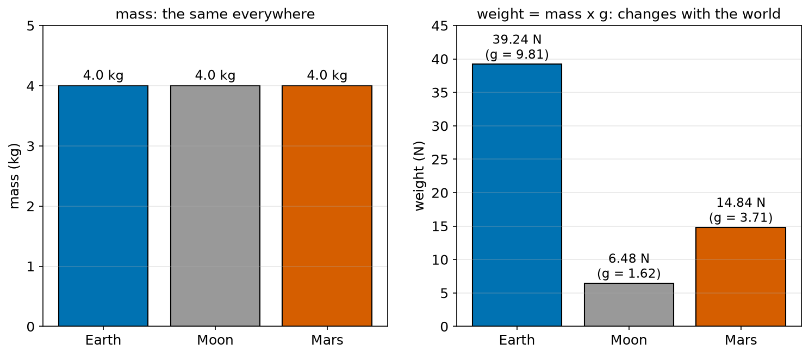
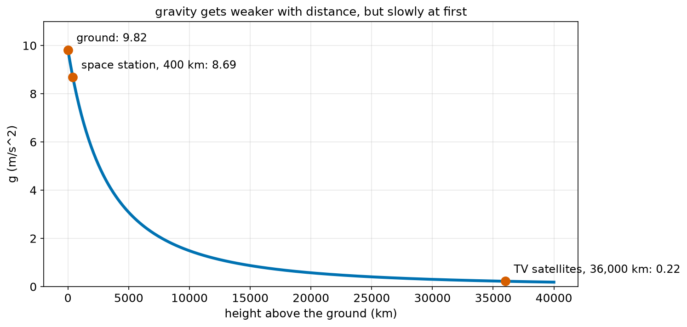
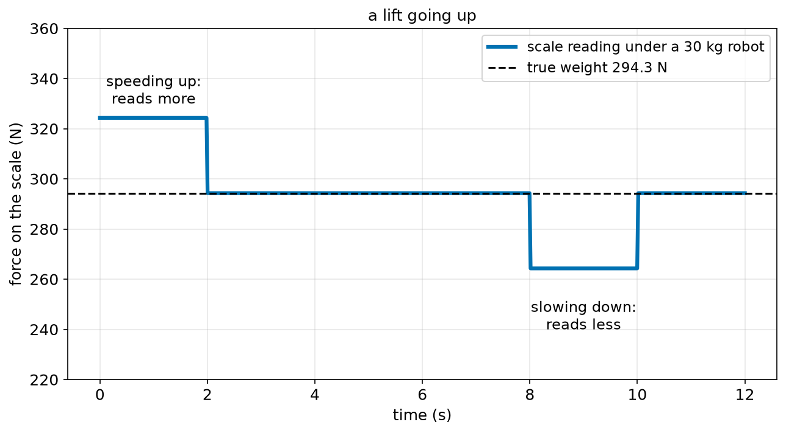
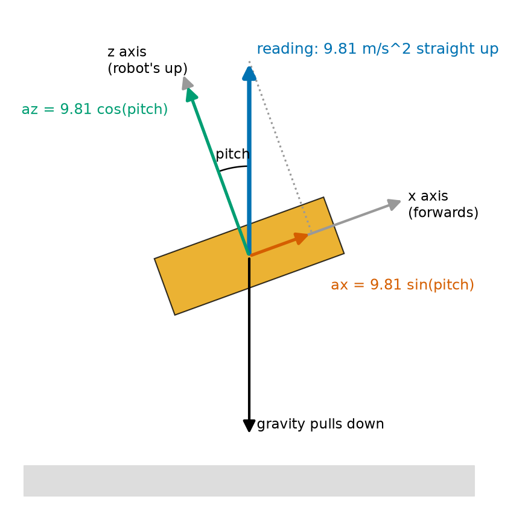
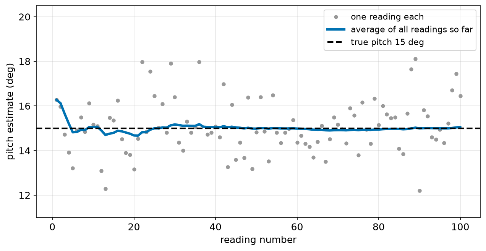

# Chapter 62 — Mass, Weight and Gravity

> **Part 4 · Chapter 62 of 749**
> **You need:** Chapter 38 (scientific notation), Chapter 50 (`atan2`), Chapter 58 (accelerometers) and Chapter 61 (F = m × a).
> **You will make:** a program that compares a robot's weight on Earth, the Moon and Mars and works out g from Newton's law of gravity; a program that shows what a scale reads in a moving lift; and a tilt sensor built from an accelerometer.

---

## What you will learn

- The difference between **mass** (kg) and **weight** (N), and why it matters for robots.
- The formula **W = m × g**, and what **g = 9.81 m/s²** really means.
- Why heavy and light objects fall with the same acceleration.
- Where gravity comes from: **Newton's law of gravitation**.
- Why g is a little different in different places, and much smaller far from the Earth.
- What **apparent weight** is: why you feel heavier in a lift that starts going up.
- Why a still accelerometer reads 9.81 m/s² **upwards**, and how robots use that to measure their **tilt**.

---

## New words in this chapter

| Word | Simple meaning |
|---|---|
| **mass** | How much stuff an object has; how hard it is to speed up. Measured in kg. The same everywhere. |
| **weight** | The force of gravity on an object. Measured in N. Depends on where you are. |
| **gravitational field strength (g)** | The weight of each kilogram: 9.81 N/kg on Earth. The same number as the falling acceleration, 9.81 m/s². |
| **gravitation** | The pull that every mass has on every other mass. |
| **gravitational constant (G)** | A tiny fixed number in Newton's law of gravitation: 6.674 × 10⁻¹¹. |
| **inverse square law** | A rule where twice the distance gives a quarter of the effect. |
| **apparent weight** | The force a scale or a floor actually pushes with. It changes when you accelerate. |
| **weightless** | Feeling no weight because you and everything around you are falling together. |
| **specific force** | What an accelerometer really measures: its acceleration minus gravity's. |
| **pitch** / **roll** | Tilt forwards-backwards / tilt left-right. |

---

## 62.1 Mass and weight are different things

In everyday life, people say "I weigh 40 kilograms". Physics (and robot design) needs more care. There are two different quantities hidden in that sentence.

📖 **New word: mass** — how much stuff an object has. Measured in **kilograms (kg)**. Mass decides how hard it is to speed the object up or slow it down (Chapter 61: a = F / m). A robot's mass is the same on Earth, on the Moon, and in space.

📖 **New word: weight** — the force with which gravity pulls an object. Measured in **newtons (N)**, because it is a force. Weight changes from place to place.

Chapter 39 already warned about this. Here is the link between them:

```
W = m × g
```

In words: "weight equals mass times g".

📖 **New word: gravitational field strength (g)** — how hard gravity pulls on each kilogram. On the Earth's surface, g ≈ 9.81 N/kg.

Notice: 9.81 **N/kg** is the same as 9.81 **m/s²** (because 1 N = 1 kg × 1 m/s², so N/kg = m/s²). It is the same g as the falling acceleration of Chapter 58. Section 62.2 shows why.

🔢 **Maths.** Rover has a mass of 4.0 kg.

| Where | g (m/s²) | Rover's mass | Rover's weight |
|---|---|---|---|
| Earth | 9.81 | 4.0 kg | 4.0 × 9.81 = 39.24 N |
| Moon | 1.62 | 4.0 kg | 6.48 N |
| Mars | 3.71 | 4.0 kg | 14.84 N |
| deep space | ≈ 0 | 4.0 kg | ≈ 0 N |



*Figure 62.1 — Rover's mass is 4.0 kg everywhere. Its weight changes with g.*

**How to read this picture:** The left chart shows Rover's mass on Earth, the Moon and Mars: three equal bars. The right chart shows its weight: 39.24 N on Earth, only 6.48 N on the Moon and 14.84 N on Mars. Same robot, same mass, different weights.

### Why both matter for robots

On the Moon, Rover is six times lighter to **lift**. But it is just as hard to **speed up**: to accelerate at 0.5 m/s², it still needs 4.0 × 0.5 = 2.0 N (Chapter 61), because that depends on **mass**, not weight. And because it presses on the ground less, its wheels grip less (Chapter 63), so it can push less hard before they slip. Space engineers have to think about both, all the time.

| Depends on **mass** | Depends on **weight** |
|---|---|
| force needed to accelerate (F = m a) | force needed to lift or hold up |
| force needed to brake | how hard the wheels press on the ground |
| how hard a crash hits | how much grip the wheels have (Chapter 63) |
| energy of motion (Chapter 67) | energy to climb a hill (Chapter 67) |
| how hard it is to turn (Chapter 66) | the pull down a ramp (Chapter 61) |

💡 **Tip.** A kitchen scale or a bathroom scale really measures a **force** (how hard you press on it) and then divides by 9.81 to show "kilograms". On the Moon, it would show the wrong mass: a 40 kg person would read about 6.6 "kg".

⚠️ **Watch out.** In robot code, keep the two apart in your names: `mass_kg` and `weight_n`. Using a mass where a weight is needed makes every force 9.81 times too small.

---

## 62.2 Why everything falls with the same acceleration

Drop a heavy hammer and a light ball from the same height at the same moment. Without much air resistance, they land together. People believed for a very long time that heavy things fall faster. They do not. Why?

Newton's second law gives the answer in one line. The only force on a falling object (ignoring air) is its weight, W = m g. So:

```
a = F / m = (m × g) / m = g
```

The mass cancels. A heavier object is pulled harder, but it is also harder to speed up, by exactly the same factor. Every object falls with the same acceleration g.

This is why the g in "W = m g" (a force per kilogram) and the g in "falls at 9.81 m/s²" (an acceleration) are the same number.

### What about the air?

A feather falls slowly because the air pushes up on it (drag) with a force that is large compared with its tiny weight. A falling object speeds up until the drag grows as big as the weight. Then the net force is zero, and by Newton's first law it stops speeding up. This top speed is called the **terminal velocity**. A dense ball has a high terminal velocity (it falls almost like the formula), and a feather a low one. In a vacuum, a feather and a hammer fall together. Astronauts have shown this on the Moon, where there is no air.

🤖 **Robot link.** The parachute of Chapter 59's falling drone works by making the drag large, so the terminal velocity is low: a few m/s instead of tens of m/s. Chapter 71 simulates a fall with drag step by step.

---

## 62.3 Where gravity comes from

Why does the Earth pull on Rover at all? Newton's answer, in 1687, was that **every mass pulls on every other mass**.

📖 **New word: gravitation** — the pull of every mass on every other mass. Weight is the Earth's gravitation on an object.

🔢 **Maths.** Newton's law of gravitation:

```
F = G × m₁ × m₂ / r²
```

In words: "the force equals G times the two masses, divided by the square of the distance between their centres".

📖 **New word: gravitational constant (G)** — a fixed number found by measurement: G = 6.674 × 10⁻¹¹ N m²/kg² (scientific notation, Chapter 38). It is tiny, which is why you do not feel a pull towards a chair or a wall: the masses are far too small. Only a planet-sized mass makes a pull you can feel.

⚠️ **Watch out.** Big G (6.674 × 10⁻¹¹, the same everywhere in the universe) and small g (9.81 m/s², the field strength here) are different things. Do not mix them up.

### Working out g

For an object of mass m on the Earth's surface, m₂ is the Earth's mass M = 5.972 × 10²⁴ kg, and r is the Earth's radius R = 6.371 × 10⁶ m:

```
weight = G × M × m / R²   and   weight = m × g
so  g = G × M / R²
      = 6.674 × 10⁻¹¹ × 5.972 × 10²⁴ / (6.371 × 10⁶)²
      = 9.82 m/s²
```

The robot's own mass cancels again. So g depends only on the planet's mass and size. That is why the Moon (small and light) has g = 1.62 m/s².

📖 **New word: inverse square law** — a rule where the effect is divided by the distance **squared**. Twice as far: a quarter of the pull. Ten times as far: a hundredth.

### g at different heights

Because of the r² in the bottom, g gets weaker as you go up. But the Earth is so big that the first few kilometres hardly matter.



*Figure 62.2 — g falls slowly at first, then more and more as you get far from the Earth.*

**How to read this picture:** Across the bottom is the height above the ground in kilometres, up the side is g. At the ground it is 9.82. At 400 km, where the International Space Station flies, it is still 8.69 m/s²: almost 90% of the ground value. Far out at 36,000 km, where TV satellites orbit, it is only 0.22 m/s².

Surprise: there **is** gravity on the space station, nearly as much as on the ground. So why do astronauts float? Section 62.4 answers.

Also, g is not exactly the same everywhere on the ground: it is about 9.78 m/s² at the equator and 9.83 m/s² at the poles, because the Earth spins and is slightly flattened. For almost all robot work, 9.81 is good enough. Very precise instruments, such as some scales, are calibrated where they are used (Chapter 133).

---

## 62.4 Apparent weight, lifts and weightlessness

Stand on a bathroom scale in a lift (elevator). As the lift starts going up, the scale reads **more** than your weight. As it slows down at the top, it reads **less**. What is happening?

The scale does not measure gravity directly. It measures how hard it has to push **up** on you. Let us call that push N (a normal force, Chapter 61).

📖 **New word: apparent weight** — the force a scale (or a floor, or a seat) actually pushes on you with. It is what you **feel** as your weight.

Two forces act on you: your weight m g down, and the scale's push N up. Taking up as positive, Newton's second law says:

```
N − m g = m a
N = m × (g + a)
```

In words: "the scale reads your mass times g plus the lift's acceleration".

- Lift still or moving at a steady speed: a = 0, N = m g. The scale reads your true weight.
- Lift speeding up going up (a > 0): N > m g. You feel heavier.
- Lift slowing down going up (a < 0): N < m g. You feel lighter.

You met this formula in Chapter 61: it is the same as the drone's thrust and the landing robot's ground force.



*Figure 62.3 — A 30 kg robot standing on a scale during Chapter 58's lift ride.*

**How to read this picture:** The blue line is what the scale reads. The black dashed line is the robot's true weight, 294.3 N. While the lift speeds up (0 to 2 s, a = +1.0 m/s²), the scale reads 324.3 N: more. While the lift moves steadily, it reads exactly 294.3 N. While it slows down (8 to 10 s, a = −1.0 m/s²), it reads 264.3 N: less.

### Weightless

What if the lift's cable broke and it fell freely? Then a = −g, and

```
N = m × (g − g) = 0
```

The scale reads zero. You would float inside the falling lift: you, the scale and the lift are all falling together at the same rate, so nothing pushes on anything.

📖 **New word: weightless** — feeling no weight, because you and everything around you are falling together.

This is exactly why astronauts float on the space station. Gravity there is still 8.69 m/s². But the station and everything in it is **falling** all the time: it moves sideways so fast (about 7.7 km/s) that as it falls, the curved Earth falls away underneath it, so it never gets closer. It is in free fall around the Earth. That is what an **orbit** is.

🤖 **Robot link.** Robots that stand on force sensors use apparent weight all the time. A humanoid robot's feet contain force sensors (Chapter 695). Standing still, the forces on both feet add up to its weight. If they add up to more, the robot is accelerating upwards (pushing off for a jump or a step). If they drop towards 0, its feet are leaving the ground.

---

## 62.5 Why a still accelerometer reads 9.81 upwards

Chapter 58 promised to explain a strange fact: an accelerometer lying still on a table does not read 0. It reads 9.81 m/s² **upwards**.

Remember how an accelerometer works (Chapter 58): inside is a tiny mass on tiny springs, and the chip measures how much the springs stretch. Now think about what the springs feel:

- **On a table:** the tiny mass is pulled down by gravity, and the springs must hold it up. They stretch exactly as they would if the chip were in deep space **accelerating upwards** at 9.81 m/s². So the chip reports 9.81 m/s² up.
- **In free fall:** the chip and its tiny mass fall together. The springs do not need to hold anything. They do not stretch. The chip reports 0, even though it is accelerating at 9.81 m/s² downwards.

📖 **New word: specific force** — what an accelerometer really measures: its true acceleration **minus** the acceleration that gravity alone would give it.

```
reading = true acceleration − (gravity's acceleration)
```

Taking up as positive, gravity's acceleration is −g:

- still on a table: 0 − (−g) = +g, so it reads 9.81 up;
- in free fall: −g − (−g) = 0, so it reads 0;
- in a lift accelerating up at 1 m/s²: +1 − (−9.81) = +10.81, so it reads 10.81 up.

The last one is just the apparent weight per kilogram, N / m = g + a. An accelerometer is really a tiny scale for its own little mass.

This is why phone apps offer "linear acceleration" separately (Chapter 58's lift program used it): the phone uses other sensors to work out the direction of gravity and subtracts it.

---

## 62.6 Using gravity to measure tilt

That "annoying" 9.81 m/s² is actually a gift. Gravity always points straight down. So a still accelerometer tells the robot which way is **up**, and therefore how much the robot is **tilted**.

📖 **New word: pitch** — tilt forwards or backwards (nose up or nose down). 📖 **roll** — tilt to the left or right.

Fix the accelerometer to the robot with its x axis pointing forwards and its z axis pointing up through the robot's top. When the robot is flat, the 9.81 m/s² reading is all along z. When the robot pitches nose-up by an angle, the reading (still pointing straight up in the world) is split between the robot's z and x axes, just like the weight on a ramp in Chapter 61:

```
ax = 9.81 × sin(pitch)
az = 9.81 × cos(pitch)
```



*Figure 62.4 — The reading points straight up. The robot's own axes are tilted, so the reading splits into an x part and a z part.*

**How to read this picture:** The orange box is the robot, tilted nose-up. The grey arrows are its own axes: x forwards, z through its top. The blue arrow is the accelerometer's reading: 9.81 m/s² straight up in the world, opposite to gravity (black). The red arrow is the part of the reading along the robot's x axis: 9.81 sin(pitch). The green arrow is the part along its z axis: 9.81 cos(pitch). The angle between the blue arrow and the z axis is the pitch.

To get the pitch back from the two readings, divide: ax / az = tan(pitch). Using `atan2` (Chapter 50) is safer, because it also works when the robot is tilted a lot:

```
pitch = atan2(ax, az)
```

Notice that 9.81 cancels: the tilt comes from the **ratio** of the two readings, so it does not matter if the sensor is slightly miscalibrated in size, as long as both axes are wrong by the same factor.

The same works for roll, with the y axis instead of x.

⚠️ **Watch out.** This only works when the robot is **not accelerating**. If Rover speeds up forwards at 1 m/s², the accelerometer adds 1 m/s² to its x reading, and the "tilt" comes out as atan2(1, 9.81) = 5.8° nose-up, even on a flat floor. Robots that need tilt while moving combine the accelerometer with a gyroscope (Chapter 413 builds this filter).

---

## Code

File `code/ch062/weight_and_g.py`:

```python
# weight_and_g.py - the same mass has a different weight on different worlds, and g falls with height
BIG_G = 6.674e-11            # the gravitational constant, N m^2 / kg^2
EARTH_MASS_KG = 5.972e24
EARTH_RADIUS_M = 6.371e6

ROVER_MASS_KG = 4.0
worlds = {"Earth": 9.81, "Moon": 1.62, "Mars": 3.71}
for name, g in worlds.items():
    print(f"on {name:5s}: mass {ROVER_MASS_KG} kg, weight {ROVER_MASS_KG * g:5.2f} N")

g_surface = BIG_G * EARTH_MASS_KG / EARTH_RADIUS_M ** 2
print(f"g from Newton's law of gravity: {g_surface:.2f} m/s^2")

for height_km in [0, 10, 100, 400, 36000]:
    r = EARTH_RADIUS_M + height_km * 1000
    g = BIG_G * EARTH_MASS_KG / r ** 2
    print(f"{height_km:6d} km up: g = {g:5.2f} m/s^2 ({g / g_surface:.0%} of the surface value)")
```

| Line | Code | What it does (simple English) |
|---|---|---|
| 1 | `# weight_and_g.py …` | A comment. |
| 2 | `BIG_G = 6.674e-11` | Big G. `6.674e-11` is Python's way to write 6.674 × 10⁻¹¹ (Chapter 38). We call it `BIG_G` so it is never confused with small g. |
| 3 | `EARTH_MASS_KG = 5.972e24` | The Earth's mass. |
| 4 | `EARTH_RADIUS_M = 6.371e6` | The Earth's radius: 6371 km. |
| 5 | (blank) | Spacing. |
| 6 | `ROVER_MASS_KG = 4.0` | Rover's mass: the same everywhere. |
| 7 | `worlds = {"Earth": 9.81, …}` | A dictionary of g for each world. |
| 8 | `for name, g in worlds.items():` | `.items()` gives each name and its value (Chapter 22). |
| 9 | `print(f"… weight {ROVER_MASS_KG * g:5.2f} N")` | W = m g. `:5s` pads the name so the columns line up. |
| 10 | (blank) | Spacing. |
| 11 | `g_surface = BIG_G * EARTH_MASS_KG / EARTH_RADIUS_M ** 2` | g = G M / R². |
| 12 | `print(f"g from …")` | Shows it. |
| 13 | (blank) | Spacing. |
| 14 | `for height_km in [0, 10, 100, 400, 36000]:` | Some heights. |
| 15 | `r = EARTH_RADIUS_M + height_km * 1000` | The distance from the Earth's **centre**: radius plus height, in metres. |
| 16 | `g = BIG_G * EARTH_MASS_KG / r ** 2` | g at that distance. |
| 17 | `print(f"… ({g / g_surface:.0%} …)")` | Also as a share of the surface value. |

Output:

```
on Earth: mass 4.0 kg, weight 39.24 N
on Moon : mass 4.0 kg, weight  6.48 N
on Mars : mass 4.0 kg, weight 14.84 N
g from Newton's law of gravity: 9.82 m/s^2
     0 km up: g =  9.82 m/s^2 (100% of the surface value)
    10 km up: g =  9.79 m/s^2 (100% of the surface value)
   100 km up: g =  9.52 m/s^2 (97% of the surface value)
   400 km up: g =  8.69 m/s^2 (89% of the surface value)
 36000 km up: g =  0.22 m/s^2 (2% of the surface value)
```

At 10 km (higher than a passenger plane flies), g is still 99.7% of the surface value, which rounds to 100%. The formula gives 9.82 rather than 9.81 because it ignores the Earth's spin, which reduces the g we feel a little.

File `code/ch062/lift_scale.py`:

```python
# lift_scale.py - what a bathroom scale (or a robot's force sensor) reads in a moving lift
G = 9.81
MASS_KG = 30.0               # a robot standing on the scale


def lift_accel(t):
    """The lift's acceleration in m/s^2, up is positive: speed up, cruise, slow down (Chapter 58)."""
    if t < 2.0:
        return 1.0
    if t < 8.0:
        return 0.0
    if t < 10.0:
        return -1.0
    return 0.0


print("  t (s)   lift a (m/s^2)   scale reads (N)   looks like (kg)")
for t in [1.0, 5.0, 9.0, 11.0]:
    a = lift_accel(t)
    reading = MASS_KG * (G + a)        # the scale pushes up: N - m g = m a
    print(f"{t:6.1f}   {a:+12.1f}   {reading:15.1f}   {reading / G:13.1f}")
print(f"in free fall (cable cut), a = -9.81: the scale reads {MASS_KG * (G - G):.1f} N")
```

| Line | Code | What it does (simple English) |
|---|---|---|
| 1 | `# lift_scale.py …` | A comment. |
| 2 | `G = 9.81` | Small g. |
| 3 | `MASS_KG = 30.0` | The robot on the scale. |
| 4–5 | (blank) | Spacing. |
| 6 | `def lift_accel(t):` | The lift's acceleration at time t: the same ride as Chapter 58. |
| 7 | `"""…"""` | The docstring, including the sign rule: up is positive. |
| 8–14 | `if t < 2.0: return 1.0` and so on | Speed up, cruise, slow down, stop. |
| 15–16 | (blank) | Spacing. |
| 17 | `print("  t (s) …")` | The table heading. |
| 18 | `for t in [1.0, 5.0, 9.0, 11.0]:` | One moment in each part of the ride. |
| 19 | `a = lift_accel(t)` | The acceleration then. |
| 20 | `reading = MASS_KG * (G + a)` | N = m (g + a). The comment shows where it comes from. |
| 21 | `print(f"… {reading / G:13.1f}")` | A scale marked in kg divides by 9.81, so it "shows" a wrong mass when the lift accelerates. |
| 22 | `print(f"in free fall …")` | With a = −g, the reading is 0. |

Output:

```
  t (s)   lift a (m/s^2)   scale reads (N)   looks like (kg)
   1.0           +1.0             324.3            33.1
   5.0           +0.0             294.3            30.0
   9.0           -1.0             264.3            26.9
  11.0           +0.0             294.3            30.0
in free fall (cable cut), a = -9.81: the scale reads 0.0 N
```

---

## Small examples

**Example 1.** A 12 kg robot weighs 12 × 9.81 = 117.7 N on Earth.

**Example 2.** A robot weighs 490.5 N on Earth. Its mass is 490.5 / 9.81 = 50 kg.

**Example 3.** The same 50 kg robot on Mars weighs 50 × 3.71 = 185.5 N.

**Example 4.** A hammer and a feather on the Moon fall with the same acceleration, 1.62 m/s².

**Example 5.** Twice as far from the Earth's centre, gravity is ¼ as strong.

**Example 6.** A 70 kg person in a lift slowing down at 1.5 m/s² while going up: N = 70 × (9.81 − 1.5) = 581.7 N, instead of 686.7 N.

**Example 7.** An accelerometer lying still reads (0, 0, 9.81). It is flat.

**Example 8.** A still accelerometer reads ax = 4.905, az = 8.496. Pitch = atan2(4.905, 8.496) = 30°.

---

## 🏭 Real robot applications

### Application 1 (worked in full) — 🤖 A tilt alarm for a tall robot

**1. The real problem.** A tall delivery robot carries a tray of cups. If it stands on a slope steeper than 10°, the cups may slide and the robot may tip over (Chapter 70). It needs to know its tilt, from an accelerometer fixed inside its body, and stop with a warning when the tilt is too large.

**2. Why this theory.** A still accelerometer reads 9.81 m/s² straight up (section 62.5). When the robot tilts, that reading splits between the robot's x and z axes. The pitch is atan2(ax, az) (section 62.6).

**3. The numbers.** Tilt limit: 10°. The accelerometer has random noise of about 0.2 m/s² on each axis (a cheap sensor, Chapter 124). The robot reads it 100 times a second.

**4. The maths.** At 15° nose-up:

```
ax = 9.81 × sin 15° = 2.54 m/s²
az = 9.81 × cos 15° = 9.48 m/s²
pitch = atan2(2.54, 9.48) = 15.0°
```

With noise of 0.2 m/s² on ax, the pitch from one reading can be off by roughly atan(0.2 / 9.48) ≈ 1.2°, sometimes 2 to 3°. Averaging N readings makes the noise about √N times smaller (Chapter 31). With 100 readings, about 10 times smaller.

**5. The code.** File `code/ch062/tilt.py`:

```python
# tilt.py - find a robot's tilt from a still accelerometer, which feels gravity as 9.81 m/s^2 "up"
import math
import random

G = 9.81
random.seed(3)


def accel_reading(pitch_deg, noise=0.0):
    """What a still accelerometer reads (x forwards, z up through the robot) when tilted nose-up by pitch."""
    p = math.radians(pitch_deg)
    ax = G * math.sin(p) + random.gauss(0, noise)
    az = G * math.cos(p) + random.gauss(0, noise)
    return ax, az


def pitch_from(ax, az):
    return math.degrees(math.atan2(ax, az))


for true_pitch in [0, 5, 15, 30, -10]:
    ax, az = accel_reading(true_pitch)
    print(f"true pitch {true_pitch:4d} deg: reads ax {ax:+5.2f}, az {az:5.2f} -> pitch {pitch_from(ax, az):+6.1f} deg")

print("with noise of 0.2 m/s^2, true pitch 15 deg:")
one = [pitch_from(*accel_reading(15, 0.2)) for k in range(5)]
print("  single readings:", [round(x, 1) for x in one])
many = [pitch_from(*accel_reading(15, 0.2)) for k in range(100)]
print(f"  average of 100 readings: {sum(many) / len(many):.2f} deg")
```

| Line | Code | What it does (simple English) |
|---|---|---|
| 1 | `# tilt.py …` | A comment. |
| 2–3 | `import math`, `import random` | Trig, and noise. |
| 4 | (blank) | Spacing. |
| 5 | `G = 9.81` | Small g. |
| 6 | `random.seed(3)` | The same noise each run. |
| 7–8 | (blank) | Spacing. |
| 9 | `def accel_reading(pitch_deg, noise=0.0):` | Pretends to be the accelerometer. |
| 10 | `"""…"""` | The docstring says which way the axes point. |
| 11 | `p = math.radians(pitch_deg)` | Radians for `sin` and `cos`. |
| 12 | `ax = G * math.sin(p) + random.gauss(0, noise)` | The x part of the 9.81 "up" reading, plus noise. |
| 13 | `az = G * math.cos(p) + random.gauss(0, noise)` | The z part, plus noise. |
| 14 | `return ax, az` | Two readings. |
| 15–16 | (blank) | Spacing. |
| 17 | `def pitch_from(ax, az):` | The robot's side: from readings back to an angle. |
| 18 | `return math.degrees(math.atan2(ax, az))` | pitch = atan2(ax, az), in degrees. |
| 19–20 | (blank) | Spacing. |
| 21 | `for true_pitch in [0, 5, 15, 30, -10]:` | Some tilts, including nose-down (−10°). |
| 22 | `ax, az = accel_reading(true_pitch)` | Perfect readings, no noise. |
| 23 | `print(f"…")` | The readings and the pitch worked out from them. |
| 24 | (blank) | Spacing. |
| 25 | `print("with noise …")` | A heading. |
| 26 | `one = [pitch_from(*accel_reading(15, 0.2)) for k in range(5)]` | Five single noisy estimates. `*` unpacks the tuple `(ax, az)` into the two arguments of `pitch_from`. |
| 27 | `print("  single readings:", …)` | Rounded to 0.1°. |
| 28 | `many = [… for k in range(100)]` | A hundred noisy estimates. |
| 29 | `print(f"  average of 100 readings: …")` | Their average. |

Output:

```
true pitch    0 deg: reads ax +0.00, az  9.81 -> pitch   +0.0 deg
true pitch    5 deg: reads ax +0.85, az  9.77 -> pitch   +5.0 deg
true pitch   15 deg: reads ax +2.54, az  9.48 -> pitch  +15.0 deg
true pitch   30 deg: reads ax +4.90, az  8.50 -> pitch  +30.0 deg
true pitch  -10 deg: reads ax -1.70, az  9.66 -> pitch  -10.0 deg
with noise of 0.2 m/s^2, true pitch 15 deg:
  single readings: [16.3, 16.0, 14.7, 13.9, 13.2]
  average of 100 readings: 15.04 deg
```



*Figure 62.5 — Single estimates scatter by a few degrees. Their running average settles close to the true 15°.*

**How to read this picture:** Each grey dot is the pitch worked out from one noisy reading. They scatter between about 12° and 18°. The blue line is the average of all the readings so far: it wobbles at first, then settles very close to the black dashed line at the true 15°.

**6. The result.** Without noise, the tilt sensor is exact in every case, including nose-down. With a cheap, noisy sensor, single readings can be off by 2 to 3°, so a robot that compared each single reading with the 10° limit would sometimes stop on an 8° slope, or miss a 12° one for a moment. Averaging 100 readings (1 s of data) gives 15.04°: well within 0.1°. The robot should use the average (or the filter of Chapter 52) and should only check the tilt when it is not accelerating.

**7. Going further.** While the robot drives, its own acceleration spoils the gravity-only reading. Real tilt sensors combine the accelerometer (correct on average, but upset by motion) with a gyroscope (smooth, but drifts), in a **complementary filter** (Chapter 413) or a Kalman filter (Chapter 428). Chapter 127 builds a full IMU, and drones use exactly this to know which way is up (Chapter 632).

### Application 2 (worked in full) — 🚀 Testing a Mars rover on Earth

**1. The real problem.** A team builds a 900 kg rover for Mars. They must test it on Earth. But on Earth it weighs much more than it will on Mars, so its wheels, suspension and motors are loaded differently. What changes, and what stays the same?

**2. Why this theory.** Mass is the same on both planets: so the force to **accelerate** and **brake** is the same. Weight is different: so the load on the wheels, the push needed to climb a slope, and the grip are all different.

**3. The numbers.** Mass 900 kg. g on Earth 9.81, on Mars 3.71 m/s². The rover accelerates gently at 0.05 m/s². Test slope: 20°.

**4. The maths.**

```
weight on Earth = 900 × 9.81 = 8829 N
weight on Mars  = 900 × 3.71 = 3339 N     (38% of the Earth value)

force to accelerate at 0.05 m/s²: 900 × 0.05 = 45 N on BOTH planets

pull down a 20° slope (m g sin 20°):
  Earth: 8829 × 0.342 = 3020 N
  Mars:  3339 × 0.342 = 1142 N
```

**5. The code.** The `weight_and_g.py` program does the weight part. Lab 62.3 adds the slope and the acceleration.

**6. The result.** On Earth, the rover's motors must push almost three times harder to climb the same slope, and its wheels and suspension carry 2.6 times the load they will carry on Mars. If the rover were built only for Mars loads, it might break during testing on Earth. On the other hand, a test on Earth would hide a Mars problem: on Mars, the wheels press on the ground with only 38% of the force, so they grip less (Chapter 63) and slip more easily in sand. Space agencies handle this by building a lighter "test twin" of the rover, so that its **weight** on Earth matches the real rover's weight on Mars, and by testing in sand pits that behave like Martian soil.

**7. Going further.** Lower gravity also changes falling and bouncing: a rock dropped on Mars falls with 3.71 m/s², so everything happens more slowly. Robot simulators let you set g to any value (Part 28), which makes it easy to test a robot "on Mars" before any hardware exists.

### Application 3 — ⚖️ A gripper that weighs what it holds

A factory robot picks parts and checks that each one is complete by weighing it. A force sensor in its wrist measures the downward force from the part (Chapter 43's load cell). While the arm holds the part still, the force is the part's weight, so mass = force / 9.81. A part that should be 250 g gives 2.45 N. A missing screw of 8 g changes this by only 0.08 N, so the sensor must be good to about 0.02 N. And the arm must hold **still** while it weighs: if it is accelerating upwards at 1 m/s², the reading is m (g + a), about 10% too high (section 62.4), and every part would look heavy. Chapter 133 shows how such sensors are calibrated.

### Application 4 — 🚁 A drone weighs its own payload

A delivery drone can find out how heavy its parcel is without a scale. When it hovers, thrust = weight (Chapter 61). If it knows its thrust (from its motor commands and a thrust table, Chapter 619), it knows its total weight, and so its total mass. If the empty drone hovers with 11.8 N and the loaded drone needs 16.7 N, the parcel weighs 4.9 N: a mass of 0.5 kg. The drone can then refuse a parcel that is too heavy, or plan a shorter route because a heavier drone uses more battery (Chapter 67). The measurement only works in a steady hover, for the same reason as in Application 3.

### Application 5 — 🦿 Feeling the ground through the feet

A humanoid robot of 60 kg weighs 588.6 N. When it stands still on both feet, the force sensors in its feet add up to 588.6 N. When it shifts its weight to one foot to take a step, that foot reads nearly all of it. When it pushes off, the total briefly rises above 588.6 N (it is accelerating upwards: apparent weight m (g + a)). When a foot is about to lose contact, its reading drops to near 0. The robot's walking controller watches these numbers every few milliseconds to know which foot it is standing on and whether it is about to fall (Chapter 695 and Chapter 703).

---

## 🔧 Hands-on lab

### Lab 62.1 — A bathroom scale in a lift (hardware)

You need a bathroom scale (digital is easiest to read), a lift, and a phone to film the scale. Do this only where it is safe and allowed, with an adult.

1. Stand on the scale in the lift before it moves. Write down the reading.
2. Film the display while the lift goes up several floors, then down again.
3. From the video, find the highest and lowest readings.
4. Work out the lift's acceleration from each: a = (reading / true reading − 1) × 9.81.

**What you should see:** The reading rises when the lift starts going up and when it stops going down. It falls when the lift starts going down and when it stops going up. Typical lifts change the reading by 5 to 15%, which means accelerations of about 0.5 to 1.5 m/s².

| If it does not work | Likely cause | Fix |
|---|---|---|
| The reading does not change | The scale updates too slowly | Use a scale that updates quickly, or ride a faster lift |
| The changes look random | You moved on the scale | Stand very still with your arms by your sides |

**Challenge:** Use the readings to estimate how long each speed-up lasts and the lift's top speed (Chapter 58: Δv = a × Δt).

### Lab 62.2 — A tilt meter with your phone (hardware)

Use a phone sensor app (the "acceleration with gravity" reading, not the "linear acceleration" one).

1. Lay the phone flat on a table. Write down x, y and z. One of them should be close to 9.81.
2. Tilt the phone by raising one end on a book. Write down the readings again.
3. Work out the tilt with `atan2` (use the two axes that changed).
4. Measure the real tilt with a ruler: height of the book ÷ length of the phone gives sin(angle) (Chapter 49).

**What you should see:** The two angles agree within about a degree. The size √(x² + y² + z²) stays close to 9.81 whatever the tilt, because it is always the same gravity reading, just split differently.

| If it does not work | Likely cause | Fix |
|---|---|---|
| All readings are near 0 | You chose "linear acceleration" | Choose the reading that includes gravity |
| The angle has the wrong sign | The phone's axis directions differ from the book's | Check which way your phone's x axis points |

**Challenge:** Hold the phone at a fixed tilt and move your hand forwards quickly. Watch the "tilt" change even though the phone's tilt did not. This is the problem of section 62.6's warning.

### Lab 62.3 — The Mars rover in code (simulation)

Write a small program for the rover of Application 2.

1. Make a dictionary of g for Earth, Moon and Mars.
2. For each world, print the weight, the force to accelerate at 0.05 m/s², and the pull down a 20° slope.
3. Find the mass of a "test twin" that weighs on Earth what the 900 kg rover weighs on Mars.

**What you should see:** The force to accelerate is 45 N on every world. The slope pull is 3020 N on Earth, 499 N on the Moon and 1142 N on Mars. The test twin's mass is 900 × 3.71 / 9.81 = 340 kg.

| If it does not work | Likely cause | Fix |
|---|---|---|
| The slope force is the same everywhere | You used mass instead of weight in m g sin(angle) | Multiply by the world's g |
| The acceleration force changes with the world | You used weight instead of mass in F = m a | F = m a uses mass only |

**Challenge:** On which world could the rover climb the steepest slope if its motors can push at most 1500 N? (Use asin, Chapter 49.)

---

## Common mistakes

⚠️ **Saying "it weighs 4 kg".** In physics, it **has a mass** of 4 kg and **weighs** 39.2 N.

⚠️ **Using mass where weight is needed, or the other way round.** F = m a uses mass. Lifting and holding use weight, m g.

⚠️ **Thinking heavy things fall faster.** Without air, all things fall with g.

⚠️ **Mixing up big G and small g.**

⚠️ **Thinking there is no gravity in orbit.** There is; astronauts float because they are falling.

⚠️ **Expecting a still accelerometer to read 0.** It reads 9.81 m/s² upwards.

⚠️ **Measuring tilt with an accelerometer while the robot accelerates.** The robot's own acceleration looks like tilt.

---

## Practice

🏋️ **1.** What is the weight on Earth of a 2.5 kg robot arm?

🏋️ **2.** A robot weighs 196.2 N on Earth. What is its mass, and what does it weigh on the Moon?

🏋️ **3.** A robot needs 60 N to accelerate at 1.5 m/s² on Earth. How much force does it need for the same acceleration on Mars?

🏋️ **4.** Why does a heavy ball not fall faster than a light ball? Explain with F = m a.

🏋️ **5.** Using g = G M / R², find g on the Moon: M = 7.35 × 10²² kg, R = 1.737 × 10⁶ m.

🏋️ **6.** How many times weaker is the Earth's gravity at 3 Earth radii from its centre than at 1 Earth radius?

🏋️ **7.** A 20 kg robot stands on a scale in a lift that accelerates downwards at 2 m/s² (a = −2). What does the scale read?

🏋️ **8.** What does an accelerometer read (up is positive) when it is (a) still, (b) falling freely, (c) in a rocket accelerating upwards at 20 m/s²?

🏋️ **9.** A still accelerometer reads ax = 1.70, az = 9.66 m/s². What is the pitch?

🏋️ **10.** A robot on a flat floor speeds up at 0.8 m/s². What tilt would a simple accelerometer tilt sensor wrongly report?

🏋️ **11.** Write a function `tilt_ok(ax, ay, az, limit_deg)` that works out pitch = atan2(ax, az) and roll = atan2(ay, az) and returns `True` only if both are within the limit. It should also return `False` if the size √(ax² + ay² + az²) is more than 5% away from 9.81, because then the robot is probably accelerating and the tilt cannot be trusted. Test it with (0.85, 0, 9.77), (2.54, 0, 9.48) and (0.85, 0, 11.0) with a limit of 10°.

---

## Answers

**1.** 2.5 × 9.81 = 24.5 N.

**2.** Mass 196.2 / 9.81 = 20 kg. Moon weight 20 × 1.62 = 32.4 N.

**3.** The same, 60 N: F = m a depends on mass, not weight.

**4.** The heavy ball is pulled harder (bigger m g), but it is also harder to accelerate (bigger m). a = m g / m = g for both.

**5.** g = 6.674 × 10⁻¹¹ × 7.35 × 10²² / (1.737 × 10⁶)² = 4.905 × 10¹² / 3.017 × 10¹² = 1.63 m/s².

**6.** 3² = 9 times weaker.

**7.** N = 20 × (9.81 − 2) = 156.2 N.

**8.** (a) +9.81 m/s². (b) 0. (c) 20 + 9.81 = +29.81 m/s².

**9.** atan2(1.70, 9.66) = 10.0°.

**10.** atan2(0.8, 9.81) = 4.7°.

**11.**

```python
import math

def tilt_ok(ax, ay, az, limit_deg):
    size = math.sqrt(ax ** 2 + ay ** 2 + az ** 2)
    if abs(size - 9.81) > 0.05 * 9.81:
        return False                     # accelerating: cannot trust the tilt
    pitch = math.degrees(math.atan2(ax, az))
    roll = math.degrees(math.atan2(ay, az))
    return abs(pitch) <= limit_deg and abs(roll) <= limit_deg

print(tilt_ok(0.85, 0, 9.77, 10))    # True:  about 5 deg
print(tilt_ok(2.54, 0, 9.48, 10))    # False: about 15 deg
print(tilt_ok(0.85, 0, 11.0, 10))    # False: size 11.03, the robot is accelerating
```

---

## Summary

🧠 **Mass** (kg) is how much stuff an object has and how hard it is to accelerate. It is the same everywhere.

🧠 **Weight** (N) is gravity's pull: **W = m × g**. On Earth g ≈ 9.81; on the Moon 1.62; on Mars 3.71.

🧠 F = m a uses **mass**. Lifting, holding, ramps and grip use **weight**.

🧠 Everything falls with the same acceleration g, because a = m g / m. Air resistance changes this for light, large objects.

🧠 **Newton's law of gravitation:** F = G m₁ m₂ / r². It gives g = G M / R², and g gets weaker with the square of the distance.

🧠 **Apparent weight** = m (g + a): heavier when accelerating up, lighter when accelerating down, zero in free fall. Orbiting astronauts float because they are falling.

🧠 An accelerometer measures acceleration minus gravity's, so a still one reads 9.81 m/s² **up**. Robots use this to measure **tilt**: pitch = atan2(ax, az), but only when they are not accelerating.

---

## Next chapter

In Chapter 63 we study **friction** and **grip**: why wheels can push a robot, why they slip on ice, why a gripper must squeeze hard to hold a part, and how the weight of this chapter decides how much grip there is. You will meet the friction coefficient μ and finally see where the rule a ≤ μ g comes from.
