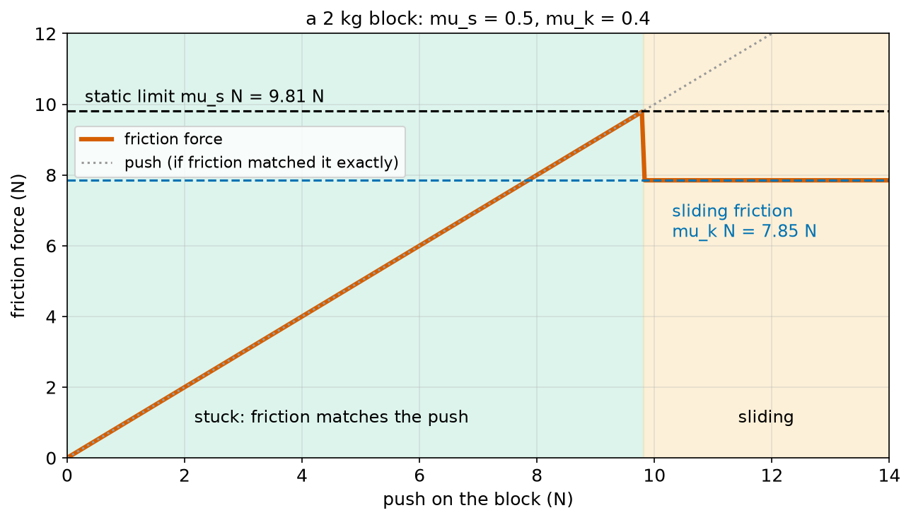
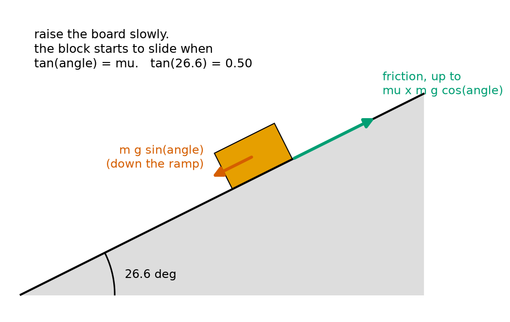
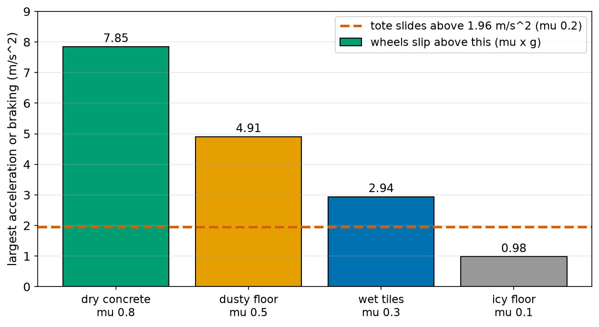
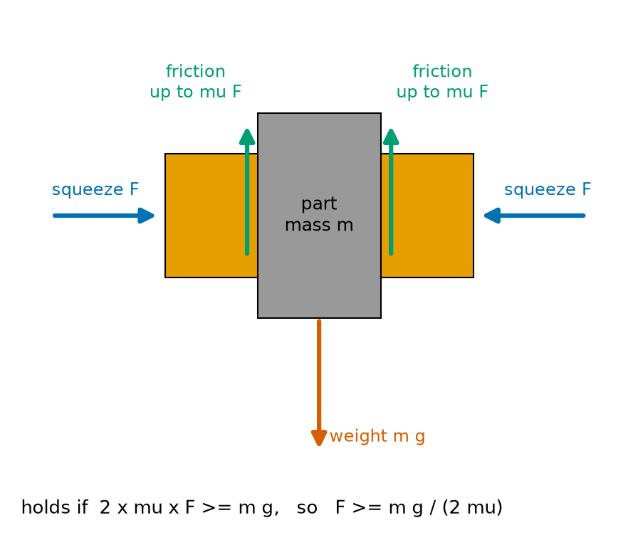
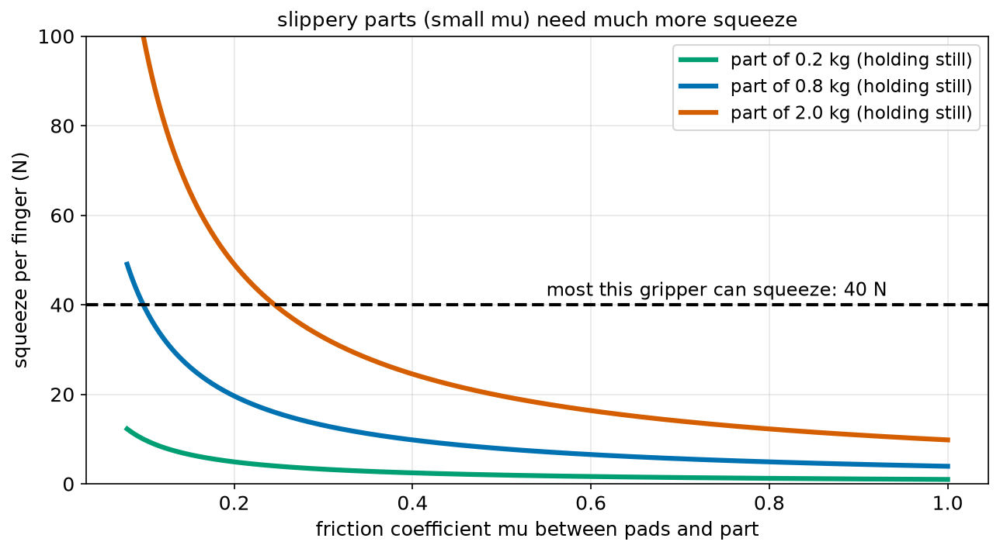
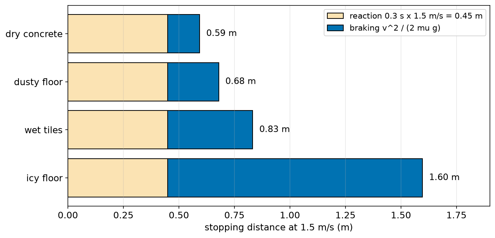

# Chapter 63 — Friction and Grip (Traction)

> **Part 4 · Chapter 63 of 749**
> **You need:** Chapter 59 (braking distance), Chapter 61 (forces, F = m × a, ramps) and Chapter 62 (weight).
> **You will make:** a program that shows when a block sticks and when it slides, a squeeze-force calculator for a robot gripper, and a program that finds the safe braking of a warehouse robot on different floors, with a load on top.

---

## What you will learn

- What **friction** is, and why robots need it **and** fight it.
- The difference between **static friction** (stuck) and **sliding friction**.
- The friction rule **F ≤ μ × N**, and what the **friction coefficient μ** means.
- How to measure μ with a tilting board.
- Why a wheel's push is limited by **grip**, and why the largest acceleration on a flat floor is **μ × g**.
- Why a load slides off a robot when a > μ g, as promised in Chapter 1 and Chapter 58.
- How hard a gripper must squeeze to hold a part: **F ≥ m g / (2μ)**.
- How wet and icy floors make braking distances longer.
- What **rolling resistance** is.

---

## New words in this chapter

| Word | Simple meaning |
|---|---|
| **friction** | A force between two surfaces that touch. It acts along the surfaces and resists sliding. |
| **static friction** | Friction while the surfaces are **not** sliding. It can be anything from 0 up to a limit. |
| **stiction** | Another name for static friction, used by engineers, especially for "stuck" motors and joints. |
| **sliding friction** (kinetic friction) | Friction while the surfaces **are** sliding. |
| **friction coefficient (μ)** | A number that says how "grippy" two surfaces are together. μ is the Greek letter "mu". |
| **traction** | The grip a wheel or a foot has on the ground: the most it can push before it slips. |
| **wheel slip** | A wheel spinning faster (or slower) than the robot is moving, because it has lost grip. |
| **rolling resistance** | A small force that resists a wheel rolling, mostly from the tyre and floor squashing. |
| **safety factor** | A number you multiply a calculated force by, to cover things you did not know. |

---

## 63.1 What is friction?

Push a heavy box across a floor. At first it does not move at all. Push harder, and suddenly it starts to slide. Keep pushing, and it keeps sliding, but you need a little less force than at the start. Stop pushing, and it stops quickly.

All of this is **friction**.

📖 **New word: friction** — a force between two surfaces that touch. It acts **along** the surfaces, and always against sliding (or against the start of sliding).

Where does it come from? Even surfaces that look smooth are rough when seen through a microscope. Where two surfaces touch, tiny bumps press into each other and partly stick together. To slide, these contacts must be torn apart and bumped over. The harder the surfaces are pressed together, the more contacts there are, and the bigger the friction.

### Robots need friction and fight it

Friction is both a friend and an enemy of every robot:

| Friction helps… | Friction hurts… |
|---|---|
| wheels push on the floor (Chapter 61's third law needs grip) | gearboxes lose energy as heat (Chapter 68) |
| brakes stop the robot | motors need extra current to start (stiction) |
| a gripper holds a part | joints wear out |
| a load stays on top of a robot | a robot arm moves jerkily at very low speeds |
| feet do not slip when walking | sliding parts get hot |

A robot on ice is as helpless as a person on ice: its wheels can turn, but they cannot push.

---

## 63.2 Static friction: stuck

Let us look closely at the box. You push with a small force, and it does not move. Newton's first law (Chapter 61) says the net force is zero, so **friction must be pushing back exactly as hard as you push**. Push harder: friction pushes back harder too. It "matches" your push.

📖 **New word: static friction** — friction while the surfaces do **not** slide. It takes whatever value is needed to stop sliding, up to a limit.

But static friction has a maximum. When your push becomes bigger than that maximum, friction can no longer match it, and the box starts to slide.

📖 **New word: stiction** — engineers' name for static friction, especially when a motor, a joint or a slide is "stuck" and needs an extra push to start. Chapter 9 met it: a robot that does not start moving until the motor command is quite large.

### The friction rule

Experiments show that the largest static friction is roughly proportional to how hard the surfaces are pressed together, which is the **normal force** N (Chapter 61):

```
static friction F ≤ μ_s × N
```

In words: "static friction can be anything up to mu-s times the normal force".

📖 **New word: friction coefficient (μ)** — a number that says how grippy two surfaces are **together**. It has no unit (it is force ÷ force). μ_s is the static coefficient, for starting.

On a flat floor with nothing else pressing, N is the weight, m g (Chapter 62), so the limit is μ_s m g.

🔢 **Maths.** A 2 kg block on a floor with μ_s = 0.5:

```
N = 2 × 9.81 = 19.62 N
largest static friction = 0.5 × 19.62 = 9.81 N
```

Push with 6 N: friction gives 6 N back, and the block stays. Push with 9 N: friction gives 9 N, and it still stays. Push with 10 N: more than 9.81 N, so it slides.

---

## 63.3 Sliding friction

Once the block slides, friction is still there, but it is usually a little **smaller** than the static limit, and it stays roughly the same whatever the speed.

📖 **New word: sliding friction** (also called **kinetic friction**) — friction while the surfaces slide over each other.

```
sliding friction F = μ_k × N
```

In words: "sliding friction equals mu-k times the normal force". Usually μ_k is a little smaller than μ_s.

🔢 **Maths.** The block has μ_k = 0.4. While it slides, friction is 0.4 × 19.62 = 7.85 N. With a 10 N push, the net force is 10 − 7.85 = 2.15 N, so a = 2.15 / 2 = 1.08 m/s² (Chapter 61).



*Figure 63.1 — Friction matches the push up to the static limit. Then the block slides, and friction drops to the sliding value.*

**How to read this picture:** Across the bottom is how hard we push the 2 kg block. Up the side is the friction force. In the green part, the block is stuck: the red line rises along the grey dotted line, because friction exactly matches the push. At 9.81 N (the black dashed static limit), the block breaks free. In the orange part it slides, and friction drops to 7.85 N (blue dashed line) and stays there however hard we push. The extra push now makes the block accelerate.

That drop explains the "jump" you feel when a stuck box suddenly starts to slide, and it is why robot joints with high stiction move in little jerks at very low speed: stick, jump, stick, jump. Control engineers fight this with special tricks (Chapter 212's integral action is one of them).

### Typical values

μ depends on **both** surfaces and on dirt, water and oil. These are rough values, only for getting a feel; real designs measure them.

| Surfaces | μ_s (about) | μ_k (about) |
|---|---|---|
| rubber tyre on dry concrete | 0.8–1.0 | 0.7 |
| rubber tyre on wet concrete or tiles | 0.3–0.6 | 0.25–0.5 |
| rubber on ice | 0.1 | 0.05 |
| steel on steel, dry | 0.6 | 0.4 |
| steel on steel, oiled | 0.1 | 0.05 |
| plastic tote on steel | 0.2–0.3 | 0.2 |
| rubber gripper pad on steel | 0.5–0.8 | 0.4 |
| PTFE (Teflon) on steel | 0.05 | 0.05 |

### Does the area matter?

Surprisingly, for most hard surfaces, **no**. A brick pressed with the same weight has about the same friction lying flat or standing on end. With a bigger area, there are more contacts, but each one is pressed less hard, and the two effects cancel. That is why the rule has only μ and N in it. (Soft materials such as tyres and gripper pads do not follow this rule perfectly, which is one reason racing cars use wide tyres.)

---

## 63.4 Measuring μ with a tilting board

There is a simple way to measure μ_s between two surfaces. Put a block on a board, and raise one end of the board slowly. At some angle, the block suddenly starts to slide.

From Chapter 61, on a ramp at an angle θ:

- the pull down the ramp is m g sin θ;
- the push into the ramp (the normal force) is N = m g cos θ;
- so the largest static friction is μ_s m g cos θ.

The block is just about to slide when the pull equals the largest friction:

```
m g sin θ = μ_s × m g cos θ
μ_s = sin θ / cos θ = tan θ
```

In words: "the friction coefficient is the tangent of the angle at which the block starts to slide". The mass and g cancel out, so the block's weight does not matter.



*Figure 63.2 — Raise the board until the block just starts to slide. Then μ_s = tan(angle).*

**How to read this picture:** The orange block sits on a grey board tilted at 26.6°. The red arrow is the part of the weight pulling down the board, m g sin(angle). The green arrow is friction, holding the block, up to μ × m g cos(angle). At 26.6°, the red pull just equals the largest green friction, so the block starts to slide. tan(26.6°) = 0.50, so μ_s = 0.50.

🤖 **Robot link.** The same rule tells you the steepest slope a **wheel** can grip: if every wheel is driven, a robot can climb (or park on) a slope only while tan θ < μ. On a wet floor with μ = 0.3, the steepest slope is atan(0.3) = 16.7°. On ice with μ = 0.1, only 5.7°: a gentle ramp becomes impossible.

---

## 63.5 Grip limits how hard a robot can push, speed up and brake

Chapter 61 said that a wheel pushes the ground backwards, and the ground pushes the robot forwards (third law). That forward push **is** a friction force between the tyre and the floor. So it is limited by μ × N.

📖 **New word: traction** — the grip a wheel or foot has on the ground: the largest push it can make before it slips.

📖 **New word: wheel slip** — when a wheel spins faster (when pushing) or slower (when braking) than the robot is really moving, because the push asked for is bigger than the grip.

Usually a wheel rolls without sliding at the contact point, so the right friction is **static**, μ_s. (That is good news: μ_s is the bigger one. A wheel that skids drops to μ_k and grips less, which is why cars have anti-lock brakes.)

### The largest acceleration on a flat floor

Suppose **all** of a robot's wheels are driven or braked. The total normal force on them is the whole weight, m g, so the largest total push is μ m g. With Newton's second law:

```
a_max = μ m g / m = μ g
```

In words: "the largest acceleration or braking is mu times g". The mass cancels again! A heavy robot needs more push, but it also has more grip, by the same factor.

🔢 **Maths.**

| Floor | μ | a_max = μ g |
|---|---|---|
| dry concrete | 0.8 | 7.85 m/s² |
| dusty floor | 0.5 | 4.91 m/s² |
| wet tiles | 0.3 | 2.94 m/s² |
| icy floor | 0.1 | 0.98 m/s² |

If only **some** wheels are driven, only the weight on those wheels counts. Rover drives its two back wheels and has a free caster at the front. If 70% of its weight is on the driven wheels, a_max = 0.7 × μ g.

### Braking distance and the floor

Chapter 59 found braking distance = v² / (2b). If braking is limited by grip, b = μ g:

```
braking distance = v² / (2 μ g)
```

On a wet floor (μ = 0.3) the braking distance is 0.8 / 0.3 = 2.7 times longer than on dry concrete (μ = 0.8). Safety systems must use the **worst** floor the robot will ever meet (Application 2).

---

## 63.6 Keeping a load on the robot: a ≤ μ g

Chapter 1 promised that you would work out how fast a robot can speed up before its load slides. Chapter 58 found, by testing, that a tote slid at about 2.0 m/s². Now we can explain that number.

A tote of mass m sits on a robot's flat top. When the robot accelerates at a, the tote must accelerate at a too, or it is left behind. The only thing that can push it forwards is **friction** from the robot's top. So friction must provide m × a. The most it can provide is μ m g. So the tote stays on only while

```
m a ≤ μ m g
a ≤ μ g
```

In words: "the load stays put while the acceleration is at most mu times g". The load's mass cancels: a light tote and a heavy tote slide at the same acceleration.

🔢 **Maths.** A plastic tote on a steel top has μ ≈ 0.2:

```
a_max = 0.2 × 9.81 = 1.96 m/s²
```

That is Chapter 58's "about 2.0 m/s²": the test measured μ without knowing it. Chapter 58 chose a ramp limit of 0.8 m/s², a safety factor of 2.5.

📖 **New word: safety factor** — a number you multiply a calculated value by, to cover things you did not know: dust, wear, oil, a sensor that is a little wrong. Here, the design uses 2.5 times less acceleration than the physics allows.



*Figure 63.3 — On most floors, the tote slides long before the wheels slip.*

**How to read this picture:** Each bar is the largest acceleration or braking the wheels can manage on one floor: μ × g. The red dashed line is the tote's limit, 1.96 m/s². On dry concrete, dusty floors and even wet tiles, the wheels could brake much harder than the tote allows: the **load** sets the limit. Only on an icy floor (0.98 m/s²) do the wheels slip first.

🤖 **Robot link.** Robots that carry loads often add a rubber mat on top (raising μ to 0.6 or more), or a small fence, or a clamp. Each one raises the safe acceleration, so the robot can move faster and finish more jobs per hour.

---

## 63.7 Gripping: F ≥ m g / (2μ)

A two-finger gripper holds a part by squeezing it from both sides. Squeezing does not lift the part directly: the fingers push **sideways**. What holds the part up is **friction** between the finger pads and the part.



*Figure 63.4 — Each finger squeezes with F. Each finger's friction, up to μ F, holds the part up.*

**How to read this picture:** The grey part is held between two orange finger pads. Each finger squeezes sideways with a force F (blue arrows). The squeeze is the normal force for that pad. Each pad can give a friction force of up to μ × F, pointing up (green arrows). Two pads give up to 2 μ F. The part's weight, m g (red), pulls down. The part stays if 2 μ F ≥ m g.

🔢 **Maths.**

```
2 μ F ≥ m g
F ≥ m g / (2 μ)
```

In words: "each finger must squeeze at least the part's weight divided by twice mu".

**Small example.** A 0.8 kg steel bracket, pads with μ = 0.3: F ≥ 0.8 × 9.81 / 0.6 = 13.1 N per finger.

Notice what μ does: with oily steel (μ = 0.12), the same bracket needs 32.7 N, two and a half times more. A gripper squeezes **much** harder than the part weighs.

If the arm also **accelerates the part upwards** at a, friction must hold the weight and give the acceleration, m (g + a) (Chapter 61), so:

```
F ≥ m (g + a) / (2 μ)
```



*Figure 63.5 — The squeeze needed rises steeply as the pads get slippery.*

**How to read this picture:** Across the bottom is μ between the pads and the part. Each curve is one part's mass, held still. The curves rise very steeply on the left: halving μ doubles the squeeze. The black dashed line is the most this gripper can squeeze, 40 N. The 2 kg part can only be held if μ is above about 0.25. The 0.8 kg part can be held down to μ ≈ 0.1. The 0.2 kg part is easy everywhere.

⚠️ **Watch out.** Squeezing too hard is also a problem: it crushes soft parts (fruit, cups, cardboard boxes). Good grippers squeeze **just enough**, which needs a good guess of μ and the mass, plus a safety factor. Some measure slip with touch sensors and squeeze a little more when the part starts to slide.

---

## 63.8 Rolling resistance

A rolling wheel does not slide on the floor, so it has no sliding friction. But it still needs a small push to keep rolling. Chapter 61's delivery robot needed 3.0 N, measured by towing it.

📖 **New word: rolling resistance** — a small force that resists a wheel rolling. It comes mainly from the tyre and the floor squashing a little at the contact, and from friction in the wheel bearings.

It is also roughly proportional to the weight:

```
rolling resistance ≈ C_rr × m g
```

C_rr (the rolling resistance coefficient) is much smaller than μ: about 0.005 to 0.03 for robot wheels on hard floors, but 0.1 or more on soft carpet, grass or sand.

🔢 **Maths.** Chapter 61's robot: 3.0 N for a 25 kg robot. C_rr = 3.0 / (25 × 9.81) = 0.012.

Rolling resistance is why a robot on carpet uses more battery than on tiles (Chapter 67) and why a robot vacuum slows down when it climbs onto a thick rug.

---

## Code

File `code/ch063/friction_basics.py`:

```python
# friction_basics.py - the friction limit F <= mu N, and finding mu by tilting a ramp
import math

G = 9.81
MASS_KG = 2.0
MU_STATIC = 0.5
MU_SLIDING = 0.4

normal = MASS_KG * G                       # on a flat floor the floor pushes up with the weight
limit = MU_STATIC * normal
print(f"normal force {normal:.2f} N, friction can hold up to {limit:.2f} N")
for push in [2.0, 6.0, 9.0, 10.0, 12.0]:
    if push <= limit:
        print(f"push {push:5.1f} N: stays still, friction pushes back {push:5.1f} N")
    else:
        sliding = MU_SLIDING * normal
        a = (push - sliding) / MASS_KG
        print(f"push {push:5.1f} N: slides, friction {sliding:.2f} N, a = {a:.2f} m/s^2")

print("tilt test: the block starts to slide when tan(angle) = mu")
for angle_deg in [15, 22, 26.6, 30]:
    t = math.tan(math.radians(angle_deg))
    print(f"  ramp at {angle_deg:4.1f} deg: tan = {t:.3f} -> {'slides' if t > MU_STATIC else 'stays'}")
print(f"a block that just starts to slide at 26.6 deg has mu = {math.tan(math.radians(26.6)):.2f}")
```

| Line | Code | What it does (simple English) |
|---|---|---|
| 1 | `# friction_basics.py …` | A comment. |
| 2 | `import math` | For `tan` and `radians`. |
| 3 | (blank) | Spacing. |
| 4–7 | `G`, `MASS_KG`, `MU_STATIC`, `MU_SLIDING` | The block and the two friction coefficients. |
| 8 | (blank) | Spacing. |
| 9 | `normal = MASS_KG * G` | On a flat floor, N = m g. |
| 10 | `limit = MU_STATIC * normal` | The largest static friction. |
| 11 | `print(f"normal force …")` | Shows both. |
| 12 | `for push in [2.0, 6.0, 9.0, 10.0, 12.0]:` | Some pushes. |
| 13 | `if push <= limit:` | Can static friction match it? |
| 14 | `print(f"… stays still, friction pushes back {push:5.1f} N")` | Then friction equals the push exactly, and the block stays. |
| 15 | `else:` | Too big: the block slides. |
| 16 | `sliding = MU_SLIDING * normal` | Sliding friction, μ_k N. |
| 17 | `a = (push - sliding) / MASS_KG` | Net force ÷ mass (Chapter 61). |
| 18 | `print(f"… slides …")` | Shows the friction and the acceleration. |
| 19 | (blank) | Spacing. |
| 20 | `print("tilt test: …")` | A heading. |
| 21 | `for angle_deg in [15, 22, 26.6, 30]:` | Some board angles. |
| 22 | `t = math.tan(math.radians(angle_deg))` | tan of the angle. |
| 23 | `print(f"…{'slides' if t > MU_STATIC else 'stays'}")` | It slides once tan(angle) is bigger than μ_s. |
| 24 | `print(f"a block that just starts …")` | Going backwards: from the angle to μ. |

Output:

```
normal force 19.62 N, friction can hold up to 9.81 N
push   2.0 N: stays still, friction pushes back   2.0 N
push   6.0 N: stays still, friction pushes back   6.0 N
push   9.0 N: stays still, friction pushes back   9.0 N
push  10.0 N: slides, friction 7.85 N, a = 1.08 m/s^2
push  12.0 N: slides, friction 7.85 N, a = 2.08 m/s^2
tilt test: the block starts to slide when tan(angle) = mu
  ramp at 15.0 deg: tan = 0.268 -> stays
  ramp at 22.0 deg: tan = 0.404 -> stays
  ramp at 26.6 deg: tan = 0.501 -> slides
  ramp at 30.0 deg: tan = 0.577 -> slides
a block that just starts to slide at 26.6 deg has mu = 0.50
```

(26.6° is tan⁻¹ 0.5 rounded up a tiny bit, so its tangent is 0.501: just over the limit.)

---

## Small examples

**Example 1.** A 5 kg box, μ_s = 0.4. It starts to slide when the push is more than 0.4 × 49.05 = 19.6 N.

**Example 2.** A block starts to slide on a board at 31°. μ_s = tan 31° = 0.60.

**Example 3.** On wet tiles (μ = 0.3), the largest braking is 0.3 × 9.81 = 2.94 m/s².

**Example 4.** A load with μ = 0.5 on a robot slides above 4.9 m/s².

**Example 5.** A 0.3 kg part, pads with μ = 0.6: each finger squeezes at least 0.3 × 9.81 / 1.2 = 2.45 N.

**Example 6.** Braking from 2 m/s on dry concrete (μ = 0.8): 4 / (2 × 7.85) = 0.25 m. On ice (μ = 0.1): 2.04 m.

**Example 7.** A robot that weighs 98.1 N needs 1.5 N to roll. C_rr = 1.5 / 98.1 = 0.015.

**Example 8.** On ice with μ = 0.1, a robot with every wheel driven can climb slopes only up to atan(0.1) = 5.7°.

---

## 🏭 Real robot applications

### Application 1 (worked in full) — 🏭 How hard must the gripper squeeze?

**1. The real problem.** A factory robot picks four kinds of parts from a tray with a two-finger gripper. Its gripper can squeeze at most 40 N per finger. The arm lifts each part with an upward acceleration of up to 5 m/s². The engineers want to know, for each part, the squeeze needed, with a safety factor of 2 for wear and dirt, and whether the gripper is strong enough.

**2. Why this theory.** Friction from two pads must hold the part's weight **and** give its upward acceleration: 2 μ F ≥ m (g + a) (section 63.7). μ depends on the pad and the part's surface.

**3. The numbers.**

| Part | Mass | μ (pads on part) |
|---|---|---|
| plastic cap | 0.05 kg | 0.40 |
| steel bracket | 0.8 kg | 0.30 |
| oily steel bracket | 0.8 kg | 0.12 |
| glass bottle | 0.6 kg | 0.25 |

**4. The maths.** For the steel bracket, lifting at 5 m/s²:

```
F = 0.8 × (9.81 + 5) / (2 × 0.30) = 0.8 × 14.81 / 0.6 = 19.75 N
with safety factor 2: 39.5 N  (just under the 40 N limit)
```

**5. The code.** File `code/ch063/gripper.py`:

```python
# gripper.py - how hard must two fingers squeeze so a part does not slip out?
G = 9.81
SAFETY = 2.0             # squeeze twice what the physics says, for oily parts and worn pads


def squeeze_needed(mass_kg, mu, accel_up=0.0):
    """Each finger's squeeze force so that friction from two fingers holds the part."""
    hold = mass_kg * (G + accel_up)          # friction must hold the weight AND give the acceleration
    return hold / (2 * mu)                   # two fingers, each giving at most mu x squeeze


parts = [("plastic cap", 0.05, 0.4), ("steel bracket", 0.8, 0.3), ("oily steel bracket", 0.8, 0.12), ("glass bottle", 0.6, 0.25)]
GRIPPER_MAX_N = 40.0
print("part                 mass   mu    still      lifting at 5 m/s^2   with safety x2")
for name, m, mu in parts:
    still = squeeze_needed(m, mu)
    lifting = squeeze_needed(m, mu, 5.0)
    design = SAFETY * lifting
    verdict = "ok" if design <= GRIPPER_MAX_N else "TOO HEAVY for this gripper"
    print(f"{name:20s} {m:4.2f} kg  {mu:4.2f}  {still:6.2f} N   {lifting:8.2f} N   {design:12.2f} N  {verdict}")
```

| Line | Code | What it does (simple English) |
|---|---|---|
| 1 | `# gripper.py …` | A comment. |
| 2 | `G = 9.81` | g. |
| 3 | `SAFETY = 2.0` | The safety factor, with the reason in a comment. |
| 4–5 | (blank) | Spacing. |
| 6 | `def squeeze_needed(mass_kg, mu, accel_up=0.0):` | The squeeze for one finger. Upward acceleration is 0 unless given. |
| 7 | `"""…"""` | The docstring. |
| 8 | `hold = mass_kg * (G + accel_up)` | The force friction must give: m (g + a). |
| 9 | `return hold / (2 * mu)` | F = m (g + a) / (2 μ). |
| 10–11 | (blank) | Spacing. |
| 12 | `parts = [("plastic cap", 0.05, 0.4), …]` | A list of tuples: name, mass, μ. |
| 13 | `GRIPPER_MAX_N = 40.0` | The strongest squeeze per finger. |
| 14 | `print("part …")` | The heading. |
| 15 | `for name, m, mu in parts:` | Unpacks each tuple. |
| 16 | `still = squeeze_needed(m, mu)` | Holding still. |
| 17 | `lifting = squeeze_needed(m, mu, 5.0)` | Lifting at 5 m/s². |
| 18 | `design = SAFETY * lifting` | What the gripper should really be set to. |
| 19 | `verdict = "ok" if … else "TOO HEAVY …"` | Can the gripper do it? |
| 20 | `print(f"…")` | One row per part. |

Output:

```
part                 mass   mu    still      lifting at 5 m/s^2   with safety x2
plastic cap          0.05 kg  0.40    0.61 N       0.93 N           1.85 N  ok
steel bracket        0.80 kg  0.30   13.08 N      19.75 N          39.49 N  ok
oily steel bracket   0.80 kg  0.12   32.70 N      49.37 N          98.73 N  TOO HEAVY for this gripper
glass bottle         0.60 kg  0.25   11.77 N      17.77 N          35.54 N  ok
```

**6. The result.** The cap needs less than 2 N: a firm squeeze would crush it, so the gripper should use a low force for it. The clean steel bracket and the glass bottle are just within the gripper's 40 N. The oily bracket is the problem: it would need almost 99 N, and even without the safety factor 49 N. The options: clean the parts before picking, use softer, grippier pads (raising μ), lift more gently (a smaller a), or use a different gripper (a suction cup or fingers shaped to go **under** the part, so friction is not needed to hold it up).

**7. Going further.** Real gripper pads are soft, and their μ changes with how hard they are pressed. Some grippers have tactile sensors that feel the part starting to slip and squeeze harder at once. Chapter 499 builds a colour-sorting robot with a small gripper, and Parts 17 to 20 build up robot arms step by step.

### Application 2 (worked in full) — 🧺 Braking safely with a tote on wet floors

**1. The real problem.** A warehouse robot drives at 1.5 m/s with a plastic tote on its steel top. Parts of the warehouse floor are sometimes wet or dusty, and one loading area can be icy in winter. The safety team asks: what braking can the robot use on each floor, and how far does it travel before stopping?

**2. Why this theory.** Two limits apply at once. The wheels can brake at most μ_floor × g (section 63.5). The tote stays on only while the braking is at most μ_tote × g (section 63.6). The robot must respect the **smaller** limit. Then Chapter 59 gives the stopping distance: reaction distance plus v² / (2b).

**3. The numbers.** Speed 1.5 m/s. Reaction time 0.3 s. Floors: dry concrete μ = 0.8, dusty floor 0.5, wet tiles 0.3, icy floor 0.1. Tote on steel μ = 0.2. All wheels can brake.

**4. The maths.**

```
wheel limits:   0.8 g = 7.85,  0.5 g = 4.91,  0.3 g = 2.94,  0.1 g = 0.98 m/s²
tote limit:     0.2 g = 1.96 m/s²
braking distance on ice (the wheels set the limit):
                1.5² / (2 × 0.98) = 1.147 m,  + 0.45 m reaction = 1.60 m
braking distance anywhere else (the tote sets the limit):
                1.5² / (2 × 1.96) = 0.573 m,  + 0.45 m reaction = 1.02 m
```

**5. The code.** File `code/ch063/grip_limits.py`:

```python
# grip_limits.py - the fastest a robot may speed up or brake before its wheels or its load slip
G = 9.81
SPEED = 1.5                    # m/s
REACTION_S = 0.3

floors = {"dry concrete": 0.8, "dusty floor": 0.5, "wet tiles": 0.3, "icy floor": 0.1}
TOTE_MU = 0.2                  # plastic tote on the robot's steel top

print("floor          wheel limit   braking distance   stopping distance")
for name, mu in floors.items():
    a_max = mu * G                                   # every wheel braked: friction mu m g, so a = mu g
    braking = SPEED ** 2 / (2 * a_max)               # Chapter 59
    print(f"{name:14s} {a_max:6.2f} m/s^2   {braking:10.3f} m   {SPEED * REACTION_S + braking:12.3f} m")

print(f"the tote slides if the robot accelerates or brakes harder than {TOTE_MU * G:.2f} m/s^2")
print(f"so on dry concrete the tote, not the wheels, sets the limit: brake at most {TOTE_MU * G:.2f} m/s^2")
print(f"braking distance with the tote limit: {SPEED ** 2 / (2 * TOTE_MU * G):.3f} m")
```

| Line | Code | What it does (simple English) |
|---|---|---|
| 1 | `# grip_limits.py …` | A comment. |
| 2–4 | `G`, `SPEED`, `REACTION_S` | The numbers. |
| 5 | (blank) | Spacing. |
| 6 | `floors = {"dry concrete": 0.8, …}` | Each floor's μ for the tyres. |
| 7 | `TOTE_MU = 0.2` | μ between the tote and the robot's top. |
| 8 | (blank) | Spacing. |
| 9 | `print("floor …")` | The heading. |
| 10 | `for name, mu in floors.items():` | Each floor in turn. |
| 11 | `a_max = mu * G` | The wheels' largest braking: μ g. |
| 12 | `braking = SPEED ** 2 / (2 * a_max)` | v² / (2b), from Chapter 59. |
| 13 | `print(f"…{SPEED * REACTION_S + braking:12.3f} m")` | The braking distance, and the total stopping distance with the reaction distance added. |
| 14 | (blank) | Spacing. |
| 15 | `print(f"the tote slides …")` | The tote's limit, μ_tote g. |
| 16 | `print(f"so on dry concrete …")` | The conclusion. |
| 17 | `print(f"braking distance with the tote limit …")` | v² / (2 × 1.96). |

Output:

```
floor          wheel limit   braking distance   stopping distance
dry concrete     7.85 m/s^2        0.143 m          0.593 m
dusty floor      4.91 m/s^2        0.229 m          0.679 m
wet tiles        2.94 m/s^2        0.382 m          0.832 m
icy floor        0.98 m/s^2        1.147 m          1.597 m
the tote slides if the robot accelerates or brakes harder than 1.96 m/s^2
so on dry concrete the tote, not the wheels, sets the limit: brake at most 1.96 m/s^2
braking distance with the tote limit: 0.573 m
```



*Figure 63.6 — Stopping from 1.5 m/s if the wheels brake as hard as each floor allows.*

**How to read this picture:** Each bar is the stopping distance on one floor. The light orange part is the reaction distance, the same 0.45 m on every floor. The blue part is the braking distance, which grows as the floor gets slipperier: 0.14 m on dry concrete, but 1.15 m on ice.

**6. The result.** With a tote on board, the robot must never brake harder than 1.96 m/s² (in practice, with a safety factor, about 1.2 m/s², as Chapter 58 chose). So on dry, dusty and wet floors, it stops in about 1.0 m from 1.5 m/s (0.45 m reaction + 0.57 m braking). On the icy floor, the wheels slip before the tote does, and it needs 1.6 m. The safety scanner's warning zone (Chapter 59) must be set for the worst case: at least 1.6 m plus a margin, or the robot must slow down in the icy area. Notice that the figure (which ignores the tote) badly underestimates the distance on dry floors: the load, not the floor, often decides.

**7. Going further.** Real robots also lose some braking when their wheels lock, because sliding friction is smaller than static friction. Anti-lock control, like in cars, keeps the wheels just below slipping. Chapter 744 covers the safety rules that require such calculations, and Part 15 studies wheeled robots that detect slip by comparing wheel speed with an IMU.

### Application 3 — 🚀 Wheels in Martian sand

On Mars, a rover's weight is only 38% of its Earth weight (Chapter 62), so its wheels press on the ground with only 38% of the force, and their largest push, μ m g_Mars, is 38% of the Earth value. But the force needed to **accelerate** the rover (m a) is the same as on Earth, and the pull down a slope is m g_Mars sin θ, also 38%. On a slope, the ratio stays the same: the steepest climbable slope is still tan θ = μ. The real trouble is the **sand**: loose sand has a low and unpredictable μ, and the wheels sink, which raises rolling resistance. Rovers detect slip by comparing how far their wheels have turned with how far their cameras say they moved (Chapter 56's Mars application), and stop when the slip gets large.

### Application 4 — 🧗 A wall-climbing inspection robot

Robots that inspect walls, tanks and ship hulls climb **vertical** surfaces. Gravity pulls them straight down along the wall, with their whole weight m g. Nothing presses them onto the wall naturally, so they make their own normal force: with magnets (on steel), suction cups or fans that suck them against the surface. Friction then holds them up: μ N ≥ m g, so N ≥ m g / μ. A 5 kg robot (49 N) with rubber wheels on painted steel (μ ≈ 0.5) needs at least 98 N of pull towards the wall, and with a safety factor of 2, about 200 N: four times its own weight. This is exactly the gripper formula with one "finger" (the wall) and the robot's magnets as the squeeze.

### Application 5 — 🦿 A walking robot on a slippery floor

When a person or a legged robot walks, each foot pushes backwards and sideways on the floor at every step. That push is friction, so it must stay below μ × N, where N is the weight on that foot. On a dry floor (μ ≈ 0.8) there is plenty of grip. On ice (μ ≈ 0.1), the foot can push sideways with only 10% of the weight on it. That is why people take short, flat steps on ice: short steps need smaller backwards and sideways pushes. Walking robots do the same. Their controllers keep the foot force inside a **friction cone**: the sideways force divided by the downward force must stay below μ. Chapter 715 builds this into humanoid control, and walking on slippery ground is one of the hardest problems in legged robotics.

---

## 🔧 Hands-on lab

### Lab 63.1 — Measure μ with a tilting board (hardware)

You need a flat board (a shelf or a large book), some small objects (an eraser, a coin, a plastic box, a rubber-soled shoe), a protractor or a phone tilt app (Chapter 62's lab), and a ruler.

1. Put one object on the board.
2. Raise one end of the board **slowly** until the object starts to slide. Hold the board there.
3. Measure the angle: with a phone tilt app, or with the ruler (height of the raised end ÷ length of the board = sin(angle)).
4. Work out μ_s = tan(angle).
5. Repeat 3 times for each object, and take the average.
6. Try the same object on a different surface (paper on the board, a wet board).

**What you should see:** Rubber gives a large angle (30° or more, μ above 0.6). A coin or a plastic box slides at a smaller angle (10–20°, μ about 0.2–0.35). Putting the same object on its side (a different area) gives about the same angle. A wet or dusty board usually gives a smaller angle.

| If it does not work | Likely cause | Fix |
|---|---|---|
| The object rolls instead of sliding | It is round | Use flat objects |
| The angle changes a lot between tries | Raising too fast, or knocking the board | Raise very slowly, without shaking |
| The object topples over before it slides | It is tall and narrow (Chapter 70) | Lay it down on its widest side |

**Challenge:** Once the object is sliding, lower the board a little until it **just** keeps sliding at a steady speed. tan of that angle is μ_k. Is it smaller than μ_s?

### Lab 63.2 — Choose a gripper (simulation)

Copy `gripper.py`.

1. Add a 1.5 kg aluminium block with μ = 0.35. Is the gripper strong enough?
2. For the oily bracket, find the largest upward acceleration the gripper can manage with the safety factor of 2.
3. Change the gripper limit to 60 N. Which parts can it now handle?

**What you should see:** The aluminium block needs 1.5 × 14.81 / 0.7 = 31.7 N, and 63.5 N with the safety factor: too much for 40 N. For the oily bracket, 2 × 0.8 × (9.81 + a) / 0.24 ≤ 40 gives 9.81 + a ≤ 6.0, which is impossible: it cannot even be **held still** with the safety factor (that needs 65.4 N). With 60 N, every part except the oily bracket and the aluminium block works.

| If it does not work | Likely cause | Fix |
|---|---|---|
| A negative acceleration answer | The part cannot be held even at rest | Report "cannot hold", not a number |
| All parts fail | The safety factor was applied twice | Multiply once, in `design` |

**Challenge:** Write a function `best_mu_needed(mass, max_squeeze, accel, safety)` that returns the smallest μ the pads must have.

### Lab 63.3 — Safe speed on every floor (simulation)

Combine `grip_limits.py` with Chapter 59's `safe_speed`.

1. The robot's scanner promises 1.2 m of free space ahead. For each floor, use the smaller of the wheel limit and the tote limit as the braking, and find the fastest safe speed.
2. Remove the tote (no load). Find the safe speeds again.

**What you should see:** With the tote (braking 1.96 m/s² on all floors except ice), the safe speed is about 1.66 m/s; on ice (0.98 m/s²) it is about 1.27 m/s. Without the tote, the dry-concrete robot could go much faster, about 2.58 m/s, because the wheels can brake at 7.85 m/s². (With the rubber mat of the challenge, braking 5.89 m/s², the answer is about 2.39 m/s.)

| If it does not work | Likely cause | Fix |
|---|---|---|
| The safe speed goes **up** on ice | You used the larger of the two limits | Use `min(wheel_limit, tote_limit)` |
| `ValueError` from `sqrt` | A sign mistake in the quadratic | Check the formula from Chapter 59 |

**Challenge:** A rubber mat raises the tote's μ to 0.6. How much faster may the robot drive on dry concrete now?

---

## Common mistakes

⚠️ **Thinking static friction is always μ N.** It is only **up to** μ N. While nothing slides, it equals whatever is needed.

⚠️ **Using the weight as the normal force on a ramp or a wall.** On a ramp, N = m g cos θ. On a wall, N comes from magnets or suction.

⚠️ **Thinking a heavier robot can accelerate harder on the same floor.** More weight means more grip but also more mass to push: a_max = μ g for any mass.

⚠️ **Forgetting the load.** The load may slide long before the wheels slip.

⚠️ **Forgetting the acceleration in a gripper.** Lifting fast needs m (g + a), not m g.

⚠️ **Treating μ as a fixed fact of a material.** It depends on both surfaces, dirt, water, oil and wear. Measure it, and use a safety factor.

⚠️ **Mixing up friction and rolling resistance.** A rolling wheel does not slide; its resistance (C_rr) is much smaller than μ.

---

## Practice

🏋️ **1.** A 10 kg box sits on a floor with μ_s = 0.6 and μ_k = 0.45. What is the smallest push that starts it moving? Once it slides, what push keeps it sliding at a steady speed?

🏋️ **2.** A block starts to slide when a board is tilted to 35°. What is μ_s?

🏋️ **3.** A robot with all wheels driven is on a floor with μ = 0.55. What is its largest acceleration?

🏋️ **4.** Rover drives only its back wheels, which carry 60% of its weight. On a floor with μ = 0.7, what is its largest acceleration?

🏋️ **5.** A box on a robot has μ = 0.35 with the robot's top. What is the largest braking before it slides?

🏋️ **6.** A 1.2 kg part is held by two pads with μ = 0.4. What squeeze is needed per finger to hold it still? To lift it at 3 m/s²?

🏋️ **7.** How far does a robot at 2 m/s brake on a floor with μ = 0.25, if the wheels set the limit?

🏋️ **8.** What is the steepest slope a robot with every wheel driven can climb on a surface with μ = 0.4?

🏋️ **9.** A 20 kg robot needs 2.4 N to roll at a steady speed. What is C_rr?

🏋️ **10.** A 3 kg wall-climbing robot has μ = 0.6 with the wall. What is the smallest suction force (towards the wall) that holds it? With a safety factor of 2?

🏋️ **11.** Write a function `safe_braking(mu_floor, mu_load, driven_share=1.0)` that returns the largest braking (m/s²) that neither slips the wheels nor slides the load. `driven_share` is the share of the weight on the braked wheels. Test: (0.8, 0.2), (0.1, 0.2), (0.8, 0.9, 0.5).

---

## Answers

**1.** Start: more than 0.6 × 98.1 = 58.9 N. Keep sliding steadily: 0.45 × 98.1 = 44.1 N.

**2.** tan 35° = 0.70.

**3.** 0.55 × 9.81 = 5.40 m/s².

**4.** 0.6 × 0.7 × 9.81 = 4.12 m/s².

**5.** 0.35 × 9.81 = 3.43 m/s².

**6.** Still: 1.2 × 9.81 / 0.8 = 14.7 N. Lifting: 1.2 × 12.81 / 0.8 = 19.2 N.

**7.** b = 0.25 × 9.81 = 2.45 m/s². Distance 4 / 4.905 = 0.82 m.

**8.** atan(0.4) = 21.8°.

**9.** 2.4 / (20 × 9.81) = 0.012.

**10.** N ≥ 3 × 9.81 / 0.6 = 49.1 N. With a factor of 2: 98.1 N.

**11.**

```python
def safe_braking(mu_floor, mu_load, driven_share=1.0):
    wheels = driven_share * mu_floor * 9.81
    load = mu_load * 9.81
    return min(wheels, load)

print(round(safe_braking(0.8, 0.2), 2))         # 1.96: the load sets the limit
print(round(safe_braking(0.1, 0.2), 2))         # 0.98: the wheels set the limit
print(round(safe_braking(0.8, 0.9, 0.5), 2))    # 3.92: only half the weight is on braked wheels
```

---

## Summary

🧠 **Friction** acts along touching surfaces and resists sliding. Robots need it (wheels, brakes, grippers, feet) and fight it (gears, bearings, stiction).

🧠 **Static friction** matches the push, up to μ_s × N. Then the object slides, and **sliding friction** is μ_k × N, usually a little smaller.

🧠 μ depends on **both** surfaces and on dirt, water and oil. Measure it with a tilting board: μ_s = tan(angle when it starts to slide).

🧠 A wheel's push is friction, so it is limited by **traction**: a_max = μ g if all wheels are driven. Braking distance = v² / (2 μ g).

🧠 A load on a robot stays put while **a ≤ μ g**. Often the load, not the floor, sets the robot's limit.

🧠 A two-finger gripper must squeeze **F ≥ m (g + a) / (2μ)** per finger. Slippery parts need far more force.

🧠 **Rolling resistance** ≈ C_rr × m g is much smaller than sliding friction, but grows on carpet and sand.

---

## Next chapter

So far our robots have moved in straight lines. In Chapter 64 we make them **turn**. We meet angular position, **angular speed** and **angular acceleration**, the turning versions of position, velocity and acceleration, and see how a wheel's turning speed becomes the robot's forward speed.
