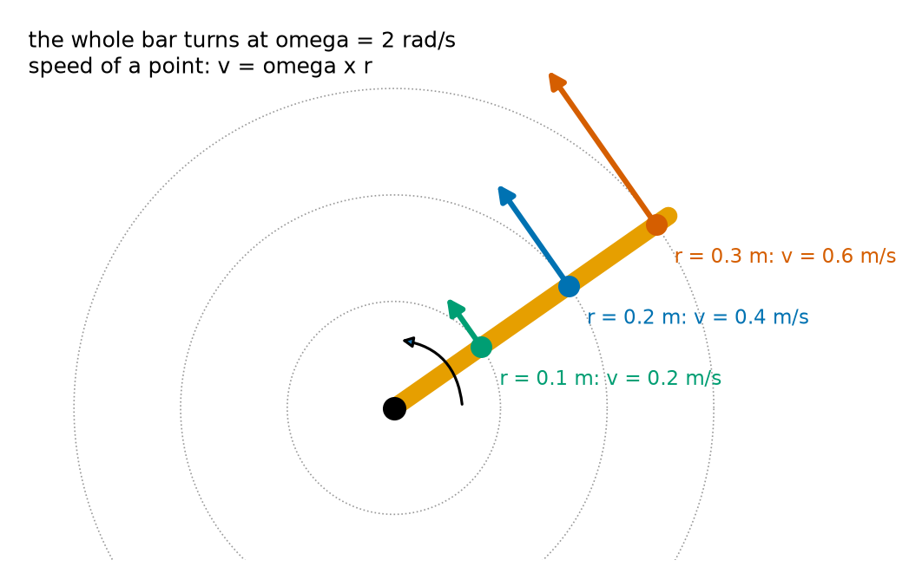
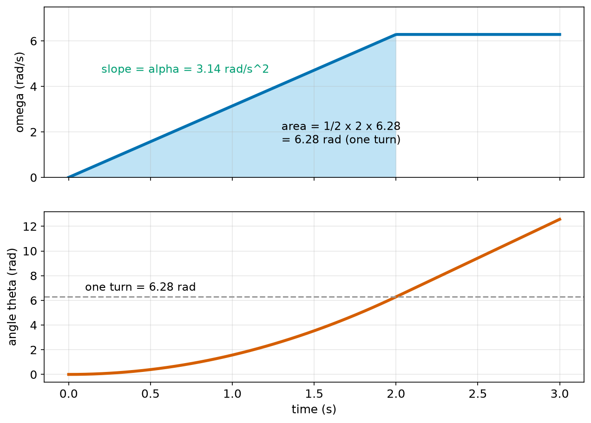
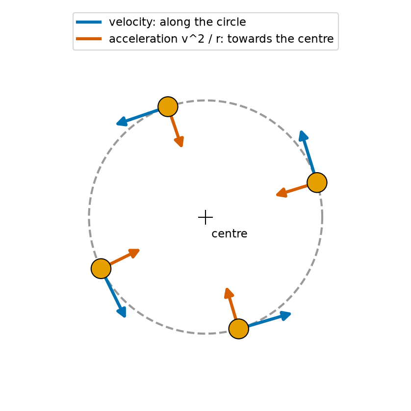
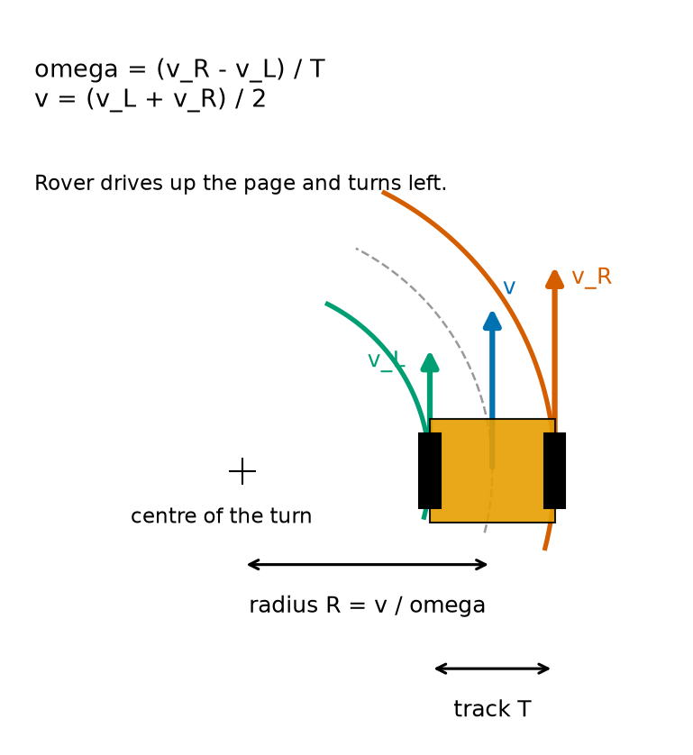
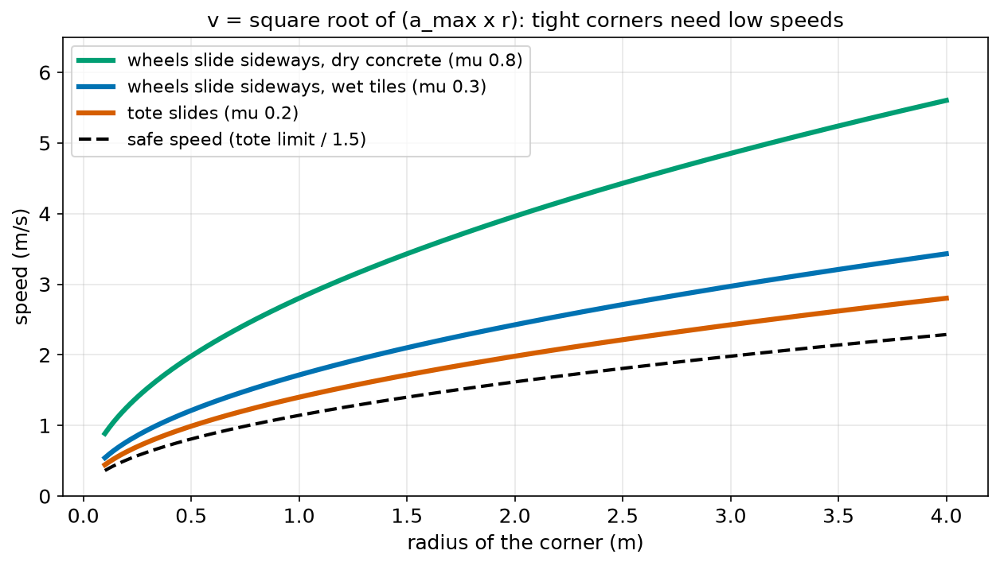

# Chapter 64 — Turning: Angle, Angular Speed, Angular Acceleration

> **Part 4 · Chapter 64 of 749**
> **You need:** Chapter 46 (Rover's wheel speeds), Chapter 47 (radians, v = ω r), Chapter 59 (equations of motion) and Chapter 63 (grip).
> **You will make:** a program for spinning things that speed up and slow down, a program that turns two wheel speeds into a turning radius (and back), and a program that finds how fast a robot may take a corner.

---

## What you will learn

- How to describe turning with **angle**, **angular speed** (ω) and **angular acceleration** (α).
- Why every turning quantity has a "straight-line twin", and why the equations of Chapter 59 work for turning too.
- Why points further from the centre of a turning object move faster: **v = ω r**.
- Why anything moving in a circle is **accelerating**, even at a steady speed: **a = v² / r**.
- How a two-wheeled robot turns, and how to work out its **turning radius**.
- How fast a robot can take a corner before its wheels or its load slide sideways.

---

## New words in this chapter

| Word | Simple meaning |
|---|---|
| **angular position (θ)** | Which way something points, as an angle in radians. |
| **angular displacement (Δθ)** | How much it has turned. |
| **angular speed (ω)** | How fast it turns: radians per second. ω is the Greek letter "omega". |
| **angular acceleration (α)** | How fast the turning speed changes: rad/s². α is the Greek letter "alpha". |
| **rpm** | Revolutions (whole turns) per minute. |
| **tangential speed** | The speed of a point on a turning object, along its circle. |
| **centripetal acceleration** | The acceleration towards the centre that every circling object has. |
| **turning radius** | The radius of the circle a robot drives along. |
| **turn rate** / **yaw rate** | A robot's angular speed about its vertical axis. |
| **differential drive** | A robot that steers by driving its left and right wheels at different speeds. |
| **turn on the spot** | Turning with zero forward speed: the wheels go at equal speeds in opposite directions. |

---

## 64.1 Turning has its own position, velocity and acceleration

So far in Part 4, everything moved along a line or across a floor. But robots also **turn**: wheels spin, arm joints rotate, Rover changes its heading, a drone yaws, a lidar sensor spins round and round. We need the same tools for turning as we had for moving.

The good news: there is nothing completely new. Every straight-line idea has a turning **twin**.

| Straight line | Unit | Turning | Unit |
|---|---|---|---|
| position x | m | angular position θ | rad |
| displacement Δx | m | angular displacement Δθ | rad |
| velocity v = Δx/Δt | m/s | angular speed ω = Δθ/Δt | rad/s |
| acceleration a = Δv/Δt | m/s² | angular acceleration α = Δω/Δt | rad/s² |

📖 **New word: angular position (θ)** — which way an object points, as an angle. We measure it in **radians** (Chapter 47), from a chosen starting direction, with **anticlockwise as positive** (Chapter 50).

📖 **New word: angular displacement (Δθ)** — how much an object has turned: end angle minus start angle.

⚠️ **Watch out.** Unlike positions on a line, angles **wrap around**: turning by 2π rad (360°) brings you back to the same direction. For a wheel's total angle, we do **not** wrap (a wheel that has turned 10 times has turned 20π rad, and that tells us how far it rolled). For a robot's heading, we usually **do** wrap, to keep it between −π and π (Chapter 50).

---

## 64.2 Angular speed

📖 **New word: angular speed (ω)** — how fast something turns: the angle turned per second.

```
ω = Δθ / Δt          (rad/s)
```

In words: "omega equals the change in angle divided by the change in time".

Chapter 47 already used this to turn wheel rpm into rad/s.

📖 **New word: rpm** — revolutions per minute: how many whole turns in a minute. Motors are usually rated in rpm.

```
ω (rad/s) = rpm × 2π / 60
```

One revolution is 2π rad, and one minute is 60 s.

🔢 **Maths.**

| Thing | rpm | ω (rad/s) |
|---|---|---|
| clock's second hand | 1 | 0.105 |
| Rover's wheel at 0.3 m/s | 87 | 9.1 |
| a turntable | 60 | 6.28 |
| a spinning lidar at 10 turns per second | 600 | 62.8 |
| a small drone propeller | about 15,000 | about 1,570 |

🤖 **Robot link.** A robot's **turn rate** (also called **yaw rate**) is its angular speed about its vertical axis. A gyroscope (Chapter 125) measures it directly, in rad/s or degrees per second.

📖 **New word: turn rate** (or **yaw rate**) — how fast a robot's heading changes.

---

## 64.3 v = ω r: the speed of a point on a turning object

Chapter 47 showed that a wheel of radius r turning through an angle θ rolls a distance r θ (arc length). Divide by the time, and you get:

```
v = ω × r
```

In words: "the speed of a point equals the angular speed times its distance from the centre".

📖 **New word: tangential speed** — the speed of a point on a turning object. Its direction is along the circle the point follows ("tangential" means "along the tangent", the line that just touches the circle, Chapter 57).

The important new idea: **everything on a turning object has the same ω, but different speeds**. Points far from the centre travel a bigger circle in the same time, so they move faster.



*Figure 64.1 — The whole bar turns at 2 rad/s. Points further out move faster.*

**How to read this picture:** An orange bar turns about the black dot, anticlockwise, at ω = 2 rad/s. Three points on it are marked. Each arrow shows that point's velocity: along its own circle (grey dotted). The green point, 0.1 m from the centre, moves at 2 × 0.1 = 0.2 m/s. The blue point at 0.2 m moves at 0.4 m/s. The red point at 0.3 m moves at 0.6 m/s. Three times as far out, three times as fast.

🤖 **Robot link.** This is why the tip of a robot arm can move very fast even when its joints turn slowly. A 1 m arm with its shoulder turning at 2 rad/s (only 19 rpm) moves its gripper at 2 m/s. That is why arm speed limits near people (Chapter 57's 0.25 m/s) are about the **tip**, not the joints. Chapter 356 works out an arm tip's velocity from all its joints.

---

## 64.4 Angular acceleration and the equations of motion for turning

📖 **New word: angular acceleration (α)** — how fast the angular speed changes.

```
α = Δω / Δt          (rad/s²)
```

**Small example.** A turntable speeds up from rest to 60 rpm (6.283 rad/s) in 2 s. α = 6.283 / 2 = 3.142 rad/s².

Because turning quantities are exact twins of straight-line ones, **the equations of motion of Chapter 59 work for turning too**, with θ for s, ω for v and α for a:

| Straight line (Chapter 59) | Turning |
|---|---|
| v = u + a t | ω = ω₀ + α t |
| s = (u + v)/2 × t | Δθ = (ω₀ + ω)/2 × t |
| s = u t + ½ a t² | Δθ = ω₀ t + ½ α t² |
| v² = u² + 2 a s | ω² = ω₀² + 2 α Δθ |

ω₀ is the starting angular speed (the twin of u).

🔢 **Maths.** How far does the turntable turn while it speeds up?

```
Δθ = ½ × 3.142 × 2² = 6.283 rad = 360° = exactly one turn
```



*Figure 64.2 — Top: angular speed. Bottom: angle. They are linked by slopes and areas, exactly as in Chapters 57 and 58.*

**How to read this picture:** The top graph is ω against time. It rises in a straight line for 2 s (slope α = 3.14 rad/s²), then stays at 6.28 rad/s. The blue area under it during the first 2 s is a triangle: ½ × 2 × 6.28 = 6.28 rad, one full turn. The bottom graph is the angle θ. It curves upwards while the turntable speeds up (a parabola, like Chapter 59's), then rises in a straight line at a steady 6.28 rad/s. It crosses "one turn" exactly at 2 s.

### The tip also accelerates along its circle

If ω changes, the speed v = ω r of every point changes too. The point's acceleration **along** its circle is

```
a_t = α × r
```

In words: "the tangential acceleration equals the angular acceleration times the radius". A gripper 0.8 m from a shoulder that speeds up at 5 rad/s² accelerates along its circle at 4 m/s²: enough to make a held part slip, if the gripper is weak (Chapter 63).

### Turning in a set time, with limits

Rover often has to turn on the spot to face a new direction. Its controller limits the turn rate (to 2 rad/s, so the camera image is not blurred) and the angular acceleration (to 4 rad/s², so the wheels do not slip). How long does a 180° turn take? This is Chapter 59's trapezoid move, in angles:

```
ramp angle = ω_max² / α_max = 2² / 4 = 1 rad   (speeding up and slowing down together)
π rad (180°) ≥ 1 rad, so a trapezoid:
time = 2 × ω_max / α_max + (π − 1) / ω_max = 1 + 1.071 = 2.071 s
```

---

## 64.5 Moving in a circle is accelerating

Here is a surprise. A robot drives round a circular track at a steady 1 m/s. Is it accelerating?

Its **speed** is steady. But its **velocity** is a vector (Chapter 60), with a direction, and the direction keeps changing. A change in velocity is an acceleration (Chapter 58). So yes: anything moving in a circle is accelerating, all the time.

Which way? The velocity keeps turning **towards the centre** of the circle, so the acceleration points towards the centre.

📖 **New word: centripetal acceleration** — the acceleration towards the centre that every object moving in a circle has. ("Centripetal" is Latin for "centre-seeking".)

```
a = v² / r = ω² × r
```

In words: "the centripetal acceleration equals the speed squared divided by the radius", or equally "omega squared times the radius". (The two forms agree because v = ω r.)



*Figure 64.3 — The velocity (blue) is always along the circle. The acceleration (red) always points to the centre.*

**How to read this picture:** An object (orange) moves anticlockwise round the grey dashed circle at a steady speed. At four moments, the blue arrow shows its velocity: always along the circle, at right angles to the line to the centre. The red arrow shows its acceleration: always pointing straight at the centre. The velocity keeps the same length, but its direction keeps turning, and the red acceleration is what turns it.

Why v² / r? Two reasons together. Faster: the direction must change more quickly **and** each change is bigger, so v appears twice. Tighter circle (smaller r): the direction turns more quickly, so r is underneath. A full proof uses vectors (Chapter 328).

🔢 **Maths.** A point on the turntable's rim, 0.2 m from the centre at 6.283 rad/s:

```
a = ω² r = 6.283² × 0.2 = 7.90 m/s²   (almost 0.8 g)
```

That is why a coin on the edge of a fast turntable flies off: friction (Chapter 63) cannot give it 7.9 m/s² of sideways push.

### Where does the sideways force come from?

By Newton's second law (Chapter 61), a centripetal acceleration needs a **force towards the centre**: m v² / r. Something must provide it:

- for a car or a wheeled robot turning, **sideways friction** between the tyres and the floor;
- for a ball on a string, the **tension** in the string;
- for the space station, **gravity** (Chapter 62's orbit).

If nothing provides it, there is no circle: the object goes straight on (Newton's first law). That is what happens when a robot takes a corner too fast on a slippery floor: its wheels cannot give the sideways force, and it slides outwards.

⚠️ **Watch out.** People often say they are "thrown outwards" in a turning car. Nothing throws them. Their body tries to go **straight** (inertia), while the car turns under them. The only real force is the door or seat pushing them **inwards**.

---

## 64.6 How a two-wheeled robot turns

Rover has two driven wheels, one on each side, and no steering. It turns by driving them at **different speeds**.

📖 **New word: differential drive** — steering by driving the left and right wheels at different speeds. Most small robots, robot vacuums and many warehouse robots work this way.

Chapter 46 found the two formulas by solving two equations. Let the left wheel move at v_L, the right wheel at v_R, and the distance between them (the **track**) be T:

```
forward speed   v = (v_L + v_R) / 2
turn rate       ω = (v_R − v_L) / T
```

In words: "the forward speed is the average of the two wheel speeds; the turn rate is their difference divided by the track". Anticlockwise (turning left) is positive, so a faster right wheel turns the robot left.

📖 **New word: turning radius** — the radius of the circle the middle of the robot follows. From v = ω R:

```
R = v / ω
```



*Figure 64.4 — Rover drives up the page and turns left, around the centre marked +.*

**How to read this picture:** The orange box is Rover, seen from above, driving up the page and turning left. The black + on the left is the centre of its turn. The middle of Rover follows the grey dashed circle, of radius R. The right wheel is further from the centre, so it follows a bigger (red) circle and must go faster (the long red arrow v_R). The left wheel follows a smaller (green) circle and goes slower (green arrow v_L). The middle moves at v (blue), the average of the two.

### Special cases

| Wheel speeds | What happens |
|---|---|
| v_L = v_R | straight line: ω = 0, R is infinite |
| v_R a bit faster than v_L | a gentle left turn: large R |
| v_L = 0 | turns around the left wheel: R = T/2 |
| v_L = −v_R | **turns on the spot**: v = 0, R = 0 |

📖 **New word: turn on the spot** — turning with no forward motion, wheels going at equal speeds in opposite directions. This is the big advantage of differential drive over car-like steering: it can face any direction without moving.

### Going the other way: wheels for a corner

To drive at speed v around a corner of radius R:

```
ω = v / R
v_L = v − ω T / 2
v_R = v + ω T / 2
```

The Code section does both directions.

---

## Code

File `code/ch064/spin.py`:

```python
# spin.py - angular speed and angular acceleration: the turning versions of Chapter 59's equations
import math

# a turntable speeds up from rest to 60 rpm in 2 s
omega_end = 60 * 2 * math.pi / 60            # rpm -> rad/s
alpha = (omega_end - 0) / 2.0                 # angular acceleration, rad/s^2
angle = 0.5 * alpha * 2.0 ** 2                # theta = 1/2 alpha t^2, like s = 1/2 a t^2
print(f"60 rpm = {omega_end:.3f} rad/s, alpha = {alpha:.3f} rad/s^2")
print(f"in 2 s it turns {angle:.3f} rad = {math.degrees(angle):.0f} deg = {angle / (2 * math.pi):.1f} turns")

# points on the turntable at different distances from the centre
for r in [0.05, 0.10, 0.20]:
    print(f"  point {r:.2f} m from the centre: speed {omega_end * r:.3f} m/s, "
          f"sideways (centripetal) acceleration {omega_end ** 2 * r:.2f} m/s^2")

# Rover turns on the spot by 180 deg, with its turn rate limited to 2 rad/s and alpha to 4 rad/s^2
TURN = math.pi
W_MAX, A_MAX = 2.0, 4.0
ramp_angle = W_MAX ** 2 / A_MAX                # speeding up plus slowing down (Chapter 59, in angles)
if TURN >= ramp_angle:
    t = 2 * W_MAX / A_MAX + (TURN - ramp_angle) / W_MAX
else:
    t = 2 * math.sqrt(TURN / A_MAX)
print(f"a 180 deg turn on the spot takes {t:.3f} s")
```

| Line | Code | What it does (simple English) |
|---|---|---|
| 1 | `# spin.py …` | A comment. |
| 2 | `import math` | For π, `degrees` and `sqrt`. |
| 3 | (blank) | Spacing. |
| 4 | `# a turntable …` | A comment that says what the next lines do. |
| 5 | `omega_end = 60 * 2 * math.pi / 60` | 60 rpm in rad/s: rpm × 2π / 60. |
| 6 | `alpha = (omega_end - 0) / 2.0` | α = Δω / Δt. |
| 7 | `angle = 0.5 * alpha * 2.0 ** 2` | Δθ = ½ α t², the twin of s = ½ a t². |
| 8–9 | `print(…)` | ω, α and the angle in radians, degrees and turns. |
| 10 | (blank) | Spacing. |
| 11 | `# points on the turntable …` | A comment. |
| 12 | `for r in [0.05, 0.10, 0.20]:` | Three distances from the centre. |
| 13–14 | `print(f"…{omega_end * r:.3f}…" f"…{omega_end ** 2 * r:.2f}…")` | Speed v = ω r and centripetal acceleration ω² r. Two f-strings side by side are joined. |
| 15 | (blank) | Spacing. |
| 16 | `# Rover turns on the spot …` | A comment. |
| 17 | `TURN = math.pi` | 180° in radians. |
| 18 | `W_MAX, A_MAX = 2.0, 4.0` | The turn-rate limit and the angular-acceleration limit. |
| 19 | `ramp_angle = W_MAX ** 2 / A_MAX` | The angle used up by speeding up and slowing down: Chapter 59's v_max² / a, in angles. |
| 20 | `if TURN >= ramp_angle:` | Is there room to reach the top turn rate? |
| 21 | `t = 2 * W_MAX / A_MAX + (TURN - ramp_angle) / W_MAX` | Trapezoid: two ramps plus the cruise. |
| 22 | `else:` | Too short a turn. |
| 23 | `t = 2 * math.sqrt(TURN / A_MAX)` | Triangle: 2√(Δθ / α). |
| 24 | `print(f"a 180 deg turn …")` | The time. |

Output:

```
60 rpm = 6.283 rad/s, alpha = 3.142 rad/s^2
in 2 s it turns 6.283 rad = 360 deg = 1.0 turns
  point 0.05 m from the centre: speed 0.314 m/s, sideways (centripetal) acceleration 1.97 m/s^2
  point 0.10 m from the centre: speed 0.628 m/s, sideways (centripetal) acceleration 3.95 m/s^2
  point 0.20 m from the centre: speed 1.257 m/s, sideways (centripetal) acceleration 7.90 m/s^2
a 180 deg turn on the spot takes 2.071 s
```

Notice: doubling the distance from the centre doubles both the speed and the centripetal acceleration (at the same ω, a = ω² r grows in a straight line with r).

---

## Small examples

**Example 1.** 300 rpm = 300 × 2π / 60 = 31.4 rad/s.

**Example 2.** A wheel of radius 0.05 m at 20 rad/s rolls at 1 m/s.

**Example 3.** A joint speeds up from 0 to 3 rad/s in 0.5 s. α = 6 rad/s².

**Example 4.** A wheel at 10 rad/s brakes at 5 rad/s². It stops after 2 s, having turned 10 rad (½ × 10 × 2).

**Example 5.** A robot drives at 2 m/s round a circle of radius 4 m. a = 4 / 4 = 1 m/s² towards the centre.

**Example 6.** Wheels at 0.2 and 0.4 m/s, track 0.15 m. v = 0.3 m/s, ω = 1.33 rad/s, R = 0.225 m.

**Example 7.** Wheels at −0.1 and +0.1 m/s: v = 0, turn on the spot at ω = 0.2 / T.

**Example 8.** A gyro reads 90°/s. ω = π/2 = 1.571 rad/s. A full turn takes 4 s.

---

## 🏭 Real robot applications

### Application 1 (worked in full) — 🤖 Steering Rover with two wheels

**1. The real problem.** Rover's path planner says "drive at 0.4 m/s around a corner of radius 0.5 m". The motor controller only understands "left wheel speed" and "right wheel speed". We need to convert in both directions: from a wish (v, R) to wheel speeds, and from measured wheel speeds back to (v, ω, R), so Rover can check what it is really doing.

**2. Why this theory.** Differential drive (section 64.6): v = (v_L + v_R)/2, ω = (v_R − v_L)/T, R = v/ω, and the reverse formulas.

**3. The numbers.** Rover's track T = 0.15 m (Chapter 46). Some test wheel speeds, and corners of radius 2.0, 0.5, 0.2 and 0.075 m at 0.4 m/s.

**4. The maths.** For a 0.5 m corner at 0.4 m/s:

```
ω = 0.4 / 0.5 = 0.8 rad/s
v_L = 0.4 − 0.8 × 0.075 = 0.34 m/s
v_R = 0.4 + 0.8 × 0.075 = 0.46 m/s
```

**5. The code.** File `code/ch064/turn_radius.py`:

```python
# turn_radius.py - a two-wheeled robot turns by driving its wheels at different speeds
TRACK_M = 0.15           # distance between Rover's wheels (Chapter 46)


def body_motion(v_left, v_right):
    """Forward speed, turn rate and turning radius from the two wheel speeds."""
    v = (v_left + v_right) / 2
    omega = (v_right - v_left) / TRACK_M          # anticlockwise is positive
    radius = v / omega if omega != 0 else float("inf")
    return v, omega, radius


def wheels_for(v, radius):
    """Wheel speeds to drive at v around a circle of the given radius (positive = turning left)."""
    omega = v / radius
    return v - omega * TRACK_M / 2, v + omega * TRACK_M / 2


for left, right in [(0.30, 0.30), (0.225, 0.375), (0.20, 0.40), (0.0, 0.30), (-0.15, 0.15)]:
    v, w, R = body_motion(left, right)
    print(f"wheels L {left:+.3f} R {right:+.3f} m/s -> v {v:.3f} m/s, omega {w:+.2f} rad/s, radius {R:.3f} m")

print("to drive at 0.4 m/s round a corner:")
for radius in [2.0, 0.5, 0.2, 0.075]:
    l, r = wheels_for(0.4, radius)
    print(f"  radius {radius:5.3f} m: left {l:.3f} m/s, right {r:.3f} m/s")
```

| Line | Code | What it does (simple English) |
|---|---|---|
| 1 | `# turn_radius.py …` | A comment. |
| 2 | `TRACK_M = 0.15` | Rover's track. |
| 3–4 | (blank) | Spacing. |
| 5 | `def body_motion(v_left, v_right):` | From wheel speeds to the robot's motion. |
| 6 | `"""…"""` | The docstring. |
| 7 | `v = (v_left + v_right) / 2` | The average: forward speed. |
| 8 | `omega = (v_right - v_left) / TRACK_M` | The difference over the track: turn rate. |
| 9 | `radius = v / omega if omega != 0 else float("inf")` | R = v / ω. Driving straight (ω = 0) would divide by zero, so we return infinity: `float("inf")` is Python's "infinitely big". |
| 10 | `return v, omega, radius` | Three results. |
| 11–12 | (blank) | Spacing. |
| 13 | `def wheels_for(v, radius):` | The other direction: from a wish to wheel speeds. |
| 14 | `"""…"""` | The docstring. |
| 15 | `omega = v / radius` | ω = v / R. |
| 16 | `return v - omega * TRACK_M / 2, v + omega * TRACK_M / 2` | Each wheel is T/2 from the middle: slower on the inside, faster on the outside. |
| 17–18 | (blank) | Spacing. |
| 19 | `for left, right in [(0.30, 0.30), …]:` | Some test pairs. The second pair is Chapter 46's (0.3 m/s, 1.0 rad/s). |
| 20 | `v, w, R = body_motion(left, right)` | Unpacks the three results. |
| 21 | `print(f"wheels …")` | One line per pair. |
| 22 | (blank) | Spacing. |
| 23 | `print("to drive at 0.4 m/s …")` | A heading. |
| 24 | `for radius in [2.0, 0.5, 0.2, 0.075]:` | From a gentle bend to a very tight one. |
| 25 | `l, r = wheels_for(0.4, radius)` | The two wheel speeds. |
| 26 | `print(f"  radius …")` | The result. |

Output:

```
wheels L +0.300 R +0.300 m/s -> v 0.300 m/s, omega +0.00 rad/s, radius inf m
wheels L +0.225 R +0.375 m/s -> v 0.300 m/s, omega +1.00 rad/s, radius 0.300 m
wheels L +0.200 R +0.400 m/s -> v 0.300 m/s, omega +1.33 rad/s, radius 0.225 m
wheels L +0.000 R +0.300 m/s -> v 0.150 m/s, omega +2.00 rad/s, radius 0.075 m
wheels L -0.150 R +0.150 m/s -> v 0.000 m/s, omega +2.00 rad/s, radius 0.000 m
to drive at 0.4 m/s round a corner:
  radius 2.000 m: left 0.385 m/s, right 0.415 m/s
  radius 0.500 m: left 0.340 m/s, right 0.460 m/s
  radius 0.200 m: left 0.250 m/s, right 0.550 m/s
  radius 0.075 m: left 0.000 m/s, right 0.800 m/s
```

**6. The result.** The conversions agree with Chapter 46 (0.225 and 0.375 m/s give 0.3 m/s and 1 rad/s). A gentle 2 m bend needs wheel speeds only 0.03 m/s apart. A tight 0.075 m corner (half the track) needs the inner wheel to stop and the outer wheel to go at **twice** the robot's speed, 0.8 m/s. If Rover's motors can only reach 0.6 m/s, the controller must slow the whole robot down for tight corners, keeping the ratio of the wheel speeds. And turning on the spot (the last test pair) has radius 0.

**7. Going further.** Adding up these motions over time gives the robot's position and heading from its encoders: 2D odometry (Chapter 288). Differential drive is studied fully in Part 15 (Chapters 285 and 286), and Chapter 301 compares it with car-like (Ackermann) steering, which cannot turn on the spot.

### Application 2 (worked in full) — 🧺 How fast may the robot take a corner?

**1. The real problem.** Chapter 63's warehouse robot carries a tote at up to 1.5 m/s. In aisles it turns corners of different radii. On a corner, the robot (and the tote) need a sideways, centripetal acceleration of v² / r. If that is more than the wheels' grip, the robot slides outwards; if it is more than the tote's grip, the tote slides off sideways. What is the safe speed for each corner?

**2. Why this theory.** Centripetal acceleration a = v² / r (section 64.5) must come from friction, which can give at most μ g (Chapter 63). So v² / r ≤ μ g, which gives

```
v_max = √(μ g r)
```

The robot must respect the smaller of the floor's μ and the tote's μ, and a safety factor.

**3. The numbers.** Floors: dry concrete μ = 0.8, wet tiles μ = 0.3. Tote on steel μ = 0.2. Safety factor 1.5 on the acceleration. Corners of radius 0.5, 1, 2 and 4 m.

**4. The maths.** For a 1 m corner with the tote:

```
tote limit: v = √(0.2 × 9.81 × 1) = 1.40 m/s
with safety factor 1.5: v = √(0.2 × 9.81 / 1.5 × 1) = 1.14 m/s
```

**5. The code.** File `code/ch064/cornering.py`:

```python
# cornering.py - how fast may a robot take a corner before its wheels or its load slide sideways?
import math

G = 9.81
FLOOR_MU = {"dry concrete": 0.8, "wet tiles": 0.3}
TOTE_MU = 0.2
SAFETY = 1.5

print("radius   floor          wheels slide above   tote slides above   safe speed")
for radius in [0.5, 1.0, 2.0, 4.0]:
    for floor, mu in FLOOR_MU.items():
        v_wheels = math.sqrt(mu * G * radius)                # mu g = v^2 / r
        v_tote = math.sqrt(TOTE_MU * G * radius)
        v_safe = math.sqrt(min(mu, TOTE_MU) * G / SAFETY * radius)
        print(f"{radius:5.1f} m  {floor:13s}  {v_wheels:10.2f} m/s   {v_tote:12.2f} m/s   {v_safe:8.2f} m/s")
```

| Line | Code | What it does (simple English) |
|---|---|---|
| 1 | `# cornering.py …` | A comment. |
| 2 | `import math` | For `sqrt`. |
| 3 | (blank) | Spacing. |
| 4–7 | `G`, `FLOOR_MU`, `TOTE_MU`, `SAFETY` | The numbers. |
| 8 | (blank) | Spacing. |
| 9 | `print("radius …")` | The heading. |
| 10 | `for radius in [0.5, 1.0, 2.0, 4.0]:` | Each corner… |
| 11 | `for floor, mu in FLOOR_MU.items():` | …on each floor: a loop inside a loop (Chapter 20). |
| 12 | `v_wheels = math.sqrt(mu * G * radius)` | From μ g = v² / r. |
| 13 | `v_tote = math.sqrt(TOTE_MU * G * radius)` | The same, with the tote's μ. |
| 14 | `v_safe = math.sqrt(min(mu, TOTE_MU) * G / SAFETY * radius)` | The smaller μ, with the acceleration divided by the safety factor. |
| 15 | `print(f"…")` | One row. |

Output:

```
radius   floor          wheels slide above   tote slides above   safe speed
  0.5 m  dry concrete         1.98 m/s           0.99 m/s       0.81 m/s
  0.5 m  wet tiles            1.21 m/s           0.99 m/s       0.81 m/s
  1.0 m  dry concrete         2.80 m/s           1.40 m/s       1.14 m/s
  1.0 m  wet tiles            1.72 m/s           1.40 m/s       1.14 m/s
  2.0 m  dry concrete         3.96 m/s           1.98 m/s       1.62 m/s
  2.0 m  wet tiles            2.43 m/s           1.98 m/s       1.62 m/s
  4.0 m  dry concrete         5.60 m/s           2.80 m/s       2.29 m/s
  4.0 m  wet tiles            3.43 m/s           2.80 m/s       2.29 m/s
```



*Figure 64.5 — The fastest speed for a corner grows with the square root of its radius.*

**How to read this picture:** Across the bottom is the radius of the corner, up the side the speed. Each curve is a limit: green for the wheels on dry concrete, blue for the wheels on wet tiles, red for the tote. The black dashed line is the safe speed. All curves rise steeply for small radii and then more slowly: four times the radius allows only twice the speed (square root, Chapter 38). The tote's curve is the lowest, so it decides.

**6. The result.** The robot may drive its full 1.5 m/s only on corners of about 2 m radius or more. On a 1 m corner it must slow to 1.14 m/s, and on a tight 0.5 m corner to 0.81 m/s. Again, as in Chapter 63, the tote, not the floor, sets the limit, so the safe speed is the same on dry and wet floors here. The path planner should prefer wide curves: a corner of twice the radius can be taken about 1.4 times faster.

**7. Going further.** Tall robots may **tip over** sideways in a fast corner before anything slides; Chapter 70 adds that limit. Real planners also limit how quickly the curvature changes, so the sideways acceleration builds up smoothly (like Chapter 58's jerk). Chapter 471 plans speeds along a path with all these limits, and Chapter 306 tracks such paths.

### Application 3 — 🦾 A robot arm's tip speed

A pick-and-place arm has a 0.9 m reach. Its shoulder motor turns at up to 3 rad/s and accelerates at up to 10 rad/s². The tip can therefore move at up to 3 × 0.9 = 2.7 m/s, and accelerate along its circle at up to 10 × 0.9 = 9 m/s². At full turning speed, the tip also has a centripetal acceleration of 3² × 0.9 = 8.1 m/s² towards the shoulder. A part in the gripper feels both: √(9² + 8.1²) = 12.1 m/s² in total, more than 1 g. Chapter 63's gripper formula must use this, not just g. This is why fast arms either squeeze hard or slow down when they carry fragile or slippery parts.

### Application 4 — 📡 A spinning lidar's angle steps

A 2D lidar spins at 10 turns per second (ω = 62.8 rad/s) and measures a distance 7,200 times per second. Between two measurements it turns 62.8 / 7,200 = 0.00873 rad = 0.5°. So each turn gives 720 measurements, one every 0.5°. At 10 m, neighbouring measurement points are 10 × 0.00873 = 0.087 m apart (arc length, Chapter 47): a 5 cm pole might fall between two beams. Spinning slower (5 turns per second) halves the step to 0.25° but halves how often the map is updated. Chapter 49's scan-to-map program used exactly these angles. Chapter 132 looks at lidars in detail.

### Application 5 — 🚁 A drone's yaw

A quadcopter turns about its vertical axis (yaws) by speeding up two of its propellers and slowing the other two (Chapter 623 explains why). Drone flight controllers limit the yaw rate, for example to 200°/s (3.49 rad/s), and the yaw acceleration. A pilot asks for a 90° turn: if the yaw acceleration is limited to 10 rad/s², the ramp angle is 3.49² / 10 = 1.22 rad. That is less than the 1.571 rad of the turn, so the move is a trapezoid, and it takes 2 × 0.349 + (1.571 − 1.22) / 3.49 = 0.80 s. Drones yaw slowly compared with how fast they tilt, because the yaw "push" from the propellers is weak (Chapter 66 explains why turning a drone about its vertical axis is hard).

---

## 🔧 Hands-on lab

### Lab 64.1 — Measure ω and v on a turning wheel (hardware)

You need a bicycle wheel turned upside down (or a spinning office chair, or a turntable), a piece of tape, a phone stopwatch, and a tape measure.

1. Stick a piece of tape on the wheel's rim.
2. Spin the wheel at a steady speed. Count how many turns it makes in 10 s.
3. Work out rpm and ω in rad/s.
4. Measure the rim's radius. Work out the rim's speed v = ω r.
5. Stick a second piece of tape halfway between the centre and the rim. What is its speed?

**What you should see:** For a gentle spin of 1 turn per second, ω = 6.28 rad/s; a bicycle rim of radius 0.33 m then moves at about 2.1 m/s. The halfway tape has the same ω but half the speed. Both pieces take the same time per turn.

| If it does not work | Likely cause | Fix |
|---|---|---|
| The count changes each time | The wheel slows down (friction) | Count for a shorter time, just after a spin |
| ω is 60 times too big | You used rpm directly | ω = rpm × 2π / 60 |

**Challenge:** Let the wheel slow down by itself. Count turns in each 5 s. Find α from the change in ω. Is it roughly constant?

### Lab 64.2 — Draw Rover's turns (simulation)

Use `turn_radius.py` and Chapter 33's plotting.

1. Write a loop that moves Rover in small steps of dt = 0.05 s. Each step: heading += ω × dt; x += v cos(heading) × dt; y += v sin(heading) × dt.
2. Drive with wheel speeds (0.2, 0.4) for 5 s and plot the path.
3. Check that the path is a circle of radius 0.225 m, as `body_motion` predicts.
4. Try (0.4, 0.2), and (−0.15, 0.15).

**What you should see:** (0.2, 0.4) gives a circle turning left, radius about 0.225 m; after 5 s at 1.33 rad/s it has turned 6.67 rad, a little more than one full circle. (0.4, 0.2) gives the same circle turning right. (−0.15, 0.15) stays on one spot and only turns.

| If it does not work | Likely cause | Fix |
|---|---|---|
| The path is a straight line | ω is not added to the heading | Update the heading every step |
| The circle slowly spirals outwards | dt is large (Chapter 71 explains) | Make dt smaller, or update the heading in the middle of the step |
| The robot turns the wrong way | The sign of ω | ω = (v_R − v_L) / T; left turns are positive |

**Challenge:** Drive a figure-of-eight by switching the wheel speeds halfway.

### Lab 64.3 — A coin on a turntable (hardware or thought experiment)

You need a record player or a lazy Susan (a turning tray) and some coins, or do it on paper.

1. Put coins at 5 cm, 10 cm and 15 cm from the centre.
2. Slowly spin faster. Which coin slides off first?
3. Measure μ for a coin on the tray with Chapter 63's tilt test.
4. Predict the turn rate at which each coin slides: ω² r = μ g, so ω = √(μ g / r).

**What you should see:** The outer coin slides first, because it needs the biggest centripetal acceleration (ω² r). With μ = 0.3, the coin at 15 cm slides at ω = √(0.3 × 9.81 / 0.15) = 4.43 rad/s (42 rpm), and the one at 5 cm only at 7.67 rad/s (73 rpm).

| If it does not work | Likely cause | Fix |
|---|---|---|
| The inner coin slides first | Uneven surface, or a bump when starting | Speed up gently and smoothly |
| The coins slide at once | Starting too suddenly: the tangential acceleration α r is too big | Speed up slowly |

**Challenge:** A robot vacuum's brush spins at 2,000 rpm with a radius of 4 cm. What centripetal acceleration does a bristle tip feel, in g?

---

## Common mistakes

⚠️ **Using degrees or rpm in v = ω r.** ω must be in **rad/s**.

⚠️ **Thinking every point of a turning object has the same speed.** They share ω, not v.

⚠️ **Thinking an object circling at a steady speed is not accelerating.** Its velocity's direction changes: a = v² / r towards the centre.

⚠️ **Thinking objects are "thrown outwards" in a turn.** They try to go straight. The real force points inwards.

⚠️ **Getting the sign of a differential-drive turn backwards.** With anticlockwise positive, ω = (v_R − v_L) / T.

⚠️ **Forgetting that tight corners at speed need big wheel-speed differences.** The outer wheel may need more speed than the motor can give.

⚠️ **Taking corners at straight-line speed.** The safe speed is √(μ g r).

---

## Practice

🏋️ **1.** Change 45 rpm to rad/s, and 10 rad/s to rpm.

🏋️ **2.** A wheel of diameter 0.12 m turns at 15 rad/s. How fast does the robot move?

🏋️ **3.** A motor speeds up from 0 to 120 rpm in 0.5 s. Find α, and how many turns it makes during that time.

🏋️ **4.** A robot arm joint turns at 1.5 rad/s. How fast does a point 0.6 m from the joint move?

🏋️ **5.** A robot drives round a circle of radius 1.5 m at 1.2 m/s. What is its centripetal acceleration? What force does a 20 kg robot need towards the centre?

🏋️ **6.** Rover's wheels go at 0.10 and 0.30 m/s (left, right), with T = 0.15 m. Find v, ω and R.

🏋️ **7.** Rover must drive at 0.3 m/s round a corner of radius 0.3 m. What are the wheel speeds?

🏋️ **8.** What is the fastest speed for a corner of radius 3 m on a floor with μ = 0.5 (no load)?

🏋️ **9.** A robot turns on the spot by 90° with ω_max = 1.5 rad/s and α_max = 3 rad/s². How long does it take?

🏋️ **10.** Why does a car (front-wheel steering) need more room to turn around than Rover?

🏋️ **11.** Write a function `corner_speed(radius, mu_floor, mu_load, max_wheel_speed, track)` that returns the safe speed for a corner: the smallest of √(min(μ) g r) and the speed at which the **outer** wheel reaches `max_wheel_speed`. Test it with radius 0.2 m, μ 0.8 and 0.2, max wheel speed 0.6 m/s, track 0.15 m.

---

## Answers

**1.** 45 × 2π / 60 = 4.71 rad/s. 10 × 60 / 2π = 95.5 rpm.

**2.** r = 0.06 m. v = 15 × 0.06 = 0.9 m/s.

**3.** 120 rpm = 12.57 rad/s. α = 25.1 rad/s². Δθ = ½ × 25.1 × 0.25 = 3.14 rad = 0.5 turns.

**4.** 1.5 × 0.6 = 0.9 m/s.

**5.** a = 1.44 / 1.5 = 0.96 m/s². F = 20 × 0.96 = 19.2 N.

**6.** v = 0.2 m/s. ω = 0.2 / 0.15 = 1.33 rad/s. R = 0.2 / 1.333 = 0.15 m.

**7.** ω = 1 rad/s. v_L = 0.3 − 0.075 = 0.225 m/s, v_R = 0.375 m/s.

**8.** √(0.5 × 9.81 × 3) = 3.84 m/s.

**9.** Ramp angle 1.5² / 3 = 0.75 rad ≤ 1.571 rad: trapezoid. t = 2 × 1.5 / 3 + (1.571 − 0.75) / 1.5 = 1 + 0.547 = 1.547 s.

**10.** A car's wheels cannot drive at opposite speeds, and its steering angle is limited, so it has a smallest turning radius (several metres). Rover can make R = 0 by driving its wheels in opposite directions.

**11.**

```python
import math

def corner_speed(radius, mu_floor, mu_load, max_wheel_speed, track):
    grip_speed = math.sqrt(min(mu_floor, mu_load) * 9.81 * radius)
    # outer wheel speed = v + (v / radius) * track / 2 = v * (1 + track / (2 * radius))
    wheel_speed_limit = max_wheel_speed / (1 + track / (2 * radius))
    return min(grip_speed, wheel_speed_limit)

print(round(corner_speed(0.2, 0.8, 0.2, 0.6, 0.15), 3))   # 0.436
```

The grip allows √(0.2 × 9.81 × 0.2) = 0.626 m/s, but the outer wheel would then need 0.626 × 1.375 = 0.86 m/s, more than 0.6. So the wheel speed sets the limit: 0.6 / 1.375 = 0.436 m/s.

---

## Summary

🧠 Turning has twins of every straight-line quantity: angle θ (rad), angular speed **ω** (rad/s), angular acceleration **α** (rad/s²). rpm × 2π / 60 = rad/s.

🧠 The equations of motion work for turning: ω = ω₀ + α t, Δθ = ω₀ t + ½ α t², ω² = ω₀² + 2 α Δθ.

🧠 All points on a turning object share ω, but a point at radius r moves at **v = ω r** and accelerates along its circle at **α r**.

🧠 Moving in a circle is accelerating: **a = v² / r = ω² r**, towards the centre. A force towards the centre (friction, tension, gravity) must provide it.

🧠 **Differential drive:** v = (v_L + v_R)/2, ω = (v_R − v_L)/T, R = v/ω. Equal and opposite wheel speeds turn the robot on the spot.

🧠 The safe cornering speed is **v = √(μ g r)**, using the smallest μ (floor or load), with a safety factor. Wide corners can be taken faster.

---

## Next chapter

In Chapter 65 we find out what makes things **start** turning. A force can push something along; to turn it, we need a **torque**. You will meet levers, see why a door handle is far from the hinges, and work out the torque a motor needs to hold a robot arm straight out.
