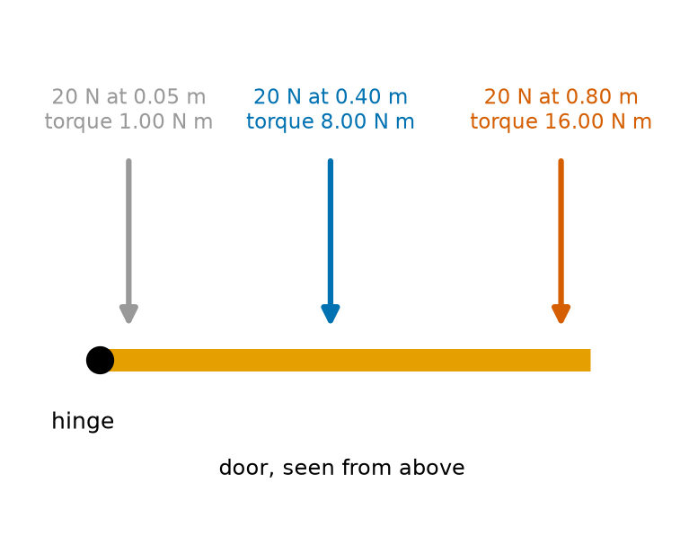
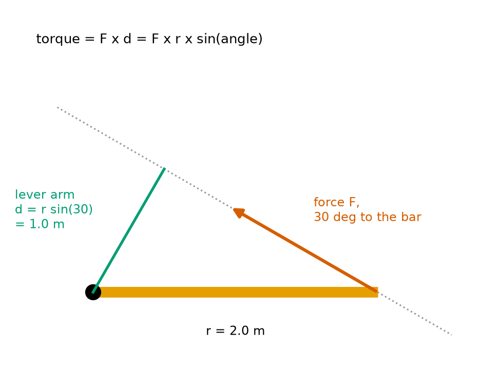
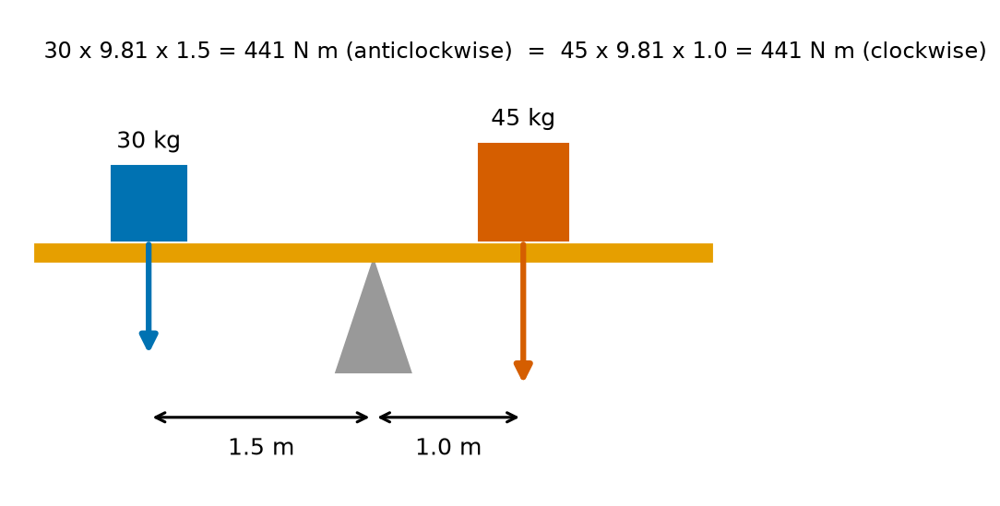
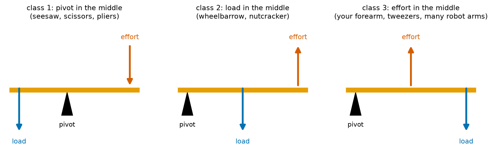
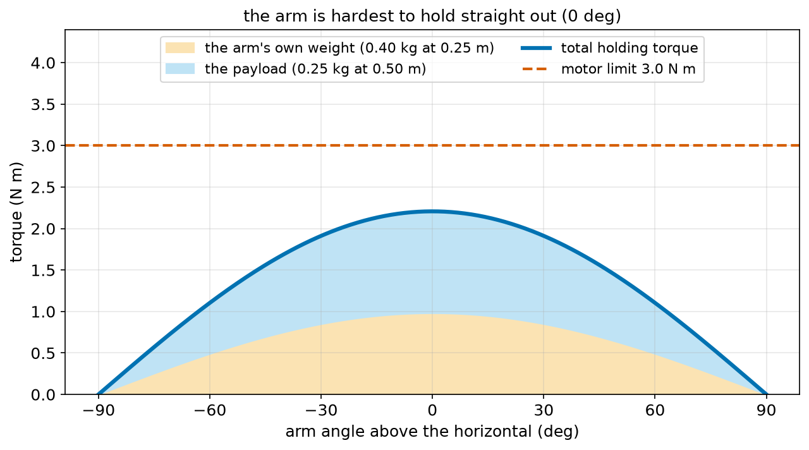
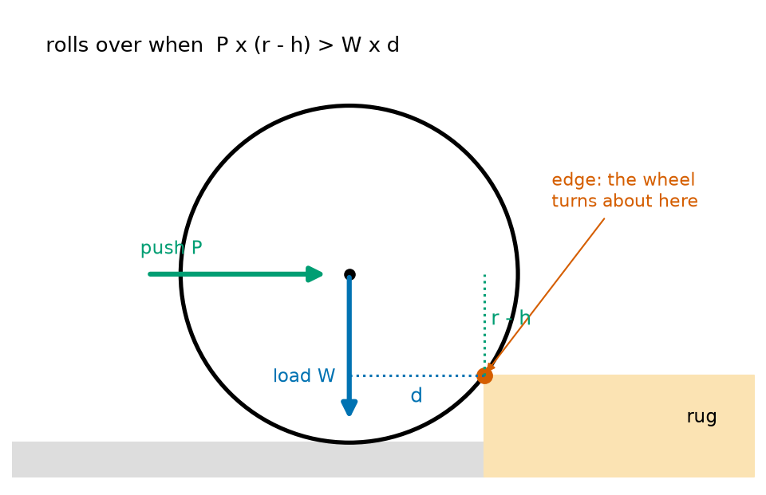

# Chapter 65 — Torque and Levers

> **Part 4 · Chapter 65 of 749**
> **You need:** Chapter 49 (sin, and the ramp robot), Chapter 61 (forces), Chapter 62 (weight) and Chapter 64 (turning).
> **You will make:** a program that works out torques for a door, a seesaw and a wheel; a program that finds the torque a shoulder motor needs to hold a robot arm, at any angle; and a program that checks whether a robot vacuum can climb onto a rug.

---

## What you will learn

- What **torque** is: the turning effect of a force.
- Why the **distance** from the pivot matters as much as the force: **torque = force × lever arm**.
- Why the **angle** of the force matters: torque = F × r × sin(angle).
- How to balance torques: the **principle of moments**.
- The three kinds of **lever**, and how levers trade force for distance.
- How a wheel turns a motor's torque into a push on the ground: **F = τ / r**.
- How much torque a robot arm needs to hold itself out, and why straight out is the hardest position.
- How a small wheel climbs a step, worked out with torques.

---

## New words in this chapter

| Word | Simple meaning |
|---|---|
| **torque (τ)** | The turning effect of a force. Measured in newton metres (N m). τ is the Greek letter "tau". |
| **pivot** | The point or axis something turns about. Also called the fulcrum. |
| **lever arm** | The shortest distance from the pivot to the line of the force. |
| **newton metre (N m)** | The unit of torque: 1 N pushing at 1 m from the pivot. |
| **moment** | Another word for torque, used especially when things balance. |
| **principle of moments** | For something that is not turning faster or slower, the clockwise torques equal the anticlockwise torques. |
| **lever** | A stiff bar that turns about a pivot, used to move a load with an effort. |
| **effort** / **load** | The force you apply / the force you are working against. |
| **mechanical advantage** | Load ÷ effort: how many times a lever (or gear) multiplies your force. |
| **holding torque** | The torque a joint motor needs to keep an arm still against gravity. |
| **stall torque** | The largest torque a motor can give, when it is held so it cannot turn. |

---

## 65.1 What makes things turn?

Try to open a heavy door by pushing right next to the hinges. It is very hard. Push the same door at the handle, far from the hinges, and it swings open easily. Same force, different result. To make something **turn**, it is not only **how hard** you push that matters, but **where**.

📖 **New word: torque (τ)** — the turning effect of a force.

📖 **New word: pivot** — the point (or the axis, the line) that something turns about: the hinges of a door, the axle of a wheel, the shaft of a motor, the joint of a robot arm.

🔢 **Maths.** When the force pushes at right angles to the line from the pivot:

```
torque = force × distance from the pivot
τ = F × r
```

In words: "torque equals force times the distance from the pivot".

📖 **New word: newton metre (N m)** — the unit of torque. 1 N m is the torque of a 1 N force pushing at right angles, 1 m from the pivot. (Written with a space, "N m", or a dot, "N·m".)



*Figure 65.1 — The same 20 N push gives very different torques at different distances from the hinge.*

**How to read this picture:** We look down on a door from above. The black dot is the hinge, the pivot. Three pushes of 20 N each act at right angles to the door. Near the hinge (0.05 m), the torque is only 20 × 0.05 = 1 N m. In the middle (0.40 m) it is 8 N m. At the handle (0.80 m) it is 16 N m: sixteen times as much as near the hinge.

That is why door handles are on the side away from the hinges, why spanners (wrenches) have long handles, and why a robot arm's shoulder must be much stronger than its wrist.

### The direction of a torque

Torques, like turning (Chapter 64), have a direction: they turn things **anticlockwise** or **clockwise**. We use the same sign rule as for angles (Chapter 50): **anticlockwise is positive**.

🔢 **Maths.** A 30 N force pushes up on the right end of a 0.5 m bar pivoted at its left end. That turns the bar anticlockwise: τ = +30 × 0.5 = +15 N m. The same force pushing down would give −15 N m.

---

## 65.2 The angle of the force: the lever arm

What if you push the door at a slant, not at right angles? Push it **along** the door, straight towards the hinge, and it does not turn at all, however hard you push. Push at a slant, and you get a part of the full effect.

📖 **New word: lever arm** — the shortest distance from the pivot to the **line** of the force (the line the force arrow lies on, extended in both directions). Also called the "moment arm".

```
torque = force × lever arm = F × d
```



*Figure 65.2 — The lever arm d is the distance from the pivot to the force's line, at right angles to it.*

**How to read this picture:** The orange bar is 2.0 m long, with its pivot (the black dot) on the left. A force F (red arrow) pushes on its right end, at 30° to the bar. The grey dotted line continues the line of the force. The green line goes from the pivot to that dotted line, meeting it at a right angle: that is the lever arm d. In the right-angled triangle formed by the bar, the green line and the dotted line, d = r × sin(30°) = 2.0 × 0.5 = 1.0 m (Chapter 49).

So the torque can also be written:

```
τ = F × r × sin(angle)
```

where the angle is between the bar (from the pivot to where the force acts) and the force.

| Angle between force and bar | sin | Torque from 20 N at 0.8 m |
|---|---|---|
| 90° (at right angles) | 1 | 16.0 N m (the most) |
| 60° | 0.866 | 13.9 N m |
| 30° | 0.5 | 8.0 N m |
| 0° (along the bar, towards the pivot) | 0 | 0 N m |

🤖 **Robot link.** This is why the force of **gravity** on a robot arm gives the biggest torque when the arm is **horizontal** (gravity then acts at right angles to the arm) and no torque when the arm points straight up or down (gravity acts along it). Section 65.6 uses this. Chapter 158 meets torque again as a 3D vector, using the "cross product".

---

## 65.3 Balancing torques: the principle of moments

Chapter 5 worked out a robot's centre of mass by adding up "mass × position", and called that product a **moment**. It promised you would meet it again here.

📖 **New word: moment** — another word for torque, used especially when talking about things that balance. "The moment of a force about a point" means "its torque about that point".

When something is not turning, or is turning at a steady rate, its angular acceleration is zero. Just as zero acceleration needs zero net force (Newton's first law, Chapter 61), zero angular acceleration needs **zero net torque**:

📖 **New word: principle of moments** — for an object that is balanced (not starting to turn), the total clockwise torque equals the total anticlockwise torque about any pivot.

```
Σ clockwise torques = Σ anticlockwise torques
```



*Figure 65.3 — A light child far from the pivot balances a heavy child closer in.*

**How to read this picture:** A seesaw is pivoted on the grey triangle. A 30 kg child sits 1.5 m to the left: their weight (blue arrow) turns the seesaw anticlockwise with 30 × 9.81 × 1.5 = 441 N m. A 45 kg child sits 1.0 m to the right: their weight (red) turns it clockwise with 45 × 9.81 × 1.0 = 441 N m. The torques are equal, so the seesaw balances.

🔢 **Maths.** Where must the 45 kg child sit? Set the torques equal:

```
30 × 9.81 × 1.5 = 45 × 9.81 × x
x = 30 × 1.5 / 45 = 1.0 m
```

The 9.81 cancels, so only "mass × distance" matters, which is exactly Chapter 5's moment.

🤖 **Robot link.** Cranes and big robot arms use **counterweights**: a heavy block on the other side of the pivot, so the motors only need to give the **difference** between the torques, not the whole load's torque. Some robot arms use springs in the same way (Chapter 385 looks at balancing gravity in arms).

---

## 65.4 Levers

📖 **New word: lever** — a stiff bar that turns about a pivot. It lets a force applied at one place move a load at another place.

📖 **New word: effort** — the force you apply. 📖 **load** — the force you are working against.

By the principle of moments, a lever balances when:

```
effort × effort's lever arm = load × load's lever arm
```

So if the effort is twice as far from the pivot as the load, you need only **half** the force. Levers multiply force.

📖 **New word: mechanical advantage** — load ÷ effort: how many times the lever multiplies your force. It equals (effort's lever arm) ÷ (load's lever arm).

**Small example.** A crowbar is 1.2 m long, with the pivot 0.1 m from the end under a heavy box. The effort's lever arm is 1.1 m, the load's 0.1 m. Mechanical advantage = 11. A push of 50 N can lift a load of 550 N.

### Nothing is free

If a lever multiplies force by 11, the effort end must move 11 times **further** than the load end, because they turn through the same angle (Chapter 64: distance = angle × radius). You trade distance for force. Chapter 67 shows that the **work** (force × distance) stays the same. Gears (Chapter 68) make the same trade, with speed and torque.

### Three kinds of lever



*Figure 65.4 — The three classes differ in what is in the middle: the pivot, the load or the effort.*

**How to read this picture:** Each orange bar is a lever, with its pivot (black triangle), its load (blue arrow) and its effort (red arrow). In class 1 the pivot is in the middle, like a seesaw: load and effort both push down, on opposite sides. In class 2 the load is in the middle, like a wheelbarrow: the effort at the end lifts. In class 3 the effort is in the middle, like your forearm: your biceps muscle pulls up close to the elbow, and the load is in your hand, far away.

| Class | In the middle | Mechanical advantage | Examples |
|---|---|---|---|
| 1 | pivot | more or less than 1 | seesaw, scissors, pliers, crowbar |
| 2 | load | always more than 1 (multiplies force) | wheelbarrow, nutcracker |
| 3 | effort | always less than 1 (multiplies distance and speed) | forearm, tweezers, fishing rod, many robot arms |

🤖 **Robot link.** Robot arms are usually class 3 levers: the motor sits at the joint, and the load is at the far end. That makes the tip move fast (good) but needs a big joint torque (bad). Grippers are often class 1 levers, designed so the fingers squeeze harder than the actuator pushes (Chapter 63's squeeze force).

---

## 65.5 Wheels: from torque to push

A motor gives a **torque** to its wheel. The wheel touches the ground at a distance r (its radius) from the axle. The ground pushes back on the tyre (Chapter 61's third law). So the push on the robot is:

```
F = τ / r
```

In words: "the push equals the wheel torque divided by the wheel radius". This is the step Chapter 49 and Chapter 61 used: 2.2 N m on a 0.08 m wheel gives 2.2 / 0.08 = 27.5 N.

🔢 **Maths.**

| Wheel radius | Push from 2.2 N m |
|---|---|
| 0.04 m | 55.0 N |
| 0.08 m | 27.5 N |
| 0.16 m | 13.8 N |

Small wheels push **harder** with the same torque. But a small wheel must also turn **faster** for the same robot speed (v = ω r, Chapter 64), and it climbs bumps less well (section 65.7). Choosing a wheel size is always a trade-off.

📖 **New word: stall torque** — the largest torque a motor can give, when it is held so that it cannot turn. It is usually printed on the motor's data sheet. A motor gives less torque as it spins faster (Chapter 138 explains).

🤖 **Robot link.** Chapter 37 said that a gearbox that makes a motor turn slower gives it more **torque**. A motor with 0.05 N m of torque and a 30:1 gearbox gives about 0.05 × 30 = 1.5 N m at the wheel (minus some loss to friction). Chapter 68 explains why.

---

## 65.6 Holding a robot arm against gravity

A robot arm sticking out sideways is like a heavy door that gravity tries to swing down. The shoulder motor must give a torque to stop it falling.

📖 **New word: holding torque** — the torque a joint motor must give to keep an arm still against gravity.

Two weights pull down on the arm:

1. **The payload** in the gripper, at the end: lever arm L (the arm's length).
2. **The arm's own weight**. If its mass is spread evenly, it acts as if it were all at the middle (the centre of mass, Chapter 70): lever arm L / 2.

When the arm is straight out (horizontal), gravity acts at right angles to it:

```
holding torque = m_payload × g × L  +  m_arm × g × L / 2
```

When the arm is raised by an angle θ above the horizontal, each weight's lever arm shrinks to (distance) × cos θ (the horizontal distance from the shoulder):

```
holding torque = (m_payload × L + m_arm × L / 2) × g × cos θ
```

At θ = 0° (straight out), cos θ = 1: the most torque. At θ = 90° (straight up), cos θ = 0: no torque at all, because gravity pulls straight along the arm.

🔢 **Maths.** A 0.5 m arm of mass 0.40 kg holds a 0.25 kg part, straight out:

```
payload: 0.25 × 9.81 × 0.50 = 1.226 N m
arm:     0.40 × 9.81 × 0.25 = 0.981 N m
total:                         2.207 N m
```



*Figure 65.5 — The torque needed to hold the arm is largest straight out and zero straight up or down.*

**How to read this picture:** Across the bottom is the arm's angle above the horizontal (negative means below). The orange area is the torque needed for the arm's own weight; the blue area on top is the extra for the payload. The total (blue line) follows a cosine curve (Chapter 50): 2.21 N m at 0°, falling to 0 at ±90°. The red dashed line is the motor's limit, 3.0 N m. The arm can be held at any angle, with the most margin when it points up or down.

⚠️ **Watch out.** The arm's own weight is often a big part of the torque, here 44% of it. Making an arm lighter (carbon fibre instead of steel, smaller motors further out) lets the same shoulder motor carry a bigger payload. That is why robot arm designers put the heavy motors as close to the base as they can.

---

## 65.7 Climbing a step, with torques

How does a wheel get over a bump? When a wheel of radius r meets a step of height h, it can no longer roll on the floor. Instead, it must **turn about the edge** of the step: the edge becomes the pivot.

Two forces try to turn the wheel about the edge:

- the **load** W on the wheel (its share of the robot's weight) pulls down through the axle, with a lever arm d (the horizontal distance from the edge to the axle). It tries to turn the wheel **back**, off the step;
- the **push** P at the axle (from the rest of the robot) acts horizontally, with a lever arm r − h (the height of the axle above the edge). It tries to turn the wheel **up**, onto the step.



*Figure 65.6 — The wheel turns about the edge. The push's torque must beat the load's torque.*

**How to read this picture:** The black circle is a small wheel, the black dot its axle. The orange block is a rug of height h. The red dot is the rug's edge, where the wheel touches it: the pivot. The green push P acts at the axle, at a height r − h above the edge (green dotted line). The blue load W acts down through the axle, at a horizontal distance d from the edge (blue dotted line). The wheel rolls onto the rug when P × (r − h) is bigger than W × d.

From the right-angled triangle formed by the edge, the axle and the point straight below the axle at the edge's height (Chapter 48):

```
d = √(r² − (r − h)²)
P needed = W × d / (r − h)
```

As h approaches r, (r − h) approaches 0, and the push needed grows enormously. A wheel cannot climb a step as high as its axle.

🤖 **Robot link.** This is why rough-terrain robots have **big** wheels, and why robot vacuums with tiny front wheels get stuck on rug edges and door strips. Application 2 works it out.

---

## Code

File `code/ch065/torque_basics.py`:

```python
# torque_basics.py - torque = force x lever arm, and balancing torques on a seesaw
import math

# pushing a door with 20 N at different distances from the hinges, at right angles
for r in [0.05, 0.40, 0.80]:
    print(f"20 N at {r:.2f} m from the hinge: torque {20 * r:5.2f} N m")

# the same 20 N at 0.80 m, but pushing at different angles to the door
for angle_deg in [90, 60, 30, 0]:
    torque = 20 * 0.80 * math.sin(math.radians(angle_deg))
    print(f"push at {angle_deg:2d} deg to the door: torque {torque:5.2f} N m")

# a seesaw: 30 kg child 1.5 m left of the pivot; where must a 45 kg child sit to balance?
G = 9.81
left_torque = 30 * G * 1.5                       # anticlockwise
right_distance = left_torque / (45 * G)          # clockwise must be equal
print(f"left child's torque {left_torque:.1f} N m, so the 45 kg child sits {right_distance:.2f} m right of the pivot")

# wheel torque and the push on the ground (Chapter 49 and Chapter 61)
WHEEL_TORQUE_NM = 2.2
for radius in [0.04, 0.08, 0.16]:
    print(f"2.2 N m on a wheel of radius {radius:.2f} m pushes with {WHEEL_TORQUE_NM / radius:5.1f} N")
```

| Line | Code | What it does (simple English) |
|---|---|---|
| 1 | `# torque_basics.py …` | A comment. |
| 2 | `import math` | For `sin` and `radians`. |
| 3 | (blank) | Spacing. |
| 4 | `# pushing a door …` | A comment for the first part. |
| 5 | `for r in [0.05, 0.40, 0.80]:` | Three distances from the hinge. |
| 6 | `print(f"… torque {20 * r:5.2f} N m")` | τ = F × r at right angles. |
| 7 | (blank) | Spacing. |
| 8 | `# the same 20 N …` | A comment. |
| 9 | `for angle_deg in [90, 60, 30, 0]:` | Four angles between the push and the door. |
| 10 | `torque = 20 * 0.80 * math.sin(math.radians(angle_deg))` | τ = F r sin(angle). |
| 11 | `print(f"push at …")` | Shows each one. |
| 12 | (blank) | Spacing. |
| 13 | `# a seesaw: …` | A comment that states the question. |
| 14 | `G = 9.81` | g. |
| 15 | `left_torque = 30 * G * 1.5` | The 30 kg child's weight times 1.5 m. |
| 16 | `right_distance = left_torque / (45 * G)` | The principle of moments, solved for the distance. |
| 17 | `print(f"left child's torque …")` | The answer. |
| 18 | (blank) | Spacing. |
| 19 | `# wheel torque …` | A comment. |
| 20 | `WHEEL_TORQUE_NM = 2.2` | The torque from Chapter 49. |
| 21 | `for radius in [0.04, 0.08, 0.16]:` | Three wheel sizes. |
| 22 | `print(f"… {WHEEL_TORQUE_NM / radius:5.1f} N")` | F = τ / r. |

Output:

```
20 N at 0.05 m from the hinge: torque  1.00 N m
20 N at 0.40 m from the hinge: torque  8.00 N m
20 N at 0.80 m from the hinge: torque 16.00 N m
push at 90 deg to the door: torque 16.00 N m
push at 60 deg to the door: torque 13.86 N m
push at 30 deg to the door: torque  8.00 N m
push at  0 deg to the door: torque  0.00 N m
left child's torque 441.5 N m, so the 45 kg child sits 1.00 m right of the pivot
2.2 N m on a wheel of radius 0.04 m pushes with  55.0 N
2.2 N m on a wheel of radius 0.08 m pushes with  27.5 N
2.2 N m on a wheel of radius 0.16 m pushes with  13.8 N
```

---

## Small examples

**Example 1.** 15 N at right angles, 0.3 m from a pivot: τ = 4.5 N m.

**Example 2.** 15 N at 45° to a 0.3 m bar: τ = 15 × 0.3 × 0.707 = 3.18 N m.

**Example 3.** A 2 kg mass hangs 0.4 m from a pivot on a horizontal bar: τ = 2 × 9.81 × 0.4 = 7.85 N m.

**Example 4.** A seesaw has 20 kg at 2 m on one side. 40 kg balances it at 1 m on the other side.

**Example 5.** A lever with lever arms of 0.9 m (effort) and 0.1 m (load) has a mechanical advantage of 9.

**Example 6.** A motor gives 1.5 N m to a wheel of radius 0.05 m: push 30 N.

**Example 7.** A 0.6 m arm points 60° above the horizontal and holds 1 kg at its end: τ = 1 × 9.81 × 0.6 × cos 60° = 2.94 N m.

**Example 8.** A wheel of radius 0.1 m and a step of 0.1 m: the push needed is infinite. The wheel cannot climb it.

---

## 🏭 Real robot applications

### Application 1 (worked in full) — 🦾 Can the shoulder motor hold the arm?

**1. The real problem.** A small desktop robot arm has a 0.5 m link from its shoulder to its gripper. Its shoulder motor (with gearbox) can give at most 3.0 N m. The designers want to know: how much of the motor's torque does holding the arm use, at different angles? And what is the heaviest part it can hold straight out?

**2. Why this theory.** Gravity on the payload and on the arm makes torques about the shoulder (section 65.6). Each is weight × lever arm, and the lever arm is the **horizontal** distance from the shoulder, which shrinks with cos(angle) as the arm is raised.

**3. The numbers.** Arm length 0.50 m. Arm mass 0.40 kg, spread evenly (acting at 0.25 m). Payload 0.25 kg at the end. Motor limit 3.0 N m.

**4. The maths.** Straight out: 0.981 + 1.226 = 2.207 N m (section 65.6). That leaves 3.0 − 2.207 = 0.793 N m. The heaviest payload straight out:

```
3.0 = 0.981 + m × 9.81 × 0.5
m = (3.0 − 0.981) / 4.905 = 0.412 kg
```

**5. The code.** File `code/ch065/arm_torque.py`:

```python
# arm_torque.py - how much torque must a shoulder motor give to hold a robot arm still?
import math

G = 9.81
ARM_LENGTH_M = 0.50       # shoulder to gripper
ARM_MASS_KG = 0.40        # spread evenly along the arm, so it acts at the middle
PAYLOAD_KG = 0.25         # the part in the gripper
MOTOR_MAX_NM = 3.0        # the shoulder motor after its gearbox


def holding_torque(angle_deg):
    """Torque to hold the arm still at an angle above the horizontal."""
    lever = math.cos(math.radians(angle_deg))     # horizontal distance shrinks as the arm lifts
    arm_part = ARM_MASS_KG * G * (ARM_LENGTH_M / 2) * lever
    payload_part = PAYLOAD_KG * G * ARM_LENGTH_M * lever
    return arm_part + payload_part


print(" angle   holding torque   share of the motor")
for angle in [0, 30, 60, 90, -45]:
    t = holding_torque(angle)
    print(f"{angle:5d}   {t:10.3f} N m   {t / MOTOR_MAX_NM:12.0%}")

spare = MOTOR_MAX_NM - holding_torque(0)
heaviest = (MOTOR_MAX_NM - ARM_MASS_KG * G * ARM_LENGTH_M / 2) / (G * ARM_LENGTH_M)
print(f"straight out, the motor has {spare:.3f} N m spare")
print(f"heaviest payload it can hold straight out: {heaviest:.3f} kg")
```

| Line | Code | What it does (simple English) |
|---|---|---|
| 1 | `# arm_torque.py …` | A comment. |
| 2 | `import math` | For `cos` and `radians`. |
| 3 | (blank) | Spacing. |
| 4–8 | `G`, `ARM_LENGTH_M`, `ARM_MASS_KG`, `PAYLOAD_KG`, `MOTOR_MAX_NM` | The arm's numbers, with comments. |
| 9–10 | (blank) | Spacing. |
| 11 | `def holding_torque(angle_deg):` | The torque for any angle. |
| 12 | `"""…"""` | The docstring. |
| 13 | `lever = math.cos(math.radians(angle_deg))` | The share of each distance that is horizontal. |
| 14 | `arm_part = ARM_MASS_KG * G * (ARM_LENGTH_M / 2) * lever` | The arm's weight acts at its middle. |
| 15 | `payload_part = PAYLOAD_KG * G * ARM_LENGTH_M * lever` | The payload acts at the end. |
| 16 | `return arm_part + payload_part` | Both torques turn the same way, so they add. |
| 17–18 | (blank) | Spacing. |
| 19 | `print(" angle …")` | The heading. |
| 20 | `for angle in [0, 30, 60, 90, -45]:` | Straight out, raised, straight up, and lowered. |
| 21 | `t = holding_torque(angle)` | The torque at that angle. |
| 22 | `print(f"…{t / MOTOR_MAX_NM:12.0%}")` | The torque and the share of the motor's maximum. |
| 23 | (blank) | Spacing. |
| 24 | `spare = MOTOR_MAX_NM - holding_torque(0)` | What is left in the worst case. |
| 25 | `heaviest = (MOTOR_MAX_NM - …) / (G * ARM_LENGTH_M)` | The principle of moments solved for the payload mass. |
| 26–27 | `print(…)` | The results. |

Output:

```
 angle   holding torque   share of the motor
    0        2.207 N m            74%
   30        1.912 N m            64%
   60        1.104 N m            37%
   90        0.000 N m             0%
  -45        1.561 N m            52%
straight out, the motor has 0.793 N m spare
heaviest payload it can hold straight out: 0.412 kg
```

**6. The result.** The arm can hold its 0.25 kg part at every angle, but straight out it uses 74% of the motor's torque. Only 0.793 N m is left to **speed the arm up** (Chapter 66 shows that turning faster needs torque too), so the arm will be slow when it moves straight out with a load. The heaviest part it could ever hold straight out is 0.412 kg, and in practice designers keep a margin, so the arm's rating would be about 0.3 kg. Holding near straight up uses almost no torque: a good "rest" position that saves battery and keeps the motor cool (Chapter 52's motor cooling).

**7. Going further.** Real arms have several joints, and the shoulder must hold up everything beyond it: the elbow motor, the forearm, the wrist and the payload. Chapter 385 works out gravity torques for a whole arm. Chapter 150 chooses motors and gearboxes from torque calculations like this one, and Chapter 694 looks at the joints of humanoid robots, where the hip and knee must hold up the whole body.

### Application 2 (worked in full) — 🏠 Can the robot vacuum climb onto the rug?

**1. The real problem.** A robot vacuum has two driven wheels at the back and a small free front wheel. It keeps getting stuck at the edges of thick rugs. The designers want to know the highest rug edge its front wheel can roll over.

**2. Why this theory.** When the front wheel meets the edge, it must turn about that edge (section 65.7). The push from the drive wheels must give more torque about the edge than the load on the front wheel. The drive wheels themselves can only push as hard as their grip allows (Chapter 63).

**3. The numbers.** The robot's mass is 3.5 kg. 30% of its weight rests on the front wheel, 70% on the drive wheels. Front wheel radius 25 mm. Drive wheels' μ on the floor 0.6.

**4. The maths.**

```
load on the front wheel W = 0.30 × 3.5 × 9.81 = 10.30 N
largest push from the drive wheels = 0.6 × 0.70 × 3.5 × 9.81 = 14.42 N

for a 10 mm edge:
  r − h = 0.025 − 0.010 = 0.015 m
  d = √(0.025² − 0.015²) = √(0.000625 − 0.000225) = 0.020 m
  push needed = 10.30 × 0.020 / 0.015 = 13.73 N   (less than 14.42: it climbs)
```

**5. The code.** File `code/ch065/rug_edge.py`:

```python
# rug_edge.py - can a robot vacuum push its front wheel up onto a rug?
import math

G = 9.81
WHEEL_RADIUS_M = 0.025          # the small front wheel
FRONT_LOAD_N = 0.30 * 3.5 * G   # 30% of a 3.5 kg robot rests on the front wheel
MAX_PUSH_N = 0.6 * 0.70 * 3.5 * G   # drive wheels: mu 0.6 x the 70% of the weight they carry


def push_needed(step_m):
    """Horizontal push at the axle to roll the wheel over a step: turn about the step's edge."""
    if step_m >= WHEEL_RADIUS_M:
        return float("inf")                       # the step is as high as the axle: impossible
    lever_weight = math.sqrt(WHEEL_RADIUS_M ** 2 - (WHEEL_RADIUS_M - step_m) ** 2)
    lever_push = WHEEL_RADIUS_M - step_m
    return FRONT_LOAD_N * lever_weight / lever_push   # push x lever_push = load x lever_weight


print(f"front wheel load {FRONT_LOAD_N:.2f} N, drive wheels can push {MAX_PUSH_N:.2f} N")
for step_mm in [2, 5, 10, 15, 20]:
    need = push_needed(step_mm / 1000)
    print(f"rug edge {step_mm:2d} mm: push needed {need:6.2f} N  ->  {'climbs' if need <= MAX_PUSH_N else 'stuck'}")
```

| Line | Code | What it does (simple English) |
|---|---|---|
| 1 | `# rug_edge.py …` | A comment. |
| 2 | `import math` | For `sqrt`. |
| 3 | (blank) | Spacing. |
| 4 | `G = 9.81` | g. |
| 5 | `WHEEL_RADIUS_M = 0.025` | The front wheel's radius. |
| 6 | `FRONT_LOAD_N = 0.30 * 3.5 * G` | The front wheel's share of the weight. |
| 7 | `MAX_PUSH_N = 0.6 * 0.70 * 3.5 * G` | The drive wheels' grip: μ × their share of the weight (Chapter 63). |
| 8–9 | (blank) | Spacing. |
| 10 | `def push_needed(step_m):` | The push to roll over a step of this height. |
| 11 | `"""…"""` | The docstring. |
| 12–13 | `if step_m >= WHEEL_RADIUS_M: return float("inf")` | A step as high as the axle can never be climbed: the push's lever arm would be zero. |
| 14 | `lever_weight = math.sqrt(…)` | d, by Pythagoras (Chapter 48). |
| 15 | `lever_push = WHEEL_RADIUS_M - step_m` | r − h: the height of the axle above the edge. |
| 16 | `return FRONT_LOAD_N * lever_weight / lever_push` | The principle of moments about the edge, solved for the push. |
| 17–18 | (blank) | Spacing. |
| 19 | `print(f"front wheel load …")` | The two key forces. |
| 20 | `for step_mm in [2, 5, 10, 15, 20]:` | Rug edges in millimetres. |
| 21 | `need = push_needed(step_mm / 1000)` | Millimetres to metres. |
| 22 | `print(f"…{'climbs' if need <= MAX_PUSH_N else 'stuck'}")` | Compares the push needed with the push available. |

Output:

```
front wheel load 10.30 N, drive wheels can push 14.42 N
rug edge  2 mm: push needed   4.39 N  ->  climbs
rug edge  5 mm: push needed   7.73 N  ->  climbs
rug edge 10 mm: push needed  13.73 N  ->  climbs
rug edge 15 mm: push needed  23.60 N  ->  stuck
rug edge 20 mm: push needed  50.46 N  ->  stuck
```

**6. The result.** The vacuum can climb rug edges up to about 10 mm, and gets stuck on 15 mm. The push needed grows very fast near the limit: from 13.7 N at 10 mm to 23.6 N at 15 mm and 50.5 N at 20 mm. Better grip on the drive wheels would only help a little. A bigger front wheel helps much more: with a 40 mm radius, the 15 mm edge needs only 10.30 × √(0.04² − 0.025²) / 0.025 = 12.9 N, which the drive wheels can give. Real robot vacuums also lift their front ends with a little ramp or a "climbing" mechanism.

**7. Going further.** Robots for rough ground use big wheels, tracks, or legs (Part 31), all for the reason worked out here. Chapter 69 looks at wheels and rolling in more detail, including rolling resistance on soft ground.

### Application 3 — 🦿 Knee torque in an exoskeleton

When a person stands up from a chair, their knees must lift most of their body. Suppose the person's upper body (about 50 kg, 490 N) acts at a horizontal distance of 0.25 m from the knee at the start of standing up. Each knee then needs about 490 × 0.25 / 2 = 61 N m. A person whose muscles can only give 30 N m per knee cannot stand up alone. An exoskeleton's knee motor that gives 35 N m per knee fills the gap. As the person rises, the horizontal distance shrinks, so the torque needed falls, exactly like the arm in section 65.6. Exoskeleton designers size their motors for the **worst** position: the start of standing up. Chapter 694 looks at the actuators used in humanoid and wearable robots.

### Application 4 — 🏗️ A counterweight on a crane robot

A small crane robot lifts 20 kg at the end of a 1.5 m boom. Without help, its base motor must give 20 × 9.81 × 1.5 = 294 N m. A 30 kg counterweight placed 1.0 m behind the pivot gives 30 × 9.81 × 1.0 = 294 N m the other way. With the full load, the motor needs to give almost nothing. With no load, it must hold the counterweight's 294 N m instead. Engineers often choose a counterweight that balances **half** the largest load, so the motor only ever needs to give half of the load's torque, whether the crane is loaded or empty. Big robot arms use the same idea, often with springs instead of weights (Chapter 385).

### Application 5 — 🔩 A robot that tightens bolts

Assembly robots tighten bolts to an exact torque: too little and the bolt works loose, too much and it breaks. A car wheel bolt might need about 100 N m. A robot's nut-runner tool measures the torque as it turns and stops when the target is reached. The tool's reaction force pushes back on the robot (Newton's third law, Chapter 61): a tool that applies 100 N m to the bolt pushes the robot's wrist with 100 N m the other way. If the robot's wrist can only resist 30 N m, the tool must have a **reaction arm** that pushes against something solid, a short lever that carries the torque instead of the wrist. Designers of assembly cells calculate these reaction torques for every tool.

---

## 🔧 Hands-on lab

### Lab 65.1 — Balance a ruler (hardware)

You need a 30 cm ruler, a pencil (as a pivot), and some coins of the same kind.

1. Balance the ruler on the pencil at its middle (15 cm).
2. Put 2 coins at the 10 cm mark (5 cm from the pivot). Where must 1 coin go on the other side to balance?
3. Try 3 coins at 10 cm (5 cm from the pivot). Where must 1 coin go?
4. Now balance the empty ruler at the 10 cm mark instead of the middle, by putting coins on the short side.

**What you should see:** 2 coins at 5 cm from the pivot are balanced by 1 coin at 10 cm from the pivot (the 25 cm mark): 2 × 5 = 1 × 10. 3 coins at 5 cm from the pivot are balanced by 1 coin at 15 cm from the pivot (the 30 cm end): 3 × 5 = 1 × 15. In each case, coins × distance is the same on both sides. In step 4, the ruler's own weight acts at its middle, 5 cm from the new pivot, so you need coins on the short side to balance it.

| If it does not work | Likely cause | Fix |
|---|---|---|
| It never balances | The pencil rolls | Use a triangular pencil or a ruler edge as the pivot |
| The numbers are a little off | The coins are not exactly on the marks | Measure to the middle of each coin |

**Challenge:** Use step 4 to find the ruler's mass in "coins": how many coins at the short end balance it?

### Lab 65.2 — How strong must the shoulder be? (simulation)

Copy `arm_torque.py`.

1. Make the arm 0.7 m long, keeping everything else. What is the heaviest payload now?
2. The designers replace the 0.40 kg arm with a 0.20 kg carbon-fibre arm. What is the heaviest payload (0.5 m long)?
3. Plot the holding torque against angle for both arms (Chapter 33).

**What you should see:** At 0.7 m, the arm's own torque is 0.40 × 9.81 × 0.35 = 1.373 N m, and the heaviest payload is (3.0 − 1.373) / (9.81 × 0.7) = 0.237 kg: much less than at 0.5 m. With the carbon-fibre arm at 0.5 m, the heaviest payload is (3.0 − 0.491) / 4.905 = 0.512 kg. Lighter arms carry more.

| If it does not work | Likely cause | Fix |
|---|---|---|
| The torque grows when the arm is raised | sin used instead of cos | Use cos of the angle above the horizontal |
| The payload limit does not change with length | The formula for `heaviest` still uses 0.5 | Use `ARM_LENGTH_M` everywhere |

**Challenge:** Add a 0.15 kg elbow motor halfway along the arm and work out the new heaviest payload.

### Lab 65.3 — Bigger wheels for the vacuum (simulation)

Copy `rug_edge.py`.

1. Change the front wheel radius to 35 mm and 50 mm. What is the highest edge each can climb?
2. Write a loop that finds the highest climbable edge (to 0.1 mm) for radii from 15 mm to 60 mm in steps of 5 mm.
3. Plot the highest edge against the radius.

**What you should see:** The highest edge grows in proportion to the radius: about 0.42 of the radius here, because the push available is 1.4 times the front load. For this robot, the 25 mm wheel climbs about 10.5 mm, a 35 mm wheel about 14.7 mm, and a 50 mm wheel about 20.9 mm.

| If it does not work | Likely cause | Fix |
|---|---|---|
| `ZeroDivisionError` | The step equals the radius | Keep the `inf` check before dividing |
| No edge is ever climbable | Millimetres and metres mixed | Convert mm to m before calling `push_needed` |

**Challenge:** Show with algebra that if the available push is P and the load is W, the highest edge is h = r (1 − 1/√(1 + (P/W)²)).

---

## Common mistakes

⚠️ **Using the distance to where the force acts instead of the lever arm.** Only the part at right angles counts: F × r × sin(angle).

⚠️ **Forgetting the arm's own weight.** It can be half the holding torque.

⚠️ **Using sin instead of cos for an arm's angle above the horizontal.** Straight out (0°) must give the most torque.

⚠️ **Mixing up N m (torque) and N (force).** A wheel's push is torque ÷ radius.

⚠️ **Adding clockwise and anticlockwise torques as if they had the same sign.** Anticlockwise is positive, clockwise negative.

⚠️ **Thinking a lever gives something for nothing.** More force means more distance to move.

⚠️ **Forgetting reaction torques.** A tool that twists a bolt twists the robot the other way.

---

## Practice

🏋️ **1.** A force of 40 N pushes at right angles on a spanner, 0.25 m from the bolt. What is the torque?

🏋️ **2.** The same 40 N pushes at 30° to the spanner. What is the torque now?

🏋️ **3.** A 25 kg child sits 2 m from a seesaw's pivot. Where must a 40 kg adult sit to balance?

🏋️ **4.** A lever has the load 0.2 m from the pivot and the effort 1.0 m from it, on the other side. What is the mechanical advantage? What effort lifts a 300 N load?

🏋️ **5.** A wheel motor gives 0.9 N m to a wheel of diameter 0.12 m. What is the push on the ground?

🏋️ **6.** A robot needs 40 N of push. Its wheels have a radius of 0.06 m. What wheel torque does it need?

🏋️ **7.** A 0.8 m arm of mass 1.2 kg holds a 0.5 kg tool straight out. What is the holding torque?

🏋️ **8.** The same arm is raised to 45° above the horizontal. What is the holding torque?

🏋️ **9.** A wheel of radius 0.05 m carries 20 N and meets a 0.02 m step. What horizontal push at the axle is needed?

🏋️ **10.** Why do robot arm designers put heavy motors near the base?

🏋️ **11.** Write a function `heaviest_payload(motor_nm, length, arm_mass, extra=[])`, where `extra` is a list of `(mass, distance)` pairs for things fixed on the arm (such as an elbow motor). It returns the heaviest payload at the end, straight out, or 0 if even the empty arm is too heavy. Test it with (3.0, 0.5, 0.4) and with an extra (0.15, 0.25).

---

## Answers

**1.** 40 × 0.25 = 10 N m.

**2.** 40 × 0.25 × sin 30° = 5 N m.

**3.** 25 × 2 = 40 × x → x = 1.25 m.

**4.** Mechanical advantage = 1.0 / 0.2 = 5. Effort = 300 / 5 = 60 N.

**5.** r = 0.06 m. F = 0.9 / 0.06 = 15 N.

**6.** τ = 40 × 0.06 = 2.4 N m.

**7.** Arm: 1.2 × 9.81 × 0.4 = 4.709 N m. Tool: 0.5 × 9.81 × 0.8 = 3.924 N m. Total 8.633 N m.

**8.** 8.633 × cos 45° = 6.104 N m.

**9.** r − h = 0.03 m. d = √(0.05² − 0.03²) = 0.04 m. P = 20 × 0.04 / 0.03 = 26.7 N.

**10.** Every mass far from the shoulder needs torque from every joint between it and the base. A heavy motor at the base adds no holding torque at all, while one at the wrist adds torque to the shoulder and the elbow, and leaves less for the payload.

**11.**

```python
def heaviest_payload(motor_nm, length, arm_mass, extra=[]):
    g = 9.81
    used = arm_mass * g * length / 2
    for mass, distance in extra:
        used = used + mass * g * distance
    spare = motor_nm - used
    return max(0.0, spare / (g * length))

print(round(heaviest_payload(3.0, 0.5, 0.4), 3))                  # 0.412
print(round(heaviest_payload(3.0, 0.5, 0.4, [(0.15, 0.25)]), 3))  # 0.337
```

(Using a list as a default value is safe here only because the function never changes the list. Chapter 24 explains why a changeable default can surprise you.)

---

## Summary

🧠 **Torque** is the turning effect of a force: **τ = F × d**, where d is the **lever arm**, the distance from the pivot to the force's line. Unit: **N m**.

🧠 τ = F × r × sin(angle): a force at right angles turns best; a force towards the pivot does not turn at all.

🧠 **Principle of moments:** something balanced has equal clockwise and anticlockwise torques. Only "mass × distance" matters on a seesaw.

🧠 A **lever** multiplies force by (effort's lever arm ÷ load's lever arm), but the effort must move further. Robot arms are usually class 3 levers: fast tips, big joint torques.

🧠 A wheel turns torque into push: **F = τ / r**. Small wheels push harder but turn faster and climb worse.

🧠 An arm's **holding torque** is (m_payload × L + m_arm × L/2) × g × cos(angle): biggest straight out, zero straight up.

🧠 A wheel climbs a step by turning about its edge: P × (r − h) must beat W × d. Steps near the axle's height cannot be climbed.

---

## Next chapter

A torque makes things **start** to turn, but how quickly? In Chapter 66 we meet the turning twin of mass: the **moment of inertia**. You will see why a long arm is much harder to swing than a short one of the same mass, why a spinning skater turns faster after pulling in their arms, and how τ = I × α works like F = m × a.
