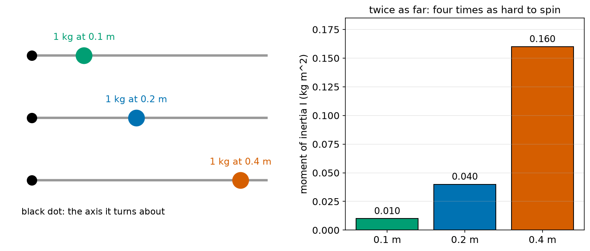
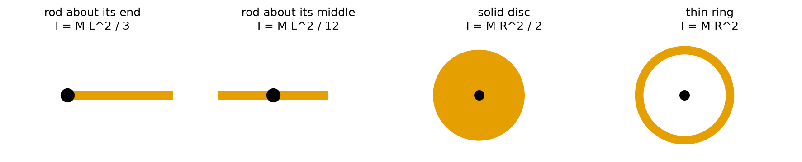
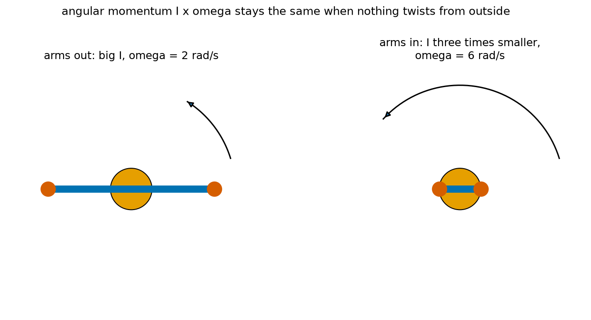
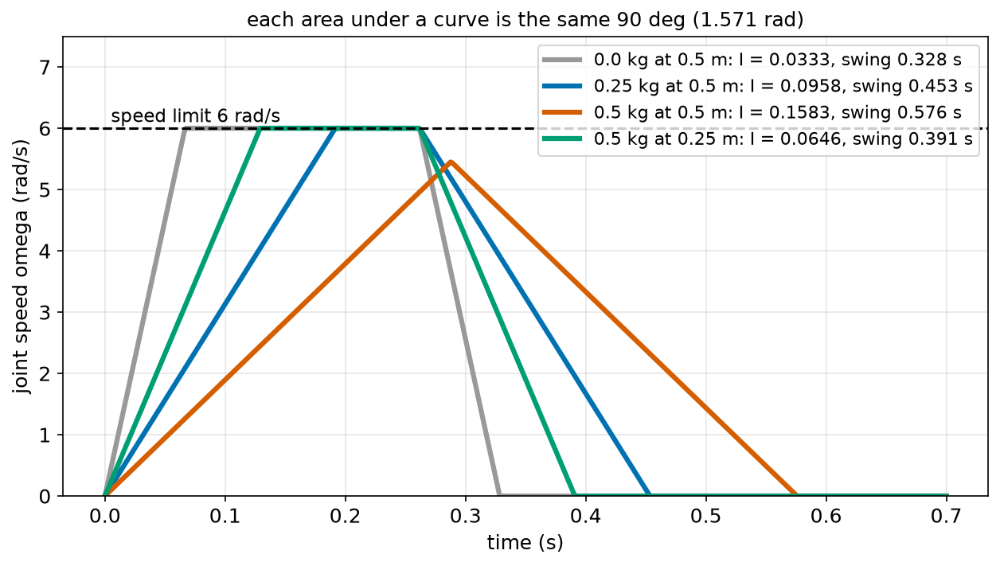
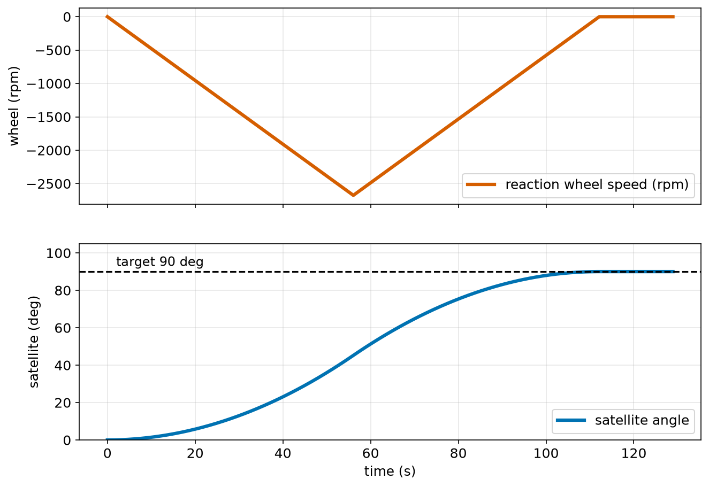

# Chapter 66 — Moment of Inertia: How Hard It Is to Spin Something

> **Part 4 · Chapter 66 of 749**
> **You need:** Chapter 61 (F = m × a), Chapter 64 (turning and v = ω r) and Chapter 65 (torque).
> **You will make:** a calculator for moments of inertia, a program that finds how fast a shoulder motor can swing an arm with different loads, and a program that turns a satellite by spinning a small wheel inside it.

---

## What you will learn

- What **moment of inertia** is: the turning twin of mass.
- Why it depends on **where** the mass is, not only how much: **I = Σ m r²**.
- The moment of inertia of a rod, a disc and a ring.
- The turning version of Newton's second law: **τ = I × α**.
- Why a robot arm with its load far out is slow to swing.
- What **angular momentum** is, and why it stays the same when nothing twists from outside.
- How satellites turn themselves with **reaction wheels**, and why a drone yaws slowly.
- Why the spinning parts inside a robot make it feel heavier when it speeds up.

---

## New words in this chapter

| Word | Simple meaning |
|---|---|
| **moment of inertia (I)** | How hard it is to change something's turning speed. Unit: kg m². |
| **rotational inertia** | Another name for moment of inertia. |
| **point mass** | A mass so small compared with its distance from the axis that we treat it as a dot. |
| **axis of rotation** | The line something turns about. |
| **angular momentum (L)** | "Amount of turning motion": L = I × ω. Unit: kg m²/s. |
| **conservation** | Staying the same. A quantity is "conserved" when its total cannot change. |
| **reaction wheel** | A wheel inside a satellite or robot, spun by a motor to turn the body the other way. |
| **effective mass** | How heavy a robot "feels" when it speeds up, including the spinning parts inside it. |

---

## 66.1 Mass for turning

Chapter 61 said that **mass** decides how hard it is to speed something up in a straight line: a = F / m. Chapter 65 said that **torque** makes things turn. So what decides how hard it is to speed up a **turning** thing?

Try this. Hold a broom in the middle and twist it back and forth quickly: easy. Now hold it at one end and twist it the same way: much harder. The broom has the same mass in both cases. What changed is **where** the mass is compared with the axis you turn it about.

📖 **New word: axis of rotation** — the line that something turns about: the shaft of a motor, the hinge of a door, the joint of an arm.

📖 **New word: moment of inertia (I)** — how hard it is to change something's turning speed. It depends on the mass **and** on how far that mass is from the axis.

### Where does r² come from?

Take one small mass m, at distance r from an axis, on a light stick. A torque τ turns the stick with angular acceleration α. Let us follow the mass:

1. Its acceleration along its circle is a = α r (Chapter 64).
2. To give it that acceleration, the stick must push it with F = m a = m α r (Chapter 61).
3. That push, at distance r, needs a torque τ = F × r = m α r × r = m r² × α (Chapter 65).

So:

```
τ = (m r²) × α
```

The quantity m r² plays the part that m played in F = m a. That is the moment of inertia of one small mass:

```
I = m r²
```

The distance appears **twice**: once because a mass further out must move faster (a = α r), and once because the push on it acts further out (τ = F r).

📖 **New word: point mass** — a mass that is small compared with its distance from the axis, so we can treat it as a dot.

🔢 **Maths.** The same 1 kg at different distances:

| Distance | I = m r² |
|---|---|
| 0.1 m | 0.010 kg m² |
| 0.2 m | 0.040 kg m² |
| 0.4 m | 0.160 kg m² |



*Figure 66.1 — Moving a mass twice as far from the axis makes it four times as hard to spin.*

**How to read this picture:** On the left, three light bars turn about the black dots on their left ends. Each carries 1 kg, at 0.1, 0.2 and 0.4 m. On the right, the bars show their moments of inertia. Going from 0.1 m to 0.2 m multiplies I by 4; going to 0.4 m multiplies it by 16. Distance matters much more than mass.

### Many masses: add them up

A real object is made of many small pieces. Its moment of inertia is the sum of m r² for all of them (Σ, Chapter 53):

```
I = Σ m_i × r_i²
```

**Small example.** A light arm carries 0.15 kg at 0.1 m, 0.15 kg at 0.3 m and 0.25 kg at 0.5 m:

```
I = 0.15 × 0.01 + 0.15 × 0.09 + 0.25 × 0.25
  = 0.0015 + 0.0135 + 0.0625 = 0.0775 kg m²
```

The 0.25 kg at the end gives 81% of the total. The 0.15 kg near the shoulder hardly counts.

📖 **New word: rotational inertia** — another name for moment of inertia.

⚠️ **Watch out.** A moment of inertia only makes sense **about a particular axis**. The same broom has a small I about its long axis (twisting it like a screwdriver), a medium I about its middle, and a large I about its end. Always say which axis.

---

## 66.2 Moments of inertia of common shapes

For solid shapes, mathematicians have done the sum Σ m r² for us, using calculus (Part 10). Here are the ones robot builders use most. M is the total mass.



*Figure 66.2 — Each shape turns about the black dot, through the paper.*

**How to read this picture:** Each orange shape turns about the axis marked by the black dot (imagine a pin through the paper). Under each title is its moment of inertia.

| Shape and axis | I | Robot example |
|---|---|---|
| point mass at distance r | M r² | a payload in a gripper |
| thin rod of length L, about one end | M L² / 3 | a robot arm link turning at its joint |
| thin rod of length L, about its middle | M L² / 12 | a propeller blade pair, a balancing pole |
| solid disc (or cylinder) of radius R, about its centre | M R² / 2 | a solid wheel, a motor's rotor |
| thin ring of radius R, about its centre | M R² | a wheel with a heavy rim, a flywheel rim |

🔢 **Maths.** For M = 0.40 kg, L = 0.5 m, R = 0.1 m:

```
rod about its end:    0.40 × 0.25 / 3  = 0.0333 kg m²
rod about its middle: 0.40 × 0.25 / 12 = 0.0083 kg m²   (4 times smaller)
solid disc:           0.40 × 0.01 / 2  = 0.0020 kg m²
thin ring:            0.40 × 0.01      = 0.0040 kg m²   (twice the disc)
```

Notice two things:

- A rod turned about its **middle** is **4 times** easier to spin than the same rod turned about its **end**. In the middle, no piece is more than L/2 from the axis.
- A **ring** is twice as hard to spin as a **disc** of the same mass and size, because all of a ring's mass is at the edge.

💡 **Tip.** To build shapes from pieces, just add their moments of inertia **about the same axis**. A robot arm = the link (M L²/3) + the payload (m L²) + the motor at the elbow (m_motor × d²).

---

## 66.3 τ = I × α: Newton's second law for turning

We found it in section 66.1. Here it is again, side by side with its twin:

| Straight line | Turning |
|---|---|
| F = m × a | τ = I × α |
| force (N) | torque (N m) |
| mass (kg) | moment of inertia (kg m²) |
| acceleration (m/s²) | angular acceleration (rad/s²) |

In words: "the net torque equals the moment of inertia times the angular acceleration".

As with F = m a, τ is the **net** torque: the motor's torque minus any torque from gravity, friction or springs.

🔢 **Maths.** A 0.5 N m torque on the 0.40 kg rod:

- about its end: α = 0.5 / 0.0333 = 15 rad/s²;
- about its middle: α = 0.5 / 0.0083 = 60 rad/s². Four times faster.

### Why loaded arms are slow

Chapter 65's arm (0.5 m, 0.40 kg) has a 3.0 N m shoulder motor. Suppose the arm swings in a **flat** plane, like a table-top robot turning its arm sideways, so gravity does not pull against the swing. All 3.0 N m can be used to speed the arm up.

```
empty arm:              I = 0.40 × 0.5² / 3 = 0.0333 kg m²     α = 3.0 / 0.0333 = 90 rad/s²
with 0.25 kg at the end: I = 0.0333 + 0.25 × 0.5² = 0.0958 kg m²  α = 31.3 rad/s²
```

A 0.25 kg payload (62% of the arm's mass) makes the arm almost **three times** harder to swing, because it sits at the far end. Application 1 works out how long a 90° swing takes.

🤖 **Robot link.** When an arm lifts against gravity (Chapter 65), the motor's torque has **two** jobs: holding the arm up (the holding torque) and speeding it up (I × α). Only what is left after holding can be used to accelerate. Chapter 65's arm, straight out with its load, had only 0.793 N m spare, so it could only accelerate at 0.793 / 0.0958 = 8.3 rad/s²: almost 4 times slower than in a flat plane.

---

## 66.4 Angular momentum

Chapter 61 did not name it, but a moving object has a "quantity of motion" called **momentum**, m × v. Turning objects have a twin.

📖 **New word: angular momentum (L)** — the "amount of turning motion":

```
L = I × ω          (unit: kg m²/s)
```

In words: "angular momentum equals the moment of inertia times the angular speed".

Torque changes angular momentum, just as force changes momentum. The important fact is what happens when there is **no** outside torque:

📖 **New word: conservation** — staying the same. A quantity is **conserved** when its total cannot change.

🧠 **Remember:** if no torque acts on an object from **outside**, its angular momentum I × ω stays the same.

This has a surprising effect when an object changes **shape** while it spins. If it pulls its mass inwards, I gets smaller, so ω must get **bigger** to keep I × ω the same.



*Figure 66.3 — Pulling the masses in makes I smaller, so the spin gets faster.*

**How to read this picture:** A spinning body (orange) holds two masses (red) on its arms (blue). On the left, the arms are stretched out: I is large, and the body turns at 2 rad/s. On the right, the arms are pulled in: I is three times smaller, so ω becomes three times bigger, 6 rad/s. No motor did this; it happened only because the mass moved inwards. The curved arrows show how far each turns in the same time.

🔢 **Maths.** I falls from 0.6 to 0.2 kg m²:

```
before: L = 0.6 × 2 = 1.2 kg m²/s
after:  0.2 × ω = 1.2   →   ω = 6 rad/s
```

This is how ice skaters and divers spin faster, and how a cat that falls upside down turns itself over.

### Turning yourself with no outside push

Angular momentum has another consequence. If the total is zero and nothing twists from outside, it **stays** zero. So if one part of a robot starts turning one way, the rest must turn the **other** way.

Try it on an office chair: sit with your feet off the floor and swing your arms quickly to the right. The chair turns to the left. When your arms stop, the chair stops.

📖 **New word: reaction wheel** — a heavy wheel inside a satellite (or a robot), spun by a motor. When the wheel spins one way, the body turns the other way, so the total angular momentum stays zero.

```
I_body × ω_body + I_wheel × ω_wheel = 0
ω_body = −(I_wheel / I_body) × ω_wheel
```

A small wheel spinning very fast can slowly turn a big satellite. Application 2 works it out.

---

## 66.5 Spinning parts make a robot feel heavier

When Rover speeds up, its wheels must also spin up, and so must the motors' rotors inside the gearboxes. Speeding up those spinning parts needs torque too, and that torque comes from the motors.

📖 **New word: effective mass** — how heavy a robot "feels" to its motors when it speeds up: its real mass plus an extra amount for all the parts that must spin faster.

For one wheel of radius r and moment of inertia I, speeding the robot up at a means spinning the wheel up at α = a / r (Chapter 64). That takes a torque I a / r, which at the ground is like an extra force I a / r². So the wheel adds

```
extra mass = I / r²
```

A motor's rotor turns much **faster** than the wheel, because of the gearbox. With a gear ratio N (the motor turns N times for each wheel turn, Chapter 37), the rotor adds

```
extra mass = I_rotor × N² / r²
```

The N² makes this surprisingly big. Chapter 68 explains it in full.

🔢 **Maths.** Rover (4 kg) has two wheels of radius 0.033 m. A motor rotor has I = 1 × 10⁻⁶ kg m² (tiny!), behind a 30:1 gearbox:

```
one rotor: 1 × 10⁻⁶ × 30² / 0.033² = 0.0009 / 0.001089 = 0.83 kg
two rotors: 1.65 kg
```

The two tiny rotors make Rover feel about 1.65 kg heavier when it speeds up: 41% more than its real 4 kg. A designer who forgot them would choose motors that are too weak to reach the planned acceleration.

---

## Code

File `code/ch066/inertia.py`:

```python
# inertia.py - moment of inertia: I = sum of (mass x distance squared), and tau = I x alpha
# 1) the same 1 kg, placed at different distances from the axis
for r in [0.1, 0.2, 0.4]:
    print(f"1 kg at {r:.1f} m: I = {1.0 * r ** 2:.3f} kg m^2")

# 2) a dumbbell robot arm: two masses on a light bar, turning about the shoulder
masses = [(0.15, 0.10), (0.15, 0.30), (0.25, 0.50)]     # (mass in kg, distance in m)
I = 0
for m, r in masses:
    I = I + m * r ** 2
print(f"arm made of point masses: I = {I:.4f} kg m^2")

# 3) common shapes, each 0.40 kg
M, L, R = 0.40, 0.50, 0.10
print(f"rod {L} m long, turning about its end:    I = M L^2 / 3  = {M * L ** 2 / 3:.4f} kg m^2")
print(f"rod {L} m long, turning about its middle: I = M L^2 / 12 = {M * L ** 2 / 12:.4f} kg m^2")
print(f"solid disc of radius {R} m:               I = M R^2 / 2  = {M * R ** 2 / 2:.4f} kg m^2")
print(f"thin ring of radius {R} m:                I = M R^2      = {M * R ** 2:.4f} kg m^2")

# 4) tau = I alpha: the same torque on the rod about its end and about its middle
TORQUE = 0.5
for name, i in [("end", M * L ** 2 / 3), ("middle", M * L ** 2 / 12)]:
    print(f"0.5 N m on the rod about its {name}: alpha = {TORQUE / i:.1f} rad/s^2")
```

| Line | Code | What it does (simple English) |
|---|---|---|
| 1 | `# inertia.py …` | A comment. |
| 2 | `# 1) the same 1 kg …` | A comment for the first part. |
| 3 | `for r in [0.1, 0.2, 0.4]:` | Three distances. |
| 4 | `print(f"… I = {1.0 * r ** 2:.3f} …")` | I = m r² for 1 kg. |
| 5 | (blank) | Spacing. |
| 6 | `# 2) a dumbbell robot arm …` | A comment. |
| 7 | `masses = [(0.15, 0.10), …]` | A list of (mass, distance) tuples. The comment says which is which. |
| 8 | `I = 0` | The running total. |
| 9 | `for m, r in masses:` | Unpacks each tuple. |
| 10 | `I = I + m * r ** 2` | Adds m r² for this piece: Σ m r². |
| 11 | `print(f"arm made of point masses: …")` | The total. |
| 12 | (blank) | Spacing. |
| 13 | `# 3) common shapes …` | A comment. |
| 14 | `M, L, R = 0.40, 0.50, 0.10` | Mass, rod length and disc radius. |
| 15–18 | `print(f"rod … I = M L^2 / 3 = …")` and so on | The four formulas from section 66.2. |
| 19 | (blank) | Spacing. |
| 20 | `# 4) tau = I alpha …` | A comment. |
| 21 | `TORQUE = 0.5` | The same torque for both. |
| 22 | `for name, i in [("end", …), ("middle", …)]:` | Two axes for the same rod. |
| 23 | `print(f"… alpha = {TORQUE / i:.1f} rad/s^2")` | α = τ / I. |

Output:

```
1 kg at 0.1 m: I = 0.010 kg m^2
1 kg at 0.2 m: I = 0.040 kg m^2
1 kg at 0.4 m: I = 0.160 kg m^2
arm made of point masses: I = 0.0775 kg m^2
rod 0.5 m long, turning about its end:    I = M L^2 / 3  = 0.0333 kg m^2
rod 0.5 m long, turning about its middle: I = M L^2 / 12 = 0.0083 kg m^2
solid disc of radius 0.1 m:               I = M R^2 / 2  = 0.0020 kg m^2
thin ring of radius 0.1 m:                I = M R^2      = 0.0040 kg m^2
0.5 N m on the rod about its end: alpha = 15.0 rad/s^2
0.5 N m on the rod about its middle: alpha = 60.0 rad/s^2
```

---

## Small examples

**Example 1.** 2 kg at 0.3 m: I = 2 × 0.09 = 0.18 kg m².

**Example 2.** A 1.2 kg rod, 0.6 m long, about its end: I = 1.2 × 0.36 / 3 = 0.144 kg m².

**Example 3.** A 0.5 kg disc wheel of radius 0.04 m: I = 0.5 × 0.0016 / 2 = 0.0004 kg m².

**Example 4.** A torque of 2 N m on I = 0.1 kg m²: α = 20 rad/s².

**Example 5.** To give I = 0.05 kg m² an angular acceleration of 8 rad/s² needs τ = 0.4 N m.

**Example 6.** A body with I = 0.3 kg m² spins at 4 rad/s: L = 1.2 kg m²/s.

**Example 7.** It pulls in until I = 0.1 kg m². With no outside torque, ω = 1.2 / 0.1 = 12 rad/s.

**Example 8.** A wheel with I = 0.0004 kg m² and radius 0.04 m adds 0.0004 / 0.0016 = 0.25 kg of effective mass.

---

## 🏭 Real robot applications

### Application 1 (worked in full) — 🦾 How fast can the arm swing?

**1. The real problem.** A table-top robot arm swings sideways in a flat plane (so gravity does not resist the swing) to move parts between two trays 90° apart. Its shoulder motor gives at most 3.0 N m, and the joint may turn at most 6 rad/s. How long does a 90° swing take, with no load, with 0.25 kg, with 0.5 kg at the end, and with 0.5 kg held closer in, at 0.25 m?

**2. Why this theory.** The motor's torque gives an angular acceleration α = τ / I (section 66.3). The payload adds m r² to I. With α and the speed limit, the swing is a trapezoid or triangle move, exactly as in Chapter 59, but in angles (Chapter 64).

**3. The numbers.** Arm: 0.5 m, 0.40 kg (a rod about its end). Motor: 3.0 N m. Speed limit 6 rad/s. Swing: π/2 = 1.571 rad.

**4. The maths.** With 0.25 kg at the end:

```
I = 0.40 × 0.25 / 3 + 0.25 × 0.25 = 0.0333 + 0.0625 = 0.0958 kg m²
α = 3.0 / 0.0958 = 31.3 rad/s²
ramp angle = 6² / 31.3 = 1.15 rad  ≤ 1.571 rad  → trapezoid
time = 2 × 6 / 31.3 + (1.571 − 1.15) / 6 = 0.383 + 0.070 = 0.453 s
```

**5. The code.** File `code/ch066/arm_swing.py`:

```python
# arm_swing.py - how quickly can a shoulder motor swing an arm through 90 degrees in a flat plane?
import math

ARM_LENGTH_M = 0.50
ARM_MASS_KG = 0.40
MOTOR_MAX_NM = 3.0
SPEED_LIMIT = 6.0                  # rad/s, the joint's top speed


def arm_inertia(payload_kg, payload_at_m):
    rod = ARM_MASS_KG * ARM_LENGTH_M ** 2 / 3          # the arm itself, turning about one end
    return rod + payload_kg * payload_at_m ** 2         # plus the payload as a point mass


def swing_time(inertia, angle=math.pi / 2):
    alpha = MOTOR_MAX_NM / inertia                      # tau = I alpha, all the torque used to swing
    ramp = SPEED_LIMIT ** 2 / alpha                     # speeding up plus slowing down (Chapter 59 in angles)
    if angle >= ramp:
        return 2 * SPEED_LIMIT / alpha + (angle - ramp) / SPEED_LIMIT, alpha
    return 2 * math.sqrt(angle / alpha), alpha


print(" payload         I (kg m^2)   alpha (rad/s^2)   90 deg swing")
for kg, at in [(0.0, 0.5), (0.25, 0.5), (0.5, 0.5), (0.5, 0.25)]:
    i = arm_inertia(kg, at)
    t, a = swing_time(i)
    print(f"{kg:4.2f} kg at {at:.2f} m   {i:9.4f}   {a:12.1f}   {t:10.3f} s")
```

| Line | Code | What it does (simple English) |
|---|---|---|
| 1 | `# arm_swing.py …` | A comment. |
| 2 | `import math` | For π and `sqrt`. |
| 3 | (blank) | Spacing. |
| 4–7 | `ARM_LENGTH_M`, `ARM_MASS_KG`, `MOTOR_MAX_NM`, `SPEED_LIMIT` | The arm's numbers. |
| 8–9 | (blank) | Spacing. |
| 10 | `def arm_inertia(payload_kg, payload_at_m):` | I of the arm plus its load. |
| 11 | `rod = ARM_MASS_KG * ARM_LENGTH_M ** 2 / 3` | A rod about its end. |
| 12 | `return rod + payload_kg * payload_at_m ** 2` | Add the payload as a point mass, m r². |
| 13–14 | (blank) | Spacing. |
| 15 | `def swing_time(inertia, angle=math.pi / 2):` | The swing time, for 90° unless told otherwise. |
| 16 | `alpha = MOTOR_MAX_NM / inertia` | α = τ / I. |
| 17 | `ramp = SPEED_LIMIT ** 2 / alpha` | The angle used by speeding up and slowing down together. |
| 18–19 | `if angle >= ramp: return …` | Trapezoid: two ramps and a cruise at 6 rad/s. Also returns α. |
| 20 | `return 2 * math.sqrt(angle / alpha), alpha` | Triangle: it never reaches 6 rad/s. |
| 21–22 | (blank) | Spacing. |
| 23 | `print(" payload …")` | The heading. |
| 24 | `for kg, at in [(0.0, 0.5), …]:` | Four cases. |
| 25 | `i = arm_inertia(kg, at)` | I for this case. |
| 26 | `t, a = swing_time(i)` | The time and α. |
| 27 | `print(f"…")` | One row. |

Output:

```
 payload         I (kg m^2)   alpha (rad/s^2)   90 deg swing
0.00 kg at 0.50 m      0.0333           90.0        0.328 s
0.25 kg at 0.50 m      0.0958           31.3        0.453 s
0.50 kg at 0.50 m      0.1583           18.9        0.576 s
0.50 kg at 0.25 m      0.0646           46.5        0.391 s
```



*Figure 66.4 — Heavier loads far out speed up more slowly. The heaviest never reaches the speed limit.*

**How to read this picture:** Each line is the joint speed during one 90° swing. Steeper sides mean a larger α. The grey line (empty arm) shoots up to the 6 rad/s limit almost at once, cruises, and stops: 0.328 s. The blue (0.25 kg at the end) and green (0.5 kg at 0.25 m) lines rise more slowly. The red line (0.5 kg at the end) is so slow to speed up that it never reaches 6 rad/s: a triangle, 0.576 s. The area under every line is the same 1.571 rad.

**6. The result.** Doubling the payload at the end (0.25 → 0.5 kg) makes the swing 27% slower. But the same 0.5 kg held **at 0.25 m** instead of 0.5 m swings in 0.391 s: faster than the 0.25 kg at the end, because halving the distance quarters its contribution to I. If the parts can be gripped closer to the shoulder (for example, by a design where the arm folds), the robot works faster with the same motor.

**7. Going further.** Real arms have several links and joints, and each joint "sees" a moment of inertia that changes as the other joints move (a folded arm is easier to swing than a stretched one). Part 19 works out these changing inertias for whole arms (Chapter 380), and Chapter 397 plans moves that respect each joint's torque limit.

### Application 2 (worked in full) — 🛰️ Turning a satellite with a reaction wheel

**1. The real problem.** A small Earth-observation satellite must turn by 90° to point its camera at a new target. In space, there is nothing to push against: no ground, no air. How can it turn? And how long will a 90° turn take?

**2. Why this theory.** With no outside torque, the total angular momentum stays the same: zero, if the satellite starts still (section 66.4). A motor inside spins a **reaction wheel** one way; the motor's torque pushes the satellite the other way with an equal torque (Newton's third law, Chapter 61). The satellite turns opposite to the wheel.

**3. The numbers.** Satellite moment of inertia about the turning axis: 20 kg m². Reaction wheel: 0.002 kg m², top speed 6000 rpm. The wheel's motor gives at most 0.01 N m.

**4. The maths.** At most, with the wheel at full speed:

```
6000 rpm = 628.3 rad/s
satellite speed = 0.002 × 628.3 / 20 = 0.0628 rad/s = 3.6 °/s
```

The motor's 0.01 N m acts on the satellite too (third law):

```
α_sat = 0.01 / 20 = 0.0005 rad/s²
```

For a 90° (1.571 rad) turn, the ramp angle would be 0.0628² / 0.0005 = 7.9 rad: much more than 1.571, so it is a triangle (it never reaches the top speed):

```
time = 2 × √(1.571 / 0.0005) = 2 × 56.0 = 112 s
```

**5. The code.** File `code/ch066/reaction_wheel.py`:

```python
# reaction_wheel.py - a satellite turns itself by spinning a wheel the other way
import math

SAT_I = 20.0             # kg m^2, a small satellite about its turning axis
WHEEL_I = 0.002          # kg m^2, the small reaction wheel
WHEEL_MAX_RPM = 6000
TURN_DEG = 90

wheel_max = WHEEL_MAX_RPM * 2 * math.pi / 60
sat_max = WHEEL_I * wheel_max / SAT_I                # total angular momentum stays 0: I_s w_s = -I_w w_w
print(f"wheel at {WHEEL_MAX_RPM} rpm = {wheel_max:.1f} rad/s")
print(f"the satellite then turns the other way at {sat_max:.4f} rad/s = {math.degrees(sat_max):.2f} deg/s")

# spin the wheel up and down with a motor torque of 0.01 N m, to turn the satellite by 90 deg
TORQUE = 0.01
alpha_sat = TORQUE / SAT_I                           # the motor pushes the satellite back just as hard
angle = math.radians(TURN_DEG)
ramp = sat_max ** 2 / alpha_sat
if angle >= ramp:
    t = 2 * sat_max / alpha_sat + (angle - ramp) / sat_max
else:
    t = 2 * math.sqrt(angle / alpha_sat)
print(f"satellite alpha {alpha_sat:.4f} rad/s^2, a 90 deg turn takes {t:.1f} s")
print(f"angular momentum of the wheel at top speed: {WHEEL_I * wheel_max:.4f} kg m^2/s")
```

| Line | Code | What it does (simple English) |
|---|---|---|
| 1 | `# reaction_wheel.py …` | A comment. |
| 2 | `import math` | For π, `degrees`, `radians`, `sqrt`. |
| 3 | (blank) | Spacing. |
| 4–7 | `SAT_I`, `WHEEL_I`, `WHEEL_MAX_RPM`, `TURN_DEG` | The satellite, the wheel and the turn we want. |
| 8 | (blank) | Spacing. |
| 9 | `wheel_max = WHEEL_MAX_RPM * 2 * math.pi / 60` | rpm to rad/s. |
| 10 | `sat_max = WHEEL_I * wheel_max / SAT_I` | From I_s ω_s = −I_w ω_w: the satellite's top turning speed (we drop the minus sign; it only gives the direction). |
| 11–12 | `print(…)` | Both speeds. |
| 13 | (blank) | Spacing. |
| 14 | `# spin the wheel up and down …` | A comment. |
| 15 | `TORQUE = 0.01` | The wheel motor's largest torque. |
| 16 | `alpha_sat = TORQUE / SAT_I` | α = τ / I for the satellite. |
| 17 | `angle = math.radians(TURN_DEG)` | 90° in radians. |
| 18 | `ramp = sat_max ** 2 / alpha_sat` | The angle needed to reach top speed and stop again. |
| 19–22 | `if angle >= ramp: … else: …` | Trapezoid or triangle (Chapter 59). |
| 23 | `print(f"satellite alpha …")` | The result. |
| 24 | `print(f"angular momentum …")` | L = I ω of the wheel at full speed. |

Output:

```
wheel at 6000 rpm = 628.3 rad/s
the satellite then turns the other way at 0.0628 rad/s = 3.60 deg/s
satellite alpha 0.0005 rad/s^2, a 90 deg turn takes 112.1 s
angular momentum of the wheel at top speed: 1.2566 kg m^2/s
```



*Figure 66.5 — The wheel spins up and down one way; the satellite turns 90° the other way.*

**How to read this picture:** The top graph is the reaction wheel's speed (negative: it turns the opposite way to the satellite). It speeds up for 56 s, to about 2,670 rpm, then slows back to zero. The bottom graph is the satellite's angle. It turns slowly at first, fastest in the middle, and stops exactly at 90° when the wheel stops. When the wheel stops, the satellite stops: their angular momenta always add up to zero.

**6. The result.** A wheel with a moment of inertia 10,000 times smaller than the satellite turns it by 90° in about 112 s, with no fuel at all, using only electricity from the solar panels. The wheel never needs to go above about 2,670 rpm for this turn, well under its 6000 rpm limit. For a faster turn, the satellite needs a stronger wheel motor (more torque gives a larger α) or a heavier wheel.

**7. Going further.** Real satellites have three or four reaction wheels, so they can turn about any axis (Part 16 describes orientation in 3D). Small outside torques (from the Sun's light and the thin upper air) slowly add angular momentum, so the wheels slowly speed up over days. When they get close to their limit, the satellite uses small thrusters or magnetic coils to "unload" them. Some robots use the same trick: a balancing robot can use a reaction wheel to stay upright (Chapter 310), and legged robots swing their arms or tails to control their body's rotation in the air.

### Application 3 — 🚁 Why a drone yaws slowly

A quadcopter tilts (rolls and pitches) quickly, but turns about its vertical axis (yaws) slowly (Chapter 64). Why? To tilt, it speeds up the propellers on one side: their thrust (several newtons) acts at the arm's length (say 0.12 m), giving a torque of about 0.5 N m. To yaw, it uses the small **drag** torques of the spinning propellers (Chapter 623): speeding up the two that spin one way and slowing the other two. Those drag torques are only a few hundredths of a newton metre. Its moment of inertia about the vertical axis is also the **largest** of the three, because all four motors are far from that axis (I ≈ 4 m r²). A small torque on a large I gives a small α, so yawing is slow.

### Application 4 — 🦿 Arm swinging in walking robots

When you walk, your right arm swings forwards as your left leg swings forwards. Your legs' swing gives your body some angular momentum about the vertical axis. Your arms swinging the other way cancel it, so your body does not twist. Humanoid robot designers use the same idea: without arm swing, a walking humanoid's feet must give a twisting torque on the ground to stop the body turning, and on a slippery floor the feet may slip (Chapter 63). Many humanoid controllers plan arm motions to cancel the legs' angular momentum (Chapter 712 studies the whole robot's angular momentum).

### Application 5 — 🤖 Rover's hidden extra mass

Section 66.5 showed that the two tiny motor rotors behind Rover's 30:1 gearboxes add about 1.65 kg of **effective mass**, plus the wheels themselves (two thin rubber rings of about 0.05 kg each at the rim add about 0.1 kg more). So when Rover speeds up at 0.5 m/s², its motors must give the force for about 5.75 kg, not 4 kg: 2.9 N instead of 2.0 N. That is why Rover's measured acceleration in tests is lower than F / m predicts. Fast robots with high gear ratios, such as robot arms with 100:1 gearboxes, are often dominated by their motors' rotors: Chapter 68 shows that a rotor's inertia, seen at the output, is multiplied by N².

---

## 🔧 Hands-on lab

### Lab 66.1 — Twist a broom, a ruler and a water bottle (hardware)

You need a broom (or a long stick), a ruler, and a half-full water bottle.

1. Hold the broom in the middle and twist it quickly back and forth. Then hold it near one end and do the same. Which is harder?
2. Tape two heavy objects (for example, two full drink cans) to a ruler, near its middle. Twist it about its centre. Now move the cans to the ends and twist again.
3. Spin the water bottle on a table, standing up. Then lay it on its side and roll it down a slight slope next to an empty bottle. Which reaches the bottom first?

**What you should see:** The broom is much harder to twist about its end (about 4 times the moment of inertia). The ruler with the cans at the ends is much harder to twist, even though the mass is the same. The bottles behave differently from each other because their mass is spread differently (water does not turn fully with the bottle), which shows that "where the mass is" matters, not just "how much".

| If it does not work | Likely cause | Fix |
|---|---|---|
| No difference felt with the ruler | The cans are too light | Use heavier objects, or a longer stick |
| The bottle result changes each time | The slope is not even | Use a smooth, straight board |

**Challenge:** Predict which rolls down a slope faster: a solid can of food or an empty can of the same size and mass (if you can find one). Explain using rings and discs. (Chapter 69 answers.)

### Lab 66.2 — Design a faster arm (simulation)

Copy `arm_swing.py`.

1. Make the arm out of carbon fibre: 0.20 kg instead of 0.40 kg. How much faster is a 90° swing with 0.25 kg at the end?
2. Keep the 0.40 kg arm, but add a 0.30 kg elbow motor at 0.25 m. How much slower is the swing?
3. Find the payload at the end (to 0.01 kg) at which the swing stops being a trapezoid and becomes a triangle.

**What you should see:** With the lighter arm, I = 0.0167 + 0.0625 = 0.0792 kg m², and the swing takes 0.42 s instead of 0.453 s. The elbow motor adds 0.30 × 0.25² = 0.0188 kg m², and the swing takes about 0.49 s. The swing becomes a triangle when the ramp angle 36 / α reaches 1.571 rad, that is when I reaches 3.0 × 1.571 / 36 = 0.131 kg m², a payload of about 0.39 kg.

| If it does not work | Likely cause | Fix |
|---|---|---|
| The elbow motor makes no difference | It was added to the mass but not to I | Add m r² for it in `arm_inertia` |
| Times get shorter with more mass | α computed as I / τ | α = τ / I |

**Challenge:** Make a plot of the swing time against the payload's distance from the shoulder (0.1 m to 0.5 m) for a 0.5 kg payload.

### Lab 66.3 — A spinning chair as a reaction wheel (hardware)

You need an office chair that spins freely, a friend to keep you safe, and a bicycle wheel held by its axle (or, without a wheel, just your arms).

1. Sit on the chair with your feet off the floor. Swing both arms quickly to the right, then stop them. Watch what the chair does.
2. If you have a bicycle wheel: hold it with its axle pointing up. Ask your friend to spin it. Then use your hands to slow the wheel down. What does the chair do?

**What you should see:** When your arms swing right, the chair turns left; when they stop, the chair stops. When you slow down a wheel that is spinning anticlockwise (seen from above), the chair starts turning anticlockwise: the wheel's angular momentum moves to you and the chair, as section 66.4 says.

| If it does not work | Likely cause | Fix |
|---|---|---|
| The chair hardly moves | Friction in the chair's bearing | Use a smoother chair, and swing faster |
| You feel dizzy | Turning too fast | Stop. Do short, gentle tries |

**Challenge:** Estimate your body's moment of inertia on the chair, if your arms (about 7 kg together, about 0.4 m out on average) turned through 90° while the chair turned through 15°.

---

## Common mistakes

⚠️ **Thinking only the mass matters for turning.** Where the mass is matters more: I grows with r².

⚠️ **Giving a moment of inertia without saying the axis.** The same object has different I about different axes.

⚠️ **Using the rod-about-its-middle formula for an arm turning at its end.** About the end, it is M L² / 3, four times bigger.

⚠️ **Forgetting the payload in I.** A small mass far out can be most of the moment of inertia.

⚠️ **Using all the motor's torque for acceleration when the arm also fights gravity.** Subtract the holding torque first.

⚠️ **Forgetting the spinning parts when sizing motors.** Rotors behind gearboxes add a lot of effective mass.

⚠️ **Thinking a body cannot turn itself without pushing on something.** It can, by spinning or moving a part the other way, as long as the total angular momentum stays the same.

---

## Practice

🏋️ **1.** Find I for 0.5 kg at 0.6 m, and for 2 kg at 0.15 m. Which is harder to spin?

🏋️ **2.** Three masses on a light bar: 0.2 kg at 0.1 m, 0.3 kg at 0.2 m, 0.1 kg at 0.5 m. Find I about the end.

🏋️ **3.** A 0.9 kg rod, 0.4 m long. Find I about its end and about its middle.

🏋️ **4.** A solid wheel of mass 0.3 kg and radius 0.05 m. Find I.

🏋️ **5.** A torque of 1.2 N m acts on I = 0.08 kg m². What is α? How long to reach 6 rad/s from rest?

🏋️ **6.** A joint must accelerate an arm with I = 0.25 kg m² at 12 rad/s². What torque does it need (no gravity)?

🏋️ **7.** A spinning robot with I = 0.5 kg m² turns at 3 rad/s. It pulls its arms in, and I falls to 0.2 kg m². What is its new ω?

🏋️ **8.** A satellite with I = 50 kg m² has a reaction wheel with I = 0.01 kg m². The wheel speeds up to 300 rad/s. How fast does the satellite turn?

🏋️ **9.** A robot's wheel has I = 0.0006 kg m² and radius 0.06 m. What effective mass does it add?

🏋️ **10.** A motor rotor has I = 2 × 10⁻⁶ kg m², behind a 50:1 gearbox, on a wheel of radius 0.05 m. What effective mass does it add?

🏋️ **11.** Write a function `arm_I(link_mass, length, extras)` where `extras` is a list of (mass, distance) pairs. It returns the moment of inertia about the shoulder (the link counts as a rod about its end). Use it to find I for a 0.4 kg, 0.5 m link with a 0.15 kg elbow motor at 0.25 m and a 0.25 kg payload at 0.5 m.

---

## Answers

**1.** 0.5 × 0.36 = 0.18 kg m². 2 × 0.0225 = 0.045 kg m². The 0.5 kg at 0.6 m is 4 times harder to spin.

**2.** 0.2 × 0.01 + 0.3 × 0.04 + 0.1 × 0.25 = 0.002 + 0.012 + 0.025 = 0.039 kg m².

**3.** End: 0.9 × 0.16 / 3 = 0.048 kg m². Middle: 0.9 × 0.16 / 12 = 0.012 kg m².

**4.** 0.3 × 0.0025 / 2 = 0.000375 kg m².

**5.** α = 1.2 / 0.08 = 15 rad/s². t = 6 / 15 = 0.4 s.

**6.** τ = 0.25 × 12 = 3 N m.

**7.** L = 1.5 kg m²/s. ω = 1.5 / 0.2 = 7.5 rad/s.

**8.** ω = 0.01 × 300 / 50 = 0.06 rad/s (3.4 °/s), the opposite way to the wheel.

**9.** 0.0006 / 0.0036 = 0.167 kg.

**10.** 2 × 10⁻⁶ × 2500 / 0.0025 = 2.0 kg.

**11.**

```python
def arm_I(link_mass, length, extras):
    total = link_mass * length ** 2 / 3
    for m, r in extras:
        total = total + m * r ** 2
    return total

print(round(arm_I(0.4, 0.5, [(0.15, 0.25), (0.25, 0.5)]), 4))   # 0.1052
```

---

## Summary

🧠 The **moment of inertia** I is the turning twin of mass: how hard it is to change something's turning speed. Unit: kg m².

🧠 **I = Σ m r²**. Distance counts twice: twice as far, four times as hard to spin.

🧠 Common shapes: rod about its end M L²/3, about its middle M L²/12; solid disc M R²/2; ring M R²; point mass m r².

🧠 **τ = I × α**, the turning version of F = m a. τ is the **net** torque: subtract gravity's torque first.

🧠 A payload far from a joint makes the arm much slower to swing. Grip loads close in, and keep arms light.

🧠 **Angular momentum** L = I ω is conserved when no outside torque acts. Pulling mass in spins faster. Spinning a wheel one way turns the body the other way (reaction wheels).

🧠 Spinning parts add **effective mass**: I / r² for a wheel, and I × N² / r² for a motor rotor behind an N:1 gearbox.

---

## Next chapter

In Chapter 67 we meet the idea that ties all of Part 4 together: **energy**. You will see what **work** and **power** are, how much energy a moving robot has (½ m v², promised back in Chapter 41), how much a drone needs to climb, and how to work out how long a battery will last.
