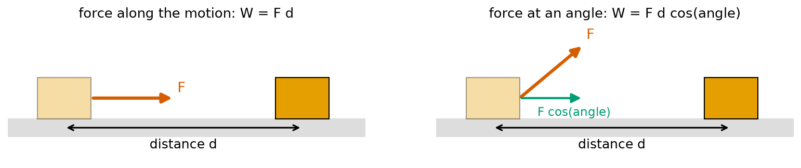
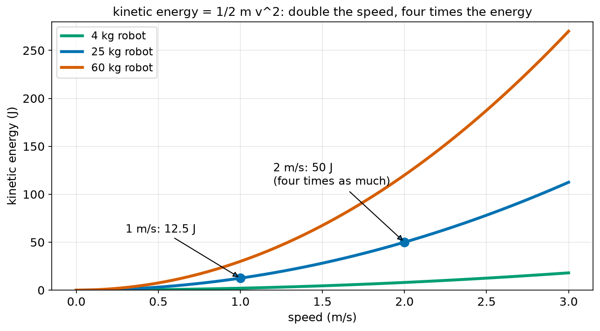
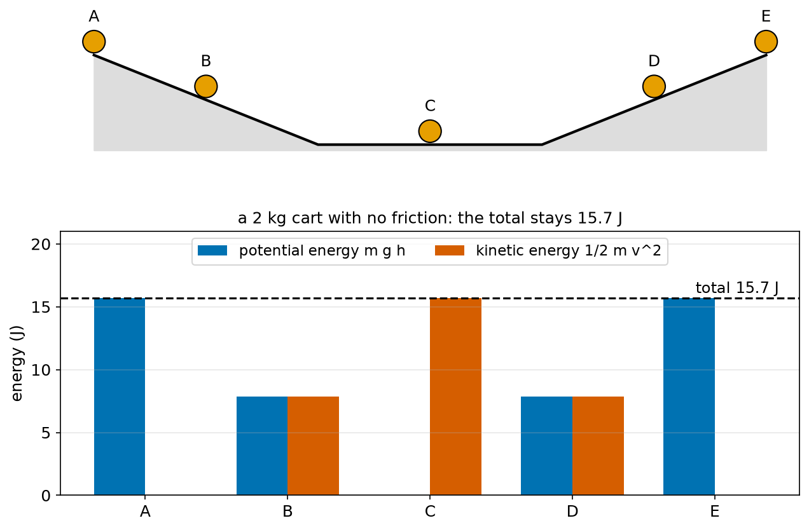
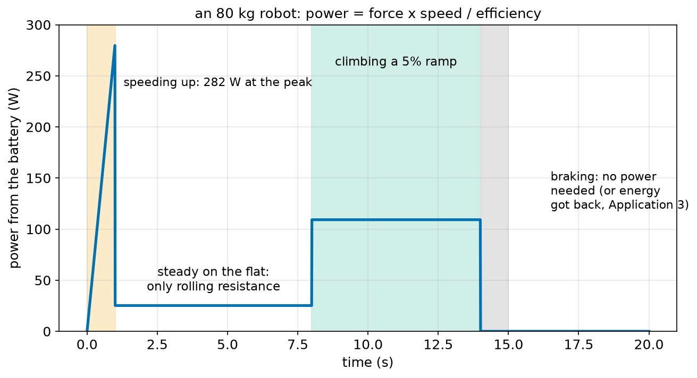
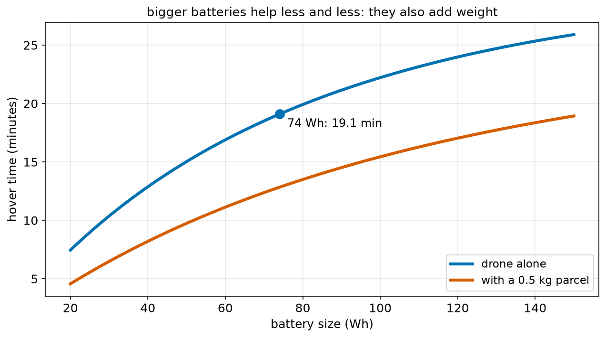
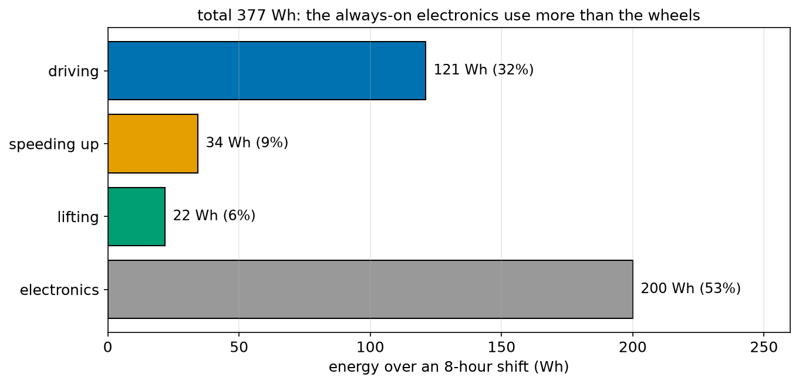

# Chapter 67 — Work, Energy and Power

> **Part 4 · Chapter 67 of 749**
> **You need:** Chapter 40 (E = P × t), Chapter 59 (equations of motion), Chapter 61 (forces), Chapter 62 (weight) and Chapter 63 (rolling resistance).
> **You will make:** a program that works out work, kinetic energy, potential energy and power for a delivery robot; a flight-time calculator for a delivery drone; and a battery-size calculator for a warehouse robot working an 8-hour shift.

---

## What you will learn

- What **work** is in physics: force × distance.
- What **energy** is, its main forms, and why it is never lost, only changed.
- Where **½ m v²** comes from, and why a robot going twice as fast hits **four** times as hard.
- What **potential energy** m g h is, and what it costs a robot to climb.
- What **power** is, and why **power = force × speed**.
- What a **joule**, a **watt** and a **watt-hour** are, and how they are linked.
- What **efficiency** is, and why a robot's battery always gives out more energy than the useful work done.
- How to estimate a drone's flight time and a robot's battery size.

---

## New words in this chapter

| Word | Simple meaning |
|---|---|
| **work (W)** | Force × distance moved along the force. Measured in joules. |
| **joule (J)** | The unit of work and energy: 1 N pushing through 1 m. |
| **energy (E)** | The ability to do work. Measured in joules. |
| **kinetic energy** | The energy something has because it moves: ½ m v². |
| **potential energy** | Energy stored by position, such as height: m g h. |
| **conservation of energy** | Energy is never made or destroyed, only changed from one form to another. |
| **power (P)** | How fast work is done or energy is used: joules per second. |
| **watt (W)** | The unit of power: 1 joule per second. |
| **watt-hour (Wh)** | An amount of energy: 1 watt for 1 hour = 3600 J. |
| **efficiency** | Useful energy out ÷ energy in. Always less than 100%. |
| **regenerative braking** | Using the motors as generators while braking, to put energy back into the battery. |

---

## 67.1 Work: force times distance

In everyday English, "work" means any effort. In physics it has an exact meaning.

📖 **New word: work (W)** — what a force does when it moves something: the force times the distance moved **along the force**.

```
W = F × d
```

In words: "work equals force times distance".

📖 **New word: joule (J)** — the unit of work. 1 J is the work done by a force of 1 N pushing something 1 m. (1 J = 1 N m. It is a coincidence of units that torque is also N m; for torque we always say "newton metre", for work and energy "joule".)

**Small example.** Rover's motors push with 3.0 N for 100 m. W = 3.0 × 100 = 300 J.



*Figure 67.1 — Only the part of the force along the motion does work.*

**How to read this picture:** On the left, a force F (red) pushes a box along the floor for a distance d: the work is F × d. On the right, the force pulls at an angle. Only its part along the floor (green, F cos(angle), Chapter 60's resolving) moves the box forward, so the work is F × d × cos(angle).

### No movement, no work

This has surprising results:

- Holding a heavy box still does **no** work in physics, however tired your arms get (d = 0). (Your muscles do use energy, because they keep twitching to hold on. A robot arm's motor also uses electricity to hold a load, as heat. But no work is done **on the box**.)
- A force at right angles to the motion does no work (cos 90° = 0). The floor's upward push on a rolling robot does no work.
- Friction pushes **against** the motion, so it does **negative** work: it takes energy away, as heat.

### Levers again

Chapter 65 said a lever multiplies force, but the effort must move further. Now we can say it exactly: the work is the same on both sides.

```
effort × effort distance = load × load distance
```

**Small example.** A crowbar with a mechanical advantage of 11: a 50 N effort moving 11 cm lifts a 550 N load by 1 cm. Work in: 50 × 0.11 = 5.5 J. Work out: 550 × 0.01 = 5.5 J. Levers and gears (Chapter 68) **trade** force for distance; they never give more work out than you put in.

---

## 67.2 Energy

📖 **New word: energy (E)** — the ability to do work. It is measured in joules, like work. When a force does work on something, it gives it energy (or takes energy away).

Energy comes in many forms. The ones robot builders meet most:

| Form | What it is | Robot example |
|---|---|---|
| **kinetic** | energy of motion | a moving robot, a spinning wheel |
| **potential (gravity)** | energy of height | a robot at the top of a ramp, a raised arm |
| **elastic** | energy in a stretched or squeezed spring | a spring in a robot leg or gripper |
| **chemical** | energy stored in a battery or fuel | the robot's battery |
| **electrical** | energy carried by an electric current | the wires to the motors |
| **heat** | the random jiggling of atoms | a hot motor, warm brakes |
| **sound and light** | waves | a buzzer, a lamp |

📖 **New word: conservation of energy** — energy is never made or destroyed. It only changes from one form to another. The total stays the same.

A robot driving across a room changes **chemical** energy (battery) into **electrical** energy (wires), then into **kinetic** energy (motion), and finally, through friction and rolling resistance, into **heat**. None is lost: but the heat spreads out into the room and cannot be used again. That is why a robot's battery always runs down.

### The watt-hour

Chapter 4 promised to explain the **watt-hour (Wh)**, the unit printed on batteries. It is an amount of energy:

```
1 Wh = 1 watt for 1 hour = 1 J/s × 3600 s = 3600 J
```

(Section 67.5 defines the watt.)

📖 **New word: watt-hour (Wh)** — an amount of energy: 3600 J. A kilowatt-hour (kWh) is 1000 Wh: the unit on electricity bills.

**Small example.** A drone battery labelled 74 Wh holds 74 × 3600 = 266,400 J.

---

## 67.3 Kinetic energy: ½ m v²

How much energy does a moving robot have? It is the work needed to get it moving from rest.

Push a robot of mass m with a steady net force F. It accelerates at a = F / m (Chapter 61). By the time it reaches speed v, it has gone a distance s = v² / (2a) (Chapter 59, starting from rest). The work done is:

```
W = F × s = (m a) × v² / (2a) = ½ m v²
```

The a cancels: it does not matter how quickly or slowly it was sped up. The energy depends only on the mass and the final speed.

📖 **New word: kinetic energy** — the energy something has because it moves:

```
KE = ½ × m × v²
```

In words: "kinetic energy equals half the mass times the speed squared". This is the E = ½ m v² that Chapter 41 rearranged.

🔢 **Maths.** A 25 kg delivery robot:

| Speed | KE = ½ × 25 × v² |
|---|---|
| 0.5 m/s | 3.1 J |
| 1.0 m/s | 12.5 J |
| 2.0 m/s | 50.0 J |



*Figure 67.2 — Kinetic energy grows with the speed squared: a parabola.*

**How to read this picture:** Across the bottom is the speed, up the side the kinetic energy. Each curve is one robot's mass. They are parabolas (Chapter 45): the energy grows with v². For the 25 kg robot (blue), going from 1 m/s to 2 m/s raises the energy from 12.5 J to 50 J: four times as much. A heavier robot at the same speed has proportionally more: the 60 kg robot (red) has 2.4 times the 25 kg robot's energy.

### Why crashes and braking distances grow with v²

Chapter 7 said that "twice as fast means four times the energy in a crash" and promised the maths. Here it is: KE = ½ m v², so doubling v multiplies KE by 4.

And braking: to stop a robot, the brakes must do enough **negative work** to remove all its kinetic energy. With a braking force F over a distance d:

```
F × d = ½ m v²
d = ½ m v² / F = v² / (2 F/m) = v² / (2 b)
```

where b = F/m is the deceleration. That is Chapter 59's braking distance again, from a completely different starting point. Two ways of thinking, one answer: four times the energy needs four times the braking distance.

🔢 **Maths.** The 25 kg robot brakes with 37.5 N (1.5 m/s²). From 1 m/s: d = 12.5 / 37.5 = 0.333 m. From 2 m/s: 50 / 37.5 = 1.333 m.

### Spinning things have kinetic energy too

A spinning wheel or arm also has kinetic energy, the turning twin of ½ m v² (Chapter 66's twins):

```
KE_turning = ½ × I × ω²
```

This is where the "effective mass" of Chapter 66 comes from: when Rover speeds up, its battery must also give energy to its spinning wheels and motor rotors.

---

## 67.4 Potential energy: m g h

Lift a box onto a shelf. You did work against gravity: the force is its weight m g, and the distance is the height h. So the work is m g h. Where did that energy go? It is **stored** in the box's height. If the box falls, gravity gives it back, as kinetic energy.

📖 **New word: potential energy** — energy stored by position. For height in gravity:

```
PE = m × g × h
```

In words: "potential energy equals mass times g times height".

🔢 **Maths.** A 25 kg robot climbs one floor (3 m) by a ramp:

```
PE = 25 × 9.81 × 3 = 735.8 J = 0.204 Wh
```

Only the **height** counts, not the path. A long gentle ramp and a short steep one both store 735.8 J for 3 m of height. The gentle ramp needs a smaller force (m g sin θ, Chapter 61) over a longer distance; the work is the same. This is the "term for hills" promised in Chapter 40.

### Energy changing form

A cart that rolls down a slope with no friction changes potential energy into kinetic energy. The total stays the same.



*Figure 67.3 — As the cart rolls down, potential energy becomes kinetic energy, and back again.*

**How to read this picture:** The top shows a 2 kg cart at five points on a track: A at the top (0.8 m high), B halfway down, C on the flat bottom, D halfway up the other side, E at the top again. The bars below show its energy at each point. At A it is all potential (blue, 15.7 J). At B it is half and half. At C it is all kinetic (red). At D it is half and half again, and at E all potential. The total (dashed line) never changes: 15.7 J.

From this we get a quick way to find speeds. At C, all the potential energy has become kinetic:

```
½ m v² = m g h
v = √(2 g h) = √(2 × 9.81 × 0.8) = 3.96 m/s
```

The mass cancels. This is the same as Chapter 59's v² = 2 g s for a fall: energy and the equations of motion always agree.

⚠️ **Watch out.** Real carts lose some energy to friction and rolling resistance, as heat. So a real cart does not quite get back up to E. Chapter 72's project measures how much is lost.

---

## 67.5 Power

Two robots both climb a 3 m ramp. One takes 10 seconds, the other 60 seconds. They do the same work (735.8 J), but the first does it six times faster. That difference is **power**.

📖 **New word: power (P)** — how fast work is done, or energy is used:

```
P = W / t        (work ÷ time)
```

📖 **New word: watt (W)** — the unit of power: 1 joule per second. (Do not mix it up with W for work: the meaning is always clear from the units.)

```
fast robot: 735.8 / 10 = 73.6 W
slow robot: 735.8 / 60 = 12.3 W
```

Rearranged, this is Chapter 40's E = P × t: the energy used is the power times the time.

### Power = force × speed

For a robot pushing with a force F while moving at speed v, in a short time Δt it moves v Δt, so the work is F v Δt, and:

```
P = F × v
```

In words: "power equals force times speed". This is very useful: to keep a robot moving at a steady speed against a resistance, the power needed is resistance × speed.

🔢 **Maths.** Rover's motors push 3.0 N at 0.5 m/s: 1.5 W. At 1.5 m/s: 4.5 W. Three times the speed against the same resistance needs three times the power.

For turning, the twin is P = τ × ω (torque times angular speed): a motor giving 0.5 N m at 100 rad/s gives 50 W.



*Figure 67.4 — An 80 kg robot's power changes a lot during one short trip.*

**How to read this picture:** The blue line is the power the robot takes from its battery. While it speeds up (orange band, 1 s), the power climbs to 282 W, because the force m a is large and the speed is growing. On the flat at a steady 1.5 m/s, it needs only 25 W, just enough for rolling resistance. Climbing a 5% ramp (green band) needs 109 W, because now it must also lift itself (m g sin θ × v). While braking (grey band) it needs no power at all.

### Efficiency

A motor never turns all its electrical energy into useful work. Some becomes heat in the wires, the magnets and the gears.

📖 **New word: efficiency** — useful energy out ÷ energy in, often given as a percentage:

```
efficiency = useful output / input
input = useful output / efficiency
```

**Small example.** A drivetrain (motor, gearbox and driver together) is 70% efficient. To give 17.6 W of rolling power, it takes 17.6 / 0.7 = 25.2 W from the battery. The other 7.6 W becomes heat.

| Part | Typical efficiency |
|---|---|
| small brushed DC motor | 50–75% |
| good brushless motor | 80–95% |
| spur gearbox (per stage) | 90–97% |
| worm gearbox | 40–80% |
| motor driver electronics | 90–98% |
| lithium battery (charge and discharge) | 90–95% |

Efficiencies multiply: a 75% motor with a 90% gearbox and a 95% driver gives 0.75 × 0.9 × 0.95 = 64% overall.

---

## 67.6 Getting energy back: regenerative braking

When a robot brakes, its kinetic energy has to go somewhere. With ordinary brakes, it becomes heat. But an electric motor can also work backwards, as a **generator**: when the wheels drive the motor, the motor makes electricity.

📖 **New word: regenerative braking** — braking by using the motors as generators, so that part of the kinetic energy goes back into the battery instead of becoming heat.

🔢 **Maths.** The 80 kg warehouse robot stops from 1.5 m/s:

```
KE = ½ × 80 × 1.5² = 90 J
```

If 60% of that is put back into the battery, it gets back 54 J per stop. Application 3 shows what that adds up to over a shift.

Not all energy can be got back: energy spent fighting rolling resistance and friction has already become heat. Only the kinetic energy (and the potential energy, when going downhill) can be recovered.

---

## Code

File `code/ch067/energy_basics.py`:

```python
# energy_basics.py - work, kinetic energy, potential energy and power for a delivery robot
G = 9.81
MASS_KG = 25.0

# work = force x distance (along the force)
print(f"pushing with 3.0 N for 100 m does {3.0 * 100:.0f} J of work")

# kinetic energy 1/2 m v^2: twice the speed, four times the energy
for v in [0.5, 1.0, 2.0]:
    ke = 0.5 * MASS_KG * v ** 2
    print(f"at {v:.1f} m/s the robot has {ke:6.1f} J of kinetic energy")

# braking: the brakes' work must remove all the kinetic energy
BRAKE_N = 37.5                            # 25 kg x 1.5 m/s^2
for v in [1.0, 2.0]:
    d = 0.5 * MASS_KG * v ** 2 / BRAKE_N
    print(f"from {v:.1f} m/s, a {BRAKE_N} N braking force stops it in {d:.3f} m")

# potential energy m g h: climbing 3 m (one floor) by a ramp
pe = MASS_KG * G * 3.0
print(f"climbing 3 m stores {pe:.1f} J = {pe / 3600:.3f} Wh")

# power = work / time = force x speed
for v in [0.5, 1.5]:
    print(f"pushing 3.0 N at {v} m/s needs {3.0 * v:.1f} W")
print(f"a 74 Wh battery holds {74 * 3600:,} J")
```

| Line | Code | What it does (simple English) |
|---|---|---|
| 1 | `# energy_basics.py …` | A comment. |
| 2 | `G = 9.81` | g. |
| 3 | `MASS_KG = 25.0` | The delivery robot. |
| 4 | (blank) | Spacing. |
| 5 | `# work = …` | A comment for each part. |
| 6 | `print(f"… {3.0 * 100:.0f} J …")` | W = F × d. |
| 7 | (blank) | Spacing. |
| 8 | `# kinetic energy …` | A comment. |
| 9 | `for v in [0.5, 1.0, 2.0]:` | Three speeds. |
| 10 | `ke = 0.5 * MASS_KG * v ** 2` | ½ m v². |
| 11 | `print(f"at {v:.1f} m/s …")` | Shows it. |
| 12 | (blank) | Spacing. |
| 13 | `# braking: …` | A comment. |
| 14 | `BRAKE_N = 37.5` | The braking force. The comment shows where it came from: m × b. |
| 15 | `for v in [1.0, 2.0]:` | Two speeds. |
| 16 | `d = 0.5 * MASS_KG * v ** 2 / BRAKE_N` | F d = ½ m v², so d = ½ m v² / F. |
| 17 | `print(f"from {v:.1f} m/s …")` | The braking distance. |
| 18 | (blank) | Spacing. |
| 19 | `# potential energy …` | A comment. |
| 20 | `pe = MASS_KG * G * 3.0` | m g h for 3 m. |
| 21 | `print(f"climbing 3 m stores …")` | In joules and in Wh (÷ 3600). |
| 22 | (blank) | Spacing. |
| 23 | `# power = …` | A comment. |
| 24 | `for v in [0.5, 1.5]:` | Two speeds. |
| 25 | `print(f"… {3.0 * v:.1f} W")` | P = F × v. |
| 26 | `print(f"a 74 Wh battery holds {74 * 3600:,} J")` | `:,` puts commas between thousands, to make big numbers easy to read. |

Output:

```
pushing with 3.0 N for 100 m does 300 J of work
at 0.5 m/s the robot has    3.1 J of kinetic energy
at 1.0 m/s the robot has   12.5 J of kinetic energy
at 2.0 m/s the robot has   50.0 J of kinetic energy
from 1.0 m/s, a 37.5 N braking force stops it in 0.333 m
from 2.0 m/s, a 37.5 N braking force stops it in 1.333 m
climbing 3 m stores 735.8 J = 0.204 Wh
pushing 3.0 N at 0.5 m/s needs 1.5 W
pushing 3.0 N at 1.5 m/s needs 4.5 W
a 74 Wh battery holds 266,400 J
```

Notice how **small** these numbers are compared with a battery: climbing a whole floor costs 0.2 Wh, and getting the robot up to 2 m/s costs 50 J, about 0.014 Wh. Section 67.5's efficiency and Application 2's always-on electronics turn out to matter far more.

---

## Small examples

**Example 1.** A 10 N force moves a box 4 m along the force. W = 40 J.

**Example 2.** The same 10 N at 60° to the motion, for 4 m: W = 10 × 4 × 0.5 = 20 J.

**Example 3.** A 2 kg drone at 10 m/s: KE = ½ × 2 × 100 = 100 J.

**Example 4.** Lifting a 5 kg box by 1.2 m: PE = 5 × 9.81 × 1.2 = 58.9 J.

**Example 5.** Lifting it in 2 s needs 58.9 / 2 = 29.4 W (plus losses).

**Example 6.** A robot pushes 20 N at 0.8 m/s: P = 16 W.

**Example 7.** A 200 W motor runs for 30 minutes: E = 200 × 1800 = 360,000 J = 100 Wh.

**Example 8.** A ball falls 5 m: v = √(2 × 9.81 × 5) = 9.9 m/s, the same as Chapter 59's answer.

---

## 🏭 Real robot applications

### Application 1 (worked in full) — 🚁 How long can the delivery drone fly?

**1. The real problem.** A delivery drone carries a 74 Wh battery. The company wants to know its hover time, the extra energy needed to climb to its cruising height of 60 m, and how much a 0.5 kg parcel shortens its flight. This decides how far it can deliver.

**2. Why this theory.** Energy used = power × time (section 67.5). The battery's usable energy divided by the power needed gives the time. Climbing stores potential energy m g h, which costs extra. A heavier drone needs more power to hover: measurements and theory (Chapter 618) both show that hover power grows faster than the mass, roughly as mass^1.5.

**3. The numbers.** Battery 74 Wh, of which only 80% should be used (emptying a LiPo battery fully damages it, Chapter 89). Hover power 180 W, measured on a test stand with the 1.6 kg drone. Electronics 6 W. Climb to 60 m, with about 50% of the extra electrical energy ending up as height.

**4. The maths.**

```
usable energy = 74 × 0.80 = 59.2 Wh = 213,120 J
hover time = 213,120 / (180 + 6) = 1146 s = 19.1 minutes

climb energy = 1.6 × 9.81 × 60 / 0.5 = 1884 J   (about 10 s of hovering)

with a 0.5 kg parcel: 2.1 kg
hover power ≈ 180 × (2.1 / 1.6)^1.5 = 180 × 1.504 = 271 W
hover time = 213,120 / (271 + 6) = 770 s = 12.8 minutes
```

**5. The code.** File `code/ch067/drone_flight_time.py`:

```python
# drone_flight_time.py - how long can a delivery drone fly on one battery?
G = 9.81
BATTERY_WH = 74.0              # 4-cell LiPo, 14.8 V x 5.0 Ah
USABLE = 0.80                  # never empty a LiPo completely (Chapter 89)
HOVER_POWER_W = 180.0          # measured on a test stand with the drone at 1.6 kg
ELECTRONICS_W = 6.0            # flight controller, GPS, radio, camera
MASS_KG = 1.6
CLIMB_EFFICIENCY = 0.5         # only half the extra electrical power ends up as height

usable_j = BATTERY_WH * USABLE * 3600
print(f"usable energy: {BATTERY_WH * USABLE:.1f} Wh = {usable_j:,.0f} J")

hover_s = usable_j / (HOVER_POWER_W + ELECTRONICS_W)
print(f"hovering only: {hover_s / 60:.1f} minutes")

climb_j = MASS_KG * G * 60 / CLIMB_EFFICIENCY      # climbing to 60 m, and back down for free
print(f"climbing to 60 m costs {climb_j:.0f} J, the same as {climb_j / (HOVER_POWER_W + ELECTRONICS_W):.1f} s of hovering")

parcel_kg = 0.5
heavier_power = HOVER_POWER_W * ((MASS_KG + parcel_kg) / MASS_KG) ** 1.5   # hover power grows faster than mass
loaded_s = usable_j / (heavier_power + ELECTRONICS_W)
print(f"with a {parcel_kg} kg parcel: hover power {heavier_power:.0f} W, flight time {loaded_s / 60:.1f} minutes")
```

| Line | Code | What it does (simple English) |
|---|---|---|
| 1 | `# drone_flight_time.py …` | A comment. |
| 2 | `G = 9.81` | g. |
| 3 | `BATTERY_WH = 74.0` | The battery's label. The comment shows where 74 Wh comes from: volts × amp-hours (Chapter 89). |
| 4 | `USABLE = 0.80` | Use only 80%. |
| 5 | `HOVER_POWER_W = 180.0` | Measured, not calculated. |
| 6 | `ELECTRONICS_W = 6.0` | Always-on electronics. |
| 7 | `MASS_KG = 1.6` | The drone with its battery. |
| 8 | `CLIMB_EFFICIENCY = 0.5` | How much of the extra power becomes height. |
| 9 | (blank) | Spacing. |
| 10 | `usable_j = BATTERY_WH * USABLE * 3600` | Wh to joules. |
| 11 | `print(f"usable energy: …")` | `:,.0f` prints with thousands commas and no decimals. |
| 12 | (blank) | Spacing. |
| 13 | `hover_s = usable_j / (HOVER_POWER_W + ELECTRONICS_W)` | t = E / P. |
| 14 | `print(f"hovering only: …")` | In minutes. |
| 15 | (blank) | Spacing. |
| 16 | `climb_j = MASS_KG * G * 60 / CLIMB_EFFICIENCY` | m g h, divided by the efficiency. |
| 17 | `print(f"climbing to 60 m costs …")` | Also as seconds of hovering, to compare. |
| 18 | (blank) | Spacing. |
| 19 | `parcel_kg = 0.5` | The parcel. |
| 20 | `heavier_power = HOVER_POWER_W * (…) ** 1.5` | The hover power scaled by (new mass ÷ old mass) to the power 1.5. |
| 21 | `loaded_s = usable_j / (heavier_power + ELECTRONICS_W)` | The loaded hover time. |
| 22 | `print(f"with a {parcel_kg} kg parcel: …")` | The result. |

Output:

```
usable energy: 59.2 Wh = 213,120 J
hovering only: 19.1 minutes
climbing to 60 m costs 1884 J, the same as 10.1 s of hovering
with a 0.5 kg parcel: hover power 271 W, flight time 12.8 minutes
```



*Figure 67.5 — Bigger batteries give longer flights, but less and less, because they are heavier too.*

**How to read this picture:** Across the bottom is the battery size in Wh, up the side the hover time. Each curve assumes the battery weighs about 1 kg per 150 Wh, so a bigger battery also makes the drone heavier and raises the hover power. The blue curve is the drone alone, with the 74 Wh point marked (19.1 min). The red curve carries a 0.5 kg parcel. Both curves bend over: doubling the battery from 74 to 148 Wh gives about 26 min, not 38 min.

**6. The result.** The drone can hover about 19 minutes empty, but only about 13 minutes with a 0.5 kg parcel: a third less. Climbing to 60 m costs only about 10 seconds' worth of energy: height is cheap compared with hovering. A delivery company would plan routes of at most about 10 minutes there and back with a parcel, keeping a reserve for wind and landing. A much bigger battery helps less than you might hope, because it adds weight that must itself be carried.

**7. Going further.** Flying forwards often needs **less** power than hovering, because the moving air helps the propellers (Chapter 618). Wind can add or remove a lot (Chapter 57's headwind). Chapter 621 covers drone batteries in detail, and Chapter 622 designs a drone's weight and battery together.

### Application 2 (worked in full) — 📦 How big a battery for an 8-hour shift?

**1. The real problem.** A warehouse robot must work a full 8-hour shift without recharging. The designers must choose a battery. Too small, and the robot stops before the shift ends. Too big, and the robot is heavy and expensive.

**2. Why this theory.** Add up the energy for each job over 8 hours (Chapter 40's energy budget, now with physics behind each term): rolling resistance (power = force × speed), speeding up (½ m v² per start), lifting loads (m g h per lift), and the electronics that are always on (power × time). Divide by the efficiencies.

**3. The numbers.** Robot 60 kg plus an average load of 20 kg: 80 kg. Speed 1.5 m/s. Rolling resistance C_rr = 0.015 (Chapter 63). Drive efficiency 70%. It drives 60% of the time. 120 starts and 60 lifts (20 kg by 0.5 m, lift efficiency 60%) per hour. Electronics 25 W, always on.

**4. The maths.**

```
rolling force = 0.015 × 80 × 9.81 = 11.8 N
rolling power from the battery = 11.8 × 1.5 / 0.7 = 25.2 W
driving energy = 25.2 × 8 × 0.6 = 121 Wh

one start = ½ × 80 × 1.5² / 0.7 = 128.6 J,   × 960 starts = 34.3 Wh
one lift = 20 × 9.81 × 0.5 / 0.6 = 163.5 J,  × 480 lifts = 21.8 Wh
electronics = 25 × 8 = 200 Wh
total = 377 Wh
```

**5. The code.** File `code/ch067/shift_battery.py`:

```python
# shift_battery.py - how big a battery does a warehouse robot need for an 8-hour shift?
G = 9.81
MASS_KG = 60.0                 # the robot
LOAD_KG = 20.0                 # average load carried
SPEED = 1.5                    # m/s while driving
C_RR = 0.015                   # rolling resistance coefficient (Chapter 63)
DRIVE_EFFICIENCY = 0.70        # motor, gearbox and driver together
ELECTRONICS_W = 25.0           # computer, sensors, wifi: always on
SHIFT_H = 8.0
DRIVING_SHARE = 0.60           # it drives 60% of the time, waits the rest
STARTS_PER_HOUR = 120          # speeding up from rest to 1.5 m/s
LIFTS_PER_HOUR = 60            # lifting a 20 kg load by 0.5 m
LIFT_EFFICIENCY = 0.60

m = MASS_KG + LOAD_KG
rolling_w = C_RR * m * G * SPEED / DRIVE_EFFICIENCY
driving_wh = rolling_w * SHIFT_H * DRIVING_SHARE
starts_wh = STARTS_PER_HOUR * SHIFT_H * 0.5 * m * SPEED ** 2 / DRIVE_EFFICIENCY / 3600
lifts_wh = LIFTS_PER_HOUR * SHIFT_H * LOAD_KG * G * 0.5 / LIFT_EFFICIENCY / 3600
electronics_wh = ELECTRONICS_W * SHIFT_H
total_wh = driving_wh + starts_wh + lifts_wh + electronics_wh

print(f"rolling at {SPEED} m/s needs {rolling_w:.1f} W from the battery")
for name, wh in [("driving", driving_wh), ("speeding up", starts_wh), ("lifting", lifts_wh), ("electronics", electronics_wh)]:
    print(f"  {name:12s} {wh:7.1f} Wh  ({wh / total_wh:.0%})")
print(f"total for {SHIFT_H:.0f} hours: {total_wh:.0f} Wh")
print(f"battery with 25% spare and only 80% usable: {total_wh * 1.25 / 0.80:.0f} Wh")
```

| Line | Code | What it does (simple English) |
|---|---|---|
| 1 | `# shift_battery.py …` | A comment. |
| 2–14 | `G`, `MASS_KG`, … `LIFT_EFFICIENCY` | All the numbers, each with a comment. Keeping them at the top makes them easy to change (Chapter 14). |
| 15 | (blank) | Spacing. |
| 16 | `m = MASS_KG + LOAD_KG` | The total mass while driving. |
| 17 | `rolling_w = C_RR * m * G * SPEED / DRIVE_EFFICIENCY` | P = F v, with F = C_rr m g, divided by the efficiency. |
| 18 | `driving_wh = rolling_w * SHIFT_H * DRIVING_SHARE` | Watts × hours = Wh. Only for the time it drives. |
| 19 | `starts_wh = … 0.5 * m * SPEED ** 2 / DRIVE_EFFICIENCY / 3600` | Number of starts × ½ m v² ÷ efficiency, in Wh (÷ 3600). |
| 20 | `lifts_wh = … LOAD_KG * G * 0.5 / LIFT_EFFICIENCY / 3600` | Number of lifts × m g h ÷ efficiency, in Wh. |
| 21 | `electronics_wh = ELECTRONICS_W * SHIFT_H` | Always on: power × time. |
| 22 | `total_wh = …` | The sum. |
| 23 | (blank) | Spacing. |
| 24 | `print(f"rolling at …")` | The steady driving power. |
| 25 | `for name, wh in [("driving", driving_wh), …]:` | Each part of the budget. |
| 26 | `print(f"  {name:12s} …")` | Its energy and its share of the total. |
| 27 | `print(f"total for …")` | The total. |
| 28 | `print(f"battery with 25% spare …")` | A 25% margin, and only 80% of the battery used. |

Output:

```
rolling at 1.5 m/s needs 25.2 W from the battery
  driving        121.1 Wh  (32%)
  speeding up     34.3 Wh  (9%)
  lifting         21.8 Wh  (6%)
  electronics    200.0 Wh  (53%)
total for 8 hours: 377 Wh
battery with 25% spare and only 80% usable: 589 Wh
```



*Figure 67.6 — The always-on electronics use more energy than moving the robot.*

**How to read this picture:** Each bar is one part of the robot's energy use over the shift. The grey electronics bar (200 Wh) is the biggest: more than half of the total. Driving against rolling resistance is next (121 Wh). Speeding up and lifting, which feel like "hard work", are small.

**6. The result.** The robot needs about 377 Wh per shift, so a battery of about 600 Wh (with spare capacity, and using only 80%). The biggest surprise is the electronics: the computer and sensors, running all day, use more energy than the wheels. If the engineers want a smaller battery, saving 10 W on the computer saves 80 Wh per shift, more than all the lifting. Driving more slowly saves less than you might think, because rolling resistance power grows only in a straight line with speed, while the robot then needs more hours to do the same jobs.

**7. Going further.** Real fleets measure the energy each robot uses and update these numbers. Chapter 89 covers battery types and their real usable capacity, Chapter 621 covers lithium batteries, and many warehouse fleets now charge their robots for a few minutes whenever they are idle ("opportunity charging"), so they need smaller batteries.

### Application 3 — 🔋 Energy back from braking

The warehouse robot of Application 2 stops 120 times an hour from 1.5 m/s. Each stop, its kinetic energy is ½ × 80 × 1.5² = 90 J. With regenerative braking (section 67.6) getting back 60% of that, it recovers 54 J per stop: 960 stops × 54 J = 51,840 J = 14.4 Wh per shift. That is 42% of the energy spent speeding up (34.3 Wh), but under 4% of the robot's total. For this slow robot, regenerative braking is a small saving. For a heavier, faster robot that stops often, or a robot that goes down long ramps (recovering potential energy m g h), it matters much more. Electric cars recover a lot because they are heavy and fast: a 1,800 kg car at 25 m/s has 562,500 J, over 6,000 times the robot's 90 J.

### Application 4 — 🦿 Springs in robot legs

When a running robot's foot hits the ground, its kinetic energy must go somewhere. With stiff legs, the motors must absorb it as heat, then put new energy in for the next step: wasteful. With a spring in each leg, the kinetic energy is stored as elastic energy as the leg squashes, and given back as the leg extends, like a bouncing ball. Animals do this with their tendons; kangaroos are famous for it. Running robots with springs in their legs can use much less energy per metre (Chapter 694 covers series elastic actuators). The idea is exactly section 67.4's: energy changing form, from kinetic to stored and back, with only a little lost as heat.

### Application 5 — 🌾 A solar-powered field robot

A farm robot weeds a field with a 300 W solar panel on its roof. On a sunny day the panel gives an average of about 150 W over 10 hours: 1.5 kWh. The robot's drive needs 60 W while moving and its weeding tool 40 W when working, and its electronics 20 W always. If it works 10 hours a day, half the time driving and half weeding: 60 × 5 + 40 × 5 + 20 × 10 = 700 Wh. The panel gives more than twice that, so on sunny days it can charge its battery for the night and for cloudy days. This kind of energy budget, made in Wh, decides whether a solar robot is possible at all. Part 5 explains the electricity behind panels and batteries.

---

## 🔧 Hands-on lab

### Lab 67.1 — Measure your own power on the stairs (hardware)

You need a staircase, a tape measure, a stopwatch, and a bathroom scale.

1. Weigh yourself (mass m in kg).
2. Measure the height of one step and count the steps: total height h.
3. Walk up the stairs at a normal speed and time it. Then run up safely and time it again.
4. Work out the energy (m g h) and the power (m g h ÷ t) for each.

**What you should see:** A 40 kg student climbing 3 m stores 40 × 9.81 × 3 = 1177 J. Walking up in 10 s is about 118 W; running up in 4 s is about 294 W. A person can give a few hundred watts for a short time. Compare: Rover's motors use about 5 W, and the delivery drone hovers on 180 W.

| If it does not work | Likely cause | Fix |
|---|---|---|
| Very large power | Height measured in cm, not m | Convert to metres |
| The energy seems too small for how tired you feel | Your muscles are only about 25% efficient | The food energy you used was about 4 times bigger |

**Challenge:** A food label says a biscuit has 200 kJ. How many times could you climb your stairs with the energy of one biscuit, if your muscles are 25% efficient?

### Lab 67.2 — Change the drone (simulation)

Copy `drone_flight_time.py`.

1. Replace the 74 Wh battery with a 100 Wh one that weighs 0.17 kg more. Change `MASS_KG` and scale `HOVER_POWER_W` with the mass^1.5 rule. Does the flight time go up?
2. Find the heaviest parcel (to 0.01 kg) that still allows 10 minutes of hover.
3. What is the flight time if only 70% of the battery may be used, because it is cold?

**What you should see:** With the 100 Wh battery (1.77 kg), the hover power is about 209 W, and the time about 22.3 minutes: longer, but not 100/74 = 35% longer. The heaviest parcel for 10 minutes of hover is about 0.88 kg. At 70% usable, the empty drone hovers for about 16.7 minutes.

| If it does not work | Likely cause | Fix |
|---|---|---|
| Flight time goes up exactly with battery size | The hover power was not raised for the extra mass | Use the mass^1.5 rule |
| Times in the thousands | Seconds not divided by 60 | Print minutes |

**Challenge:** Plot hover time against parcel mass from 0 to 1.2 kg.

### Lab 67.3 — Find the biggest saving (simulation)

Copy `shift_battery.py`.

1. Cut the electronics to 15 W. How much smaller can the battery be?
2. Put the original electronics back, and make the robot 20 kg lighter. How much does that save?
3. Add regenerative braking (60% of each stop's kinetic energy back). How much does that save?
4. Rank the three changes from biggest saving to smallest.

**What you should see:** Cutting 10 W of electronics saves 80 Wh. Making the robot 20 kg lighter saves about 39 Wh (driving and starts each fall by a quarter). Regenerative braking saves about 14 Wh. The always-on electronics are the best place to save energy for this robot.

| If it does not work | Likely cause | Fix |
|---|---|---|
| Saving more than the total | Subtracted the recovered energy twice | Subtract it once from `total_wh` |
| The lighter robot also lifts less | You changed `LOAD_KG` instead of `MASS_KG` | Change only the robot's own mass |

**Challenge:** Add a 5% ramp that the robot climbs 30 times per hour (3 m up each time) and goes down again with regenerative braking. How much extra energy per shift?

---

## Common mistakes

⚠️ **Thinking holding something still is "work" in physics.** No distance, no work (though motors still use electricity as heat).

⚠️ **Forgetting the square in ½ m v².** Twice the speed is four times the energy.

⚠️ **Mixing up energy (J or Wh) and power (W).** Power is energy per second. A battery is labelled in Wh (energy); a motor in W (power).

⚠️ **Forgetting to divide by 3600 when changing joules to Wh.**

⚠️ **Forgetting efficiency.** The battery must supply the useful work **plus** the losses.

⚠️ **Thinking a long, gentle ramp needs less energy than a short, steep one.** The potential energy depends only on the height. (The gentle ramp does take longer, so it may use more for rolling resistance and electronics.)

⚠️ **Forgetting the always-on loads.** Computers and sensors often use more energy than the motors.

---

## Practice

🏋️ **1.** A robot pushes a cart with 12 N for 25 m. How much work does it do?

🏋️ **2.** A robot pulls a trolley with 40 N at 30° above the floor, for 10 m. How much work is done?

🏋️ **3.** Find the kinetic energy of a 4 kg robot at 0.5 m/s and at 1.5 m/s.

🏋️ **4.** A 60 kg robot moving at 2 m/s brakes with a force of 90 N. How far does it travel while braking?

🏋️ **5.** How much potential energy does a 1.6 kg drone gain by climbing 100 m? Give the answer in J and Wh.

🏋️ **6.** A ball rolls down a smooth slope from a height of 1.25 m. How fast is it going at the bottom?

🏋️ **7.** A robot climbs 2 m of height in 8 s. It has a mass of 30 kg. What is the power needed (ignore losses)?

🏋️ **8.** A robot's motors push 15 N at 2 m/s. The drivetrain is 75% efficient. What power comes from the battery?

🏋️ **9.** A 100 Wh battery powers a robot that uses 40 W. How long does it last, using all of it?

🏋️ **10.** A motor gives 0.2 N m at 300 rad/s. What is its mechanical power?

🏋️ **11.** Write a function `battery_needed(loads, hours, spare=0.25, usable=0.8)`, where `loads` is a dictionary of name → average power in W. It returns the battery size in Wh. Test it with {"drive": 15.1, "computer": 25, "lights": 3} for 8 hours.

---

## Answers

**1.** 12 × 25 = 300 J.

**2.** 40 × 10 × cos 30° = 346 J.

**3.** ½ × 4 × 0.25 = 0.5 J. ½ × 4 × 2.25 = 4.5 J (nine times as much: three times the speed).

**4.** KE = ½ × 60 × 4 = 120 J. d = 120 / 90 = 1.33 m.

**5.** 1.6 × 9.81 × 100 = 1569.6 J = 0.436 Wh.

**6.** v = √(2 × 9.81 × 1.25) = √24.5 = 4.95 m/s.

**7.** E = 30 × 9.81 × 2 = 588.6 J. P = 588.6 / 8 = 73.6 W.

**8.** Useful power 15 × 2 = 30 W. From the battery: 30 / 0.75 = 40 W.

**9.** 100 / 40 = 2.5 hours.

**10.** 0.2 × 300 = 60 W.

**11.**

```python
def battery_needed(loads, hours, spare=0.25, usable=0.8):
    total_w = sum(loads.values())
    energy_wh = total_w * hours
    return energy_wh * (1 + spare) / usable

print(round(battery_needed({"drive": 15.1, "computer": 25, "lights": 3}, 8)))   # 539
```

The loads add up to 43.1 W; over 8 hours that is 344.8 Wh; with 25% spare and only 80% usable, 539 Wh.

---

## Summary

🧠 **Work** = force × distance along the force: W = F d cos(angle). Unit: **joule** (J).

🧠 **Energy** is the ability to do work. It is never made or destroyed, only changed in form. In robots, it usually ends up as heat.

🧠 **Kinetic energy** = ½ m v². Twice the speed, four times the energy: that is why crash damage and braking distances grow with v². Turning things have ½ I ω².

🧠 **Potential energy** = m g h. Only the height counts, not the path. Falling from h gives v = √(2 g h).

🧠 **Power** = energy ÷ time = **force × speed** (or torque × angular speed). Unit: **watt** (W). Energy = power × time.

🧠 **1 Wh = 3600 J.** Batteries are labelled in Wh.

🧠 **Efficiency** = useful out ÷ in. The battery must give the useful energy ÷ efficiency. Efficiencies multiply.

🧠 Battery planning: add up driving (C_rr m g v × time), starts (½ m v² each), lifts (m g h each) and **always-on electronics**, then divide by the efficiencies and add a margin.

---

## Next chapter

In Chapter 68 we look at the parts that let a small, fast motor drive a slow, strong wheel or joint: **gears**, **pulleys** and **belts**. You will see why a gearbox multiplies torque by exactly as much as it divides speed (the power stays the same, apart from losses), and how to choose a gear ratio.
