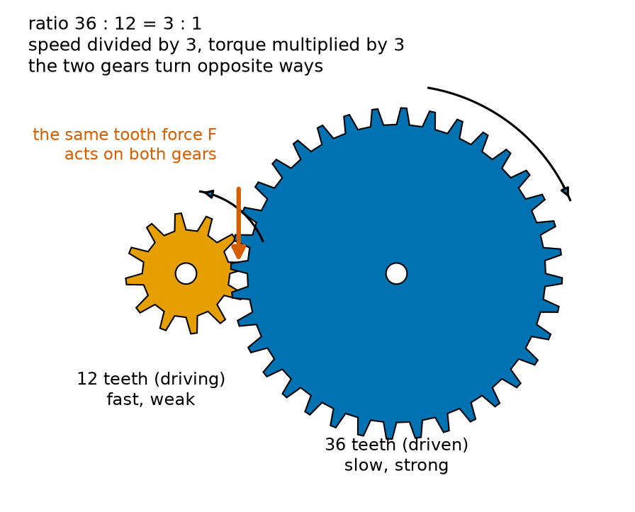
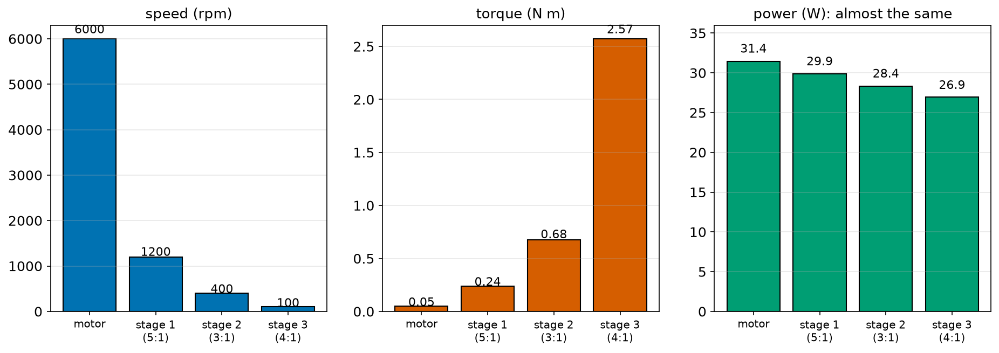
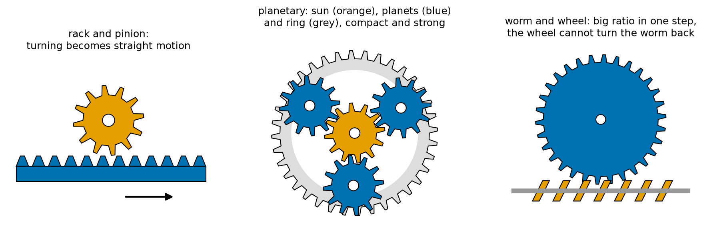
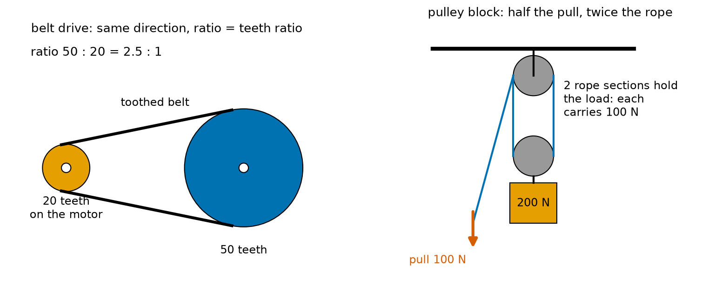
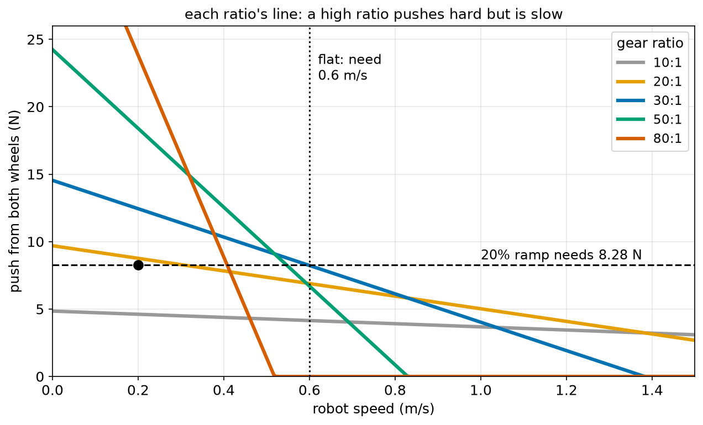
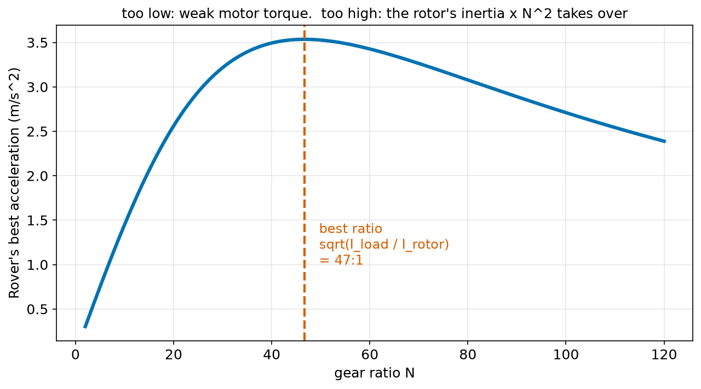

# Chapter 68 — Gears, Pulleys and Belts: Trading Speed for Torque

> **Part 4 · Chapter 68 of 749**
> **You need:** Chapter 37 (the gear-train program), Chapter 64 (v = ω r), Chapter 65 (torque), Chapter 66 (moment of inertia) and Chapter 67 (power).
> **You will make:** a program that follows speed, torque and power through a gearbox; a program that chooses the gear ratio for Rover so it is both fast enough and strong enough; and a calculator for the belt drive of a 3D printer.

---

## What you will learn

- Why robots almost always need **gears**: motors are fast and weak, wheels and joints must be slow and strong.
- What a **gear ratio** is, and why a gear pair divides speed and multiplies torque by the **same** number.
- Why the **power** stays the same through a gearbox, apart from losses.
- How to work out a **gear train** with several stages.
- The main kinds of gears: spur, rack and pinion, planetary, worm, and strain wave (harmonic drive).
- How **belts** and **pulleys** do the same job, and how a pulley block lifts loads.
- How to **choose** a gear ratio, including the surprising effect of the motor's own inertia, seen through the gears.
- What **backlash** is, and why it matters for robot arms.

---

## New words in this chapter

| Word | Simple meaning |
|---|---|
| **gear** | A wheel with teeth that mesh with the teeth of another gear. |
| **mesh** | When the teeth of two gears fit together. |
| **pinion** | The smaller gear of a pair, usually the driving one. |
| **gear ratio (N)** | Teeth on the driven gear ÷ teeth on the driving gear. |
| **gear train** | Several gear pairs one after another. |
| **gearbox** | A closed box of gears that changes a motor's speed and torque. |
| **stage** | One gear pair inside a gearbox. |
| **idler gear** | A gear placed between two others, only to change the direction. |
| **pulley** | A wheel that carries a belt, rope or cable. |
| **timing belt** | A belt with teeth, so it cannot slip on its pulleys. |
| **backlash** | A small gap between meshing teeth, so the output can wobble a little without the input moving. |
| **back-drivable** | A gearbox that can be turned from its output end, so it moves when pushed. |
| **reflected inertia** | A motor's moment of inertia as felt at the gearbox output: multiplied by N². |

---

## 68.1 Why robots need gears

A small DC motor spins very fast, perhaps 6,000 to 15,000 rpm, but it is weak: perhaps 0.01 to 0.05 N m. Rover's wheels need about 170 rpm (for 0.6 m/s) and much more torque, especially on ramps (Chapter 65).

Could we use a motor that is slow and strong? Such motors exist, but they are big, heavy and expensive. It is far cheaper to take a small, fast motor and **trade** some of its speed for torque. That is what gears do.

📖 **New word: gear** — a wheel with teeth around its edge. The teeth of two gears fit together, so when one turns, it pushes the other round without slipping.

📖 **New word: mesh** — two gears mesh when their teeth fit together.

📖 **New word: pinion** — the smaller gear of a pair. On a motor, the pinion is usually the gear on the motor's shaft.

Chapter 7 warned that meshing gears are dangerous for fingers, even with a small motor, "because gears multiply force". Chapter 37 used fractions to work out a gear train's speed and torque. This chapter shows where those rules come from.

---

## 68.2 The gear ratio



*Figure 68.1 — A 12-tooth gear drives a 36-tooth gear. The big gear turns 3 times slower, with 3 times the torque.*

**How to read this picture:** The small orange gear (12 teeth) is the driving gear, on the motor. The big blue gear (36 teeth) is driven by it. Where the teeth meet, they push on each other with the same force F (red arrow): by Newton's third law (Chapter 61), the small gear's tooth pushes the big gear's tooth exactly as hard as the big gear's tooth pushes back. The curved arrows show that the gears turn in **opposite** directions.

### Speed

Each tooth of the small gear pushes one tooth of the big gear past the meeting point. When the small gear makes one full turn, 12 teeth pass, so the big gear turns only 12 of its 36 teeth: one third of a turn.

📖 **New word: gear ratio (N)** — the number of teeth on the driven gear ÷ the number on the driving gear.

```
N = teeth_driven / teeth_driving = 36 / 12 = 3        (written "3:1")
ω_out = ω_in / N
```

In words: "the output turns N times slower than the input".

### Torque

The tooth force F is the same on both gears. Each gear's torque is F × its radius (Chapter 65). The gears' radii are in the same proportion as their numbers of teeth (each tooth takes up the same length of edge). So:

```
τ_out = F × r_big,   τ_in = F × r_small
τ_out / τ_in = r_big / r_small = 36 / 12 = N
τ_out = N × τ_in
```

In words: "the output torque is N times the input torque".

🧠 **Remember:** a gear ratio of N **divides** the speed by N and **multiplies** the torque by N.

### Power: the same on both sides

Why exactly the same N for both? Because of energy (Chapter 67). The power going in is τ_in × ω_in. The power coming out is:

```
τ_out × ω_out = (N × τ_in) × (ω_in / N) = τ_in × ω_in
```

The N cancels. A gearbox cannot make power; it only changes its "shape", from fast-and-weak to slow-and-strong. It is a lever that goes round and round (Chapter 65).

In real gears, some energy is lost as heat from friction between the teeth (Chapter 63). Each gear pair has an **efficiency** (Chapter 67), typically 90–98% for good spur gears. So in practice:

```
τ_out = N × τ_in × efficiency
```

**Small example.** A motor gives 0.05 N m at 6,000 rpm into a 3:1 gear pair, 95% efficient. Output: 2,000 rpm and 0.05 × 3 × 0.95 = 0.1425 N m.

### Direction

Two meshing gears turn in **opposite** directions. If the output must turn the same way as the input, add a third gear between them.

📖 **New word: idler gear** — a gear between two others. It changes the direction but not the ratio (whatever it gains from the first gear, it gives back to the third).

---

## 68.3 Gear trains

One gear pair gives a ratio of perhaps 3 to 6. For more, we put several pairs one after another.

📖 **New word: gear train** — several gear pairs in a row. 📖 **gearbox** — a closed box of gears. 📖 **stage** — one gear pair inside it.

In a gear train, the big gear of one stage is fixed on the same shaft as the small gear of the next stage. The ratios **multiply**:

```
N_total = N₁ × N₂ × N₃ × …
```

And so do the efficiencies (Chapter 67).

🔢 **Maths.** Chapter 37's gearbox: stages of 12→60, 15→45 and 10→40 teeth:

```
N = 5 × 3 × 4 = 60
efficiency = 0.95³ = 0.857
motor: 6000 rpm, 0.05 N m
output: 6000 / 60 = 100 rpm,  0.05 × 60 × 0.857 = 2.57 N m
```



*Figure 68.2 — Each stage divides the speed and multiplies the torque. The power falls only a little.*

**How to read this picture:** The left chart shows the speed after each stage: 6000, 1200, 400, 100 rpm. The middle chart shows the torque: 0.05, 0.24, 0.68, 2.57 N m. The right chart shows the power, τ × ω: 31.4 W from the motor, and 26.9 W at the output. The 4.5 W lost (14%) becomes heat in the gearbox.

---

## 68.4 Kinds of gears



*Figure 68.3 — Rack and pinion, planetary, and worm gears.*

**How to read this picture:** On the left, a round gear (the pinion) meshes with a straight bar of teeth (the rack); as the pinion turns, the rack slides sideways. In the middle, a planetary gearbox: an orange "sun" gear in the centre drives three blue "planet" gears, which roll around inside a grey ring with teeth on its inside. On the right, a worm (a screw, orange) turns a blue wheel; each turn of the worm moves the wheel by only one tooth.

| Kind | What it does | Typical ratio per stage | Robot use |
|---|---|---|---|
| **spur gears** | the simplest: straight teeth on parallel shafts | 1–6 | small gearmotors, toy robots |
| **rack and pinion** | turns rotation into straight motion | distance per turn = teeth × tooth spacing | linear axes, steering |
| **planetary** | sun, planets and ring: compact, strong, input and output on the same line | 3–10 | wheel motors, drone gimbals, robot joints |
| **worm and wheel** | a screw turns a wheel at right angles | 10–100 | lifts, robot arms that must hold still without power |
| **strain wave (harmonic drive)** | a flexible toothed ring bent into an oval by a cam | 50–160 | humanoid and arm joints (Chapter 694) |

### Worm gears hold their load

A worm gear with a high ratio usually cannot be turned **from the wheel side**: pushing on the wheel just jams it against the worm, because friction is too high (Chapter 63). That makes it **self-locking**: an arm or a lift driven by a worm gear stays where it is when the power is cut. That is a safety benefit, but it also means worm gears are less efficient (often 40–80%).

📖 **New word: back-drivable** — a gearbox that can be turned from its output end. Spur and planetary gearboxes with low ratios are back-drivable: if you push the robot's arm, the motor turns. Worm gears usually are not. Back-drivable joints are safer for robots that work near people, because a person who bumps into the arm can push it away (Chapter 390 builds on this).

### Strain wave gears

Chapter 37 promised to come back to the **strain wave gear** (also called a harmonic drive). It reaches ratios of 50 to 160 in one compact, light stage, with almost no backlash (section 68.7). That makes it the favourite of robot arm and humanoid joint designers. Chapter 694 explains how it works.

---

## 68.5 Pulleys and belts

📖 **New word: pulley** — a wheel that carries a belt, rope or cable.

A belt running around two pulleys works like a gear pair: the belt moves at the same speed around both pulleys, so v = ω r is the same for both (Chapter 64):

```
ω_small × r_small = ω_big × r_big
N = r_big / r_small = teeth_big / teeth_small   (for toothed pulleys)
```

Unlike gears, both pulleys turn in the **same** direction.

📖 **New word: timing belt** — a belt with teeth on its inside, running on toothed pulleys, so it cannot slip. 3D printers, robot arms and conveyor belts use them.



*Figure 68.4 — Left: a belt drive with a 2.5:1 ratio. Right: a pulley block that halves the pull needed.*

**How to read this picture:** On the left, a small orange pulley (20 teeth) on a motor drives a big blue pulley (50 teeth) through a toothed belt (black). Ratio 50 : 20 = 2.5 : 1; both turn the same way. On the right, a 200 N load hangs from a lower pulley, held by two sections of rope (blue). Each section carries half the load, 100 N, so pulling the free end with 100 N holds it. But to lift the load 1 m, you must pull 2 m of rope.

### Belts turn rotation into straight motion

A belt also turns a motor's rotation into straight-line motion. For a toothed belt:

```
distance per turn = teeth on the pulley × tooth spacing (pitch)
```

This is how a 3D printer moves its print head (Application 2).

### Pulley blocks

A **pulley block** uses several pulleys and one rope. If n sections of rope hold up the moving pulley, the pull needed is the load ÷ n, and you must pull n times as much rope. Again: the work is the same (Chapter 67's lever rule). Cranes, robot grippers driven by cables, and some robot hands use this idea.

---

## 68.6 Choosing a gear ratio

A bigger ratio gives more torque but less speed. How do we choose? The answer depends on what the motor can do at different speeds.

A DC motor's torque falls as it spins faster: it gives its most torque, the **stall torque** (Chapter 65), when held still, and no torque at its **free speed** (spinning with no load). In between, the torque falls roughly in a straight line (Chapter 138 explains why):

```
τ_motor = τ_stall × (1 − ω_motor / ω_free)
```

Through a gear ratio N, on a wheel of radius r:

```
robot speed      v = ω_motor × r / N
push on ground   F = τ_motor × N × efficiency / r
```

So each ratio gives a straight line of "push against speed". A high ratio gives a steep line: lots of push at low speed, but a low top speed. A low ratio gives a flat line: little push, but a high top speed.



*Figure 68.5 — The ratio must give enough push at the ramp point (black dot) and still reach 0.6 m/s on the flat.*

**How to read this picture:** Each coloured line is one gear ratio, for Rover's two motors. Each line starts at its biggest push (at zero speed) and falls to zero push at its top speed. The black dot marks what Rover needs on a 20% ramp: 8.28 N at 0.2 m/s. The dotted line marks 0.6 m/s, the speed it needs on the flat. A good ratio's line must pass above the dot **and** reach past the dotted line. 10:1 (grey) is too weak for the ramp. 80:1 (red) is too slow for the flat. 20:1 just manages the ramp; 30:1 and 50:1 do both comfortably. Application 1 picks one.

### The motor's inertia, seen through the gears

Chapter 66 found that a tiny motor rotor behind a 30:1 gearbox made Rover feel 0.83 kg heavier, and promised to explain the N².

When the output speeds up with angular acceleration α, the motor's rotor must speed up N times as fast: N α. That needs a torque I_rotor × N α at the motor. Seen at the output, a motor torque is multiplied by N. So the output "feels":

```
torque needed at the output = I_rotor × N α × N = (I_rotor × N²) × α
```

📖 **New word: reflected inertia** — the motor's moment of inertia as felt at the gearbox output: I_rotor × N².

One N comes from the rotor spinning faster; the other from the gears multiplying its torque. A rotor with I = 1 × 10⁻⁶ kg m² behind a 100:1 gearbox feels like 0.01 kg m² at the output, ten thousand times bigger.

This means there is a **best** gear ratio for acceleration. Too low a ratio, and the motor's small torque is not multiplied enough. Too high a ratio, and almost all the motor's effort goes into spinning its own rotor. The best ratio for speeding up a load of inertia I_load is:

```
N_best = √(I_load / I_rotor)
```

At that ratio, the reflected inertia of the rotor equals the load's inertia. (Part 10's calculus shows why; Chapter 190 finds best values.)



*Figure 68.6 — Rover's acceleration from rest rises with the ratio, peaks near 47:1, then falls.*

**How to read this picture:** Across the bottom is the gear ratio. Up the side is Rover's best acceleration from rest, with each motor giving its stall torque. At low ratios, the acceleration grows quickly: more ratio, more torque at the wheel. After the peak (red line, √(I_load / I_rotor) = 47:1), it slowly falls, because the rotor's reflected inertia I_rotor × N² grows faster than the torque. Rover's 30:1 is a little below the peak: it gives up a little acceleration (3.2 instead of 3.5 m/s²) for more top speed.

---

## 68.7 Backlash

Gear teeth cannot fit together perfectly tightly, or they would jam. There is always a tiny gap.

📖 **New word: backlash** — the small gap between meshing teeth. Because of it, the output can wobble by a small angle without the input moving at all.

For a wheel, a degree of backlash hardly matters. For a robot arm, it matters a lot: a 0.1° wobble at the shoulder of a 1 m arm moves the gripper by 1 × 0.1 × π / 180 = 1.7 mm (arc length, Chapter 47). And when the arm changes direction, the motor turns through the gap before the arm starts to move, which makes control harder (Part 12). That is why precise robot arms use strain wave gears, which have almost no backlash, or measure the joint angle **after** the gearbox.

---

## Code

File `code/ch068/gearbox.py`:

```python
# gearbox.py - a gear pair divides speed and multiplies torque; the power stays (almost) the same
import math

MOTOR_RPM = 6000
MOTOR_TORQUE_NM = 0.05
STAGE_EFFICIENCY = 0.95

stages = [(12, 60), (15, 45), (10, 40)]     # (teeth on the driving gear, teeth on the driven gear)

rpm, torque = MOTOR_RPM, MOTOR_TORQUE_NM
print("stage   ratio   speed (rpm)   torque (N m)   power (W)")
print(f"motor           {rpm:9.1f}   {torque:10.4f}   {torque * rpm * 2 * math.pi / 60:8.2f}")
for k, (driving, driven) in enumerate(stages, start=1):
    ratio = driven / driving
    rpm = rpm / ratio
    torque = torque * ratio * STAGE_EFFICIENCY
    power = torque * rpm * 2 * math.pi / 60          # P = torque x omega
    print(f"{k:5d}   {ratio:5.1f}   {rpm:11.1f}   {torque:12.4f}   {power:9.2f}")

total = 1
for driving, driven in stages:
    total = total * driven / driving
print(f"total ratio {total:.0f}:1, efficiency {STAGE_EFFICIENCY ** len(stages):.1%}")
```

| Line | Code | What it does (simple English) |
|---|---|---|
| 1 | `# gearbox.py …` | A comment. |
| 2 | `import math` | For π. |
| 3 | (blank) | Spacing. |
| 4–6 | `MOTOR_RPM`, `MOTOR_TORQUE_NM`, `STAGE_EFFICIENCY` | The motor and the efficiency of each gear pair. |
| 7 | (blank) | Spacing. |
| 8 | `stages = [(12, 60), (15, 45), (10, 40)]` | Chapter 37's gearbox, as (driving, driven) teeth. |
| 9 | (blank) | Spacing. |
| 10 | `rpm, torque = MOTOR_RPM, MOTOR_TORQUE_NM` | Start at the motor. |
| 11 | `print("stage …")` | The heading. |
| 12 | `print(f"motor …")` | The motor's row. Power = τ × ω, with ω = rpm × 2π / 60 (Chapter 64). |
| 13 | `for k, (driving, driven) in enumerate(stages, start=1):` | Each stage, counted from 1. |
| 14 | `ratio = driven / driving` | N for this stage. |
| 15 | `rpm = rpm / ratio` | Speed divided by N. |
| 16 | `torque = torque * ratio * STAGE_EFFICIENCY` | Torque multiplied by N, less the losses. |
| 17 | `power = torque * rpm * 2 * math.pi / 60` | P = τ ω after this stage. |
| 18 | `print(f"{k:5d} …")` | One row. |
| 19 | (blank) | Spacing. |
| 20 | `total = 1` | Start the product at 1 (not 0!). |
| 21–22 | `for … : total = total * driven / driving` | Multiply all the stage ratios. |
| 23 | `print(f"total ratio …")` | The total ratio, and the total efficiency 0.95³. |

Output:

```
stage   ratio   speed (rpm)   torque (N m)   power (W)
motor              6000.0       0.0500      31.42
    1     5.0        1200.0         0.2375       29.85
    2     3.0         400.0         0.6769       28.35
    3     4.0         100.0         2.5721       26.94
total ratio 60:1, efficiency 85.7%
```

The output torque, 2.57 N m, is the same as Chapter 37's answer.

---

## Small examples

**Example 1.** A 10-tooth gear drives a 50-tooth gear: N = 5. A motor at 3000 rpm gives 600 rpm.

**Example 2.** The same pair, 0.02 N m in, 96% efficient: 0.02 × 5 × 0.96 = 0.096 N m out.

**Example 3.** Stages of 4:1 and 5:1 give 20:1 in total.

**Example 4.** Three meshing gears in a row: the first and the third turn the same way.

**Example 5.** A 16-tooth pulley drives a 48-tooth pulley with a belt: 3:1, same direction.

**Example 6.** A GT2 pulley with 20 teeth (2 mm pitch) moves the belt 40 mm per turn.

**Example 7.** A rotor with I = 5 × 10⁻⁶ kg m² behind a 40:1 gearbox reflects 5 × 10⁻⁶ × 1600 = 0.008 kg m².

**Example 8.** A pulley block with 4 rope sections lifts a 400 N load with a 100 N pull, but needs 4 m of rope pulled per metre lifted.

---

## 🏭 Real robot applications

### Application 1 (worked in full) — 🤖 Choosing Rover's gear ratio

**1. The real problem.** Rover's designers have chosen a small motor (free speed 12,000 rpm, stall torque 0.010 N m) and 33 mm radius wheels. They must choose a gearbox. Rover must drive at 0.6 m/s on the flat, and must also climb a 20% ramp at 0.2 m/s or more.

**2. Why this theory.** Through a ratio N, the push at a given speed is τ_motor × N × efficiency / r, with the motor's torque falling as it spins faster (section 68.6). Each ratio gives a different push-against-speed line. We need a ratio whose line passes both tests.

**3. The numbers.** Rover 4.0 kg. Two driven wheels, radius 0.033 m. Gearbox efficiency 80%. Rolling resistance C_rr = 0.015 (Chapter 63). 20% ramp.

**4. The maths.**

```
on the flat: rolling resistance = 0.015 × 4 × 9.81 = 0.59 N
on the ramp: 4 × 9.81 × sin(atan 0.20) + 0.59 = 7.70 + 0.59 = 8.28 N

for N = 30, at 0.2 m/s:
  wheel speed = 0.2 / 0.033 = 6.06 rad/s,   motor speed = 6.06 × 30 = 181.8 rad/s
  free speed = 12000 × 2π / 60 = 1256.6 rad/s
  motor torque = 0.010 × (1 − 181.8 / 1256.6) = 0.00855 N m
  push = 2 × 0.00855 × 30 × 0.80 / 0.033 = 12.44 N   (more than 8.28 N: it climbs)
```

**5. The code.** File `code/ch068/choose_ratio.py`:

```python
# choose_ratio.py - pick a gear ratio so a robot is fast enough on the flat AND strong enough on a ramp
import math

G = 9.81
MASS_KG = 4.0                 # Rover
WHEEL_R = 0.033               # m
FREE_RPM = 12000              # motor speed with no load
STALL_NM = 0.010              # motor torque when held still
EFFICIENCY = 0.80             # gearbox
DRIVEN_WHEELS = 2
NEED_SPEED = 0.6              # m/s on the flat
RAMP_PERCENT = 20             # must climb this ramp...
RAMP_SPEED = 0.2              # ...at this speed or more


def wheel_force_at(speed, ratio):
    """Total push from both wheels at a given robot speed: motor torque falls in a straight line with speed."""
    motor_rad_s = speed / WHEEL_R * ratio
    free_rad_s = FREE_RPM * 2 * math.pi / 60
    motor_torque = STALL_NM * max(0.0, 1 - motor_rad_s / free_rad_s)
    return DRIVEN_WHEELS * motor_torque * ratio * EFFICIENCY / WHEEL_R


ramp_force = MASS_KG * G * math.sin(math.atan(RAMP_PERCENT / 100)) + 0.015 * MASS_KG * G
flat_force = 0.015 * MASS_KG * G
print(f"push needed: {flat_force:.2f} N on the flat, {ramp_force:.2f} N on the {RAMP_PERCENT}% ramp")
print(" ratio   top speed (m/s)   push at 0.2 m/s   flat ok   ramp ok")
for ratio in [10, 20, 30, 50, 80, 120]:
    top = FREE_RPM * 2 * math.pi / 60 / ratio * WHEEL_R          # wheel speed when the motor spins freely
    flat_ok = wheel_force_at(NEED_SPEED, ratio) >= flat_force
    push = wheel_force_at(RAMP_SPEED, ratio)
    print(f"{ratio:5d}   {top:12.2f}   {push:13.2f} N   {str(flat_ok):>7}   {str(push >= ramp_force):>7}")
```

| Line | Code | What it does (simple English) |
|---|---|---|
| 1 | `# choose_ratio.py …` | A comment. |
| 2 | `import math` | For π, `sin`, `atan`. |
| 3 | (blank) | Spacing. |
| 4–14 | `G`, `MASS_KG`, … `RAMP_SPEED` | All the numbers, each commented. |
| 15–16 | (blank) | Spacing. |
| 17 | `def wheel_force_at(speed, ratio):` | The total push at a robot speed, through a ratio. |
| 18 | `"""…"""` | The docstring states the motor model. |
| 19 | `motor_rad_s = speed / WHEEL_R * ratio` | Wheel ω = v / r (Chapter 64); the motor turns N times faster. |
| 20 | `free_rad_s = FREE_RPM * 2 * math.pi / 60` | The free speed in rad/s. |
| 21 | `motor_torque = STALL_NM * max(0.0, 1 - motor_rad_s / free_rad_s)` | The straight-line motor model. `max(0.0, …)` keeps it from going negative above the free speed. |
| 22 | `return DRIVEN_WHEELS * motor_torque * ratio * EFFICIENCY / WHEEL_R` | Torque × N × efficiency at each wheel, ÷ r for the push (Chapter 65), × 2 wheels. |
| 23–24 | (blank) | Spacing. |
| 25 | `ramp_force = …` | m g sin(angle) (Chapter 61) plus rolling resistance. |
| 26 | `flat_force = 0.015 * MASS_KG * G` | Only rolling resistance. |
| 27 | `print(f"push needed: …")` | The two targets. |
| 28 | `print(" ratio …")` | The table heading. |
| 29 | `for ratio in [10, 20, 30, 50, 80, 120]:` | Ratios to try. |
| 30 | `top = FREE_RPM * 2 * math.pi / 60 / ratio * WHEEL_R` | The top speed: motor free speed ÷ N × r. |
| 31 | `flat_ok = wheel_force_at(NEED_SPEED, ratio) >= flat_force` | Can it still push enough at 0.6 m/s? |
| 32 | `push = wheel_force_at(RAMP_SPEED, ratio)` | The push at 0.2 m/s. |
| 33 | `print(f"…")` | One row. `str(True)` prints "True". `:>7` pushes it to the right of a 7-wide column. |

Output:

```
push needed: 0.59 N on the flat, 8.28 N on the 20% ramp
 ratio   top speed (m/s)   push at 0.2 m/s   flat ok   ramp ok
   10           4.15            4.61 N      True     False
   20           2.07            8.76 N      True      True
   30           1.38           12.44 N      True      True
   50           0.83           18.40 N      True      True
   80           0.52           23.82 N     False      True
  120           0.35           24.51 N     False      True
```

**6. The result.** 10:1 is fast but too weak for the ramp; 80:1 and 120:1 are strong but cannot reach 0.6 m/s. 20:1 only just passes the ramp test (8.76 N against 8.28 N): no margin for a heavier load or a softer floor. 30:1 passes both with good margins: 1.38 m/s top speed, and 12.44 N on the ramp (50% more than needed). It is also near the best ratio for acceleration (section 68.6). Rover uses 30:1. (Chapter 66's effective-mass calculation assumed this ratio.)

**7. Going further.** Real motors also have a current limit and heat up (Chapter 52's cooling); running near the stall torque for long burns them. Chapter 138 gives the full motor equations, and Chapter 150 sizes a motor and gearbox together, including heating. Some robots use two-speed gearboxes, or wheels with different ratios for different jobs.

### Application 2 (worked in full) — 🖨️ The belt drive of a 3D printer

**1. The real problem.** A 3D printer (a robot that builds objects layer by layer) moves its print head with a stepper motor (Chapter 144) and a toothed belt. The firmware needs to know how many motor steps make 1 mm of movement. The designers also want to know how hard the belt can pull, and how fast the motor must spin for different printing speeds.

**2. Why this theory.** A toothed belt moves a fixed distance per pulley turn: teeth × pitch (section 68.5). The pulley is a wheel: the belt's pull is torque ÷ radius (Chapter 65). Its speed is the belt speed ÷ distance per turn.

**3. The numbers.** Stepper motor: 200 full steps per turn, driven with 16 microsteps per step (Chapter 145). GT2 pulley with 20 teeth; GT2 belt pitch 2 mm. Motor torque 0.40 N m. Print speeds 50, 150 and 300 mm/s.

**4. The maths.**

```
belt per turn = 20 × 2 mm = 40 mm
microsteps per turn = 200 × 16 = 3200
microsteps per mm = 3200 / 40 = 80     (one microstep = 12.5 micrometres)
pulley radius = 40 mm / (2π) = 6.37 mm
belt pull = 0.40 / 0.00637 = 63 N
at 150 mm/s: 150 / 40 = 3.75 turns per second = 225 rpm
```

**5. The code.** File `code/ch068/belt_axis.py`:

```python
# belt_axis.py - a stepper motor moves a 3D printer's print head with a toothed belt
import math

STEPS_PER_REV = 200           # a common stepper motor: 1.8 degrees per step
MICROSTEPS = 16               # the driver splits each step into 16 (Chapter 145)
PULLEY_TEETH = 20             # GT2 pulley on the motor
BELT_PITCH_MM = 2.0           # GT2 belt: one tooth every 2 mm
MOTOR_TORQUE_NM = 0.40

mm_per_rev = PULLEY_TEETH * BELT_PITCH_MM
steps_per_mm = STEPS_PER_REV * MICROSTEPS / mm_per_rev
pulley_radius_m = mm_per_rev / (2 * math.pi) / 1000
belt_force = MOTOR_TORQUE_NM / pulley_radius_m

print(f"one motor turn moves the belt {mm_per_rev:.0f} mm")
print(f"{steps_per_mm:.0f} microsteps per mm, so one microstep is {1000 / steps_per_mm:.1f} micrometres")
print(f"pulley radius {pulley_radius_m * 1000:.2f} mm, so {MOTOR_TORQUE_NM} N m pulls the belt with {belt_force:.0f} N")

for speed_mm_s in [50, 150, 300]:
    rpm = speed_mm_s / mm_per_rev * 60
    print(f"print head at {speed_mm_s:3d} mm/s: motor at {rpm:5.0f} rpm, {speed_mm_s * steps_per_mm:6.0f} microsteps per second")
```

| Line | Code | What it does (simple English) |
|---|---|---|
| 1 | `# belt_axis.py …` | A comment. |
| 2 | `import math` | For π. |
| 3 | (blank) | Spacing. |
| 4–8 | `STEPS_PER_REV`, `MICROSTEPS`, `PULLEY_TEETH`, `BELT_PITCH_MM`, `MOTOR_TORQUE_NM` | The parts, with comments. |
| 9 | (blank) | Spacing. |
| 10 | `mm_per_rev = PULLEY_TEETH * BELT_PITCH_MM` | Belt length per turn: teeth × pitch. |
| 11 | `steps_per_mm = STEPS_PER_REV * MICROSTEPS / mm_per_rev` | Microsteps per turn ÷ mm per turn. |
| 12 | `pulley_radius_m = mm_per_rev / (2 * math.pi) / 1000` | Circumference = 2π r, so r = circumference / 2π; then mm to m. |
| 13 | `belt_force = MOTOR_TORQUE_NM / pulley_radius_m` | F = τ / r. |
| 14 | (blank) | Spacing. |
| 15–17 | `print(…)` | The three results. |
| 18 | (blank) | Spacing. |
| 19 | `for speed_mm_s in [50, 150, 300]:` | Three printing speeds. |
| 20 | `rpm = speed_mm_s / mm_per_rev * 60` | Turns per second × 60 = rpm. |
| 21 | `print(f"print head at …")` | The motor speed and the step rate the driver must produce. |

Output:

```
one motor turn moves the belt 40 mm
80 microsteps per mm, so one microstep is 12.5 micrometres
pulley radius 6.37 mm, so 0.4 N m pulls the belt with 63 N
print head at  50 mm/s: motor at    75 rpm,   4000 microsteps per second
print head at 150 mm/s: motor at   225 rpm,  12000 microsteps per second
print head at 300 mm/s: motor at   450 rpm,  24000 microsteps per second
```

**6. The result.** The firmware setting is 80 steps per mm, a number you will find in almost every hobby 3D printer's settings. One microstep moves the head 12.5 micrometres, much finer than the printed layers. The belt can pull with 63 N, plenty to accelerate a light print head (a 0.5 kg head at 10 m/s² needs only 5 N, Chapter 61). At 300 mm/s the motor turns at 450 rpm, and the controller must send 24,000 step pulses every second: a job for a microcontroller (Part 6), not for Python on a PC.

**7. Going further.** Stepper motors lose torque at high speeds, so very fast printing can make them "skip steps", and the head ends up in the wrong place with no encoder to notice. Chapter 145 covers stepper drivers and microstepping. Belts also stretch a little under load, which acts like a spring; Part 13 shows how such springiness affects control.

### Application 3 — 🦿 Strain wave gears in humanoid joints

A humanoid robot's knee may need 100 N m or more when it stands up (Chapter 65's exoskeleton example, for a heavier robot). A suitable brushless motor gives about 1 N m. A **strain wave gear** with a 100:1 ratio, at about 75% efficiency, turns this into about 75 N m in a light, flat package, with almost no backlash. Its downside is that at 100:1, the motor's reflected inertia is multiplied by 10,000 (section 68.6), and the gear is hard to back-drive, which makes the leg stiff when it hits the ground unexpectedly. That is why some newer legged robots use lower ratios (6:1 to 10:1) with bigger motors: "quasi-direct drive". The choice of ratio is one of the biggest design decisions in a legged robot (Chapter 694).

### Application 4 — 🚀 A gearbox for steep Martian slopes

A Mars rover's wheels each have their own motor and a very high gear ratio, often well over 1000:1 through several planetary stages. The rover moves very slowly (a few centimetres per second), but each wheel can give a large torque to climb slopes and rocks. Power on Mars is scarce (solar panels or a small nuclear generator), and P = τ ω (Chapter 67): with limited power, a high torque is only possible at a low speed. The gear ratio decides where on that trade-off the rover sits. Planetary gears are chosen because they are compact and share the load between several planets, so no single tooth carries it all.

### Application 5 — 🛗 A worm-geared lift that holds when the power fails

A small goods lift inside a warehouse robot station raises 30 kg boxes by 2 m. Its motor drives the lifting drum through a 40:1 worm gear. If the power fails halfway up, the box must not fall. A spur gearbox would back-drive and let the box drop; the worm gear is self-locking (section 68.4), so the box stays where it is. The price is efficiency: the worm gear wastes about half the energy as heat, so the motor must be twice as powerful. Lifting 30 × 9.81 × 2 = 589 J (Chapter 67) in 10 s needs 59 W of useful power, so about 120 W from the motor. Safety-critical lifts often have a separate brake as well, rather than relying on the worm alone.

---

## 🔧 Hands-on lab

### Lab 68.1 — Count teeth and turns (hardware)

You need a bicycle with gears (or any toy with visible gears, or LEGO gears).

1. On a bicycle, count the teeth on the front chain ring and on the back sprocket the chain is on.
2. Work out the gear ratio. (Here the pedals drive the back wheel, so "driving" is the front ring.)
3. Turn the pedals exactly one turn by hand, with the back wheel off the ground. Count how many turns the back wheel makes.
4. Repeat in a different gear.

**What you should see:** The back wheel makes (front teeth ÷ back teeth) turns for each pedal turn. With a 44-tooth ring and an 11-tooth sprocket, that is 4 turns: a "high" gear for speed. With a 32-tooth ring and a 32-tooth sprocket, 1 turn: a "low" gear for climbing hills. Here the chain makes the wheel turn **faster** than the pedals: a gear ratio less than 1, trading torque for speed.

| If it does not work | Likely cause | Fix |
|---|---|---|
| The count is not a whole number | Correct: ratios are often not whole numbers | Count carefully, or turn the pedals 4 times and divide |
| The ratio seems upside down | Front and back swapped | Turns of the wheel per pedal turn = front teeth ÷ back teeth |

**Challenge:** Which gear would a robot bicycle use to climb a steep hill, and why? Use torque and speed in your answer.

### Lab 68.2 — Try other ratios (simulation)

Copy `choose_ratio.py`.

1. Rover gets a 1 kg payload (5 kg in total). Which ratios still pass both tests?
2. Change the ramp to 30%. Which ratios pass now?
3. Write a loop that finds the smallest and largest whole-number ratio that pass both tests, for the original Rover.

**What you should see:** With 5 kg, 20:1 fails the ramp (it needs 10.35 N), and 30:1 and 50:1 still pass. With a 30% ramp, a narrower range of ratios passes (about 29:1 to 67:1). For the original Rover, the passing range is about 19:1 to 67:1; the top limit comes from the flat-speed test, the bottom limit from the ramp.

| If it does not work | Likely cause | Fix |
|---|---|---|
| All ratios pass the ramp | The ramp force uses the angle in degrees in `sin` | Use `math.sin(math.atan(percent / 100))` |
| No ratio passes the flat test | `NEED_SPEED` in km/h | Use m/s |

**Challenge:** Plot the margin (push ÷ needed push) on the ramp and on the flat against the ratio. Choose the ratio where the smaller of the two margins is as big as possible.

### Lab 68.3 — Your own printer axis (simulation)

Copy `belt_axis.py`.

1. Change to a 16-tooth pulley. What is the new steps per mm? The new belt pull?
2. A leadscrew (a threaded rod) moves the print bed 8 mm per turn on the Z axis. With the same stepper and 16 microsteps, how many steps per mm is that?
3. Which is better for very fine height steps, the belt or the leadscrew? Why are leadscrews used for the Z axis?

**What you should see:** With 16 teeth: 32 mm per turn, 100 steps per mm, and a pull of 0.40 / 0.00509 = 79 N (smaller pulley, more force). The leadscrew gives 3200 / 8 = 400 steps per mm: much finer steps, and a leadscrew does not move when the motor is switched off (like a worm gear), so the bed stays put. Belts are faster; leadscrews are finer and hold their position.

| If it does not work | Likely cause | Fix |
|---|---|---|
| Steps per mm much too big | Pitch typed in metres | Keep everything in mm here |
| Belt force tiny | Radius left in mm | Convert to metres before dividing |

**Challenge:** Your printer's X axis measures 98.6 mm when it should move 100 mm. What should the steps-per-mm setting be? (Chapter 133's calibration.)

---

## Common mistakes

⚠️ **Thinking a gearbox makes power.** It only trades speed for torque; real gearboxes lose some power as heat.

⚠️ **Dividing the torque by the ratio.** A gear ratio N divides the **speed** and **multiplies** the torque.

⚠️ **Adding stage ratios instead of multiplying them.** 5:1 then 3:1 is 15:1, not 8:1.

⚠️ **Forgetting the efficiency.** Three stages at 95% each lose 14%.

⚠️ **Forgetting the direction.** Each gear pair reverses the direction; belts do not.

⚠️ **Choosing the highest ratio "to be safe".** Too high a ratio makes the robot slow, and the motor's reflected inertia (N²) makes it sluggish.

⚠️ **Ignoring backlash in arms.** A tiny angle at a joint is a big distance at the gripper.

---

## Practice

🏋️ **1.** A 15-tooth gear drives a 45-tooth gear. What is the ratio? If the input turns at 900 rpm with 0.1 N m, what are the output speed and torque (no losses)?

🏋️ **2.** The same pair is 94% efficient. What is the output torque now?

🏋️ **3.** A gearbox has stages of 4:1, 4:1 and 3:1, each 96% efficient. Find the total ratio and the total efficiency.

🏋️ **4.** A motor gives 25 W into a gearbox that is 80% efficient. The output turns at 50 rpm. What is the output torque?

🏋️ **5.** Gears A (driving), B and C mesh in a row. A turns clockwise. Which way does C turn?

🏋️ **6.** A belt drive has a 12-tooth pulley on the motor and a 60-tooth pulley on the wheel. The motor turns at 3000 rpm. How fast does the wheel turn, and in which direction compared with the motor?

🏋️ **7.** A rack and pinion has a pinion of radius 10 mm. How far does the rack move per turn?

🏋️ **8.** A rotor of I = 2 × 10⁻⁶ kg m² is behind a 50:1 gearbox. What is its reflected inertia at the output?

🏋️ **9.** A joint drives a load with I_load = 0.02 kg m², using a motor with I_rotor = 5 × 10⁻⁶ kg m². What is the best gear ratio for acceleration?

🏋️ **10.** A shoulder joint has 0.2° of backlash. How far can the tip of a 0.8 m arm wobble?

🏋️ **11.** Write a function `through_gears(rpm, torque, stages, eff)` that returns the output speed and torque for a list of (driving, driven) teeth, and test it with Chapter 37's gearbox. Then use it to check the claim that the output power is input power × eff^(number of stages).

---

## Answers

**1.** N = 3. 300 rpm, 0.3 N m.

**2.** 0.1 × 3 × 0.94 = 0.282 N m.

**3.** N = 48. Efficiency 0.96³ = 0.885 (88.5%).

**4.** Output power 20 W. ω = 50 × 2π / 60 = 5.236 rad/s. τ = 20 / 5.236 = 3.82 N m.

**5.** A clockwise, B anticlockwise, C clockwise: the same as A.

**6.** N = 5: 600 rpm, the same direction.

**7.** 2π × 10 mm = 62.8 mm.

**8.** 2 × 10⁻⁶ × 2500 = 0.005 kg m².

**9.** √(0.02 / 5 × 10⁻⁶) = √4000 = 63:1.

**10.** 0.8 × 0.2 × π / 180 = 0.0028 m = 2.8 mm.

**11.**

```python
import math

def through_gears(rpm, torque, stages, eff):
    for driving, driven in stages:
        ratio = driven / driving
        rpm = rpm / ratio
        torque = torque * ratio * eff
    return rpm, torque

out_rpm, out_t = through_gears(6000, 0.05, [(12, 60), (15, 45), (10, 40)], 0.95)
p_in = 0.05 * 6000 * 2 * math.pi / 60
p_out = out_t * out_rpm * 2 * math.pi / 60
print(round(out_rpm, 1), round(out_t, 4))                    # 100.0 2.5721
print(round(p_out / p_in, 4), round(0.95 ** 3, 4))           # 0.8574 0.8574
```

The two ratios agree: the output power is the input power × 0.95³.

---

## Summary

🧠 Motors are fast and weak; wheels and joints must be slow and strong. **Gears** trade speed for torque.

🧠 **Gear ratio N** = driven teeth ÷ driving teeth. Output speed = input ÷ N; output torque = input × N × efficiency.

🧠 Power τ × ω is (almost) the same on both sides: a gearbox is a lever that goes round and round. Losses become heat.

🧠 In a **gear train**, ratios multiply, and so do efficiencies. Each gear pair reverses the direction.

🧠 Kinds: spur, rack and pinion (rotation to straight line), planetary (compact, strong), worm (big ratio, self-locking), strain wave (big ratio, no backlash).

🧠 **Belts** and **pulleys** work like gears with N = pulley teeth ratio, turning the same way. A toothed belt moves teeth × pitch per turn. A **pulley block** with n ropes divides the pull by n.

🧠 Choose N so the robot is both **fast enough** and **strong enough**. The motor's **reflected inertia** is I_rotor × N², so the best ratio for acceleration is √(I_load / I_rotor).

🧠 **Backlash** is the tiny gap between teeth: a small angle at a joint, a big error at the gripper.

---

## Next chapter

In Chapter 69 we look closely at **wheels**: how a wheel rolls without slipping, why a rolling wheel's top moves twice as fast as the robot and its bottom does not move at all, how rolling resistance depends on the wheel and the floor, and which wheel is best for which robot.
