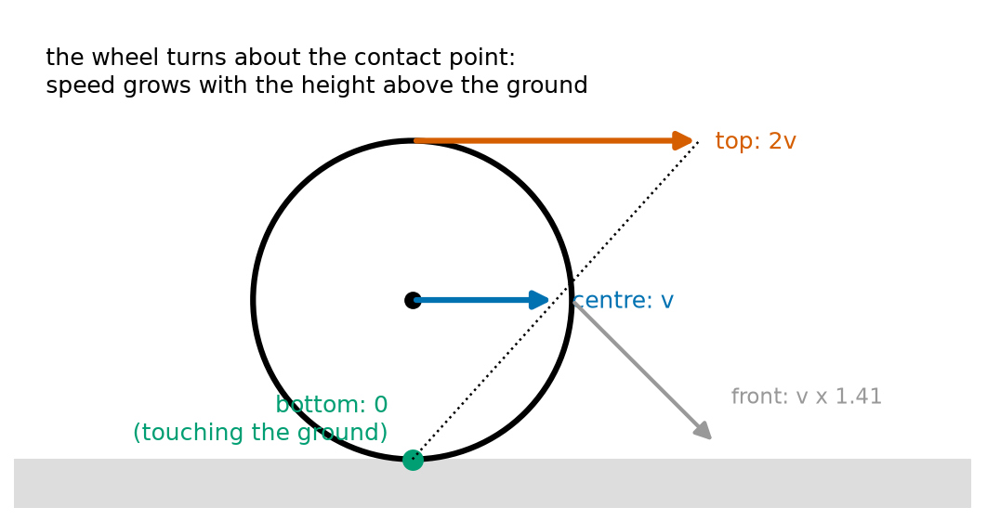
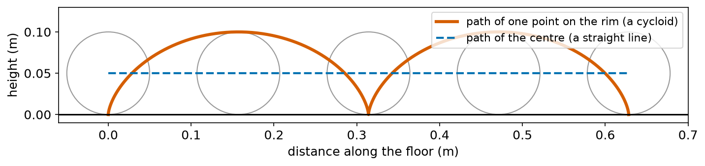
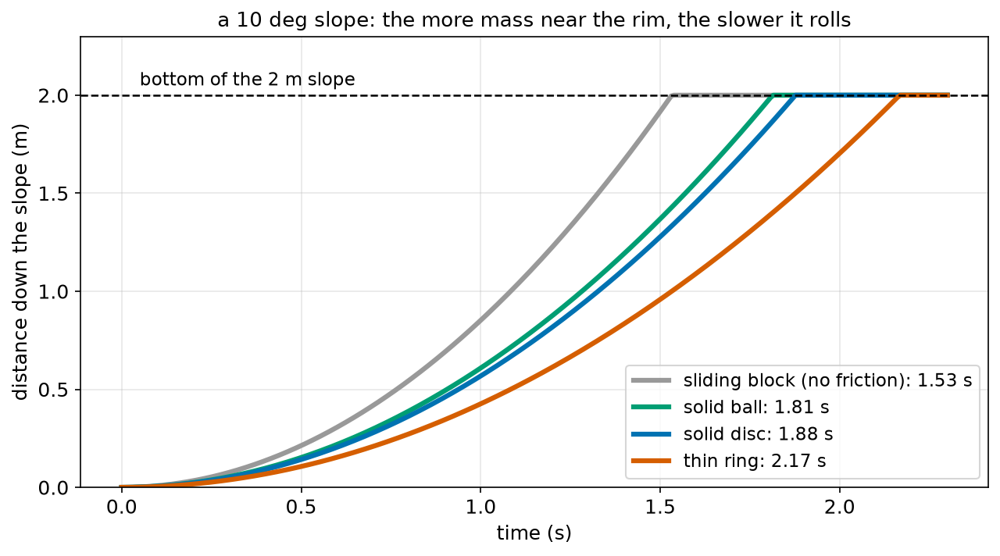
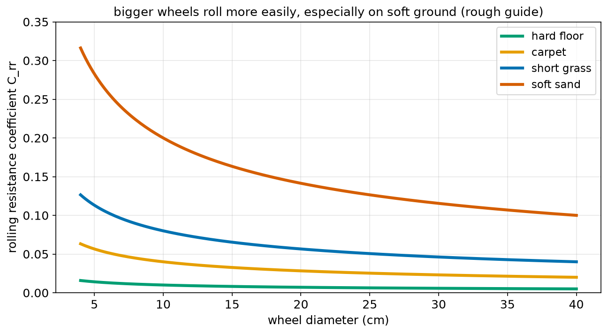
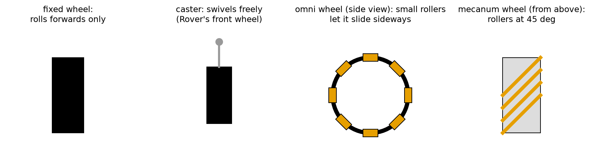

# Chapter 69 — Wheels and Rolling

> **Part 4 · Chapter 69 of 749**
> **You need:** Chapter 63 (grip and rolling resistance), Chapter 64 (v = ω r), Chapter 65 (climbing a step), Chapter 66 (moment of inertia) and Chapter 67 (energy).
> **You will make:** a program that finds the velocity of any point on a rolling wheel, a "rolling race" between a ball, a disc, a ring and a sliding block, a program that measures wheel slip and calibration errors, and a calculator that chooses the wheel size for a robot lawn mower.

---

## What you will learn

- What **rolling without slipping** means, and why the bottom of a rolling wheel is momentarily **still**.
- Why the top of a wheel moves at **twice** the robot's speed.
- What **slip** is, how to measure it, and why it ruins odometry.
- Why a ring rolls down a slope more slowly than a disc of the same mass, and both more slowly than a block sliding on ice.
- Why bigger wheels roll more easily, especially on soft ground.
- The main kinds of robot wheels: fixed, caster, omni, mecanum and tracks.
- How to choose a wheel size.

---

## New words in this chapter

| Word | Simple meaning |
|---|---|
| **rolling without slipping** | A wheel turning so that its contact point does not slide on the ground: v = ω r. |
| **contact point** | The place where the wheel touches the ground. |
| **contact patch** | The small flat area of a soft tyre that touches the ground. |
| **slip** | The difference between how far the wheel's surface rolled and how far the robot really moved, as a share. |
| **cycloid** | The curve traced by a point on the rim of a rolling wheel. |
| **caster** | A wheel that swivels freely, so it can roll in any direction. |
| **omni wheel** | A wheel with small rollers around its rim, so it can also slide sideways. |
| **mecanum wheel** | A wheel with rollers at 45°, letting a four-wheeled robot drive in any direction. |
| **track** | A loop of belt around several wheels, as on a tank. |

---

## 69.1 Rolling without slipping

A wheel can move across the ground in three ways:

1. **Skidding**: it slides without turning, like a locked wheel braking on ice.
2. **Spinning**: it turns without moving forward, like a car stuck in mud.
3. **Rolling**: it turns and moves forward together, so that the part touching the ground does not slide.

📖 **New word: rolling without slipping** — a wheel turning so that its contact point never slides on the ground. Then the distance the robot moves equals the distance the wheel's rim turns (Chapter 47), and:

```
v = ω × r
```

This is the rule Rover's odometry has used since Chapter 47. It is only true while the wheel rolls without slipping.

📖 **New word: contact point** — where the wheel touches the ground. A hard wheel on a hard floor touches it at almost one point (really a short line across the wheel's width).

### The bottom of a rolling wheel is still

Here is a surprise. While a robot drives at 0.5 m/s, its wheels' bottoms are **not moving**.

A point on the rim has two motions at once:

- it moves forward with the whole wheel, at v;
- it turns around the wheel's centre, at ω r = v, in the direction along the rim.

At the bottom, turning carries the point **backwards** at v, while the wheel carries it **forwards** at v. They cancel: speed 0. At the top, both carry it forwards: speed 2v.



*Figure 69.1 — A rolling wheel turns about its contact point. The higher a point, the faster it moves.*

**How to read this picture:** A wheel rolls to the right on the grey floor. The green dot at the bottom, touching the floor, is still. The centre (blue arrow) moves at v. The top (red arrow) moves at 2v. A point at the front of the rim (grey arrow) moves at v × √2 = 1.41 v, pointing forward and down. The black dotted line from the contact point to the tip of the red arrow shows the pattern: at each moment, the whole wheel turns about the contact point, so a point's speed is proportional to its distance from it.

The Code section works out these velocities.

🤖 **Robot link.** This is **why** friction can push a rolling robot forward (Chapter 63) using **static** friction, not sliding friction: the contact point is not sliding. It is also why tyres wear slowly: their rubber is never dragged along the ground, only pressed and lifted.

### The cycloid

📖 **New word: cycloid** — the curve traced by a point on the rim of a rolling wheel.



*Figure 69.2 — A point on the rim (red) travels in arches. The centre (blue dashed) travels in a straight line.*

**How to read this picture:** The grey circles show a 10 cm wheel at five moments as it rolls to the right. The red curve is the path of one point on its rim: it touches the floor (where it is still), rises in an arch to the top (where it is fastest), and comes down again. Each arch is one full turn, 2π r = 0.314 m long. The blue dashed line is the path of the wheel's centre: straight and level.

---

## 69.2 Slip

Real wheels never roll perfectly. When a robot pushes hard (speeding up, climbing) or brakes hard, its tyres stretch and slide a little, and on loose or slippery ground they may slide a lot.

📖 **New word: slip** — the difference between how far the wheel's surface rolled (ω r × time) and how far the robot really moved, as a share of the distance rolled:

```
slip = (distance rolled − distance moved) / distance rolled
```

- slip = 0: perfect rolling.
- slip = 0.2 (20%): the wheel rolled 1 m but the robot moved only 0.8 m. The wheel is spinning partly in place.
- When braking, the wheel rolls less than the robot moves, and the slip is negative.

On hard floors, slip is usually under 1–2%. On dust, grass, wet tiles, gravel or sand, it can be 10–50%. A stuck robot has 100% slip: the wheels turn, the robot does not move.

### Why slip ruins odometry

Rover's odometry (Chapters 47 and 56) counts encoder ticks and assumes v = ω r. Every bit of slip makes it think it has moved further than it has. Slip also tends to be different on the two wheels, so the robot's **heading** goes wrong too, and a heading error grows into a big position error over a long drive (Chapter 53).

There is a second, quieter error: if the wheel's **diameter** used in the program is wrong (because of wear, or a squashed tyre under a heavy load), the robot is wrong by the same percentage on every metre. Chapter 16 calibrated Rover's wheel diameter as 0.06589 m. If the program used 0.0660 m instead, every metre would be 0.17% too long: 1.7 cm in 10 m. Small, but it adds up.

The Code section's `slip_check.py` separates the two kinds of error.

🤖 **Robot link.** Robots detect slip by comparing the wheel's speed with an **independent** measure of how fast they are really moving: an optical flow sensor looking at the floor, a camera, a lidar, or the accelerometer (Chapter 58). If the wheels say "moving" and the other sensor says "still", the robot is stuck. Application 1 uses this.

---

## 69.3 Rolling down a slope: the rolling race

Chapter 66 set a challenge: which rolls down a slope faster, a solid can or a hollow can of the same mass and size? Energy (Chapter 67) gives the answer.

A rolling object going down a slope turns potential energy into **two** kinds of kinetic energy: moving forward (½ m v²) and spinning (½ I ω², Chapter 67). With v = ω r, and writing the moment of inertia as I = k m r² (Chapter 66: k = 1 for a ring, ½ for a disc, 2/5 for a ball):

```
m g h = ½ m v² + ½ I ω²
      = ½ m v² + ½ (k m r²)(v / r)²
      = ½ m v² (1 + k)
```

So:

```
v² = 2 g h / (1 + k)
```

The bigger k is, the more of the energy goes into spinning, and the less into moving forward. Following the same steps as Chapter 59, the acceleration down a slope of angle θ is:

```
a = g sin θ / (1 + k)
```

In words: "a rolling object accelerates down a slope at g sin θ, divided by 1 plus its k". Notice that m and r both cancel: a big hoop and a small hoop of any mass roll exactly alike.

🔢 **Maths.** On a 10° slope, g sin 10° = 1.703 m/s²:

| Object | k | a = 1.703 / (1 + k) |
|---|---|---|
| block sliding on ice (no spin) | 0 | 1.703 m/s² |
| solid ball | 0.4 | 1.217 m/s² |
| solid disc, full can | 0.5 | 1.136 m/s² |
| thin ring, empty can | 1.0 | 0.852 m/s² |



*Figure 69.3 — On a 2 m, 10° slope, the sliding block wins and the ring comes last.*

**How to read this picture:** Each curve is the distance down the slope against time, for one object starting from rest. All are parabolas (Chapter 59: s = ½ a t²), but with different accelerations. The grey sliding block (nothing to spin) reaches the bottom first, in 1.53 s. The green ball (1.81 s) and the blue disc (1.88 s) are close. The red ring is last (2.17 s), because half of its energy goes into spinning.

So the answer to Chapter 66's challenge: the **solid** can wins, because more of its mass is near its centre (smaller k). (A real can of soup has liquid inside that does not fully spin with the can, which makes it even faster.)

🤖 **Robot link.** This is the "effective mass" of Chapter 66 again, seen from the energy side. A robot whose wheels are heavy rings (big k, big r) spends more of its battery spinning them up. Light wheels with their mass near the hub are better for robots that start and stop often.

---

## 69.4 Rolling resistance and wheel size

Chapter 63 met **rolling resistance**: rolling resistance ≈ C_rr × m g. Where does it come from?

When a soft tyre rolls on a hard floor, it is squashed into a flat **contact patch** at the bottom, then springs back as it leaves. Rubber does not give back all the energy used to squash it; some becomes heat (feel a car tyre after a long drive). When a hard wheel rolls on soft ground (carpet, grass, sand), it is the **ground** that is squashed: the wheel sinks a little and is always climbing out of its own small dip. Either way, energy is lost, and the robot must push to keep rolling.

📖 **New word: contact patch** — the small flat area of a soft tyre that touches the ground.

Rough values of C_rr for robot-sized wheels (about 10 cm across):

| Wheel and ground | C_rr (about) |
|---|---|
| hard plastic wheel on smooth concrete | 0.005–0.01 |
| rubber tyre on tiles or wood | 0.01–0.02 |
| rubber tyre on carpet | 0.03–0.06 |
| tyre on short grass | 0.06–0.10 |
| tyre on soft sand | 0.15–0.30 |

### Bigger wheels roll more easily

A bigger wheel sinks less steeply into soft ground and climbs out of its dip more gently, a bit like the step-climbing of Chapter 65. Measurements show that C_rr falls roughly with the **square root** of the diameter: a wheel 4 times bigger has about half the rolling resistance. (This is only a rough rule, good for comparing choices.)



*Figure 69.4 — Bigger wheels roll more easily. The effect is large on soft ground and small on hard floors.*

**How to read this picture:** Across the bottom is the wheel diameter, up the side the rolling resistance coefficient, for four kinds of ground. Every curve falls as the wheels get bigger, following the rough 1/√diameter rule. On a hard floor (green), the coefficient is small at any size, so wheel size hardly matters. On soft sand (red), small wheels are very hard to push: a 5 cm wheel has nearly three times the resistance of a 40 cm wheel.

That is why planetary rovers, farm robots and lawn mowers have big wheels, and robot vacuums (which work on hard floors and thin carpets) have small ones.

---

## 69.5 Kinds of wheels



*Figure 69.5 — Fixed wheel, caster, omni wheel and mecanum wheel.*

**How to read this picture:** From left to right. A **fixed** wheel (seen from above) rolls only forwards and backwards. A **caster** swivels around a vertical pin (the grey dot), so it follows wherever the robot goes. An **omni wheel** (seen from the side) has small rollers around its rim, turned at right angles to the wheel, so it can roll forwards **and** slide sideways. A **mecanum wheel** (seen from above) has rollers at 45°.

📖 **New word: caster** — a wheel that swivels freely. Rover has two driven fixed wheels and a caster at the front, which just follows.

📖 **New word: omni wheel** — a wheel with small free rollers around its rim, at right angles to the wheel. It can be pushed sideways without resistance.

📖 **New word: mecanum wheel** — a wheel with rollers at 45°. A robot with four mecanum wheels can drive forwards, sideways, diagonally, or turn on the spot, by choosing the speed of each wheel. Glide, one of the robots in this course, uses them (Chapter 307).

📖 **New word: track** — a loop of belt around several wheels, as on a tank or a digger. Tracks spread the robot's weight over a big area, so they sink less into soft ground and grip better, but they lose more energy when turning (the track must be dragged sideways) and they wear quickly.

| Kind | Moves sideways? | Good for | Downside |
|---|---|---|---|
| fixed wheels + caster | no | simple, cheap, efficient indoor robots | cannot move sideways |
| car-like steering | no | fast outdoor robots, cars (Chapter 301) | cannot turn on the spot |
| omni wheels | yes | small robots that must move in any direction | rollers bump on rough floors |
| mecanum wheels | yes | warehouse and factory floors | need flat floors, lose some efficiency |
| tracks | no | mud, sand, snow, rubble | wasteful when turning, slow |
| legs (Part 31) | yes | stairs, rocks, very rough ground | complex, slow, power-hungry |

---

## 69.6 Choosing a wheel size

Every wheel size is a trade-off:

| Bigger wheel | Smaller wheel |
|---|---|
| rolls over bigger bumps (Chapter 65) | gets stuck on smaller bumps |
| lower rolling resistance on soft ground | higher rolling resistance |
| turns slower for the same speed (v = ω r): needs less gear ratio | turns faster: needs more gear ratio |
| needs more torque for the same push (F = τ / r) | less torque for the same push |
| heavier, larger moment of inertia (Chapter 66) | lighter, quicker to spin up |
| robot body sits higher: may tip more easily (Chapter 70) | lower and more stable |

Application 2 works through this for a lawn mower.

---

## Code

File `code/ch069/rolling.py`:

```python
# rolling.py - points on a rolling wheel: the bottom is still, the centre moves at v, the top at 2v
import math

R = 0.05            # wheel radius in m
V = 0.5             # robot speed in m/s
omega = V / R       # rolling without slipping: v = omega r

print(f"omega = {omega:.1f} rad/s")
for name, angle_deg in [("bottom", 270), ("front", 0), ("top", 90), ("back", 180)]:
    a = math.radians(angle_deg)
    # velocity of a rim point = velocity of the centre + velocity from turning (clockwise, so -omega)
    vx = V + (-omega) * (-R * math.sin(a))
    vy = round((-omega) * (R * math.cos(a)), 9) + 0.0      # round away a tiny -0.0
    print(f"{name:6s} of the rim: velocity ({vx:+.2f}, {vy:+.2f}) m/s, speed {math.hypot(vx, vy):.3f} m/s")

print("path of one point on the rim (a cycloid), every quarter turn:")
for k in range(0, 9):
    t = k * (math.pi / 2) / omega
    x = V * t - R * math.sin(omega * t)
    y = R - R * math.cos(omega * t)
    print(f"  t = {t:.3f} s: x = {x:.4f} m, y = {y:.4f} m")
```

| Line | Code | What it does (simple English) |
|---|---|---|
| 1 | `# rolling.py …` | A comment. |
| 2 | `import math` | For trig and π. |
| 3 | (blank) | Spacing. |
| 4 | `R = 0.05` | A 10 cm wheel. |
| 5 | `V = 0.5` | The robot's speed. |
| 6 | `omega = V / R` | Rolling without slipping. |
| 7 | (blank) | Spacing. |
| 8 | `print(f"omega = …")` | 10 rad/s. |
| 9 | `for name, angle_deg in [("bottom", 270), …]:` | Four points on the rim, by their angle measured anticlockwise from the front (Chapter 50). |
| 10 | `a = math.radians(angle_deg)` | Radians. |
| 11 | `# velocity of a rim point …` | The idea: the centre's velocity plus the turning velocity. A wheel rolling to the right turns clockwise, so its ω is negative. |
| 12 | `vx = V + (-omega) * (-R * math.sin(a))` | The x part. A point at angle a turning with ω has velocity ω × (−r sin a, r cos a) (the velocity at right angles to the radius, Chapter 64). |
| 13 | `vy = round(…, 9) + 0.0` | The y part. Rounding to 9 decimals, then adding 0.0, turns a tiny "−0.0" into a clean 0.0 (Chapter 54). |
| 14 | `print(f"…speed {math.hypot(vx, vy):.3f}…")` | The velocity and its size. |
| 15 | (blank) | Spacing. |
| 16 | `print("path of one point …")` | A heading. |
| 17 | `for k in range(0, 9):` | Nine moments, a quarter turn apart: two full turns. |
| 18 | `t = k * (math.pi / 2) / omega` | The time for k quarter turns. |
| 19 | `x = V * t - R * math.sin(omega * t)` | The point's x: the centre's x minus its turning part. |
| 20 | `y = R - R * math.cos(omega * t)` | Its height: starts at 0 (the bottom), reaches 2R at the top. |
| 21 | `print(f"  t = …")` | One row. |

Output:

```
omega = 10.0 rad/s
bottom of the rim: velocity (+0.00, +0.00) m/s, speed 0.000 m/s
front  of the rim: velocity (+0.50, -0.50) m/s, speed 0.707 m/s
top    of the rim: velocity (+1.00, +0.00) m/s, speed 1.000 m/s
back   of the rim: velocity (+0.50, +0.50) m/s, speed 0.707 m/s
path of one point on the rim (a cycloid), every quarter turn:
  t = 0.000 s: x = 0.0000 m, y = 0.0000 m
  t = 0.157 s: x = 0.0285 m, y = 0.0500 m
  t = 0.314 s: x = 0.1571 m, y = 0.1000 m
  t = 0.471 s: x = 0.2856 m, y = 0.0500 m
  t = 0.628 s: x = 0.3142 m, y = 0.0000 m
  t = 0.785 s: x = 0.3427 m, y = 0.0500 m
  t = 0.942 s: x = 0.4712 m, y = 0.1000 m
  t = 1.100 s: x = 0.5998 m, y = 0.0500 m
  t = 1.257 s: x = 0.6283 m, y = 0.0000 m
```

The bottom is still, the top moves at 1.00 m/s (2v), the front moves forward and down, the back forward and up. The point touches the floor again after one turn, 0.3142 m = 2π × 0.05 m further along.

File `code/ch069/roll_race.py`:

```python
# roll_race.py - which reaches the bottom of a slope first: a ring, a disc, a ball or a sliding block?
import math

G = 9.81
ANGLE_DEG = 10
LENGTH_M = 2.0

# I = k m r^2 for each shape, so rolling uses up a share k of the energy in turning
shapes = [("sliding block (no friction)", None), ("solid ball", 2 / 5), ("solid disc or cylinder", 1 / 2), ("thin ring or hoop", 1.0)]
for name, k in shapes:
    if k is None:
        a = G * math.sin(math.radians(ANGLE_DEG))                  # nothing to spin up
    else:
        a = G * math.sin(math.radians(ANGLE_DEG)) / (1 + k)        # from energy: m g h = 1/2 m v^2 (1 + k)
    t = math.sqrt(2 * LENGTH_M / a)
    v = a * t
    print(f"{name:28s} a = {a:.3f} m/s^2, reaches the bottom in {t:.3f} s at {v:.3f} m/s")
```

| Line | Code | What it does (simple English) |
|---|---|---|
| 1 | `# roll_race.py …` | A comment. |
| 2 | `import math` | For `sin`, `sqrt`, `radians`. |
| 3 | (blank) | Spacing. |
| 4–6 | `G`, `ANGLE_DEG`, `LENGTH_M` | The slope. |
| 7 | (blank) | Spacing. |
| 8 | `# I = k m r^2 …` | Explains k. |
| 9 | `shapes = [("sliding block …", None), …]` | Each shape's name and k. `None` for the block, which does not spin. |
| 10 | `for name, k in shapes:` | Each racer. |
| 11–12 | `if k is None: a = G * math.sin(…)` | Sliding without friction: a = g sin θ (Chapter 61). |
| 13–14 | `else: a = … / (1 + k)` | Rolling: a = g sin θ / (1 + k). |
| 15 | `t = math.sqrt(2 * LENGTH_M / a)` | From s = ½ a t² (Chapter 59). |
| 16 | `v = a * t` | Speed at the bottom. |
| 17 | `print(f"…")` | One row. `:28s` pads the name to line up the columns. |

Output:

```
sliding block (no friction)  a = 1.703 m/s^2, reaches the bottom in 1.532 s at 2.610 m/s
solid ball                   a = 1.217 m/s^2, reaches the bottom in 1.813 s at 2.206 m/s
solid disc or cylinder       a = 1.136 m/s^2, reaches the bottom in 1.877 s at 2.131 m/s
thin ring or hoop            a = 0.852 m/s^2, reaches the bottom in 2.167 s at 1.846 m/s
```

---

## Small examples

**Example 1.** A wheel of radius 0.04 m rolls at 0.8 m/s. ω = 20 rad/s. The top of the wheel moves at 1.6 m/s.

**Example 2.** A wheel turns 50 times (radius 0.03 m); the robot moved 9.0 m. Distance rolled = 50 × 2π × 0.03 = 9.42 m. Slip = 0.42 / 9.42 = 4.5%.

**Example 3.** A ring rolls down a 30° slope: a = 9.81 × 0.5 / 2 = 2.45 m/s².

**Example 4.** A solid ball on the same slope: 4.905 / 1.4 = 3.50 m/s².

**Example 5.** A disc rolls down from 1 m high: v = √(2 × 9.81 × 1 / 1.5) = 3.62 m/s.

**Example 6.** A robot's program uses a diameter 1% too big. After 50 m, its odometry is 0.5 m too long.

**Example 7.** C_rr = 0.06 with a 10 cm wheel. With a 40 cm wheel, by the rough rule: 0.06 × √(10/40) = 0.03.

**Example 8.** Mecanum wheels let a warehouse robot move sideways into a narrow gap without turning.

---

## 🏭 Real robot applications

### Application 1 (worked in full) — 🤖 Is Rover slipping, or is its wheel size wrong?

**1. The real problem.** Rover's position estimates are drifting. Two things could cause it: the wheels slipping, or the wheel diameter in the program being wrong. The fixes are different (slow down on slippery floors, or recalibrate), so the team needs to know which it is.

**2. Why this theory.** A diameter error makes the odometry wrong by the **same percentage** on every surface. Slip depends on the **floor**: almost zero on hard floors, larger on loose or slippery ones. So we drive measured distances on two surfaces and compare.

**3. The numbers.** Encoder: 540 ticks per turn (Chapter 47). The program uses a diameter of 0.0660 m; the true, calibrated diameter is 0.06589 m (Chapter 16). Test 1: 10.000 m measured with a tape on a hard floor, 26,093 ticks counted. Test 2: 2.000 m across a dusty patch, 6,300 ticks counted.

**4. The maths.**

```
test 1, hard floor:
  robot thinks  26093 / 540 × π × 0.0660   = 10.019 m
  wheel rolled  26093 / 540 × π × 0.06589  = 10.002 m
  slip = (10.002 − 10.000) / 10.002 = 0.0%
  so the extra 1.9 cm comes from the wrong diameter: 0.0660 / 0.06589 − 1 = +0.17%

test 2, dusty patch:
  robot thinks  6300 / 540 × π × 0.0660   = 2.419 m
  wheel rolled  6300 / 540 × π × 0.06589  = 2.415 m
  slip = (2.415 − 2.000) / 2.415 = 17.2%
```

**5. The code.** File `code/ch069/slip_check.py`:

```python
# slip_check.py - compare what the wheels say with what really happened, to find slip and bad calibration
import math

TICKS_PER_REV = 540
DIAMETER_USED_M = 0.0660          # what the robot's program thinks the wheel diameter is
DIAMETER_TRUE_M = 0.06589         # what it really is (Chapter 16's calibration)

# a 10 m test drive on a hard floor, then a 2 m drive over a dusty patch where the wheels slipped
ticks_hard = 26093                # ticks counted on the 10 m drive
ticks_dusty = 6300                # ticks counted on the 2 m drive

for label, ticks, true_m in [("hard floor", ticks_hard, 10.0), ("dusty patch", ticks_dusty, 2.0)]:
    wheel_m = ticks / TICKS_PER_REV * math.pi * DIAMETER_USED_M
    rolled_true = ticks / TICKS_PER_REV * math.pi * DIAMETER_TRUE_M
    slip = (rolled_true - true_m) / rolled_true
    print(f"{label:11s}: the robot thinks {wheel_m:.3f} m, it really moved {true_m:.3f} m")
    print(f"             the wheel surface rolled {rolled_true:.3f} m, so slip = {slip:.1%}")

print(f"diameter error alone: {DIAMETER_USED_M / DIAMETER_TRUE_M - 1:+.2%} on every metre")
```

| Line | Code | What it does (simple English) |
|---|---|---|
| 1 | `# slip_check.py …` | A comment. |
| 2 | `import math` | For π. |
| 3 | (blank) | Spacing. |
| 4 | `TICKS_PER_REV = 540` | Rover's encoder. |
| 5 | `DIAMETER_USED_M = 0.0660` | The (slightly wrong) number in the program. |
| 6 | `DIAMETER_TRUE_M = 0.06589` | The calibrated value. |
| 7 | (blank) | Spacing. |
| 8 | `# a 10 m test drive …` | Describes the tests. |
| 9–10 | `ticks_hard = 26093`, `ticks_dusty = 6300` | The encoder counts from the two tests. |
| 11 | (blank) | Spacing. |
| 12 | `for label, ticks, true_m in [(…), (…)]:` | Each test: its name, its ticks and the tape-measured distance. |
| 13 | `wheel_m = ticks / TICKS_PER_REV * math.pi * DIAMETER_USED_M` | Turns × circumference, with the program's diameter: what the robot believes. |
| 14 | `rolled_true = … * DIAMETER_TRUE_M` | The same with the true diameter: how far the tyre surface really rolled. |
| 15 | `slip = (rolled_true - true_m) / rolled_true` | The definition of slip. |
| 16–17 | `print(…)` | The two results. |
| 18 | (blank) | Spacing. |
| 19 | `print(f"diameter error alone: …")` | The calibration error, as a percentage. `:+.2%` shows a sign and two decimals. |

Output:

```
hard floor : the robot thinks 10.019 m, it really moved 10.000 m
             the wheel surface rolled 10.002 m, so slip = 0.0%
dusty patch: the robot thinks 2.419 m, it really moved 2.000 m
             the wheel surface rolled 2.415 m, so slip = 17.2%
diameter error alone: +0.17% on every metre
```

**6. The result.** Both problems are present, but they are very different in size. The wrong diameter adds 0.17% everywhere (1.9 cm in 10 m): fix it by putting 0.06589 in the program. The dusty patch causes 17% slip: no calibration can fix that; the robot must slow down and accelerate more gently there (to stay within the floor's grip, Chapter 63), and it should check its position with another sensor after crossing such areas.

**7. Going further.** A well-known test called UMBmark drives a robot around a square in both directions and uses where it ends up to find both the wheel-diameter error and the track-width error (Chapter 288). Robots with an optical flow sensor or a camera can measure slip all the time, and some use it for **traction control**: reducing the wheel torque the moment slip appears, as cars do.

### Application 2 (worked in full) — 🌱 Wheels for a robot lawn mower

**1. The real problem.** A company is designing a 12 kg robot lawn mower. It mows at 0.5 m/s on short grass and must roll over bumps and roots up to 3 cm high. Which wheel diameter should it use: 10, 15, 20, 25 or 30 cm?

**2. Why this theory.** Rolling resistance on grass falls with bigger wheels (section 69.4), saving battery. Bigger wheels also climb bigger bumps (Chapter 65 found a robot could climb steps up to about 0.42 of the wheel radius, with its grip and load sharing). But bigger wheels need more torque for the same push (F = τ / r) and turn more slowly (fewer rpm, so a bigger gear ratio, Chapter 68).

**3. The numbers.** Mass 12 kg. Speed 0.5 m/s. Drive efficiency 70%. Measured C_rr on the lawn with 10 cm wheels: 0.08. Two driven wheels. Bump 3 cm.

**4. The maths.** For 20 cm wheels (radius 0.10 m):

```
C_rr = 0.08 × √(0.10 / 0.20) = 0.057
rolling force = 0.057 × 12 × 9.81 = 6.66 N
power = 6.66 × 0.5 / 0.7 = 4.8 W
wheel speed = 0.5 / 0.10 = 5 rad/s = 47.7 rpm
torque per wheel = (6.66 / 2) × 0.10 = 0.333 N m
bump / radius = 0.03 / 0.10 = 0.30      (below about 0.4: it climbs)
```

**5. The code.** File `code/ch069/lawn_wheel.py`:

```python
# lawn_wheel.py - choosing the wheel size for a robot lawn mower that drives on grass
import math

G = 9.81
MASS_KG = 12.0
SPEED = 0.5                    # m/s while mowing
EFFICIENCY = 0.7
C_RR_AT_10CM = 0.08            # rolling resistance on short grass with 10 cm wheels (measured)
BUMP_M = 0.03                  # the mower must roll over 3 cm bumps and roots

print(" wheel    C_rr    rolling force   power   wheel rpm   torque per wheel   bump / radius")
for d_cm in [10, 15, 20, 25, 30]:
    d = d_cm / 100
    c_rr = C_RR_AT_10CM * math.sqrt(0.10 / d)          # rough rule: C_rr falls with 1 / sqrt(diameter)
    force = c_rr * MASS_KG * G
    power = force * SPEED / EFFICIENCY
    rpm = SPEED / (d / 2) * 60 / (2 * math.pi)
    torque = force / 2 * (d / 2)                          # two driven wheels share the push
    print(f"{d_cm:3d} cm   {c_rr:5.3f}   {force:9.2f} N   {power:5.1f} W   {rpm:7.1f}   {torque:10.3f} N m   {BUMP_M / (d / 2):10.2f}")
```

| Line | Code | What it does (simple English) |
|---|---|---|
| 1 | `# lawn_wheel.py …` | A comment. |
| 2 | `import math` | For `sqrt` and π. |
| 3 | (blank) | Spacing. |
| 4–9 | `G`, `MASS_KG`, `SPEED`, `EFFICIENCY`, `C_RR_AT_10CM`, `BUMP_M` | The mower and its lawn. |
| 10 | (blank) | Spacing. |
| 11 | `print(" wheel …")` | The heading. |
| 12 | `for d_cm in [10, 15, 20, 25, 30]:` | Five wheel sizes. |
| 13 | `d = d_cm / 100` | cm to m. |
| 14 | `c_rr = C_RR_AT_10CM * math.sqrt(0.10 / d)` | The rough 1/√diameter rule, starting from the measured value at 10 cm. |
| 15 | `force = c_rr * MASS_KG * G` | Rolling resistance (Chapter 63). |
| 16 | `power = force * SPEED / EFFICIENCY` | P = F v ÷ efficiency (Chapter 67). |
| 17 | `rpm = SPEED / (d / 2) * 60 / (2 * math.pi)` | ω = v / r, then rad/s to rpm. |
| 18 | `torque = force / 2 * (d / 2)` | Each wheel pushes half; torque = push × radius (Chapter 65). |
| 19 | `print(f"…")` | One row, including the bump height as a share of the radius. |

Output:

```
 wheel    C_rr    rolling force   power   wheel rpm   torque per wheel   bump / radius
 10 cm   0.080        9.42 N     6.7 W      95.5        0.235 N m         0.60
 15 cm   0.065        7.69 N     5.5 W      63.7        0.288 N m         0.40
 20 cm   0.057        6.66 N     4.8 W      47.7        0.333 N m         0.30
 25 cm   0.051        5.96 N     4.3 W      38.2        0.372 N m         0.24
 30 cm   0.046        5.44 N     3.9 W      31.8        0.408 N m         0.20
```

**6. The result.** 10 cm wheels are ruled out: a 3 cm bump is 60% of their radius, too high to climb, and they need the most power. 15 cm is borderline on bumps (40%). 20 cm and 25 cm both climb bumps comfortably and save about 30–35% of the rolling power compared with 10 cm. 30 cm saves a little more, but needs 74% more torque per wheel than the 10 cm wheels, a bigger gear ratio (or a stronger motor) and makes the mower taller and heavier. The designers choose 20–25 cm drive wheels. Real robot mowers do typically have large rear drive wheels and small front casters.

**7. Going further.** On a slope, the mower's weight shifts and its wheels must grip harder (Chapter 63), and lawns are often wet. Chapter 70 checks that a taller mower does not tip over on side slopes. Chapter 150 picks the actual motor and gearbox from the torque and rpm in this table.

### Application 3 — 🛒 Glide drives sideways with mecanum wheels

A warehouse cart with four mecanum wheels can slide sideways into a parking bay, which a differential-drive robot (Rover) cannot do. Each wheel's rollers are at 45°. When all four wheels turn forward, the sideways pushes from the rollers cancel and the cart goes straight. When the front-left and back-right wheels turn forward and the other two backward, the forward pushes cancel and the sideways pushes add up: the cart slides sideways. Combining the two gives diagonal motion. The price: the rollers slip by design, so mecanum wheels waste more energy and have more rolling resistance, and they need smooth, flat floors. Chapters 307 and 308 build Glide, a mecanum-wheeled robot.

### Application 4 — 🚀 Wheels for loose sand on Mars

A planetary rover must cross loose sand. Big wheels sink less and roll more easily (section 69.4); wide wheels spread the weight further. Rovers have wheels of roughly half a metre across, made of thin metal with raised ribs (grousers) that dig into the sand like the treads of a boot. They also measure slip continuously (Application 1's idea), comparing wheel turns with the distance their cameras say they moved (Chapter 56). If the slip goes above a set limit, perhaps 40–50%, the rover stops and backs out before it digs itself in. A small wheel would sink, its rolling resistance would rise sharply, and the slip would grow until the rover was stuck.

### Application 5 — 🧹 A robot vacuum's small wheels

A robot vacuum is the opposite of the Mars rover: it must be low (to fit under sofas, about 8–10 cm tall) and works mostly on hard floors and thin carpet. Its drive wheels are small, about 6–7 cm across. To climb door thresholds and rug edges (Chapter 65), many have spring-loaded wheels that push down hard, and soft, grippy tyres. On thick carpet, their rolling resistance rises a lot (section 69.4's table: from about 0.015 on tiles to 0.05 or more on carpet), so their battery runs down faster there, and they move more slowly. Their front caster wheel lets them turn on the spot (differential drive, Chapter 64), which is essential in a cluttered room.

---

## 🔧 Hands-on lab

### Lab 69.1 — Mark a rolling wheel (hardware)

You need a bicycle (or a toy car with big wheels), chalk or a strip of bright tape, and a phone that films in slow motion.

1. Put a tape mark on the tyre.
2. Push the bike slowly past the phone, filming from the side.
3. Play the video in slow motion. Watch the mark when it touches the ground, and when it is at the top.
4. Put a second mark on a spoke, halfway out. Watch its path.

**What you should see:** When the mark touches the ground, it stops for an instant (it looks frozen in the video). At the top it is a blur, moving fastest. Its path is the arch-shaped cycloid of Figure 69.2. The spoke mark moves in flatter waves that never touch the ground.

| If it does not work | Likely cause | Fix |
|---|---|---|
| The mark is always blurred | The camera is too slow, or you pushed too fast | Use slow motion and push slowly |
| The mark seems to slide on the ground | The wheel is skidding | Push gently, without braking |

**Challenge:** Measure the bike's speed from the video and check that the top of the wheel moves at twice that speed.

### Lab 69.2 — The rolling race for real (hardware)

You need a board for a slope (about 1 m long), books to raise one end, and some round objects: a full can of food, an empty can (or a roll of tape), a ball, and a ring (a bracelet or a roll of tape).

1. Raise one end of the board by about 10 cm.
2. Hold two objects at the top, side by side, and let them go at the same moment.
3. Note which arrives first. Try all pairs.
4. Use `roll_race.py` with your slope's angle to predict the times, and compare.

**What you should see:** The ball and the full can arrive nearly together, well ahead of the ring or the empty can, whatever their sizes and masses. A tiny ring and a big ring arrive together. The order matches the k values: ball (0.4), disc (0.5), ring (1.0).

| If it does not work | Likely cause | Fix |
|---|---|---|
| The objects curve off the board | Not perfectly round, or the board is uneven | Use a narrow channel or a book edge as a guide |
| The empty can beats the full can | The liquid in a full can does not spin with it; it can then behave like a sliding mass | Use a can of solid food, or compare with a solid cylinder |

**Challenge:** Time each object with a phone video and work out its acceleration with s = ½ a t² (Chapter 59). Compare with g sin θ / (1 + k).

### Lab 69.3 — Choose wheels for your own robot (simulation)

Copy `lawn_wheel.py`.

1. Change it for a 3 kg robot vacuum on carpet, with C_rr = 0.05 at 10 cm, and bumps of 1.5 cm. Try diameters of 5, 6, 7, 8 and 10 cm.
2. Which diameters can climb the bumps (bump / radius below about 0.4)?
3. The vacuum must stay under 9 cm tall, and its body sits 2 cm above the top of its wheels. Which wheels fit?

**What you should see:** The bump / radius values are 0.60, 0.50, 0.43, 0.38 and 0.30. So 8 cm and 10 cm wheels climb the bumps; 7 cm is borderline. With the 9 cm limit, the wheels can be at most 7 cm across. So no wheel meets both rules: the designers need a trick, such as spring-loaded wheels that press harder on bumps, or a small ramp at the front.

| If it does not work | Likely cause | Fix |
|---|---|---|
| Bump ratio above 1 | Bump in cm, radius in m | Use the same unit for both |
| Power seems far too big | Mass still 12 kg | Change `MASS_KG` |

**Challenge:** Add a column for the energy used per hour of mowing (or vacuuming) and per square metre covered, if the robot covers a strip 0.3 m wide.

---

## Common mistakes

⚠️ **Thinking every point of a rolling wheel moves at the robot's speed.** The bottom is still; the top moves at 2v.

⚠️ **Assuming v = ω r always holds.** Only while the wheel does not slip.

⚠️ **Blaming slip for every odometry error.** A wrong wheel diameter gives the same percentage error on every floor; slip depends on the floor.

⚠️ **Thinking heavier objects roll down slopes faster.** Mass and radius cancel; only the shape (k) matters.

⚠️ **Forgetting the energy of spinning.** A rolling object's kinetic energy is ½ m v² (1 + k), not just ½ m v².

⚠️ **Choosing small wheels for soft ground.** Rolling resistance grows a lot as wheels get smaller.

⚠️ **Choosing big wheels without checking torque and height.** Bigger wheels need more torque and raise the robot.

---

## Practice

🏋️ **1.** A robot drives at 1.2 m/s on wheels of radius 0.06 m. Find ω, and the speed of the top of a wheel.

🏋️ **2.** A wheel of diameter 0.08 m turns 120 times. The robot moved 29.0 m. What is the slip?

🏋️ **3.** A robot's program uses a wheel diameter 0.5% too small. After a 40 m drive with no slip, what does the odometry say?

🏋️ **4.** A solid cylinder rolls down a 15° slope. What is its acceleration? How long does it take to roll 3 m from rest?

🏋️ **5.** A hoop rolls down from a height of 0.5 m. How fast is it moving at the bottom? Compare with a block sliding without friction from the same height.

🏋️ **6.** Why do a big ring and a small ring of different masses roll down a slope together?

🏋️ **7.** C_rr on sand is 0.25 with 10 cm wheels. Using the rough rule, what is it with 40 cm wheels? How much less push does a 30 kg robot need?

🏋️ **8.** Which kind of wheel would you choose for: (a) a hospital delivery robot on smooth floors that must park sideways; (b) a robot exploring a muddy field; (c) a cheap classroom robot?

🏋️ **9.** A robot vacuum's wheel has a radius of 3.5 cm. Using the "bump below 0.4 × radius" rule, what is the highest bump it can climb?

🏋️ **10.** A ball rolls without slipping at 2 m/s. Its mass is 0.5 kg. What is its total kinetic energy? What share of it is spinning energy?

🏋️ **11.** Write a function `roll_time(shape, angle_deg, length)` that accepts "ring", "disc", "ball" or "block" and returns the time to roll (or slide) down the slope from rest. Use it to make a table for slopes of 5°, 10°, 20° and 30°, for a 2 m slope.

---

## Answers

**1.** ω = 1.2 / 0.06 = 20 rad/s. Top: 2.4 m/s.

**2.** Rolled 120 × π × 0.08 = 30.16 m. Slip = (30.16 − 29.0) / 30.16 = 3.8%.

**3.** 40 × (1 − 0.005) = 39.8 m: 0.2 m too short.

**4.** a = 9.81 × sin 15° / 1.5 = 2.539 / 1.5 = 1.693 m/s². t = √(2 × 3 / 1.693) = 1.88 s.

**5.** Hoop: v = √(2 × 9.81 × 0.5 / 2) = 2.21 m/s. Block: √(2 × 9.81 × 0.5) = 3.13 m/s.

**6.** a = g sin θ / (1 + k), and k is the same (1) for every ring: mass and radius cancel.

**7.** 0.25 × √(10/40) = 0.125. Push: 0.25 × 294.3 = 73.6 N, against 0.125 × 294.3 = 36.8 N: half as much.

**8.** (a) Mecanum wheels. (b) Big wheels or tracks. (c) Two fixed wheels and a caster.

**9.** 0.4 × 3.5 = 1.4 cm.

**10.** KE = ½ × 0.5 × 4 × (1 + 0.4) = 1.4 J. Spinning share = 0.4 / 1.4 = 29%.

**11.**

```python
import math

def roll_time(shape, angle_deg, length):
    k = {"ring": 1.0, "disc": 0.5, "ball": 0.4, "block": 0.0}[shape]
    a = 9.81 * math.sin(math.radians(angle_deg)) / (1 + k)
    return math.sqrt(2 * length / a)

for angle in [5, 10, 20, 30]:
    print(angle, [round(roll_time(s, angle, 2.0), 2) for s in ["block", "ball", "disc", "ring"]])
# 5 [2.16, 2.56, 2.65, 3.06]
# 10 [1.53, 1.81, 1.88, 2.17]
# 20 [1.09, 1.29, 1.34, 1.54]
# 30 [0.9, 1.07, 1.11, 1.28]
```

---

## Summary

🧠 **Rolling without slipping:** v = ω r. The contact point is momentarily **still**; the centre moves at v; the top moves at **2v**. A point on the rim traces a **cycloid**.

🧠 **Slip** = (distance rolled − distance moved) ÷ distance rolled. It depends on the floor. A wrong wheel diameter gives the same percentage error everywhere.

🧠 Rolling down a slope: **a = g sin θ / (1 + k)**, with I = k m r². Ring (k = 1) is slowest, disc (½) and ball (0.4) faster, a frictionless sliding block fastest. Mass and size cancel.

🧠 **Rolling resistance** comes from squashing the tyre or the ground. Bigger wheels have less, especially on soft ground (roughly ∝ 1/√diameter).

🧠 Kinds of wheels: fixed, caster, omni, mecanum (moves in any direction), tracks (soft ground).

🧠 Choosing a wheel size trades bump climbing and rolling resistance (big is better) against torque, gear ratio, height and inertia (small is better).

---

## Next chapter

In Chapter 70 we find out why robots **fall over**. You will meet the **centre of mass**, promised all the way back in Chapter 4, learn how to find it, and see why a robot stays upright only while its centre of mass is above the area it stands on. You will work out how far a robot can tilt, how hard it can brake with a tall load, and why humanoids walk the way they do.
