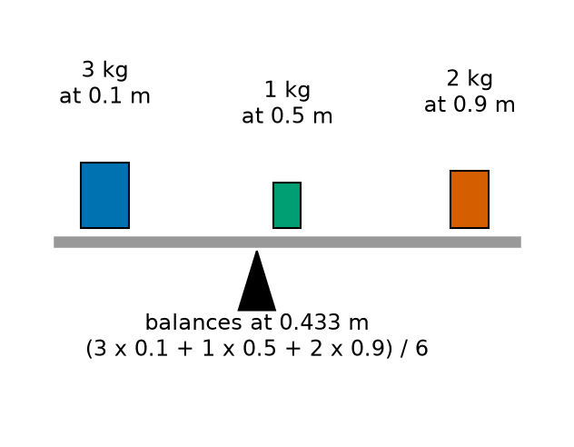
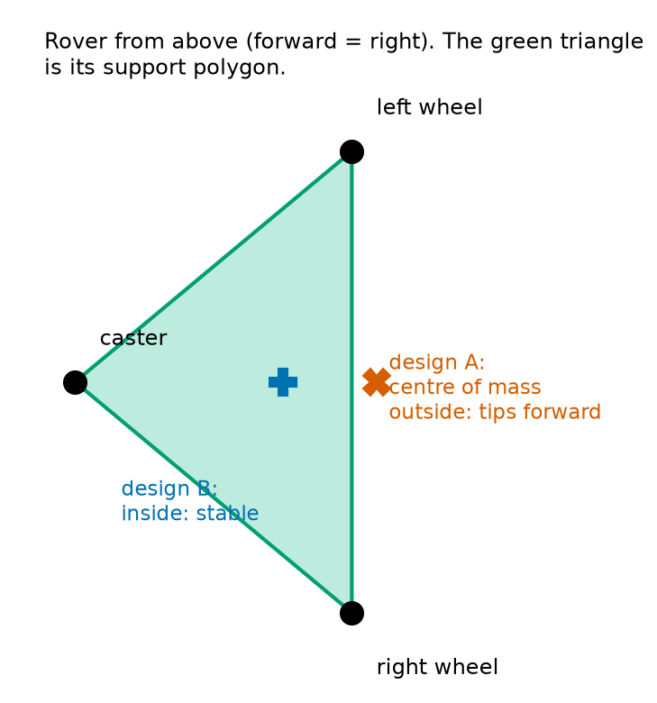
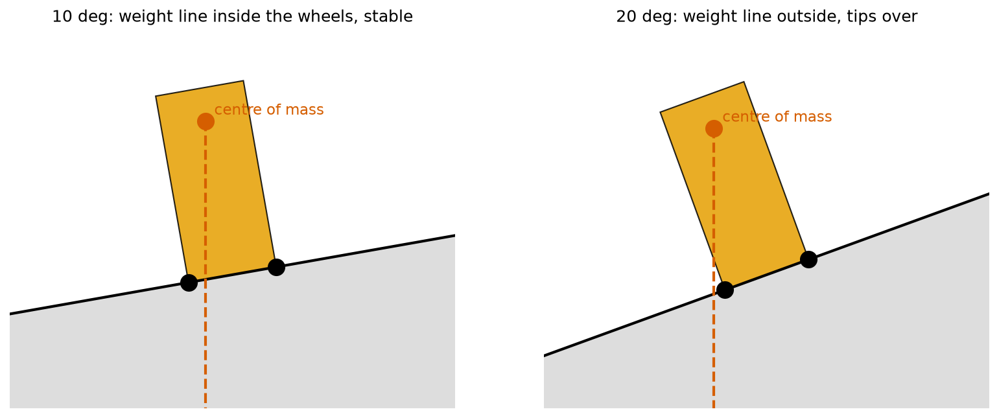
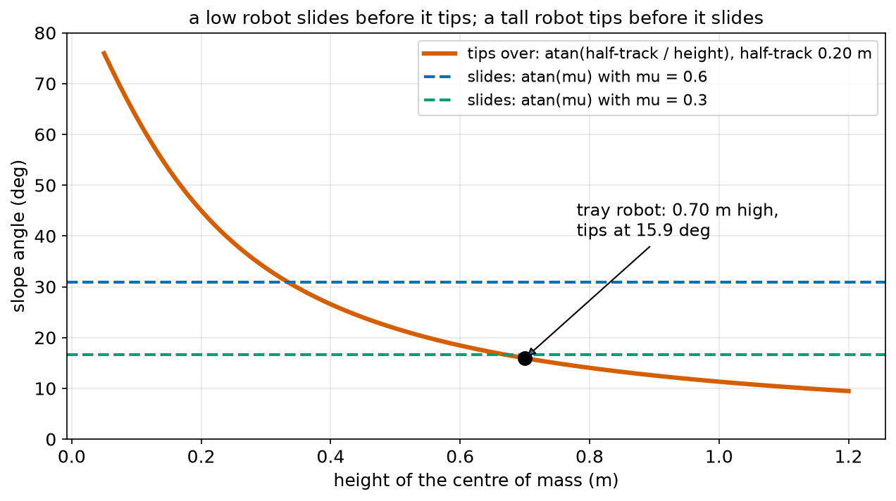
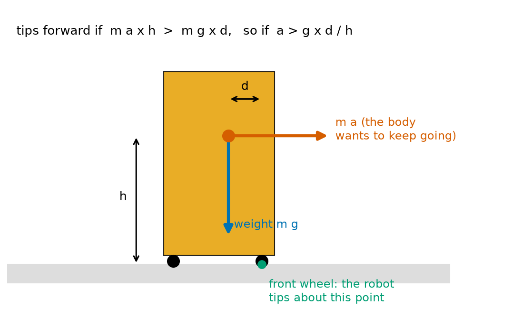
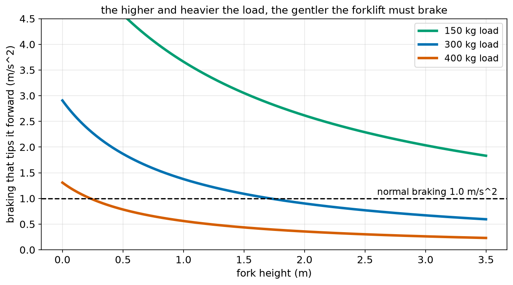

# Chapter 70 — Centre of Mass and Balance: Why Robots Fall Over

> **Part 4 · Chapter 70 of 749**
> **You need:** Chapter 5 (Rover's centre of mass program), Chapter 61 (forces), Chapter 63 (sliding on a slope), Chapter 64 (cornering) and Chapter 65 (torque and the principle of moments).
> **You will make:** a program that finds a robot's centre of mass from its parts, as its arm reaches out; a program that finds when a tall robot tips over on a slope, when braking, and in a corner; and a program that finds how gently a forklift robot must brake with a raised load.

---

## What you will learn

- What the **centre of mass** is, and how to find it by calculation and by experiment.
- What a **support polygon** is, and the simple rule for staying upright.
- How far a robot can tilt before it **tips over**, and whether it will tip or slide first.
- Why a robot can tip forward when it **brakes**, and sideways when it **corners**.
- What **stable**, **unstable** and **neutral** balance mean.
- Why tall loads, raised arms and forklifts are dangerous.
- Why humanoids and walking robots must keep their centre of mass over their feet.

---

## New words in this chapter

| Word | Simple meaning |
|---|---|
| **centre of mass (CoM)** | The point where the whole mass of an object seems to be, for working out how it moves and balances. |
| **centre of gravity** | The point where the whole weight seems to act. Near the Earth, the same point as the centre of mass. |
| **support polygon** | The shape you get by joining all the points where a robot touches the ground, seen from above. |
| **static stability** | Staying upright while standing still, because the centre of mass is above the support polygon. |
| **stability margin** | How far the centre of mass is from the nearest edge of the support polygon. |
| **tipping angle** | The slope angle at which a robot starts to fall over. |
| **tipping line** | The edge of the support polygon that the robot tips over. |
| **stable equilibrium** | A balance that comes back after a small push, like a ball in a bowl. |
| **unstable equilibrium** | A balance that falls away after a small push, like a pencil standing on its point. |
| **neutral equilibrium** | A balance that just stays in its new place after a push, like a ball on a flat table. |
| **inverted pendulum** | A mass balanced on top of a stick, like a broom balanced on your hand. |

---

## 70.1 The centre of mass

Chapter 4 gave a first meaning of the centre of mass: "the point where the whole weight of the robot seems to act. If you could hold the robot up with one finger at exactly the right point, that point is (above) the centre of mass." Chapter 5 worked it out for Rover with a short program, and promised that this chapter would explain it.

📖 **New word: centre of mass (CoM)** — the point where an object's whole mass seems to be concentrated. For working out how the whole object moves under gravity, and whether it balances, we can pretend all its mass is at that one point.

📖 **New word: centre of gravity** — the point where the whole weight seems to act. In a uniform gravity field (anywhere a robot will ever be), it is the same point as the centre of mass, and engineers use the two names for the same thing.

### Where the formula comes from

Put three masses on a light bar: 3 kg at 0.1 m, 1 kg at 0.5 m and 2 kg at 0.9 m. Where must we put a pivot so that the bar balances?

By the principle of moments (Chapter 65), the bar balances where the clockwise and anticlockwise torques are equal, that is, where the total torque of all the weights about the pivot is zero. If the pivot is at x_c, each weight m g at x pushes with a torque m g (x − x_c). Setting the sum to zero:

```
Σ m g (x − x_c) = 0
Σ m x = x_c × Σ m
x_c = Σ (m × x) / Σ m
```

The g cancels. This is exactly Chapter 5's rule: "multiply each part's mass by its position, add them up, and divide by the total mass". It is a **weighted average** of the positions, where heavier parts count more.



*Figure 70.1 — The bar balances at its centre of mass, closer to the heavier end.*

**How to read this picture:** Three masses sit on a light grey bar. The black triangle is the pivot that makes the bar balance. It is at 0.433 m: closer to the 3 kg mass on the left than to the 2 kg mass on the right. The calculation under it is Σ m x / Σ m.

🔢 **Maths.**

```
x_c = (3 × 0.1 + 1 × 0.5 + 2 × 0.9) / (3 + 1 + 2)
    = (0.3 + 0.5 + 1.8) / 6
    = 2.6 / 6 = 0.433 m
```

### In two or three directions

A real robot has a centre of mass in all three directions: front–back (x), left–right (y) and height (z). We use the same formula for each one separately:

```
x_c = Σ m x / Σ m,    y_c = Σ m y / Σ m,    z_c = Σ m z / Σ m
```

The **height** z_c is often the most important one, as the rest of this chapter shows.

### Simple shapes

For an even (uniform) object with a symmetric shape, the centre of mass is at its middle: the centre of a rod, a box, a disc or a ball. Chapter 65 used this for the robot arm's own weight, "at the middle". For a robot made of many parts, add them up with the formula.

💡 **Tip.** The centre of mass does not have to be **inside** the object. A ring's centre of mass is in the empty middle. A banana's is in the air beside it.

### Finding it by experiment

1. **Balancing:** balance the object on a thin edge (a ruler's edge). The centre of mass is right above the edge. Do it in two directions; the centre of mass is above where the two lines cross.
2. **Hanging:** hang the object from a string at one point. It always turns until the centre of mass is directly below the string. Draw a line straight down from the string. Hang it from another point and draw a second line. The centre of mass is where the lines cross.
3. **Weighing:** put the front wheels of a robot on one scale and the back wheels on another. The share of the weight on each scale tells you where the centre of mass is, front to back (Lab 70.1).

---

## 70.2 The support polygon and the rule for standing

When does a robot standing still stay upright? Think of a box standing on a table. Gravity pulls down through its centre of mass. The table pushes up on its bottom. As long as the line of the weight passes through the base, the table's push can be right under it, and the box balances. If the line of the weight passes outside the base, the weight makes a torque about the base's edge (Chapter 65) that nothing can cancel, and the box topples.

📖 **New word: support polygon** — the shape you get, seen from above, by joining all the points where a robot touches the ground with straight lines, and taking the outside edge. For a robot on three wheels, it is a triangle. For a car, a rectangle. For a person on one foot, the shape of the foot.

🧠 **The rule:** a robot standing still stays upright if the point **straight below its centre of mass** is **inside** its support polygon.

📖 **New word: static stability** — staying upright while standing still, because of this rule.

📖 **New word: stability margin** — the distance from the point below the centre of mass to the nearest edge of the support polygon. The bigger the margin, the harder it is to tip the robot.



*Figure 70.2 — Rover's two wheels and its caster make a triangle. Design B's centre of mass is inside it; design A's is just outside.*

**How to read this picture:** We look down on Rover; forward is to the right. The black dots are where it touches the floor: the two drive wheels on the right and the caster on the left. The green triangle joining them is the support polygon. Chapter 5 compared two designs. In design A (battery at the front), the centre of mass (red cross) is 0.82 cm in front of the wheels: **outside** the triangle, so Rover tips forward onto its nose. In design B (battery at the back), the centre of mass (blue plus) is 2.23 cm behind the wheels: inside, and stable.

That is why Chapter 5 said Rover is stable "if the centre of mass is between −9 and 0 cm": those are the caster and the wheel line, the back and front of its triangle along its middle.

---

## 70.3 Tipping on a slope

On a slope, gravity still pulls straight **down** (Chapter 61), but the robot's base is tilted. The line of the weight moves towards the downhill edge. At some angle, it reaches the downhill wheels, and beyond that the robot tips over.

📖 **New word: tipping line** — the edge of the support polygon that the robot tips over: here, the line through the downhill wheels.



*Figure 70.3 — At 10°, the weight's line is inside the wheels. At 20°, it is outside: the robot tips.*

**How to read this picture:** A tall robot (orange) stands across a slope, seen from behind. The black dots are its left and right wheels. The red dot is its centre of mass, 0.70 m above the ground, and the red dashed line goes straight down from it: the line of its weight. On the 10° slope (left), the dashed line hits the ground between the wheels: stable. On the 20° slope (right), it passes outside the lower wheel: the weight now turns the robot over that wheel.

📖 **New word: tipping angle** — the slope angle at which the line of the weight passes exactly through the tipping line.

🔢 **Maths.** Let h be the height of the centre of mass above the ground, and b the sideways distance from the centre of mass to the downhill wheels (half the track, for a symmetric robot). Tilted by θ, the weight's line crosses the ground at a distance h tan θ downhill of the point right under the centre of mass. The robot tips when this reaches b:

```
tan θ_tip = b / h
θ_tip = atan(b / h)
```

In words: "the tipping angle is the angle whose tangent is the half-width over the height".

**Small example.** The tray robot of Chapter 62: h = 0.70 m, b = 0.20 m. θ_tip = atan(0.20 / 0.70) = atan(0.286) = 15.9°. Lower the centre of mass to 0.35 m, and it becomes atan(0.571) = 29.7°.

### Tip or slide?

Chapter 63 found that a robot **slides** down a slope when tan θ > μ. Now it can also **tip** when tan θ > b / h. Whichever is smaller happens first:

- if b / h < μ: it **tips** before it slides (tall, narrow robots);
- if b / h > μ: it **slides** before it tips (low, wide robots).



*Figure 70.4 — The red curve is the tipping angle; the dashed lines are sliding angles. Below both, the robot is safe.*

**How to read this picture:** Across the bottom is the height of the centre of mass, for a robot with a half-track of 0.20 m. The red curve is its tipping angle, atan(0.20 / h): very large for low robots, small for tall ones. The blue and green dashed lines are the sliding angles for μ = 0.6 and μ = 0.3 (they do not depend on height). Where the red curve is below a dashed line, the robot tips first; where it is above, it slides first. The tray robot (black dot) tips at 15.9°, before it would slide even on a wet floor (16.7°).

Chapter 63's warning in Lab 63.1 ("the object topples over before it slides: it is tall and narrow") is exactly this.

---

## 70.4 Tipping when braking and cornering

A robot can also fall over on a **flat** floor, if it accelerates, brakes or turns too hard.

### Braking

When a robot brakes, its wheels slow down, but its body (by Newton's first law, Chapter 61) "wants" to keep going. In the robot's own frame, it feels as if a force m a pushes its centre of mass forwards: the same lean you feel in a braking bus. This "force" acts at the height h of the centre of mass. It turns the robot forwards about the front wheels' contact line. The weight m g, a distance d behind that line, turns it back.



*Figure 70.5 — The braking pushes the centre of mass forward; the weight holds it back.*

**How to read this picture:** A tall robot brakes. The red dot is its centre of mass, at height h. The red arrow, m a, is the effect of braking: the body tends to keep moving forward. The blue arrow is its weight, m g. The green dot is the front wheel's contact point: if the robot tips, it tips about this point. The weight acts a distance d behind it; the braking acts at height h above it.

By the principle of moments (Chapter 65), about the front wheel's contact point:

```
tipping torque  = m a × h
holding torque  = m g × d
tips forward if  m a h > m g d,  that is if  a > g × d / h
```

In words: "the robot tips forward if it brakes harder than g times d over h". The mass cancels again.

**Small example.** The tray robot: d = 0.18 m, h = 0.70 m. a_tip = 9.81 × 0.18 / 0.70 = 2.52 m/s². Its wheels could brake at 0.6 × 9.81 = 5.89 m/s² on this floor, but it would fall over long before that. Exactly the same applies, the other way round, when it **speeds up**: it can tip backwards over its back wheels.

🤖 **Robot link.** This is why tall robots (and people carrying trays) start and stop gently. It is also why a robot's ramp limiter (Chapter 58) must take the robot's **height** into account, not only the grip of its wheels.

### Cornering

Chapter 64 said that taking a corner needs a sideways acceleration v² / r towards the centre, and promised that tall robots may tip over before they slide. The same moment argument, now sideways about the outer wheels, with b the half-track:

```
tips outwards if  v² / r > g × b / h
v_tip = √(g × b × r / h)
```

Compare with sliding, v_slide = √(μ g r) (Chapter 64). Again, the robot tips first if b / h < μ.

🔢 **Maths.** The tray robot (b = 0.20, h = 0.70) on a corner of radius 1 m: v_tip = √(9.81 × 0.20 × 1 / 0.70) = 1.67 m/s. It would only slide at √(0.6 × 9.81 × 1) = 2.43 m/s.

---

## 70.5 Stable, unstable and neutral balance

Not every balance is the same. Push a balanced object a little, and one of three things happens.

📖 **New word: stable equilibrium** — after a small push, it comes back. A ball at the bottom of a bowl, a pendulum hanging down, a low robot standing on a wide base. Its centre of mass **rises** when it is pushed, so gravity pulls it back.

📖 **New word: unstable equilibrium** — after a small push, it falls away. A pencil balanced on its point, a ball on top of a dome. Its centre of mass **falls** when it is pushed, so gravity pulls it further away.

📖 **New word: neutral equilibrium** — after a push, it stays in its new place. A ball on a flat table. Its centre of mass stays at the same height.

| Type | Push it a little | Centre of mass when pushed | Example |
|---|---|---|---|
| stable | comes back | rises | a wide, low robot; a hanging pendulum |
| unstable | falls away | falls | a pencil on its point; a two-wheeled balancing robot when switched off |
| neutral | stays put | stays level | a ball on a table; a wheel on a flat floor |

🧠 **Remember:** lowering the centre of mass and widening the base make a robot more stable. That is why heavy batteries go at the bottom of robots, and why mobile robots are often low and wide.

### The inverted pendulum

📖 **New word: inverted pendulum** — a mass balanced on top of a stick: a broom balanced on your hand, a person standing, a two-wheeled self-balancing robot. It is unstable: left alone, it falls.

You can still keep a broom upright, by moving your hand under it whenever it starts to fall. A self-balancing robot does the same with its wheels, hundreds of times a second, using a tilt sensor (Chapter 62) and a feedback controller. This is one of the most famous problems in control. Rover's cousin, **Balancer**, does it in Chapters 310–312.

---

## 70.6 When the centre of mass moves

A robot's centre of mass is not fixed. It moves when:

- an arm reaches out (Chapter 65's arm),
- it picks up or puts down a load,
- a forklift raises its forks,
- a liquid sloshes inside a tank,
- a walking robot lifts a leg.

Each time, the robot's stability margin changes. The Code section's `com.py` shows a mobile robot whose arm reaches forward with a box: its centre of mass moves forward by 7.6 cm and rises by 2.7 cm, so it comes much closer to tipping over its front edge.

🤖 **Robot link.** Mobile manipulators (a robot arm on a wheeled base) check their centre of mass before every arm movement, and some move their base, or a counterweight, to keep it inside the support polygon. Humanoid robots do this all the time: their whole walking controller is built around keeping the centre of mass (and a related point, the zero moment point) over their feet (Chapters 702 and 703).

---

## Code

File `code/ch070/com.py`:

```python
# com.py - the centre of mass of a robot made of parts, in two directions (forwards x and up z)
parts = [
    # name,             mass kg, x m (forward of the axle), z m (above the floor)
    ("chassis",          1.20,   -0.02,  0.06),
    ("battery",          0.90,   -0.06,  0.04),
    ("motors + wheels",  0.80,    0.00,  0.03),
    ("computer",         0.30,   -0.03,  0.10),
    ("arm (folded)",     0.80,    0.02,  0.18),
]


def centre_of_mass(parts):
    total = sum(m for name, m, x, z in parts)
    x_com = sum(m * x for name, m, x, z in parts) / total
    z_com = sum(m * z for name, m, x, z in parts) / total
    return total, x_com, z_com


m, x, z = centre_of_mass(parts)
print(f"arm folded:   mass {m:.2f} kg, centre of mass x = {x:+.3f} m, height = {z:.3f} m")

# the arm reaches forward and lifts a 0.5 kg box: its mass moves, and a new mass is added
reaching = [p for p in parts if p[0] != "arm (folded)"] + [("arm (reaching)", 0.80, 0.20, 0.22), ("box", 0.50, 0.38, 0.25)]
m, x, z = centre_of_mass(reaching)
print(f"arm reaching: mass {m:.2f} kg, centre of mass x = {x:+.3f} m, height = {z:.3f} m")

FRONT_WHEEL_X = 0.10           # the front caster
REAR_EDGE_X = -0.12            # the back wheels' contact line
print(f"support from x = {REAR_EDGE_X} to {FRONT_WHEEL_X} m: "
      f"{'stable' if REAR_EDGE_X < x < FRONT_WHEEL_X else 'TIPS OVER'} with the arm reaching")
```

| Line | Code | What it does (simple English) |
|---|---|---|
| 1 | `# com.py …` | A comment. |
| 2 | `parts = [` | A list of the robot's parts. |
| 3 | `# name, mass kg, x m …, z m …` | A comment that says what each number is. |
| 4–8 | `("chassis", 1.20, -0.02, 0.06),` and so on | Each part: name, mass, how far forward (x) and how high (z) its own centre of mass is. |
| 9 | `]` | The end of the list. |
| 10–11 | (blank) | Spacing. |
| 12 | `def centre_of_mass(parts):` | A function, so we can use it twice. |
| 13 | `total = sum(m for name, m, x, z in parts)` | The total mass. `sum(… for … in …)` adds up a value for every item: a generator expression, like a list comprehension without the list (Chapter 21). |
| 14 | `x_com = sum(m * x for …) / total` | Σ m x / Σ m. |
| 15 | `z_com = sum(m * z for …) / total` | Σ m z / Σ m: the height. |
| 16 | `return total, x_com, z_com` | Three results. |
| 17–18 | (blank) | Spacing. |
| 19 | `m, x, z = centre_of_mass(parts)` | With the arm folded. |
| 20 | `print(f"arm folded: …")` | `:+.3f` shows the sign: minus means behind the axle. |
| 21 | (blank) | Spacing. |
| 22 | `# the arm reaches forward …` | A comment. |
| 23 | `reaching = [p for p in parts if p[0] != "arm (folded)"] + [(…), (…)]` | A new list: every part except the folded arm, plus the reaching arm in its new place, plus the box. |
| 24 | `m, x, z = centre_of_mass(reaching)` | The new centre of mass. |
| 25 | `print(f"arm reaching: …")` | Shows it. |
| 26 | (blank) | Spacing. |
| 27 | `FRONT_WHEEL_X = 0.10` | The front edge of the support polygon (along the middle). |
| 28 | `REAR_EDGE_X = -0.12` | The back edge. |
| 29–30 | `print(f"support …" f"…")` | Is the centre of mass between the two edges? |

Output:

```
arm folded:   mass 4.00 kg, centre of mass x = -0.018 m, height = 0.076 m
arm reaching: mass 4.50 kg, centre of mass x = +0.058 m, height = 0.103 m
support from x = -0.12 to 0.1 m: stable with the arm reaching
```

With the arm folded, the centre of mass is 1.8 cm behind the axle: a margin of 10.2 cm from the back edge and 11.8 cm from the front. With the arm reaching out with a box, it moves to 5.8 cm in front of the axle: still inside, but only 4.2 cm from the front edge. The robot has lost two-thirds of its forward margin, and a small bump or a quick stop could now tip it forward (section 70.4).

---

## Small examples

**Example 1.** 2 kg at 0 m and 1 kg at 0.6 m: x_c = 0.6 / 3 = 0.2 m.

**Example 2.** 4 kg at (0, 0.1) and 1 kg at (0.5, 0.6) (x, z in m): x_c = 0.1 m, z_c = (0.4 + 0.6) / 5 = 0.2 m.

**Example 3.** A robot with half-track 0.25 m and CoM height 0.25 m tips at atan(1) = 45°.

**Example 4.** The same robot on a floor with μ = 0.5 slides at 26.6°, before it tips.

**Example 5.** A robot with d = 0.15 m in front of its CoM and h = 0.5 m tips forward when braking harder than 9.81 × 0.3 = 2.94 m/s².

**Example 6.** A robot with b = 0.2 m, h = 0.4 m on a 2 m corner tips at v = √(9.81 × 0.2 × 2 / 0.4) = 3.13 m/s.

**Example 7.** A pencil standing on its point is in unstable equilibrium.

**Example 8.** Moving a 3 kg battery 0.2 m lower in a 15 kg robot lowers its centre of mass by 3 × 0.2 / 15 = 0.04 m.

---

## 🏭 Real robot applications

### Application 1 (worked in full) — ☕ How careful must the tray robot be?

**1. The real problem.** Chapter 62's tall delivery robot carries a tray of cups in a restaurant. It must never tip over. Its designers need three numbers for its controller: the steepest slope it may stand on, the hardest it may brake, and the fastest it may take corners of different radii.

**2. Why this theory.** On a slope, it tips when tan θ > b / h (section 70.3). When braking, it tips forward when a > g d / h; in a corner, outwards when v² / r > g b / h (section 70.4). For each, we also compare with sliding (Chapter 63) to see which happens first.

**3. The numbers.** The centre of mass, with a full tray, is 0.70 m above the floor. It is 0.20 m from each side wheel (half-track) and 0.18 m behind the front wheels. The floor's μ is 0.6.

**4. The maths.**

```
side slope:  tips at atan(0.20 / 0.70) = 15.9°;  slides at atan(0.6) = 31.0°
braking:     tips above 9.81 × 0.18 / 0.70 = 2.52 m/s²;  slides above 0.6 × 9.81 = 5.89 m/s²
corner, r = 1 m:  tips above √(9.81 × 0.20 / 0.70 × 1) = 1.67 m/s;  slides above √(0.6 × 9.81 × 1) = 2.43 m/s
```

**5. The code.** File `code/ch070/tip_limits.py`:

```python
# tip_limits.py - a tall delivery robot: when does it tip on a slope, when braking, and in a corner?
import math

G = 9.81
COM_HEIGHT = 0.70        # m above the floor, with a full tray of cups
HALF_TRACK = 0.20        # m from the middle to each side wheel
COM_TO_FRONT = 0.18      # m from the centre of mass forward to the front wheels' contact line
MU_FLOOR = 0.6

# 1) standing on a side slope: tips when the weight's line passes outside the wheels
tip_side = math.degrees(math.atan(HALF_TRACK / COM_HEIGHT))
slide = math.degrees(math.atan(MU_FLOOR))
print(f"side slope: tips over at {tip_side:.1f} deg, slides at {slide:.1f} deg -> {'tips first' if tip_side < slide else 'slides first'}")

# 2) braking: tips forward when a > g x (distance to the front wheels) / height
a_tip_brake = G * COM_TO_FRONT / COM_HEIGHT
print(f"braking: tips forward above {a_tip_brake:.2f} m/s^2 (wheels slide above {MU_FLOOR * G:.2f} m/s^2)")

# 3) cornering: tips outwards when v^2 / r > g x half_track / height
a_tip_side = G * HALF_TRACK / COM_HEIGHT
for r in [0.5, 1.0, 2.0]:
    v_tip = math.sqrt(a_tip_side * r)
    v_slide = math.sqrt(MU_FLOOR * G * r)
    print(f"corner radius {r} m: tips over above {v_tip:.2f} m/s, slides above {v_slide:.2f} m/s")
```

| Line | Code | What it does (simple English) |
|---|---|---|
| 1 | `# tip_limits.py …` | A comment. |
| 2 | `import math` | For `atan`, `degrees`, `sqrt`. |
| 3 | (blank) | Spacing. |
| 4–8 | `G`, `COM_HEIGHT`, `HALF_TRACK`, `COM_TO_FRONT`, `MU_FLOOR` | The robot's geometry and the floor. |
| 9 | (blank) | Spacing. |
| 10 | `# 1) standing on a side slope …` | A comment. |
| 11 | `tip_side = math.degrees(math.atan(HALF_TRACK / COM_HEIGHT))` | θ_tip = atan(b / h). |
| 12 | `slide = math.degrees(math.atan(MU_FLOOR))` | The sliding angle, atan μ (Chapter 63). |
| 13 | `print(f"side slope: …")` | Both, and which comes first. |
| 14 | (blank) | Spacing. |
| 15 | `# 2) braking …` | A comment. |
| 16 | `a_tip_brake = G * COM_TO_FRONT / COM_HEIGHT` | a = g d / h. |
| 17 | `print(f"braking: …")` | Compared with the wheels' grip, μ g. |
| 18 | (blank) | Spacing. |
| 19 | `# 3) cornering …` | A comment. |
| 20 | `a_tip_side = G * HALF_TRACK / COM_HEIGHT` | The sideways acceleration that tips it: g b / h. |
| 21 | `for r in [0.5, 1.0, 2.0]:` | Three corner radii. |
| 22 | `v_tip = math.sqrt(a_tip_side * r)` | From v² / r = a_tip. |
| 23 | `v_slide = math.sqrt(MU_FLOOR * G * r)` | Chapter 64's sliding speed. |
| 24 | `print(f"corner radius …")` | Both speeds. |

Output:

```
side slope: tips over at 15.9 deg, slides at 31.0 deg -> tips first
braking: tips forward above 2.52 m/s^2 (wheels slide above 5.89 m/s^2)
corner radius 0.5 m: tips over above 1.18 m/s, slides above 1.72 m/s
corner radius 1.0 m: tips over above 1.67 m/s, slides above 2.43 m/s
corner radius 2.0 m: tips over above 2.37 m/s, slides above 3.43 m/s
```

**6. The result.** In every case the tall robot **tips before it slides**: its height, not its grip, sets the limits. With a safety factor of 2, its controller should refuse slopes over about 8°, brake at no more than about 1.2 m/s², and keep its sideways acceleration below about 1.4 m/s² (for example, under 0.8 m/s on a 0.5 m corner). Lowering the heavy parts (battery, motors) is the best way to raise all three limits at once: halving h doubles both acceleration limits. (Of course, the cups themselves may slide on the tray long before the robot tips: Chapter 63's a ≤ μ g applies to them too.)

**7. Going further.** A robot can also measure how close it is to tipping, using the force sensors in its wheels or the accelerometer (Chapter 62), and slow down automatically. Chapter 471 plans speeds along a path with such limits built in.

### Application 2 (worked in full) — 🏗️ A forklift robot with a raised load

**1. The real problem.** An automated forklift (a robot that lifts and moves pallets) weighs 400 kg. The load sits in front of its front wheels. How heavy a load can it hold at all? And with a 300 kg load, how gently must it brake, depending on how high the forks are?

**2. Why this theory.** The forklift tips forward about its front wheels. Standing still, the load's weight turns it forward and its own weight turns it back (principle of moments, Chapter 65). When braking, both masses also "push" forward at their own heights (section 70.4). The higher the load, the bigger that push's lever arm.

**3. The numbers.** Forklift: 400 kg, centre of mass 0.50 m behind the front wheels and 0.45 m high. Load centre: 0.40 m in front of the front wheels, 0.3 m above the forks.

**4. The maths.** Standing still, about the front wheels:

```
load × 0.40 ≤ 400 × 0.50   →   load ≤ 500 kg   (no margin)
```

Braking with 300 kg at fork height L (load centre at L + 0.3):

```
holding moment  = 400 × 9.81 × 0.50 − 300 × 9.81 × 0.40 = 1962 − 1177 = 785 N m
tipping moment  = a × (400 × 0.45 + 300 × (L + 0.3))
a_max = 785 / (180 + 300 (L + 0.3))
forks at 2 m:  a_max = 785 / (180 + 690) = 0.90 m/s²
```

**5. The code.** File `code/ch070/forklift.py`:

```python
# forklift.py - how heavy a load can a forklift robot carry, and how hard may it brake with it held high?
G = 9.81
ROBOT_KG = 400.0
ROBOT_COM_BEHIND = 0.50     # m, the robot's own centre of mass behind the front wheels
ROBOT_COM_HEIGHT = 0.45     # m
LOAD_AHEAD = 0.40           # m, the load's centre of mass in front of the front wheels

# standing still: about the front wheels, load x 0.40 must stay below robot x 0.50
max_load = ROBOT_KG * ROBOT_COM_BEHIND / LOAD_AHEAD
print(f"standing still, the heaviest load is {max_load:.0f} kg (with no margin at all)")

LOAD_KG = 300.0
print(f"with a {LOAD_KG:.0f} kg load, braking limits (tipping forward over the front wheels):")
for lift_m in [0.2, 1.0, 2.0, 3.0]:
    load_height = lift_m + 0.3                       # the load's centre is 0.3 m above the forks
    # tipping happens when the braking torques beat the gravity torques, both about the front wheels
    gravity_moment = ROBOT_KG * G * ROBOT_COM_BEHIND - LOAD_KG * G * LOAD_AHEAD
    braking_per_a = ROBOT_KG * ROBOT_COM_HEIGHT + LOAD_KG * load_height
    a_max = gravity_moment / braking_per_a
    print(f"  forks at {lift_m:.1f} m: brake at most {a_max:.2f} m/s^2")
```

| Line | Code | What it does (simple English) |
|---|---|---|
| 1 | `# forklift.py …` | A comment. |
| 2–6 | `G`, `ROBOT_KG`, `ROBOT_COM_BEHIND`, `ROBOT_COM_HEIGHT`, `LOAD_AHEAD` | The forklift and the load's position. |
| 7 | (blank) | Spacing. |
| 8 | `# standing still: …` | A comment. |
| 9 | `max_load = ROBOT_KG * ROBOT_COM_BEHIND / LOAD_AHEAD` | The principle of moments, solved for the load (g cancels). |
| 10 | `print(f"standing still, …")` | 500 kg. |
| 11 | (blank) | Spacing. |
| 12 | `LOAD_KG = 300.0` | A load well under the limit. |
| 13 | `print(f"with a …")` | A heading. |
| 14 | `for lift_m in [0.2, 1.0, 2.0, 3.0]:` | Four fork heights. |
| 15 | `load_height = lift_m + 0.3` | The load's centre of mass height. |
| 16 | `# tipping happens …` | A comment. |
| 17 | `gravity_moment = …` | The robot's weight holds it back; the load's weight pushes it forward. The difference is what holds it upright. |
| 18 | `braking_per_a = …` | Each mass, times its height: the tipping moment for each 1 m/s² of braking. |
| 19 | `a_max = gravity_moment / braking_per_a` | The braking that makes the two moments equal. |
| 20 | `print(f"  forks at …")` | One line per height. |

Output:

```
standing still, the heaviest load is 500 kg (with no margin at all)
with a 300 kg load, braking limits (tipping forward over the front wheels):
  forks at 0.2 m: brake at most 2.38 m/s^2
  forks at 1.0 m: brake at most 1.38 m/s^2
  forks at 2.0 m: brake at most 0.90 m/s^2
  forks at 3.0 m: brake at most 0.67 m/s^2
```



*Figure 70.6 — The higher and heavier the load, the gentler the braking must be.*

**How to read this picture:** Across the bottom is the fork height, up the side the braking that would tip the forklift forward. Each curve is one load. All fall as the forks rise, because the load's lever arm for tipping grows. The black dashed line is a normal braking of 1.0 m/s². With 300 kg (blue), normal braking becomes dangerous above about 1.7 m. With 400 kg (red), it is dangerous above about 0.25 m.

**6. The result.** The forklift could in theory hold up to 500 kg standing still, but real forklifts are rated well below their tipping load. With 300 kg, it can brake normally only while the load is low. Above about 1.7 m, normal braking would tip it. So forklift robots follow a simple rule, also taught to every human forklift driver: **drive with the load low, and raise it only when stopped**. Their controllers also limit acceleration and speed automatically according to fork height and load weight.

**7. Going further.** Real forklifts also tilt their mast back while driving, which moves the load's centre of mass back over the wheels, and their rear axle is often heavy on purpose, as a counterweight (Chapter 65). Safety standards set how much margin is needed (Chapter 744).

### Application 3 — 🦿 A humanoid keeps its centre of mass over its feet

A humanoid robot standing on two feet has a support polygon shaped like the area around both feet. On one foot, it shrinks to the shape of one sole: perhaps 10 cm by 22 cm. While walking, a humanoid spends much of its time on one foot, so before it lifts the other foot, it must shift its centre of mass over the standing foot. Watch people walk: their body sways a little from side to side for exactly this reason. A standing humanoid's centre of mass is about 0.9 m high; with only 5 cm of margin to the edge of one foot, the tipping angle is atan(0.05 / 0.9) = 3.2°. Tiny. That is why walking robots need fast balance controllers, and why their walking is built around the **zero moment point**, a point that extends the support-polygon rule to a robot that is accelerating (Chapters 702 and 703).

### Application 4 — 🚀 A Mars rover on a side slope

A Mars rover crossing the side of a hill must not roll over: there is nobody to set it upright. Rovers are built low and wide, with a long wheelbase and track, so their tipping angle is large: a rover with a half-track of about 1 m and a centre of mass about 1 m high tips at about 45°. Their drivers on Earth still keep to slopes well under that (often around 20–30°), because loose soil can give way under the downhill wheels, suddenly increasing the tilt. Lower gravity (Chapter 62) does not change the tipping angle (it depends only on b / h), but it does make a fall slower.

### Application 5 — 🌱 The lawn mower on a side slope

Chapter 69 promised to check whether its robot mower could tip over on a sloping lawn. The mower is low and wide: centre of mass 0.15 m high, half-track 0.22 m. Its tipping angle is atan(0.22 / 0.15) = 55.7°: it would tip only on a very steep bank. But on wet grass (μ ≈ 0.4), it slides at atan(0.4) = 21.8°. So the mower **slides before it tips**: grip, not height, is its problem on slopes. That is why robot mowers have deep tyre treads and usually a limit of about 35–45% slope (19–24°), and why some refuse to mow when the grass is wet.

---

## 🔧 Hands-on lab

### Lab 70.1 — Find a robot's centre of mass with two scales (hardware)

You need two kitchen or bathroom scales, a toy car or a small robot (or a long box with something heavy inside), and a ruler.

1. Measure the distance L between the front and back wheels (the wheelbase).
2. Put the front wheels on one scale and the back wheels on the other, at the same height (use a book under one scale if needed).
3. Read both scales: F (front) and R (back), in grams or kg.
4. The centre of mass is a distance x = L × F / (F + R) in front of the back wheels.
5. Move a heavy object inside the box forwards. Repeat.

**What you should see:** The front scale reads more when the centre of mass is further forward. If F = R, the centre of mass is exactly halfway. This is the principle of moments (Chapter 65): taking moments about the back wheels, F × L = (F + R) × x.

| If it does not work | Likely cause | Fix |
|---|---|---|
| F + R is not the total mass | One wheel is off the scale | Check all the wheels are on the scales |
| The answer changes when you swap scales | The scales disagree | Calibrate with a known mass first (Chapter 133) |

**Challenge:** Raise the back wheels by a known height (a book). The scale readings change a little, because the centre of mass is above the wheels. Use the change to estimate the **height** of the centre of mass.

### Lab 70.2 — Tip or slide? (hardware)

You need a board you can tilt, a tall narrow box (like a cereal box) and a short wide one, and some tape.

1. Stand the tall box on the board, across the slope (sideways). Raise the board slowly until it tips or slides. Measure the angle.
2. Repeat with the box lying on its side, then with the short wide box.
3. Measure each box's half-width b and centre-of-mass height h (half its height, if it is evenly filled). Predict atan(b / h).
4. Measure μ for the box's surface with Chapter 63's tilt test (lay a flat box down so it cannot tip).

**What you should see:** The tall box tips at about atan(b / h), before it slides. The wide box slides first, at about atan(μ). Whichever angle is smaller happens first, as section 70.3 says.

| If it does not work | Likely cause | Fix |
|---|---|---|
| The tall box slides first | Its surface is very slippery | Put a strip of rubber or rough paper under it |
| The tipping angle is smaller than predicted | The box is not evenly filled; its centre of mass is high | Measure where its contents are |

**Challenge:** Put a heavy object (a can) at the bottom of the tall box. Predict and measure the new tipping angle.

### Lab 70.3 — Make the arm robot tip (simulation)

Copy `com.py`.

1. Increase the box mass in steps of 0.25 kg. At what mass does the robot tip forward?
2. Put the box back to 0.5 kg. Move the battery forward from −0.06 m to −0.12 m (further back) and repeat step 1. How much heavier a box can it hold now?
3. Add a check for tipping when braking: with the arm reaching, at what braking does the robot tip forward? Use d = front edge − x_com and h = z_com.

**What you should see:** The robot tips forward when the box is about 1.3 kg. Moving the battery 6 cm further back lets it hold about 1.7 kg. With the 0.5 kg box, d = 0.042 m and h = 0.103 m, so it tips forward when braking harder than 9.81 × 0.042 / 0.103 = 4.0 m/s².

| If it does not work | Likely cause | Fix |
|---|---|---|
| It never tips | The box is added to the folded list, not the reaching one | Change the box in `reaching` |
| It tips backwards | The signs of x are mixed up | Forward is positive in this program |

**Challenge:** Find the heaviest box the robot can hold if it must keep a margin of 3 cm from the front edge **and** be able to brake at 1.5 m/s² without tipping.

---

## Common mistakes

⚠️ **Averaging positions without weighting by mass.** The centre of mass is Σ m x / Σ m, not the plain average.

⚠️ **Forgetting the height of the centre of mass.** Most tipping limits depend on it.

⚠️ **Using the whole track width instead of the distance from the centre of mass to the tipping edge.**

⚠️ **Thinking a heavier robot is harder to tip on a slope.** Mass cancels; only b / h matters.

⚠️ **Checking only grip (sliding) for tall robots.** They often tip before they slide.

⚠️ **Forgetting that the centre of mass moves** when arms reach, loads are lifted or liquids slosh.

⚠️ **Thinking balance means "not moving".** An inverted pendulum is balanced but unstable: it needs active control.

---

## Practice

🏋️ **1.** Three masses on a light rod: 2 kg at 0 m, 3 kg at 0.4 m, 5 kg at 1.0 m. Where is the centre of mass?

🏋️ **2.** A robot has a 6 kg body with its centre of mass at (0, 0.10 m) and a 2 kg arm at (0.3, 0.25 m) (x forward, z up). Find its centre of mass.

🏋️ **3.** A robot has a half-track of 0.15 m and a centre of mass 0.45 m high. At what side slope does it tip? On a floor with μ = 0.5, does it tip or slide first?

🏋️ **4.** The same robot has its centre of mass 0.12 m behind its front wheels. At what braking does it tip forward?

🏋️ **5.** At what speed does it tip over on a corner of radius 1.5 m?

🏋️ **6.** A scale under the front wheels of a car reads 600 kg and under the back wheels 400 kg. The wheelbase is 2.5 m. How far in front of the back wheels is the centre of mass?

🏋️ **7.** Is each of these stable, unstable or neutral? (a) a pendulum hanging straight down; (b) a ball on a flat floor; (c) a two-wheeled balancing robot with its motors off.

🏋️ **8.** A 20 kg robot has its centre of mass 0.5 m high. A 5 kg battery is moved from 0.6 m high to 0.1 m high. What is the new height of the centre of mass?

🏋️ **9.** A forklift of 1000 kg has its centre of mass 0.8 m behind the front wheels. A load's centre is 0.5 m in front of the front wheels. What is the heaviest load it can hold, standing still?

🏋️ **10.** Why does a person carrying a heavy bag in one hand lean the other way?

🏋️ **11.** Write a function `stability_limits(h, b, d, mu)` that returns a dictionary with the tipping angle, the sliding angle, the braking that tips it, and the largest safe sideways acceleration, each with a safety factor of 2 applied to the accelerations. Test it with the tray robot (h = 0.70, b = 0.20, d = 0.18, μ = 0.6).

---

## Answers

**1.** (0 + 1.2 + 5.0) / 10 = 0.62 m.

**2.** x_c = (0 + 0.6) / 8 = 0.075 m. z_c = (0.6 + 0.5) / 8 = 0.1375 m.

**3.** atan(0.15 / 0.45) = 18.4°. Sliding at atan(0.5) = 26.6°. It tips first.

**4.** a = 9.81 × 0.12 / 0.45 = 2.62 m/s².

**5.** v = √(9.81 × 0.15 × 1.5 / 0.45) = √4.905 = 2.21 m/s.

**6.** x = 2.5 × 600 / 1000 = 1.5 m in front of the back wheels.

**7.** (a) Stable. (b) Neutral. (c) Unstable.

**8.** The change is 5 × (0.1 − 0.6) / 20 = −0.125 m. New height 0.375 m.

**9.** 1000 × 0.8 / 0.5 = 1600 kg (with no margin).

**10.** The bag moves the person's combined centre of mass towards the bag. Leaning the other way moves the body's mass back, so the combined centre of mass stays above the feet.

**11.**

```python
import math

def stability_limits(h, b, d, mu):
    g = 9.81
    return {
        "tip angle (deg)": round(math.degrees(math.atan(b / h)), 1),
        "slide angle (deg)": round(math.degrees(math.atan(mu)), 1),
        "safe braking (m/s^2)": round(min(g * d / h, mu * g) / 2, 2),
        "safe sideways acceleration (m/s^2)": round(min(g * b / h, mu * g) / 2, 2),
    }

print(stability_limits(0.70, 0.20, 0.18, 0.6))
# {'tip angle (deg)': 15.9, 'slide angle (deg)': 31.0, 'safe braking (m/s^2)': 1.26, 'safe sideways acceleration (m/s^2)': 1.4}
```

---

## Summary

🧠 The **centre of mass** is the weighted average of the positions of all the parts: x_c = Σ m x / Σ m, and the same for y and z. It comes from the principle of moments.

🧠 A robot standing still stays up if the point **below its centre of mass** is inside its **support polygon**. The distance to the nearest edge is the **stability margin**.

🧠 On a slope it **tips** when tan θ > b / h and **slides** when tan θ > μ. Tall, narrow robots tip first; low, wide ones slide first.

🧠 It tips forward when braking harder than **g d / h**, and outwards in a corner when v² / r > **g b / h**.

🧠 **Stable** balance comes back after a push; **unstable** falls away; **neutral** stays put. Lower and wider is more stable.

🧠 The centre of mass **moves** when arms reach, loads are lifted or legs are raised. Forklifts carry loads low; humanoids shift their weight over the standing foot.

🧠 An **inverted pendulum** (a balancing robot, a standing person) is unstable and needs active control.

---

## Next chapter

So far, every problem in Part 4 had a neat formula. But real robots face changing forces: air drag that grows with speed, motors whose torque falls as they spin faster, springs, friction that switches between stuck and sliding. In Chapter 71 you will learn the one method that handles all of them: **simulating physics in Python with small time steps**, called **Euler's method**. It is how every robot simulator in this course works inside.
