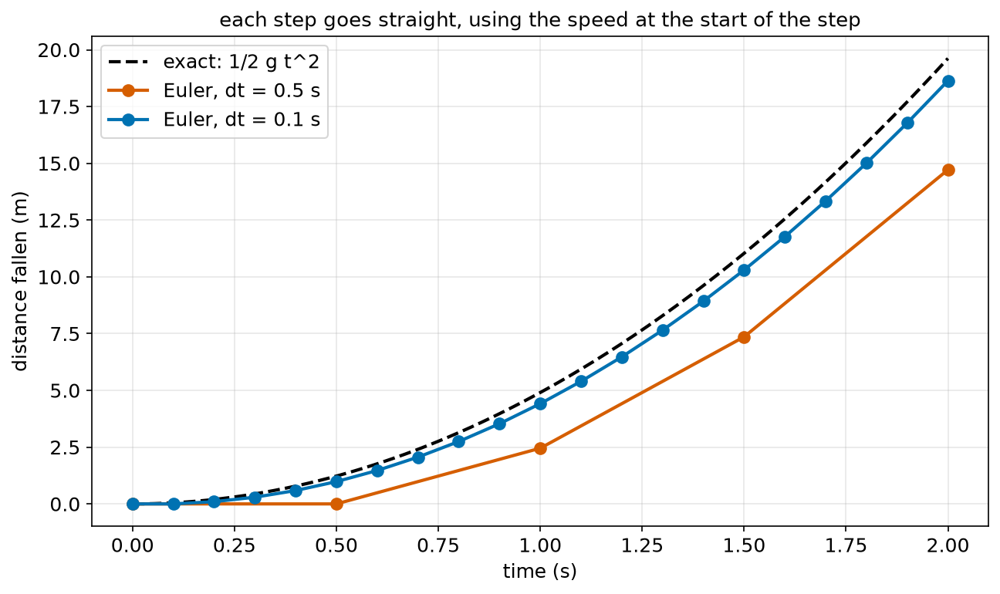
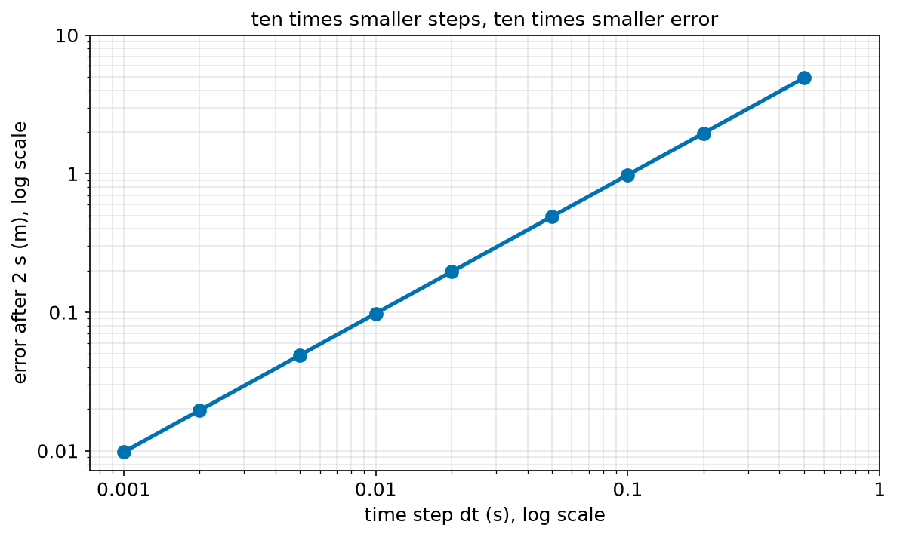
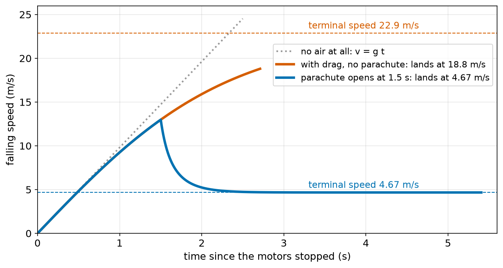
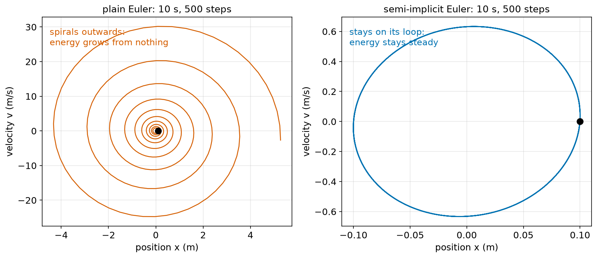
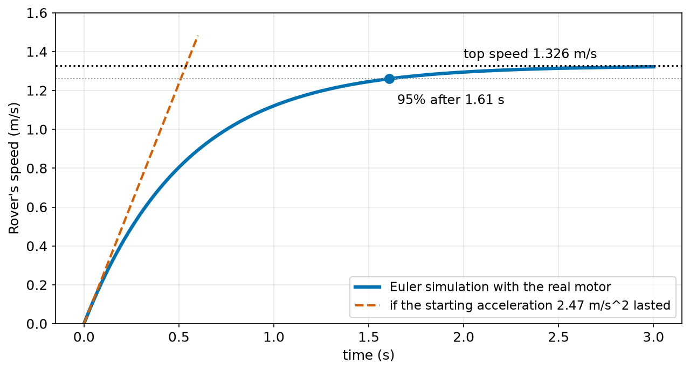

# Chapter 71 — Simulating Physics in Python: Small Time Steps (Euler's Method)

> **Part 4 · Chapter 71 of 749**
> **You need:** Chapter 30 (loops in time), Chapter 52 (time constants), Chapter 57 (areas under graphs), Chapter 59 (equations of motion), Chapter 61 (F = m × a) and Chapter 67 (energy).
> **You will make:** a falling-ball simulation that you check against the exact answer, a simulation of a drone falling with air drag and opening a parachute, a mass on a spring that shows how a simulation can go wrong, and a simulation of Rover speeding up with a real motor.

---

## What you will learn

- Why most real robot problems have **no neat formula**, and what to do instead.
- What the **state** of a simple system is: its position and its velocity.
- **Euler's method**: step forward in time, a little at a time.
- How to **check** a simulation against a case with a known answer.
- Why the error of Euler's method gets 10 times smaller when the time step gets 10 times smaller.
- How to simulate **air drag**, and what **terminal velocity** is.
- Why plain Euler can make energy appear from nowhere, and how a one-line change (**semi-implicit Euler**) fixes it.
- How to choose a good time step.

---

## New words in this chapter

| Word | Simple meaning |
|---|---|
| **simulation** | A program that works out what a system will do, step by step, using the laws of physics. |
| **state** | The numbers that describe a system at one moment, such as its position and velocity. |
| **time step (dt)** | The small amount of time the simulation jumps forward in each step. |
| **Euler's method** | Update the state by assuming that the rates of change stay the same for one small step. |
| **semi-implicit Euler** | Euler's method, but update the velocity first and then move with the **new** velocity. |
| **error** | The difference between the simulation's answer and the true answer. |
| **air drag** | The force of the air pushing back on a moving object. It grows with the speed squared. |
| **drag coefficient (C_d)** | A number that says how "streamlined" a shape is. |
| **terminal velocity** | The steady speed a falling object reaches when drag equals its weight. |
| **unstable simulation** | A simulation whose numbers grow without limit because the time step is too big or the method is poor. |

---

## 71.1 When there is no formula

In Chapters 56 to 70, every problem had a neat formula: v = u + a t, s = ½ a t², v_top = √(μ g r) and so on. Those formulas work because the forces were **simple**: constant, or depending on nothing that changes.

Real robots are not so kind:

- **Air drag** on a drone grows with speed squared, so the acceleration changes as the drone speeds up.
- A **motor's torque** falls as it spins faster (Chapter 68), so a robot's push changes with its speed.
- A **spring** in a robot's leg pushes harder the more it is squashed, so the force changes with position.
- **Friction** switches between "stuck" and "sliding" (Chapter 63).
- A **controller** (Part 12) changes the motor command 100 times a second, based on what the sensors say.

For most of these, there is no formula you could look up. But there is a method that works for **all** of them, and it is simple enough to write in a few lines of Python.

📖 **New word: simulation** — a program that works out what a system will do, by following the laws of physics step by step.

Every robot simulator in this course (Gazebo, Webots, MuJoCo, Isaac Sim, Part 28) works this way inside, millions of times per second. This chapter shows you the heart of all of them.

---

## 71.2 The state, and Euler's method

To describe a moving object along a line at one moment, two numbers are enough: its **position** x and its **velocity** v. Together with the forces, they decide everything that happens next.

📖 **New word: state** — the set of numbers that describe a system at one moment. For a moving object: (x, v). For a turning one: (θ, ω). For a robot on a floor: (x, y, heading, speed, turn rate).

Chapters 57 and 58 linked them:

- the **rate of change** of x is v (velocity is the slope of position);
- the **rate of change** of v is a (acceleration is the slope of velocity), and a = F / m (Chapter 61).

The idea of Euler's method is this: over a very short time dt, the rates of change hardly change. So pretend they are **constant** for that short time, and use the simplest rule there is, "new = old + rate × time":

📖 **New word: time step (dt)** — the small amount of time each step jumps forward.

📖 **New word: Euler's method** (named after the Swiss mathematician Leonhard Euler):

```
1. work out the force F from the state now, and a = F / m
2. x_new = x + v × dt
3. v_new = v + a × dt
4. t_new = t + dt
5. repeat
```

In words: "each step, find the acceleration from the forces now; then move the position by velocity × dt, and change the velocity by acceleration × dt".

Chapter 57 called v × dt "the area of one thin strip under the velocity graph", and Chapter 58's lift program used exactly these lines. Euler's method is just adding up thin strips, with the forces worked out fresh for every strip.

🤖 **Robot link.** A robot's own control loop (Chapter 30) also runs in steps, typically every 0.01 s or 0.001 s. In a simulation, we run the robot's controller and the physics in the same loop, step after step.

---

## 71.3 Testing a simulation against a known answer

Before trusting a simulation for a hard problem, always test it on an easy problem whose answer you know. A ball dropped from rest falls ½ g t² (Chapter 59): 19.62 m in 2 s.



*Figure 71.1 — Each Euler step goes in a straight line, using the speed at the start of the step. Big steps fall behind the true curve.*

**How to read this picture:** The black dashed curve is the exact answer, ½ g t². The red dots are Euler with dt = 0.5 s: only 4 steps. In the first step the ball's speed is 0, so the simulation does not move at all; it ends 4.9 m short. The blue dots use dt = 0.1 s: 20 steps, much closer to the truth, about 1 m short.

### Why the error shrinks with dt

In each step, the simulation uses the speed at the **start** of the step for the whole step. But the real ball speeds up during the step. So every step falls short by a small triangle on the velocity–time graph, of area ½ × dt × (g dt) = ½ g dt².

Over a time T there are T / dt steps, so the total error is:

```
error ≈ (T / dt) × ½ g dt² = ½ g T × dt
```

The error is **proportional to dt**: ten times smaller steps, ten times smaller error. This answers Chapter 59's challenge.

🔢 **Maths.** For T = 2 s and dt = 0.1 s: error ≈ ½ × 9.81 × 2 × 0.1 = 0.981 m. With dt = 0.001 s, 0.0098 m.



*Figure 71.2 — On log scales, the error and the time step make a straight line: they are proportional.*

**How to read this picture:** Both axes are log scales (Chapter 52), so each grid step is ten times the one before. Each dot is one simulation of the 2 s fall. The dots lie on a straight line: when dt goes down by 10 times (one step left), the error goes down by 10 times (one step down).

💡 **Tip.** Methods whose error is proportional to dt are called "first-order" methods. Better methods, such as **Runge–Kutta** (Chapter 185), have errors proportional to dt² or dt⁴, so they can use bigger steps. Euler is the simplest, and good enough for many robot jobs if dt is small.

---

## 71.4 Air drag and terminal velocity

📖 **New word: air drag** — the push of the air against a moving object. For objects the size of robots and drones, moving at everyday speeds:

```
drag = ½ × ρ × C_d × A × v²
```

In words: "drag equals one half, times the air's density, times the drag coefficient, times the front area, times the speed squared". ρ (the Greek letter "rho") is the density of air, about 1.2 kg/m³.

📖 **New word: drag coefficient (C_d)** — a number that says how streamlined a shape is: about 0.05 for a smooth teardrop, 0.5 for a ball, 1.0–1.3 for a flat plate or an open parachute. In simulations we often use the product C_d × A, measured in tests.

Drag grows with **speed squared**: twice as fast, four times the drag. So a falling object speeds up, its drag grows, its net force shrinks, and it speeds up more and more slowly. Eventually drag equals its weight, the net force is zero (Newton's first law), and it stops speeding up.

📖 **New word: terminal velocity** — the steady speed a falling object reaches when drag equals its weight:

```
½ ρ C_d A v² = m g
v_terminal = √(2 m g / (ρ C_d A))
```

Chapter 62 described it in words; now we can work it out, and the simulation shows how the speed gets there.



*Figure 71.3 — With drag, the speed curves away from v = g t. With a parachute, it drops to a low terminal speed.*

**How to read this picture:** Across the bottom is the time since the drone's motors stopped, 30 m up. The grey dotted line is the speed with no air at all: v = g t, the straight line of Chapter 59. The red curve is the drone with air drag: it bends away from the straight line as drag grows, and the drone hits the ground at 18.8 m/s, still below its terminal speed of 22.9 m/s (dashed red line). The blue curve is the same drone opening a parachute after 1.5 s: drag jumps, the speed falls quickly, and it settles at the parachute's terminal speed of 4.67 m/s (dashed blue line).

Notice the shape of the blue curve after the parachute opens: it approaches 4.67 m/s quickly at first and then more and more slowly, like Chapter 52's exponential decay. No formula from Chapter 59 could give this curve; the simulation gives it in 20 lines.

---

## 71.5 When simulations go wrong: the spring

A mass on a spring is the simplest thing that **vibrates**: a robot's suspension, a springy leg, a wobbly arm. The spring pulls back with a force proportional to how far it is stretched:

```
F = −k × x
```

k is the spring's stiffness (N/m). The minus sign means "back towards the middle". With no friction, the mass should swing back and forth for ever with the **same** energy (Chapter 67: kinetic plus spring energy, ½ m v² + ½ k x², stays constant).

Let us simulate it with Euler's method, with k = 40 N/m, m = 1 kg, starting 0.1 m from the middle (energy 0.2 J), with dt = 0.02 s.



*Figure 71.4 — Plain Euler spirals outwards, gaining energy from nowhere. Semi-implicit Euler stays on its loop.*

**How to read this picture:** Each plot shows the mass's velocity against its position, one dot per step, for 10 s. A perfect swing would go round the same loop for ever. On the left, plain Euler spirals **outwards**: every swing is bigger than the last. After 10 s the mass is swinging 5 m away and its energy has grown from 0.2 J to 560 J, which is impossible. On the right, semi-implicit Euler stays on a steady loop: its energy stays close to 0.2 J.

📖 **New word: unstable simulation** — a simulation whose numbers grow without limit, because of the method or a time step that is too big, even though the real system would not.

Why does plain Euler gain energy? In each step it moves the mass using the **old** velocity, which is always a little "behind" the turning swing, so it overshoots a little outward every time, just like the circle that spiralled outwards in Chapter 64's Lab 64.2.

📖 **New word: semi-implicit Euler** — a tiny change: update the velocity **first**, then move using the **new** velocity:

```
v_new = v + a × dt
x_new = x + v_new × dt
```

This keeps the energy almost exactly steady for springs, pendulums and orbits, at no extra cost. Many robot and game simulators use it. From now on, it is our default.

⚠️ **Watch out.** A simulation that runs without error messages can still be completely wrong. Always check something you know: a known answer (section 71.3), or a quantity that should stay constant, such as energy.

---

## 71.6 Choosing the time step

How small should dt be? A practical recipe:

1. **Start small compared with how fast things change.** A good first guess is one tenth (or less) of the shortest important time in the problem: a vibration's period, a time constant (Chapter 52), or the control loop's period.
2. **Run it. Then halve dt and run again.** If the answer you care about hardly changes, dt was small enough. If it changes a lot, halve again.
3. **Check a conserved quantity** (energy, if there is no friction) or a known case.

| System | Shortest important time | Typical dt |
|---|---|---|
| Rover speeding up (time constant about 0.5 s) | 0.5 s | 0.01 s |
| a drone's attitude (wobbles of 0.1 s) | 0.1 s | 0.001 s |
| a stiff robot leg hitting the ground | 0.005 s | 0.0001 s |
| a satellite in orbit (period 90 min) | 5400 s | 1–10 s |

---

## Code

File `code/ch071/euler_fall.py`:

```python
# euler_fall.py - Euler's method: simulate a falling ball in small steps, and check it against the exact answer
G = 9.81
T_END = 2.0


def simulate(dt):
    """Step a dropped ball forward in time; return its fall distance after T_END seconds."""
    t, x, v = 0.0, 0.0, 0.0           # time, distance fallen, speed (down is positive)
    for step in range(round(T_END / dt)):
        a = G                          # 1) work out the acceleration from the forces now
        x = x + v * dt                 # 2) move, using the speed at the START of the step
        v = v + a * dt                 # 3) change the speed
        t = t + dt
    return x


exact = 0.5 * G * T_END ** 2
print(f"exact: 1/2 g t^2 = {exact:.4f} m")
for dt in [0.5, 0.1, 0.01, 0.001]:
    x = simulate(dt)
    print(f"dt = {dt:5.3f} s: {round(T_END / dt):5d} steps, Euler gives {x:8.4f} m, error {x - exact:+8.4f} m")
```

| Line | Code | What it does (simple English) |
|---|---|---|
| 1 | `# euler_fall.py …` | A comment. |
| 2 | `G = 9.81` | g. |
| 3 | `T_END = 2.0` | Simulate 2 seconds. |
| 4–5 | (blank) | Spacing. |
| 6 | `def simulate(dt):` | One whole simulation, with a chosen time step. |
| 7 | `"""…"""` | The docstring. |
| 8 | `t, x, v = 0.0, 0.0, 0.0` | The starting state: time, position (distance fallen) and velocity. Down is positive here. |
| 9 | `for step in range(round(T_END / dt)):` | The number of steps: 2 s ÷ dt. `round` avoids a float surprise (Chapter 54). |
| 10 | `a = G` | Step 1: the acceleration from the forces. Here, only gravity. In harder problems, this line holds all the physics. |
| 11 | `x = x + v * dt` | Step 2: move with the speed at the start of the step (plain Euler). |
| 12 | `v = v + a * dt` | Step 3: change the speed. |
| 13 | `t = t + dt` | Step 4: move the clock on. (Not used for gravity, but useful when forces depend on time.) |
| 14 | `return x` | The distance after 2 s. |
| 15–16 | (blank) | Spacing. |
| 17 | `exact = 0.5 * G * T_END ** 2` | The known answer. |
| 18 | `print(f"exact: …")` | Shows it. |
| 19 | `for dt in [0.5, 0.1, 0.01, 0.001]:` | Four step sizes. |
| 20 | `x = simulate(dt)` | Run a whole simulation. |
| 21 | `print(f"dt = …")` | The number of steps, the answer and the error. |

Output:

```
exact: 1/2 g t^2 = 19.6200 m
dt = 0.500 s:     4 steps, Euler gives  14.7150 m, error  -4.9050 m
dt = 0.100 s:    20 steps, Euler gives  18.6390 m, error  -0.9810 m
dt = 0.010 s:   200 steps, Euler gives  19.5219 m, error  -0.0981 m
dt = 0.001 s:  2000 steps, Euler gives  19.6102 m, error  -0.0098 m
```

Each error is exactly ½ g T dt = 9.81 × dt, as section 71.3 predicted.

File `code/ch071/spring_euler.py`:

```python
# spring_euler.py - a mass on a spring: plain Euler slowly gains energy, semi-implicit Euler does not
K = 40.0          # spring stiffness, N/m
M = 1.0           # mass, kg
DT = 0.02
STEPS = 500       # 10 seconds


def energy(x, v):
    return 0.5 * M * v * v + 0.5 * K * x * x        # kinetic + spring energy (Chapter 67)


for method in ["plain Euler", "semi-implicit Euler"]:
    x, v = 0.1, 0.0                                  # pulled 10 cm and let go
    for step in range(STEPS):
        a = -K * x / M                               # the spring pulls back towards 0
        if method == "plain Euler":
            x, v = x + v * DT, v + a * DT            # both use the OLD values of x and v
        else:
            v = v + a * DT                           # first the speed...
            x = x + v * DT                           # ...then move with the NEW speed
    print(f"{method:20s}: after 10 s, x = {x:+.4f} m, energy {energy(x, v):.4f} J (started at {energy(0.1, 0):.4f} J)")
```

| Line | Code | What it does (simple English) |
|---|---|---|
| 1 | `# spring_euler.py …` | A comment. |
| 2–5 | `K`, `M`, `DT`, `STEPS` | The spring, the mass, the step and the number of steps. |
| 6–7 | (blank) | Spacing. |
| 8 | `def energy(x, v):` | The total energy, to check the simulation. |
| 9 | `return 0.5 * M * v * v + 0.5 * K * x * x` | ½ m v² + ½ k x². |
| 10–11 | (blank) | Spacing. |
| 12 | `for method in ["plain Euler", "semi-implicit Euler"]:` | Run both methods. |
| 13 | `x, v = 0.1, 0.0` | Start 10 cm out, at rest. |
| 14 | `for step in range(STEPS):` | 500 steps of 0.02 s. |
| 15 | `a = -K * x / M` | The spring force F = −k x, divided by the mass. |
| 16–17 | `if method == "plain Euler": x, v = x + v * DT, v + a * DT` | Python works out both right-hand sides **before** changing either, so both use the old x and v. |
| 18–20 | `else: v = …` then `x = x + v * DT` | Semi-implicit: v changes first, so the move uses the new v. |
| 21 | `print(f"{method:20s}: …")` | Where the mass is after 10 s, and its energy. |

Output:

```
plain Euler         : after 10 s, x = +5.2729 m, energy 559.6081 J (started at 0.2000 J)
semi-implicit Euler : after 10 s, x = +0.0870 m, energy 0.1903 J (started at 0.2000 J)
```

The one-line difference turns a useless simulation (energy multiplied by 2,800) into a good one (energy within 5%, and it does not keep growing: it wobbles up and down a little around 0.2 J).

---

## Small examples

**Example 1.** One Euler step: x = 2, v = 3, a = −1, dt = 0.1. New x = 2.3, new v = 2.9.

**Example 2.** The same step, semi-implicit: new v = 2.9, new x = 2 + 2.9 × 0.1 = 2.29.

**Example 3.** Simulating 5 s with dt = 0.001 s needs 5,000 steps.

**Example 4.** An Euler fall with dt = 0.05 s for 3 s is short by about ½ × 9.81 × 3 × 0.05 = 0.74 m.

**Example 5.** Drag on a drone with C_d A = 0.05 m² at 20 m/s: ½ × 1.2 × 0.05 × 400 = 12 N.

**Example 6.** Terminal velocity of a 0.5 kg object with C_d A = 0.02 m²: √(2 × 0.5 × 9.81 / (1.2 × 0.02)) = 20.2 m/s.

**Example 7.** A spring with k = 100 N/m stretched 0.05 m pulls back with 5 N.

**Example 8.** A vibration with a period of 0.2 s needs dt of about 0.02 s or less.

---

## 🏭 Real robot applications

### Application 1 (worked in full) — 🪂 Is the drone's parachute good enough?

**1. The real problem.** Chapter 59's Application 4 asked whether a parachute that opens 1.5 s after a drone's motors stop is useful at 30 m height. It had to ignore air drag, because drag has no neat formula. Now we can simulate it properly: how fast does the drone hit the ground with and without the parachute?

**2. Why this theory.** The forces change with the speed (drag ∝ v²) and suddenly change when the parachute opens. Euler's method handles both: in each step, work out the drag from the speed **now**, using the drone's C_d A or the parachute's, then step.

**3. The numbers.** Drone mass 1.6 kg. Air density 1.2 kg/m³. C_d A of the drone 0.05 m², of the open parachute 1.2 m². Start: 30 m up, at rest. Parachute opens at t = 1.5 s. dt = 0.001 s.

**4. The maths.** In each step:

```
drag = ½ × 1.2 × C_d A × v²
a = (1.6 × 9.81 − drag) / 1.6        (down positive)
h_new = h − v × dt
v_new = v + a × dt
```

Terminal velocity with the parachute: √(2 × 1.6 × 9.81 / (1.2 × 1.2)) = 4.67 m/s. Without it: √(2 × 1.6 × 9.81 / (1.2 × 0.05)) = 22.87 m/s.

**5. The code.** File `code/ch071/drag_fall.py`:

```python
# drag_fall.py - a drone falls from 30 m with air drag, and opens a parachute after 1.5 s
import math

G = 9.81
MASS = 1.6                 # kg
RHO = 1.2                  # kg/m^3, density of air
CD_A_DRONE = 0.05          # drag coefficient x area of the drone, m^2
CD_A_CHUTE = 1.2           # drag coefficient x area with the parachute open, m^2
OPEN_AT = 1.5              # s after the motors stop
DT = 0.001

t, h, v = 0.0, 30.0, 0.0   # v is the downward speed
report = 0.0
while h > 0:
    cd_a = CD_A_CHUTE if t >= OPEN_AT else CD_A_DRONE
    drag = 0.5 * RHO * cd_a * v * v            # grows with speed squared, pushes up
    a = (MASS * G - drag) / MASS               # Newton's second law, down positive
    h = h - v * DT
    v = v + a * DT
    t = t + DT
    if t >= report:
        print(f"t = {t:4.2f} s   height {h:6.2f} m   speed {v:5.2f} m/s   drag {drag:6.2f} N")
        report = report + 0.5
print(f"lands after {t:.2f} s at {v:.2f} m/s")
print(f"terminal speed with the parachute: {math.sqrt(2 * MASS * G / (RHO * CD_A_CHUTE)):.2f} m/s")
print(f"terminal speed without it:         {math.sqrt(2 * MASS * G / (RHO * CD_A_DRONE)):.2f} m/s")
```

| Line | Code | What it does (simple English) |
|---|---|---|
| 1 | `# drag_fall.py …` | A comment. |
| 2 | `import math` | For `sqrt`. |
| 3 | (blank) | Spacing. |
| 4–10 | `G`, `MASS`, `RHO`, `CD_A_DRONE`, `CD_A_CHUTE`, `OPEN_AT`, `DT` | All the numbers, with units. |
| 11 | (blank) | Spacing. |
| 12 | `t, h, v = 0.0, 30.0, 0.0` | The starting state: time, height, falling speed. |
| 13 | `report = 0.0` | The next time to print a line. |
| 14 | `while h > 0:` | Until it reaches the ground (Chapter 19). |
| 15 | `cd_a = CD_A_CHUTE if t >= OPEN_AT else CD_A_DRONE` | Before 1.5 s, the drone's drag; after, the parachute's. |
| 16 | `drag = 0.5 * RHO * cd_a * v * v` | The drag formula. |
| 17 | `a = (MASS * G - drag) / MASS` | Weight down, drag up: net force ÷ mass. |
| 18 | `h = h - v * DT` | The height falls by v × dt. |
| 19 | `v = v + a * DT` | The speed changes. |
| 20 | `t = t + DT` | The clock moves on. |
| 21 | `if t >= report:` | Every 0.5 s… |
| 22 | `print(f"t = …")` | …print the state and the drag. |
| 23 | `report = report + 0.5` | The next report time. |
| 24 | `print(f"lands after …")` | The landing time and speed. |
| 25–26 | `print(f"terminal speed …")` | The two terminal speeds, from the formula, to compare. |

Output:

```
t = 0.00 s   height  30.00 m   speed  0.01 m/s   drag   0.00 N
t = 0.50 s   height  28.79 m   speed  4.83 m/s   drag   0.70 N
t = 1.00 s   height  25.24 m   speed  9.25 m/s   drag   2.56 N
t = 1.50 s   height  19.64 m   speed 12.98 m/s   drag   5.05 N
t = 2.00 s   height  16.03 m   speed  5.24 m/s   drag  19.76 N
t = 2.50 s   height  13.58 m   speed  4.73 m/s   drag  16.14 N
t = 3.00 s   height  11.23 m   speed  4.68 m/s   drag  15.75 N
t = 3.50 s   height   8.89 m   speed  4.67 m/s   drag  15.70 N
t = 4.00 s   height   6.56 m   speed  4.67 m/s   drag  15.70 N
t = 4.50 s   height   4.22 m   speed  4.67 m/s   drag  15.70 N
t = 5.00 s   height   1.89 m   speed  4.67 m/s   drag  15.70 N
lands after 5.41 s at 4.67 m/s
terminal speed with the parachute: 4.67 m/s
terminal speed without it:         22.87 m/s
```

(The first line is printed after one step, at t = 0.001 s, so the speed shows 0.01 m/s.)

**6. The result.** With air drag, the drone reaches 12.98 m/s when the parachute opens (not 14.7 m/s, as Chapter 59 estimated without air). The parachute then brings it down to 4.67 m/s within about a second, and it lands gently after 5.41 s. In the steady part, the drag is 15.70 N: exactly the drone's weight, 1.6 × 9.81. Without a parachute (Figure 71.3), it would hit the ground at 18.8 m/s. Chapter 59's worry was right in spirit, but the simulation shows the parachute does work from 30 m. One more thing the simulation reveals: the moment the parachute opens at 13 m/s, the drag is ½ × 1.2 × 1.2 × 13² = 122 N, about 7.8 g of deceleration: the parachute's lines and mounting must be strong enough for that jolt.

**7. Going further.** Real parachutes take a short time to open fully, so their C_d A grows over about half a second; the simulation can easily include that by making `cd_a` depend on the time since opening. Chapter 660 looks at air forces on flying robots, and the drone simulators of Part 30 handle all of these forces in 3D.

### Application 2 (worked in full) — 🤖 How long does Rover take to reach its top speed?

**1. The real problem.** Chapter 68 chose a 30:1 gearbox for Rover. How long does Rover take to reach full speed from rest, and how far does it travel meanwhile? The motor's torque falls as it speeds up (Chapter 68), so the acceleration keeps changing. Chapter 59's constant-acceleration formulas cannot be used.

**2. Why this theory.** In each step, work out the push from the motor model at the **current** speed, subtract rolling resistance, divide by the effective mass (including the spinning rotors, Chapter 66), and step forward.

**3. The numbers.** Rover 4.0 kg; effective mass 5.65 kg (4.0 + 1.65 kg for the rotors). Wheel radius 0.033 m, gear ratio 30, stall torque 0.010 N m, free speed 12,000 rpm, efficiency 80%, two motors. Rolling resistance 0.015 × 4 × 9.81 = 0.59 N. dt = 0.001 s.

**4. The maths.** The push falls in a straight line with speed (Chapter 68's motor model). At rest it is 14.5 N. It reaches the rolling resistance at the top speed:

```
v_free = free speed × r / N = 1256.6 × 0.033 / 30 = 1.382 m/s
v_top = v_free × (1 − 0.59 / 14.55) = 1.326 m/s
starting acceleration = (14.55 − 0.59) / 5.65 = 2.47 m/s²
```

**5. The code.** File `code/ch071/rover_speedup.py`:

```python
# rover_speedup.py - Rover speeds up with a real motor whose torque falls with speed: no neat formula, so we step
import math

G = 9.81
MASS = 4.0
EFFECTIVE_MASS = MASS + 1.65          # plus the spinning motor rotors (Chapter 66)
WHEEL_R = 0.033
RATIO = 30
STALL_NM = 0.010
FREE_RAD_S = 12000 * 2 * math.pi / 60
EFFICIENCY = 0.80
ROLLING_N = 0.015 * MASS * G
DT = 0.001


def push(v):
    motor_speed = v / WHEEL_R * RATIO
    torque = STALL_NM * max(0.0, 1 - motor_speed / FREE_RAD_S)
    return 2 * torque * RATIO * EFFICIENCY / WHEEL_R


# top speed: the push falls in a straight line with speed, so solve push(v) = rolling resistance
push_at_rest = push(0.0)
v_free = FREE_RAD_S * WHEEL_R / RATIO                 # robot speed when the motors spin freely
v_top = v_free * (1 - ROLLING_N / push_at_rest)
print(f"top speed {v_top:.3f} m/s")

t, x, v = 0.0, 0.0, 0.0
marks = [0.25, 0.5, 0.75, 0.95]
while v < 0.95 * v_top:
    a = (push(v) - ROLLING_N) / EFFECTIVE_MASS
    x = x + v * DT
    v = v + a * DT
    t = t + DT
    if marks and v >= marks[0] * v_top:
        print(f"{marks[0]:.0%} of top speed ({v:.3f} m/s) after {t:.3f} s and {x:.3f} m")
        marks.pop(0)

a0 = (push(0) - ROLLING_N) / EFFECTIVE_MASS
print(f"starting acceleration {a0:.2f} m/s^2; at that rate it would reach 95% in {0.95 * v_top / a0:.3f} s")
```

| Line | Code | What it does (simple English) |
|---|---|---|
| 1 | `# rover_speedup.py …` | A comment. |
| 2 | `import math` | For π. |
| 3 | (blank) | Spacing. |
| 4–13 | `G`, `MASS`, `EFFECTIVE_MASS`, … `DT` | Rover, its motors and gearbox (Chapters 66 and 68). |
| 14–15 | (blank) | Spacing. |
| 16 | `def push(v):` | The total push from both wheels at speed v: Chapter 68's model. |
| 17 | `motor_speed = v / WHEEL_R * RATIO` | The motor's speed for this robot speed. |
| 18 | `torque = STALL_NM * max(0.0, 1 - motor_speed / FREE_RAD_S)` | The motor's torque falls in a straight line with its speed. |
| 19 | `return 2 * torque * RATIO * EFFICIENCY / WHEEL_R` | Through the gears and onto the ground, two motors. |
| 20–21 | (blank) | Spacing. |
| 22 | `# top speed: …` | A comment. |
| 23 | `push_at_rest = push(0.0)` | The push at zero speed. |
| 24 | `v_free = FREE_RAD_S * WHEEL_R / RATIO` | The speed at which the push would reach zero. |
| 25 | `v_top = v_free * (1 - ROLLING_N / push_at_rest)` | The push is a straight line from push_at_rest (at 0) to 0 (at v_free); this is where it equals the rolling resistance. |
| 26 | `print(f"top speed …")` | Shows it. |
| 27 | (blank) | Spacing. |
| 28 | `t, x, v = 0.0, 0.0, 0.0` | Start at rest. |
| 29 | `marks = [0.25, 0.5, 0.75, 0.95]` | Moments to report: 25%, 50%, 75% and 95% of the top speed. |
| 30 | `while v < 0.95 * v_top:` | Keep stepping until 95% of the top speed. |
| 31 | `a = (push(v) - ROLLING_N) / EFFECTIVE_MASS` | Step 1: the acceleration from the forces **now**. |
| 32–34 | `x = …`, `v = …`, `t = …` | Steps 2 to 4: plain Euler. |
| 35 | `if marks and v >= marks[0] * v_top:` | Has the speed passed the next mark? `marks and …` is false once the list is empty. |
| 36 | `print(f"…")` | Report the time and distance. |
| 37 | `marks.pop(0)` | Remove that mark from the front of the list (Chapter 21). |
| 38 | (blank) | Spacing. |
| 39 | `a0 = …` | The acceleration at the start. |
| 40 | `print(f"starting acceleration …")` | How long it would take if the acceleration stayed that big. |

Output:

```
top speed 1.326 m/s
25% of top speed (0.333 m/s) after 0.155 s and 0.027 m
50% of top speed (0.663 m/s) after 0.372 s and 0.137 m
75% of top speed (0.995 m/s) after 0.744 s and 0.453 m
95% of top speed (1.260 m/s) after 1.608 s and 1.456 m
starting acceleration 2.47 m/s^2; at that rate it would reach 95% in 0.510 s
```



*Figure 71.5 — The simulated speed (blue) climbs quickly at first, then more and more slowly towards the top speed.*

**How to read this picture:** The blue curve is the simulation. The red dashed line shows what would happen if Rover kept its starting acceleration of 2.47 m/s²: it would reach top speed in about half a second. Instead, the push shrinks as the motors speed up, so the curve bends over and creeps towards the dotted line at 1.326 m/s. It reaches 95% after 1.61 s.

**6. The result.** Rover takes about 1.6 s and 1.46 m to reach 95% of its top speed: three times longer than the simple constant-acceleration estimate. Its curve has exactly the shape of Chapter 52's exponential approach. (In fact, with a straight-line motor model, the speed **is** an exponential with a time constant of about 0.54 s, and 95% takes 3 time constants: 1.61 s.) A path planner using the simple estimate would expect Rover to be at full speed much earlier than it is, so its timing would be wrong.

**7. Going further.** In Part 12, a controller will change the motor command every step, and the same simulation loop will include the controller's code. Chapter 223 builds a full motor model with its electrical side (current and voltage), and Chapter 290 simulates Rover driving and turning on a floor. Chapter 185 replaces Euler with a more accurate method.

### Application 3 — 🌾 How far do spray droplets drift?

Chapter 60 promised to work out spray drift with air resistance. A 0.2 mm water droplet is so small and light that air drag quickly matters more than its weight. For such tiny droplets, the drag is roughly proportional to the speed (not the speed squared), and a simulation with a small dt shows its terminal falling speed is only about 1.2 m/s. Released 3 m above a field, it takes about 2.6 s to fall, and the same drag makes it move with the wind sideways within about a tenth of a second. So in a 3 m/s cross wind, it lands about 7–8 m away from where it was released, off the edge of a narrow field. Bigger droplets fall faster and drift less, which is why farmers choose nozzles that make larger droplets on windy days.

### Application 4 — 🖥️ Inside a robot simulator

Programs like Gazebo, Webots and MuJoCo (Part 28) are, at their heart, the loop of this chapter: work out all the forces (gravity, motors, contacts, friction, springs), then step every part of the robot forward by dt. A typical simulator runs at 1,000 steps per simulated second, and MuJoCo often uses semi-implicit integration for exactly the reason in section 71.5. When a robot's feet hit the ground, the contact forces are very stiff springs, which need small time steps; that is why simulated robots sometimes "jitter" or explode into the air when the time step is set too large. Engineers who use simulators learn to check their dt the same way as section 71.6.

### Application 5 — 🛰️ Predicting where a satellite will be

A satellite's position is predicted by simulating its orbit: gravity (Chapter 62's inverse square law) pulls it towards the Earth, the step updates its velocity and position, and a thin trace of air drag slowly lowers it. Orbits are a classic test of a simulation: the energy should stay constant, so any method that gains or loses energy (like plain Euler on the spring) slowly spirals the satellite outward or inward. Real orbit programs use high-accuracy methods (Chapter 185 introduces Runge–Kutta), but the idea is the same: state, forces, small steps.

---

## 🔧 Hands-on lab

### Lab 71.1 — Check your own simulation (simulation)

Copy `euler_fall.py`.

1. Change it to **semi-implicit** Euler (swap the order of lines 11 and 12, so v changes first). Run it. What happens to the error?
2. Use the **average** of the old and new speeds to move: `x = x + (v + v_new) / 2 * dt`. Run it. What is the error now?
3. Make a table of the errors for the three methods with dt = 0.1, 0.01 and 0.001.

**What you should see:** Semi-implicit Euler is now too **far** by the same amount (+0.981 m with dt = 0.1): it uses the speed at the end of each step, which is always a bit too high. The averaged method gives the exact answer (error 0, apart from tiny rounding), because for a constant acceleration, the average speed over a step is exactly the mean of the start and end speeds (Chapter 59's Equation 2).

| If it does not work | Likely cause | Fix |
|---|---|---|
| The averaged method still has an error of about 1 m | `v_new` was not computed before `x` | Compute `v_new = v + a * dt` first, then x, then set `v = v_new` |
| Errors are all 0 | You printed the exact answer twice | Print `x - exact` |

**Challenge:** Explain in one sentence why plain Euler is too short and semi-implicit Euler too long for a falling ball, but semi-implicit Euler is better for the spring.

### Lab 71.2 — Drop a cupcake case (hardware and simulation)

You need some paper cupcake cases (muffin cases), a tape measure, and a phone stopwatch or video.

1. Drop one case, open side up, from 2 m. Time the fall. Repeat 5 times.
2. Stack 4 cases together (4 times the mass, the same shape) and repeat.
3. Simulate both with `drag_fall.py`: set the mass of one case (weigh 10 cases on a kitchen scale and divide), and adjust C_d A until the simulated time matches your measured time for one case.
4. Use the same C_d A with 4 times the mass, and predict the time for 4 cases. Compare with your measurement.

**What you should see:** The cases reach their terminal speed within about 20–30 cm and then fall at a steady speed. The stack of 4 falls faster, at about twice the speed (terminal speed ∝ √m: √4 = 2), so it takes roughly half as long once it is falling steadily. The simulation with your fitted C_d A predicts the stack's time quite well.

| If it does not work | Likely cause | Fix |
|---|---|---|
| The case drifts sideways | Draughts in the room | Close windows and doors |
| Times vary a lot | Hand-timing errors (about 0.1–0.2 s) | Use a video and count frames |

**Challenge:** From your measurements, find the terminal speed of one case and work out C_d A directly from v_terminal = √(2 m g / (ρ C_d A)).

### Lab 71.3 — Find the largest safe time step (simulation)

Copy `spring_euler.py`.

1. Use semi-implicit Euler only. Try DT = 0.02, 0.1, 0.2, 0.3 and 0.4. For each, print the energy after 10 s.
2. Find the time step at which the simulation becomes unstable (the energy explodes).
3. The spring's natural period is T = 2π √(m / k). How does the unstable time step compare with T?

**What you should see:** T = 2π √(1/40) = 0.99 s. Semi-implicit Euler stays reasonable for DT = 0.02 and 0.1, wobbles badly at 0.2 and 0.3, and explodes at 0.4 (the limit for this method is DT = 2 √(m / k) = 0.32 s, about a third of the period). Good results need DT well under a tenth of the period, as section 71.6 recommends.

| If it does not work | Likely cause | Fix |
|---|---|---|
| Nothing ever explodes | You are still running 500 steps of a larger DT, which is a longer time, so that is fine; or you forgot to change DT | Print DT and the number of steps |
| `OverflowError` | The numbers grew too large: the simulation exploded | That is the answer for that DT |

**Challenge:** Add friction (damping) to the spring: `a = (-K * x - C * v) / M` with C = 0.5. Does the energy now fall steadily, as it should?

---

## Common mistakes

⚠️ **Trusting a simulation that has never been checked.** Test it on a case with a known answer, or check that energy behaves.

⚠️ **Using a time step that is too big.** Halve it and see if the answer changes.

⚠️ **Updating x with the new v in one place and the old v in another.** Be clear which method you use.

⚠️ **Working out the forces once, outside the loop.** The forces depend on the state, so they must be worked out again in every step.

⚠️ **Adding dt to the time in a long loop** and then comparing times exactly (Chapter 54). Count steps, or compare with `>=`.

⚠️ **Forgetting that drag grows with speed squared.** Doubling the speed quadruples the drag.

⚠️ **Using plain Euler for springs, pendulums or orbits.** Use semi-implicit Euler.

---

## Practice

🏋️ **1.** Do two plain Euler steps by hand for a dropped ball, with dt = 0.5 s. What are x and v after 1 s? Compare with the exact values.

🏋️ **2.** Do the same two steps with semi-implicit Euler.

🏋️ **3.** A plain Euler simulation of a falling ball over 4 s uses dt = 0.02 s. About how big is its error?

🏋️ **4.** What time step would you need for an error under 1 cm in that 4 s fall?

🏋️ **5.** Find the drag on a ball with C_d A = 0.01 m² moving at 15 m/s in air.

🏋️ **6.** Find the terminal speed of a 0.25 kg object with C_d A = 0.03 m².

🏋️ **7.** Doubling an object's mass but keeping its shape: by what factor does its terminal speed change?

🏋️ **8.** A spring with k = 200 N/m holds a 0.5 kg mass. What is its period? Suggest a time step.

🏋️ **9.** Why is semi-implicit Euler preferred for a springy robot leg?

🏋️ **10.** A simulation of a robot arm gives a joint angle of 1.23 rad with dt = 0.01 s, 1.20 rad with dt = 0.005 s, and 1.185 rad with dt = 0.0025 s. Estimate the true answer.

🏋️ **11.** Write a function `simulate_fall(mass, cd_a, height, dt)` that returns the landing time and speed of an object dropped from a height, with drag. Use it to show that a 1 kg and a 4 kg ball of the **same size** (C_d A = 0.02 m²) dropped from 20 m land at different times, but would land together with no air.

---

## Answers

**1.** Step 1: x = 0, v = 4.905. Step 2: x = 2.4525, v = 9.81. Exact after 1 s: x = 4.905 m, v = 9.81 m/s. Euler's x is half the true value.

**2.** Step 1: v = 4.905, x = 2.4525. Step 2: v = 9.81, x = 2.4525 + 4.905 = 7.3575 m. Too far by 2.4525 m.

**3.** ½ × 9.81 × 4 × 0.02 = 0.39 m.

**4.** ½ × 9.81 × 4 × dt < 0.01 → dt < 0.00051 s.

**5.** ½ × 1.2 × 0.01 × 225 = 1.35 N.

**6.** √(2 × 0.25 × 9.81 / (1.2 × 0.03)) = √136.25 = 11.67 m/s.

**7.** √2 = 1.41 times faster.

**8.** T = 2π √(0.5 / 200) = 0.314 s. dt about 0.03 s or smaller (0.01 s is safer).

**9.** It keeps the energy steady, so the simulated leg does not bounce higher and higher on its own.

**10.** The changes are −0.03, then −0.015: each halving of dt halves the change (a first-order method). The remaining changes add up to about −0.015 more, so the true answer is about 1.17 rad.

**11.**

```python
def simulate_fall(mass, cd_a, height, dt):
    t, h, v = 0.0, height, 0.0
    while h > 0:
        a = (mass * 9.81 - 0.5 * 1.2 * cd_a * v * v) / mass
        v = v + a * dt              # semi-implicit: speed first...
        h = h - v * dt              # ...then move
        t = t + dt
    return t, v

for m in [1.0, 4.0]:
    t, v = simulate_fall(m, 0.02, 20.0, 0.001)
    print(f"{m} kg: lands after {t:.2f} s at {v:.1f} m/s")
# 1.0 kg: lands after 2.10 s at 17.7 m/s
# 4.0 kg: lands after 2.04 s at 19.2 m/s
```

With no air, both would land after √(2 × 20 / 9.81) = 2.02 s (Chapter 59). With air, the heavier ball (same drag, more weight) lands sooner and faster.

---

## Summary

🧠 When forces change with position, speed or time, there is usually **no neat formula**. **Simulate**: follow the laws of physics in small time steps.

🧠 The **state** (position and velocity) plus the forces decide what happens next.

🧠 **Euler's method:** each step, find a = F / m from the state now; x += v × dt; v += a × dt.

🧠 Always **test** a simulation against a known answer. Euler's error is **proportional to dt**: ten times smaller steps, ten times smaller error.

🧠 **Air drag** = ½ ρ C_d A v². A falling object approaches its **terminal velocity** √(2 m g / (ρ C_d A)).

🧠 Plain Euler can make energy grow from nothing (springs, orbits, turning). **Semi-implicit Euler** (update v first, then move with the new v) keeps it steady. Use it by default.

🧠 Choose dt well below a tenth of the fastest important time in the problem, then halve it to check.

---

## Next chapter

Chapter 72 is the **project** that ends Part 4. You will roll a cart down a ramp, measure its motion with a phone, and then build a simulation of it that includes gravity, rolling resistance, spinning wheels and air drag. You will compare the two, find out what the simple model misses, and improve it until the simulation and the measurements agree.
