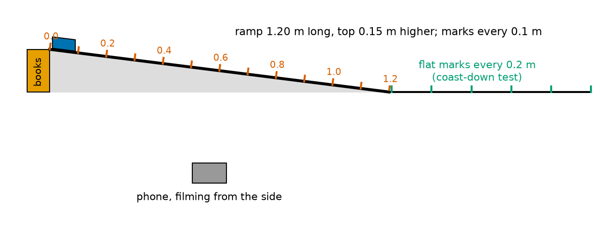
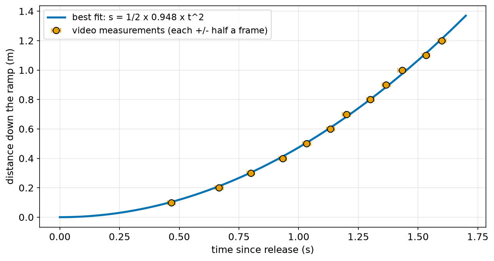
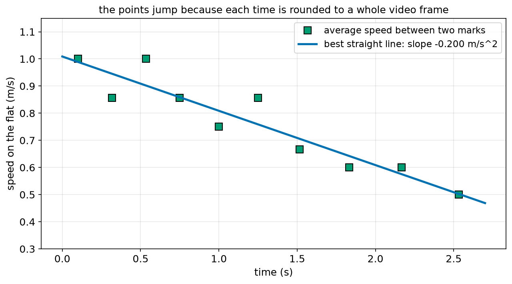
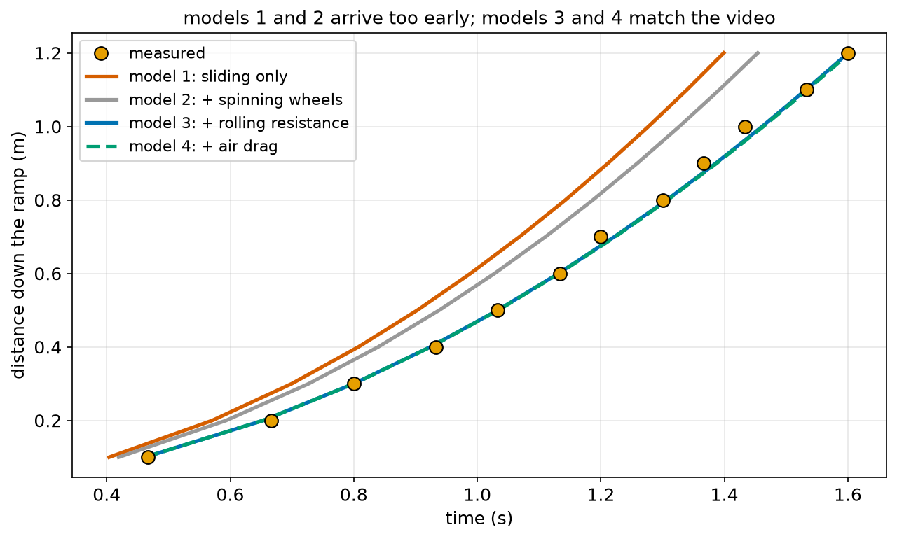
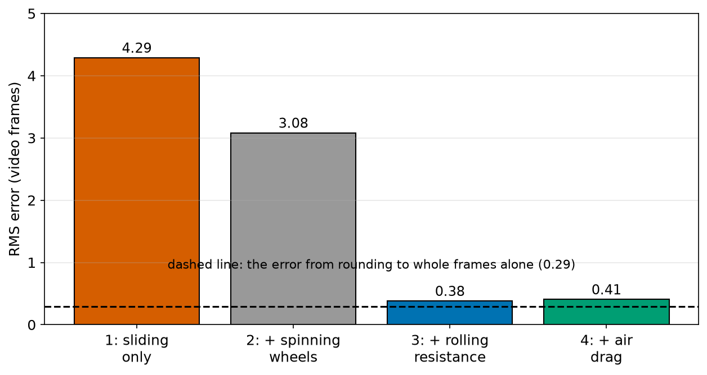
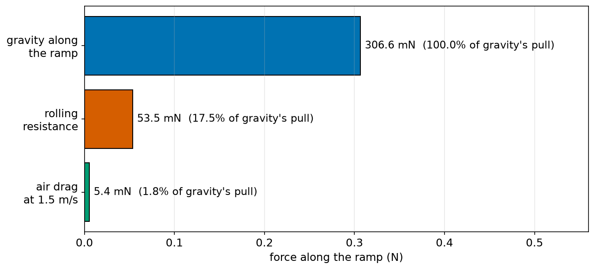

# Chapter 72 — Project: A Rolling Cart on a Ramp, Measured and Simulated

> **Part 4 · Chapter 72 of 749 · Project**
> **You need:** All of Part 4, especially Chapter 59 (equations of motion), Chapter 61 (forces on a ramp), Chapter 63 (rolling resistance), Chapter 69 (rolling wheels) and Chapter 71 (Euler simulation).
> **You will make:** a measured record of a toy cart rolling down a ramp, filmed with a phone; a program that finds the cart's acceleration from the video; a program that finds its rolling resistance from a "coast-down" test; and a simulation with four models, from the simplest to the fullest, that you compare with the measurements until they agree.

---

## What you will learn

- How to plan an experiment so that it tests one idea at a time.
- How to measure motion with a phone video, and how accurate that is.
- How to find an acceleration from many measurements at once (fitting).
- How to measure rolling resistance with a **coast-down test**.
- How to build a simulation **step by step**, adding one physical effect at a time.
- How to judge a model with a single number (the RMS error), and how to tell when a model is "good enough".
- Why you must never count the same effect twice.
- The engineer's loop: **model → measure → compare → improve**. It is how every robot simulator in this course is made trustworthy.

---

## New words in this chapter

| Word | Simple meaning |
|---|---|
| **model** | A simplified description of a real system, here written as forces and code. |
| **experiment** | A planned test that measures something to check a model. |
| **frame** | One picture of a video. A 30 fps video has 30 frames each second. |
| **fps** | Frames per second. |
| **fit** | Choosing a model's number (such as a) so it matches many measurements as well as possible. |
| **least squares** | A way of fitting: make the sum of the squared differences as small as possible. |
| **coast-down test** | Give a vehicle a push, let it roll freely on the flat, and measure how quickly it slows. |
| **residual** | The difference between one measurement and the model's value for it. |
| **RMS error** | "Root mean square": the square root of the average squared residual. One number for how far a model is from the data. |
| **validation** | Checking a model against measurements it was **not** fitted to. |
| **double counting** | Including the same effect twice in a model, for example once inside a measured number and again as a separate term. |

---

## 72.1 The goal

Robots are designed and tested in simulators long before they are built (Chapter 9 and Part 28). But a simulator is only useful if it is **right**. How do engineers make sure? They build a model from physics, measure the real thing, compare, and improve the model until it agrees. Then they trust it for situations they have not measured.

In this project you will do that whole loop for the simplest robot-like vehicle there is: a small cart rolling down a ramp, with no motor at all. Everything in it comes from Part 4:

| Effect | From |
|---|---|
| distance, time and speed from a video | Chapters 56, 57 |
| constant acceleration and s = ½ a t² | Chapters 58, 59 |
| gravity along a ramp, m g sin θ | Chapters 61, 62 |
| rolling resistance, C_rr m g cos θ | Chapters 63, 69 |
| spinning wheels make the cart "feel" heavier | Chapters 66, 69 |
| energy at the bottom | Chapter 67 |
| air drag, and simulating with small steps | Chapter 71 |

📖 **New word: model** — a simplified description of a real system. Here, a list of forces, turned into code.

📖 **New word: experiment** — a planned test that measures something to check a model.

At the end, you should be able to say: "my simulation predicts when the cart passes each mark to within about half a video frame (about 0.013 s), and I know which effects matter and which do not."

---

## 72.2 Parts list

| Part | Notes | Rough cost |
|---|---|---|
| a toy car or small cart with 4 free-rolling wheels | about 100–500 g; it must roll straight | toy box, or $5 |
| a smooth, stiff board, about 1.2–1.5 m long | a shelf, a piece of laminate floor, or a long table leaf | free |
| books or blocks to raise one end | for a rise of about 10–20 cm | free |
| a tape measure and a ruler | | free |
| narrow tape or a marker | for marks every 10 cm on the ramp and every 20 cm on the floor | free |
| a kitchen scale | to weigh the cart and one wheel | free |
| a phone that records video | 30 frames per second is enough; 60 or 120 is better | free |
| a computer with Python, numpy and matplotlib | as in Chapter 8 | free |

💡 **Tip.** If your cart's wheels can be taken off, weigh one. If not, estimate: plastic toy wheels are often 5–10% of the cart's mass. Section 72.6 shows how much this matters.

---

## 72.3 The physics plan

Before building anything, write down the model. Draw a free-body diagram of the cart on the ramp (Chapter 61). Along the ramp, three forces act:

1. **Gravity along the ramp**, pulling it down: m g sin θ (Chapter 61).
2. **Rolling resistance**, pushing it back up: C_rr × m g cos θ (Chapter 63; the normal force on a ramp is m g cos θ).
3. **Air drag**, pushing it back: ½ ρ C_d A v² (Chapter 71).

And one more effect: the wheels must be **spun up** as the cart speeds up. Chapter 69 showed this makes a rolling object accelerate as if it were heavier: the mass m becomes m (1 + k). For the cart, k is the extra "spinning mass" of the wheels divided by the cart's mass. Each wheel, a solid disc, adds half its own mass (I / r² = ½ m_wheel, Chapter 66):

```
k = (4 × ½ × m_wheel) / m_cart
```

Putting it together (Newton's second law, Chapter 61):

```
a = [ m g sin θ − C_rr m g cos θ − ½ ρ C_d A v² ] / [ m (1 + k) ]
```

In words: "the acceleration is the net force along the ramp, divided by the cart's mass made bigger by its spinning wheels".

Because drag depends on v, the acceleration changes slightly as the cart speeds up. So we will **simulate** (Chapter 71). Without drag, the acceleration is constant, and Chapter 59's formulas work too: a good check.

### Four models, one effect at a time

We will build the model in four stages, adding one effect each time, so we can see how much each one matters:

| Model | Includes | Expect |
|---|---|---|
| 1 | gravity only (a block sliding on ice) | too fast |
| 2 | + spinning wheels | a bit slower |
| 3 | + rolling resistance | close |
| 4 | + air drag | slightly closer? |

### What we must measure

| Quantity | How |
|---|---|
| m_cart, m_wheel | kitchen scale |
| ramp angle θ | rise ÷ length = sin θ (Chapter 49) |
| C_rr | coast-down test on the flat (section 72.5) |
| C_d A | estimate from the cart's size (drag is small; see section 72.7) |
| when the cart passes each mark | phone video, frame by frame |

---

## 72.4 Build and measure, step by step

### Step 1: Weigh and measure

Weigh the cart (m_cart) and, if you can, one wheel (m_wheel). Measure the wheel radius. Measure the ramp's length L along its surface and the rise H (how much higher one end is). Then sin θ = H / L.

### Step 2: Mark the ramp and the floor

Put a tape mark across the ramp every 10 cm, starting from a start line near the top. On the floor beyond the ramp (or on a separate flat stretch), put marks every 20 cm for the coast-down test.



*Figure 72.1 — The ramp, its marks, the flat stretch for the coast-down test, and the phone filming from the side.*

**How to read this picture:** The ramp (black line on the grey wedge) is raised at its left end by a stack of books (orange), so its top is 0.15 m higher than its bottom. The blue cart waits at the start line. Red marks cross the ramp every 0.1 m, labelled every 0.2 m. To the right, green marks on the flat floor every 0.2 m are for the coast-down test. The grey box below is the phone, filming from the side, far enough away to see every mark.

### Step 3: Film the ramp run

Put the phone on a stack of books, level, about 1–1.5 m away from the ramp, so the whole ramp is in view and the marks are clear. Start recording. Hold the cart with its nose exactly on the start line, and let it go **without pushing** (lift your fingers straight up). Stop recording after it reaches the bottom.

### Step 4: Read the frames

Open the video in an app that steps one frame at a time. Find the frame where you let go: call it frame 0. Then, for each mark, write down the frame number where the cart's nose first reaches the mark.

📖 **New word: frame** — one picture of a video. 📖 **fps** — frames per second. At 30 fps, each frame is 1/30 = 0.033 s.

⚠️ **Watch out.** A frame number is always a whole number, so each time is only known to within about half a frame (±0.017 s at 30 fps). That is the main measurement error in this project. Chapter 57's warning about speeds from short time differences applies with full force.

### Step 5: Film a coast-down

On a flat floor, give the cart a gentle push so it passes the first floor mark at about 1 m/s, then let it roll freely. Film it from the side, and read the frame at each 20 cm mark, with frame 0 at the first mark.

📖 **New word: coast-down test** — give a vehicle a push and let it roll freely on the flat; how quickly it slows down tells you its rolling resistance. Car makers do the same test with real cars on long, flat roads.

### Step 6: Type in the data

Put your numbers into `ramp_data.py` (section 72.6). This book gives one example set of measurements, so that you can follow the whole analysis even before you build the ramp. **Replace them with your own.**

---

## 72.5 The data and the analysis

### The data file

File `code/ch072/ramp_data.py`:

```python
# ramp_data.py - the measurements from the ramp project (one example set; replace them with your own)
FPS = 30                       # the phone video's frames per second

# the cart and the ramp, measured with a kitchen scale and a tape measure
CART_MASS_KG = 0.250           # the whole cart, wheels included
WHEEL_MASS_KG = 0.010          # each of the 4 wheels
WHEEL_RADIUS_M = 0.015
RAMP_LENGTH_M = 1.20
RAMP_RISE_M = 0.15             # how much higher the top end is than the bottom end

# run 1, down the ramp: (distance from the start line in m, video frame when the cart's nose passed it)
# frame 0 is the frame where the cart was let go
RAMP_MARKS = [(0.1, 14), (0.2, 20), (0.3, 24), (0.4, 28), (0.5, 31), (0.6, 34),
              (0.7, 36), (0.8, 39), (0.9, 41), (1.0, 43), (1.1, 46), (1.2, 48)]

# run 2, coasting on the flat floor after a push: marks every 0.2 m, frame 0 at the first line
FLAT_MARKS = [(0.0, 0), (0.2, 6), (0.4, 13), (0.6, 19), (0.8, 26), (1.0, 34),
              (1.2, 41), (1.4, 50), (1.6, 60), (1.8, 70), (2.0, 82)]

if __name__ == "__main__":
    print(f"{len(RAMP_MARKS)} ramp marks, {len(FLAT_MARKS)} flat marks, video at {FPS} frames per second")
    print(f"ramp angle: sin = {RAMP_RISE_M / RAMP_LENGTH_M:.4f}")
```

| Line | Code | What it does (simple English) |
|---|---|---|
| 1 | `# ramp_data.py …` | A comment that says these are example numbers to replace. |
| 2 | `FPS = 30` | The video's frame rate. |
| 3 | (blank) | Spacing. |
| 4 | `# the cart and the ramp …` | A comment. |
| 5–9 | `CART_MASS_KG`, `WHEEL_MASS_KG`, `WHEEL_RADIUS_M`, `RAMP_LENGTH_M`, `RAMP_RISE_M` | The measured sizes, with units in the names. |
| 10 | (blank) | Spacing. |
| 11–12 | `# run 1 …` | Comments that explain the tuples and what frame 0 means. |
| 13–14 | `RAMP_MARKS = [(0.1, 14), …]` | A list of (distance, frame) tuples (Chapter 22). The list continues onto a second line inside the brackets, which Python allows. |
| 15 | (blank) | Spacing. |
| 16 | `# run 2 …` | A comment. |
| 17–18 | `FLAT_MARKS = [(0.0, 0), …]` | The coast-down marks. |
| 19 | (blank) | Spacing. |
| 20 | `if __name__ == "__main__":` | The two prints run only when this file is run on its own; the other programs import it quietly (Chapter 26). |
| 21–22 | `print(…)` | A short summary. |

Output:

```
12 ramp marks, 11 flat marks, video at 30 frames per second
ramp angle: sin = 0.1250
```

sin θ = 0.125 means θ = asin(0.125) = 7.18° (Chapter 49).

### Finding the acceleration down the ramp

If the acceleration is (nearly) constant, the cart starts from rest and s = ½ a t² (Chapter 59). We have 12 measurements, and each one gives a slightly different a, because each time is rounded to a whole frame. We want the **one** value of a that fits **all** of them best.

📖 **New word: fit** — choosing a model's number so that it matches many measurements as well as possible.

📖 **New word: least squares** — the most common way to fit: choose the number that makes the sum of the squared differences between the model and the measurements as small as possible. (Chapter 171 explains it fully.)

For the model s = ½ a t², the least-squares answer has a simple formula:

```
a = 2 × Σ (s × t²) / Σ (t⁴)
```

(It comes from asking where the sum of squared differences stops going down as a changes; Part 10 shows how.)

File `code/ch072/analyse_ramp.py`:

```python
# analyse_ramp.py - turn the video frames into times, then find the cart's acceleration down the ramp
from ramp_data import FPS, RAMP_MARKS

times = [frame / FPS for s, frame in RAMP_MARKS]
dists = [s for s, frame in RAMP_MARKS]

# best a for s = 1/2 a t^2 through all the points (least squares through the origin, Chapter 171)
top = sum(s * t ** 2 for s, t in zip(dists, times))
bottom = sum(t ** 4 for t in times)
a = 2 * top / bottom
print(f"measured acceleration down the ramp: a = {a:.3f} m/s^2")

print("  s (m)   t (s)   1/2 a t^2 (m)   difference (cm)")
for s, t in zip(dists, times):
    fit = 0.5 * a * t ** 2
    print(f"  {s:4.1f}   {t:5.3f}   {fit:12.3f}   {100 * (s - fit):+12.1f}")

t_end = times[-1]
print(f"reaches the bottom (1.2 m) after {t_end:.3f} s; speed there from v = a t: {a * t_end:.2f} m/s")
print(f"average speed over the last 0.2 m: {0.2 / (times[-1] - times[-3]):.2f} m/s")
```

| Line | Code | What it does (simple English) |
|---|---|---|
| 1 | `# analyse_ramp.py …` | A comment. |
| 2 | `from ramp_data import FPS, RAMP_MARKS` | Uses the data file (Chapter 26). |
| 3 | (blank) | Spacing. |
| 4 | `times = [frame / FPS for s, frame in RAMP_MARKS]` | Each frame number ÷ 30 = seconds since release. |
| 5 | `dists = [s for s, frame in RAMP_MARKS]` | The distances. |
| 6 | (blank) | Spacing. |
| 7 | `# best a …` | A comment. |
| 8 | `top = sum(s * t ** 2 for s, t in zip(dists, times))` | Σ s t². `zip` walks through two lists side by side (Chapter 21). |
| 9 | `bottom = sum(t ** 4 for t in times)` | Σ t⁴. |
| 10 | `a = 2 * top / bottom` | The least-squares acceleration. |
| 11 | `print(f"measured acceleration …")` | Shows it. |
| 12 | (blank) | Spacing. |
| 13 | `print("  s (m) …")` | A table heading. |
| 14 | `for s, t in zip(dists, times):` | Each measurement. |
| 15 | `fit = 0.5 * a * t ** 2` | Where the fitted model says the cart should be at that time. |
| 16 | `print(f"…{100 * (s - fit):+12.1f}")` | The difference in centimetres, with a sign. |
| 17 | (blank) | Spacing. |
| 18 | `t_end = times[-1]` | The time at the last mark. |
| 19 | `print(f"reaches the bottom …")` | The speed at the bottom from v = a t (Chapter 59). |
| 20 | `print(f"average speed over the last 0.2 m: …")` | The speed from two marks directly, for comparison. |

Output:

```
measured acceleration down the ramp: a = 0.948 m/s^2
  s (m)   t (s)   1/2 a t^2 (m)   difference (cm)
   0.1   0.467          0.103           -0.3
   0.2   0.667          0.211           -1.1
   0.3   0.800          0.303           -0.3
   0.4   0.933          0.413           -1.3
   0.5   1.033          0.506           -0.6
   0.6   1.133          0.609           -0.9
   0.7   1.200          0.683           +1.7
   0.8   1.300          0.801           -0.1
   0.9   1.367          0.885           +1.5
   1.0   1.433          0.974           +2.6
   1.1   1.533          1.114           -1.4
   1.2   1.600          1.213           -1.3
reaches the bottom (1.2 m) after 1.600 s; speed there from v = a t: 1.52 m/s
average speed over the last 0.2 m: 1.20 m/s
```



*Figure 72.2 — The 12 measurements lie close to one parabola, s = ½ × 0.948 × t².*

**How to read this picture:** Each orange dot is one mark: its distance down the ramp, and the time from the video. The tiny horizontal bars show the ±half-frame uncertainty in each time. The blue curve is the best-fitting s = ½ a t². The dots scatter a little around it, never by more than 2.6 cm, in both directions: just what whole-frame rounding would cause.

📖 **New word: residual** — the difference between one measurement and the model's value for it. The last column of the output is the residuals, in cm.

Two things stand out:

1. The best acceleration is **0.948 m/s²**. Gravity alone would give g sin θ = 9.81 × 0.125 = 1.226 m/s². Something is slowing the cart by almost a quarter. Section 72.6 finds out what.
2. The speed at the bottom from the fit (1.52 m/s) and from the last two marks (1.20 m/s) are very different. Which is right? The last 0.2 m took only 5 frames (from frame 43 to 48). A one-frame error in that would change the answer by 20%. The fitted value uses **all** 12 measurements and is far more trustworthy. This is Chapter 57's lesson again: speeds from short time differences are noisy.

### Finding the rolling resistance: the coast-down test

On a flat floor, gravity does not push the cart along. Only rolling resistance (and a little air drag) slow it down. Ignoring drag for now:

```
deceleration = C_rr × m g / (m (1 + k)) = C_rr × g / (1 + k)
so C_rr = deceleration × (1 + k) / g
```

To find the deceleration, we work out the average speed between each pair of neighbouring marks (Chapter 57), put each at the middle time of its gap, and fit a straight line through these speeds against time. Its slope is the acceleration (Chapter 58), here negative.

The best straight line (least squares again) through points (t, v) has slope:

```
slope = Σ (t − t̄)(v − v̄) / Σ (t − t̄)²
```

where t̄ and v̄ are the averages. (Chapter 171 derives it; Chapter 43 met straight lines.)

File `code/ch072/coast_down.py`:

```python
# coast_down.py - find the rolling resistance from how quickly the cart slows down on a flat floor
from ramp_data import FPS, FLAT_MARKS, CART_MASS_KG, WHEEL_MASS_KG

G = 9.81

# average speed between neighbouring marks, placed at the middle time of that gap (Chapter 57)
mid_t, speeds = [], []
for (s0, f0), (s1, f1) in zip(FLAT_MARKS, FLAT_MARKS[1:]):
    t0, t1 = f0 / FPS, f1 / FPS
    mid_t.append((t0 + t1) / 2)
    speeds.append((s1 - s0) / (t1 - t0))

# the straight line through the middle of the points: slope = sum((t - tm)(v - vm)) / sum((t - tm)^2)
tm = sum(mid_t) / len(mid_t)
vm = sum(speeds) / len(speeds)
slope = sum((t - tm) * (v - vm) for t, v in zip(mid_t, speeds)) / sum((t - tm) ** 2 for t in mid_t)
print("  middle time (s)   speed (m/s)")
for t, v in zip(mid_t, speeds):
    print(f"  {t:13.3f}   {v:10.3f}")
print(f"best straight line: speed falls by {-slope:.3f} m/s every second")

k = 4 * 0.5 * WHEEL_MASS_KG / CART_MASS_KG      # spinning wheels: 4 discs, each adds half its mass (Chapter 66)
c_rr = -slope * (1 + k) / G                       # rolling resistance m g c_rr = (m + extra) x deceleration
print(f"wheel factor k = {k:.3f}")
print(f"rolling resistance coefficient C_rr = {c_rr:.4f}")
```

| Line | Code | What it does (simple English) |
|---|---|---|
| 1 | `# coast_down.py …` | A comment. |
| 2 | `from ramp_data import …` | The data and the masses. |
| 3 | (blank) | Spacing. |
| 4 | `G = 9.81` | g. |
| 5 | (blank) | Spacing. |
| 6 | `# average speed …` | A comment. |
| 7 | `mid_t, speeds = [], []` | Two empty lists. |
| 8 | `for (s0, f0), (s1, f1) in zip(FLAT_MARKS, FLAT_MARKS[1:]):` | Pairs each mark with the next one: `FLAT_MARKS[1:]` is the list without its first item, so `zip` pairs item 0 with 1, 1 with 2, and so on. |
| 9 | `t0, t1 = f0 / FPS, f1 / FPS` | Frames to seconds. |
| 10 | `mid_t.append((t0 + t1) / 2)` | The middle time of the gap. |
| 11 | `speeds.append((s1 - s0) / (t1 - t0))` | The average speed over the gap. |
| 12 | (blank) | Spacing. |
| 13 | `# the straight line …` | A comment with the formula. |
| 14 | `tm = sum(mid_t) / len(mid_t)` | The average time. |
| 15 | `vm = sum(speeds) / len(speeds)` | The average speed. |
| 16 | `slope = …` | The least-squares slope. |
| 17 | `print("  middle time …")` | A table heading. |
| 18–19 | `for t, v in zip(mid_t, speeds): print(…)` | The speed points. |
| 20 | `print(f"best straight line …")` | The deceleration. |
| 21 | (blank) | Spacing. |
| 22 | `k = 4 * 0.5 * WHEEL_MASS_KG / CART_MASS_KG` | The wheel factor of section 72.3. |
| 23 | `c_rr = -slope * (1 + k) / G` | C_rr from the deceleration. |
| 24–25 | `print(…)` | The results. |

Output:

```
  middle time (s)   speed (m/s)
          0.100        1.000
          0.317        0.857
          0.533        1.000
          0.750        0.857
          1.000        0.750
          1.250        0.857
          1.517        0.667
          1.833        0.600
          2.167        0.600
          2.533        0.500
best straight line: speed falls by 0.200 m/s every second
wheel factor k = 0.080
rolling resistance coefficient C_rr = 0.0220
```



*Figure 72.3 — Single speeds jump about, because of whole-frame rounding. The best straight line uses them all.*

**How to read this picture:** Each green square is the average speed between two floor marks. They jump up and down by about 0.1 m/s, because each gap is only 6 to 12 frames long, and a one-frame error changes the speed by 8–17%. The blue line is the best straight line through all of them. Its slope, −0.200 m/s², is the deceleration. Even though no single point is very accurate, the line through all ten is.

So C_rr ≈ 0.022: a little more than 2% of the cart's weight resists its rolling. That is typical for small plastic wheels on a board (Chapter 69's table).

---

## 72.6 Four models, compared with the video

Now we have every number the model needs. File `code/ch072/models.py`:

```python
# models.py - four models of the cart on the ramp, from simplest to fullest, checked against the video
import math
from ramp_data import FPS, RAMP_MARKS, CART_MASS_KG, WHEEL_MASS_KG, RAMP_LENGTH_M, RAMP_RISE_M

G = 9.81
SIN = RAMP_RISE_M / RAMP_LENGTH_M
COS = math.sqrt(1 - SIN ** 2)
K = 4 * 0.5 * WHEEL_MASS_KG / CART_MASS_KG      # spinning wheels (Chapter 69)
C_RR = 0.0220                                   # from coast_down.py
CD_A = 0.004                                    # drag coefficient x front area, m^2: a box about 6 cm x 5 cm
RHO = 1.2
DT = 0.0005


def acceleration(v, wheels, rolling, drag):
    """Acceleration down the ramp at speed v, with the chosen effects switched on."""
    force = CART_MASS_KG * G * SIN                                  # gravity along the ramp (Chapter 61)
    if rolling:
        force -= C_RR * CART_MASS_KG * G * COS                      # rolling resistance (Chapter 63)
    if drag:
        force -= 0.5 * RHO * CD_A * v * v                           # air drag (Chapter 71)
    mass = CART_MASS_KG * (1 + K) if wheels else CART_MASS_KG       # spinning wheels feel heavier
    return force / mass


def times_at_marks(wheels, rolling, drag):
    """Simulate with semi-implicit Euler; return the time the cart passes each mark."""
    t, x, v = 0.0, 0.0, 0.0
    result = []
    for s, frame in RAMP_MARKS:
        while x < s:
            v = v + acceleration(v, wheels, rolling, drag) * DT
            x = x + v * DT
            t = t + DT
        result.append(t)
    return result, v


if __name__ == "__main__":
    measured = [frame / FPS for s, frame in RAMP_MARKS]
    models = [("1: sliding, nothing else", False, False, False),
              ("2: + spinning wheels", True, False, False),
              ("3: + rolling resistance", True, True, False),
              ("4: + air drag", True, True, True)]
    print("model                       time at 1.2 m   speed at 1.2 m   RMS error (frames)")
    print(f"{'measured by video':26s}  {measured[-1]:10.3f} s")
    for name, wheels, rolling, drag in models:
        sim, v_end = times_at_marks(wheels, rolling, drag)
        rms = math.sqrt(sum((a - b) ** 2 for a, b in zip(sim, measured)) / len(sim)) * FPS
        print(f"{name:26s}  {sim[-1]:10.3f} s   {v_end:10.3f} m/s   {rms:12.2f}")
```

| Line | Code | What it does (simple English) |
|---|---|---|
| 1 | `# models.py …` | A comment. |
| 2 | `import math` | For `sqrt`. |
| 3 | `from ramp_data import …` | The measurements. |
| 4 | (blank) | Spacing. |
| 5 | `G = 9.81` | g. |
| 6 | `SIN = RAMP_RISE_M / RAMP_LENGTH_M` | sin θ = rise ÷ length (Chapter 49). |
| 7 | `COS = math.sqrt(1 - SIN ** 2)` | cos θ from sin² + cos² = 1 (Chapter 49). |
| 8 | `K = …` | The wheel factor. |
| 9 | `C_RR = 0.0220` | From the coast-down test. |
| 10 | `CD_A = 0.004` | An estimate of C_d × A for a small box-shaped cart. |
| 11 | `RHO = 1.2` | The density of air. |
| 12 | `DT = 0.0005` | A small time step: the whole run is only 1.6 s, so this is 3,200 steps. |
| 13–14 | (blank) | Spacing. |
| 15 | `def acceleration(v, wheels, rolling, drag):` | The acceleration, with each effect switched on or off by a `True`/`False` argument. |
| 16 | `"""…"""` | The docstring. |
| 17 | `force = CART_MASS_KG * G * SIN` | Gravity along the ramp: always on. |
| 18–19 | `if rolling: force -= …` | `-=` means "subtract and store" (Chapter 14). Rolling resistance on a ramp uses the normal force m g cos θ. |
| 20–21 | `if drag: force -= …` | Air drag. |
| 22 | `mass = CART_MASS_KG * (1 + K) if wheels else CART_MASS_KG` | The "effective" mass, bigger if the wheels' spin is included. |
| 23 | `return force / mass` | Newton's second law. |
| 24–25 | (blank) | Spacing. |
| 26 | `def times_at_marks(wheels, rolling, drag):` | One simulated run. |
| 27 | `"""…"""` | The docstring. |
| 28 | `t, x, v = 0.0, 0.0, 0.0` | Start from rest at the start line. |
| 29 | `result = []` | The time at each mark. |
| 30 | `for s, frame in RAMP_MARKS:` | For each mark in turn… |
| 31 | `while x < s:` | …step until the cart reaches it. |
| 32 | `v = v + acceleration(…) * DT` | Semi-implicit Euler (Chapter 71): speed first… |
| 33 | `x = x + v * DT` | …then position with the new speed. |
| 34 | `t = t + DT` | The clock. |
| 35 | `result.append(t)` | The time it passed this mark. |
| 36 | `return result, v` | The list of times, and the speed at the last mark. |
| 37–38 | (blank) | Spacing. |
| 39 | `if __name__ == "__main__":` | The comparison runs only when this file is run directly; `figures.py` imports the functions. |
| 40 | `measured = [frame / FPS for …]` | The video times. |
| 41–44 | `models = [("1: …", False, False, False), …]` | The four models, as (name, wheels, rolling, drag). |
| 45–46 | `print(…)` | The heading and the measured time. |
| 47 | `for name, wheels, rolling, drag in models:` | Each model in turn. |
| 48 | `sim, v_end = times_at_marks(wheels, rolling, drag)` | Simulate it. |
| 49 | `rms = math.sqrt(sum((a - b) ** 2 …) / len(sim)) * FPS` | The RMS error (see below), converted to frames by × 30. |
| 50 | `print(f"{name:26s} …")` | One row. |

Output:

```
model                       time at 1.2 m   speed at 1.2 m   RMS error (frames)
measured by video                1.600 s
1: sliding, nothing else         1.399 s        1.716 m/s           4.29
2: + spinning wheels             1.454 s        1.651 m/s           3.08
3: + rolling resistance          1.600 s        1.500 m/s           0.38
4: + air drag                    1.603 s        1.492 m/s           0.41
```

📖 **New word: RMS error** — "root mean square" error: square every residual, take the average, then take the square root. It is one number that says how far a model is from the measurements, on average, in the same units as the measurements (here, frames). Squaring stops positive and negative residuals from cancelling.



*Figure 72.4 — Models 1 and 2 reach each mark too early. Models 3 and 4 pass through the measurements.*

**How to read this picture:** The orange dots are the measurements: distance against time. The red line is model 1, a frictionless block: it reaches the bottom 0.2 s too early. The grey line (model 2, with spinning wheels) is a little better. The blue line (model 3, with rolling resistance) passes right through the dots, and the green dashed line (model 4, with drag too) lies almost on top of it.



*Figure 72.5 — Rolling resistance is the effect that matters most. Air drag makes almost no difference.*

**How to read this picture:** Each bar is one model's RMS error, in video frames. Model 1 is wrong by more than 4 frames on average, model 2 by 3. Model 3 drops to 0.38 frames. The dashed line at 0.29 frames is the error you would expect from rounding every time to a whole frame, even with a perfect model (the RMS of a rounding error is 1/√12 = 0.29 of a step). Model 3 is almost down at that limit: it cannot get much better, because the measurements themselves are not more precise than that.

---

## 72.7 What the comparison teaches us

### Which effects matter?



*Figure 72.6 — Along the ramp at 1.5 m/s, gravity pulls with 307 mN, rolling resistance holds back 54 mN, and air drag only 5 mN.*

**How to read this picture:** Each bar is one force along the ramp, in millinewtons (thousandths of a newton). Gravity's pull (blue) is by far the largest. Rolling resistance (red) is 17.5% of it: enough to change the timing by 0.15 s. Air drag (green) is less than 2% of gravity even at the cart's top speed, and much less on the way: it barely matters for a small, slow cart.

This "force budget" is the most important habit to take from Part 4: **before building a big model, estimate each effect, and keep the ones that matter.** Spinning wheels: 8% (they matter a little). Rolling resistance: 17.5% (it matters a lot). Air drag: under 2% (it hardly matters here, though it would for a drone, Chapter 71).

### Model 4 is not better than model 3. Why?

Adding drag made the RMS error slightly **worse** (0.41 against 0.38 frames). Two reasons:

1. The difference is far smaller than the measurement error. Both models are equally good, within the precision of the video. When two models fit equally well, prefer the simpler one.
2. **Double counting.** The coast-down test measured the **total** slowing on the flat, which includes a little air drag. So the C_rr we found (0.0220) already contains a bit of drag. Adding drag again in model 4 counts it twice.

📖 **New word: double counting** — including the same effect twice in a model: once hidden inside a measured number, and once again as a separate term. If you want drag as a separate term, you must fit C_rr and C_d A together, from tests at different speeds.

### Is the model good enough?

📖 **New word: validation** — checking a model against measurements it was **not** fitted to.

Notice something important: model 3 was **not** fitted to the ramp data. Its numbers came from the scale (masses), the tape measure (angle) and a **different** experiment (the coast-down on the flat). Yet it predicts the ramp times to within 0.38 frames. That is real validation, and it is why we can now trust the model for things we have not measured: a steeper ramp, a heavier cart, or a longer run. Lab 72.2 tests that.

### The engineer's loop

What you have just done is the loop every robot engineer uses:

```
   model ──► predict ──► measure ──► compare
     ▲                                  │
     └────────── improve ◄──────────────┘
```

1. **Model:** write the forces, as simply as possible.
2. **Predict:** simulate.
3. **Measure:** run a careful experiment, and know its errors.
4. **Compare:** look at the residuals and the RMS error.
5. **Improve:** add the effect that explains the biggest difference; stop when the model is as good as the measurements.

Every simulator in this course (Part 28) and every model of a motor, a drone or a robot arm (Parts 13, 19, 30) is built and checked this way.

---

## 72.8 Testing the code

Before trusting the programs, test them on cases with known answers (Chapter 25):

1. **No friction, no wheels, no drag:** model 1 should give a = g sin θ = 1.226 m/s², so the time to 1.2 m should be √(2 × 1.2 / 1.226) = 1.399 s. It does: 1.399 s.
2. **A flat ramp:** set `RAMP_RISE_M = 0` in a copy of the data. Model 1 should never move (it starts at rest with no force), so the `while` loop would never end. Good to know: a real program should check for this and stop (Lab 72.3).
3. **Perfect data:** make fake marks from s = ½ × 1.0 × t² (frames not rounded). `analyse_ramp.py` should give exactly a = 1.000.
4. **Energy check:** at the bottom, model 3 gives 1.500 m/s. Energy (Chapter 67): the drop in height 0.15 m gives m g h = 0.368 J; the rolling resistance's work over 1.2 m is 0.0220 × 0.25 × 9.81 × 0.992 × 1.2 = 0.0642 J; so the kinetic energy (including the wheels' spin) should be 0.303 J = ½ × 0.25 × 1.08 × v², so v = 1.50 m/s. ✓

---

## 🏭 Real robot applications

### Application 1 — 🚗 How car makers measure rolling and air resistance

Car makers do exactly this project's coast-down test with real cars on long, flat test tracks. A car is driven at, say, 120 km/h, put in neutral, and allowed to slow down to 20 km/h, both ways along the track (to cancel out wind and slope). Its speed against time is fitted with a model that has a constant term (rolling resistance) and a v² term (air drag). Because air drag matters a lot at high speed and hardly at all at low speed, the two can be separated, avoiding the double counting of section 72.7. The resulting numbers are used in simulators that predict energy use, which is how official range figures for electric cars are calculated.

### Application 2 — 🤖 Making a robot simulator match the real robot

Before a team trusts a Gazebo or MuJoCo model of their robot (Part 28), they run simple tests on the real robot: drive at constant command and log the speed, coast from speed, turn on the spot, and so on. Then they run the same tests in the simulator and adjust its friction, wheel inertia and motor parameters until the logs agree, exactly as this project does. The difference between simulation and reality is called the "sim-to-real gap", and closing it is a big topic in robot learning (Chapter 513 and Part 25). It starts with the humble loop of section 72.7.

### Application 3 — 🛒 Warehouse robots that learn their own rolling resistance

A warehouse robot's rolling resistance changes as its wheels wear and as the floor gets dusty or wet (Chapter 63). Some fleet software runs a tiny coast-down test whenever a robot is about to stop anyway: it notes how quickly the robot slows with zero motor command. If the deceleration rises, something is dragging (a worn bearing, a wheel full of string), and the robot is sent for maintenance. The same number also improves its energy planning (Chapter 67).

### Application 4 — 🚀 Testing a planetary rover's wheels on slopes

Before a rover goes to Mars, engineers drive test rovers up and down slopes of crushed rock and sand that copy Martian soil, measuring speed, slip and motor current. They fit models with gravity along the slope (with Mars's g, Chapter 62), rolling resistance in loose soil (Chapter 69), and slip (Chapter 69). The validated models let the rover's drivers predict whether a slope is safe before the rover ever tries it.

### Application 5 — 🧪 Teaching simulators with data

Modern simulators sometimes fit **thousands** of parameters at once: friction in every joint, the springiness of every tyre, delays in every motor. They use the same least-squares idea as this project's fits, run by an optimiser on a computer (Chapter 190) instead of a formula. Some go further and train a small neural network to learn the part of the physics that the model gets wrong (Part 25). But it always starts with careful measurements, a simple model, and a comparison like Figure 72.4.

---

## 🔧 Hands-on lab

### Lab 72.1 — Run the full project with your own cart (hardware, the main task)

Follow sections 72.2 to 72.6 with your own cart, ramp and phone.

1. Weigh, measure, mark and film, as in section 72.4.
2. Put your numbers into `ramp_data.py`.
3. Run `analyse_ramp.py`, `coast_down.py` and `models.py`.
4. Make the figures with `figures.py`.

**What you should see:** Your fitted acceleration is clearly below g sin θ. Your C_rr is between about 0.005 (hard wheels on a smooth board) and 0.05 (soft wheels or a rough surface). Model 3's RMS error is below about 1 frame; models 1 and 2 are clearly worse.

| If it does not work | Likely cause | Fix |
|---|---|---|
| The fitted line misses the first marks badly | Frame 0 is not the moment of release | Pick the last frame before the cart moves |
| C_rr comes out negative | The floor slopes slightly downhill | Do the coast-down both ways and average |
| Model 3 is still far too fast | The cart rubs on something, or a wheel is stiff | Check the wheels spin freely; or use C_rr measured on the ramp board itself |
| The cart curves off the ramp | It does not roll straight | Add guide rails (two strips of card) |

**Challenge:** Film at 60 or 120 fps and repeat. How much smaller is model 3's RMS error **in seconds**?

### Lab 72.2 — Predict, then test (hardware and simulation)

The real test of a model is a prediction **before** the experiment.

1. Change the ramp's rise (add or remove a book). Measure the new rise.
2. **Before** filming, use `models.py` (model 3) to predict the time to the bottom.
3. Film the run, and compare.
4. Add a weight (a coin or a small stone) to the cart. Predict and test again.

**What you should see:** The prediction is within about one frame for both changes. With more weight, the time hardly changes: g sin θ, C_rr g cos θ and the wheel factor all scale with the mass, so the mass mostly cancels (only k changes, because the wheels' mass is now a smaller share).

| If it does not work | Likely cause | Fix |
|---|---|---|
| The prediction is far off on a much steeper ramp | The wheels start to slip or bounce | Keep slopes gentle (under about 15°) |
| The heavier cart is slower | The extra weight squashes the wheels, raising C_rr | Measure C_rr again with the weight on |

**Challenge:** Predict the steepest ramp on which your cart would **not** start rolling by itself (hint: tan θ = C_rr, Chapter 63). Test it.

### Lab 72.3 — Make the model safer (simulation)

Copy `models.py`.

1. Make `times_at_marks` stop and return `None` if the cart's speed becomes zero or negative before reaching a mark (so a ramp too shallow to roll never hangs the program).
2. Add a fifth model in which C_rr and C_d A are both fitted: try C_rr from 0.018 to 0.024 in steps of 0.0005 and C_d A from 0 to 0.02 in steps of 0.002, and print the pair with the lowest RMS error.
3. Is the best C_d A sensible for your cart's size?

**What you should see:** The safety check stops cleanly for a flat ramp. The search finds the lowest RMS error with C_rr near 0.021 and a small C_d A (in this example data, 0), but the RMS changes very little across a wide range of C_d A: the ramp run alone cannot measure drag well, because the cart is slow. This is a common lesson in fitting: some numbers simply cannot be found from some experiments.

| If it does not work | Likely cause | Fix |
|---|---|---|
| The search takes very long | Too small a DT inside a double loop | Use DT = 0.002 for the search |
| Every pair gives the same RMS | The drag term was not switched on | Call with `drag=True` |

**Challenge:** Design an experiment that **would** measure the cart's C_d A well. (Hint: drag grows with v², so you need high speeds: a longer, steeper ramp, or a fan blowing at the cart.)

---

## Common mistakes

⚠️ **Pushing the cart at the start.** Then it does not start from rest, and s = ½ a t² does not fit.

⚠️ **Choosing frame 0 badly.** One frame off at the start shifts every time.

⚠️ **Working out speeds from two nearby marks and trusting them.** Short time gaps give noisy speeds; fit the whole run instead.

⚠️ **Forgetting the spinning wheels.** They make the cart accelerate about 7% more slowly than a sliding block.

⚠️ **Using m g instead of m g cos θ for the normal force on the ramp.** (Small for gentle ramps, but wrong.)

⚠️ **Double counting.** A C_rr measured from a coast-down already includes some drag.

⚠️ **Adding more and more effects to a model that already matches the data within its measurement error.** Stop when the model is as good as the measurements.

⚠️ **Testing a model only on the data it was fitted to.** Validate it on a different experiment.

---

## Practice

🏋️ **1.** A cart passes a mark at frame 51 of a 30 fps video. What is the time? What is the uncertainty?

🏋️ **2.** A ramp is 1.5 m long and rises 0.2 m. What are sin θ and θ? What is g sin θ?

🏋️ **3.** Marks at 0.3 m and 0.9 m are passed at 0.70 s and 1.22 s, from rest. Find a from each mark separately using s = ½ a t².

🏋️ **4.** A cart's wheels add 6% to its effective mass, and C_rr = 0.015. On the ramp of question 2, what acceleration does model 3 predict?

🏋️ **5.** In a coast-down, a cart slows from 1.2 m/s to 0.6 m/s in 2.5 s. Its wheel factor is k = 0.05. Find C_rr.

🏋️ **6.** Residuals of a model are 0.5, −1.0, 0.0, 1.5 and −0.5 frames. What is the RMS error?

🏋️ **7.** At 30 fps, roughly what is the smallest RMS error you can expect, even from a perfect model?

🏋️ **8.** A cart rolls down from a height of 0.25 m. Ignoring all losses but including k = 0.08, how fast is it at the bottom?

🏋️ **9.** Why does a heavier cart (same wheels, same ramp) take almost the same time?

🏋️ **10.** A team adds air drag to their model, and the RMS error goes from 0.45 to 0.44 frames. Should they keep the drag term? Explain.

🏋️ **11.** Write a function `fit_acceleration(marks, fps)` that returns a for s = ½ a t² from a list of (distance, frame) tuples, and test it on marks made from a = 1.0 m/s² and rounded to whole frames at 30 fps, for s = 0.1, 0.2, …, 1.0 m.

---

## Answers

**1.** 51 / 30 = 1.700 s, ± about 0.017 s (half a frame).

**2.** sin θ = 0.2 / 1.5 = 0.1333, θ = 7.66°. g sin θ = 1.308 m/s².

**3.** a = 2s / t²: 2 × 0.3 / 0.49 = 1.224 m/s², and 2 × 0.9 / 1.4884 = 1.209 m/s².

**4.** cos θ = √(1 − 0.1333²) = 0.991. a = 9.81 × (0.1333 − 0.015 × 0.991) / 1.06 = 9.81 × 0.1185 / 1.06 = 1.096 m/s².

**5.** Deceleration = 0.6 / 2.5 = 0.24 m/s². C_rr = 0.24 × 1.05 / 9.81 = 0.0257.

**6.** Squares: 0.25, 1.0, 0, 2.25, 0.25; average 3.75 / 5 = 0.75; RMS = √0.75 = 0.87 frames.

**7.** About 0.29 frames (1/√12): about 0.0096 s.

**8.** m g h = ½ m (1 + k) v², so v = √(2 g h / (1 + k)) = √(2 × 9.81 × 0.25 / 1.08) = 2.13 m/s.

**9.** Every force along the ramp (gravity, rolling resistance) and the effective mass all grow in proportion to the mass, so the mass cancels in a = F / m. Only the wheels' share k changes a little.

**10.** No (or only with care). The improvement (0.01 frames) is far smaller than the measurement error (about 0.3 frames), so the data cannot tell the models apart, and the simpler model is preferred. Also, the drag may already be counted inside C_rr.

**11.**

```python
def fit_acceleration(marks, fps):
    top = sum(s * (f / fps) ** 2 for s, f in marks)
    bottom = sum((f / fps) ** 4 for s, f in marks)
    return 2 * top / bottom

marks = [(k / 10, round((2 * (k / 10) / 1.0) ** 0.5 * 30)) for k in range(1, 11)]
print(marks)
print(round(fit_acceleration(marks, 30), 3))
```

Output:

```
[(0.1, 13), (0.2, 19), (0.3, 23), (0.4, 27), (0.5, 30), (0.6, 33), (0.7, 35), (0.8, 38), (0.9, 40), (1.0, 42)]
1.01
```

Even with every time rounded to a whole frame, the fit finds a to within about 1%.

---

## Summary

🧠 A model is only useful once it has been checked against measurements: **model → predict → measure → compare → improve**.

🧠 A phone video measures times to about half a frame. Speeds from short gaps are noisy; **fitting** a model to all the measurements is far more accurate.

🧠 The cart's acceleration down a ramp is a = [m g sin θ − C_rr m g cos θ − drag] / [m (1 + k)], where k is the spinning wheels' share.

🧠 A **coast-down test** on the flat measures rolling resistance: C_rr = deceleration × (1 + k) / g.

🧠 Build models one effect at a time, and judge each with the **RMS error**. Stop when it is as small as the measurement error.

🧠 Make a **force budget** first: keep the effects that matter (here, rolling resistance) and drop those that do not (here, air drag).

🧠 Do not **double count**, and **validate** a model on data it was not fitted to.

---

## Part 4 review

You have finished Part 4. Here is what you can now do, and where it will be used.

| You can now … | Chapters | Used again in |
|---|---|---|
| Describe motion: position, displacement, speed, velocity, acceleration | 56, 57, 58 | odometry, control, every moving robot |
| Use the equations of motion; braking distances, move times | 59 | safety, motion planning |
| Work with vectors and projectiles | 60 | drones, arms, Part 9 |
| Use F = m a, free-body diagrams, Newton's third law | 61 | motors, drones, dynamics (Part 19) |
| Tell mass from weight; use g; measure tilt with an accelerometer | 62 | IMUs, balance, drones |
| Use friction and grip: μ, a ≤ μ g, grippers | 63 | wheels, grippers, legged robots |
| Describe turning: ω, α, v = ω r, v² / r, differential drive | 64 | mobile robots (Part 15) |
| Use torque, levers and holding torque | 65 | arms, motor sizing |
| Use the moment of inertia and τ = I α | 66 | arms, drones, dynamics |
| Use work, energy and power; size batteries | 67 | batteries, motors, planning |
| Choose gear ratios, belts and pulleys | 68 | every motorised robot |
| Understand rolling, slip and wheel choice | 69 | odometry, mobile robots |
| Find a centre of mass and check stability | 70 | arms on bases, humanoids |
| Simulate physics with Euler steps, and check a simulation | 71, 72 | every simulator, control design |

### Quiz

🏋️ **R1.** A robot drives 3 m east, then 4 m north, then 3 m west. What are its distance travelled and its displacement?

🏋️ **R2.** A robot speeds up from 0.5 m/s to 2.0 m/s in 3 s. What is its acceleration, and how far does it go meanwhile?

🏋️ **R3.** A robot at 1.6 m/s with a reaction time of 0.25 s brakes at 2 m/s². What is its stopping distance?

🏋️ **R4.** A drone of 2.5 kg must climb with an acceleration of 1.5 m/s². What thrust does it need?

🏋️ **R5.** A box sits on a robot with μ = 0.35. What is the fastest the robot may accelerate?

🏋️ **R6.** A robot's wheels go at 0.30 m/s (left) and 0.50 m/s (right), 0.2 m apart. What are its forward speed, turn rate and turning radius?

🏋️ **R7.** A 0.6 m arm of mass 0.5 kg holds a 0.3 kg tool straight out. What holding torque does the shoulder need?

🏋️ **R8.** A 20 kg robot at 1.5 m/s: what is its kinetic energy? How much energy does it need to climb 2 m?

🏋️ **R9.** A motor gives 0.04 N m at 9000 rpm through a 25:1 gearbox, 85% efficient. What are the output speed and torque?

🏋️ **R10.** A robot's centre of mass is 0.5 m high and 0.18 m from its side wheels. At what side slope does it tip?

### Quiz answers

**R1.** Distance 3 + 4 + 3 = 10 m. Displacement (0, 4): 4 m north.

**R2.** a = 1.5 / 3 = 0.5 m/s². s = (0.5 + 2.0) / 2 × 3 = 3.75 m.

**R3.** 1.6 × 0.25 + 1.6² / (2 × 2) = 0.4 + 0.64 = 1.04 m.

**R4.** 2.5 × (9.81 + 1.5) = 28.3 N.

**R5.** 0.35 × 9.81 = 3.43 m/s².

**R6.** v = 0.40 m/s. ω = 0.20 / 0.2 = 1.0 rad/s (turning left). R = 0.4 m.

**R7.** 0.5 × 9.81 × 0.3 + 0.3 × 9.81 × 0.6 = 1.47 + 1.77 = 3.24 N m.

**R8.** KE = ½ × 20 × 2.25 = 22.5 J. PE = 20 × 9.81 × 2 = 392.4 J.

**R9.** 9000 / 25 = 360 rpm. 0.04 × 25 × 0.85 = 0.85 N m.

**R10.** atan(0.18 / 0.5) = 19.8°.

---

## Next chapter

Part 5 begins with Chapter 73: **What is electricity? Charge and electrons.** Every robot in this course runs on electricity: its battery, its motors, its sensors and its computer. Part 4 gave you the physics of how robots move; Part 5 gives you the physics of what makes them go, one small step at a time.
