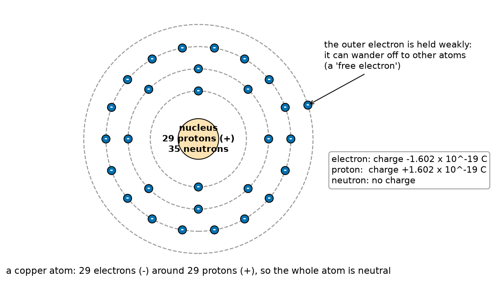
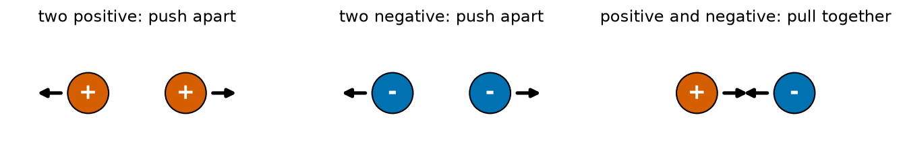
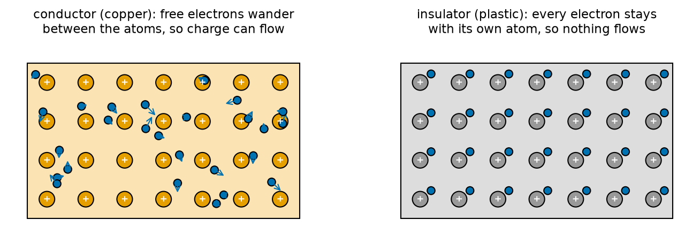
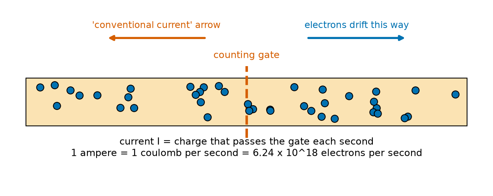
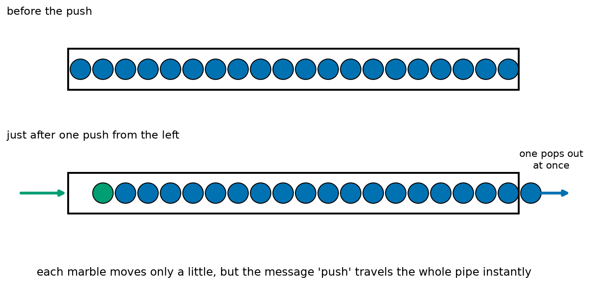
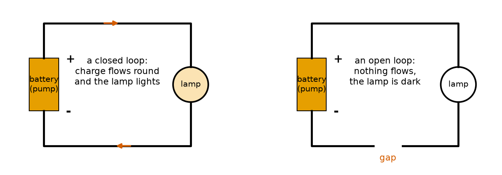

# Chapter 73 — What Is Electricity? Charge and Electrons

> **Part 5 · Chapter 73 of 749**
> **You need:** Chapter 5 (the parts of a robot and its power wires), Chapter 7 (safety and the water picture of electricity), Chapter 38 (powers of ten and scientific notation), Chapter 52 (exponential decay) and Chapter 67 (energy).
> **You will make:** a program that counts the charge and the electrons in a battery, a program that works out how fast electrons really move in a wire, a program that shows why a static spark from your finger can kill a chip, and a program that treats a drone battery as a tank of charge.

---

## What you will learn

- What **charge** is, and why there are two kinds, plus and minus.
- What **electrons** are, and why they are the part of the atom that moves.
- The unit of charge, the **coulomb**, and how many electrons it holds.
- Why metals **conduct** and plastics do not.
- What a **current** is: charge passing a point, measured in **amperes**.
- Why the electrons in a wire crawl at a fraction of a millimetre per second, yet a lamp lights at once.
- Why electricity needs a **closed loop**, and why static electricity is dangerous for robot electronics.

---

## New words in this chapter

| Word | Simple meaning |
|---|---|
| **atom** | The tiny building block of everything. It has a heavy centre and light electrons around it. |
| **electron** | A tiny particle with a negative charge. Electrons are what move in a wire. |
| **proton** | A particle in the centre of an atom with a positive charge. |
| **charge** | The property that makes things push or pull each other electrically. It comes in two kinds: positive (+) and negative (−). |
| **coulomb (C)** | The unit of charge. One coulomb is the charge of about 6.24 × 10¹⁸ electrons. |
| **static electricity** | Charge that has built up on something and is staying there. |
| **conductor** | A material in which charge can move easily, such as copper. |
| **insulator** | A material in which charge cannot move, such as plastic or glass. |
| **semiconductor** | A material in between, such as silicon. Chips and transistors are made of it. |
| **current (I)** | How much charge passes a point each second. Measured in amperes. |
| **ampere (A)** | The unit of current. One ampere is one coulomb per second. |
| **conventional current** | The direction engineers draw for current: from + to −. The electrons actually go the other way. |
| **drift speed** | The slow average speed at which electrons move along a wire. |
| **circuit** | A closed loop that charge can flow round. |
| **ESD** | Electrostatic discharge: a spark of static electricity jumping from one thing to another. |

---

## 73.1 Everything is made of atoms

Pick up anything near you: a pencil, a coin, a cup of water. If you could zoom in a million times, you would see that it is made of **atoms**. An atom is so small that one million of them in a row would be about as wide as a human hair.

📖 **New word: atom** — the tiny building block of all ordinary matter.

An atom has two parts:

- A heavy centre called the **nucleus**. It holds **protons** and **neutrons**.
- Around the nucleus, much lighter particles called **electrons**. They move around the nucleus like a swarm of very fast bees.

📖 **New word: proton** — a particle in the nucleus with a **positive** charge.

📖 **New word: electron** — a very light particle around the nucleus with a **negative** charge.

Neutrons have no charge at all. They only add weight.



*Figure 73.1 — A copper atom, drawn simply: 29 protons in the nucleus and 29 electrons around it.*

**How to read this picture:** The orange centre is the nucleus. The blue dots are electrons, drawn on dashed rings (the real picture is fuzzier, but rings are a good first idea). Copper has 29 electrons, and the one on the outside ring is held only weakly. That one electron is the reason copper is such a good material for wires, as you will see in section 73.4.

Here is the rule that matters most:

🧠 **A whole atom is neutral.** It has exactly as many electrons (−) as protons (+), so the pluses and minuses cancel. Your pencil does not shock you, because every atom in it is balanced.

Electricity happens when this balance is disturbed: when electrons are **pulled off** atoms, **pushed onto** atoms, or made to **move** from atom to atom.

---

## 73.2 Charge: what electricity is made of

📖 **New word: charge** — the property that makes two things push or pull each other electrically. Mass makes things pull each other by gravity (Chapter 62); charge makes things push or pull each other electrically. The difference is that charge comes in **two kinds**.

The two kinds are called **positive** (+) and **negative** (−). The names are just labels, chosen long ago by Benjamin Franklin. He could have called them "red" and "blue". The rule between them is simple:



*Figure 73.2 — Like charges push apart. Opposite charges pull together.*

**How to read this picture:** Each circle is a charged object; the arrows are the forces on it. Two positives push each other away (left). Two negatives also push each other away (middle). A positive and a negative pull each other together (right). The pull between a proton and an electron is what holds every atom together.

🧠 **Like charges repel; opposite charges attract.** This one sentence explains why electrons stay near their nucleus, why a rubbed balloon sticks to a wall, and why a motor can turn (Chapter 85 onwards).

### The unit of charge: the coulomb

Charge is measured in **coulombs**, written C, named after the French engineer Charles-Augustin de Coulomb who measured the force between charges in 1785.

📖 **New word: coulomb (C)** — the unit of charge.

The charge of a single electron is unbelievably small:

```
charge of one electron = −1.602 × 10⁻¹⁹ C
charge of one proton   = +1.602 × 10⁻¹⁹ C
```

Remember scientific notation from Chapter 38: 10⁻¹⁹ means "move the decimal point 19 places to the left". So one electron carries 0.000 000 000 000 000 000 160 2 coulombs. Turn it round, and one coulomb is a huge number of electrons:

🔢 **Maths.** Electrons in one coulomb = 1 ÷ (1.602 × 10⁻¹⁹) = 6.24 × 10¹⁸. That is 6,240,000,000,000,000,000 electrons: more than six billion billion.

Why such an awkward unit? Because the coulomb was chosen to fit everyday currents, not single electrons. A small robot's motor moves about half a coulomb every second, so the coulomb is a convenient size for engineers, even though it is an enormous number of electrons.

🔢 **Maths.** Rover's AA cells (Chapter 5) are rated 2,000 mAh, which means "2 amperes for 1 hour" (or 1 ampere for 2 hours). We will see in a moment that 1 ampere is 1 coulomb per second, so one cell holds 2 × 3,600 = **7,200 C** of charge. That is 7,200 × 6.24 × 10¹⁸ = 4.5 × 10²² electrons: a 45 followed by 21 zeros.

💡 **Tip.** You will never count electrons one at a time. But knowing that a coulomb is a specific, fixed number of them makes everything in this part real: a current is a **count** of electrons passing by, and a battery is a **store** of a known number of them.

---

## 73.3 Static electricity: charge that stays still

Rub a balloon on your hair, and it sticks to the wall. Walk across a carpet on a dry winter day, touch a door handle, and you feel a spark. Both are **static electricity**.

📖 **New word: static electricity** — extra charge that has built up on something and is staying there ("static" means "not moving").

What happens with the balloon: rubbing pulls some electrons off your hair and onto the balloon. Now the balloon has **more** electrons than protons, so it is negative. Your hair has **fewer** electrons than protons, so it is positive. Opposite charges attract, so the hair reaches up towards the balloon.

How much charge moves? Very little: about 10⁻⁸ to 10⁻⁷ coulombs, less than a millionth of what a AA cell holds. Yet it is enough to lift paper or bend a thin stream of water, because even a small charge can be concentrated on one spot.

The spark from the door handle is a tiny flash of charge jumping through the air. It happens because your body built up charge from the carpet, and the handle offered a path for it to leave. The charge is small, the time is very short, and for you it is only a surprise.

⚠️ **Careful: for a chip, a static spark can be deadly.** The parts inside a modern chip are narrower than a thousandth of a hair. A spark that you cannot even feel (under 3,000 V) can burn a hole in them. Many "mysterious" dead sensor boards were killed by a static spark from the fingers of the person who built the robot. Application 2 works through the numbers, and the rule is simple: **touch something metal that is connected to the ground before you pick up a board**, and keep boards in their silver anti-static bags until you need them.

📖 **New word: ESD** — electrostatic discharge: a static spark jumping into something, often a chip.

---

## 73.4 Conductors, insulators and semiconductors

Why does a copper wire carry electricity, while the plastic around it does not? Look back at Figure 73.1. Copper's outer electron is far from the nucleus and held only weakly. In a piece of copper, with billions of billions of atoms packed together, those outer electrons do not stay with their own atom. They wander freely between all the atoms, like people in a crowd. They are called **free electrons**.



*Figure 73.3 — In copper, free electrons wander between the atoms. In plastic, every electron stays with its own atom.*

**How to read this picture:** Orange circles with + are the copper nuclei (with their tightly held inner electrons). The blue dots with little arrows are free electrons, moving in all directions between them. On the right, each grey nucleus keeps its blue electron close, and nothing can move.

📖 **New word: conductor** — a material with free electrons, so charge can move through it. All metals are conductors. Copper, silver and gold are the best; aluminium and iron are good; the salty water inside your body conducts too (that is why electricity is dangerous for people).

📖 **New word: insulator** — a material with no free electrons, so charge cannot move. Plastic, rubber, glass, dry wood, dry air and ceramic are insulators. The plastic coating on a wire is an insulator; it keeps the charge inside the copper and keeps your fingers safe.

📖 **New word: semiconductor** — a material in between. Pure silicon has almost no free electrons, but adding a tiny amount of another element ("doping") gives it some, and engineers can control exactly how many and where. Every chip, LED, diode and transistor in a robot is made of a semiconductor. Chapters 86 to 88 show what they can do.

🤖 **Robot link.** Rover's wiring (Chapter 5) uses copper wires inside plastic coats. The copper carries the charge; the plastic stops two wires that touch from joining, which would be a **short circuit** (Chapter 7). When you build Rover, the most common wiring faults are a plastic coat that was not stripped off (an insulator where you wanted a conductor) and a bare wire touching another (a conductor where you wanted an insulator).

| Material | Kind | Used in a robot for |
|---|---|---|
| Copper | conductor | wires, circuit board tracks, motor windings |
| Aluminium | conductor | frames, heat sinks (also a conductor: keep it away from bare wires) |
| Carbon | conductor (weak) | resistors, some potentiometers |
| Silicon | semiconductor | every chip, transistor, LED, diode |
| Plastic (PVC, silicone) | insulator | wire coats, connectors, the body |
| Glass fibre with resin (FR4) | insulator | the green board that holds the parts |
| Dry air | insulator | the gap between parts (but a high enough voltage can jump it: a spark) |
| Water with salt | conductor | your body; rain on a board (a cause of faults) |

---

## 73.5 Current: charge on the move

Static charge is interesting, but robots run on **moving** charge. When free electrons in a wire all drift the same way, we have a **current**.

📖 **New word: current (I)** — how much charge passes a point each second. The symbol is I (from the French *intensité*).

Imagine a gate across the wire, and a counter that counts the charge going through it:



*Figure 73.4 — Count the charge that passes the gate in one second: that is the current.*

**How to read this picture:** The orange bar is a wire, the blue dots are free electrons, and the red dashed line is an imaginary counting gate. Current is the amount of charge that crosses the gate each second. Notice the two arrows: the electrons drift to the right, but the "conventional current" arrow points left. The next paragraphs explain why.

📖 **New word: ampere (A)** — the unit of current, often shortened to "amp". **One ampere is one coulomb per second.**

```
current (A) = charge (C) ÷ time (s)
I = Q / t
```

In words: "current equals charge divided by time". This is the same shape as speed = distance ÷ time (Chapter 57): current is the **rate** of charge, just as speed is the rate of distance.

🔢 **Maths.** Rover draws about 0.53 A when driving normally (Chapter 7). So 0.53 coulombs pass any point in its battery wire each second: 0.53 × 6.24 × 10¹⁸ = 3.3 × 10¹⁸ electrons every second.

🔢 **Maths.** Rearrange the formula: Q = I × t. A 2,000 mAh cell (7,200 C) at 0.53 A lasts t = Q / I = 7,200 ÷ 0.53 = 13,585 s = 3.77 hours. (Chapter 5 found 3.05 h for the whole robot, because the brain and the sensors also draw current. The two numbers agree in spirit: the battery is a tank of charge, and the current is how fast it drains.)

### Which way does current flow?

Here is a piece of history that confuses every beginner, so read it twice. When scientists first studied currents, around 1800, nobody knew about electrons. They **guessed** that something positive flowed from the + end of a battery to the − end, and they drew their arrows that way. A hundred years later, electrons were discovered, and it turned out that in a wire it is the **negative** electrons that move, from − to +. The opposite way.

By then, every book and every diagram used the old direction. So engineers kept it, and gave it a name:

📖 **New word: conventional current** — the direction drawn on every circuit diagram: **from + to −**, out of the battery's + end, through the circuit, and back into the − end.

The electrons in the wire go the other way. It does not matter. A current of electrons going left is exactly the same, for every calculation, as a current of positive charge going right. Every formula in this part, every arrow in every diagram, and every rule in every datasheet uses conventional current. We will too.

🧠 **Draw current from + to −. Remember that the electrons go the other way, then stop worrying about it.**

---

## 73.6 How fast do electrons move?

Switch on a lamp, and it lights at once. So electrons must race along the wire at enormous speed, right? No. This is one of the biggest surprises in electricity. Let us work it out.

A copper wire has about 8.5 × 10²⁸ free electrons in every cubic metre (one for each atom). Take a wire with a cross-section area A, and suppose the electrons all drift along it at speed v. In one second, the electrons that pass the gate are the ones that started within a distance v × 1 s of it: a cylinder of volume A × v.

```
electrons passing per second  = 8.5 × 10²⁸ × A × v
charge passing per second (I) = 8.5 × 10²⁸ × 1.602 × 10⁻¹⁹ × A × v
so                          v = I ÷ (8.5 × 10²⁸ × 1.602 × 10⁻¹⁹ × A)
```

🔢 **Maths.** Rover's battery wire has a cross-section of 0.5 mm² = 0.5 × 10⁻⁶ m², and carries 0.53 A.

```
v = 0.53 ÷ (8.5 × 10²⁸ × 1.602 × 10⁻¹⁹ × 0.5 × 10⁻⁶)
  = 0.53 ÷ (6.81 × 10³)
  = 7.8 × 10⁻⁵ m/s
  = 0.078 mm/s
```

The electrons crawl along at **less than a tenth of a millimetre per second**. An electron that leaves the battery would take 3.6 hours to reach a motor 1 m away. By then the battery is nearly empty!

📖 **New word: drift speed** — the slow average speed of the electrons along the wire.

So why does the motor start at once? Because the wire is already **full** of free electrons, from end to end. The battery does not have to send electrons to the motor. It only has to **push**, and the push travels through the crowd of electrons almost at the speed of light.



*Figure 73.5 — Push one marble into a full pipe, and one pops out of the far end at once, although each marble moved only a little.*

**How to read this picture:** The pipe is the wire; the marbles are the free electrons that are already in it. In the lower picture, one marble (green) is pushed in from the left, and immediately a marble leaves on the right. Every marble moved only one space. That is the drift. The "message" that a push happened crossed the whole pipe instantly.

The push itself (an electric field, if you want the proper name) travels along a wire at about 200,000,000 m/s, two thirds of the speed of light. A 1 m wire passes the message in about 5 nanoseconds. That is why the motor starts at once.

🤖 **Robot link.** This matters for fast robot signals. A signal wire 30 cm long adds about 1.5 nanoseconds of delay. For an Arduino that is nothing. For the gigahertz signals between a camera and a computer, wires of different lengths can deliver the bits at measurably different times, which is why high-speed cables are made with exactly matched lengths (Chapter 538).

---

## 73.7 A circuit is a loop

Chapter 7 gave you the **water picture**: a battery is a pump, wires are pipes, voltage is how hard the pump pushes, and current is how much water flows. Now we can add the most important rule about pipes: water only flows if the pipe goes all the way round.

📖 **New word: circuit** — a closed loop of conductors that charge can flow round. The word comes from "circle".



*Figure 73.6 — Charge flows only round a closed loop. One gap anywhere, and nothing flows.*

**How to read this picture:** On the left, the wires make a complete loop from the battery's + end, through the lamp, and back to its − end. The red arrows show the conventional current going round, and the lamp is lit. On the right there is a gap in the bottom wire. The wire is full of free electrons, but they cannot go round, so nothing moves and the lamp is dark.

Why must it be a loop? Because the free electrons that leave the battery's − end have to be replaced, and the only place they can come from is the + end. The battery does not **make** electrons; it pumps the ones that are already in the wire round and round. A gap breaks the chain, and the pump has nothing to push against.

This gives you three facts that you will use in every circuit in this course:

1. **A switch is a gap you can open and close.** Open: no current anywhere in the loop. Closed: current everywhere in the loop.
2. **Current is the same all the way round a simple loop.** The charge that leaves the + end is the charge that arrives at the − end; none is used up on the way. (What is used up is **energy**, Chapter 76.) Chapter 77 extends this to loops with branches.
3. **A broken wire anywhere stops everything.** When Rover's motors do not turn, the first question is: is the loop complete? A loose connector, a wire that fell out of the breadboard, or a blown fuse (Chapter 7) are all gaps.

🤖 **Robot link.** The fuse in Rover's battery wire (Chapter 7) works by **becoming a gap**: too much current melts the thin wire inside it, which opens the loop and stops the current at once. The emergency stop (Chapter 7) is a switch: a gap you can make with your hand.

What makes the charge move at all is the battery's **push**, which Chapter 7 called voltage. Chapter 74 explains what a volt really is, and what slows the flow down (resistance). Then Chapter 75 ties the three together in a single rule, Ohm's law.

---

## Code

File `code/ch073/charge_count.py`:

```python
# charge_count.py - how much charge is in a battery, and how many electrons that is
ELECTRON_C = 1.602e-19          # the charge of one electron, in coulombs (a minus sign in real life)
PER_COULOMB = 1 / ELECTRON_C    # electrons in one coulomb

print(f"one coulomb is {PER_COULOMB:.3e} electrons")
print()

batteries = [
    ("AA cell in Rover", 2000),
    ("phone", 4000),
    ("drone 4S LiPo", 5000),
    ("coin cell CR2032", 220),
]
print(f"{'battery':18s} {'mAh':>6s} {'coulombs':>10s} {'electrons':>12s}")
for name, mah in batteries:
    coulombs = mah / 1000 * 3600          # mAh -> Ah -> coulombs (1 A for 1 s = 1 C)
    electrons = coulombs * PER_COULOMB
    print(f"{name:18s} {mah:6d} {coulombs:10.0f} {electrons:12.3e}")

print()
current = 0.53                            # Rover's normal current, A (Chapter 7)
print(f"Rover at {current} A: {current:.2f} C every second = {current * PER_COULOMB:.2e} electrons per second")
print(f"a 2,000 mAh cell lasts {7200 / current / 3600:.2f} h at that current")
```

| Line | Code | What it does (simple English) |
|---|---|---|
| 1 | `# charge_count.py …` | A comment. |
| 2 | `ELECTRON_C = 1.602e-19` | The charge of one electron in coulombs, written in scientific notation (Chapter 38). |
| 3 | `PER_COULOMB = 1 / ELECTRON_C` | One divided by that: the number of electrons in a coulomb. |
| 4 | (blank) | Spacing. |
| 5 | `print(f"one coulomb is {PER_COULOMB:.3e} electrons")` | Prints it. `.3e` means scientific notation with 3 decimals. |
| 6 | `print()` | An empty line. |
| 7 | (blank) | Spacing. |
| 8–13 | `batteries = [ … ]` | A list of tuples (Chapter 22): a name and a capacity in mAh. |
| 14 | `print(f"{'battery':18s} …")` | The table header, with column widths (Chapter 15). |
| 15 | `for name, mah in batteries:` | One row per battery, unpacking each tuple. |
| 16 | `coulombs = mah / 1000 * 3600` | mAh ÷ 1,000 gives Ah; × 3,600 seconds gives coulombs. |
| 17 | `electrons = coulombs * PER_COULOMB` | Coulombs times electrons per coulomb. |
| 18 | `print(f"{name:18s} …")` | The row. |
| 19 | (blank) | Spacing. |
| 20 | `print()` | An empty line. |
| 21 | `current = 0.53` | Rover's normal current. |
| 22 | `print(f"Rover at {current} A: …")` | Charge and electrons per second at that current. |
| 23 | `print(f"a 2,000 mAh cell lasts …")` | 7,200 C ÷ 0.53 A gives seconds; ÷ 3,600 gives hours. |

Output:

```
one coulomb is 6.242e+18 electrons

battery               mAh   coulombs    electrons
AA cell in Rover     2000       7200    4.494e+22
phone                4000      14400    8.989e+22
drone 4S LiPo        5000      18000    1.124e+23
coin cell CR2032      220        792    4.944e+21

Rover at 0.53 A: 0.53 C every second = 3.31e+18 electrons per second
a 2,000 mAh cell lasts 3.77 h at that current
```

Even the tiny coin cell holds nearly five thousand billion billion electrons. The numbers are huge, but the **ratios** are easy: a phone battery holds twice the charge of one of Rover's cells, and a drone battery two and a half times.

File `code/ch073/drift_speed.py`:

```python
# drift_speed.py - how fast do the electrons themselves move in a wire? (slowly!)
ELECTRON_C = 1.602e-19       # charge of one electron, C
FREE_PER_M3 = 8.5e28         # free electrons in one cubic metre of copper


def drift_speed(current_a, area_mm2):
    """Average speed of the electrons in a copper wire, in metres per second."""
    area_m2 = area_mm2 * 1e-6                           # 1 mm^2 = 0.000001 m^2
    return current_a / (FREE_PER_M3 * ELECTRON_C * area_m2)


print(f"{'wire':28s} {'current':>8s} {'area':>8s} {'drift':>12s} {'time for 1 m':>14s}")
cases = [
    ("Rover, normal driving", 0.53, 0.5),
    ("Rover, motors starting", 3.1, 0.5),
    ("house wire, 1 A", 1.0, 1.0),
    ("drone motor wire, hover", 25.0, 4.0),
]
for name, current, area in cases:
    v = drift_speed(current, area)
    print(f"{name:28s} {current:6.2f} A {area:4.1f} mm2 {v * 1000:9.3f} mm/s {1 / v / 3600:10.2f} h")

print()
print("but the push travels along the wire at about 200,000,000 m/s,")
print(f"so a 1 m wire passes the message in {1 / 2e8 * 1e9:.0f} nanoseconds")
```

| Line | Code | What it does (simple English) |
|---|---|---|
| 1 | `# drift_speed.py …` | A comment. |
| 2 | `ELECTRON_C = 1.602e-19` | The electron's charge. |
| 3 | `FREE_PER_M3 = 8.5e28` | Free electrons per cubic metre of copper. |
| 4–5 | (blank) | Spacing. |
| 6 | `def drift_speed(current_a, area_mm2):` | A function (Chapter 23): current in amps, wire area in mm². |
| 7 | `"""…"""` | The docstring. |
| 8 | `area_m2 = area_mm2 * 1e-6` | A square millimetre is a millionth of a square metre. |
| 9 | `return current_a / (FREE_PER_M3 * ELECTRON_C * area_m2)` | The formula from section 73.6: v = I ÷ (n × e × A). |
| 10–11 | (blank) | Spacing. |
| 12 | `print(f"{'wire':28s} …")` | The table header. |
| 13–18 | `cases = [ … ]` | Four wires: name, current, area. |
| 19 | `for name, current, area in cases:` | One row each. |
| 20 | `v = drift_speed(current, area)` | Work out the speed. |
| 21 | `print(f"{name:28s} …")` | The speed in mm/s (× 1,000), and the hours an electron needs for 1 m (1 ÷ v seconds, ÷ 3,600). |
| 22 | (blank) | Spacing. |
| 23 | `print()` | An empty line. |
| 24 | `print("but the push …")` | A reminder that the push is fast. |
| 25 | `print(f"so a 1 m wire … {1 / 2e8 * 1e9:.0f} …")` | 1 m ÷ 2 × 10⁸ m/s = 5 × 10⁻⁹ s; × 10⁹ gives nanoseconds. |

Output:

```
wire                          current     area        drift   time for 1 m
Rover, normal driving          0.53 A  0.5 mm2     0.078 mm/s       3.57 h
Rover, motors starting         3.10 A  0.5 mm2     0.455 mm/s       0.61 h
house wire, 1 A                1.00 A  1.0 mm2     0.073 mm/s       3.78 h
drone motor wire, hover       25.00 A  4.0 mm2     0.459 mm/s       0.61 h

but the push travels along the wire at about 200,000,000 m/s,
so a 1 m wire passes the message in 5 nanoseconds
```

Even in a drone's fat motor wire carrying 25 A, the electrons drift at under half a millimetre per second. Notice that doubling the wire's area halves the speed for the same current: the same number of electrons per second has more room, so each moves more slowly.

---

## Small examples

**Example 1.** A charge of 3 C passes a point in 2 s. Current = 3 ÷ 2 = 1.5 A.

**Example 2.** A current of 0.2 A flows for 1 minute. Charge = 0.2 × 60 = 12 C.

**Example 3.** 12 C is 12 × 6.24 × 10¹⁸ = 7.5 × 10¹⁹ electrons.

**Example 4.** A 500 mAh battery holds 0.5 × 3,600 = 1,800 C. At 0.1 A it lasts 1,800 ÷ 0.1 = 18,000 s = 5 hours.

**Example 5.** A balloon with −5 × 10⁻⁸ C has 5 × 10⁻⁸ ÷ 1.602 × 10⁻¹⁹ = 3.1 × 10¹¹ extra electrons: 310 billion. It sounds like a lot, but it is a billion times less than a coin cell's charge.

**Example 6.** An atom with 6 protons and 6 electrons has a total charge of +6 − 6 = 0. Take one electron away: +1 × 1.602 × 10⁻¹⁹ C. It is now a positive **ion**.

**Example 7.** A wire of 1 mm² carrying 2 A: drift speed = 2 ÷ (8.5 × 10²⁸ × 1.602 × 10⁻¹⁹ × 10⁻⁶) = 0.15 mm/s.

**Example 8.** A loop: battery → switch → motor → back to the battery. Open the switch: the current is zero in the motor **and** in the battery wire, not only at the switch.

---

## 🏭 Real robot applications

### Application 1 (worked in full) — 🚁 A drone battery as a tank of charge

**1. The real problem.** A survey drone has a 5,000 mAh battery. Its motors draw about 25 A while hovering and 40 A when flying fast. The pilot wants to know how long the drone can stay up, and how much hover time is left after a 2-minute climb at 35 A. Chapter 4 did this with watt-hours; here we do it with charge, which is what the battery's own label (mAh) measures.

**2. Why this theory.** A battery is a store of charge. Current is charge per second. So time = charge ÷ current. The only new idea is to turn the label (mAh) into coulombs first, and to keep 20% of the charge in reserve, because lithium batteries are damaged if emptied (Chapter 89).

**3. The numbers.** 5,000 mAh. Usable fraction 0.80. Hover 25 A, fast 40 A, climb 35 A for 120 s.

**4. The maths.**

```
full charge   = 5,000 ÷ 1,000 × 3,600 = 18,000 C
usable charge = 18,000 × 0.80         = 14,400 C
hover time    = 14,400 ÷ 25 = 576 s  = 9.6 min
fast time     = 14,400 ÷ 40 = 360 s  = 6.0 min
climb uses      35 × 120   = 4,200 C
left            14,400 − 4,200 = 10,200 C  →  10,200 ÷ 25 = 408 s = 6.8 min of hover
```

**5. The code.** File `code/ch073/drone_charge.py`:

```python
# drone_charge.py - a drone battery as a tank of charge: how long does the charge last?
ELECTRON_C = 1.602e-19

CAPACITY_MAH = 5000
USABLE = 0.80                       # never empty a LiPo completely (Chapter 89)
HOVER_A = 25.0                      # current while hovering
FAST_A = 40.0                       # current while flying fast

full_c = CAPACITY_MAH / 1000 * 3600
usable_c = full_c * USABLE
print(f"battery: {CAPACITY_MAH} mAh = {full_c:.0f} C, usable {usable_c:.0f} C")
print(f"that is {usable_c / ELECTRON_C:.2e} electrons we may use")
print()

for name, amps in [("hover", HOVER_A), ("fast flight", FAST_A)]:
    seconds = usable_c / amps                     # charge left / charge per second
    print(f"{name:12s} {amps:5.1f} A: {amps / ELECTRON_C:.2e} electrons per second, lasts {seconds:5.0f} s = {seconds / 60:4.1f} min")

print()
# a mission: 2 min climb at 35 A, then hover for the rest
climb_c = 35.0 * 120
left = usable_c - climb_c
print(f"a 2 min climb at 35 A uses {climb_c:.0f} C, leaving {left:.0f} C")
print(f"hover time after the climb: {left / HOVER_A / 60:.1f} min")
```

| Line | Code | What it does (simple English) |
|---|---|---|
| 1 | `# drone_charge.py …` | A comment. |
| 2 | `ELECTRON_C = 1.602e-19` | The electron's charge. |
| 3 | (blank) | Spacing. |
| 4–7 | `CAPACITY_MAH`, `USABLE`, `HOVER_A`, `FAST_A` | The battery and the currents. |
| 8 | (blank) | Spacing. |
| 9 | `full_c = CAPACITY_MAH / 1000 * 3600` | mAh to coulombs. |
| 10 | `usable_c = full_c * USABLE` | Keep 20% back. |
| 11 | `print(f"battery: …")` | Shows both. |
| 12 | `print(f"that is … electrons we may use")` | Coulombs ÷ charge per electron. |
| 13 | `print()` | An empty line. |
| 14 | (blank) | Spacing. |
| 15 | `for name, amps in [("hover", HOVER_A), ("fast flight", FAST_A)]:` | Two flying styles. |
| 16 | `seconds = usable_c / amps` | Time = charge ÷ current. |
| 17 | `print(f"{name:12s} …")` | Electrons per second, and the time in seconds and minutes. |
| 18 | (blank) | Spacing. |
| 19 | `print()` | An empty line. |
| 20 | `# a mission: …` | A comment. |
| 21 | `climb_c = 35.0 * 120` | Charge = current × time. |
| 22 | `left = usable_c - climb_c` | What remains. |
| 23 | `print(f"a 2 min climb …")` | Shows it. |
| 24 | `print(f"hover time after the climb: …")` | Remaining charge ÷ hover current, in minutes. |

Output:

```
battery: 5000 mAh = 18000 C, usable 14400 C
that is 8.99e+22 electrons we may use

hover         25.0 A: 1.56e+20 electrons per second, lasts   576 s =  9.6 min
fast flight   40.0 A: 2.50e+20 electrons per second, lasts   360 s =  6.0 min

a 2 min climb at 35 A uses 4200 C, leaving 10200 C
hover time after the climb: 6.8 min
```

**6. The result.** The drone can hover for about 9.6 minutes, or fly fast for 6 minutes, and after a 2-minute climb it has 6.8 minutes of hover left. The pilot's "return home" alarm must be set with these numbers, plus the time needed to fly back. Without the 80% rule, the drone would seem to have 12 minutes, and a pilot who used them all would ruin the battery, or worse, lose power in the air. Note that nothing here needed volts or watts: charge in, charge out.

**7. Going further.** A real flight controller counts the charge this way, using a current sensor and adding up current × time every few milliseconds. This is called "coulomb counting", and Chapter 89 and Chapter 621 explain it, together with why the battery's voltage is a poor guide on its own. The real drone's current also changes with wind, weight and battery temperature, so good pilots keep a bigger reserve than 20%.

### Application 2 (worked in full) — 🏭 An ESD-safe bench for building robot electronics

**1. The real problem.** A company builds sensor boards for warehouse robots. In winter, when the air is dry, a surprising number of boards fail their final test, and nobody can see any damage. The cause is static electricity: workers pick up boards after walking across the floor, and a spark they cannot feel jumps into a chip. The company needs to understand the numbers and fix its benches.

**2. Why this theory.** A person is a store of static charge. Engineers model the body as holding about 100 picocoulombs of charge per volt (they call this 100 pF; Chapter 84 explains the unit). The charge is Q = 100 × 10⁻¹² × V. When the person touches a chip, the charge rushes through the body's resistance (about 1,500 Ω in the standard test model) into the chip. Trust two formulas for now, both explained in Chapter 84: the energy stored is ½ × Q × V, and the first instant's current is V ÷ 1,500 Ω. A wrist strap with a 1 MΩ resistor lets the charge leak away slowly and safely, with a time constant of R × C (Chapter 52's exponential decay).

**3. The numbers.** Body model 100 pF, 1,500 Ω. Voltages seen on people: 100 V (sitting still), 1,500 V (walking in a humid room), 3,000 V (the smallest spark you can feel), 15,000 V (walking on carpet in dry air). Wrist strap resistor 1 MΩ.

**4. The maths.** At 15,000 V:

```
Q = 100 × 10⁻¹² × 15,000 = 1.5 × 10⁻⁶ C   (1,500 nC, about 9 × 10¹² electrons)
energy = ½ × 1.5 × 10⁻⁶ × 15,000 = 0.011 J  (11 mJ)
peak current = 15,000 ÷ 1,500 = 10 A
wrist strap: R × C = 10⁶ × 100 × 10⁻¹² = 10⁻⁴ s = 100 µs
after 500 µs (5 time constants) the voltage is 15,000 × e⁻⁵ ≈ 100 V
```

Ten amperes, twenty times Rover's whole driving current, for a fraction of a microsecond, through a wire inside a chip that is thinner than a hair's thousandth. That is why chips die.

**5. The code.** File `code/ch073/esd.py`:

```python
# esd.py - static electricity on a person: charge, energy, and the current when it jumps into a chip
import math

ELECTRON_C = 1.602e-19
BODY_F = 100e-12            # a person stores charge like a 100 pF capacitor (Chapter 84 explains farads)
BODY_OHM = 1500             # the body's resistance in the standard test model
STRAP_OHM = 1e6             # the resistor inside a wrist strap

print(f"{'volts on the body':>18s} {'charge':>10s} {'electrons':>11s} {'energy':>10s} {'peak current':>13s}")
for volts in [100, 1500, 3000, 15000]:
    charge = BODY_F * volts                     # Q = C x V
    energy = 0.5 * BODY_F * volts ** 2          # the energy stored, joules
    peak = volts / BODY_OHM                     # the first instant of the spark, amps
    print(f"{volts:15d} V {charge * 1e9:8.1f} nC {charge / ELECTRON_C:11.2e} {energy * 1000:8.3f} mJ {peak:10.2f} A")

print()
print("you feel a spark from about 3,000 V; a chip can die from 100 V")
tau = STRAP_OHM * BODY_F
print(f"wrist strap: time constant R x C = {tau * 1e6:.0f} microseconds")
for t_us in [0, 100, 300, 500]:
    v = 15000 * math.exp(-t_us * 1e-6 / tau)
    print(f"  after {t_us:3d} microseconds: {v:8.1f} V left")
```

| Line | Code | What it does (simple English) |
|---|---|---|
| 1 | `# esd.py …` | A comment. |
| 2 | `import math` | For `exp` (Chapter 52). |
| 3 | (blank) | Spacing. |
| 4 | `ELECTRON_C = 1.602e-19` | The electron's charge. |
| 5 | `BODY_F = 100e-12` | Charge per volt stored on a person: 100 pF. |
| 6 | `BODY_OHM = 1500` | The body's resistance in the standard model. |
| 7 | `STRAP_OHM = 1e6` | The wrist strap's resistor. |
| 8 | (blank) | Spacing. |
| 9 | `print(f"{'volts on the body':>18s} …")` | The table header. |
| 10 | `for volts in [100, 1500, 3000, 15000]:` | Four typical body voltages. |
| 11 | `charge = BODY_F * volts` | Q = C × V. |
| 12 | `energy = 0.5 * BODY_F * volts ** 2` | ½ C V² (the same as ½ Q V). |
| 13 | `peak = volts / BODY_OHM` | The current at the first instant of the spark. |
| 14 | `print(f"{volts:15d} V …")` | The row: nanocoulombs (× 10⁹), electrons, millijoules, amps. |
| 15 | (blank) | Spacing. |
| 16 | `print()` | An empty line. |
| 17 | `print("you feel a spark …")` | The two thresholds. |
| 18 | `tau = STRAP_OHM * BODY_F` | The time constant R × C. |
| 19 | `print(f"wrist strap: …")` | In microseconds. |
| 20 | `for t_us in [0, 100, 300, 500]:` | Four moments after touching the strap. |
| 21 | `v = 15000 * math.exp(-t_us * 1e-6 / tau)` | Exponential decay from 15,000 V (Chapter 52). |
| 22 | `print(f"  after {t_us:3d} microseconds: …")` | The voltage left. |

Output:

```
 volts on the body     charge   electrons     energy  peak current
            100 V     10.0 nC    6.24e+10    0.001 mJ       0.07 A
           1500 V    150.0 nC    9.36e+11    0.113 mJ       1.00 A
           3000 V    300.0 nC    1.87e+12    0.450 mJ       2.00 A
          15000 V   1500.0 nC    9.36e+12   11.250 mJ      10.00 A

you feel a spark from about 3,000 V; a chip can die from 100 V
wrist strap: time constant R x C = 100 microseconds
  after   0 microseconds:  15000.0 V left
  after 100 microseconds:   5518.2 V left
  after 300 microseconds:    746.8 V left
  after 500 microseconds:    101.1 V left
```

**6. The result.** A worker at 1,500 V, which they cannot feel at all, pushes a 1 A pulse into the chip: fifteen times the "can die" level. The energy is tiny (a tenth of a millijoule, less than a grain of rice falling 1 cm), but it is delivered in a few nanoseconds into a few square micrometres, which melts the chip's tiny wires. The fixes are cheap: a wrist strap (which drains a 15,000 V charge to a safe level in half a millisecond, slowly enough that no spark forms), a grounded mat, humidity above 40%, and anti-static bags. The company's winter failures stopped.

**7. Going further.** Chip makers test every design with this "human body model" and two others (a charged machine, and a charged device). Robot boards used outdoors add protection parts (Chapter 86's diodes) on every connector that a person might touch. When you build Rover, treat every board as if it were a winter day: touch grounded metal first.

### Application 3 — 🌾 Electrostatic crop spraying

Orchard-spraying robots use static electricity on purpose. The spray nozzle gives each droplet a small charge of the same sign, about 1 to 5 millicoulombs per kilogram of liquid. Like charges repel, so the droplets spread out instead of clumping; and the charged droplets attract the leaves (which are nearly neutral but conduct a little), so they curve round and land on the **undersides** of leaves, where pests hide and where an ordinary spray never reaches. Trials show two to three times more spray landing on the plant and much less on the ground, so the robot can carry less liquid and spray fewer chemicals. The same idea, with the sign reversed, is how a paint robot in a car factory coats a car body with almost no paint lost in the air (Chapter 408 looks at spraying paths).

### Application 4 — 🚀 Charging in space and dust on Mars

In space there is no air to carry charge away, so a satellite's surfaces can build up thousands of volts from the thin plasma of charged particles around the Earth. If two parts of the satellite charge differently, a spark jumps between them, exactly like Application 2, and it can reset or destroy electronics. Spacecraft designers therefore connect every metal part to a common ground and cover surfaces with slightly conducting paint, so the charge spreads evenly. On Mars, blowing dust rubs against itself and the rover, building up static charge in the dry, thin air. Engineers studying future Mars robots worry that the charge will make dust stick to solar panels and camera lenses, and some designs include tiny electrodes that push the dust off with an electric push: like charges repel.

### Application 5 — 🏭 Touch skin for collaborative robot arms

Some cobots (Chapter 4) can feel a person's hand before it touches them. Their arm is covered with a thin "skin" of conducting pads. Each pad is held with a small charge on it, and a person's body, which is a conductor, disturbs that charge as it comes within a few centimetres: a little charge is pushed onto or pulled off the pad. The electronics measure that tiny change (a few picocoulombs) a thousand times a second and slow the arm down before contact. It is the same effect as the balloon and the hair, used as a sensor. Chapter 84 explains the part that stores the charge (a capacitor), Chapter 129 covers these capacitive sensors in detail, and Chapter 743 looks at how humans and robots share a workspace safely.

---

## 🔧 Hands-on lab

### Lab 73.1 — Static electricity you can see (hardware)

You need a balloon (or a plastic ruler or comb), some small torn pieces of paper, a tap, and dry hair or a wool jumper. No electronics needed.

1. Rub the balloon on your hair or the jumper for 10 seconds.
2. Hold it 2 cm above the paper pieces. Watch them jump up.
3. Turn on the tap to make a thin, smooth stream of water. Hold the balloon near (not touching) the stream.
4. Press the balloon against a wall and let go.
5. Try all of this again on a humid day, or after breathing on the balloon.

**What you should see:** The paper pieces jump up and stick to the balloon (and then some fall off again: once they touch, they pick up some of the balloon's charge, become the same sign, and are repelled). The water stream bends towards the balloon by a centimetre or more. The balloon sticks to the wall for minutes. On a humid day, the effects are weak or absent: the moisture in the air is slightly conducting and lets the charge leak away, which is exactly why the factory in Application 2 raises its humidity.

| If it does not work | Likely cause | Fix |
|---|---|---|
| Nothing happens | Humid air, or damp hair | Try a wool jumper, and a dry room |
| Paper sticks and then jumps away | It charged up and is now repelled | That is correct: like charges repel |
| Water stream does not bend | The stream is too fast or splashing | Make it thin and smooth, and hold the balloon close |

**Challenge:** Charge the balloon, then touch it with a metal key that you hold in your hand. Try the paper again. What happened to the charge, and where did it go?

### Lab 73.2 — A charge calculator (simulation)

1. Write a function `coulombs(mah)` that turns a capacity in mAh into coulombs, and a function `electrons(coulombs)` that counts the electrons.
2. Use them on the battery in your phone (look up its mAh in the settings or on the label), a AA cell (2,000 mAh), and a car battery (60,000 mAh).
3. Add a function `hours(mah, current_a)` that returns how long the battery lasts at a given current. How long does a car battery last running a 0.1 A dashboard clock? How long does the phone battery last at a steady 0.3 A?

**What you should see:** The car battery holds 216,000 C (1.35 × 10²⁴ electrons) and runs the clock for 600 hours (25 days). A 4,000 mAh phone battery at 0.3 A lasts 13.3 hours. All three functions are one line each.

| If it does not work | Likely cause | Fix |
|---|---|---|
| Hours come out 1,000 times too small | You forgot to divide mAh by 1,000 | mAh ÷ 1,000 = Ah |
| `OverflowError` or huge nonsense | A unit mixed up, such as mAh treated as C | Print each intermediate value |

**Challenge:** The current in Chapter 5's power budget was not one number but a sum of parts: brain, driver, motors, sensors. Write the calculator so that it takes a **list** of currents and prints the hours for the total.

### Lab 73.3 — The electron race (simulation)

1. Copy `drift_speed.py`. Add a loop that prints the drift speed for Rover's 0.53 A in wires of 0.25, 0.5, 1.0, 2.0 and 4.0 mm².
2. Add a second loop: a 1 mm² wire carrying 0.1, 0.5, 1, 5 and 10 A.
3. For each case, print how long one electron would take to travel from Rover's battery to a motor along a 0.3 m wire.

**What you should see:** The drift speed is **proportional to the current** and **inversely proportional to the area**. At 0.53 A, the 4 mm² wire gives 0.0097 mm/s and the 0.25 mm² wire 0.156 mm/s. In the 1 mm² wire, 10 A gives 0.73 mm/s. Along 0.3 m at Rover's normal current in its 0.5 mm² wire, one electron needs about 64 minutes, and yet the motor starts in nanoseconds.

| If it does not work | Likely cause | Fix |
|---|---|---|
| All speeds the same | The loop variable is not used inside the call | Pass the loop variable, not a fixed number |
| Speeds in m/s look like zero | Printing with `.3f` hides tiny numbers | Multiply by 1,000 for mm/s or use `.3e` |

**Challenge:** Silver has 5.9 × 10²⁸ free electrons per m³ and aluminium 1.8 × 10²⁹. Make the free-electron count a parameter and compare the drift speeds in the three metals for the same current and wire.

---

## Common mistakes

⚠️ **Thinking the battery sends out electrons that travel to the motor.** The wire is already full of them. The battery pushes the crowd round.

⚠️ **Thinking current is used up on the way round.** Charge goes round and round; what is used up is energy (Chapter 76). The current is the same at the battery's + end and its − end.

⚠️ **Mixing up the two directions.** Conventional current (on every diagram) goes from + to −. Electrons go from − to +. Use conventional current, always.

⚠️ **Forgetting that mAh is not coulombs.** Divide by 1,000 and multiply by 3,600.

⚠️ **Believing "I did not feel a spark, so the board is fine".** A spark becomes noticeable at about 3,000 V; a chip can die from 100 V.

⚠️ **Thinking an open switch only stops the current "at the switch".** It stops the current everywhere in that loop.

⚠️ **Touching the metal legs of a chip or a sensor without grounding yourself first**, especially in dry weather.

---

## Practice

🏋️ **1.** How many electrons are in a charge of 0.5 C?

🏋️ **2.** A current of 2 A flows for 30 s. How much charge passed? How many electrons?

🏋️ **3.** A charge of 90 C passes in 1 minute. What is the current?

🏋️ **4.** A 1,200 mAh battery is fully used in 4 hours. What was the average current?

🏋️ **5.** Rover's cell is 2,000 mAh. The whole robot draws 0.53 A for the motors and driver plus 0.1 A for the brain and sensors. How long does the cell last (ignoring the 80% rule)?

🏋️ **6.** An object has 10¹⁰ more electrons than protons. What is its charge, in coulombs and in nanocoulombs? Is it positive or negative?

🏋️ **7.** Sort into conductor, insulator or semiconductor: silicon, rubber, aluminium, salty water, glass, gold.

🏋️ **8.** A 2 mm² copper wire carries 4 A. Find the electron drift speed.

🏋️ **9.** A lamp is in a loop with a battery and two switches, one after the other. Switch A is closed and switch B is open. Does the lamp light? What if both are closed?

🏋️ **10.** A worker charged to 2,000 V (body 100 pF) touches a chip. How much charge jumps, and what is the peak current with a 1,500 Ω body?

🏋️ **11.** Write a function `drain_time(mah, currents)` that takes a capacity in mAh and a **list** of (current in A, seconds) pairs, in order, and returns how many seconds the battery lasts, stopping early if the charge runs out part way through a stage. Test it with a 2,000 mAh battery and the stages [(3.1, 2), (0.53, 3600), (2.0, 20000)].

---

## Answers

**1.** 0.5 × 6.24 × 10¹⁸ = 3.12 × 10¹⁸ electrons.

**2.** Q = 2 × 30 = 60 C. 60 × 6.24 × 10¹⁸ = 3.74 × 10²⁰ electrons.

**3.** I = 90 ÷ 60 = 1.5 A.

**4.** 1,200 mAh = 1.2 Ah = 4,320 C. 4,320 ÷ (4 × 3,600) = 0.3 A. (Or simply 1.2 Ah ÷ 4 h = 0.3 A.)

**5.** Total current 0.63 A. 7,200 C ÷ 0.63 A = 11,429 s = 3.17 h.

**6.** 10¹⁰ × 1.602 × 10⁻¹⁹ = 1.6 × 10⁻⁹ C = 1.6 nC. Negative (extra electrons).

**7.** Conductors: aluminium, salty water, gold. Insulators: rubber, glass. Semiconductor: silicon.

**8.** v = 4 ÷ (8.5 × 10²⁸ × 1.602 × 10⁻¹⁹ × 2 × 10⁻⁶) = 4 ÷ 27,234 = 1.47 × 10⁻⁴ m/s = 0.147 mm/s.

**9.** No: switch B is a gap, and one gap stops the whole loop. With both closed, the loop is complete and the lamp lights.

**10.** Q = 100 × 10⁻¹² × 2,000 = 2 × 10⁻⁷ C = 200 nC. Peak current 2,000 ÷ 1,500 = 1.33 A.

**11.**

```python
def drain_time(mah, stages):
    charge = mah / 1000 * 3600
    elapsed = 0.0
    for current, seconds in stages:
        needed = current * seconds
        if needed <= charge:
            charge -= needed
            elapsed += seconds
        else:
            elapsed += charge / current     # only part of this stage fits
            return elapsed
    return elapsed

print(drain_time(2000, [(3.1, 2), (0.53, 3600), (2.0, 20000)]))
# 6244.9
```

The start burst uses 6.2 C, the hour of driving 1,908 C, leaving 5,285.8 C; at 2 A that lasts 2,642.9 s more, so the battery is empty after 6,244.9 s (1 h 44 min), part way through the last stage.

---

## Summary

🧠 Everything is made of **atoms**: a positive nucleus with negative **electrons** around it. A whole atom is neutral.

🧠 **Charge** comes in two kinds. **Like charges repel, opposite charges attract.** The unit is the **coulomb**: 6.24 × 10¹⁸ electrons.

🧠 **Conductors** (metals) have free electrons that can move. **Insulators** (plastic, glass, dry air) do not. **Semiconductors** (silicon) are in between and make every chip.

🧠 **Current** is charge passing a point per second: I = Q / t, in **amperes** (coulombs per second). A battery's mAh label is a store of charge: 1,000 mAh = 3,600 C.

🧠 On diagrams, current goes from **+ to −** (conventional current). Electrons go the other way. Use conventional current.

🧠 Electrons **drift** at a fraction of a millimetre per second, but the **push** travels at nearly the speed of light, because the wire is already full of electrons.

🧠 Charge only flows round a **closed loop**. One gap anywhere stops the current everywhere in that loop. A switch and a fuse are gaps.

🧠 **Static electricity** can kill a chip with a spark you cannot feel. Ground yourself before touching boards.

---

## Next chapter

Chapter 74 explains the three quantities that every circuit calculation uses: **voltage** (the push, properly defined as energy per coulomb), **current** (which you now know) and **resistance** (what slows the flow down). You will see what a "9 V" battery really promises, why a thin wire resists more than a thick one, and how the water picture of Chapter 7 maps onto all three.
