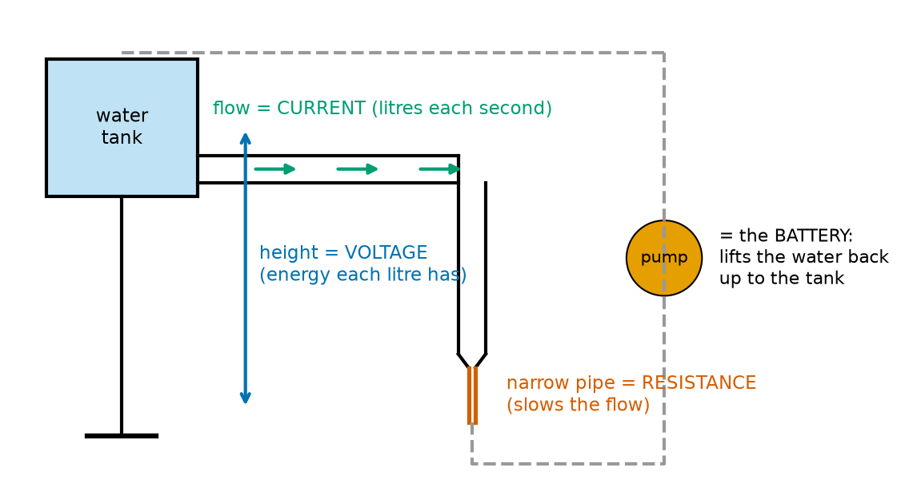
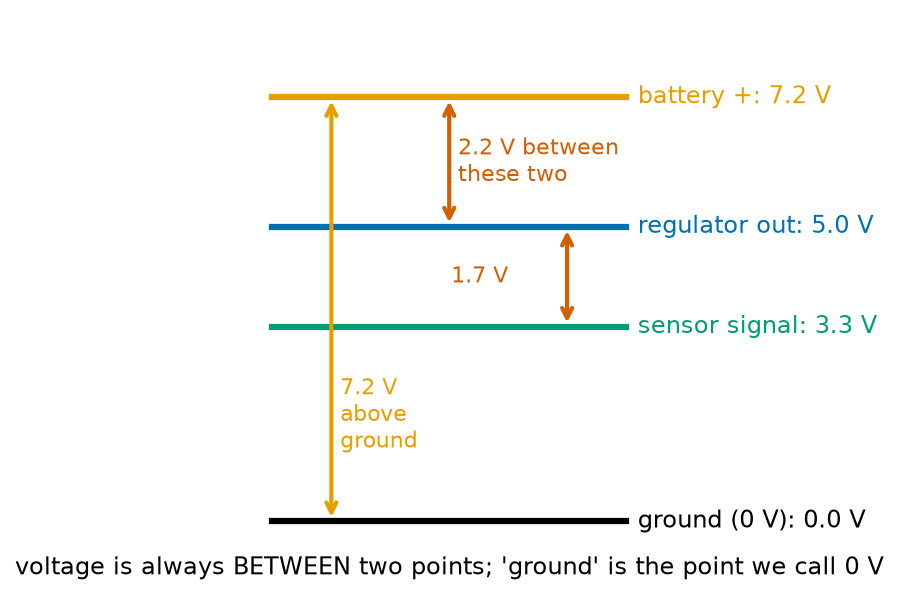
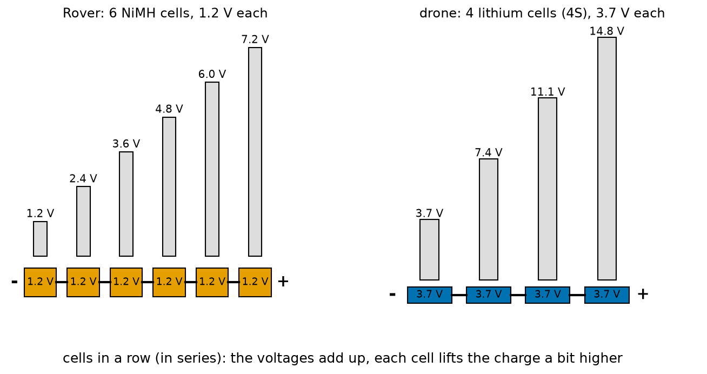
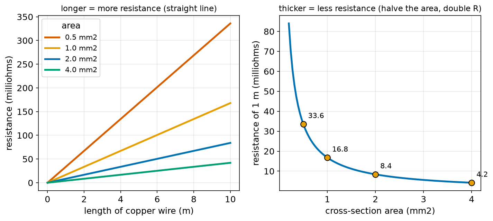
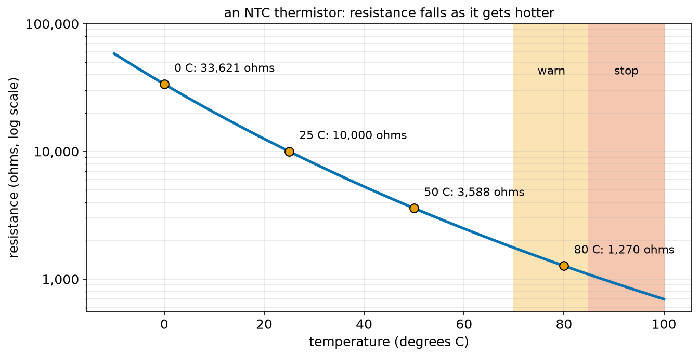
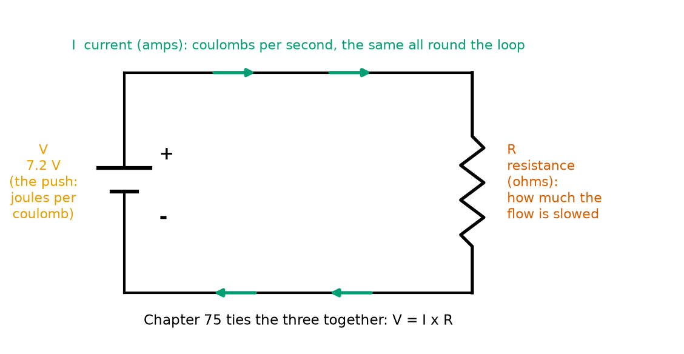

# Chapter 74 — Voltage, Current and Resistance

> **Part 5 · Chapter 74 of 749**
> **You need:** Chapter 5 (Rover's power parts and the common ground), Chapter 7 (the water picture), Chapter 52 (exponentials), Chapter 67 (energy and the joule) and Chapter 73 (charge and current).
> **You will make:** a program that turns battery labels into joules and checks Chapter 5's Wh rule, a program that works out the resistance of any wire, a program that prices a drone flight in joules and coulombs, and a program that reads a motor driver's temperature from a thermistor.

---

## What you will learn

- What a **volt** really is: a joule of energy for every coulomb of charge.
- Why voltage is always **between two points**, and what **ground** means.
- Why cells in a row **add** their voltages, and what a battery label promises.
- What **resistance** is, its unit the **ohm**, and what a **resistor** does.
- Why a long thin wire resists more than a short thick one: **R = ρ L / A**.
- How resistance changes with **temperature**, and how a **thermistor** turns that into a sensor.
- How voltage, current and resistance fit together in the water picture, ready for Ohm's law.

---

## New words in this chapter

| Word | Simple meaning |
|---|---|
| **voltage (V)** | The electrical push. Properly: the energy each coulomb of charge carries, in joules per coulomb. |
| **volt (V)** | The unit of voltage. One volt is one joule per coulomb. |
| **ground** | The point in a circuit that we call 0 V and measure everything from. |
| **potential difference** | Another name for voltage: the difference in "electrical height" between two points. |
| **series** | Parts connected in a row, one after the other, so the same current flows through each. |
| **nominal voltage** | The "typical" voltage printed on a battery. The real voltage is higher when full and lower when empty. |
| **resistance (R)** | How much a part slows the flow of charge. |
| **ohm (Ω)** | The unit of resistance. |
| **resistor** | A part made to have a chosen, steady resistance. |
| **resistivity (ρ)** | A number for each material that says how much it resists. Low for copper, high for plastic. |
| **cross-section area** | The area of the cut end of a wire. A thick wire has a large one. |
| **thermistor** | A resistor whose resistance changes a lot with temperature, used as a temperature sensor. |
| **NTC** | "Negative temperature coefficient": a thermistor whose resistance **falls** as it gets hotter. |

---

## 74.1 Voltage: the push, measured in joules per coulomb

Chapter 7 gave you the water picture: a battery is a pump, and **voltage is how hard the pump pushes**. Now we make that exact.

A better water picture is a **water tower**. Water at the top of a tall tower has more energy than water at the top of a short one (Chapter 67: energy = m g h). When it flows down, each litre gives up that energy. A tower twice as high gives each litre twice the energy.



*Figure 74.1 — Height is voltage, flow is current, a narrow pipe is resistance, and the pump is the battery.*

**How to read this picture:** The tank on the left is high up: its height is like the voltage, the energy each litre has. Water flows along the pipe (green arrows): that is the current, litres per second. The narrow red section slows the flow: that is the resistance. The dashed loop and the orange pump lift the water back up to the tank, which is what a battery does for charge. Nothing is used up; the water goes round and round, and the pump keeps supplying the energy.

Now replace "litre" with "coulomb":

📖 **New word: voltage** — the energy that each coulomb of charge carries (or gives up) between two points. The symbol is V.

📖 **New word: volt (V)** — the unit of voltage. **One volt is one joule per coulomb.**

```
voltage (V) = energy (J) ÷ charge (C)
V = E / Q         →         E = V × Q
```

In words: "voltage equals energy divided by charge", and turned round: "energy equals voltage times charge".

🔢 **Maths.** Rover's battery is 7.2 V and holds 7,200 C (Chapter 73). The energy it stores is E = 7.2 × 7,200 = **51,840 J**. Chapter 67 said 1 Wh = 3,600 J, so that is 51,840 ÷ 3,600 = **14.4 Wh**: exactly the number Chapter 5 found with the rule "Wh = V × Ah". That rule was never magic: volts × amp-hours = (joules per coulomb) × (coulombs ÷ 3,600) = watt-hours.

🔢 **Maths.** A 9 V battery pushes each coulomb with 9 J. A 1.5 V AA cell pushes with 1.5 J. A 230 V wall socket pushes with 230 J per coulomb, which is why it is deadly and why Chapter 7 says never to touch it: the same current does 150 times the damage.

Voltage is also called **potential difference**, because it is the difference in electrical "height" between two points. In the water tower, what matters is not how high the tank is above the sea, but how far the water falls between the tank and the tap.

📖 **New word: potential difference** — the same thing as voltage: the difference in energy per coulomb between two points.

🤖 **Robot link.** When a robot's battery sags from 7.2 V to 6.5 V under a heavy load (you saw this in Chapter 5's voltage plot), each coulomb is arriving with less energy. The motors push less hard, and the regulator has less to work with. Chapter 89 explains the sag; Chapter 90 explains how the regulator copes.

---

## 74.2 Voltage is always between two points

Here is the idea that beginners miss most often: **a single point does not have a voltage.** Voltage is a difference, between **two** points, like height. "The tank is 20 m high" only means something if you say "above the tap", or "above the ground".



*Figure 74.2 — Four points in Rover drawn as heights above ground. Every voltage is a difference between two of them.*

**How to read this picture:** Each horizontal line is a point in Rover's wiring, drawn at its "electrical height". The black line at the bottom is ground, 0 V. The battery's + end is 7.2 V above ground; the regulator's output is 5.0 V above ground. Between the battery + and the regulator output there are 2.2 V, and between the regulator output and a 3.3 V sensor signal there are 1.7 V. You can only ever measure between two lines.

📖 **New word: ground** — the point in a circuit that everyone agrees to call **0 V**. Usually it is the battery's − end. Every other voltage in the circuit is measured from it.

This is why Chapter 5 insisted that all of Rover's parts share a **common ground**. If the Arduino measured heights from one floor and the sensor from another, a "3.3 V" signal from the sensor would arrive as some other number at the Arduino. One shared 0 V makes every voltage mean the same thing to every part.

💡 **Tip.** When someone says "this wire is at 5 V", they mean "5 V above ground". It is a shortcut. If the ground is missing or broken, the number means nothing.

⚠️ **Careful.** "Ground" in electronics does not usually mean the soil under the building, although in house wiring it does. For Rover, ground is just the − wire of the battery.

---

## 74.3 Cells in a row: voltages add

A single AA cell gives about 1.2 V (rechargeable NiMH) or 1.5 V (alkaline). Rover needs more, so Chapter 5 put six NiMH cells in a row, the + of one touching the − of the next. Parts in a row like this are **in series**.

📖 **New word: series** — parts connected one after another, so the same charge flows through each in turn.

Each cell lifts the charge another 1.2 V higher, like six small pumps stacked on top of each other:



*Figure 74.3 — Each cell lifts the charge a little higher. Six 1.2 V cells make 7.2 V; four 3.7 V lithium cells make 14.8 V.*

**How to read this picture:** The orange boxes are Rover's six cells, joined − to +. The grey bars above show the total voltage after each cell: 1.2, 2.4, 3.6 … 7.2 V. On the right, four lithium cells of 3.7 V each make a drone's "4S" pack of 14.8 V. The "S" in 4S means "in series".

🔢 **Maths.** 6 × 1.2 = 7.2 V. 4 × 3.7 = 14.8 V. 13 × 3.7 = 48.1 V (a typical humanoid pack, Application 4).

### What the label promises

The "7.2 V" on Rover's pack and the "3.7 V" on a lithium cell are **nominal** voltages: typical values in the middle of a discharge.

📖 **New word: nominal voltage** — the voltage written on the label. The real voltage is above it when the battery is full and below it when nearly empty.

| Cell type | Full | Nominal (label) | Empty (stop here) |
|---|---|---|---|
| NiMH (Rover) | 1.4 V | 1.2 V | 1.0 V |
| Alkaline (not rechargeable) | 1.6 V | 1.5 V | 0.9 V |
| Lithium (LiPo, Li-ion) | 4.2 V | 3.7 V | 3.3 V (never below 3.0 V) |

So a 4S lithium pack is 16.8 V when full, 14.8 V on the label and 13.2 V when it should be stopped. Chapter 16's preflight program used exactly these numbers. Chapter 89 explains why the voltage falls and how to use it to estimate how full a battery is.

---

## 74.4 Current, once more, and the two measuring rules

Chapter 73 defined current: charge per second, in amperes. Add it to the water picture: it is the **flow**, litres per second. Two things follow from the water picture, and both will matter in every circuit you build:

1. **Voltage is measured across; current is measured through.** You measure a height difference by holding a ruler **between** two points, without touching the water. You measure a flow by putting a meter **in** the pipe, so all the water passes through it. Chapter 81 shows how a multimeter does both, and why mixing them up blows the meter's fuse.
2. **In a simple loop, the current is the same everywhere.** The water that leaves the tank is the water that arrives at the pump. Charge is not used up (Chapter 73). What is used up is energy: each coulomb arrives back at the battery with its energy spent, and the battery gives it 7.2 J more.

🧠 **Voltage across, current through.**

---

## 74.5 Resistance: what slows the flow

Push the same tank height through a narrow pipe and a wide pipe: less water flows through the narrow one. The pipe **resists** the flow. Wires and parts do the same to charge.

📖 **New word: resistance (R)** — how much a part slows the flow of charge for a given push. More resistance, less current for the same voltage.

📖 **New word: ohm (Ω)** — the unit of resistance, written with the Greek letter omega. Named after Georg Ohm, whose law comes in Chapter 75.

Why does a wire resist at all? Chapter 73 showed free electrons drifting through a crowd of copper atoms. They keep bumping into the atoms, which jiggle about (the hotter the copper, the more they jiggle). Every bump steals a little of the electron's energy and turns it into heat. A longer wire means more bumps; a thinner wire means a smaller crowd of electrons to carry the charge, so each must bump more often.

Some values to get a feel for the ohm:

| Thing | Resistance |
|---|---|
| 1 m of Rover's copper wire | 0.03 Ω |
| a small motor's winding, at rest | 1–5 Ω |
| the resistor in series with an LED (Chapter 82) | 150–470 Ω |
| a thermistor at room temperature | 10,000 Ω (10 kΩ) |
| a resistor that pulls a button's wire to 5 V (Chapter 83) | 10,000–100,000 Ω |
| dry human skin, hand to hand | 100,000 Ω or more (Chapter 7: dry skin is a narrow pipe) |
| wet human skin | 1,000 Ω: this is why water makes electricity dangerous |
| a plastic wire coat | more than 10¹² Ω |

Prefixes you will meet: 1 kΩ = 1,000 Ω, 1 MΩ = 1,000,000 Ω, 1 mΩ = 0.001 Ω (Chapter 39).

📖 **New word: resistor** — a small part made to have a chosen, steady resistance, for example 150 Ω or 10 kΩ. On a diagram it is a zigzag (Figure 74.6) or a plain rectangle. Chapter 82 shows how to read the value from the coloured bands on its body.

🤖 **Robot link.** Rover will use resistors to limit the current into an LED (Chapter 82), to hold a button's wire at a known voltage (Chapter 83), to measure the battery (Chapter 79) and to sense temperature (section 74.7). A resistor is the simplest part in electronics, and the most used.

---

## 74.6 What resistance depends on

A wire's resistance comes from three things: its **material**, its **length** and its **thickness**.

```
R = ρ × L / A
```

In words: "resistance equals resistivity times length, divided by cross-section area".

📖 **New word: resistivity (ρ)** — a number for each material (Greek letter "rho", the same letter Chapter 71 used for air density, but a different quantity). Its unit is ohm metres (Ω m). Copper's is 1.68 × 10⁻⁸ Ω m.

📖 **New word: cross-section area (A)** — the area of the cut end of the wire, in m². Wires are sold by this area in mm²: Rover's are 0.5 mm², house wires are 1.5 or 2.5 mm², drone motor wires are 4 mm² or more. 1 mm² = 10⁻⁶ m².

| Material | ρ (Ω m) | Compared with copper |
|---|---|---|
| silver | 1.59 × 10⁻⁸ | 0.95 × (slightly better, but expensive) |
| copper | 1.68 × 10⁻⁸ | 1 (the standard wire metal) |
| gold | 2.44 × 10⁻⁸ | 1.5 × (used on contacts because it does not corrode) |
| aluminium | 2.65 × 10⁻⁸ | 1.6 × (light; used for power lines) |
| iron | 9.7 × 10⁻⁸ | 5.8 × |
| nichrome (heater wire) | 1.1 × 10⁻⁶ | 65 × (made to get hot) |
| carbon (resistors) | about 3 × 10⁻⁵ | 2,000 × |
| silicon (pure) | about 2,000 | a hundred billion × |
| glass, plastic | 10¹⁰ to 10¹⁴ | insulators |

🔢 **Maths.** Rover's battery wire: copper, 0.3 m long, 0.5 mm² = 0.5 × 10⁻⁶ m².

```
R = 1.68 × 10⁻⁸ × 0.3 ÷ (0.5 × 10⁻⁶)
  = 5.04 × 10⁻⁹ ÷ 5 × 10⁻⁷
  = 0.01008 Ω  ≈ 10 mΩ
```

Ten thousandths of an ohm: for Rover that is nothing (Chapter 75 will show how little voltage it costs). But the same formula says that 20 m of the same wire would be 0.67 Ω, which matters.



*Figure 74.4 — Resistance grows in a straight line with length, and shrinks as the wire gets thicker.*

**How to read this picture:** On the left, each line is one wire thickness; resistance grows in proportion to length, and a thinner wire's line is steeper. On the right, 1 m of copper: halve the area and the resistance doubles (33.6 mΩ at 0.5 mm², 16.8 at 1 mm², 8.4 at 2 mm², 4.2 at 4 mm²). Doubling a wire's diameter makes its area four times bigger, so a wire twice as thick has a quarter of the resistance.

🧠 **Longer wire: more resistance, in proportion. Thicker wire: less resistance, in proportion to the area.**

---

## 74.7 Resistance and temperature: the thermistor

Resistance is not quite steady. In a **metal**, the atoms jiggle more when hot, the electrons bump more, and the resistance **rises**: copper by about 0.4% per degree. A motor's winding at 80 °C has about 20% more resistance than at 20 °C, which Chapter 76 will show is one reason hot motors get weaker.

Some materials do the opposite. A **thermistor** is a small bead of a special ceramic whose resistance **falls** sharply as it gets hotter, roughly halving every 20 °C. This makes it a cheap and sensitive temperature sensor.

📖 **New word: thermistor** — a resistor made to change its resistance strongly with temperature. The common kind is an **NTC** (negative temperature coefficient: hotter means less resistance).

Its datasheet gives two numbers: the resistance at 25 °C (often 10 kΩ) and a "B value" (often 3950). The resistance at any temperature follows an exponential (Chapter 52), with temperatures in kelvin (°C + 273.15):

```
R = R₂₅ × e^( B × (1/T − 1/298.15) )
```

🔢 **Maths.** At 50 °C: T = 323.15 K. 1/323.15 − 1/298.15 = 0.0030945 − 0.0033540 = −0.0002595. Times 3950 = −1.025. e^(−1.025) = 0.359. R = 10,000 × 0.359 = **3,590 Ω**. At 0 °C the same steps give 33,600 Ω. Hotter: less resistance.



*Figure 74.5 — The resistance of a 10 kΩ, B = 3950 thermistor from −10 °C to 100 °C, on a log scale.*

**How to read this picture:** The vertical axis is a log scale (Chapter 52): each grid band is ten times the one below. The blue curve is the thermistor's resistance; the orange dots mark 0, 25, 50 and 80 °C. It falls from 33,600 Ω at freezing to 1,270 Ω at 80 °C. The shaded bands on the right are where a robot would warn (70–85 °C) and stop (above 85 °C) if this thermistor were glued to its motor driver, as in Application 2.

🤖 **Robot link.** Thermistors sit on motor drivers, inside battery packs (a charger refuses to charge a cold or hot lithium cell, Chapter 89), in 3D printer heads and on the motors of legged robots that overheat when they stand still with a load. Chapter 79 shows how to turn the resistance into a voltage that a microcontroller can read, and Chapter 101 reads it.

---

## 74.8 The three together



*Figure 74.6 — A battery, a resistor and the current going round. The three quantities of every circuit calculation.*

**How to read this picture:** The symbol on the left (a long line and a short line) is a battery; the long line is the + end. The zigzag on the right is a resistor. The green arrows are the conventional current (Chapter 73), the same all round the loop. V is the push the battery gives each coulomb; R is how much the resistor slows the flow; I is how much flows. Chapter 75 gives the rule that ties the three together.

| Quantity | Symbol | Unit | Water picture | Measured |
|---|---|---|---|---|
| voltage | V | volt (V) = J/C | height of the tank (energy per litre) | across two points |
| current | I | ampere (A) = C/s | flow (litres per second) | through a point |
| resistance | R | ohm (Ω) | narrowness of the pipe | across a part, with no power on (Chapter 81) |

From the water picture you can already guess the rule: a higher tank pushes more flow; a narrower pipe allows less. More voltage, more current; more resistance, less current. Chapter 75 makes it exact and uses it fifty times.

---

## Code

File `code/ch074/volts_and_joules.py`:

```python
# volts_and_joules.py - a volt is a joule per coulomb, so energy = volts x coulombs
batteries = [
    # name, volts, mAh
    ("Rover, 6 x AA NiMH", 7.2, 2000),
    ("USB power bank", 5.0, 10000),
    ("drone 4S LiPo", 14.8, 5000),
    ("9 V block", 9.0, 550),
]
print(f"{'battery':20s} {'volts':>6s} {'mAh':>6s} {'coulombs':>9s} {'joules':>9s} {'Wh':>6s}")
for name, volts, mah in batteries:
    coulombs = mah / 1000 * 3600
    joules = volts * coulombs                 # each coulomb carries 'volts' joules
    print(f"{name:20s} {volts:6.1f} {mah:6d} {coulombs:9.0f} {joules:9.0f} {joules / 3600:6.1f}")

print()
print("check of the Chapter 5 rule 'Wh = V x Ah':")
print(f"  7.2 V x 2.0 Ah = {7.2 * 2.0:.1f} Wh, and 51,840 J / 3,600 = {51840 / 3600:.1f} Wh: the same")
print()
# how much charge does one job cost?
job_j = 1.6 * 9.81 * 60               # lifting a 1.6 kg drone 60 m (Chapter 67)
print(f"lifting 1.6 kg by 60 m needs {job_j:.0f} J")
print(f"at 14.8 V that is {job_j / 14.8:.1f} C of charge if nothing is wasted")
print(f"with half the energy wasted as heat: {job_j / 14.8 / 0.5:.1f} C = {job_j / 14.8 / 0.5 / 3.6:.1f} mAh")
```

| Line | Code | What it does (simple English) |
|---|---|---|
| 1 | `# volts_and_joules.py …` | A comment. |
| 2–8 | `batteries = [ … ]` | A list of tuples: name, nominal volts, capacity in mAh. Line 3 is a comment that names the columns. |
| 9 | `print(f"{'battery':20s} …")` | The table header. |
| 10 | `for name, volts, mah in batteries:` | One row per battery. |
| 11 | `coulombs = mah / 1000 * 3600` | mAh to coulombs (Chapter 73). |
| 12 | `joules = volts * coulombs` | E = V × Q. |
| 13 | `print(f"{name:20s} …")` | The row; the last column divides joules by 3,600 for Wh. |
| 14 | (blank) | Spacing. |
| 15 | `print()` | An empty line. |
| 16–17 | `print("check …")`, `print(f"  7.2 V x 2.0 Ah = …")` | Shows that the Chapter 5 rule gives the same number. |
| 18 | `print()` | An empty line. |
| 19 | `# how much charge does one job cost?` | A comment. |
| 20 | `job_j = 1.6 * 9.81 * 60` | m g h, the energy to lift the drone (Chapter 67). |
| 21 | `print(f"lifting 1.6 kg …")` | Shows it. |
| 22 | `print(f"at 14.8 V that is {job_j / 14.8:.1f} C …")` | Q = E ÷ V. |
| 23 | `print(f"with half the energy wasted …")` | Divide by the efficiency 0.5; then ÷ 3.6 turns coulombs into mAh (1 mAh = 3.6 C). |

Output:

```
battery               volts    mAh  coulombs    joules     Wh
Rover, 6 x AA NiMH      7.2   2000      7200     51840   14.4
USB power bank          5.0  10000     36000    180000   50.0
drone 4S LiPo          14.8   5000     18000    266400   74.0
9 V block               9.0    550      1980     17820    5.0

check of the Chapter 5 rule 'Wh = V x Ah':
  7.2 V x 2.0 Ah = 14.4 Wh, and 51,840 J / 3,600 = 14.4 Wh: the same

lifting 1.6 kg by 60 m needs 942 J
at 14.8 V that is 63.6 C of charge if nothing is wasted
with half the energy wasted as heat: 127.3 C = 35.4 mAh
```

Two things to notice. The drone's 74 Wh is the battery Chapter 67 used, and now you know where the number comes from. And the 9 V block, despite its high voltage, stores a third of a AA cell's energy: a high voltage with little charge is a small tank on a tall tower.

File `code/ch074/wire_resistance.py`:

```python
# wire_resistance.py - the resistance of a wire: R = rho x length / area
RHO = {"copper": 1.68e-8, "aluminium": 2.65e-8, "iron": 9.7e-8, "nichrome": 1.1e-6}   # ohm metres


def resistance(material, length_m, area_mm2):
    """Resistance in ohms of a wire of this material, length and cross-section area."""
    return RHO[material] * length_m / (area_mm2 * 1e-6)


print("1 m of copper wire:")
for area in [0.25, 0.5, 1.0, 2.0, 4.0]:
    print(f"  {area:4.2f} mm2: {resistance('copper', 1.0, area) * 1000:7.2f} milliohms")

print()
print("Rover's battery wire, 0.3 m of 0.5 mm2:")
for material in ["copper", "aluminium", "iron"]:
    print(f"  {material:10s} {resistance(material, 0.3, 0.5) * 1000:7.2f} milliohms")

print()
print("a 20 m cable to a factory robot (there and back = 40 m):")
for area in [1.5, 2.5, 4.0]:
    print(f"  {area:3.1f} mm2 copper: {resistance('copper', 40.0, area):6.3f} ohms")

print()
r_heater = resistance("nichrome", 2.0, 0.05)
print(f"2 m of thin nichrome heater wire (0.05 mm2): {r_heater:.1f} ohms")
```

| Line | Code | What it does (simple English) |
|---|---|---|
| 1 | `# wire_resistance.py …` | A comment. |
| 2 | `RHO = {"copper": 1.68e-8, …}` | A dictionary (Chapter 22) of resistivities in Ω m. |
| 3–4 | (blank) | Spacing. |
| 5 | `def resistance(material, length_m, area_mm2):` | The formula as a function. |
| 6 | `"""…"""` | The docstring. |
| 7 | `return RHO[material] * length_m / (area_mm2 * 1e-6)` | ρ L / A, with the area turned into m². |
| 8–9 | (blank) | Spacing. |
| 10 | `print("1 m of copper wire:")` | A heading. |
| 11 | `for area in [0.25, 0.5, 1.0, 2.0, 4.0]:` | Five thicknesses. |
| 12 | `print(f"  {area:4.2f} mm2: …")` | The resistance, × 1,000 for milliohms. |
| 13 | (blank) | Spacing. |
| 14 | `print()` | An empty line. |
| 15 | `print("Rover's battery wire, …")` | A heading. |
| 16 | `for material in ["copper", "aluminium", "iron"]:` | Three materials. |
| 17 | `print(f"  {material:10s} …")` | 0.3 m of 0.5 mm² in each. |
| 18 | (blank) | Spacing. |
| 19 | `print()` | An empty line. |
| 20 | `print("a 20 m cable …")` | A heading. The current goes out along one wire and back along the other, so 40 m of wire. |
| 21 | `for area in [1.5, 2.5, 4.0]:` | Three cable sizes. |
| 22 | `print(f"  {area:3.1f} mm2 copper: …")` | In ohms this time. |
| 23 | (blank) | Spacing. |
| 24 | `print()` | An empty line. |
| 25 | `r_heater = resistance("nichrome", 2.0, 0.05)` | A thin heater wire. |
| 26 | `print(f"2 m of thin nichrome …")` | Shows it. |

Output:

```
1 m of copper wire:
  0.25 mm2:   67.20 milliohms
  0.50 mm2:   33.60 milliohms
  1.00 mm2:   16.80 milliohms
  2.00 mm2:    8.40 milliohms
  4.00 mm2:    4.20 milliohms

Rover's battery wire, 0.3 m of 0.5 mm2:
  copper       10.08 milliohms
  aluminium    15.90 milliohms
  iron         58.20 milliohms

a 20 m cable to a factory robot (there and back = 40 m):
  1.5 mm2 copper:  0.448 ohms
  2.5 mm2 copper:  0.269 ohms
  4.0 mm2 copper:  0.168 ohms

2 m of thin nichrome heater wire (0.05 mm2): 44.0 ohms
```

Compare the last line with the first block: 2 m of nichrome resists as much as 1.3 km of Rover's copper wire. That is the point of nichrome: it is built to resist, and so to get hot (Chapter 76).

---

## Small examples

**Example 1.** A 12 V battery pushes 10 C through a lamp. Energy given: 12 × 10 = 120 J.

**Example 2.** A motor receives 360 J from 60 C of charge. The voltage across it was 360 ÷ 60 = 6 V.

**Example 3.** Three 1.5 V alkaline cells in series: 4.5 V. Eight: 12 V.

**Example 4.** A 3S lithium pack: nominal 11.1 V, full 12.6 V, empty 9.9 V.

**Example 5.** A point at 5 V and a point at 3.3 V, both measured from ground: 1.7 V between them.

**Example 6.** 2 m of 1 mm² copper: R = 1.68 × 10⁻⁸ × 2 ÷ 10⁻⁶ = 0.0336 Ω = 33.6 mΩ.

**Example 7.** Doubling a wire's **diameter** gives four times the area, so a quarter of the resistance.

**Example 8.** A thermistor reads 10 kΩ at 25 °C and about 5 kΩ at 42 °C: roughly halving every 20 °C.

---

## 🏭 Real robot applications

### Application 1 (worked in full) — 🚁 Pricing a drone flight in joules and coulombs

**1. The real problem.** A 1.6 kg survey drone with a 4S 5,000 mAh pack must climb to 60 m, survey for 8 minutes, and descend. The pilot wants to know, before take-off, how much of the battery the flight will use, in mAh (what the battery meter shows) and in joules (what the physics needs).

**2. Why this theory.** Energy = voltage × charge. The physics (Chapter 67) gives the energy of each part of the flight in joules. Dividing by the pack's voltage turns joules into coulombs, and ÷ 3.6 turns coulombs into mAh. The battery's usable energy is its nominal voltage times its usable charge.

**3. The numbers.** 4 cells × 3.7 V = 14.8 V nominal. 5,000 mAh, 80% usable = 14,400 C. Climb: m g h = 1.6 × 9.81 × 60 = 942 J of height, with only half the electrical energy ending as height (the rest is lost in the motors and the air), so 1,884 J. Survey: 180 W for 8 minutes = 86,400 J. Descent: 120 W for 1 minute = 7,200 J.

**4. The maths.**

```
usable energy = 14.8 × 14,400 = 213,120 J = 59.2 Wh
climb   1,884 J ÷ 14.8 V = 127 C = 35 mAh
survey 86,400 J ÷ 14.8 V = 5,838 C = 1,622 mAh
descent 7,200 J ÷ 14.8 V = 486 C = 135 mAh
total  95,484 J = 6,452 C = 1,792 mAh  →  45% of the usable energy
```

**5. The code.** File `code/ch074/drone_energy.py`:

```python
# drone_energy.py - how many joules, and how many coulombs, does a survey flight cost?
CELLS = 4
CELL_NOMINAL = 3.7            # volts per lithium cell, typical
CELL_FULL = 4.2
CELL_EMPTY = 3.3              # stop here (Chapter 89)
CAPACITY_MAH = 5000
USABLE = 0.80
MASS = 1.6
G = 9.81

v_nom = CELLS * CELL_NOMINAL
print(f"a {CELLS}S pack: {v_nom:.1f} V nominal, {CELLS * CELL_FULL:.1f} V full, {CELLS * CELL_EMPTY:.1f} V empty")
charge_c = CAPACITY_MAH / 1000 * 3600 * USABLE
energy_j = v_nom * charge_c
print(f"usable charge {charge_c:.0f} C, usable energy {energy_j:.0f} J = {energy_j / 3600:.1f} Wh")
print()

# the flight plan: climb, survey, descend. Energy per part, from Chapter 67's ideas
climb_j = MASS * G * 60 / 0.5              # lift 60 m, half the electrical energy ends up as height
survey_j = 180.0 * 8 * 60                  # 8 minutes at 180 W (hover-like flying)
descend_j = 120.0 * 60                     # 1 minute descending at 120 W
parts = [("climb to 60 m", climb_j), ("8 min survey", survey_j), ("descend", descend_j)]
total = 0.0
for name, joules in parts:
    coulombs = joules / v_nom
    total += joules
    print(f"{name:14s} {joules:8.0f} J = {coulombs:7.0f} C = {coulombs / 3.6:6.0f} mAh")
print(f"{'total':14s} {total:8.0f} J = {total / v_nom:7.0f} C = {total / v_nom / 3.6:6.0f} mAh")
print(f"that is {total / energy_j:.0%} of the usable energy")
```

| Line | Code | What it does (simple English) |
|---|---|---|
| 1 | `# drone_energy.py …` | A comment. |
| 2–9 | `CELLS` … `G` | The pack, the limits, the drone's mass and g. |
| 10 | (blank) | Spacing. |
| 11 | `v_nom = CELLS * CELL_NOMINAL` | Cells in series: voltages add. |
| 12 | `print(f"a {CELLS}S pack: …")` | Nominal, full and empty voltages. |
| 13 | `charge_c = CAPACITY_MAH / 1000 * 3600 * USABLE` | Usable coulombs. |
| 14 | `energy_j = v_nom * charge_c` | E = V × Q. |
| 15 | `print(f"usable charge …")` | Shows both, with Wh. |
| 16 | `print()` | An empty line. |
| 17 | (blank) | Spacing. |
| 18 | `# the flight plan: …` | A comment. |
| 19 | `climb_j = MASS * G * 60 / 0.5` | m g h, divided by the 50% efficiency. |
| 20 | `survey_j = 180.0 * 8 * 60` | Power × time (Chapter 67): watts × seconds = joules. |
| 21 | `descend_j = 120.0 * 60` | The same for the descent. |
| 22 | `parts = [ … ]` | The three parts as (name, joules) tuples. |
| 23 | `total = 0.0` | A running total (Chapter 20). |
| 24 | `for name, joules in parts:` | Each part. |
| 25 | `coulombs = joules / v_nom` | Q = E ÷ V. |
| 26 | `total += joules` | Add up. |
| 27 | `print(f"{name:14s} …")` | Joules, coulombs and mAh (coulombs ÷ 3.6). |
| 28 | `print(f"{'total':14s} …")` | The totals. |
| 29 | `print(f"that is {total / energy_j:.0%} …")` | As a percentage of what the battery holds. |

Output:

```
a 4S pack: 14.8 V nominal, 16.8 V full, 13.2 V empty
usable charge 14400 C, usable energy 213120 J = 59.2 Wh

climb to 60 m      1884 J =     127 C =     35 mAh
8 min survey      86400 J =    5838 C =   1622 mAh
descend            7200 J =     486 C =    135 mAh
total             95484 J =    6452 C =   1792 mAh
that is 45% of the usable energy
```

**6. The result.** The flight will use about 1,800 mAh, 45% of the usable charge: a comfortable margin, with room to fly back against a headwind. Notice how small the climb is: 35 mAh, 2% of the flight. Almost all the energy goes into **staying up**, which is why flight time, not height, is what limits survey drones. Without the "energy per coulomb" link, the pilot could not turn the physics (joules) into what the battery meter shows (mAh).

**7. Going further.** The pack's real voltage falls from 16.8 V to 13.2 V during the flight, so the coulombs per joule change as it goes; a flight controller integrates both voltage and current to track energy in watt-hours. Chapter 76 brings in power (joules per second), which is what the "180 W" above really is, and Chapters 616 to 621 cover drone power systems in full.

### Application 2 (worked in full) — 🏭 A thermistor watching a motor driver

**1. The real problem.** A warehouse robot's motor driver chip must stay below 85 °C; above that it can be damaged, and above 70 °C the robot should slow down to let it cool. A 10 kΩ NTC thermistor is glued to the chip. The controller can measure the thermistor's resistance (Chapter 79 and Chapter 101 show how). It needs to turn ohms into degrees and decide what to do.

**2. Why this theory.** Resistance depends on temperature, and for an NTC thermistor the dependence is a known exponential curve. Turning the formula round (using the natural logarithm, Chapter 52) gives temperature from resistance.

**3. The numbers.** R₂₅ = 10,000 Ω, B = 3950. Warn at 70 °C, stop at 85 °C.

**4. The maths.** Forward: R = 10,000 × e^(3950 × (1/T − 1/298.15)). Turned round: take ln of both sides, ln(R/10,000) = 3950 × (1/T − 1/298.15), so 1/T = 1/298.15 + ln(R/10,000)/3950. For R = 2,000 Ω: ln(0.2) = −1.609; ÷ 3950 = −0.000407; 1/T = 0.0033540 − 0.000407 = 0.0029466; T = 339.4 K = 66.2 °C.

**5. The code.** File `code/ch074/thermistor.py`:

```python
# thermistor.py - a resistor whose resistance changes with temperature, used to watch a motor driver
import math

R_25 = 10000.0        # ohms at 25 degrees C
B = 3950.0            # the thermistor's 'B value' from its datasheet
T0_K = 25 + 273.15    # 25 degrees C in kelvin


def resistance(temp_c):
    """Resistance of an NTC thermistor at a temperature in degrees C."""
    temp_k = temp_c + 273.15
    return R_25 * math.exp(B * (1 / temp_k - 1 / T0_K))


def temperature(ohms):
    """The temperature in degrees C that gives this resistance (the formula turned round)."""
    inv_t = 1 / T0_K + math.log(ohms / R_25) / B
    return 1 / inv_t - 273.15


print(f"{'temp (C)':>9s} {'resistance':>12s}")
for t in [-10, 0, 25, 50, 80, 100]:
    print(f"{t:9d} {resistance(t):10.0f} ohms")

print()
for ohms in [8000, 4000, 2000, 1000]:
    t = temperature(ohms)
    state = "OK" if t < 70 else "WARNING: slow the motors" if t < 85 else "STOP: too hot"
    print(f"measured {ohms:5d} ohms -> {t:5.1f} C  {state}")
```

| Line | Code | What it does (simple English) |
|---|---|---|
| 1 | `# thermistor.py …` | A comment. |
| 2 | `import math` | For `exp` and `log`. |
| 3 | (blank) | Spacing. |
| 4–6 | `R_25`, `B`, `T0_K` | The datasheet numbers; 25 °C in kelvin. |
| 7–8 | (blank) | Spacing. |
| 9 | `def resistance(temp_c):` | Ohms from degrees. |
| 10 | `"""…"""` | The docstring. |
| 11 | `temp_k = temp_c + 273.15` | Kelvin. |
| 12 | `return R_25 * math.exp(B * (1 / temp_k - 1 / T0_K))` | The exponential formula. |
| 13–14 | (blank) | Spacing. |
| 15 | `def temperature(ohms):` | Degrees from ohms. |
| 16 | `"""…"""` | The docstring. |
| 17 | `inv_t = 1 / T0_K + math.log(ohms / R_25) / B` | 1/T from the turned-round formula. `math.log` is the natural logarithm (Chapter 52). |
| 18 | `return 1 / inv_t - 273.15` | Back to degrees C. |
| 19–20 | (blank) | Spacing. |
| 21 | `print(f"{'temp (C)':>9s} …")` | A header. |
| 22 | `for t in [-10, 0, 25, 50, 80, 100]:` | Six temperatures. |
| 23 | `print(f"{t:9d} {resistance(t):10.0f} ohms")` | The resistance at each. |
| 24 | (blank) | Spacing. |
| 25 | `print()` | An empty line. |
| 26 | `for ohms in [8000, 4000, 2000, 1000]:` | Four measurements. |
| 27 | `t = temperature(ohms)` | Turn each into degrees. |
| 28 | `state = "OK" if t < 70 else "WARNING: …" if t < 85 else "STOP: …"` | A chained one-line if (Chapter 18): below 70 OK, below 85 warn, else stop. |
| 29 | `print(f"measured {ohms:5d} ohms -> …")` | The decision. |

Output:

```
 temp (C)   resistance
      -10      58246 ohms
        0      33621 ohms
       25      10000 ohms
       50       3588 ohms
       80       1270 ohms
      100        698 ohms

measured  8000 ohms ->  30.1 C  OK
measured  4000 ohms ->  47.2 C  OK
measured  2000 ohms ->  66.2 C  OK
measured  1000 ohms ->  87.7 C  STOP: too hot
```

**6. The result.** A reading of 1,000 Ω means 87.7 °C: the robot stops its motors and waits. The thermistor is more sensitive where it matters: between 50 and 100 °C its resistance changes by a factor of five, so even a rough measurement gives the temperature to a degree or two. Without this sensor, the first sign of an overheated driver is usually smoke. Real robots also log these temperatures to spot a motor that is slowly going bad.

**7. Going further.** The B-value formula is an approximation; precise work uses the three-term Steinhart–Hart equation, or a lookup table from the datasheet. Chapter 79 turns the resistance into a voltage with a divider, Chapter 101 reads it with the Arduino's ADC, and Chapter 151 adds temperature limits to Rover's power management.

### Application 3 — 🚗 Why electric cars use 400 V

A small robot runs at 7 V, a drone at 15–25 V, a cobot at 48 V, and an electric car at 400 or 800 V. Why? Energy = voltage × charge, so at a higher voltage **the same energy needs fewer coulombs**. A car motor that needs 100,000 J every second at 400 V draws 250 C per second (250 A); at 12 V it would need 8,300 A, which would require copper bars as thick as your arm (R = ρ L / A: the only way to keep the resistance down for a huge current is a huge area). Chapter 76 gives the exact rule (power = V × I). The 48 V choice for cobots and humanoids balances two things: enough voltage to keep currents and wire sizes sensible, but low enough that touching it is not dangerous.

### Application 4 — 🦿 A humanoid's 13S battery pack

Full-size humanoid robots usually carry a pack labelled "13S" or "14S": 13 or 14 lithium cells in series, 48.1 or 51.8 V nominal, 54.6 or 58.8 V full, and 42.9 or 46.2 V at the "empty" limit. Every leg motor driver is designed for that range. The pack also holds a thermistor against the cells (Application 2) and a small circuit that watches each cell's voltage separately, because in a series string the charge through every cell is identical, so a weak cell empties first and would be driven below its 3.0 V limit while the others are still fine. Chapter 89 explains this "balancing" problem and Chapter 696 shows the power system of the course's humanoid, Hero.

### Application 5 — 🌾 Soil moisture from resistance

The cheapest soil moisture sensor is two metal probes pushed into the ground. Dry soil is a poor conductor (its resistivity can be above 1,000 Ω m); wet soil with dissolved minerals conducts much better (below 10 Ω m). With probes 5 cm apart and about 1 cm² of contact, R = ρ L / A gives roughly 500 kΩ when dry and 5 kΩ when wet, a hundred-fold change that is easy to detect. A farm robot that waters plants reads this resistance (Chapter 79 shows the circuit) and waters only where needed. The catch is corrosion: a current through metal in wet soil slowly eats the probes, so good sensors measure with alternating current or use the capacitive method of Chapter 84 instead.

---

## 🔧 Hands-on lab

### Lab 74.1 — Battery label survey (hardware, no tools)

Find five batteries or devices at home: a phone (look in the settings or online for its mAh), a laptop (the label gives Wh and V), a power bank, a AA cell, a car battery if there is one.

1. For each, write down the voltage and the capacity (mAh or Ah). If the label gives Wh and V, work out the Ah.
2. Turn each into coulombs and joules.
3. Rank them by energy. Which stores the most? Which has the highest voltage? Are they the same?

**What you should see:** A laptop label like "11.4 V, 56 Wh" means 56 × 3,600 = 201,600 J and 201,600 ÷ 11.4 = 17,684 C = 4.9 Ah. A car battery (12 V, 60 Ah) stores 2.6 MJ, about fifty times a phone. The highest voltage and the most energy are usually **not** the same item: the 9 V block is the tallest tower with the smallest tank.

| If it does not work | Likely cause | Fix |
|---|---|---|
| Phone shows mAh but no voltage | Phone cells are 3.7 V nominal (3.85 V on some) | Use 3.7 V |
| Power bank's Wh does not match V × Ah | The mAh is rated at the cell's 3.7 V, not at the 5 V output | Use 3.7 V × Ah |

**Challenge:** Your laptop label says 56 Wh. Chapter 7's battery room held 40 batteries of 100 Wh. How many of your laptop batteries would that be, and how many coulombs at 11.4 V?

### Lab 74.2 — The wire table (simulation)

1. Copy `wire_resistance.py`. Add a loop that prints the resistance of a 10 m extension cable (20 m of wire there and back) for 0.75, 1.0, 1.5 and 2.5 mm² copper.
2. Add a function `area_for(material, length_m, max_ohms)` that returns the smallest cross-section area that keeps the resistance under a limit.
3. Use it to find the area needed for a 2 m drone motor lead (4 m there and back) under 0.01 Ω.

**What you should see:** The extension cable comes to 0.448, 0.336, 0.224 and 0.134 Ω. The function is the formula turned round, A = ρ L / R: for 4 m of copper under 0.01 Ω, A = 1.68 × 10⁻⁸ × 4 ÷ 0.01 = 6.72 × 10⁻⁶ m² = 6.7 mm², so a 7 mm² or larger cable, which is why drone power leads are so fat.

| If it does not work | Likely cause | Fix |
|---|---|---|
| Areas come out a million times too small | The function returned m², not mm² | Multiply by 10⁶ |
| `KeyError: 'Copper'` | Dictionary keys are case-sensitive | Use `"copper"` |

**Challenge:** Add aluminium to the comparison. For the same resistance, how much thicker must an aluminium wire be, and (aluminium's density is 2,700 kg/m³ against copper's 8,960) which is lighter per metre?

### Lab 74.3 — A thermistor lookup table (simulation)

1. Copy `thermistor.py`. Print a table of resistance from 0 to 100 °C in steps of 10.
2. Write a loop that reads a list of measured resistances `[9800, 7000, 4100, 2500, 1600, 1000]` taken 1 second apart while a motor driver warms up, prints the temperature of each, and prints "WARNING" the first time 70 °C is passed and "STOP" the first time 85 °C is passed.
3. Estimate how fast the temperature was rising, in °C per second, over the last two readings.

**What you should see:** 9,800 Ω is 25.5 °C and 1,000 Ω is 87.7 °C. The warning comes at the fifth reading (1,600 Ω = 72.9 °C) and the stop at the sixth. Between those two readings the temperature rose about 15 °C in one second, which is a fast rise: a real controller would have stopped earlier, when it saw the slope.

| If it does not work | Likely cause | Fix |
|---|---|---|
| `ValueError: math domain error` | `math.log` of zero or a negative number | Check for a reading of 0 (a broken wire) before calling the function |
| Temperatures come out around −273 | Kelvin not converted back | Subtract 273.15 at the end |

**Challenge:** The readings are noisy. Use the `MovingAverage` idea from Chapter 21 on the resistance before converting, and see whether the warning time changes.

---

## Common mistakes

⚠️ **Saying "the voltage at this point" without a second point.** Voltage is between two points. Usually the second is ground.

⚠️ **Thinking a higher voltage means more energy stored.** Energy = V × Q. A 9 V block holds less than a 1.2 V AA cell.

⚠️ **Mixing up the nominal voltage with the full voltage.** A "3.7 V" lithium cell is 4.2 V when full.

⚠️ **Using the diameter instead of the area in R = ρ L / A.** Area = π × (d/2)². Doubling the diameter quarters the resistance.

⚠️ **Forgetting the return wire.** Current goes out and back: a 20 m cable has 40 m of wire.

⚠️ **Forgetting kelvin in the thermistor formula.** Add 273.15 to degrees C.

⚠️ **Measuring current across a battery.** That is a short circuit through the meter (Chapter 81 shows the right way).

---

## Practice

🏋️ **1.** A 5 V USB supply pushes 20 C through a sensor. How much energy did the sensor receive?

🏋️ **2.** A motor received 1,440 J from 200 C. What was the voltage across it?

🏋️ **3.** Rover's battery sags to 6.6 V under load. How much energy does each coulomb carry then, and how much less is that than at 7.2 V, as a percentage?

🏋️ **4.** How many 1.2 V NiMH cells in series make at least 12 V?

🏋️ **5.** A 6S lithium pack: write its nominal, full and empty voltages.

🏋️ **6.** Point A is 5 V above ground, point B is 1.8 V above ground. What is the voltage between A and B?

🏋️ **7.** Find the resistance of 5 m of 1.5 mm² copper wire.

🏋️ **8.** A wire's resistance is 0.2 Ω. The same wire, twice as long and twice the diameter: what is its resistance?

🏋️ **9.** A thermistor (10 kΩ, B = 3950) reads 5,000 Ω. What is the temperature? (Use the turned-round formula.)

🏋️ **10.** A 48 V cobot and a 12 V toy both need 480 J every second. How many coulombs per second does each draw?

🏋️ **11.** Write a function `pack(cells, chemistry)` that returns a tuple (nominal, full, empty) for a battery pack, using the table in section 74.3, and print it for Rover (6, "nimh"), a 4S drone and a 13S humanoid.

---

## Answers

**1.** E = 5 × 20 = 100 J.

**2.** V = 1,440 ÷ 200 = 7.2 V.

**3.** 6.6 J per coulomb. (7.2 − 6.6) ÷ 7.2 = 8.3% less.

**4.** 12 ÷ 1.2 = 10 cells.

**5.** 6 × 3.7 = 22.2 V nominal, 6 × 4.2 = 25.2 V full, 6 × 3.3 = 19.8 V empty. (Chapter 7's battery room used the same 25.2 V.)

**6.** 5 − 1.8 = 3.2 V.

**7.** R = 1.68 × 10⁻⁸ × 5 ÷ (1.5 × 10⁻⁶) = 0.056 Ω.

**8.** Twice as long doubles it (0.4 Ω); twice the diameter means four times the area, which divides by 4: 0.1 Ω.

**9.** 1/T = 1/298.15 + ln(0.5)/3950 = 0.0033540 − 0.0001755 = 0.0031785. T = 314.6 K = 41.5 °C.

**10.** Cobot: 480 ÷ 48 = 10 C/s (10 A). Toy: 480 ÷ 12 = 40 C/s (40 A). The toy would need much thicker wires.

**11.**

```python
TABLE = {"nimh": (1.2, 1.4, 1.0), "lithium": (3.7, 4.2, 3.3)}

def pack(cells, chemistry):
    nominal, full, empty = TABLE[chemistry]
    return (cells * nominal, cells * full, cells * empty)

for name, n, chem in [("Rover", 6, "nimh"), ("4S drone", 4, "lithium"), ("13S humanoid", 13, "lithium")]:
    nom, full, empty = pack(n, chem)
    print(f"{name:13s} nominal {nom:5.1f} V, full {full:5.1f} V, empty {empty:5.1f} V")
# Rover         nominal   7.2 V, full   8.4 V, empty   6.0 V
# 4S drone      nominal  14.8 V, full  16.8 V, empty  13.2 V
# 13S humanoid  nominal  48.1 V, full  54.6 V, empty  42.9 V
```

---

## Summary

🧠 **Voltage** is energy per coulomb: **1 V = 1 J/C**. Energy = V × Q. This is why Wh = V × Ah.

🧠 Voltage is always **between two points**. **Ground** is the point called 0 V; all parts of a robot must share it.

🧠 Cells **in series** add their voltages. Labels give the **nominal** voltage; full is higher, empty is lower (lithium: 4.2 / 3.7 / 3.3 V per cell).

🧠 **Current** is charge per second, the same all round a simple loop. **Voltage across, current through.**

🧠 **Resistance** (ohms) slows the flow. A **resistor** is a part with a chosen resistance.

🧠 **R = ρ L / A**: longer wire, more resistance; thicker wire, less. Copper: 1.68 × 10⁻⁸ Ω m, so 1 m of 1 mm² is 16.8 mΩ.

🧠 Metals resist more when hot. An **NTC thermistor** resists less when hot, roughly halving every 20 °C, and makes a cheap temperature sensor.

---

## Next chapter

Chapter 75 gives the rule that ties voltage, current and resistance together: **Ohm's law, V = I × R**. You will use it in many worked examples: how much current flows through a motor, an LED, a resistor or a wet hand; how much voltage a wire loses; and why a short circuit draws such a dangerous current.
