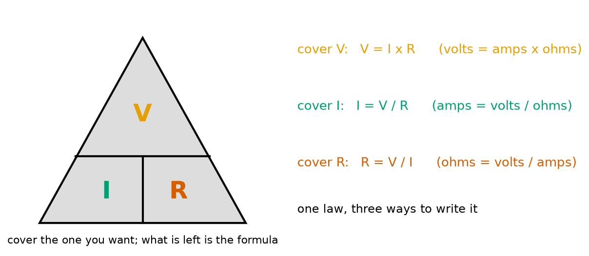
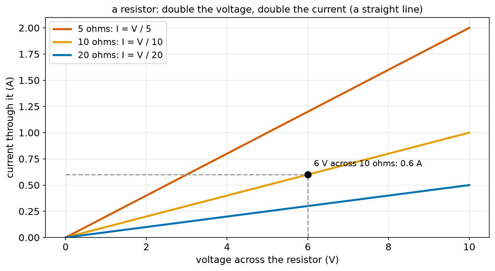
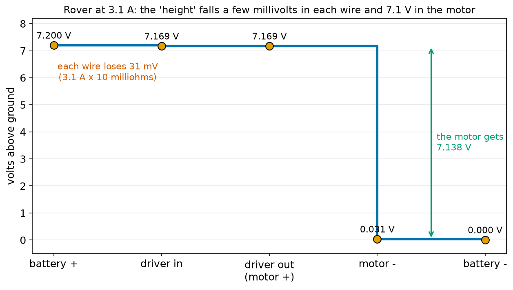
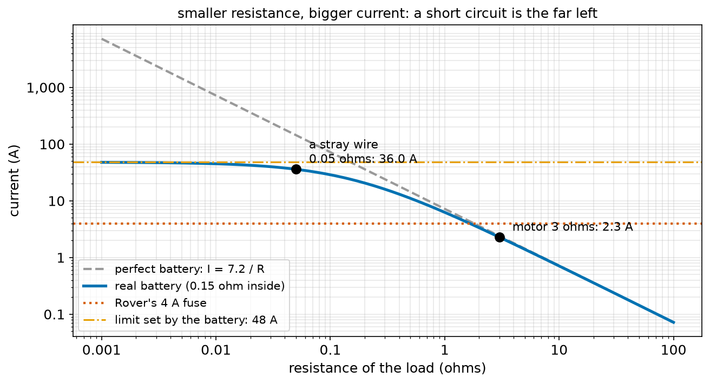
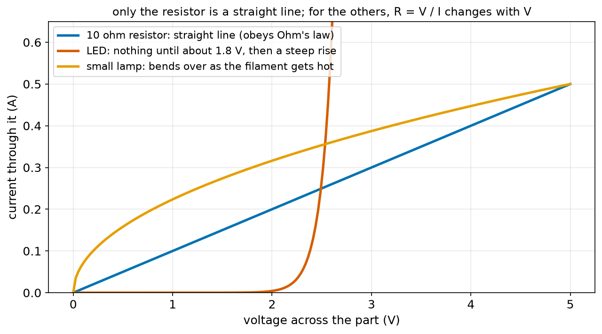
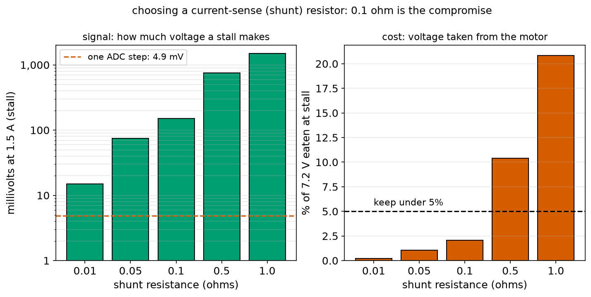

# Chapter 75 — Ohm's Law with Many Worked Examples

> **Part 5 · Chapter 75 of 749**
> **You need:** Chapter 7 (fuses and short circuits), Chapter 23 (functions with default arguments, Chapter 24), Chapter 43 (straight lines and slopes), Chapter 73 (current) and Chapter 74 (voltage and resistance).
> **You will make:** an Ohm's law solver that takes any two of V, I and R, a program that finds the voltage lost along wires, a program that shows what a short circuit does, a program that chooses a current-sensing resistor for Rover's motors, and a program that sizes a drone's power wires.

---

## What you will learn

- **Ohm's law**: V = I × R, and its two other forms I = V / R and R = V / I.
- How to recognise it on a graph: a resistor is a **straight line** through zero.
- Many worked examples: currents through motors, LEDs and hands; voltages lost in wires; resistances of unknown parts.
- What a **voltage drop** is and why long thin wires matter.
- Why a **short circuit** draws such a large current, and what limits it.
- Which parts **do not** obey Ohm's law (LEDs, lamps, motors), and what that means.

---

## New words in this chapter

| Word | Simple meaning |
|---|---|
| **Ohm's law** | For a resistor, the voltage across it equals the current through it times its resistance: V = I × R. |
| **ohmic** | A part that obeys Ohm's law: its resistance stays the same whatever the current. |
| **non-ohmic** | A part whose resistance changes with the voltage or current, such as an LED or a lamp. |
| **voltage drop** | The voltage lost across a part or a wire when current flows through it: I × R. |
| **load** | Whatever the circuit is powering: a motor, a lamp, a sensor. |
| **short circuit** | A path of almost no resistance across a supply, which draws a huge current. |
| **internal resistance** | The small resistance inside a battery itself, which limits the current it can give. |
| **stall current** | The current a motor draws when it is held still but powered: its largest current. |
| **shunt resistor** | A very small resistor put in the current's path so that the voltage across it tells you the current. |
| **ADC** | Analog-to-digital converter: the part of a microcontroller that measures a voltage and turns it into a number (Chapter 101). |

---

## 75.1 The law

Chapter 74 left you with the water picture: more push gives more flow, and a narrower pipe gives less. In 1827 the German teacher Georg Ohm measured this exactly for metal wires and found something simple: for a given wire, **the current is proportional to the voltage**. Double the voltage, double the current. The constant of proportion is the resistance.

📖 **New word: Ohm's law** — for a resistor (or a wire), the voltage across it equals the current through it times its resistance:

```
V = I × R
```

In words: "volts equal amps times ohms".

Because it is one law, it can be written three ways, and you will use all three:

| Want | Formula | Words |
|---|---|---|
| the voltage | V = I × R | volts = amps × ohms |
| the current | I = V / R | amps = volts ÷ ohms |
| the resistance | R = V / I | ohms = volts ÷ amps |



*Figure 75.2 — Cover the quantity you want with a finger; what is left is the formula.*

**How to read this picture:** V sits on top; I and R sit side by side underneath. Cover V and you see I next to R: multiply. Cover I and you see V over R: divide. Cover R and you see V over I: divide. It is a memory aid, nothing more, but it works.

This also tells you what an ohm **is**: one ohm is the resistance that lets one ampere flow when one volt is across it. 1 Ω = 1 V/A.

🧠 **V = I × R. Volts across, amps through, ohms in between.**

---

## 75.2 What the law looks like

Chapter 43 taught straight lines: y = m x, a line through the origin with slope m. Ohm's law is exactly that, with I = (1/R) × V.



*Figure 75.1 — Each resistor gives a straight line through zero. A smaller resistance makes a steeper line.*

**How to read this picture:** The horizontal axis is the voltage across the resistor; the vertical axis is the current through it. The 5 Ω line is steepest: 2 A at 10 V. The 20 Ω line is the flattest: 0.5 A at 10 V. The black dot shows 6 V across 10 Ω giving 0.6 A, exactly I = V / R. Doubling the voltage to 12 V would double the current to 1.2 A.

📖 **New word: ohmic** — a part whose current–voltage graph is a straight line through the origin. Resistors and plain wires are ohmic (as long as they do not get hot). Section 75.7 shows parts that are not.

The slope of the line is 1/R: the **steeper** the line, the **smaller** the resistance. Engineers often plot it the other way round (V against I); then the slope is R itself.

---

## 75.3 Worked examples: finding the current

Use I = V / R.

**Example A — Rover's motor.** A small gearmotor's winding measures 3 Ω. Connected straight to Rover's 7.2 V battery, at the moment of switch-on (before it starts spinning):

```
I = 7.2 ÷ 3 = 2.4 A
```

That is more than four times Rover's normal driving current (0.53 A, Chapter 7). A motor draws most at the instant it starts, which is why Chapter 7 planned for a 3.1 A start-up peak. (Once spinning, a motor makes a voltage of its own that pushes back, so the current falls: section 75.7.)

**Example B — an LED's resistor.** Chapter 52 promised this one. An LED needs about 2 V and 0.02 A. From a 5 V supply, a 150 Ω resistor takes the other 3 V:

```
I = 3 ÷ 150 = 0.02 A = 20 mA
```

Chapter 82 builds this.

**Example C — a wet hand on the mains.** Chapter 7 said wet skin is a "wide pipe". Wet skin, hand to hand, can be about 1,000 Ω. On 230 V:

```
I = 230 ÷ 1,000 = 0.23 A = 230 mA
```

A current of 0.03 A (30 mA) through the chest can stop a heart. This is seven times that. It is the arithmetic behind Chapter 7's rule: never work on mains.

**Example D — a dry hand on Rover's battery.** Dry skin, about 100,000 Ω, on 7.2 V:

```
I = 7.2 ÷ 100,000 = 0.000072 A = 72 µA
```

Seventy-two millionths of an ampere: you will not feel it. Low-voltage robot electronics are safe to touch. (The battery itself is still dangerous if **shorted**, section 75.6, because a wire is not a hand.)

**Example E — a sensor.** A distance sensor is marked "5 V, 100 Ω equivalent". I = 5 ÷ 100 = 0.05 A = 50 mA.

---

## 75.4 Worked examples: finding the voltage, and the voltage drop

Use V = I × R. The most important use is to find how much voltage is **lost** along a wire or across a part that is in the way.

📖 **New word: voltage drop** — the voltage used up across a part when a current flows through it: I × R. Along a wire it is a loss; across the load it is the whole point.

**Example F — Rover's battery wire.** Chapter 74 found Rover's 0.3 m battery lead has 0.01008 Ω. When the motors start and 3.1 A flows:

```
V_lost = 3.1 × 0.01008 = 0.031 V = 31 mV
```

The current goes out along one wire and back along another, so the loop loses 62 mV in total. Out of 7.2 V that is under 1%: Rover's thin wires are fine.



*Figure 75.3 — The "electrical height" around the loop at 3.1 A: a few millivolts fall in each wire, and almost everything falls across the motor.*

**How to read this picture:** Each point along the bottom is a place in the loop, from the battery's + end round to its − end. The height is the voltage above ground (Chapter 74). The first wire costs 31 mV, so the driver sees 7.169 V. Across the motor the height falls by 7.138 V. The return wire costs another 31 mV, bringing the line back to 0 V at the battery's − end. Add up all the drops and you get exactly 7.2 V, the battery's push; Chapter 78 makes a law out of that.

**Example G — a long cable.** Chapter 74's factory robot has 40 m of 1.5 mm² wire (0.448 Ω) and draws 5 A:

```
V_lost = 5 × 0.448 = 2.24 V
```

The robot was promised 48 V and gets 45.76 V. If its electronics stop working below 46 V, the robot fails at the far end of the cable. The fix is a thicker cable (4 mm² loses 0.84 V) or a higher supply voltage.

**Example H — a cheap thin lead.** A 0.2 mm² lead, 2 m there and back (0.336 Ω), from a 12 V battery to a motor drawing 10 A:

```
V_lost = 10 × 0.336 = 3.36 V
```

The motor sees only 8.6 V and runs at about 70% speed. Beginners meet this often: "the motor is slow, the battery must be flat", when the real cause is a thin wire.

**Example I — a shunt resistor.** 0.5 A through a 0.1 Ω resistor: V = 0.5 × 0.1 = 0.05 V = 50 mV. Application 1 uses this to measure current.

---

## 75.5 Worked examples: finding the resistance

Use R = V / I. This is how you measure a part you do not know, and how you turn a motor's label into a number.

**Example J — an unknown part.** You measure 5 V across a part and 0.025 A through it (Chapter 81 shows how). R = 5 ÷ 0.025 = 200 Ω.

**Example K — the stall resistance of Rover's motor.** Rover's motor datasheet says "stall current 1.5 A at 7.2 V". A stalled motor is just a coil of wire, so:

📖 **New word: stall current** — the current a motor draws when it is powered but held still. It is the motor's largest current and the number used to size fuses and drivers.

```
R = 7.2 ÷ 1.5 = 4.8 Ω
```

That is the resistance of its winding. (Example A used 3 Ω for a slightly bigger motor.)

**Example L — a heater.** A 12 V heater pad draws 2 A: R = 12 ÷ 2 = 6 Ω.

**Example M — a thermistor from a measurement.** 2.5 V across the thermistor with 0.0005 A through it: R = 2.5 ÷ 0.0005 = 5,000 Ω, which Chapter 74's formula says is about 42 °C.

**Example N — a human body in the ESD model.** Chapter 73 used 1,500 Ω for the body: at 1,500 V, 1 A. R = V / I = 1,500 ÷ 1 = 1,500 Ω. The numbers were chosen to be consistent with Ohm's law all along.

---

## 75.6 Short circuits and fuses

What if the resistance is very small, as when a stray wire touches both battery ends?

📖 **New word: short circuit** — a path of almost no resistance across a supply. "Short" because the current takes a short cut past the load.

🔢 **Maths.** A stray piece of wire of 0.01 Ω across Rover's 7.2 V battery: I = 7.2 ÷ 0.01 = **720 A**. Real batteries cannot give that, because a battery has a small resistance **inside** it: its internal resistance.

📖 **New word: internal resistance** — the resistance inside a battery, from its chemicals and plates. For six AA NiMH cells it is about 0.15 Ω in total. Trust this number for now; Chapter 89 explains where it comes from and how to measure it.

The internal resistance is always in the loop, so the current is I = V / (R_load + R_inside):

```
with a 0.01 Ω short: I = 7.2 ÷ (0.01 + 0.15) = 45 A
with a perfect short:  I = 7.2 ÷ 0.15 = 48 A
```



*Figure 75.4 — As the load resistance shrinks, the current grows, until the battery's own resistance sets a limit of 48 A.*

**How to read this picture:** Both axes are log scales. The grey dashed line is the ideal I = 7.2 / R, which goes up forever as R shrinks. The blue line is the real battery: it follows the ideal line for normal loads (the 3 Ω motor at 2.3 A) but flattens at 48 A for small resistances (a stray 0.05 Ω wire draws 36 A). The red dotted line is Rover's 4 A fuse: anything above it melts the fuse. Any load under about 1.7 Ω blows the fuse, which is exactly what we want, because nothing in Rover should ever draw that much.

Forty-eight amperes through a thin wire makes it red hot in a second (Chapter 76 gives the heat). This is why Chapter 7's rules are what they are: a fuse **near the battery**, rated **above the normal peak** (3.1 A) and **below what the wires can take** (5 A). Ohm's law gives the numbers behind the rules.

🤖 **Robot link.** A motor's **stall** is a mild short circuit: Rover's 4.8 Ω motor stalled on 7.2 V draws 1.5 A, three times its running current, and it heats up fast. Motor drivers (Chapter 139) watch for this and cut the power, and Application 1 shows the simplest way to detect it.

---

## 75.7 Parts that do not obey Ohm's law

Ohm's law is a law for **resistors**. Many parts are not resistors:



*Figure 75.5 — A resistor is a straight line. An LED and a lamp are not.*

**How to read this picture:** The blue line is a 10 Ω resistor: straight, through zero. The red curve is an LED: almost no current until about 1.8 V, then the current shoots up so steeply that a small extra voltage means a huge extra current (that is why an LED needs a resistor in series, Chapter 82). The orange curve is a small lamp: it starts steep and bends over, because the filament's resistance rises as it gets hot (Chapter 74: metals resist more when hot).

📖 **New word: non-ohmic** — a part whose current–voltage graph is not a straight line. R = V / I still gives you a number, but it is a different number at every voltage.

The non-ohmic parts you will meet most:

| Part | Why it bends | Chapter |
|---|---|---|
| LED, diode | Conducts almost nothing below its "forward voltage", then a lot | 82, 86 |
| lamp, heater | Resistance rises as it gets hot | 76 |
| thermistor | Resistance changes with temperature (which its own current can raise) | 74 |
| motor | When spinning it makes its own voltage that opposes the supply, so the current falls as it speeds up | 85, 139 |
| transistor, MOSFET | A control signal changes the resistance between two other legs | 87, 88 |
| battery | Its voltage falls as the current rises (internal resistance) and as it empties | 89 |

The motor is the important one for robots. At stall it obeys Ohm's law (Example K). Once it spins, it generates a "back voltage" that grows with speed, and the current becomes (V_supply − V_back) / R. A free-running motor draws only a small current; a stalled motor draws the most. You will use this again and again from Chapter 139 on.

---

## 75.8 Ohm's law in Python

A function that accepts any two of the three and returns the third saves you from remembering which form to use:

```python
def ohm(v=None, i=None, r=None):
    if v is None:
        v = i * r
    elif i is None:
        i = v / r
    elif r is None:
        r = v / i
    return v, i, r
```

Chapter 24 introduced default arguments and `None`. Call it with keywords: `ohm(v=7.2, r=3.0)` returns `(7.2, 2.4, 3.0)`. The full program below runs all the worked examples of this chapter through it.

---

## Code

File `code/ch075/ohm.py`:

```python
# ohm.py - Ohm's law: give any two of V, I and R, and get the third
def ohm(v=None, i=None, r=None):
    """Return (v, i, r). Exactly one of them must be None; it is worked out from the other two."""
    if v is None:
        v = i * r                 # V = I x R
    elif i is None:
        i = v / r                 # I = V / R
    elif r is None:
        r = v / i                 # R = V / I
    return v, i, r


examples = [
    ("Rover motor, 3 ohms, on 7.2 V", dict(v=7.2, r=3.0)),
    ("LED resistor, 150 ohms, 3 V across it", dict(v=3.0, r=150.0)),
    ("wet hand, 1,000 ohms, on 230 V mains", dict(v=230.0, r=1000.0)),
    ("dry hand, 100,000 ohms, on Rover's 7.2 V", dict(v=7.2, r=100000.0)),
    ("Rover wire, 0.01 ohms, carrying 3.1 A", dict(i=3.1, r=0.01008)),
    ("unknown part: 5 V across, 0.025 A through", dict(v=5.0, i=0.025)),
    ("Rover motor stalled: 7.2 V, 1.5 A", dict(v=7.2, i=1.5)),
]
print(f"{'case':46s} {'V':>8s} {'I':>9s} {'R':>11s}")
for name, known in examples:
    v, i, r = ohm(**known)
    print(f"{name:46s} {v:8.3f} {i:9.4f} {r:11.3f}")
```

| Line | Code | What it does (simple English) |
|---|---|---|
| 1 | `# ohm.py …` | A comment. |
| 2 | `def ohm(v=None, i=None, r=None):` | Three parameters, each `None` unless given (Chapter 24). |
| 3 | `"""…"""` | The docstring. |
| 4–5 | `if v is None: v = i * r` | Missing V: multiply. |
| 6–7 | `elif i is None: i = v / r` | Missing I: divide by R. |
| 8–9 | `elif r is None: r = v / i` | Missing R: divide by I. |
| 10 | `return v, i, r` | All three, as a tuple (Chapter 22). |
| 11–12 | (blank) | Spacing. |
| 13–21 | `examples = [ … ]` | A list of (name, dictionary) pairs. Each dictionary holds the two known values, built with `dict(v=…, r=…)`. |
| 22 | `print(f"{'case':46s} …")` | The table header. |
| 23 | `for name, known in examples:` | One row per example. |
| 24 | `v, i, r = ohm(**known)` | `**known` unpacks the dictionary into keyword arguments: `ohm(v=7.2, r=3.0)`. |
| 25 | `print(f"{name:46s} …")` | The row, with V to 3 decimals, I to 4 and R to 3. |

Output:

```
case                                                  V         I           R
Rover motor, 3 ohms, on 7.2 V                     7.200    2.4000       3.000
LED resistor, 150 ohms, 3 V across it             3.000    0.0200     150.000
wet hand, 1,000 ohms, on 230 V mains            230.000    0.2300    1000.000
dry hand, 100,000 ohms, on Rover's 7.2 V          7.200    0.0001  100000.000
Rover wire, 0.01 ohms, carrying 3.1 A             0.031    3.1000       0.010
unknown part: 5 V across, 0.025 A through         5.000    0.0250     200.000
Rover motor stalled: 7.2 V, 1.5 A                 7.200    1.5000       4.800
```

Every number matches the worked examples. The dry-hand current shows as 0.0001 because of the 4-decimal format; the real value is 0.000072 A.

File `code/ch075/wire_drop.py`:

```python
# wire_drop.py - how much voltage is lost along a wire? V_lost = I x R_wire
RHO_COPPER = 1.68e-8


def wire_ohms(length_m, area_mm2):
    return RHO_COPPER * length_m / (area_mm2 * 1e-6)


print("Rover: battery to motor driver, 0.3 m out + 0.3 m back of 0.5 mm2")
r = wire_ohms(0.6, 0.5)
for name, amps in [("idle", 0.1), ("driving", 0.53), ("motors starting", 3.1)]:
    lost = amps * r
    print(f"  {name:16s} {amps:4.2f} A: loses {lost * 1000:5.1f} mV of 7.2 V ({lost / 7.2:.2%})")

print()
print("a factory robot on a 20 m cable (40 m of wire), 48 V, drawing 5 A:")
for area in [1.5, 2.5, 4.0]:
    r = wire_ohms(40.0, area)
    lost = 5.0 * r
    print(f"  {area:3.1f} mm2: {r:5.3f} ohms, loses {lost:4.2f} V, the robot gets {48 - lost:5.2f} V")

print()
print("a cheap thin 0.2 mm2 lead on a 12 V battery, 2 m there and back, 10 A:")
r = wire_ohms(4.0, 0.2)
print(f"  {r:5.3f} ohms, loses {10 * r:4.2f} V: the motor sees only {12 - 10 * r:4.1f} V")
```

| Line | Code | What it does (simple English) |
|---|---|---|
| 1 | `# wire_drop.py …` | A comment. |
| 2 | `RHO_COPPER = 1.68e-8` | Copper's resistivity (Chapter 74). |
| 3–4 | (blank) | Spacing. |
| 5 | `def wire_ohms(length_m, area_mm2):` | R = ρ L / A as a function. |
| 6 | `return RHO_COPPER * length_m / (area_mm2 * 1e-6)` | The formula. |
| 7–8 | (blank) | Spacing. |
| 9 | `print("Rover: …")` | A heading. |
| 10 | `r = wire_ohms(0.6, 0.5)` | Out and back: 0.6 m of 0.5 mm². |
| 11 | `for name, amps in [ … ]:` | Three currents. |
| 12 | `lost = amps * r` | V = I × R. |
| 13 | `print(f"  {name:16s} …")` | In millivolts and as a share of 7.2 V. |
| 14 | (blank) | Spacing. |
| 15 | `print()` | An empty line. |
| 16 | `print("a factory robot …")` | A heading. |
| 17 | `for area in [1.5, 2.5, 4.0]:` | Three cable sizes. |
| 18 | `r = wire_ohms(40.0, area)` | 40 m of wire. |
| 19 | `lost = 5.0 * r` | At 5 A. |
| 20 | `print(f"  {area:3.1f} mm2: …")` | Ohms, volts lost and volts left. |
| 21 | (blank) | Spacing. |
| 22 | `print()` | An empty line. |
| 23 | `print("a cheap thin …")` | A heading. |
| 24 | `r = wire_ohms(4.0, 0.2)` | 4 m of 0.2 mm². |
| 25 | `print(f"  {r:5.3f} ohms, …")` | The loss at 10 A and what the motor sees. |

Output:

```
Rover: battery to motor driver, 0.3 m out + 0.3 m back of 0.5 mm2
  idle             0.10 A: loses   2.0 mV of 7.2 V (0.03%)
  driving          0.53 A: loses  10.7 mV of 7.2 V (0.15%)
  motors starting  3.10 A: loses  62.5 mV of 7.2 V (0.87%)

a factory robot on a 20 m cable (40 m of wire), 48 V, drawing 5 A:
  1.5 mm2: 0.448 ohms, loses 2.24 V, the robot gets 45.76 V
  2.5 mm2: 0.269 ohms, loses 1.34 V, the robot gets 46.66 V
  4.0 mm2: 0.168 ohms, loses 0.84 V, the robot gets 47.16 V

a cheap thin 0.2 mm2 lead on a 12 V battery, 2 m there and back, 10 A:
  0.336 ohms, loses 3.36 V: the motor sees only  8.6 V
```

File `code/ch075/short_circuit.py`:

```python
# short_circuit.py - what happens to the current as the resistance gets smaller and smaller
V = 7.2
FUSE_A = 4.0                     # Rover's fuse (Chapter 7)
BATTERY_INSIDE = 0.15            # the battery's own resistance in ohms (Chapter 89 explains it)

print(f"{'resistance':>12s} {'current':>10s} {'fuse?':>8s}")
for r in [100, 10, 3, 1, 0.3, 0.1, 0.03, 0.01, 0.0]:
    i = V / (r + BATTERY_INSIDE)         # the battery's own resistance is always in the loop
    blows = "BLOWS" if i > FUSE_A else "ok"
    print(f"{r:10.2f} ohms {i:8.2f} A {blows:>8s}")

print()
print(f"with a perfect battery (no resistance inside), a 0.01 ohm short would draw {V / 0.01:.0f} A")
print(f"the real battery's {BATTERY_INSIDE} ohms limits any short to about {V / BATTERY_INSIDE:.0f} A: still 12 times the fuse")
```

| Line | Code | What it does (simple English) |
|---|---|---|
| 1 | `# short_circuit.py …` | A comment. |
| 2–4 | `V`, `FUSE_A`, `BATTERY_INSIDE` | The battery, the fuse and the internal resistance. |
| 5 | (blank) | Spacing. |
| 6 | `print(f"{'resistance':>12s} …")` | The header. |
| 7 | `for r in [100, 10, 3, 1, 0.3, 0.1, 0.03, 0.01, 0.0]:` | Loads from big to a dead short. |
| 8 | `i = V / (r + BATTERY_INSIDE)` | Ohm's law with the inside resistance added. |
| 9 | `blows = "BLOWS" if i > FUSE_A else "ok"` | Compare with the fuse. |
| 10 | `print(f"{r:10.2f} ohms …")` | The row. |
| 11 | (blank) | Spacing. |
| 12 | `print()` | An empty line. |
| 13 | `print(f"with a perfect battery …")` | 7.2 ÷ 0.01. |
| 14 | `print(f"the real battery's …")` | 7.2 ÷ 0.15. |

Output:

```
  resistance    current    fuse?
    100.00 ohms     0.07 A       ok
     10.00 ohms     0.71 A       ok
      3.00 ohms     2.29 A       ok
      1.00 ohms     6.26 A    BLOWS
      0.30 ohms    16.00 A    BLOWS
      0.10 ohms    28.80 A    BLOWS
      0.03 ohms    40.00 A    BLOWS
      0.01 ohms    45.00 A    BLOWS
      0.00 ohms    48.00 A    BLOWS

with a perfect battery (no resistance inside), a 0.01 ohm short would draw 720 A
the real battery's 0.15 ohms limits any short to about 48 A: still 12 times the fuse
```

Notice the 3 Ω motor: 2.29 A, a little less than Example A's 2.4 A, because the internal resistance now shares the 7.2 V. The battery's voltage at its terminals during that start is 2.29 × 3 = 6.87 V: this is the **sag** you saw in Chapter 5's plot.

---

## Small examples

**Example 1.** 9 V across 450 Ω: I = 9 ÷ 450 = 0.02 A.

**Example 2.** 0.5 A through 12 Ω: V = 0.5 × 12 = 6 V.

**Example 3.** 3.3 V across a part passing 0.011 A: R = 3.3 ÷ 0.011 = 300 Ω.

**Example 4.** A 1 kΩ resistor on 5 V: I = 5 ÷ 1,000 = 0.005 A = 5 mA.

**Example 5.** A 10 kΩ pull-up resistor (Chapter 83) on 5 V: 0.5 mA. Twenty of them: 10 mA.

**Example 6.** A wire of 0.05 Ω carrying 20 A loses 1 V.

**Example 7.** A stalled 12 V motor draws 8 A: R = 1.5 Ω. If it spins and makes 9 V of back voltage, the current is (12 − 9) ÷ 1.5 = 2 A.

**Example 8.** 7.2 V across a 0.15 Ω internal resistance: 48 A. Through a 4 A fuse: it blows.

---

## 🏭 Real robot applications

### Application 1 (worked in full) — 🏭 A current-sense resistor that detects a stalled motor

**1. The real problem.** When Rover drives into a wall and its bumper misses, the motors stall. A stalled motor draws 1.5 A instead of 0.5 A and gets hot; after a minute it can burn out. The Arduino can measure voltages (0 to 5 V, in 1,024 steps of 4.88 mV, Chapter 101) but it cannot measure current directly. The warehouse robots of Chapter 4 have the same problem on a bigger scale.

**2. Why this theory.** Put a small known resistor in the motor's current path. By Ohm's law the voltage across it is I × R, so measuring the voltage tells you the current. This is a **shunt resistor**. Too small a shunt gives a voltage the Arduino cannot see; too big a shunt steals voltage from the motor.

📖 **New word: shunt resistor** — a very small, accurately known resistor placed in the current's path, so that the voltage across it reveals the current.

**3. The numbers.** Supply 7.2 V. Normal current 0.5 A, stall 1.5 A. ADC step 5 ÷ 1,024 = 4.88 mV. Candidate shunts: 0.01, 0.05, 0.1, 0.5 and 1 Ω.

**4. The maths.** For 0.1 Ω: at 0.5 A, V = 0.05 V = 50 mV (about 10 ADC steps). At stall, 150 mV (31 steps). Lost from the motor at stall: 150 mV of 7.2 V = 2.1%. The smallest current change the ADC can see is 4.88 mV ÷ 0.1 Ω = 0.049 A. For 1 Ω the signal is ten times larger but the shunt eats 1.5 V, 21% of the motor's voltage. For 0.01 Ω the loss is tiny but a stall is only 15 mV, three ADC steps, which noise would hide.

**5. The code.** File `code/ch075/shunt.py`:

```python
# shunt.py - choosing a small 'sense' resistor that turns a motor's current into a voltage
SUPPLY = 7.2
STALL_A = 1.5              # Rover's motor when it is blocked
NORMAL_A = 0.5
ADC_STEP_V = 5.0 / 1024    # the Arduino reads 0-5 V in 1,024 steps (Chapter 101)

print(f"the Arduino sees steps of {ADC_STEP_V * 1000:.2f} mV")
print(f"{'shunt':>8s} {'at 0.5 A':>10s} {'at stall':>10s} {'lost at stall':>14s} {'amps per step':>14s}")
for r in [0.01, 0.05, 0.1, 0.5, 1.0]:
    v_normal = NORMAL_A * r                  # V = I x R
    v_stall = STALL_A * r
    lost = v_stall / SUPPLY                  # share of the motor's voltage eaten by the shunt
    per_step = ADC_STEP_V / r                # I = V / R: the smallest current change the Arduino can see
    print(f"{r:6.2f} ohm {v_normal * 1000:7.0f} mV {v_stall * 1000:7.0f} mV {lost:13.1%} {per_step:13.3f} A")

print()
print("rule: a stall must be easy to see (many ADC steps) but the shunt must eat little voltage")
chosen = 0.1
threshold_a = 1.0
print(f"with {chosen} ohm, a stall alarm at {threshold_a} A means 'voltage above {threshold_a * chosen * 1000:.0f} mV'")
print(f"that is ADC reading above {threshold_a * chosen / ADC_STEP_V:.0f}")
```

| Line | Code | What it does (simple English) |
|---|---|---|
| 1 | `# shunt.py …` | A comment. |
| 2–5 | `SUPPLY`, `STALL_A`, `NORMAL_A`, `ADC_STEP_V` | The numbers; the ADC step is 5 V ÷ 1,024. |
| 6 | (blank) | Spacing. |
| 7 | `print(f"the Arduino sees steps of …")` | 4.88 mV. |
| 8 | `print(f"{'shunt':>8s} …")` | The header. |
| 9 | `for r in [0.01, 0.05, 0.1, 0.5, 1.0]:` | Five candidate shunts. |
| 10 | `v_normal = NORMAL_A * r` | V = I × R at the normal current. |
| 11 | `v_stall = STALL_A * r` | And at stall. |
| 12 | `lost = v_stall / SUPPLY` | What share of 7.2 V the shunt takes at stall. |
| 13 | `per_step = ADC_STEP_V / r` | I = V / R for one ADC step: the current resolution. |
| 14 | `print(f"{r:6.2f} ohm …")` | The row. |
| 15 | (blank) | Spacing. |
| 16 | `print("rule: …")` | The design rule in words. |
| 17–18 | `chosen = 0.1`, `threshold_a = 1.0` | The choice, and the alarm level. |
| 19 | `print(f"with {chosen} ohm, …")` | The alarm as a voltage. |
| 20 | `print(f"that is ADC reading above …")` | And as an ADC number. |

Output:

```
the Arduino sees steps of 4.88 mV
   shunt   at 0.5 A   at stall  lost at stall  amps per step
  0.01 ohm       5 mV      15 mV          0.2%         0.488 A
  0.05 ohm      25 mV      75 mV          1.0%         0.098 A
  0.10 ohm      50 mV     150 mV          2.1%         0.049 A
  0.50 ohm     250 mV     750 mV         10.4%         0.010 A
  1.00 ohm     500 mV    1500 mV         20.8%         0.005 A

rule: a stall must be easy to see (many ADC steps) but the shunt must eat little voltage
with 0.1 ohm, a stall alarm at 1.0 A means 'voltage above 100 mV'
that is ADC reading above 20
```



*Figure 75.6 — Signal against cost for five shunt values. The 0.1 Ω shunt gives a clear stall signal while eating only 2% of the motor's voltage.*

**How to read this picture:** On the left, the bars show the voltage across each shunt at stall (log scale); the red dashed line is one ADC step. The 0.01 Ω shunt is barely above it. On the right, the bars show the share of the motor's voltage each shunt takes; the dashed line is a 5% limit. Only 0.1 Ω and below pass; 0.1 Ω is the compromise.

**6. The result.** With a 0.1 Ω shunt, the Arduino sees a stall as a reading above 20 (100 mV), while normal driving reads about 10. The program on the Arduino (Chapter 139) can cut the motor within a few milliseconds. Without the shunt, Rover would keep pushing against the wall until the motor overheated or the battery emptied. Real motor drivers include a shunt and a comparator for exactly this.

**7. Going further.** Dedicated current-sense chips amplify the shunt's tiny voltage by 50 or 100 times, so an even smaller shunt (1 mΩ) can be used on a 40 A drone motor with almost no loss. Chapter 129 covers current sensors, including Hall-effect sensors that measure current without any resistor at all. Chapter 76 shows how much heat the shunt itself makes.

### Application 2 (worked in full) — 🚁 How thick must a drone's power wires be?

**1. The real problem.** A racing drone's four motors draw 40 A together at full throttle, from a 4S (14.8 V) battery 0.5 m away. The wires must not waste much voltage, because every volt lost is lost thrust at the moment the pilot needs it most. The designer allows at most 0.2 V of loss in the wires.

**2. Why this theory.** The voltage lost is I × R (Ohm's law), and R = ρ L / A (Chapter 74). Put them together: V_lost = I × ρ × L / A. Turn it round to find the area that keeps V_lost under the limit: A = I × ρ × L / V_lost.

**3. The numbers.** I = 40 A. L = 1.0 m (0.5 m out and 0.5 m back). ρ = 1.68 × 10⁻⁸ Ω m. V_lost ≤ 0.2 V.

**4. The maths.**

```
R_max = V_lost / I = 0.2 ÷ 40 = 0.005 Ω = 5 mΩ
A_min = ρ L / R_max = 1.68 × 10⁻⁸ × 1.0 ÷ 0.005 = 3.36 × 10⁻⁶ m² = 3.36 mm²
```

The next standard size up is 4 mm² (12 AWG in the American gauge system), which loses 40 × 0.0042 = 0.17 V.

**5. The code.** File `code/ch075/drone_wire.py`:

```python
# drone_wire.py - how thick must the wire from a drone battery to its motors be?
RHO_COPPER = 1.68e-8
LENGTH = 1.0            # 0.5 m out and 0.5 m back
CURRENT = 40.0          # all four motors at full power
PACK_V = 14.8
MAX_LOSS = 0.2          # we allow 0.2 V of loss in the wire

print(f"{'area':>8s} {'ohms':>8s} {'lost volts':>11s} {'share':>7s} {'ok?':>5s}")
for area in [0.5, 1.0, 2.0, 4.0, 6.0]:
    r = RHO_COPPER * LENGTH / (area * 1e-6)
    lost = CURRENT * r
    ok = "yes" if lost <= MAX_LOSS else "no"
    print(f"{area:5.1f} mm2 {r:8.4f} {lost:11.2f} {lost / PACK_V:7.1%} {ok:>5s}")

print()
r_max = MAX_LOSS / CURRENT                               # R = V / I
area_min = RHO_COPPER * LENGTH / r_max * 1e6             # A = rho L / R, in mm2
print(f"to lose at most {MAX_LOSS} V at {CURRENT} A, R must be under {r_max * 1000:.1f} milliohms")
print(f"so the wire needs at least {area_min:.2f} mm2: choose 4 mm2 (about 12 AWG)")
```

| Line | Code | What it does (simple English) |
|---|---|---|
| 1 | `# drone_wire.py …` | A comment. |
| 2–6 | `RHO_COPPER` … `MAX_LOSS` | The numbers. |
| 7 | (blank) | Spacing. |
| 8 | `print(f"{'area':>8s} …")` | The header. |
| 9 | `for area in [0.5, 1.0, 2.0, 4.0, 6.0]:` | Five wire sizes. |
| 10 | `r = RHO_COPPER * LENGTH / (area * 1e-6)` | R = ρ L / A. |
| 11 | `lost = CURRENT * r` | V = I × R. |
| 12 | `ok = "yes" if lost <= MAX_LOSS else "no"` | Does it meet the limit? |
| 13 | `print(f"{area:5.1f} mm2 …")` | The row, with the loss as a share of 14.8 V. |
| 14 | (blank) | Spacing. |
| 15 | `r_max = MAX_LOSS / CURRENT` | The largest allowed resistance: R = V / I. |
| 16 | `area_min = RHO_COPPER * LENGTH / r_max * 1e6` | The smallest allowed area, in mm². |
| 17–18 | `print(…)` | The result. |

Output:

```
    area     ohms  lost volts   share   ok?
  0.5 mm2   0.0336        1.34    9.1%    no
  1.0 mm2   0.0168        0.67    4.5%    no
  2.0 mm2   0.0084        0.34    2.3%    no
  4.0 mm2   0.0042        0.17    1.1%   yes
  6.0 mm2   0.0028        0.11    0.8%   yes

to lose at most 0.2 V at 40.0 A, R must be under 5.0 milliohms
so the wire needs at least 3.36 mm2: choose 4 mm2 (about 12 AWG)
```

**6. The result.** The drone needs 4 mm² wire from the battery to the power board: about 2.3 mm in diameter, stiff and heavy, but necessary. With the 1 mm² wire that looks "big enough" to a beginner, the motors would lose 0.67 V (4.5% of the pack) at full throttle, and Chapter 76 will show that the wire would also get hot. Drone builders use the same calculation for the connector: a cheap connector with 10 mΩ of contact resistance loses 0.4 V on its own.

**7. Going further.** At 40 A the wire's own resistance rises as it warms (Chapter 74), which raises the loss further; good designs allow for a hot wire. Chapter 615 covers the complete power system of the course's drone, and Chapter 618 the ESC, where the same current is switched on and off thousands of times a second.

### Application 3 — 🏥 Leakage current in a hospital robot

A robot that touches patients must never let a dangerous current flow through them, even if something inside it fails. The safety rule for medical equipment limits the "leakage" current through a patient to 100 µA (0.0001 A) in normal use and 500 µA with one fault. Ohm's law turns that into a requirement for the insulation: on 230 V mains, R must be at least 230 ÷ 0.0001 = 2.3 MΩ, and the test is done by measuring exactly that resistance with a special meter at 500 V. For a robot running from a 48 V battery the problem is far smaller (48 ÷ 0.0001 = 480 kΩ), which is one reason patient-contact robots are usually battery powered with the mains kept outside the patient area.

### Application 4 — 🌾 A sensor at the end of a long field cable

A farm robot's base station reads a soil sensor 100 m away over a cheap 0.5 mm² two-core cable. The cable is 200 m of wire there and back: R = 1.68 × 10⁻⁸ × 200 ÷ (0.5 × 10⁻⁶) = 6.7 Ω. The sensor draws 20 mA, so the cable loses 0.02 × 6.7 = 0.13 V, which is fine for a 5 V sensor. But a 2 A motor at the end of the same cable would lose 13.4 V, more than the supply. This is why long runs carry **signals** (small currents) rather than **power**, and why remote motors get their own battery or a much higher voltage (Application 3 of Chapter 74).

### Application 5 — 🦿 Why leg motors need current limits

A quadruped robot's leg motor has a winding of 0.3 Ω and runs from 48 V. Stalled, which happens whenever the robot stands still under load or lands from a jump, Ohm's law gives 48 ÷ 0.3 = 160 A: enough to melt the winding in a second and far beyond what the battery can give. So every leg motor driver measures its current (with a shunt as in Application 1, thousands of times a second) and **limits** it to a safe value, typically 20 to 40 A, by switching the voltage on and off (Chapter 139's PWM). The motor then delivers a controlled torque instead of a burst of smoke. Chapters 143 and 653 show how the current limit sets the maximum force a leg can push with.

---

## 🔧 Hands-on lab

### Lab 75.1 — Ten problems, then check them (simulation)

Solve these by hand first, then check with `ohm.py` by adding them to the `examples` list.

1. 12 V across 60 Ω. Find I.
2. 0.25 A through 48 Ω. Find V.
3. 3.3 V, 0.0033 A. Find R.
4. A 220 Ω resistor passing 15 mA. Find V.
5. 5 V across 2.2 kΩ. Find I in mA.
6. 24 V stall, 3 A. Find the winding resistance.
7. 0.02 Ω of wire carrying 25 A. Find the lost voltage.
8. A 1 MΩ resistor on 5 V. Find I in µA.
9. 150 mV across a 0.05 Ω shunt. Find I.
10. A 9 V battery with 1.5 Ω inside, shorted. Find I.

**What you should see:** 0.2 A; 12 V; 1,000 Ω; 3.3 V; 2.27 mA; 8 Ω; 0.5 V; 5 µA; 3 A; 6 A. The program's table agrees to the printed decimals.

| If it does not work | Likely cause | Fix |
|---|---|---|
| `TypeError: unsupported operand` | Two values were `None` | Give exactly two of the three |
| An answer is 1,000 times off | kΩ, mA or mV not converted | Work in plain V, A and Ω |

**Challenge:** Make `ohm()` raise a `ValueError` with a clear message when fewer or more than two values are given (Chapter 25).

### Lab 75.2 — The voltage-drop detective (simulation)

A robot's motor is slow. You measure 12.00 V at the battery, 11.20 V at the motor's terminals, and the motor draws 4.0 A.

1. How much voltage is lost in the wiring (both wires together)?
2. What is the total resistance of the wiring?
3. The wire is 0.5 mm² copper. How long is the wiring (out and back)?
4. What area of wire would cut the loss to 0.2 V?

**What you should see:** 0.8 V lost; 0.8 ÷ 4 = 0.2 Ω; L = R A / ρ = 0.2 × 0.5 × 10⁻⁶ ÷ 1.68 × 10⁻⁸ = 5.95 m of wire (about 3 m each way, which is long for a robot and suggests a wiring mistake, such as a loop of extra cable); 0.2 V needs 0.05 Ω, so A = 1.68 × 10⁻⁸ × 5.95 ÷ 0.05 = 2.0 mm².

| If it does not work | Likely cause | Fix |
|---|---|---|
| Length comes out in km | ρ in the wrong units | Use 1.68 × 10⁻⁸ Ω m and A in m² |

**Challenge:** The connector at each end adds 0.02 Ω. Redo the calculation: how much of the loss is the connectors, and how long is the wire really?

### Lab 75.3 — Choose a fuse (simulation)

Chapter 7 gave three fuse rules: above the normal peak, below the wire limit, as near the battery as possible. Write `choose_fuse(loads, wire_limit_a, standard=[1, 2, 3, 4, 5, 7.5, 10, 15, 20])` where `loads` is a list of (volts, ohms) pairs for everything that can be on at once (each current is V / R), and the function returns the smallest standard fuse at or above 1.25 times the total current, or `None` if that is above the wire limit.

1. Rover: two motors (7.2 V, 4.8 Ω each, stalled), a brain (7.2 V, 36 Ω), wire limit 5 A.
2. A bigger robot: two motors (12 V, 1.5 Ω), a computer (12 V, 6 Ω), wire limit 15 A.
3. The same bigger robot on 0.5 mm² wire with a 5 A limit.

**What you should see:** Rover's currents are 1.5 + 1.5 + 0.2 = 3.2 A; with 25% margin 4.0 A, so a 4 A fuse (as Chapter 7 chose) and it is below the 5 A wire limit. The bigger robot draws 8 + 8 + 2 = 18 A, margin gives 22.5 A, so no standard fuse under 25 A fits: the function returns `None` even for the 15 A wire, which tells you to use thicker wire **and** a bigger fuse. Fuses protect wires; if the wire limit is below the load's current, the wire is wrong, not the fuse.

| If it does not work | Likely cause | Fix |
|---|---|---|
| The function returns 3 for Rover | No margin added | Multiply the total by 1.25 before searching |
| It returns 20 for the bigger robot | The wire limit was not checked | Return `None` if the chosen fuse is above the wire limit |

**Challenge:** Add a "start-up" mode where motors are stalled for only the first second, and a "running" mode where each motor draws a third of its stall current. Which mode should the fuse be chosen for, given that a slow-blow fuse tolerates twice its rating for about a second?

---

## Common mistakes

⚠️ **Using Ohm's law across a whole circuit with one resistance** when there are several parts. Chapter 77 shows how to combine them first.

⚠️ **Mixing units.** 5 V across 2.2 kΩ is 5 ÷ 2,200 A, not 5 ÷ 2.2.

⚠️ **Forgetting the return wire** when working out a voltage drop.

⚠️ **Applying Ohm's law to an LED** as if it were a resistor. Its "resistance" changes with every millivolt. Use the forward voltage method of Chapter 82.

⚠️ **Thinking a stalled motor and a spinning motor draw the same current.** Stalled: V / R. Spinning: much less.

⚠️ **Ignoring the battery's internal resistance** when estimating short-circuit or start-up currents.

⚠️ **Choosing a fuse by the running current instead of the start-up peak**, or above the wire's limit.

---

## Practice

🏋️ **1.** 6 V across 30 Ω. Find the current.

🏋️ **2.** 2 A through 0.6 Ω. Find the voltage.

🏋️ **3.** 4.5 V across a part passing 0.09 A. Find its resistance.

🏋️ **4.** A 470 Ω resistor must carry 10 mA. What voltage is across it?

🏋️ **5.** Rover's motor (4.8 Ω) is stalled on a half-empty battery at 6.6 V. Find the stall current.

🏋️ **6.** 50 m of 1.5 mm² copper (both wires together) carries 3 A. Find the voltage lost.

🏋️ **7.** A 3.7 V lithium cell has 0.05 Ω inside. What current does a dead short draw?

🏋️ **8.** Your body (100 kΩ, dry) touches a 48 V robot bus. Find the current, and compare it with the 30 mA that is dangerous.

🏋️ **9.** A 0.02 Ω shunt reads 0.3 V. What current flows, and what fraction of a 24 V supply does the shunt take?

🏋️ **10.** A motor's resistance is 2 Ω; at full speed it makes a back voltage of 10.5 V from a 12 V supply. Find the running current and the stall current.

🏋️ **11.** Write `drop_table(current_a, length_m)` that prints, for areas 0.5, 1, 1.5, 2.5 and 4 mm², the resistance and the voltage lost for a copper cable of that length (there and back), and marks each row "ok" if the loss is under 3% of 24 V. Run it for 10 A and 5 m.

---

## Answers

**1.** I = 6 ÷ 30 = 0.2 A.

**2.** V = 2 × 0.6 = 1.2 V.

**3.** R = 4.5 ÷ 0.09 = 50 Ω.

**4.** V = 0.01 × 470 = 4.7 V.

**5.** I = 6.6 ÷ 4.8 = 1.375 A.

**6.** R = 1.68 × 10⁻⁸ × 50 ÷ (1.5 × 10⁻⁶) = 0.56 Ω. V = 3 × 0.56 = 1.68 V.

**7.** I = 3.7 ÷ 0.05 = 74 A. (This is why a shorted lithium cell can start a fire, Chapter 89.)

**8.** I = 48 ÷ 100,000 = 0.00048 A = 0.48 mA, about 60 times less than 30 mA. With wet skin (1 kΩ) it would be 48 mA: dangerous. Keep hands dry.

**9.** I = 0.3 ÷ 0.02 = 15 A. 0.3 ÷ 24 = 1.25%.

**10.** Running: (12 − 10.5) ÷ 2 = 0.75 A. Stall: 12 ÷ 2 = 6 A, eight times more.

**11.**

```python
RHO = 1.68e-8

def drop_table(current_a, length_m):
    for area in [0.5, 1.0, 1.5, 2.5, 4.0]:
        r = RHO * 2 * length_m / (area * 1e-6)
        lost = current_a * r
        ok = "ok" if lost < 0.03 * 24 else "too much"
        print(f"{area:3.1f} mm2  {r:6.3f} ohm  loses {lost:5.2f} V  {ok}")

drop_table(10.0, 5.0)
# 0.5 mm2   0.336 ohm  loses  3.36 V  too much
# 1.0 mm2   0.168 ohm  loses  1.68 V  too much
# 1.5 mm2   0.112 ohm  loses  1.12 V  too much
# 2.5 mm2   0.067 ohm  loses  0.67 V  ok
# 4.0 mm2   0.042 ohm  loses  0.42 V  ok
```

3% of 24 V is 0.72 V, so 2.5 mm² is the smallest that passes.

---

## Summary

🧠 **Ohm's law: V = I × R.** Also I = V / R and R = V / I. One ohm lets one amp flow per volt.

🧠 A resistor's current–voltage graph is a **straight line through zero**; the slope is 1/R.

🧠 A **voltage drop** is I × R across anything the current passes through. In wires it is a loss: V_lost = I × ρ L / A. Count both wires.

🧠 A motor's **stall current** is V / R_winding, its largest current. Spinning, it draws much less because it makes its own back voltage.

🧠 A **short circuit** draws V / (R_short + R_inside): the battery's **internal resistance** sets the limit (about 48 A for Rover). The fuse must blow long before that.

🧠 LEDs, lamps, motors, thermistors and batteries are **non-ohmic**: R = V / I changes with the conditions.

🧠 A **shunt resistor** turns a current into a voltage you can measure: small enough to waste little, big enough to see.

---

## Next chapter

Chapter 76 answers the question this chapter kept raising: where does the lost voltage **go**? It becomes heat. You will learn **power, P = V × I** (and its forms I² R and V² / R), why a thin wire at 40 A gets hot while a thick one stays cool, how hot a resistor or a motor driver gets, and how to size a heat sink. It also keeps Chapter 7's promise to explain the link between watts and amps that sized Rover's fuse.
