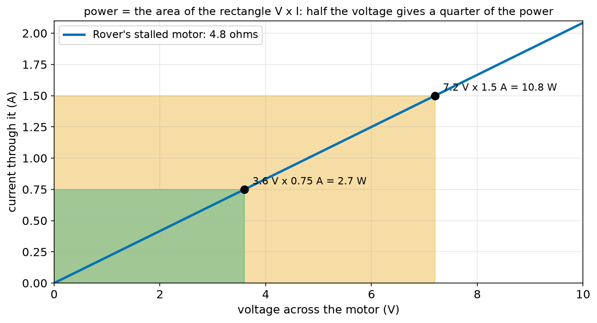
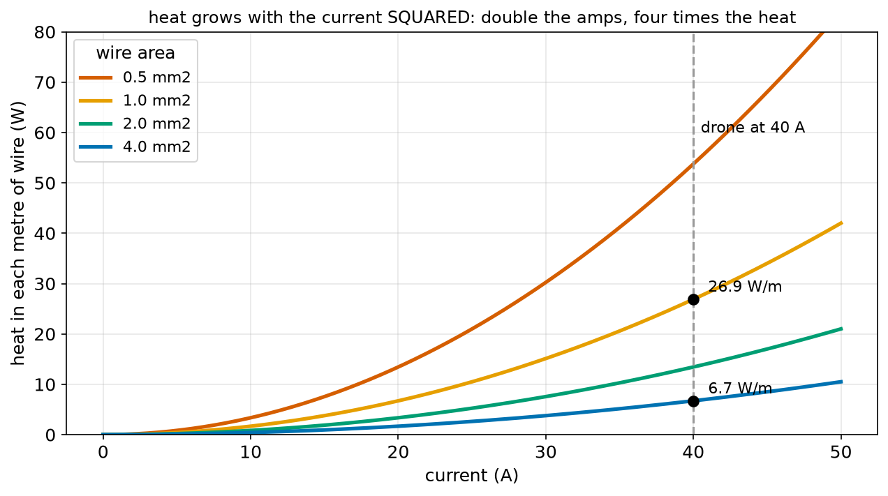
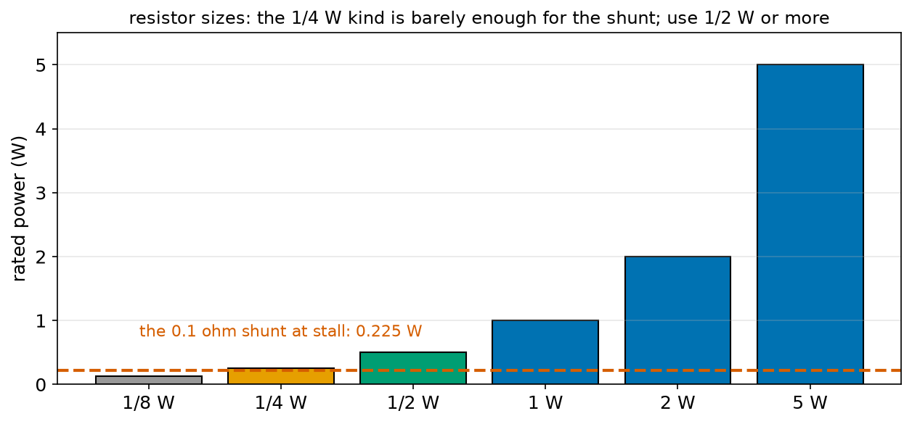
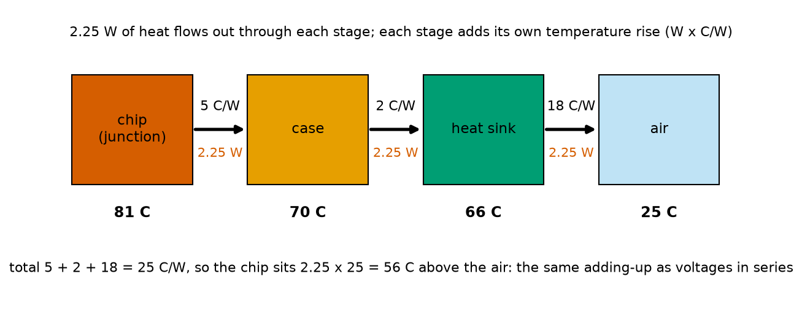
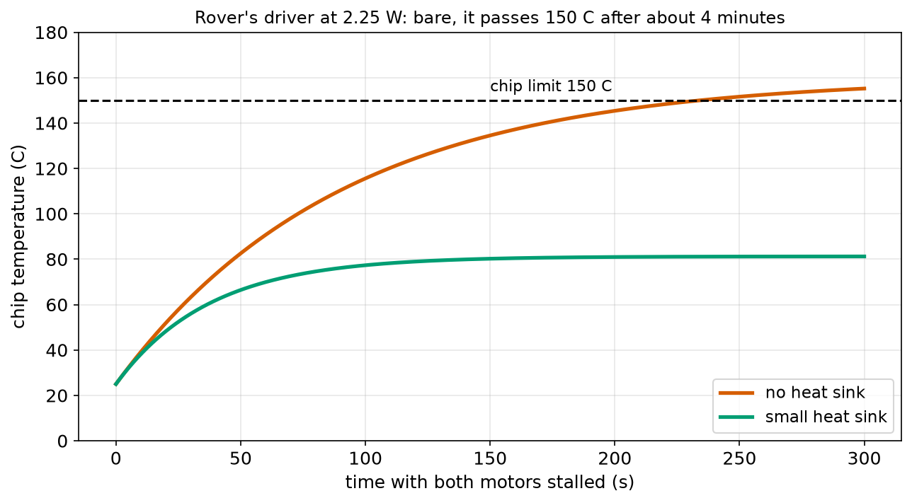
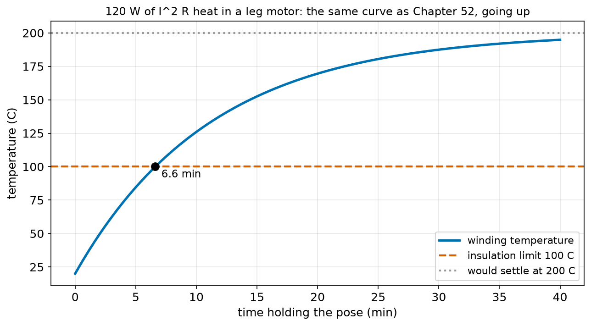

# Chapter 76 — Power in Circuits (P = V × I) and Heat

> **Part 5 · Chapter 76 of 749**
> **You need:** Chapter 5 (Rover's power budget), Chapter 7 (the fuse), Chapter 52 (exponential approach), Chapter 67 (work, energy and power), Chapter 71 (stepping a simulation in time), Chapter 74 (volts as joules per coulomb) and Chapter 75 (Ohm's law).
> **You will make:** a program that computes power three ways, a program that works out how much heat each metre of wire makes, a program that says how hot a part gets, a simulation of Rover's motor driver during a stall, and a simulation of a humanoid's leg motor heating up while it holds a pose.

---

## What you will learn

- Why **P = V × I**: watts are volts times amps, straight from the definitions.
- The two other forms for resistors, **P = I² R** and **P = V² / R**, and when to use each.
- Where the energy goes: **heat** in wires and resistors, motion in motors, light in LEDs.
- Why heat grows with the **square** of the current, and what that means for wires and fuses.
- **Thermal resistance**: how to work out how hot a resistor, a chip or a motor gets.
- Why heating takes **time**, and how to simulate it with the same loop as Chapter 71.
- How Chapter 7's fuse size and Chapter 5's power budget follow from one formula.

---

## New words in this chapter

| Word | Simple meaning |
|---|---|
| **power (P)** | Energy per second, in watts. Electrically, P = V × I. |
| **watt (W)** | One joule per second (Chapter 67). |
| **dissipate** | To turn electrical energy into heat. A resistor dissipates power. |
| **efficiency** | The useful energy out divided by the energy in, as a fraction or a percentage. |
| **power rating** | The most power a part may dissipate without being damaged, such as ¼ W for a small resistor. |
| **thermal resistance (θ)** | How many degrees hotter a part gets for each watt of heat, in °C per watt. |
| **junction** | The tiny silicon part inside a chip where the heat is made and where the temperature limit applies. |
| **heat sink** | A piece of metal with fins, attached to a hot part to carry its heat into the air. |
| **heat capacity** | How many joules it takes to warm something by one degree. |
| **thermal time constant** | Heat capacity × thermal resistance: how long a part takes to get most of the way to its final temperature. |
| **derating** | Using a part well below its rating, because ratings assume ideal conditions. |

---

## 76.1 Power: volts times amps

Chapter 67 defined power as energy per second: one watt is one joule per second. Electricity delivers energy, so it must have a power too. Put the two definitions from Chapters 73 and 74 side by side:

- voltage V is **joules per coulomb** (Chapter 74);
- current I is **coulombs per second** (Chapter 73).

Multiply them: (joules ÷ coulomb) × (coulombs ÷ second) = joules ÷ second = watts. The coulombs cancel.

```
P = V × I
```

In words: "power equals voltage times current". Watts equal volts times amps. That is all there is to it: each coulomb carries V joules, and I coulombs arrive every second.

🔢 **Maths.** Rover's stalled motor: 7.2 V and 1.5 A (Chapter 75). P = 7.2 × 1.5 = **10.8 W**. All of it becomes heat in the winding, because a stalled motor does no work.

🔢 **Maths.** Rover driving: 7.2 V and 0.25 A per motor. P = 1.8 W per motor, 3.6 W for both. Chapter 5's budget had 3.0 W for the motors on average, which agrees within the roughness of such estimates.

🔢 **Maths.** Chapter 7 promised the link between watts and amps that sized Rover's fuse. Turn the formula round: **I = P / V**. Rover's whole budget was 3.78 W from 7.2 V, so I = 3.78 ÷ 7.2 = 0.525 A, the 0.53 A that Chapter 7 used.



*Figure 76.1 — On a current–voltage graph, power is the area of the rectangle from the origin to the operating point.*

**How to read this picture:** The blue line is Rover's stalled motor, 4.8 Ω, as in Chapter 75. At 7.2 V the current is 1.5 A and the orange rectangle has area 7.2 × 1.5 = 10.8 W. At half the voltage, 3.6 V, the current is also halved, so the green rectangle is a quarter of the size: 2.7 W. Halve the voltage across a resistor and you get a quarter of the power. That is the next section's formula in a picture.

🤖 **Robot link.** Every datasheet gives you two of the three. A motor says "12 V, 2 A": 24 W. A sensor says "5 V, 30 mA": 0.15 W. A drone battery label "14.8 V, 5,000 mAh" with a "25C" rating (Chapter 89) means it can give 125 A: 14.8 × 125 = 1,850 W, about two and a half horsepower, from a pack the size of a sandwich.

---

## 76.2 Three forms of the same formula

For a **resistor**, Ohm's law lets you swap V for I × R or I for V / R:

```
P = V × I
P = (I × R) × I  =  I² × R          (replace V)
P = V × (V / R)  =  V² / R          (replace I)
```

In words: "power equals current squared times resistance", and "power equals voltage squared divided by resistance". Use whichever one matches what you know:

| You know | Use |
|---|---|
| the voltage and the current | P = V × I (works for **any** part, not only resistors) |
| the current and the resistance (wires, shunts, windings) | P = I² R |
| the voltage and the resistance (a resistor across a supply) | P = V² / R |

🔢 **Maths.** Rover's wire at start-up: 3.1 A through 0.01008 Ω. P = 3.1² × 0.01008 = 9.61 × 0.01008 = **0.097 W** in each wire. Check with V × I: Chapter 75 found 0.031 V lost, and 0.031 × 3.1 = 0.097 W. The same answer, as it must be.

🔢 **Maths.** The LED's 150 Ω resistor with 3 V across it: P = 3² ÷ 150 = 9 ÷ 150 = **0.06 W**. A standard ¼ W resistor is fine.

⚠️ **Careful.** I² R and V² / R only hold for parts that obey Ohm's law. For a motor, an LED or a battery, use P = V × I with the real measured voltage and current.

The I² is the important part. **Double the current and the heat goes up four times.** Ten times the current, a hundred times the heat. This single fact decides wire sizes, fuse behaviour, motor ratings and why high-voltage power lines exist.

---

## 76.3 Where the energy goes

Energy is never lost; it only changes form (Chapter 67). Electrical energy delivered to a part becomes:

| Part | Most of the energy becomes | The rest becomes |
|---|---|---|
| resistor, wire, heater | heat | (nothing else) |
| motor | motion (work) | heat in the winding and the gears |
| LED | light (about 30–50%) | heat |
| old filament lamp | heat (95%) | light (5%) |
| speaker | sound (a few %) | heat |
| battery being charged | stored chemical energy | heat |
| microcontroller | heat | (the "work" of thinking takes almost no energy) |

📖 **New word: dissipate** — to turn electrical energy into heat. "The resistor dissipates 0.06 W."

📖 **New word: efficiency** — useful energy out ÷ energy in. Chapter 68 gave Rover's motor-plus-gearbox 80%. At 1.8 W in, that is 1.44 W of motion and 0.36 W of heat.

The heat is what you must manage. A part that dissipates more heat than it can shed gets hotter and hotter until something melts, cracks or catches fire. The rest of this chapter is about the heat.

---

## 76.4 Heat in wires

Each metre of wire has resistance ρ / A (Chapter 74, with L = 1), so each metre dissipates:

```
P per metre = I² × ρ / A
```



*Figure 76.2 — Heat made in each metre of copper wire, for four wire sizes. The curves are parabolas: I squared.*

**How to read this picture:** The horizontal axis is the current, the vertical axis the watts of heat made in one metre of wire. Each curve is one wire size; thinner wires curve up faster. At the drone's 40 A (dashed line), a 1 mm² wire makes 26.9 W per metre, about the heat of a small soldering iron, while a 4 mm² wire makes 6.7 W. Note the shape: from 20 A to 40 A, the heat goes up four times, not two.

🔢 **Maths.** The drone of Chapter 75, 1 m of 4 mm² wire at 40 A: P = 40² × 1.68 × 10⁻⁸ ÷ (4 × 10⁻⁶) = 1,600 × 0.0042 = **6.7 W**. Spread along a metre of thick wire in moving air, that makes it warm, not hot. The same current in 1 mm²: 26.9 W. That wire would be too hot to touch and would soften its plastic coat.

🔢 **Maths.** Rover's wire at 3.1 A: 9.61 × 0.0336 = 0.32 W per metre, and Rover's wire is 0.3 m long: 0.1 W. Nothing.

### How a fuse works

A fuse is a short piece of thin wire chosen so that I² R heat melts it at the rated current. Below 4 A, Rover's fuse makes little heat and sheds it through its ends. At 8 A it makes four times the heat, and the thin wire reaches its melting point in about a second. At 48 A (a dead short, Chapter 75), the heat is 144 times the normal amount and the fuse opens in milliseconds, long before the 0.5 mm² wire gets hot. That is Chapter 7's "below the wire limit" rule, in numbers.

🤖 **Robot link.** The same I² R heating happens **inside** a battery (through its internal resistance) and inside a motor winding. A drone battery at 125 A with 0.01 Ω inside makes 125² × 0.01 = 156 W of heat in itself, which is why high-current packs get warm in flight and why Chapter 89 cares so much about the C rating.

---

## 76.5 How hot does it get? Thermal resistance

Knowing the watts is half the job. The other half is the temperature, and there is a beautifully simple rule for it that looks exactly like Ohm's law.

A hot part sheds heat to the air around it. The hotter it is above the air, the faster the heat flows out. For most parts, the rate is proportional: a part that is 20 °C above the air sheds twice as much heat per second as one 10 °C above it. Turn that round: a steady flow of P watts out of a part holds it at a steady temperature rise of

```
temperature rise = P × θ
```

📖 **New word: thermal resistance (θ)** — how many degrees hotter a part gets for each watt of heat it must shed, in °C per watt. Written with the Greek letter theta. Compare V = I × R: temperature rise is like voltage, heat flow is like current, and θ is like resistance.

| Part | θ to the air (°C/W) | What that means |
|---|---|---|
| ¼ W resistor | about 400 | ¼ W makes it 100 °C hotter than the room |
| 1 W resistor | about 100 | 1 W makes it 100 °C hotter |
| small driver chip on a breakout board | 60 | 1 W makes it 60 °C hotter |
| the same chip with a small stuck-on heat sink | 25 | |
| TO-220 regulator, no heat sink | 50 | |
| TO-220 regulator with a 5 cm heat sink | 10 | |
| a small motor's winding | 1.5 | 100 W makes it 150 °C hotter |

Every part also has a **maximum temperature**: about 155 °C for a resistor, 150 °C for the silicon **junction** inside most chips, 125 °C for many regulators, 100 to 155 °C for a motor's winding insulation.

📖 **New word: junction** — the tiny silicon inside a chip where the heat is made. Its temperature is what the limit refers to, and it is hotter than the outside of the case.

🔢 **Maths.** Chapter 75's shunt: 0.1 Ω at the 1.5 A stall dissipates I² R = 2.25 × 0.1 = **0.225 W**. In a ¼ W resistor (θ = 400 °C/W): rise = 0.225 × 400 = 90 °C, so 115 °C in a 25 °C room. Allowed, but it would burn your finger and it leaves no margin. In a 1 W resistor (100 °C/W): 22.5 °C rise, 48 °C. Use the 1 W, or at least a ½ W.



*Figure 76.4 — The standard resistor power ratings. The shunt's 0.225 W sits just under the ¼ W line.*

**How to read this picture:** Each bar is a standard resistor size, from the tiny ⅛ W to the chunky 5 W. The red dashed line is what Rover's shunt must dissipate at stall. A ¼ W resistor is rated for it, but only just, and ratings assume a 25 °C room with free air; inside a warm robot it would run hotter. The ½ W or 1 W size is the right choice.

📖 **New word: power rating** — the most power a part may dissipate, printed in its datasheet. It is a promise about the part's own body, not about what it is connected to.

📖 **New word: derating** — using a part well below its rating, typically at half, because ratings assume ideal conditions: a cool room, free air, short leads to a cool board. Good designs derate everything that gets warm.

### Thermal resistances add up, like series resistors

Heat from a chip's junction flows to the case, then to a heat sink, then to the air. Each step has its own θ, and they **add**, exactly like resistors in series (Chapter 77 will do the electrical version).



*Figure 76.3 — Heat flows from the junction through the case and the heat sink to the air; each stage adds its temperature rise.*

**How to read this picture:** 2.25 W of heat (Application 1's stalled driver) flows left to right through three stages, with 5, 2 and 18 °C/W. Each stage's rise is 2.25 W times its θ: 11, 5 and 41 °C. Starting from 25 °C air, the heat sink is at 66 °C, the case at 70 °C and the junction at 81 °C. Total θ = 25 °C/W, rise = 56 °C. A heat sink works by replacing a big "to the air" number (60 °C/W for the bare chip) with a smaller one.

📖 **New word: heat sink** — a finned piece of aluminium clipped or glued to a hot part. Its large surface sheds heat into the air far better than the small part can.

---

## 76.6 Heating takes time

A part does not jump to its final temperature. It warms up gradually, because it takes energy to warm its own body: its **heat capacity**, in joules per degree. Chapter 52 showed a hot motor cooling along an exponential curve; heating follows the same curve, upside down.

📖 **New word: heat capacity (C)** — the joules needed to warm a part by 1 °C. A small chip and its board: about 1.5 J/°C. A 0.5 kg motor: about 450 J/°C.

📖 **New word: thermal time constant** — τ = C × θ. After one time constant the part has made 63% of its final rise; after five, it is there.

In each small step of time dt, the part gains P × dt joules of electrical heat and loses (T − T_air) / θ × dt joules to the air; dividing the net by C gives the temperature change. That is one Euler step (Chapter 71):

```
T_new = T + (P − (T − T_air) / θ) / C × dt
```

🔢 **Maths.** Rover's driver during a stall: C = 1.5 J/°C, θ = 60 °C/W, τ = 90 s. Final rise 135 °C. The chip passes its 150 °C limit (a 125 °C rise) after t = −τ × ln(1 − 125/135) = 90 × 2.6 = 234 s, about four minutes. Application 1 simulates this.

🤖 **Robot link.** Time constants are why a stall for two seconds is harmless and a stall for four minutes is fatal, why motor datasheets give a "peak" current for a few seconds and a smaller "continuous" current, and why a thermistor (Chapter 74) on the driver, read every second, is enough to protect it.

---

## 76.7 Power in Rover

Chapter 5's budget, now with currents from I = P / V:

| Part | Power | Supplied at | Current |
|---|---|---|---|
| Arduino | 0.25 W | 5 V (via the regulator) | 0.05 A |
| motor driver (its own electronics) | 0.3 W | 7.2 V | 0.04 A |
| two motors | 3.0 W | 7.2 V | 0.42 A |
| line sensor | 0.15 W | 5 V | 0.03 A |
| distance sensor | 0.08 W | 5 V | 0.016 A |

The 5 V parts draw 0.096 A from the regulator. A simple ("linear") regulator passes that same current and drops the voltage from 7.2 V to 5 V, so it dissipates (7.2 − 5) × 0.096 = 0.21 W as heat (Chapter 90 explains why, and the kind that does not waste the difference). At stage 7, with a Raspberry Pi at 4 W (0.8 A at 5 V), the same regulator would dissipate 2.2 × 0.8 = 1.76 W: with θ = 50 °C/W that is an 88 °C rise, too hot. Chapter 90 fixes it.

What gets hot in Rover, in order: the motors when stalled (10.8 W each), the driver chip when stalled (2.25 W), the regulator at stage 7, and nothing else. Everything else is under a tenth of a watt.

---

## Code

File `code/ch076/power_forms.py`:

```python
# power_forms.py - electrical power three ways: P = V x I = I^2 x R = V^2 / R
cases = [
    # name, volts across, amps through
    ("LED (2 V, 20 mA)", 2.0, 0.020),
    ("LED's 150 ohm resistor", 3.0, 0.020),
    ("Rover's wire at start-up", 0.031, 3.1),
    ("Rover motor, stalled", 7.2, 1.5),
    ("Rover motor, driving", 7.2, 0.25),
    ("kettle on the mains", 230.0, 8.7),
]
print(f"{'part':26s} {'V':>7s} {'I':>7s} {'R = V/I':>9s} {'V x I':>8s} {'I^2 R':>8s} {'V^2 / R':>8s}")
for name, v, i in cases:
    r = v / i
    print(f"{name:26s} {v:7.3f} {i:7.3f} {r:9.3f} {v * i:8.3f} {i * i * r:8.3f} {v * v / r:8.3f}")

print()
print("the Chapter 7 link between watts and amps:")
rover_w = 3.78
print(f"  Rover uses {rover_w} W from 7.2 V, so I = P / V = {rover_w / 7.2:.2f} A   (Chapter 7 used 0.53 A)")
print(f"  a 2,000 W kettle on 230 V draws {2000 / 230:.1f} A; on 12 V it would need {2000 / 12:.0f} A")
```

| Line | Code | What it does (simple English) |
|---|---|---|
| 1 | `# power_forms.py …` | A comment. |
| 2–10 | `cases = [ … ]` | Six parts with the voltage across and the current through each. Line 3 names the columns. |
| 11 | `print(f"{'part':26s} …")` | The header. |
| 12 | `for name, v, i in cases:` | One row each. |
| 13 | `r = v / i` | Ohm's law gives R (meaningful only for the ohmic parts, but the arithmetic works for all). |
| 14 | `print(f"{name:26s} …")` | V, I, R and the power three ways. |
| 15 | (blank) | Spacing. |
| 16 | `print()` | An empty line. |
| 17 | `print("the Chapter 7 link …")` | A heading. |
| 18 | `rover_w = 3.78` | Chapter 5's budget. |
| 19 | `print(f"  Rover uses …")` | I = P / V. |
| 20 | `print(f"  a 2,000 W kettle …")` | The same for a kettle, on the mains and on 12 V. |

Output:

```
part                             V       I   R = V/I    V x I    I^2 R  V^2 / R
LED (2 V, 20 mA)             2.000   0.020   100.000    0.040    0.040    0.040
LED's 150 ohm resistor       3.000   0.020   150.000    0.060    0.060    0.060
Rover's wire at start-up     0.031   3.100     0.010    0.096    0.096    0.096
Rover motor, stalled         7.200   1.500     4.800   10.800   10.800   10.800
Rover motor, driving         7.200   0.250    28.800    1.800    1.800    1.800
kettle on the mains        230.000   8.700    26.437 2001.000 2001.000 2001.000

the Chapter 7 link between watts and amps:
  Rover uses 3.78 W from 7.2 V, so I = P / V = 0.52 A   (Chapter 7 used 0.53 A)
  a 2,000 W kettle on 230 V draws 8.7 A; on 12 V it would need 167 A
```

The three power columns always agree, because R was computed from V and I. (The "28.8 Ω" for the driving motor is not a real resistance: a spinning motor is non-ohmic, Chapter 75. Only the V × I column means something for it.)

File `code/ch076/wire_heat.py`:

```python
# wire_heat.py - the heat made in each metre of wire: P per metre = I^2 x rho / A
RHO = 1.68e-8


def watts_per_metre(current_a, area_mm2):
    return current_a ** 2 * RHO / (area_mm2 * 1e-6)


print("heat in watts per metre of copper wire")
areas = [0.5, 1.0, 2.0, 4.0, 6.0]
print(f"{'current':>8s}" + "".join(f"{a:>9.1f}" for a in areas) + "   mm2")
for amps in [1, 3.1, 10, 20, 40]:
    row = "".join(f"{watts_per_metre(amps, a):9.2f}" for a in areas)
    print(f"{amps:6.1f} A {row}")

print()
print("double the current, four times the heat:")
for amps in [10, 20, 40]:
    print(f"  {amps:2d} A in 1 mm2: {watts_per_metre(amps, 1.0):5.1f} W/m")
print()
print("the drone's 1 m of 4 mm2 wire at 40 A makes", f"{watts_per_metre(40, 4.0):.1f} W of heat;",
      f"1 mm2 would make {watts_per_metre(40, 1.0):.1f} W")
```

| Line | Code | What it does (simple English) |
|---|---|---|
| 1 | `# wire_heat.py …` | A comment. |
| 2 | `RHO = 1.68e-8` | Copper. |
| 3–4 | (blank) | Spacing. |
| 5 | `def watts_per_metre(current_a, area_mm2):` | The formula as a function. |
| 6 | `return current_a ** 2 * RHO / (area_mm2 * 1e-6)` | I² ρ / A. |
| 7–8 | (blank) | Spacing. |
| 9 | `print("heat in watts …")` | A heading. |
| 10 | `areas = [0.5, 1.0, 2.0, 4.0, 6.0]` | The columns. |
| 11 | `print(f"{'current':>8s}" + "".join(…) + "   mm2")` | The header row, built with `join` (Chapter 21). |
| 12 | `for amps in [1, 3.1, 10, 20, 40]:` | The rows. |
| 13 | `row = "".join(f"{watts_per_metre(amps, a):9.2f}" for a in areas)` | One number per column. |
| 14 | `print(f"{amps:6.1f} A {row}")` | The row. |
| 15 | (blank) | Spacing. |
| 16 | `print()` | An empty line. |
| 17 | `print("double the current, …")` | A heading. |
| 18–19 | `for amps in [10, 20, 40]: print(…)` | The squared law in three lines. |
| 20 | `print()` | An empty line. |
| 21–22 | `print("the drone's …", …)` | The two drone wires. |

Output:

```
heat in watts per metre of copper wire
 current      0.5      1.0      2.0      4.0      6.0   mm2
   1.0 A      0.03     0.02     0.01     0.00     0.00
   3.1 A      0.32     0.16     0.08     0.04     0.03
  10.0 A      3.36     1.68     0.84     0.42     0.28
  20.0 A     13.44     6.72     3.36     1.68     1.12
  40.0 A     53.76    26.88    13.44     6.72     4.48

double the current, four times the heat:
  10 A in 1 mm2:   1.7 W/m
  20 A in 1 mm2:   6.7 W/m
  40 A in 1 mm2:  26.9 W/m

the drone's 1 m of 4 mm2 wire at 40 A makes 6.7 W of heat; 1 mm2 would make 26.9 W
```

A rule of thumb from this table: in still air, a wire stays comfortably cool below about 10 W per metre. That gives roughly 17 A for 0.5 mm², 24 A for 1 mm² and 49 A for 4 mm², which is close to the limits printed in wiring guides.

File `code/ch076/temperature_rise.py`:

```python
# temperature_rise.py - how hot does a part get? rise = power x thermal resistance
ROOM_C = 25.0

parts = [
    # name, watts of heat, thermal resistance in degrees C per watt, maximum allowed temperature
    ("1/4 W resistor used as a 0.1 ohm shunt at stall", 0.225, 400, 155),
    ("1 W resistor as the same shunt", 0.225, 100, 155),
    ("motor driver chip, no heat sink, motors driving", 0.25, 60, 150),
    ("motor driver chip, no heat sink, both motors stalled", 2.25, 60, 150),
    ("motor driver chip with a small heat sink, stalled", 2.25, 25, 150),
    ("5 V regulator making 1 A from 7.2 V, no heat sink", 2.2, 50, 125),
]
print(f"{'part':54s} {'watts':>6s} {'C/W':>5s} {'rise':>7s} {'temp':>7s} {'ok?':>4s}")
for name, watts, c_per_w, limit in parts:
    rise = watts * c_per_w
    temp = ROOM_C + rise
    ok = "yes" if temp <= limit else "NO"
    print(f"{name:54s} {watts:6.3f} {c_per_w:5d} {rise:6.0f} C {temp:5.0f} C {ok:>4s}")
```

| Line | Code | What it does (simple English) |
|---|---|---|
| 1 | `# temperature_rise.py …` | A comment. |
| 2 | `ROOM_C = 25.0` | The air temperature. |
| 3 | (blank) | Spacing. |
| 4–12 | `parts = [ … ]` | Six cases: name, watts, θ, limit. Line 5 names the columns. |
| 13 | `print(f"{'part':54s} …")` | The header. |
| 14 | `for name, watts, c_per_w, limit in parts:` | One row each. |
| 15 | `rise = watts * c_per_w` | Rise = P × θ. |
| 16 | `temp = ROOM_C + rise` | Add the room. |
| 17 | `ok = "yes" if temp <= limit else "NO"` | Compare with the limit. |
| 18 | `print(f"{name:54s} …")` | The row. |

Output:

```
part                                                    watts   C/W    rise    temp  ok?
1/4 W resistor used as a 0.1 ohm shunt at stall         0.225   400     90 C   115 C  yes
1 W resistor as the same shunt                          0.225   100     22 C    48 C  yes
motor driver chip, no heat sink, motors driving         0.25    60     15 C    40 C  yes
motor driver chip, no heat sink, both motors stalled    2.250    60    135 C   160 C   NO
motor driver chip with a small heat sink, stalled       2.250    25     56 C    81 C  yes
5 V regulator making 1 A from 7.2 V, no heat sink       2.200    50    110 C   135 C   NO
```

Two "NO" rows: the bare driver during a double stall, and a linear regulator feeding a 1 A load. Both are real problems that Rover's design must solve (Application 1 and Chapter 90).

---

## Small examples

**Example 1.** 12 V × 2.5 A = 30 W.

**Example 2.** 0.75 A through 8 Ω: P = 0.75² × 8 = 4.5 W.

**Example 3.** 5 V across 100 Ω: P = 25 ÷ 100 = 0.25 W: exactly a ¼ W resistor's rating, so use a ½ W.

**Example 4.** A 9 W part on 18 V draws 0.5 A.

**Example 5.** 3 A through a 0.5 Ω driver: 4.5 W of heat. At 60 °C/W: a 270 °C rise. Destroyed.

**Example 6.** A 36 W motor on 12 V draws 3 A; on 24 V the same power needs 1.5 A, and the wire heat (I² R) is a quarter.

**Example 7.** A regulator dissipating 2.2 W at 50 °C/W in a 25 °C room: 135 °C.

**Example 8.** C = 450 J/°C and θ = 1.5 °C/W: τ = 675 s = 11 min.

---

## 🏭 Real robot applications

### Application 1 (worked in full) — 🤖 Heat in Rover's motor driver

**1. The real problem.** Rover's TB6612 driver chip (Chapter 5) passes each motor's current through its own transistors, which have about 0.5 Ω of resistance in the path. When Rover drives into a wall and both motors stall at 1.5 A, the chip heats up. How hot does it get, how long does it take, and does it need a heat sink? The same chip family drives the brushes and wheels of home vacuum robots, which hit furniture all day.

**2. Why this theory.** The heat is I² R in each channel. The steady temperature rise is P × θ. The time to get there follows the heat-capacity simulation of section 76.6.

**3. The numbers.** R_on = 0.5 Ω per channel. Driving: 0.5 A per motor. Stall: 1.5 A. θ = 60 °C/W bare, 25 °C/W with a small heat sink. Junction limit 150 °C. Room 25 °C. Heat capacity 1.5 J/°C.

**4. The maths.**

```
driving:  P = 2 × 0.5² × 0.5 = 0.25 W   →  rise 15 °C bare: fine
stalled:  P = 2 × 1.5² × 0.5 = 2.25 W   →  rise 135 °C bare: 160 °C, over the limit
                                           rise 56 °C with heat sink: 81 °C, fine
time constant bare: 1.5 × 60 = 90 s;  150 °C reached after 90 × ln(135 / 10) = 234 s
```

**5. The code.** File `code/ch076/driver_heat.py`:

```python
# driver_heat.py - Rover's motor driver: how much heat, how hot, and for how long can the motors stall?
R_ON = 0.5              # ohms: the driver's own resistance in each motor's path (from the TB6612 datasheet)
THETA_BARE = 60.0       # degrees C per watt, chip to air, on its small board
THETA_SINK = 25.0       # with a small stuck-on heat sink
T_MAX = 150.0           # the chip's limit
ROOM = 25.0
HEAT_CAPACITY = 1.5     # joules per degree: how much energy warms the chip and its board by 1 degree
DT = 0.1

for name, amps in [("driving", 0.5), ("one motor stalled", 1.5), ("both motors stalled", 1.5)]:
    motors = 1 if name == "one motor stalled" else 2
    watts = motors * amps ** 2 * R_ON                   # I^2 R in each channel
    print(f"{name:20s}: {watts:5.3f} W of heat; steady rise {watts * THETA_BARE:5.1f} C bare, {watts * THETA_SINK:5.1f} C with heat sink")

print()
# both motors stalled: how long until the chip reaches 150 C? Step forward in time (Chapter 71)
watts = 2 * 1.5 ** 2 * R_ON
for theta, label in [(THETA_BARE, "bare"), (THETA_SINK, "with heat sink")]:
    temp, t = ROOM, 0.0
    while temp < T_MAX and t < 600:
        cooling = (temp - ROOM) / theta                 # watts flowing out to the air
        temp = temp + (watts - cooling) / HEAT_CAPACITY * DT
        t = t + DT
    if temp >= T_MAX:
        print(f"{label:15s}: reaches {T_MAX:.0f} C after {t:5.1f} s of stall")
    else:
        print(f"{label:15s}: settles at {temp:5.1f} C, never reaches {T_MAX:.0f} C")
```

| Line | Code | What it does (simple English) |
|---|---|---|
| 1 | `# driver_heat.py …` | A comment. |
| 2–8 | `R_ON` … `DT` | The chip's numbers and the time step. |
| 9 | (blank) | Spacing. |
| 10 | `for name, amps in [ … ]:` | Three situations. |
| 11 | `motors = 1 if name == "one motor stalled" else 2` | How many channels carry the current. |
| 12 | `watts = motors * amps ** 2 * R_ON` | I² R per channel, times the channels. |
| 13 | `print(f"{name:20s}: …")` | The heat and the steady rise, bare and with a heat sink. |
| 14 | (blank) | Spacing. |
| 15 | `print()` | An empty line. |
| 16 | `# both motors stalled: …` | A comment. |
| 17 | `watts = 2 * 1.5 ** 2 * R_ON` | 2.25 W. |
| 18 | `for theta, label in [ … ]:` | Bare, then with a heat sink. |
| 19 | `temp, t = ROOM, 0.0` | Start cold. |
| 20 | `while temp < T_MAX and t < 600:` | Step until the limit, or 10 minutes. |
| 21 | `cooling = (temp - ROOM) / theta` | Heat flowing out: rise ÷ θ. |
| 22 | `temp = temp + (watts - cooling) / HEAT_CAPACITY * DT` | The Euler step: net heat ÷ heat capacity × dt. |
| 23 | `t = t + DT` | The clock. |
| 24–25 | `if temp >= T_MAX: print(…)` | Report the time if the limit was reached. |
| 26–27 | `else: print(…)` | Otherwise the temperature it settled at. |

Output:

```
driving             : 0.250 W of heat; steady rise  15.0 C bare,   6.2 C with heat sink
one motor stalled   : 1.125 W of heat; steady rise  67.5 C bare,  28.1 C with heat sink
both motors stalled : 2.250 W of heat; steady rise 135.0 C bare,  56.2 C with heat sink

bare           : reaches 150 C after 234.2 s of stall
with heat sink : settles at  81.2 C, never reaches 150 C
```



*Figure 76.6 — The driver chip's temperature while both motors are stalled, bare and with a small heat sink.*

**How to read this picture:** Time runs along the bottom, chip temperature up the side. The red curve is the bare chip: it climbs along an exponential and crosses the 150 °C limit after about four minutes, heading for 160 °C. The green curve, with a heat sink, levels off at 81 °C and is safe for ever. Both curves start with the same slope, because at the start no heat is leaving yet; the heat sink only matters once the chip is warm.

**6. The result.** Rover can survive a short stall (a few seconds against a wall) with no heat sink, because the chip's time constant is 90 s. A stall of several minutes with the bare chip destroys it. The cheap fixes are, in order: software that cuts the motors when the shunt of Chapter 75 reports a stall for more than two seconds; a thermistor (Chapter 74) on the chip; and a small heat sink. Rover will use the first two from Chapter 139. Vacuum robots use exactly these, plus a current limit inside the driver chip itself.

**7. Going further.** Real chips also have a built-in thermal shutdown at about 170 °C junction temperature, a last line of defence that stops the chip but does not stop it ageing. Chapter 88 looks at the MOSFET transistors inside such drivers and why a lower R_on means less heat, and Chapter 141 covers the full motor driver.

### Application 2 (worked in full) — 🦿 A humanoid's leg motor holding a pose

**1. The real problem.** A humanoid robot (Hero, Part 32) stands in a half-squat with 20 A flowing in each knee motor to hold the pose. The motors are not moving, so all the electrical power becomes heat in the windings. How long can the robot hold the pose before the winding insulation (limit 100 °C) is at risk?

**2. Why this theory.** I² R gives the heat. The motor's heat capacity and thermal resistance give the exponential rise, and the time to reach the limit follows from the same formula as Chapter 52's decay, turned upside down.

**3. The numbers.** Winding 0.3 Ω. Hold current 20 A. Heat capacity 450 J/°C (about 0.5 kg of copper and iron). θ = 1.5 °C/W. Room 20 °C. Limit 100 °C.

**4. The maths.**

```
P = 20² × 0.3 = 120 W
steady temperature = 20 + 120 × 1.5 = 200 °C   (far above the limit)
τ = 450 × 1.5 = 675 s
time to 100 °C: t = −675 × ln(1 − 80 / 180) = 675 × 0.588 = 397 s = 6.6 min
```

**5. The code.** File `code/ch076/motor_heating.py`:

```python
# motor_heating.py - a humanoid's leg motor holding a pose: I^2 R heat, and how long before it is too hot
import math

WINDING_OHM = 0.3
HOLD_A = 20.0                  # current needed to hold the pose
HEAT_CAPACITY = 450.0          # J per degree C (about 0.5 kg of copper and iron)
THETA = 1.5                    # degrees C per watt from the winding to the air
ROOM = 20.0
LIMIT = 100.0                  # the winding insulation's safe limit
DT = 1.0

watts = HOLD_A ** 2 * WINDING_OHM
steady = ROOM + watts * THETA
tau = HEAT_CAPACITY * THETA
print(f"holding at {HOLD_A} A makes {watts:.0f} W of heat in the winding")
print(f"if it stood for ever it would settle at {steady:.0f} C (time constant {tau:.0f} s)")

temp, t = ROOM, 0.0
while temp < LIMIT:
    temp = temp + (watts - (temp - ROOM) / THETA) / HEAT_CAPACITY * DT      # Euler step (Chapter 71)
    t = t + DT
    if t % 60 == 0:
        print(f"  after {t / 60:3.0f} min: {temp:5.1f} C")
print(f"the winding reaches {LIMIT:.0f} C after {t / 60:.1f} min: the robot must sit or change pose before then")
exact = -tau * math.log(1 - (LIMIT - ROOM) / (steady - ROOM))
print(f"(the exact exponential formula gives {exact / 60:.1f} min)")
```

| Line | Code | What it does (simple English) |
|---|---|---|
| 1 | `# motor_heating.py …` | A comment. |
| 2 | `import math` | For `log`. |
| 3 | (blank) | Spacing. |
| 4–10 | `WINDING_OHM` … `DT` | The motor's numbers; dt = 1 s is fine for a time constant of 675 s. |
| 11 | (blank) | Spacing. |
| 12 | `watts = HOLD_A ** 2 * WINDING_OHM` | I² R. |
| 13 | `steady = ROOM + watts * THETA` | Where it would end up. |
| 14 | `tau = HEAT_CAPACITY * THETA` | The time constant. |
| 15–16 | `print(…)` | Report them. |
| 17 | (blank) | Spacing. |
| 18 | `temp, t = ROOM, 0.0` | Start at room temperature. |
| 19 | `while temp < LIMIT:` | Until the limit. |
| 20 | `temp = temp + (watts - (temp - ROOM) / THETA) / HEAT_CAPACITY * DT` | The Euler step: heat in minus heat out, over the heat capacity. |
| 21 | `t = t + DT` | The clock. |
| 22–23 | `if t % 60 == 0: print(…)` | A line every minute (Chapter 13's `%`). |
| 24 | `print(f"the winding reaches …")` | The answer. |
| 25 | `exact = -tau * math.log(1 - (LIMIT - ROOM) / (steady - ROOM))` | The exact formula from the exponential (Chapter 52). |
| 26 | `print(f"(the exact … )")` | To compare with the simulation. |

Output:

```
holding at 20.0 A makes 120 W of heat in the winding
if it stood for ever it would settle at 200 C (time constant 675 s)
  after   1 min:  35.3 C
  after   2 min:  49.3 C
  after   3 min:  62.2 C
  after   4 min:  73.9 C
  after   5 min:  84.6 C
  after   6 min:  94.4 C
the winding reaches 100 C after 6.6 min: the robot must sit or change pose before then
(the exact exponential formula gives 6.6 min)
```



*Figure 76.5 — The winding temperature while holding the pose. It would settle at 200 °C; it crosses 100 °C after 6.6 minutes.*

**How to read this picture:** The blue curve rises along the exponential approach of Chapter 52, towards the grey dotted line at 200 °C. It crosses the red dashed insulation limit after 6.6 minutes (black dot). The curve is steepest at the start, when the winding is cool and nothing is flowing out yet, and flattens as the cooling catches up with the heating.

**6. The result.** The robot can hold the half-squat for about six minutes, then must stand up straight (where the knee current drops to a few amps) or sit down. Its controller keeps a running estimate of each motor's temperature with exactly this model, updated every control cycle, and the motion planner treats "thermal budget" as a limit just like torque. Without the model, the first warning would be the smell of hot insulation.

**7. Going further.** Real motors have two time constants (the winding warms fast, the housing slowly), and the resistance rises with temperature (Chapter 74), which makes the heating worse: a hot winding at 0.36 Ω makes 144 W, not 120. Chapter 224 models heating properly, and Chapter 694 uses the thermal budget when choosing Hero's actuators.

### Application 3 — 🚁 Heat in a drone's wiring and connectors

A racing drone's 40 A runs through about a metre of wire, two connectors and the power board. The wire at 4 mm² makes 6.7 W (section 76.4). A good XT60 connector has about 1 mΩ of contact resistance: 1.6 W, fine. A worn or dirty one can reach 10 mΩ: 16 W in a lump of plastic the size of a sugar cube, which melts it, and a melted connector mid-flight means a crash. That is why pilots replace connectors that feel warm after a flight, and why high-current connectors are rated by the I² R heat they can shed, not only by the current.

### Application 4 — 🚀 Power is survival on Mars

NASA's Curiosity and Perseverance rovers carry no solar panels. Their electricity comes from a radioisotope generator that makes about 110 W, continuously, from the heat of decaying plutonium. The budget is brutal: driving, the arm, the cameras, the computer and the radio must share 110 W, so the rover drives for a while, then stops to recharge its batteries, then drives again. Some of that power deliberately becomes heat: small resistive heaters (P = V² / R, nothing more) keep the electronics and the wheel motors above −40 °C through the Martian night. On Mars, the "waste" heat of this chapter is the thing that keeps the robot alive.

### Application 5 — 🏭 Power that flows backwards

When a 300 kg warehouse robot carrying a 500 kg rack slows down from 2 m/s, its kinetic energy (Chapter 67: ½ × 800 × 4 = 1,600 J) must go somewhere. The motors become generators (Chapter 85), the current reverses, and P = V × I comes out **negative**: about 1,600 J over 2 s is 800 W flowing **into** the battery. This is regenerative braking. If the battery is already full, the drive must dump the power into a "brake resistor" instead: a 10 Ω resistor rated at 1 kW that is bolted to the chassis and gets hot on purpose. The sizing is this chapter's maths: at 48 V the resistor draws 4.8 A and dissipates 230 W, so braking from full speed takes a few seconds of its rating, and its heat capacity carries the rest.

### Application 6 — 🚗 Charging an electric car

A fast charger delivers 350 kW to a car at 800 V: I = 350,000 ÷ 800 = 437 A. The cable to the car is liquid-cooled, because even at 50 mm² of copper, 437 A in a 3 m cable (6 m of wire, 2 mΩ) makes 437² × 0.002 = 380 W of heat. At 400 V the same power would need 875 A and four times the heat, which is why the newest cars moved to 800 V (Chapter 74's Application 3). The same reasoning, scaled down a thousand times, decides the voltage of every robot.

---

## 🔧 Hands-on lab

### Lab 76.1 — Power labels at home (hardware, no tools)

1. Find the labels on five things: a phone charger, a laptop charger, a kettle or toaster, an LED bulb, a games console or TV. Each gives volts and amps, or watts.
2. Fill in the missing number for each with P = V × I.
3. Rank them by power. Touch each one after it has been on for a while (carefully, with the back of a finger): which are warm?

**What you should see:** A phone charger label like "5 V 2 A" is 10 W; a laptop charger "20 V 3.25 A" is 65 W; a kettle 2,000 W draws 8.7 A from 230 V. The chargers are warm because they are not perfectly efficient: a 65 W charger at 90% efficiency makes 6.5 W of heat inside a plastic box with no fan. The LED bulb (about 8 W) is barely warm; an old 60 W filament bulb would be too hot to touch, because 95% of its power is heat.

| If it does not work | Likely cause | Fix |
|---|---|---|
| The label gives "100–240 V" | That is the input range; the output is listed separately | Use the **output** line for the power delivered |
| The label gives only watts | The current is not printed | Work it out: I = P ÷ V |

**Challenge:** Your kettle on a 12 V car battery would need 167 A. Using Chapter 75, what area of copper wire would keep the loss under 1 V over 2 m there and back? (Hint: the answer is why nobody makes 12 V kettles.)

### Lab 76.2 — The hottest wire (simulation)

1. Copy `wire_heat.py`. Add a function `max_current(area_mm2, watts_per_metre_limit=10)` that returns the largest current that keeps the heat under the limit (turn the formula round: I = √(P A / ρ)).
2. Print it for 0.5, 1, 2.5 and 4 mm².
3. Change the limit to 5 W/m (a wire inside a closed box) and 20 W/m (a wire in a fast airflow) and print again.

**What you should see:** At 10 W/m: 17.3, 24.4, 38.6 and 48.8 A. The current limit grows with the **square root** of the area, because the heat grows with the square of the current. Halving the allowed heat per metre cuts the allowed current by only 29% (√0.5 = 0.71); doubling it raises the current by 41%.

| If it does not work | Likely cause | Fix |
|---|---|---|
| `ValueError: math domain error` | A negative number under the square root | Check the sign of the limit |
| Currents in the thousands | Area in mm² used as m² | Multiply the area by 10⁻⁶ |

**Challenge:** Real wiring tables also derate for bundles: several wires together shed heat worse. If six wires share a bundle and each can shed only half as much heat, what current can each carry?

### Lab 76.3 — Protect the driver (simulation)

Copy `driver_heat.py`.

1. The driver board is fixed to Rover's chassis with thermal paste, which doubles its heat capacity to 3 J/°C. How long does a double stall now take to reach 150 °C?
2. Instead, a fan improves θ to 40 °C/W. Does the chip still reach 150 °C?
3. The software limits the stall current to 1.2 A. With the bare chip (60 °C/W, 1.5 J/°C), what is the steady temperature?
4. Combine: with the current limit at 1.2 A, how long may the stall last before 120 °C (a safer limit)?

**What you should see:** Doubling the heat capacity doubles the time constant, so the limit is reached after about 468 s instead of 234 s: more thermal mass buys time but does not change the end point. With θ = 40 °C/W the steady temperature is 25 + 2.25 × 40 = 115 °C: safe for ever. With 1.2 A, the heat is 2 × 1.44 × 0.5 = 1.44 W and the steady temperature 25 + 86 = 111 °C: also safe. The combination lets the stall last for ever below 120 °C. A current limit is the cheapest fix because it removes heat at the source, where the I² makes a 20% current cut into a 36% heat cut.

| If it does not work | Likely cause | Fix |
|---|---|---|
| The loop never ends | The steady temperature is below `T_MAX` and `t < 600` was removed | Keep the time limit, or compare with the steady value |
| The temperature overshoots wildly | `DT` too large for the time constant | Keep dt well below C × θ (Chapter 71) |

**Challenge:** Make the simulation drive for 20 s, stall for 30 s, and repeat. Find the longest stall that keeps the bare chip under 120 °C in steady operation.

---

## Common mistakes

⚠️ **Using I² R or V² / R on a motor or an LED.** Those forms need Ohm's law. Use V × I with real measurements.

⚠️ **Forgetting that heat goes with the current squared.** A 20% current reduction is a 36% heat reduction; a doubling is a quadrupling.

⚠️ **Choosing a resistor by its ohms only.** Check the watts. P = V² / R or I² R, then take the next rating up, and derate by half if it will be warm.

⚠️ **Believing a chip's power rating without a heat sink.** Ratings are often given for a large copper area or an infinite heat sink. Read the θ in the datasheet.

⚠️ **Thinking a short stall is as bad as a long one.** Heating takes time; use the time constant.

⚠️ **Ignoring connectors.** A worn connector can make more heat than a metre of wire.

⚠️ **Measuring the case and assuming the junction is the same.** The junction is hotter by P × θ_junction-to-case.

---

## Practice

🏋️ **1.** A motor runs on 24 V at 3 A. Find its power.

🏋️ **2.** A 10 Ω resistor carries 0.4 A. Find the power, and the smallest standard rating (⅛, ¼, ½, 1, 2, 5 W) that is at least twice it.

🏋️ **3.** A 220 Ω resistor is connected across 12 V. Find the power. Is a ¼ W resistor enough?

🏋️ **4.** A 60 W part on a 48 V bus draws how much current?

🏋️ **5.** Rover's two motors stall at 1.5 A each on a battery with 0.15 Ω internal resistance. How much heat is made **inside the battery**?

🏋️ **6.** A 2 mm² wire carries 30 A. Find the heat per metre.

🏋️ **7.** A regulator dissipates 1.76 W. With θ = 50 °C/W in a 30 °C box, what is its temperature? With a heat sink giving 10 °C/W?

🏋️ **8.** A part with C = 2 J/°C and θ = 40 °C/W: what is its time constant, and how long until it reaches 63% of its final rise?

🏋️ **9.** A brake resistor must absorb 1,600 J in 2 s. What power is that? If it is 10 Ω on 48 V, what power does it actually take, and how long does it need?

🏋️ **10.** An LED runs at 2 V, 20 mA, and is 40% efficient. How much heat does it make?

🏋️ **11.** Write `time_to_limit(watts, theta, heat_capacity, room, limit)` that simulates the heating with dt = 0.1 s and returns the time to reach the limit, or `None` if it never does. Check it against the exact formula for Application 1's bare chip (234 s) and show that the stalled driver with a 25 °C/W heat sink returns `None`.

---

## Answers

**1.** 24 × 3 = 72 W.

**2.** 0.4² × 10 = 1.6 W. Twice is 3.2 W, so a 5 W resistor.

**3.** 144 ÷ 220 = 0.65 W. No: it needs a 1 W (or 2 W with derating).

**4.** 60 ÷ 48 = 1.25 A.

**5.** The total current is 3 A. Inside the battery: 3² × 0.15 = 1.35 W.

**6.** 900 × 1.68 × 10⁻⁸ ÷ (2 × 10⁻⁶) = 7.56 W per metre.

**7.** 30 + 1.76 × 50 = 118 °C (too hot for a 125 °C limit with any margin). With the heat sink: 30 + 17.6 = 47.6 °C.

**8.** τ = 2 × 40 = 80 s; 63% after 80 s.

**9.** 1,600 ÷ 2 = 800 W. The resistor on 48 V takes 48² ÷ 10 = 230 W, so it needs 1,600 ÷ 230 = 7 s to absorb the energy; the drive must brake more gently, or use a smaller resistance (5 Ω: 461 W, 3.5 s).

**10.** 0.04 W in, 40% light, so 0.024 W of heat.

**11.**

```python
import math

def time_to_limit(watts, theta, heat_capacity, room, limit, dt=0.1, max_t=3600):
    temp, t = room, 0.0
    while temp < limit:
        temp += (watts - (temp - room) / theta) / heat_capacity * dt
        t += dt
        if t > max_t:
            return None
    return t

print(time_to_limit(2.25, 60, 1.5, 25, 150))      # 234.2 (seconds)
print(time_to_limit(2.25, 25, 1.5, 25, 150))      # None: settles at 81 C
tau = 1.5 * 60
print(-tau * math.log(1 - 125 / 135))             # 234.3, the exact answer
```

---

## Summary

🧠 **P = V × I.** Watts = volts × amps, because volts are joules per coulomb and amps are coulombs per second. Turned round, **I = P / V** sizes fuses and wires.

🧠 For resistors and wires, **P = I² R = V² / R**. Heat grows with the **square** of the current.

🧠 Energy becomes heat (resistors, wires), motion (motors), light (LEDs). **Efficiency** is the useful share; the rest must be shed as heat.

🧠 Heat per metre of wire = I² ρ / A. A fuse is a wire designed to melt from its own I² R heat.

🧠 **Temperature rise = P × θ.** Thermal resistances add along the path to the air, like resistors in series. A **heat sink** lowers θ.

🧠 Check every part's **power rating** and **derate** by half when warm. A ¼ W resistor at 0.225 W runs at 115 °C.

🧠 Heating follows an exponential with **time constant C × θ**. Short overloads are fine; long ones are not. Simulate it with one Euler line.

---

## Next chapter

Chapter 77 puts several parts into one circuit: **series** and **parallel**. You will learn why series resistances add (as the thermal ladder did here), why parallel resistances combine to less than the smallest, how current splits between branches, and why Rover's motors are wired in parallel while its battery cells are in series. You will also build the formulas that every later circuit uses.
