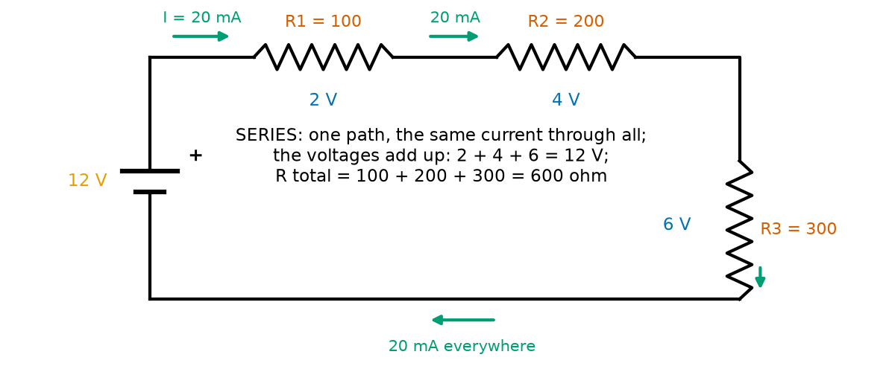
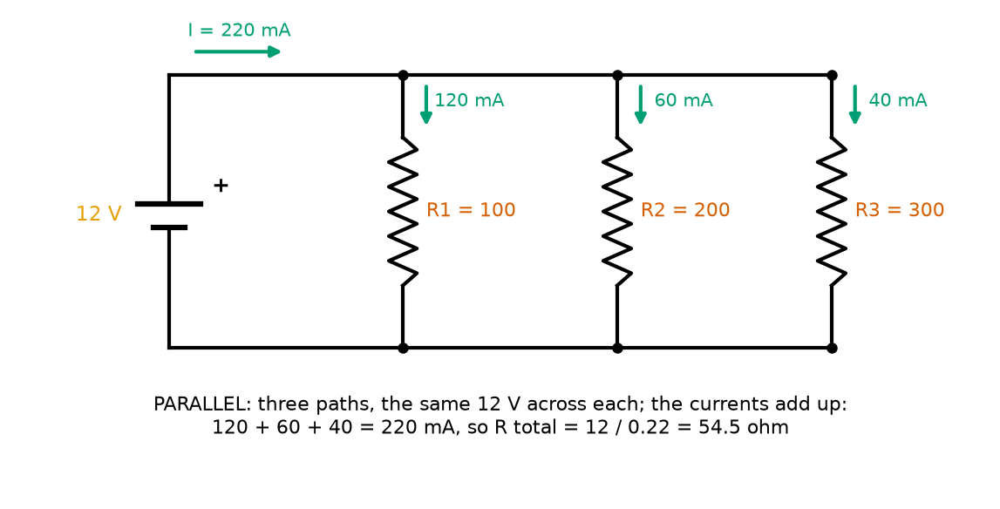
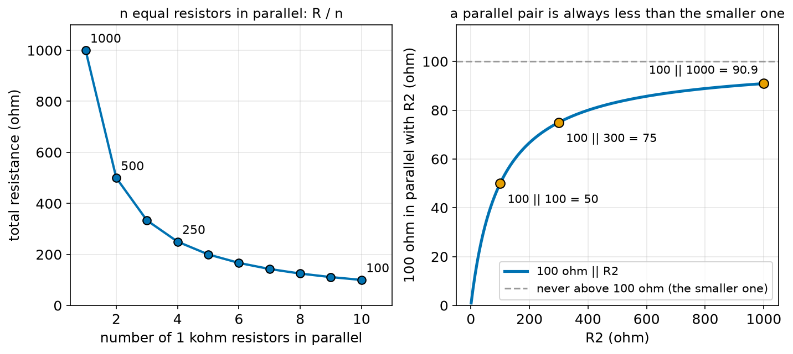
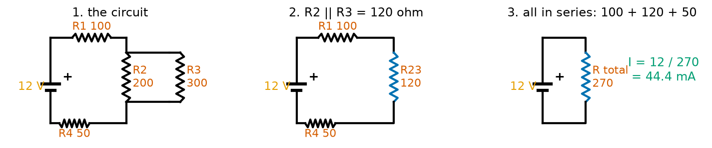
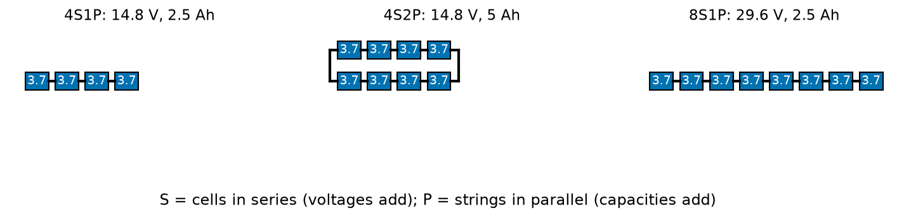
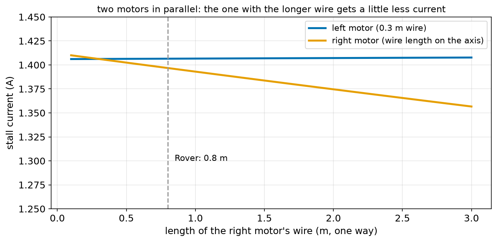

# Chapter 77 — Series and Parallel Circuits

> **Part 5 · Chapter 77 of 749**
> **You need:** Chapter 21 (lists and `sum`), Chapter 73 (current in a loop), Chapter 74 (cells in series), Chapter 75 (Ohm's law and internal resistance) and Chapter 76 (power).
> **You will make:** functions that combine resistors in series and in parallel, a program that solves a mixed circuit step by step, a program that shows how Rover's two motors share the battery's current, a program that adds up the loads on Rover's 5 V rail, and a program that designs drone battery packs from single cells.

---

## What you will learn

- What **series** and **parallel** mean, and how to recognise each in a circuit.
- In series: **the same current** flows through every part, the **voltages add**, and the **resistances add**.
- In parallel: **the same voltage** is across every branch, the **currents add**, and the resistance is **less than the smallest branch**.
- How to solve a **mixed** circuit by shrinking it to one resistor and then expanding it again.
- Why a robot's loads are wired in parallel, and why its battery cells are in series.
- How battery packs are named (**4S2P**) and what each letter changes.

---

## New words in this chapter

| Word | Simple meaning |
|---|---|
| **series** | Parts in a row, one after another, so the charge must pass through each in turn. |
| **parallel** | Parts side by side, each joined to the same two points, so the charge can take any of them. |
| **branch** | One of the paths in a parallel group. |
| **node** | A point where two or more wires meet. |
| **equivalent resistance** | The one resistor that would draw the same current as a whole group. |
| **rail** | A wire that carries one supply voltage to many parts, such as "the 5 V rail". |
| **load** | Anything the supply powers: a motor, a sensor, an LED. |
| **current hogging** | When parallel parts that should share a current do not, because one of them takes most of it. |
| **S and P (packs)** | In "4S2P", 4 cells in series in each string, and 2 strings in parallel. |

---

## 77.1 Two ways to connect two parts

Take two lamps and one battery. There are only two ways to connect them.

**In a row**, one after the other: the charge leaves the battery, goes through the first lamp, then through the second, and back. This is **series**. Chapter 74 already used it for Rover's six cells.

📖 **New word: series** — parts connected one after another, with no other path, so the same charge passes through each in turn.

**Side by side**: both lamps are joined to the same two wires. The charge leaving the battery splits, part going through each lamp, and joins again on the way back. This is **parallel**.

📖 **New word: parallel** — parts connected across the same two points, so each has the same voltage across it and the charge can take any of them.

📖 **New word: branch** — one of the paths in a parallel group.

📖 **New word: node** — a point where two or more wires meet. In a parallel group, all the top ends meet at one node and all the bottom ends at another.

A quick test: **follow the current with your finger.** If it has no choice and must pass through part A and then part B, they are in series. If it reaches a fork and could go through A **or** B, they are in parallel.

🤖 **Robot link.** Everything that plugs into Rover's 5 V supply (the Arduino, the sensors, the LEDs) is in parallel: each one is connected between the 5 V wire and ground. Rover's six AA cells are in series. Its fuse and e-stop switch (Chapter 7) are in series with everything, which is exactly why opening either one stops everything.

---

## 77.2 Series circuits



*Figure 77.1 — Three resistors in series on 12 V. One path, so 20 mA flows through all three; their voltages add up to 12 V.*

**How to read this picture:** The battery on the left pushes current clockwise through R1 (100 Ω), R2 (200 Ω) and R3 (300 Ω), and back. The green arrows show the same 20 mA everywhere. The blue numbers are the voltage across each resistor: 2, 4 and 6 V. They add up to the battery's 12 V.

### Rule 1: the same current everywhere

Chapter 73 said charge is not used up as it goes round a loop. In series there is only one path, so the current that leaves the battery passes through every part. In Figure 77.1 the current is 20 mA in R1, 20 mA in R2, 20 mA in R3.

### Rule 2: the voltages add up

Each coulomb leaves the battery with 12 J (Chapter 74) and gives some of it to each resistor in turn. By the time it returns to the battery, it has given all 12 J away. So the voltages across the parts add up to the battery's voltage:

```
V1 + V2 + V3 = V_battery
```

In the water picture: the water falls a little at each narrow pipe, and the falls add up to the height of the tower. Chapter 78 makes this a law.

### Rule 3: the resistances add up

Each resistor slows the flow, and the charge must pass through all of them, so their resistances add:

```
R_total = R1 + R2 + R3
```

📖 **New word: equivalent resistance** — the single resistor that would draw the same current from the battery as the whole group. For series, it is the sum.

🔢 **Maths.** Figure 77.1, step by step:

```
R_total = 100 + 200 + 300 = 600 Ω
I = 12 ÷ 600 = 0.02 A = 20 mA                 (Ohm's law for the whole loop)
V1 = 0.02 × 100 = 2 V
V2 = 0.02 × 200 = 4 V
V3 = 0.02 × 300 = 6 V                          (Ohm's law for each part)
check: 2 + 4 + 6 = 12 V ✓
```

Notice that **the biggest resistor gets the biggest share of the voltage**. Each resistor's share is its fraction of the total: R3 is 300 of 600, half, so it gets half of 12 V. Chapter 79 builds the voltage divider on exactly this idea.

You have already met series in disguise. Chapter 75's short-circuit current, V ÷ (R_load + R_inside), was a series sum: the battery's internal resistance is in series with whatever you connect. And Chapter 76's thermal ladder added θ values the same way.

⚠️ **Careful.** Series has a weakness: **one break stops everything**. Old Christmas-tree lights were wired in series, and when one bulb failed, the whole string went dark, and you had to test every bulb to find it.

---

## 77.3 Parallel circuits



*Figure 77.2 — The same three resistors in parallel on 12 V. Each has the full 12 V across it; the currents add up.*

**How to read this picture:** The top wire is joined to the battery's + end and the bottom wire to its − end. Each resistor connects the two wires, so each has the full 12 V across it. The current through each is 12 V ÷ its own resistance: 120, 60 and 40 mA. The battery supplies the total, 220 mA. The black dots are the nodes where the current splits and joins.

### Rule 1: the same voltage across every branch

Every branch connects the same two nodes, so every branch has the same voltage across it: the battery's 12 V. This is the reason robots use parallel wiring. Every sensor on Rover's 5 V rail gets 5 V, whatever the other sensors are doing.

### Rule 2: the currents add up

The current arriving at the top node must leave it (charge cannot pile up in a wire), so it splits among the branches:

```
I_total = I1 + I2 + I3
```

Each branch's current follows Ohm's law on its own: I1 = 12 ÷ 100 = 120 mA, and so on. **The smallest resistor takes the biggest current.** In the water picture, a wide pipe and a narrow pipe side by side: more water goes through the wide one.

### Rule 3: the resistance gets smaller

Adding a branch gives the current another path, so **more** current flows for the same voltage: the group's resistance **falls**. The rule is that the reciprocals (1 ÷ R) add:

```
1 / R_total = 1/R1 + 1/R2 + 1/R3
```

In words: "one over the total resistance is the sum of one over each resistance". Here is why. I_total = V/R1 + V/R2 + V/R3 = V × (1/R1 + 1/R2 + 1/R3). The equivalent resistor must give I_total = V / R_total. Compare the two: 1/R_total = 1/R1 + 1/R2 + 1/R3.

🔢 **Maths.** Figure 77.2:

```
1 / R_total = 1/100 + 1/200 + 1/300 = 0.01 + 0.005 + 0.00333 = 0.01833
R_total = 1 ÷ 0.01833 = 54.5 Ω
check: 12 ÷ 54.5 = 0.220 A = 220 mA ✓
```

The parallel group (54.5 Ω) is **less than its smallest branch** (100 Ω). That is always true: each extra branch only adds another path.

### Two shortcuts

**Two resistors in parallel**: the "product over sum" formula is easier to use by hand:

```
R_total = (R1 × R2) / (R1 + R2)
```

100 Ω and 300 Ω: (100 × 300) ÷ (100 + 300) = 30,000 ÷ 400 = 75 Ω.

**n equal resistors in parallel**: R_total = R ÷ n. Two 1 kΩ make 500 Ω; four make 250 Ω.



*Figure 77.4 — Left: n equal resistors in parallel give R ÷ n. Right: 100 Ω in parallel with anything is always below 100 Ω.*

**How to read this picture:** On the left, each dot is a number of 1 kΩ resistors side by side; the total falls as 1000 ÷ n. On the right, the curve shows 100 Ω in parallel with a second resistor R2. Even when R2 is ten times bigger (1,000 Ω), the pair is 90.9 Ω, still under the smaller one. When R2 is very large, the pair is almost exactly 100 Ω: a huge resistor in parallel hardly changes anything. That last fact explains why a good voltmeter (10 MΩ inside) can be connected across a part without disturbing it (Chapter 81).

### Rule 4: one branch broken, the others carry on

If one branch opens, the others still have their 12 V across them and carry on. This is why houses and robots are wired in parallel: unplugging the camera does not turn off the motors.

---

## 77.4 Mixed circuits: shrink, then expand

Real circuits mix series and parallel. The method is always the same:

1. **Shrink.** Find a group that is purely series or purely parallel and replace it with its equivalent resistor. Repeat until one resistor is left.
2. **Ohm's law** on that one resistor gives the battery's current.
3. **Expand.** Go back through the steps in reverse, using Ohm's law on each part to find its voltage and current.



*Figure 77.3 — R2 and R3 are in parallel; replace them with 120 Ω. Then R1, 120 Ω and R4 are in series: 270 Ω.*

**How to read this picture:** In panel 1, R2 (200 Ω) and R3 (300 Ω) sit side by side between the same two nodes: a parallel pair. Panel 2 replaces them with their equivalent, 120 Ω (blue). Now there is one path, so panel 3 adds the three in series: 100 + 120 + 50 = 270 Ω, and the battery's current is 12 ÷ 270 = 44.4 mA.

The program `reduce_circuit.py` in the Code section carries out all five steps and checks the answer twice: the voltages must add up to 12 V, and the currents in R2 and R3 must add up to the battery's current.

💡 **Tip.** Redraw the circuit after each step. Most mistakes come from trying to see two steps at once.

---

## 77.5 Why robots use both

| Connection | Same in every part | Adds up | Used in a robot for |
|---|---|---|---|
| **series** | current | voltage and resistance | battery cells (more voltage), fuse and switch (protect everything), current-sense resistor (Chapter 75), LED with its resistor (Chapter 82), voltage dividers (Chapter 79) |
| **parallel** | voltage | current (and 1/R) | every load on a supply rail, motors on one battery, battery strings (more capacity), extra wires to carry more current |

📖 **New word: rail** — a wire that carries one supply voltage to many parts in parallel: "the 5 V rail", "the battery rail". All loads hang between the rail and ground.

📖 **New word: load** — whatever the supply powers. Each load on a rail is one parallel branch, and the rail must carry the sum of their currents.

### Battery packs: S and P

Lithium cells come in one voltage (3.7 V nominal) and a few sizes. A pack is built from them in two directions:

- cells in **series** raise the **voltage**: 4 in a row give 14.8 V;
- strings in **parallel** raise the **capacity** (and the current the pack can give): two strings of 2.5 Ah give 5 Ah.

📖 **New word: S and P** — a pack labelled **4S2P** has 4 cells in series in each string and 2 such strings in parallel: 8 cells in all, 14.8 V, 5 Ah.



*Figure 77.5 — Three packs from the same cells. Series raises the voltage; parallel raises the capacity.*

**How to read this picture:** Each blue box is one 3.7 V cell. Left: 4 cells in a row, 4S1P, 14.8 V. Middle: two such rows joined at their ends, 4S2P, still 14.8 V but twice the amp-hours. Right: 8 cells in one row, 8S1P, 29.6 V. The middle and right packs have the same 8 cells and the same energy (Chapter 74: V × Ah), arranged differently.

The internal resistances combine by the same rules as any resistors: in series they add, in parallel they divide. Application 2 works through what that means for a drone.

---

## Code

File `code/ch077/series_parallel.py`:

```python
# series_parallel.py - combining resistors: in series they add, in parallel their reciprocals add
def series(resistors):
    """Total resistance of resistors in a row: just add them."""
    return sum(resistors)


def parallel(resistors):
    """Total resistance of resistors side by side: 1 / (1/R1 + 1/R2 + ...)."""
    return 1 / sum(1 / r for r in resistors)


cases = [
    ("two 100 ohm", [100, 100]),
    ("100 and 300 ohm", [100, 300]),
    ("10 and 1000 ohm", [10, 1000]),
    ("four 1 kohm", [1000, 1000, 1000, 1000]),
    ("Rover's two stalled motors (4.8 ohm each)", [4.8, 4.8]),
    ("10 kohm resistor and a 10 Mohm meter", [10000, 10e6]),
]
print(f"{'resistors':46s} {'series':>10s} {'parallel':>10s}")
for name, rs in cases:
    print(f"{name:46s} {series(rs):10.3f} {parallel(rs):10.3f}")

print()
print("n equal resistors of R in parallel give R / n:")
for n in [1, 2, 3, 4, 10]:
    print(f"  {n:2d} x 1000 ohm in parallel = {parallel([1000] * n):7.1f} ohm")
```

| Line | Code | What it does (simple English) |
|---|---|---|
| 1 | `# series_parallel.py …` | A comment. |
| 2 | `def series(resistors):` | A function that takes a list of resistances. |
| 3 | `"""…"""` | The docstring. |
| 4 | `return sum(resistors)` | Series: add them (Chapter 21's `sum`). |
| 5–6 | (blank) | Spacing. |
| 7 | `def parallel(resistors):` | The parallel rule. |
| 8 | `"""…"""` | The docstring. |
| 9 | `return 1 / sum(1 / r for r in resistors)` | Add up 1/R for every resistor, then take one over the sum. The `1 / r for r in resistors` part is a generator, like a list comprehension without the square brackets (Chapter 21). |
| 10–11 | (blank) | Spacing. |
| 12–19 | `cases = [ … ]` | Six groups of resistors, each a (name, list) pair. |
| 20 | `print(f"{'resistors':46s} …")` | The header. |
| 21 | `for name, rs in cases:` | One row per group. |
| 22 | `print(f"{name:46s} {series(rs):10.3f} {parallel(rs):10.3f}")` | The same resistors combined both ways. |
| 23 | (blank) | Spacing. |
| 24 | `print()` | An empty line. |
| 25 | `print("n equal resistors …")` | A heading. |
| 26 | `for n in [1, 2, 3, 4, 10]:` | Different numbers of resistors. |
| 27 | `print(f"  {n:2d} x 1000 ohm …")` | `[1000] * n` makes a list of n copies of 1000 (Chapter 21). |

Output:

```
resistors                                          series   parallel
two 100 ohm                                       200.000     50.000
100 and 300 ohm                                   400.000     75.000
10 and 1000 ohm                                  1010.000      9.901
four 1 kohm                                      4000.000    250.000
Rover's two stalled motors (4.8 ohm each)           9.600      2.400
10 kohm resistor and a 10 Mohm meter         10010000.000   9990.010

n equal resistors of R in parallel give R / n:
   1 x 1000 ohm in parallel =  1000.0 ohm
   2 x 1000 ohm in parallel =   500.0 ohm
   3 x 1000 ohm in parallel =   333.3 ohm
   4 x 1000 ohm in parallel =   250.0 ohm
  10 x 1000 ohm in parallel =   100.0 ohm
```

Look at the third and last rows. In series, the **big** resistor dominates (10 + 1,000 is nearly 1,000). In parallel, the **small** one dominates (10 in parallel with 1,000 is nearly 10). The last row shows a 10 MΩ meter connected across a 10 kΩ resistor: the pair is 9,990 Ω, only 0.1% less, so the meter barely disturbs what it measures.

File `code/ch077/reduce_circuit.py`:

```python
# reduce_circuit.py - a mixed circuit solved step by step: shrink it to one resistor, then expand again
V_BATTERY = 12.0
R1, R2, R3, R4 = 100.0, 200.0, 300.0, 50.0     # R1, then R2 beside R3, then R4, all in a row with the battery

# step 1: the parallel pair becomes one resistor
r23 = 1 / (1 / R2 + 1 / R3)
print(f"step 1: R2 || R3 = 1 / (1/{R2:.0f} + 1/{R3:.0f}) = {r23:.1f} ohm")

# step 2: everything is now in series
r_total = R1 + r23 + R4
print(f"step 2: R1 + R23 + R4 = {R1:.0f} + {r23:.0f} + {R4:.0f} = {r_total:.0f} ohm")

# step 3: Ohm's law for the whole loop
i_total = V_BATTERY / r_total
print(f"step 3: I = {V_BATTERY:.0f} / {r_total:.0f} = {i_total * 1000:.1f} mA flows out of the battery")

# step 4: the voltage across each series part is I x R
v1, v23, v4 = i_total * R1, i_total * r23, i_total * R4
print(f"step 4: V1 = {v1:.2f} V, V23 = {v23:.2f} V, V4 = {v4:.2f} V   (sum {v1 + v23 + v4:.2f} V = the battery)")

# step 5: inside the parallel pair, both have V23 across them; each current is V23 / R
i2, i3 = v23 / R2, v23 / R3
print(f"step 5: I2 = {v23:.2f} / {R2:.0f} = {i2 * 1000:.1f} mA, I3 = {v23:.2f} / {R3:.0f} = {i3 * 1000:.1f} mA   (sum {(i2 + i3) * 1000:.1f} mA = I)")

# bonus: power in each part, and the total
powers = [v1 * i_total, v23 * i2, v23 * i3, v4 * i_total]
print(f"powers: R1 {powers[0] * 1000:.0f} mW, R2 {powers[1] * 1000:.0f} mW, R3 {powers[2] * 1000:.0f} mW, R4 {powers[3] * 1000:.0f} mW; "
      f"total {sum(powers) * 1000:.0f} mW = battery {V_BATTERY * i_total * 1000:.0f} mW")
```

| Line | Code | What it does (simple English) |
|---|---|---|
| 1 | `# reduce_circuit.py …` | A comment. |
| 2 | `V_BATTERY = 12.0` | The supply. |
| 3 | `R1, R2, R3, R4 = …` | The four resistors of Figure 77.3. |
| 4 | (blank) | Spacing. |
| 5–7 | step 1 | The parallel pair becomes 120 Ω, and the step is printed. `||` is a common way of writing "in parallel with". |
| 8 | (blank) | Spacing. |
| 9–11 | step 2 | Now all in series: add. |
| 12 | (blank) | Spacing. |
| 13–15 | step 3 | Ohm's law for the whole loop gives the battery's current. |
| 16 | (blank) | Spacing. |
| 17–19 | step 4 | The same current flows through R1, the pair and R4; V = I × R for each. The print adds them as a check. |
| 20 | (blank) | Spacing. |
| 21–23 | step 5 | Both resistors of the pair have V23 across them; each current is V23 ÷ R. The print adds them as a check. |
| 24 | (blank) | Spacing. |
| 25–28 | bonus | V × I for each part (Chapter 76), and the total compared with the battery's power. |

Output:

```
step 1: R2 || R3 = 1 / (1/200 + 1/300) = 120.0 ohm
step 2: R1 + R23 + R4 = 100 + 120 + 50 = 270 ohm
step 3: I = 12 / 270 = 44.4 mA flows out of the battery
step 4: V1 = 4.44 V, V23 = 5.33 V, V4 = 2.22 V   (sum 12.00 V = the battery)
step 5: I2 = 5.33 / 200 = 26.7 mA, I3 = 5.33 / 300 = 17.8 mA   (sum 44.4 mA = I)
powers: R1 198 mW, R2 142 mW, R3 95 mW, R4 99 mW; total 533 mW = battery 533 mW
```

Three checks pass: the voltages add to 12 V, the branch currents add to the battery's current, and the powers add to the battery's power. Energy is neither made nor lost (Chapter 67).

File `code/ch077/current_split.py`:

```python
# current_split.py - Rover's two motors in parallel on one battery: who gets how much current?
V_BATTERY = 7.2
R_INSIDE = 0.15                # the battery's internal resistance (in series with everything)
R_MOTOR = 4.8                  # each motor, stalled
WIRE_OHM_PER_M = 0.0336        # 0.5 mm2 copper
LEFT_WIRE_M = 0.3              # the left motor is near the battery
RIGHT_WIRE_M = 0.8             # the right motor's wire takes a longer route

# each branch = its motor plus its wire there and back (series)
r_left = R_MOTOR + 2 * LEFT_WIRE_M * WIRE_OHM_PER_M
r_right = R_MOTOR + 2 * RIGHT_WIRE_M * WIRE_OHM_PER_M
print(f"left branch  {r_left:.3f} ohm, right branch {r_right:.3f} ohm")

# the two branches are in parallel; that pair is in series with the battery's inside
r_pair = 1 / (1 / r_left + 1 / r_right)
i_total = V_BATTERY / (r_pair + R_INSIDE)
v_terminals = V_BATTERY - i_total * R_INSIDE
print(f"both together {r_pair:.3f} ohm; total current {i_total:.3f} A; battery terminals sag to {v_terminals:.3f} V")

# each branch has the terminal voltage across it
i_left, i_right = v_terminals / r_left, v_terminals / r_right
print(f"left motor {i_left:.3f} A, right motor {i_right:.3f} A (sum {i_left + i_right:.3f} A)")
print(f"the longer wire costs the right motor {(i_left - i_right) / i_left:.1%} of its current")

print()
# what if one motor is unplugged (its branch is open)?
i_one = V_BATTERY / (r_left + R_INSIDE)
print(f"with only the left motor: {i_one:.3f} A, terminals {V_BATTERY - i_one * R_INSIDE:.3f} V")
print("one branch open does not stop the other: that is the point of parallel wiring")
```

| Line | Code | What it does (simple English) |
|---|---|---|
| 1 | `# current_split.py …` | A comment. |
| 2–7 | `V_BATTERY` … `RIGHT_WIRE_M` | The battery, the motors and the two wire lengths. |
| 8 | (blank) | Spacing. |
| 9 | `# each branch = …` | A comment. |
| 10–11 | `r_left = …`, `r_right = …` | Each branch is its motor in series with its wire, there and back. |
| 12 | `print(…)` | The two branch resistances. |
| 13 | (blank) | Spacing. |
| 14 | `# the two branches …` | A comment. |
| 15 | `r_pair = 1 / (1 / r_left + 1 / r_right)` | Shrink: the branches in parallel. |
| 16 | `i_total = V_BATTERY / (r_pair + R_INSIDE)` | Shrink again: the pair in series with the battery's inside. Ohm's law gives the total current. |
| 17 | `v_terminals = V_BATTERY - i_total * R_INSIDE` | Expand: the voltage left at the battery's terminals after its own drop. |
| 18 | `print(…)` | Shows them. |
| 19 | (blank) | Spacing. |
| 20 | `# each branch has …` | A comment. |
| 21 | `i_left, i_right = …` | Expand: each branch has the terminal voltage across it. |
| 22–23 | `print(…)` | The two currents, their sum, and the right motor's loss as a percentage. |
| 24 | (blank) | Spacing. |
| 25 | `print()` | An empty line. |
| 26 | `# what if one motor …` | A comment. |
| 27 | `i_one = V_BATTERY / (r_left + R_INSIDE)` | With the right branch open, only the left branch and the battery's inside are in the loop. |
| 28–29 | `print(…)` | The result. |

Output:

```
left branch  4.820 ohm, right branch 4.854 ohm
both together 2.418 ohm; total current 2.803 A; battery terminals sag to 6.780 V
left motor 1.406 A, right motor 1.397 A (sum 2.803 A)
the longer wire costs the right motor 0.7% of its current

with only the left motor: 1.449 A, terminals 6.983 V
one branch open does not stop the other: that is the point of parallel wiring
```



*Figure 77.6 — The stall current in each of Rover's motors as the right motor's wire gets longer.*

**How to read this picture:** The blue line is the left motor, whose wire stays at 0.3 m; the orange line is the right motor, whose wire length is on the horizontal axis. When both wires are 0.3 m, the currents are equal. As the right wire grows, its branch resistance grows and its current falls, while the left motor's barely changes. At Rover's 0.8 m the difference is 0.7%, small enough to ignore. With very long or thin wires, the two motors would push unequally and the robot would drift to one side. Chapter 229's speed control removes that drift anyway.

Two more things from the output. Both motors together pull the battery's terminals down to 6.78 V, more than one motor alone (6.98 V): every extra parallel load draws more current through the battery's internal resistance. And unplugging one motor leaves the other running: parallel wiring.

---

## Small examples

**Example 1.** 47 Ω + 33 Ω in series: 80 Ω.

**Example 2.** Two 220 Ω in parallel: 110 Ω.

**Example 3.** 6 Ω and 3 Ω in parallel: (6 × 3) ÷ (6 + 3) = 2 Ω.

**Example 4.** 1 kΩ, 2 kΩ and 2 kΩ in parallel: 1/R = 0.001 + 0.0005 + 0.0005 = 0.002, so R = 500 Ω.

**Example 5.** 10 Ω and 30 Ω in series on 8 V: I = 8 ÷ 40 = 0.2 A; V across the 30 Ω = 6 V.

**Example 6.** Three sensors drawing 20, 30 and 50 mA from a 5 V rail: the rail carries 100 mA, and together they look like 5 ÷ 0.1 = 50 Ω.

**Example 7.** Three 1.5 V cells in series: 4.5 V. In parallel: 1.5 V, but three times the capacity.

**Example 8.** A 3S2P pack of 3.7 V, 3 Ah cells: 11.1 V, 6 Ah, 66.6 Wh, 6 cells.

---

## 🏭 Real robot applications

### Application 1 (worked in full) — 🤖 How much can Rover's 5 V rail carry?

**1. The real problem.** Rover's 5 V regulator (Chapter 5) can supply 1 A. Everything on the 5 V rail hangs in parallel between the rail and ground: the Arduino, four status LEDs, the line sensor, the distance sensor, two bumper switches with their resistors, and a small servo. Will it cope now? And at stage 7, when a Raspberry Pi is added?

**2. Why this theory.** Parallel loads share one voltage, and their currents add. So the regulator must supply the sum of all the loads' currents. The rail as a whole looks like one resistor of 5 V ÷ total current.

**3. The numbers.** Arduino 50 mA. LEDs 20 mA each. Line sensor 30 mA. Distance sensor 16 mA. Each bumper's 10 kΩ resistor passes 5 ÷ 10,000 = 0.5 mA when pressed (Chapter 83 explains these pull-up resistors). Servo idle 10 mA. Raspberry Pi 800 mA.

**4. The maths.**

```
total = 50 + 4 × 20 + 30 + 16 + 2 × 0.5 + 10 = 187 mA       (19% of 1 A)
the rail looks like 5 ÷ 0.187 = 26.7 Ω
with the Pi: 187 + 800 = 987 mA                              (99% of 1 A)
```

**5. The code.** File `code/ch077/rail_load.py`:

```python
# rail_load.py - everything on Rover's 5 V rail is in parallel: the currents add up
RAIL_V = 5.0
REGULATOR_LIMIT_A = 1.0            # what the 5 V regulator can give

loads = [
    # name, how many, current each in A
    ("Arduino", 1, 0.050),
    ("status LEDs (with 150 ohm resistors)", 4, 0.020),
    ("line sensor", 1, 0.030),
    ("distance sensor", 1, 0.016),
    ("bumper pull-up resistors (10 kohm, when pressed)", 2, 0.0005),
    ("small servo, idle", 1, 0.010),
]
total = 0.0
print(f"{'load':50s} {'each':>8s} {'total':>8s}")
for name, n, each in loads:
    total += n * each
    print(f"{n} x {name:46s} {each * 1000:6.1f} mA {n * each * 1000:6.1f} mA")
print(f"{'rail total':50s} {'':8s} {total * 1000:6.1f} mA  = {total / REGULATOR_LIMIT_A:.0%} of the regulator")
print(f"the whole rail looks like one resistor of {RAIL_V / total:.1f} ohm")

print()
# stage 7: add a Raspberry Pi and a camera
pi = 0.800
print(f"adding a Raspberry Pi (800 mA): {(total + pi) * 1000:.0f} mA = {(total + pi) / REGULATOR_LIMIT_A:.0%} of a 1 A regulator")
print("too much: the Pi needs its own regulator (Chapter 90)")

print()
# four LEDs sharing ONE resistor instead of one each
v_led = 2.0
r_shared = (RAIL_V - v_led) / 0.080          # chosen so four LEDs get 80 mA together
print(f"four LEDs on one shared {r_shared:.1f} ohm resistor: 80 mA total, 20 mA each only if all four are identical")
print("if one LED needs 1.9 V and the others 2.0 V, it hogs most of the current: give each LED its own resistor")
```

| Line | Code | What it does (simple English) |
|---|---|---|
| 1 | `# rail_load.py …` | A comment. |
| 2–3 | `RAIL_V`, `REGULATOR_LIMIT_A` | The rail and what the regulator can give. |
| 4 | (blank) | Spacing. |
| 5–13 | `loads = [ … ]` | Each load: name, how many, current each. |
| 14 | `total = 0.0` | A running total. |
| 15 | `print(…)` | The header. |
| 16 | `for name, n, each in loads:` | One row per kind of load. |
| 17 | `total += n * each` | Parallel: the currents add. |
| 18 | `print(…)` | The row. |
| 19 | `print(…)` | The total and its share of the regulator's limit. |
| 20 | `print(…)` | The rail's equivalent resistance, V ÷ I. |
| 21 | (blank) | Spacing. |
| 22 | `print()` | An empty line. |
| 23 | `# stage 7: …` | A comment. |
| 24 | `pi = 0.800` | The Pi's current. |
| 25–26 | `print(…)` | The new total, and the verdict. |
| 27 | (blank) | Spacing. |
| 28 | `print()` | An empty line. |
| 29 | `# four LEDs sharing ONE resistor …` | A comment. |
| 30 | `v_led = 2.0` | An LED's voltage (Chapter 82). |
| 31 | `r_shared = (RAIL_V - v_led) / 0.080` | The resistor that would give 80 mA to the group. |
| 32–33 | `print(…)` | The warning about sharing. |

Output:

```
load                                                   each    total
1 x Arduino                                          50.0 mA   50.0 mA
4 x status LEDs (with 150 ohm resistors)             20.0 mA   80.0 mA
1 x line sensor                                      30.0 mA   30.0 mA
1 x distance sensor                                  16.0 mA   16.0 mA
2 x bumper pull-up resistors (10 kohm, when pressed)    0.5 mA    1.0 mA
1 x small servo, idle                                10.0 mA   10.0 mA
rail total                                                   187.0 mA  = 19% of the regulator
the whole rail looks like one resistor of 26.7 ohm

adding a Raspberry Pi (800 mA): 987 mA = 99% of a 1 A regulator
too much: the Pi needs its own regulator (Chapter 90)

four LEDs on one shared 37.5 ohm resistor: 80 mA total, 20 mA each only if all four are identical
if one LED needs 1.9 V and the others 2.0 V, it hogs most of the current: give each LED its own resistor
```

**6. The result.** Today's rail uses 19% of the regulator: plenty of room. With the Pi it would use 99%, and a moving servo (which can briefly draw 500 mA or more) would push it over: the 5 V would sag, the Arduino would reset, and Rover would stop at random moments. Chapter 90 gives the Pi its own regulator. The last lines warn about a classic beginner shortcut: several LEDs sharing one resistor. Parallel parts share **voltage**, not current, and an LED's current changes enormously with a tiny change in voltage (Chapter 75's Figure 75.5). The LED with the lowest voltage takes most of the current.

📖 **New word: current hogging** — when parallel parts that should share a current do not, because one takes most of it. It happens with LEDs, and with battery cells and transistors placed in parallel without care.

**7. Going further.** Real robots keep a "power budget" spreadsheet with every load's typical and peak current on each rail, exactly like this list. Chapter 151 builds Rover's full budget with peaks, and Chapter 90 shows how to choose a regulator for it.

### Application 2 (worked in full) — 🚁 Designing a drone battery pack from cells

**1. The real problem.** A builder wants a pack for a drone whose motors need 600 W at full throttle. They have 2.5 Ah lithium cells with 0.020 Ω internal resistance each. Should they build 4S1P, 4S2P, 8S1P, 2S4P or 6S2P? What changes with each choice: voltage, capacity, energy, internal resistance, current, voltage sag, and heat inside the pack?

**2. Why this theory.** Cells in series add their voltages **and** their internal resistances. Strings in parallel add their capacities and **divide** the resistance. The current comes from P = V × I (Chapter 76). The voltage sag is I × R inside (Chapter 75) and the heat is I² R (Chapter 76).

**3. The numbers.** Cell: 3.7 V, 2.5 Ah, 0.020 Ω. Load: 600 W.

**4. The maths.** For 4S2P:

```
voltage  = 4 × 3.7 = 14.8 V
capacity = 2 × 2.5 = 5 Ah        energy = 14.8 × 5 = 74 Wh
resistance = 4 × 0.020 ÷ 2 = 0.040 Ω   (4 in series, then 2 strings in parallel)
current  = 600 ÷ 14.8 = 40.5 A
sag      = 40.5 × 0.040 = 1.62 V
heat     = 40.5² × 0.040 = 66 W
```

**5. The code.** File `code/ch077/pack_builder.py`:

```python
# pack_builder.py - building a battery pack from cells: S in series, P in parallel
CELL_V = 3.7              # nominal
CELL_AH = 2.5
CELL_OHM = 0.020          # internal resistance of one cell
POWER_W = 600.0           # the drone's motors at full throttle

print(f"one cell: {CELL_V} V, {CELL_AH} Ah, {CELL_OHM} ohm inside")
print(f"{'pack':6s} {'volts':>6s} {'Ah':>5s} {'Wh':>6s} {'ohm':>7s} {'amps':>6s} {'sag':>7s} {'heat':>7s}")
for s, p in [(4, 1), (4, 2), (8, 1), (2, 4), (6, 2)]:
    volts = s * CELL_V                       # series: voltages add
    ah = p * CELL_AH                         # parallel: capacities add
    wh = volts * ah
    ohm = s * CELL_OHM / p                   # series adds, parallel divides
    amps = POWER_W / volts                   # the current needed for 600 W
    sag = amps * ohm                         # V = I x R inside the pack
    heat = amps ** 2 * ohm                   # I^2 R inside the pack
    print(f"{s}S{p}P   {volts:6.1f} {ah:5.1f} {wh:6.0f} {ohm:7.3f} {amps:6.1f} {sag:6.2f} V {heat:5.0f} W")

print()
print("4S2P, 8S1P and 2S4P all store 74 Wh and all make 66 W of heat inside at 600 W.")
print("The 8S pack needs half the current of 4S2P, so its wires can be much thinner (Chapter 75).")
```

| Line | Code | What it does (simple English) |
|---|---|---|
| 1 | `# pack_builder.py …` | A comment. |
| 2–5 | `CELL_V` … `POWER_W` | One cell, and the load. |
| 6 | (blank) | Spacing. |
| 7–8 | `print(…)` | The cell and the header. |
| 9 | `for s, p in [ … ]:` | Five layouts as (series, parallel) pairs. |
| 10 | `volts = s * CELL_V` | Series adds voltages. |
| 11 | `ah = p * CELL_AH` | Parallel adds capacities. |
| 12 | `wh = volts * ah` | Energy (Chapter 74). |
| 13 | `ohm = s * CELL_OHM / p` | Each string has s cells' resistance in series; p strings in parallel divide it by p. |
| 14 | `amps = POWER_W / volts` | I = P / V. |
| 15 | `sag = amps * ohm` | The voltage lost inside the pack. |
| 16 | `heat = amps ** 2 * ohm` | The heat made inside the pack. |
| 17 | `print(…)` | The row. |
| 18 | (blank) | Spacing. |
| 19 | `print()` | An empty line. |
| 20–21 | `print(…)` | The conclusion in words. |

Output:

```
one cell: 3.7 V, 2.5 Ah, 0.02 ohm inside
pack    volts    Ah     Wh     ohm   amps     sag    heat
4S1P     14.8   2.5     37   0.080   40.5   3.24 V   131 W
4S2P     14.8   5.0     74   0.040   40.5   1.62 V    66 W
8S1P     29.6   2.5     74   0.160   20.3   3.24 V    66 W
2S4P      7.4  10.0     74   0.010   81.1   0.81 V    66 W
6S2P     22.2   5.0    111   0.060   27.0   1.62 V    44 W
```

```
4S2P, 8S1P and 2S4P all store 74 Wh and all make 66 W of heat inside at 600 W.
The 8S pack needs half the current of 4S2P, so its wires can be much thinner (Chapter 75).
```

**6. The result.** With the same 8 cells, three layouts store the same 74 Wh and waste the same 66 W inside. A neat result: each cell carries the same share of the power in all three. The difference is outside the pack: 2S4P needs 81 A (fat wires, big connectors, a sag of only 0.8 V), while 8S1P needs 20 A (thin wires, but a 3.2 V sag and motors built for 30 V). The builder would choose 4S2P to match ordinary 4S motors and ESCs, and avoid 4S1P, which would make 131 W of heat in only four cells: each cell would carry 40 A, far above its rating, and get dangerously hot (Chapter 89).

**7. Going further.** In a parallel group, cells must be **matched** (same type, age and charge), or current flows from one to the other when they are joined, and a weak cell is overloaded: current hogging again. Chapter 89 covers matching and the balance connector that watches each series cell, and Chapter 621 designs the course drone's pack.

### Application 3 — 🏭 LED strips on a robot's "face"

Many service robots show their state with a ring of LEDs. A ring of 24 LEDs on a 12 V supply is usually wired as groups of 3 LEDs **in series** (3 × 3 V = 9 V, with a resistor for the other 3 V), and 8 such groups **in parallel**. Series inside each group lets one resistor serve three LEDs without current hogging (they all carry the same current by Rule 1). Parallel between groups means one dead LED darkens only its own three, not the whole ring, and every group gets the same 12 V. The total current is 8 × 20 mA = 160 mA. This "series strings in parallel" pattern is exactly the 4S2P idea, applied to LEDs.

### Application 4 — 🦿 Redundant power wiring in a humanoid

A humanoid's leg must never lose power in the middle of a step: it would fall. So the power cable from the battery to each leg is often doubled: two cables in parallel. If one connector works loose, the other still carries the current (parallel Rule 4), and the robot can finish its step and sit down safely. While both are connected, the resistance is halved and the I² R heat in the cables is halved as well. The robot's software watches the current in each of the two cables with a shunt (Chapter 75): if one suddenly carries everything, that is a warning that the other has failed. Chapter 696 describes the power system of the course's humanoid.

### Application 5 — 🌾🚀 Solar cells in series, and the shade problem

A single silicon solar cell gives about 0.5 V. A farm robot's 18 V panel has 36 cells **in series**. In series the same current must pass through every cell. If a leaf covers one cell, that cell can pass only a small current, and **the whole string's current drops to match it**: one shaded cell out of 36 can cut the panel's output by more than half. Panels therefore include "bypass diodes" (Chapter 86) in parallel with groups of cells, giving the current a path around a shaded group. The Mars rovers Spirit and Opportunity had the same problem with dust and wind instead of leaves, and their engineers tracked each string's output to know which parts of the panel were working.

---

## 🔧 Hands-on lab

### Lab 77.1 — Build both circuits (hardware, or Wokwi / Tinkercad)

You need: a breadboard (Chapter 80 explains them; you can also use the free Tinkercad Circuits simulator), a 9 V battery or a 5 V USB supply, three resistors (1 kΩ, 2.2 kΩ and 4.7 kΩ) and a multimeter if you have one (Chapter 81 shows safe use; until then, use the simulator's meter).

1. Wire the three resistors in series across the supply. Measure the voltage across each.
2. Predict the voltages first, with Ohm's law. Compare.
3. Rewire them in parallel. Measure the voltage across each, then the total current (in the simulator, put the ammeter in series with the battery).

**What you should see:** On 9 V in series, R_total = 7.9 kΩ, I = 1.14 mA, and the voltages are 1.14, 2.51 and 5.35 V, adding to 9 V. In parallel, each has 9 V, the currents are 9.0, 4.1 and 1.9 mA, and the total is 15.0 mA (R_total = 600 Ω). Real resistors are within 5% of their value (Chapter 82), so your measurements will differ by up to 5%.

| If it does not work | Likely cause | Fix |
|---|---|---|
| All three voltages are 0 in series | The loop is not closed | Check that the last resistor goes back to the battery |
| One resistor shows 9 V in series and the others 0 | That resistor is not connected at one end (an open circuit) | Push its legs into the right rows |
| The battery gets warm | A wire shorts the battery | Disconnect at once and check the wiring |

**Challenge:** Build the mixed circuit of Figure 77.3 with 1 kΩ, 2.2 kΩ, 4.7 kΩ and 470 Ω. Predict every voltage with `reduce_circuit.py` first.

### Lab 77.2 — A general circuit reducer (simulation)

1. Using the `series` and `parallel` functions, compute these groups:
   (a) 220 Ω in series with (330 Ω in parallel with 470 Ω);
   (b) (1 kΩ + 1 kΩ) in parallel with 2 kΩ;
   (c) four 100 Ω resistors arranged as two series pairs in parallel.
2. For each, find the current from a 5 V supply.
3. Write one line for each group, nesting the calls: for example `series([220, parallel([330, 470])])`.

**What you should see:** (a) 220 + 193.9 = 413.9 Ω, 12.1 mA. (b) 2,000 in parallel with 2,000 = 1,000 Ω, 5.0 mA. (c) 200 in parallel with 200 = 100 Ω, 50 mA: four 100 Ω resistors arranged this way behave like one, but share the heat four ways, which is how engineers make a "100 Ω, 1 W" resistor out of four ¼ W ones.

| If it does not work | Likely cause | Fix |
|---|---|---|
| `TypeError: 'int' object is not iterable` | The function got a number, not a list | Wrap the values in square brackets |
| (c) comes out 400 Ω | All four were added in series | Two series pairs first, then the pairs in parallel |

**Challenge:** Write a recursive function `combine(tree)` where a circuit is written as nested tuples, `("s", a, b, …)` for series and `("p", a, b, …)` for parallel, and numbers are resistors. Test it on `("s", 100, ("p", 200, 300), 50)`: the answer must be 270.

### Lab 77.3 — Grow the rail (simulation)

Copy `rail_load.py`.

1. Add the stage-7 camera (250 mA) and a buzzer (30 mA). Without the Pi, what share of the 1 A regulator is used now?
2. Add a field to each load for its **peak** current (the Arduino 60 mA, LEDs 20 mA, line sensor 30 mA, distance sensor 40 mA when it pings, bumpers 0.5 mA, servo 650 mA when it moves, camera 300 mA, buzzer 30 mA). Print the peak total.
3. Is the regulator big enough for the peak, if everything peaks together?

**What you should see:** The typical total becomes 187 + 250 + 30 = 467 mA (47%). The peak total is 60 + 80 + 30 + 40 + 1 + 650 + 300 + 30 = 1,191 mA, more than the 1 A regulator can give. In practice the servo and the camera rarely peak at the same moment, but "rarely" is not "never": the safe design either gives the servo its own supply or uses a 2 A regulator.

| If it does not work | Likely cause | Fix |
|---|---|---|
| The peak total equals the typical total | The loop still uses the typical column | Add the new field to the tuple and unpack it |

**Challenge:** Simulate the voltage: give the regulator an output resistance of 0.2 Ω (its voltage falls by 0.2 V per amp) and print the rail voltage at the typical and the peak total. The Arduino resets below 4.5 V. Does it?

---

## Common mistakes

⚠️ **Adding parallel resistances like series ones.** In parallel the total is **less** than the smallest branch.

⚠️ **Forgetting to take 1 ÷ the sum** in the parallel formula. 1/100 + 1/300 = 0.0133; the answer is 75 Ω, not 0.0133 Ω.

⚠️ **Thinking parts in parallel share the current equally.** They share the **voltage**; each takes V ÷ its own R.

⚠️ **Thinking series parts share the voltage equally.** They share the **current**; each takes I × its own R of the voltage.

⚠️ **Putting LEDs (or cells, or transistors) in parallel on one resistor.** One hogs the current. Give each its own resistor.

⚠️ **Calling two parts "in series" because they are next to each other on the board.** What matters is the path of the current, not where the parts sit.

⚠️ **Forgetting the battery's internal resistance** when many loads are added in parallel: the more current, the more the supply sags.

---

## Practice

🏋️ **1.** Find the total of 150 Ω, 330 Ω and 520 Ω in series.

🏋️ **2.** Find the total of 60 Ω and 40 Ω in parallel.

🏋️ **3.** Three 3 kΩ resistors in parallel. What is the total?

🏋️ **4.** 200 Ω and 600 Ω in series on 12 V. Find the current and the voltage across each.

🏋️ **5.** The same two resistors in parallel on 12 V. Find each current and the total.

🏋️ **6.** A 100 Ω resistor is in series with a parallel pair of 300 Ω and 600 Ω, on 9 V. Find the battery's current and the current in the 300 Ω.

🏋️ **7.** A sensor rail on 3.3 V feeds an IMU (5 mA), a radio (45 mA when sending) and a microcontroller (25 mA). What is the total current, and what single resistor would draw the same?

🏋️ **8.** A 6S3P pack of 3.6 V, 3 Ah, 0.025 Ω cells: find its voltage, capacity, energy and internal resistance.

🏋️ **9.** You need 50 Ω but have only 100 Ω resistors. How do you make it? You need 150 Ω?

🏋️ **10.** Two motors of 2 Ω each are in parallel on a 12 V battery with 0.1 Ω inside. Find the terminal voltage and each motor's current. Then repeat with one motor.

🏋️ **11.** Write `ladder(n, r)` that returns the resistance of n resistors of r ohms in series, and `bank(n, r)` for n in parallel. Then find how many 1 kΩ resistors you need in parallel to get below 75 Ω, using a `while` loop.

---

## Answers

**1.** 150 + 330 + 520 = 1,000 Ω.

**2.** (60 × 40) ÷ (60 + 40) = 2,400 ÷ 100 = 24 Ω.

**3.** 3,000 ÷ 3 = 1,000 Ω.

**4.** R = 800 Ω, I = 12 ÷ 800 = 15 mA. V across 200 Ω = 3 V, across 600 Ω = 9 V. (3 + 9 = 12 ✓)

**5.** 12 ÷ 200 = 60 mA, 12 ÷ 600 = 20 mA, total 80 mA. (Check: 200 in parallel with 600 = 150 Ω, and 12 ÷ 150 = 80 mA ✓)

**6.** 300 in parallel with 600 = 200 Ω. Total 300 Ω. I = 9 ÷ 300 = 30 mA. V across the pair = 0.03 × 200 = 6 V. Current in the 300 Ω = 6 ÷ 300 = 20 mA (and 10 mA in the 600 Ω).

**7.** 5 + 45 + 25 = 75 mA. 3.3 ÷ 0.075 = 44 Ω.

**8.** 6 × 3.6 = 21.6 V. 3 × 3 = 9 Ah. 21.6 × 9 = 194.4 Wh. 6 × 0.025 ÷ 3 = 0.05 Ω.

**9.** Two 100 Ω in parallel give 50 Ω. 150 Ω: one 100 Ω in series with that pair.

**10.** Two motors in parallel: 1 Ω. I = 12 ÷ (1 + 0.1) = 10.9 A. Terminal voltage 12 − 10.9 × 0.1 = 10.9 V. Each motor 10.9 ÷ 2 = 5.45 A. One motor: I = 12 ÷ 2.1 = 5.71 A, terminals 11.43 V. Each motor gets a little less current when the other is also running, because they share the battery's internal resistance.

**11.**

```python
def ladder(n, r):
    return n * r

def bank(n, r):
    return r / n

n = 1
while bank(n, 1000) >= 75:
    n += 1
print(n, bank(n, 1000))
# 14 71.42857142857143
```

13 give 76.9 Ω, so 14 are needed: 71.4 Ω.

---

## Summary

🧠 **Series**: one path. The **same current** through every part. **Voltages add** to the supply. **Resistances add**: R = R1 + R2 + …

🧠 **Parallel**: every branch between the same two nodes. The **same voltage** across every branch. **Currents add**. 1/R = 1/R1 + 1/R2 + …, so the total is **less than the smallest branch**. Two: R1 R2 ÷ (R1 + R2). n equal: R ÷ n.

🧠 In series the **biggest** resistor dominates and takes the biggest voltage share. In parallel the **smallest** dominates and takes the biggest current.

🧠 Solve mixed circuits by **shrinking** groups to one resistor, using Ohm's law, then **expanding** back. Check that voltages and currents add up.

🧠 Robots put **loads in parallel** on rails (each gets the full voltage; one failure does not stop the rest) and **cells in series** for voltage. Packs are named **xSyP**.

🧠 Never parallel LEDs or cells without care: **current hogging**.

---

## Next chapter

Chapter 78 turns the two "add up" rules of this chapter into **Kirchhoff's laws**: the currents into any node add up to the currents out, and the voltages round any loop add up to zero. With them you can solve circuits that cannot be shrunk step by step, such as two batteries feeding one robot, or a bridge of four resistors, and you will write a Python program that solves any circuit with NumPy.
