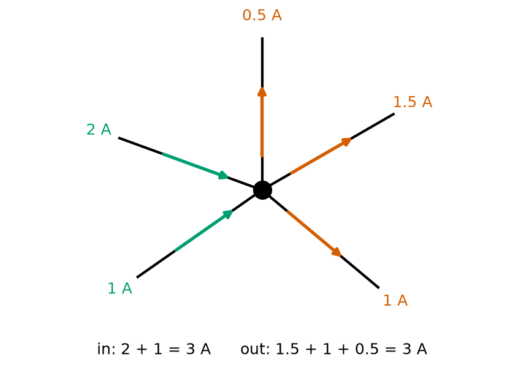
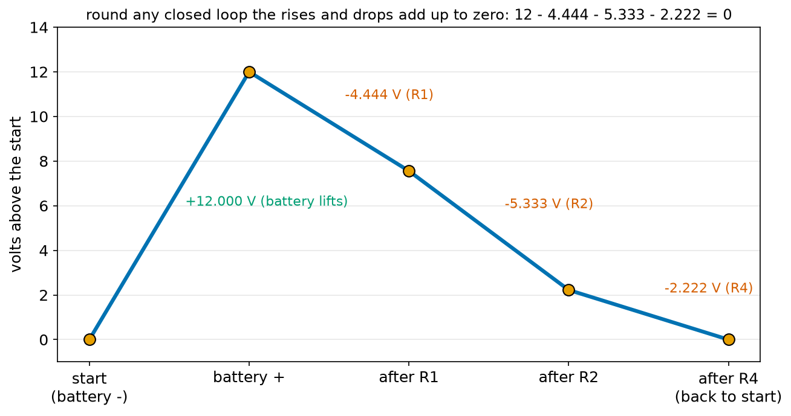
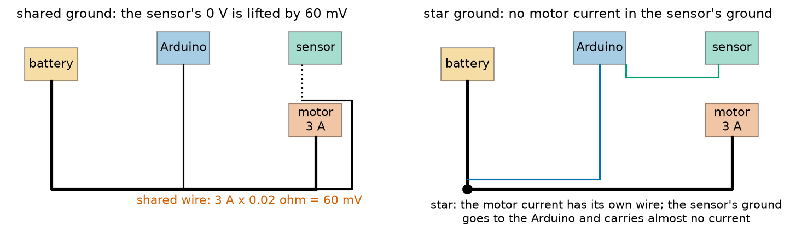
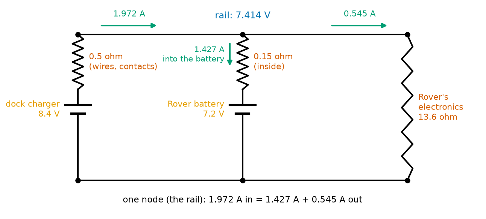
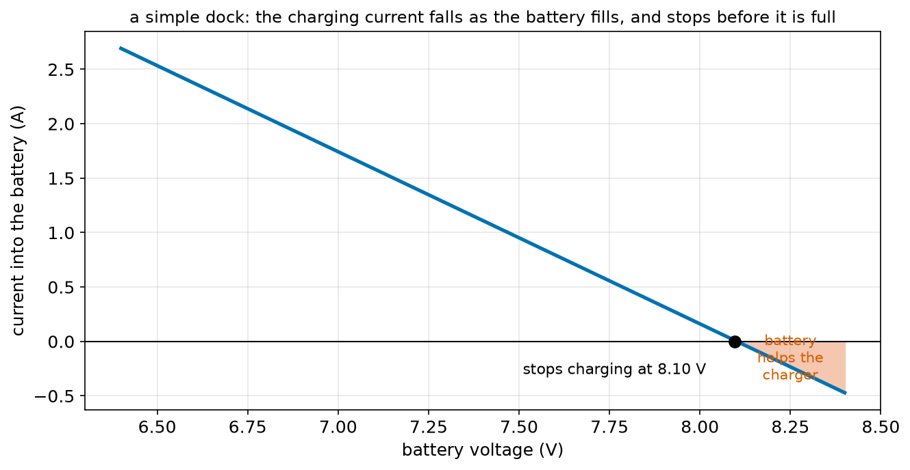
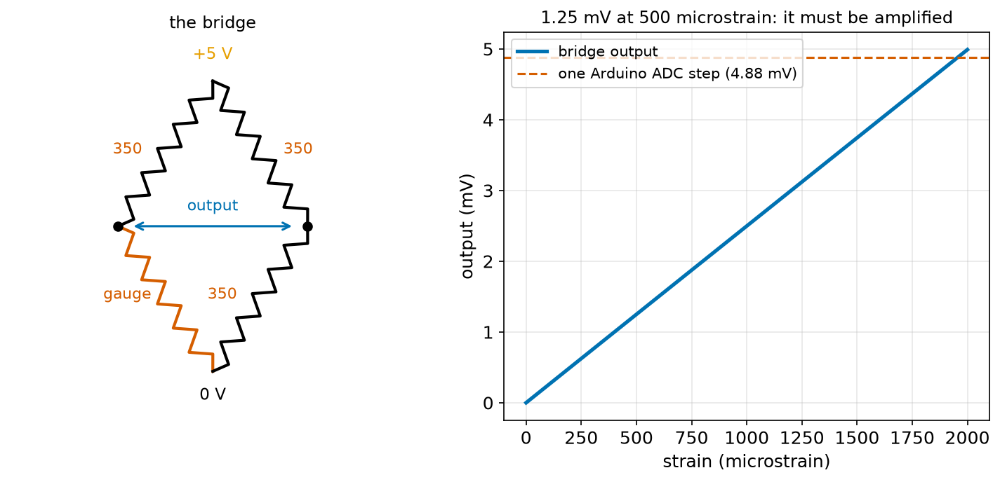

# Chapter 78 — Kirchhoff's Laws

> **Part 5 · Chapter 78 of 749**
> **You need:** Chapter 35 (NumPy arrays), Chapter 46 (simultaneous equations), Chapter 74 (voltage between two points), Chapter 75 (Ohm's law and internal resistance) and Chapter 77 (series and parallel).
> **You will make:** a program that checks both of Kirchhoff's laws on a real circuit, a general circuit solver in NumPy, a simulation of Rover on its charging dock, a strain-gauge bridge for a robot gripper, and a program that shows how a shared ground wire fools a sensor.

---

## What you will learn

- **Kirchhoff's current law**: at any node, the current flowing in equals the current flowing out.
- **Kirchhoff's voltage law**: round any closed loop, the rises and drops in voltage add up to zero.
- A careful **sign rule** so that the laws give the right answer every time.
- How to write one equation per node and solve them all together: **nodal analysis**.
- A general **circuit solver** in Python that handles circuits the series–parallel rules cannot.
- Three robot uses: two power sources feeding one robot, a **Wheatstone bridge** for measuring force, and **ground offsets** that make sensors lie.

---

## New words in this chapter

| Word | Simple meaning |
|---|---|
| **Kirchhoff's current law (KCL)** | At any node, the total current in equals the total current out. |
| **Kirchhoff's voltage law (KVL)** | Round any closed loop, the voltages add up to zero (rises count +, drops count −). |
| **loop** | Any closed path round a circuit that comes back to where it started. |
| **node voltage** | The voltage of a node measured from ground. |
| **nodal analysis** | Solving a circuit by writing the current law at every node and solving the equations together. |
| **conductance (G)** | One divided by resistance: how easily current flows. Unit: siemens (S). |
| **bridge** | Four resistors in a diamond, with the output measured across the middle. |
| **strain gauge** | A thin resistor glued to a part; its resistance changes slightly when the part stretches. |
| **ground offset** | A difference between two "grounds" that should be the same, caused by current in a shared wire. |
| **star ground** | Wiring where every part has its own ground wire back to one point. |

---

## 78.1 Two rules you already used

In 1845 the German physicist Gustav Kirchhoff (say "KEER-koff") wrote down two rules about circuits. You have already used both in Chapter 77, in the form "the currents add up" and "the voltages add up". Kirchhoff's insight was that these two rules are **always** true, for **every** circuit, however tangled. Together with Ohm's law, they solve everything in Part 5.

---

## 78.2 The current law: what goes in comes out

📖 **New word: Kirchhoff's current law (KCL)** — at any node, the total current flowing in equals the total current flowing out.



*Figure 78.1 — Five wires meet at one node. 3 A flows in; 3 A flows out.*

**How to read this picture:** The black dot is a node. The green arrows are currents flowing in (2 A and 1 A), the red arrows currents flowing out (1.5 A, 1 A and 0.5 A). In and out both total 3 A.

Why must it be true? A node is just a joint in some copper. It cannot store charge (Chapter 73: a wire is already full of electrons, and if charge piled up at the joint, the joint would become strongly charged and push it away at once). So every coulomb that arrives each second must leave each second.

In the water picture, it is a T-joint in a pipe: the water flowing in must equal the water flowing out, because the joint cannot swell.

🔢 **Maths.** Often one current is unknown. At Rover's power node, the battery supplies 0.65 A, the motors take 0.42 A and the 5 V regulator takes 0.15 A. What does the motor driver's own electronics take? In = out: 0.65 = 0.42 + 0.15 + I, so I = 0.08 A.

A handy way to write the law is: **the sum of all currents leaving a node is zero**, counting a current that flows in as a negative "leaving" current. In Figure 78.1: −2 − 1 + 1.5 + 1 + 0.5 = 0. That form is the one the computer uses in section 78.5.

💡 **Tip.** If you guess the direction of a current wrongly, the answer just comes out negative. A current of −0.3 A "to the right" is 0.3 A to the left. Never worry about guessing directions; let the sign tell you.

---

## 78.3 The voltage law: round a loop, back to zero

📖 **New word: loop** — any closed path round a circuit, starting and ending at the same point.

📖 **New word: Kirchhoff's voltage law (KVL)** — round any closed loop, the sum of the voltage rises and drops is zero.

Chapter 74 drew voltage as height. Walk round a loop, going up through batteries and down through resistors, and come back to where you started: you are back at the same height. The ups and downs must cancel.



*Figure 78.2 — Walking round the loop of Chapter 77's mixed circuit. The battery lifts 12 V; three resistors drop 4.444, 5.333 and 2.222 V; the walk ends where it began.*

**How to read this picture:** Start at the battery's − end, at 0 V. The battery lifts you to 12 V. Then R1 drops 4.444 V, R2 drops 5.333 V and R4 drops 2.222 V, and you are back at 0 V. Add them: +12 − 4.444 − 5.333 − 2.222 = 0.

In energy terms (Chapter 74), each coulomb gains 12 J in the battery and gives all of it away in the resistors before it returns. Energy is conserved.

### The sign rule

Walk round the loop in one direction (either one) and write down each voltage:

| You pass | Going this way | Write |
|---|---|---|
| a battery | from − to + | **+V** (a rise) |
| a battery | from + to − | **−V** (a drop) |
| a resistor | in the same direction as the current | **−I R** (a drop: current flows "downhill") |
| a resistor | against the current | **+I R** (a rise) |

Then set the sum to zero. The law holds for **every** loop in a circuit, not just the outside one. In Chapter 77's circuit there is a small loop through R2 and back up through R3: −I2 R2 + I3 R3 = −5.333 + 5.333 = 0. That is why parallel resistors have equal voltages: the voltage law forces it.

🔢 **Maths.** Chapter 75's short-circuit formula comes straight from the voltage law. Walk round: up through the battery (+V), down through its internal resistance (−I R_inside), down through the load (−I R_load). So V − I R_inside − I R_load = 0, which gives I = V ÷ (R_inside + R_load).

---

## 78.4 The three laws together

You now have every tool for any circuit of batteries and resistors:

| Law | Says | About |
|---|---|---|
| Ohm's law | V = I × R for each resistor | each part |
| current law | in = out at every node | each node |
| voltage law | rises − drops = 0 round every loop | each loop |

The series and parallel rules of Chapter 77 are just these laws applied to simple shapes. But some circuits cannot be shrunk with series and parallel rules at all. The **bridge** in section 78.6 is one: none of its five resistors is purely in series or purely in parallel with another. For those, we write the laws as simultaneous equations and solve them, as Chapter 46 did, with NumPy's help.

---

## 78.5 Nodal analysis: one equation per node

The tidiest way to use the laws is to give every node a voltage (measured from ground) and write the current law at each node.

📖 **New word: node voltage** — the voltage of a node above ground. Ground is node 0, at 0 V.

📖 **New word: nodal analysis** — solving a circuit by writing the current law at every node except ground, with each current written using Ohm's law in terms of the node voltages, and solving the equations together.

The current through a resistor R from node a to node b is (V_a − V_b) ÷ R: Ohm's law with the voltage across it written as a difference.

### A worked example by hand

Take Chapter 77's circuit again. Call the node after R1 "A" and the node after the parallel pair "B". The battery fixes the top at 12 V. Write "the currents leaving the node add up to zero".

At A: current leaving through R1 (back towards the battery), through R2, and through R3:

```
(V_A − 12)/100 + (V_A − V_B)/200 + (V_A − V_B)/300 = 0
```

At B: current leaving through R2 and R3 (back up to A) and through R4 (down to ground):

```
(V_B − V_A)/200 + (V_B − V_A)/300 + V_B/50 = 0
```

Multiply the first by 600 and the second by 600 to clear the fractions:

```
6 (V_A − 12) + 3 (V_A − V_B) + 2 (V_A − V_B) = 0   →   11 V_A − 5 V_B = 72
3 (V_B − V_A) + 2 (V_B − V_A) + 12 V_B = 0          →   −5 V_A + 17 V_B = 0
```

From the second, V_A = 3.4 V_B. Put that in the first: 37.4 V_B − 5 V_B = 72, so V_B = 72 ÷ 32.4 = 2.222 V and V_A = 7.556 V. These are exactly the voltages Chapter 77 found by shrinking. Two different methods, one answer.

### Conductance, and the pattern in the equations

📖 **New word: conductance (G)** — one divided by resistance: G = 1/R. A big conductance means current flows easily. The unit is the siemens (S); 1/100 Ω = 0.01 S.

Look at the equations again with conductances. At each node, the node's own voltage is multiplied by the **sum of the conductances touching it**, and each neighbour's voltage by **minus the conductance joining them**. That pattern makes a grid of numbers, a matrix, that a computer can fill in automatically:

```
[ G_A,A   G_A,B ] [ V_A ]   [ current pushed into A ]
[ G_B,A   G_B,B ] [ V_B ] = [ current pushed into B ]
```

NumPy's `np.linalg.solve` then solves it, for 2 nodes or 2,000. The program `nodal.py` in the Code section fills the grid from a simple list of parts.

### Batteries in the solver

A battery of voltage E with internal resistance r, between a node and ground, sends a current (E − V) ÷ r into the node. Split that into two pieces: E ÷ r − V ÷ r. The second piece looks exactly like a resistor r from the node to ground. The first is a fixed current E ÷ r pushed into the node. So the solver treats every battery as "a resistor r, plus a fixed push of E ÷ r amperes". For an ideal battery with no internal resistance, we give it a tiny one (10⁻⁹ Ω), so small that it changes nothing.

---

## 78.6 The bridge: a circuit you cannot shrink

📖 **New word: bridge** — four resistors arranged in a diamond, joined at the top to the supply and at the bottom to ground. The output is the voltage between the two middle corners.

If all four resistors are equal, the two middle corners are both at half the supply, and the output is exactly 0 V. If one resistor changes very slightly, the bridge goes out of balance and a small output appears. This makes the bridge perfect for measuring tiny changes in resistance, and that is exactly what a **strain gauge** produces.

📖 **New word: strain gauge** — a zigzag of thin metal foil, glued to a part. When the part stretches, the foil stretches too, becomes longer and thinner, and its resistance rises (Chapter 74: R = ρ L / A). The change is tiny: about 2 × the strain. A strain of 500 millionths ("500 microstrain", a steel beam under a moderate load) changes a 350 Ω gauge by 0.35 Ω.

If a fifth resistor joins the two middle corners, the circuit cannot be broken into series and parallel pieces at all. `nodal.py` solves such a bridge as its second test (section 78.7). Application 2 uses the bridge to weigh what a robot gripper holds.

---

## Code

File `code/ch078/check_laws.py`:

```python
# check_laws.py - check both of Kirchhoff's laws on the mixed circuit of Chapter 77
V = 12.0
R1, R2, R3, R4 = 100.0, 200.0, 300.0, 50.0

r23 = 1 / (1 / R2 + 1 / R3)
i = V / (R1 + r23 + R4)
v_a = V - i * R1               # node A: after R1, the top of the R2/R3 pair
v_b = i * R4                   # node B: the bottom of the pair, above R4
i2 = (v_a - v_b) / R2
i3 = (v_a - v_b) / R3

print("node voltages above ground:")
print(f"  battery + : {V:6.3f} V")
print(f"  node A    : {v_a:6.3f} V")
print(f"  node B    : {v_b:6.3f} V")
print()
print("current law at node A: what flows in = what flows out")
print(f"  in  (through R1)      = {i * 1000:7.3f} mA")
print(f"  out (through R2 + R3) = {i2 * 1000:7.3f} + {i3 * 1000:7.3f} = {(i2 + i3) * 1000:7.3f} mA")
print(f"  in - out = {(i - i2 - i3) * 1000:+.6f} mA")
print()
print("voltage law round the loop battery -> R1 -> R2 -> R4 -> battery (rises +, drops -):")
terms = [("battery", +V), ("R1", -i * R1), ("R2", -i2 * R2), ("R4", -i * R4)]
for name, v in terms:
    print(f"  {name:8s} {v:+8.3f} V")
print(f"  sum      {sum(t for _, t in terms):+8.3f} V")
print()
print("voltage law round the small loop R2 -> back up through R3:")
print(f"  -{i2 * R2:.3f} + {i3 * R3:.3f} = {-i2 * R2 + i3 * R3:+.3f} V")
```

| Line | Code | What it does (simple English) |
|---|---|---|
| 1 | `# check_laws.py …` | A comment. |
| 2–3 | `V = 12.0`, `R1, R2, R3, R4 = …` | The circuit of Chapter 77. |
| 4 | (blank) | Spacing. |
| 5–6 | `r23 = …`, `i = …` | Solve it by shrinking, as in Chapter 77. |
| 7 | `v_a = V - i * R1` | Node A is R1's drop below the battery's +. |
| 8 | `v_b = i * R4` | Node B is R4's drop above ground. |
| 9–10 | `i2 = …`, `i3 = …` | Each branch current from Ohm's law with the voltage between A and B. |
| 11 | (blank) | Spacing. |
| 12–15 | `print(…)` | The three node voltages. |
| 16 | `print()` | An empty line. |
| 17–20 | `print(…)` | The current law at A: in, out, and the difference. |
| 21 | `print()` | An empty line. |
| 22 | `print("voltage law …")` | A heading. |
| 23 | `terms = [ … ]` | Each element of the loop with its sign: + for the battery's rise, − for each resistor's drop. |
| 24–25 | `for name, v in terms: print(…)` | Print each term with its sign (`+8.3f` always shows the sign). |
| 26 | `print(f"  sum …")` | Their sum. `sum(t for _, t in terms)` adds the second item of each pair. |
| 27 | `print()` | An empty line. |
| 28–29 | `print(…)` | The small loop through R2 and R3. |

Output:

```
node voltages above ground:
  battery + : 12.000 V
  node A    :  7.556 V
  node B    :  2.222 V

current law at node A: what flows in = what flows out
  in  (through R1)      =  44.444 mA
  out (through R2 + R3) =  26.667 +  17.778 =  44.444 mA
  in - out = +0.000000 mA

voltage law round the loop battery -> R1 -> R2 -> R4 -> battery (rises +, drops -):
  battery   +12.000 V
  R1         -4.444 V
  R2         -5.333 V
  R4         -2.222 V
  sum        +0.000 V

voltage law round the small loop R2 -> back up through R3:
  -5.333 + 5.333 = +0.000 V
```

Both laws hold exactly, to the last printed digit.

File `code/ch078/nodal.py`:

```python
# nodal.py - solve any circuit of resistors and batteries with Kirchhoff's current law and NumPy
import numpy as np


def solve(n_nodes, resistors, sources):
    """
    Nodes are numbered 1 .. n_nodes; node 0 is ground (0 V).
    resistors: list of (a, b, ohms) joining node a and node b.
    sources:   list of (a, b, volts, ohms): a battery whose + is at node a and - at node b,
               with its internal resistance in series.
    Returns the list of node voltages, with ground first.
    """
    g = np.zeros((n_nodes + 1, n_nodes + 1))       # the conductance matrix
    i = np.zeros(n_nodes + 1)                      # the currents pushed into each node
    for a, b, r in resistors:
        g[a, a] += 1 / r; g[b, b] += 1 / r
        g[a, b] -= 1 / r; g[b, a] -= 1 / r
    for a, b, e, r in sources:                     # a battery with resistance = a current e/r in parallel with r
        g[a, a] += 1 / r; g[b, b] += 1 / r
        g[a, b] -= 1 / r; g[b, a] -= 1 / r
        i[a] += e / r; i[b] -= e / r
    v = np.linalg.solve(g[1:, 1:], i[1:])          # drop the ground row and column, then solve
    return [0.0] + list(v)


if __name__ == "__main__":
    # test 1: the Chapter 77 circuit. Nodes: 1 = battery +, 2 = node A, 3 = node B
    v = solve(3, [(1, 2, 100), (2, 3, 200), (2, 3, 300), (3, 0, 50)], [(1, 0, 12.0, 1e-9)])
    print("Chapter 77 circuit:", ", ".join(f"V{k} = {x:.3f} V" for k, x in enumerate(v)))
    print(f"  battery current = {(v[1] - v[2]) / 100 * 1000:.1f} mA (Chapter 77 found 44.4 mA)")

    # test 2: a bridge that cannot be shrunk with series and parallel rules
    # nodes: 1 = top, 2 = left middle, 3 = right middle; a 5 ohm resistor joins the two middles
    v = solve(3, [(1, 2, 10), (1, 3, 20), (2, 0, 30), (3, 0, 40), (2, 3, 5)], [(1, 0, 10.0, 1e-9)])
    print("bridge:", ", ".join(f"V{k} = {x:.3f} V" for k, x in enumerate(v)))
    print(f"  current through the middle 5 ohm resistor: {(v[2] - v[3]) / 5 * 1000:+.1f} mA")
```

| Line | Code | What it does (simple English) |
|---|---|---|
| 1 | `# nodal.py …` | A comment. |
| 2 | `import numpy as np` | For arrays and the solver (Chapter 35). |
| 3–4 | (blank) | Spacing. |
| 5 | `def solve(n_nodes, resistors, sources):` | The general solver. |
| 6–12 | `"""…"""` | A docstring that explains the inputs: node numbers, resistors as (a, b, ohms), batteries as (a, b, volts, ohms). |
| 13 | `g = np.zeros((n_nodes + 1, n_nodes + 1))` | A square grid of zeros, one row and column per node including ground. |
| 14 | `i = np.zeros(n_nodes + 1)` | One "pushed-in current" per node, all zero to start. |
| 15 | `for a, b, r in resistors:` | Each resistor between nodes a and b … |
| 16 | `g[a, a] += 1 / r; g[b, b] += 1 / r` | … adds its conductance to both nodes' own totals (the diagonal) … |
| 17 | `g[a, b] -= 1 / r; g[b, a] -= 1 / r` | … and subtracts it where the two nodes meet. This is the pattern of section 78.5. |
| 18 | `for a, b, e, r in sources:` | Each battery … |
| 19–20 | the same two lines | … acts as a resistor r … |
| 21 | `i[a] += e / r; i[b] -= e / r` | … plus a fixed current e/r pushed into its + node and pulled out of its − node. |
| 22 | `v = np.linalg.solve(g[1:, 1:], i[1:])` | Ground is fixed at 0 V, so drop its row and column (`[1:]` means "from index 1 on") and solve the rest (Chapter 46's simultaneous equations, done by NumPy). |
| 23 | `return [0.0] + list(v)` | Put ground's 0 V back at the front, so `v[k]` is node k's voltage. |
| 24–25 | (blank) | Spacing. |
| 26 | `if __name__ == "__main__":` | Run the tests only when this file is run directly, not when another program imports `solve` (Chapter 26). |
| 27–28 | test 1 | Chapter 77's circuit. The 12 V battery has a tiny 10⁻⁹ Ω inside so it acts as ideal. |
| 29 | `print(…)` | The node voltages, joined into one line. `enumerate` gives each voltage's node number. |
| 30 | `print(…)` | The current through R1 (from node 1 to node 2). |
| 31 | (blank) | Spacing. |
| 32–34 | test 2 | A bridge with a 5 Ω resistor across its middle. |
| 35–36 | `print(…)` | Its node voltages and the current through the middle resistor. |

Output:

```
Chapter 77 circuit: V0 = 0.000 V, V1 = 12.000 V, V2 = 7.556 V, V3 = 2.222 V
  battery current = 44.4 mA (Chapter 77 found 44.4 mA)
bridge: V0 = 0.000 V, V1 = 10.000 V, V2 = 7.258 V, V3 = 7.097 V
  current through the middle 5 ohm resistor: +32.3 mA
```

The solver agrees with Chapter 77 to every digit. The bridge's answer could not have been found by shrinking: the left middle sits at 7.258 V and the right at 7.097 V, so 32.3 mA flows across the middle resistor from left to right. From now on, whenever a circuit is too tangled to do by hand, `solve` does it.

File `code/ch078/ground_offset.py`:

```python
# ground_offset.py - a sensor and a motor share one ground wire: the voltage law shows the error it causes
WIRE_OHM = 0.02            # the shared ground wire from the board to the battery
SENSOR_V = 2.50            # what the sensor really outputs, measured from its own ground
ADC_STEP = 5.0 / 1024

print(f"{'motor current':>14s} {'ground lifted by':>17s} {'Arduino reads':>14s} {'error in ADC steps':>19s}")
for motor_a in [0.0, 0.5, 1.5, 3.0]:
    lift = motor_a * WIRE_OHM                  # V = I x R along the shared ground wire
    # the loop: Arduino ground -> battery ground -> up the shared wire to the sensor's ground -> sensor output
    seen = SENSOR_V + lift                     # the sensor's ground sits 'lift' volts above the Arduino's ground
    print(f"{motor_a:11.1f} A {lift * 1000:13.1f} mV {seen:12.3f} V {lift / ADC_STEP:16.1f}")

print()
print("fix: give the sensor its own ground wire back to the Arduino (a 'star' ground), so no motor current flows in it")
```

| Line | Code | What it does (simple English) |
|---|---|---|
| 1 | `# ground_offset.py …` | A comment. |
| 2–4 | `WIRE_OHM`, `SENSOR_V`, `ADC_STEP` | The shared wire, the sensor's true output, and the Arduino's measuring step. |
| 5 | (blank) | Spacing. |
| 6 | `print(…)` | The header. |
| 7 | `for motor_a in [0.0, 0.5, 1.5, 3.0]:` | Four motor currents. |
| 8 | `lift = motor_a * WIRE_OHM` | The motor current flowing back through the shared wire makes a drop along it: the sensor's "0 V" is lifted by this much. |
| 9 | `# the loop: …` | The loop that the voltage law is applied to. |
| 10 | `seen = SENSOR_V + lift` | Walking from the Arduino's ground up to the sensor's output: the wire's rise plus the sensor's 2.5 V. |
| 11 | `print(…)` | The lift, the reading, and the error in ADC steps. |
| 12 | (blank) | Spacing. |
| 13 | `print()` | An empty line. |
| 14 | `print("fix: …")` | The cure. |

Output:

```
 motor current  ground lifted by  Arduino reads  error in ADC steps
        0.0 A           0.0 mV        2.500 V              0.0
        0.5 A          10.0 mV        2.510 V              2.0
        1.5 A          30.0 mV        2.530 V              6.1
        3.0 A          60.0 mV        2.560 V             12.3
```

```
fix: give the sensor its own ground wire back to the Arduino (a 'star' ground), so no motor current flows in it
```

📖 **New word: ground offset** — a voltage between two points that should both be "ground", caused by a current flowing in the wire between them.



*Figure 78.6 — Left: the sensor's ground shares a wire with the motor's 3 A, which lifts it by 60 mV. Right: a star ground gives the motor current its own path.*

**How to read this picture:** On the left, the motor's current returns to the battery along the thick bottom wire, and the sensor's ground (dotted) joins that same wire. The 3 A makes a 60 mV drop along it, so the sensor's "0 V" is 60 mV above the Arduino's. On the right, every part has its own ground wire back to one point (the black dot at the battery). The heavy motor current flows only in its own wire; the sensor's ground wire to the Arduino carries only the sensor's tiny current.

📖 **New word: star ground** — wiring where each part has its own ground wire to one common point, like the arms of a star, so that one part's current does not flow in another part's ground.

The reading changes by 12 ADC steps whenever the motor runs: a distance sensor would see the wall jump closer each time Rover accelerates. Chapter 5 said all parts must share a **common** ground. This chapter adds the second half of the rule: shared, but not through the same wire as a big current.

---

## Small examples

**Example 1.** Currents into a node: 0.4 A and 0.25 A. Out: 0.5 A and an unknown. The unknown is 0.15 A out.

**Example 2.** A node has 1 A in and 1.3 A out on known wires; the fourth wire carries 0.3 A **in**.

**Example 3.** A loop: a 9 V battery and two resistors dropping 4 V and an unknown. The unknown is 5 V.

**Example 4.** A loop with two batteries facing the same way (5 V and 3 V) and one resistor: the resistor drops 8 V. Facing opposite ways: 2 V.

**Example 5.** G of a 250 Ω resistor: 1 ÷ 250 = 0.004 S.

**Example 6.** A node joined to 12 V through 100 Ω and to ground through 300 Ω: (V − 12)/100 + V/300 = 0 → 3V − 36 + V = 0 → V = 9 V.

**Example 7.** A balanced bridge of four 1 kΩ on 5 V: both middles at 2.5 V, output 0.

**Example 8.** 2 A of motor current in a 0.05 Ω shared ground wire: a 100 mV offset.

---

## 🏭 Real robot applications

### Application 1 (worked in full) — 🏠 Rover on its charging dock

**1. The real problem.** Home robots such as robot vacuums drive onto a dock to recharge. While docked, the robot stays switched on: its brain and sensors keep working. So three things meet at the robot's power rail: the dock's charger, the robot's battery, and the robot's electronics. How much current flows where? Does the battery charge, and does it ever get full? Rover could have a dock like this one.

**2. Why this theory.** This circuit has two sources. It cannot be shrunk with series and parallel rules, because the two batteries are not simply adding. The current law at the rail node, with Ohm's law for each branch, gives one equation in one unknown: the rail voltage.

**3. The numbers.** Charger: 8.4 V with 0.5 Ω (its wiring and the spring contacts on the dock). Rover's battery: 7.2 V now, 0.15 Ω inside. Rover's electronics and idling motors: 0.53 A at 7.2 V, so 13.6 Ω.

**4. The maths.** Write "the currents leaving the rail node add up to zero":

```
(V − 8.4)/0.5 + (V − 7.2)/0.15 + V/13.6 = 0
2V − 16.8 + 6.667V − 48 + 0.0735V = 0
8.740 V = 64.8
V = 7.414 V
charger gives (8.4 − 7.414)/0.5 = 1.972 A
battery takes (7.414 − 7.2)/0.15 = 1.427 A    (current flows INTO it: it is charging)
robot takes  7.414/13.6 = 0.545 A
check: 1.972 = 1.427 + 0.545 ✓
```

**5. The code.** File `code/ch078/dock.py`:

```python
# dock.py - Rover on its charging dock: the charger, the battery and the robot all meet at one node
from nodal import solve

CHARGER_V, CHARGER_OHM = 8.4, 0.5         # the dock's supply and its resistance (wires, contacts)
BATTERY_V, BATTERY_OHM = 7.2, 0.15        # Rover's battery: its voltage now, and inside resistance
ROBOT_OHM = 13.6                          # Rover's electronics and idling motors: 7.2 V / 0.53 A

# node 1 is the robot's power rail; every part joins it to ground
v = solve(1, [(1, 0, ROBOT_OHM)], [(1, 0, CHARGER_V, CHARGER_OHM), (1, 0, BATTERY_V, BATTERY_OHM)])
rail = v[1]
i_charger = (CHARGER_V - rail) / CHARGER_OHM      # out of the charger into the rail
i_battery = (BATTERY_V - rail) / BATTERY_OHM      # out of the battery (negative = charging)
i_robot = rail / ROBOT_OHM
print(f"rail voltage {rail:.3f} V")
print(f"charger gives {i_charger:+.3f} A, battery gives {i_battery:+.3f} A, robot takes {i_robot:.3f} A")
print(f"current law check: {i_charger:.3f} + ({i_battery:.3f}) = {i_charger + i_battery:.3f} A = robot {i_robot:.3f} A")
print()

print("as the battery fills, its voltage rises and the charging current falls:")
for bv in [6.6, 7.0, 7.2, 7.6, 8.0, 8.2, 8.4]:
    rail = solve(1, [(1, 0, ROBOT_OHM)], [(1, 0, CHARGER_V, CHARGER_OHM), (1, 0, bv, BATTERY_OHM)])[1]
    into_battery = (rail - bv) / BATTERY_OHM
    print(f"  battery at {bv:.1f} V: rail {rail:.3f} V, charging current {into_battery:+.3f} A")
```

| Line | Code | What it does (simple English) |
|---|---|---|
| 1 | `# dock.py …` | A comment. |
| 2 | `from nodal import solve` | Reuse the solver; the file must sit in the same folder (Chapter 26). |
| 3 | (blank) | Spacing. |
| 4–6 | `CHARGER_V`, … `ROBOT_OHM` | The three parts. |
| 7 | (blank) | Spacing. |
| 8 | `# node 1 is …` | A comment. |
| 9 | `v = solve(1, …)` | One node (the rail). The robot is a resistor to ground; the charger and the battery are sources to ground. |
| 10 | `rail = v[1]` | The rail's voltage. |
| 11 | `i_charger = …` | Ohm's law across the charger's resistance. |
| 12 | `i_battery = …` | The same for the battery; a negative answer means current flows into it. |
| 13 | `i_robot = rail / ROBOT_OHM` | The robot's current. |
| 14–16 | `print(…)` | The results and the current-law check. |
| 17 | `print()` | An empty line. |
| 18 | (blank) | Spacing. |
| 19 | `print("as the battery fills …")` | A heading. |
| 20 | `for bv in [ … ]:` | Seven battery voltages as it charges. |
| 21 | `rail = solve(…)[1]` | Solve again for each; `[1]` takes node 1's voltage. |
| 22 | `into_battery = (rail - bv) / BATTERY_OHM` | The charging current (positive = charging). |
| 23 | `print(…)` | One line per battery voltage. |

Output:

```
rail voltage 7.414 V
charger gives +1.972 A, battery gives -1.427 A, robot takes 0.545 A
current law check: 1.972 + (-1.427) = 0.545 A = robot 0.545 A

as the battery fills, its voltage rises and the charging current falls:
  battery at 6.6 V: rail 6.956 V, charging current +2.376 A
  battery at 7.0 V: rail 7.261 V, charging current +1.743 A
  battery at 7.2 V: rail 7.414 V, charging current +1.427 A
  battery at 7.6 V: rail 7.719 V, charging current +0.794 A
  battery at 8.0 V: rail 8.024 V, charging current +0.162 A
  battery at 8.2 V: rail 8.177 V, charging current -0.155 A
  battery at 8.4 V: rail 8.329 V, charging current -0.471 A
```



*Figure 78.3 — The charger, the battery and Rover's electronics meet at one node, the rail.*

**How to read this picture:** Three branches join the top wire (the rail) to the bottom wire (ground). The charger (left) pushes 1.972 A into the rail. The battery (middle) takes 1.427 A and is charging. The electronics (right) take 0.545 A. The current law at the rail: 1.972 in = 1.427 + 0.545 out.



*Figure 78.4 — The current into the battery for every battery voltage from nearly empty to full.*

**How to read this picture:** As the battery's voltage rises, the charging current falls in a straight line. It reaches zero at 8.10 V. Above that (the shaded part), the battery would actually be **helping** the charger feed the robot, so it never reaches its full 8.4 V while docked.

**6. The result.** The dock charges Rover's battery at up to 2.4 A when empty, falling as it fills, and it can never fill it completely: the charger's 0.5 Ω and the robot's own load pull the rail below 8.4 V. A dock built this simply would leave the battery about 90% charged and charge it fast when it is empty, which is too fast for these cells (Chapter 89). Real chargers fix both problems by controlling the current: a fixed current at first, then a fixed voltage at the end, which Chapter 89 explains.

**7. Going further.** Real docks also add a diode (Chapter 86) so that the battery cannot push current back into the charger when the dock is unplugged, and a contact sensor so the robot knows it is docked. Chapter 151 uses the current law at every node of Rover's power system for its budget.

### Application 2 (worked in full) — 🏭 Weighing the load in a robot gripper

**1. The real problem.** A packing robot must know how heavy each object is before it places it, to catch a wrong pick (two items stuck together) and to slow down for heavy ones. A small aluminium beam in its wrist bends very slightly under the load. Four strain gauges are glued to the beam in a bridge; Chapter 128 covers such "load cells". Here we work out the voltage the bridge produces.

**2. Why this theory.** A strain gauge changes its resistance by only a tenth of a percent, far too little to measure by connecting it straight to a supply. In a bridge, the unchanged part (half the supply) cancels between the two sides, and only the change appears at the output. Nodal analysis gives the output exactly, without any approximation.

**3. The numbers.** Supply ("excitation") 5 V. Four arms of 350 Ω. One active gauge with a gauge factor of 2 (ΔR / R = 2 × strain). Strains from 0 to 2,000 microstrain.

**4. The maths.** At 500 microstrain the gauge is 350 × (1 + 2 × 0.0005) = 350.35 Ω. The left middle is a divider (Chapter 79): 5 × 350.35 ÷ 700.35 = 2.50125 V. The right middle: 2.5 V exactly. Output: 1.249 mV. A simple rule for small strains: output ≈ supply × gauge factor × strain ÷ 4 = 5 × 2 × 0.0005 ÷ 4 = 1.25 mV.

**5. The code.** File `code/ch078/bridge.py`:

```python
# bridge.py - a Wheatstone bridge turns a tiny change in a strain gauge into a voltage we can amplify
from nodal import solve

EXCITE_V = 5.0
R = 350.0                  # each arm of the bridge, and the gauge when unstrained
GAUGE_FACTOR = 2.0         # the gauge's resistance changes by 2 x the strain


def bridge_output(strain):
    gauge = R * (1 + GAUGE_FACTOR * strain)
    # nodes: 1 = top (+5 V), 2 = left middle, 3 = right middle
    v = solve(3, [(1, 2, R), (2, 0, gauge), (1, 3, R), (3, 0, R)], [(1, 0, EXCITE_V, 1e-9)])
    return v[2] - v[3]


print(f"{'strain':>10s} {'gauge ohms':>11s} {'output':>10s} {'simple formula':>15s}")
for micro in [0, 100, 250, 500, 1000, 2000]:
    strain = micro * 1e-6
    out = bridge_output(strain)
    simple = EXCITE_V * GAUGE_FACTOR * strain / 4         # good for small strains
    print(f"{micro:7d} ue {R * (1 + GAUGE_FACTOR * strain):11.3f} {out * 1000:7.3f} mV {simple * 1000:12.3f} mV")

print()
print("one ADC step on a 5 V Arduino is 4.88 mV: even 2,000 microstrain gives under 5 mV,")
print("so the bridge output is amplified about 128 times first (Chapter 128)")
```

| Line | Code | What it does (simple English) |
|---|---|---|
| 1 | `# bridge.py …` | A comment. |
| 2 | `from nodal import solve` | The solver. |
| 3 | (blank) | Spacing. |
| 4–6 | `EXCITE_V`, `R`, `GAUGE_FACTOR` | The bridge's numbers. |
| 7–8 | (blank) | Spacing. |
| 9 | `def bridge_output(strain):` | The output for one strain. |
| 10 | `gauge = R * (1 + GAUGE_FACTOR * strain)` | The gauge's resistance under strain. |
| 11 | `# nodes: …` | A comment. |
| 12 | `v = solve(3, …)` | Top to left middle (R), left middle to ground (the gauge), top to right middle (R), right middle to ground (R), and the 5 V supply. |
| 13 | `return v[2] - v[3]` | The output: the voltage between the two middles. |
| 14–15 | (blank) | Spacing. |
| 16 | `print(…)` | The header. "ue" stands for microstrain. |
| 17 | `for micro in [ … ]:` | Six strains, in millionths. |
| 18 | `strain = micro * 1e-6` | Turn microstrain into a plain number. |
| 19 | `out = bridge_output(strain)` | The exact answer. |
| 20 | `simple = …` | The small-strain rule, to compare. |
| 21 | `print(…)` | The row in millivolts. |
| 22 | (blank) | Spacing. |
| 23 | `print()` | An empty line. |
| 24–25 | `print(…)` | The conclusion. |

Output:

```
    strain  gauge ohms     output  simple formula
      0 ue     350.000   0.000 mV        0.000 mV
    100 ue     350.070   0.250 mV        0.250 mV
    250 ue     350.175   0.625 mV        0.625 mV
    500 ue     350.350   1.249 mV        1.250 mV
   1000 ue     350.700   2.498 mV        2.500 mV
   2000 ue     351.400   4.990 mV        5.000 mV

one ADC step on a 5 V Arduino is 4.88 mV: even 2,000 microstrain gives under 5 mV,
so the bridge output is amplified about 128 times first (Chapter 128)
```



*Figure 78.5 — Left: the bridge, with the gauge in red. Right: its output against strain, compared with one Arduino measuring step.*

**How to read this picture:** On the left, the supply is at the top and ground at the bottom; the output is taken across the two middle dots. On the right, the output grows in a straight line with strain, but even at 2,000 microstrain it barely reaches one Arduino step (red dashed line). The bridge has turned an invisible change of 0.1% into a clean signal that starts from zero, but it must still be amplified before the Arduino can read it.

**6. The result.** At a typical working strain of 500 microstrain, the bridge gives 1.25 mV. Amplified 128 times, that is 160 mV, or 33 ADC steps: enough to weigh the object to a few per cent. Real load cells use **four** active gauges (two stretched and two squashed), which gives four times the output, 5 mV at 500 microstrain, and cancels the effect of temperature on the gauges, because all four arms change together. Without the bridge, the 0.35 Ω change would be lost under the noise of a 350 Ω reading.

**7. Going further.** The tiny bridge outputs are amplified by chips such as the HX711, which contain an amplifier and a precise 24-bit ADC; Chapter 128 uses one to build a kitchen-scale gripper sensor. The same bridge, with semiconductor gauges, is inside the pressure sensors of Chapter 128 and the force sensors in a humanoid's feet (Chapter 695).

### Application 3 — 🚁 Two drone batteries in parallel

Some drones carry two packs in parallel for longer flights. If one is full (16.8 V) and the other half empty (14.8 V), connecting them makes a loop with two batteries facing each other. The voltage law round that loop: 16.8 − I × 0.05 − I × 0.05 − 14.8 = 0, counting each pack's 0.04 Ω inside plus 0.01 Ω of wire. So I = 2 ÷ 0.1 = **20 A** flows from one pack into the other the instant they are joined, with no motors running at all. That is a dangerous current for the half-empty pack, which is suddenly being charged at many times its safe rate (Chapter 89). The rule pilots follow comes straight from the voltage law: only connect packs in parallel when their voltages are within about 0.1 V of each other, which keeps the current under 1 A.

### Application 4 — 🏭 A sensor at the end of a factory robot's arm

A factory arm has a sensor on its wrist, 2 m of cable away from the controller, with a 24 V motor brake on the same cable. When the brake switches on, its 1 A return current flows in the shared ground conductor of 0.1 Ω, lifting the sensor's ground by 0.1 V. An analog sensor sending 0–10 V for a 0–100 mm distance would suddenly read 1 mm wrong whenever the brake is on. Factory wiring rules solve this exactly as section 78.7 did: separate ground wires for power and signals, joined only at one point in the controller. Many factory sensors go further and send a **current** (4 to 20 mA) instead of a voltage: by the current law, the current is the same all round the loop, whatever the wire's resistance or the ground offset, so a current signal arrives unchanged. Chapter 543 covers the digital buses that replace both.

### Application 5 — 🦿 Checking a humanoid's wiring with the current law

A humanoid robot has a power-distribution board with a current sensor (Chapter 75's shunt) on the battery and on each of its 6 limb branches. The current law says the battery's current must equal the sum of the branch currents, plus the small current used by the board itself. The robot's software checks this sum many times a second. If the battery reports 30 A but the branches add up to only 25 A, 5 A is going somewhere it should not: a damaged cable touching the metal frame (a "ground fault"), or a failing sensor. The robot stops its motion and reports the fault before the stray current can start a fire. A law written down in 1845 becomes a safety check that runs in software (Chapter 696 describes the power board, and Chapter 729 the safety rules).

---

## 🔧 Hands-on lab

### Lab 78.1 — Check the laws on a breadboard (hardware, or Tinkercad)

You need: a 9 V battery (or a 5 V USB supply), resistors of 1 kΩ, 2.2 kΩ, 3.3 kΩ and 470 Ω, a breadboard and a multimeter (or the simulator's meter).

1. Build Chapter 77's mixed circuit: 1 kΩ, then 2.2 kΩ in parallel with 3.3 kΩ, then 470 Ω.
2. Measure the voltage across each part. Add them round the outside loop.
3. Measure (or, if you do not have an ammeter yet, calculate from V ÷ R) the current in each branch. Check the current law at the node above the pair.
4. Run `nodal.py`'s `solve` for the same circuit and compare.

**What you should see:** On 9 V, the pair is 1,320 Ω, the total 2,790 Ω, and the battery current 3.23 mA. The drops are 3.23 V, 4.26 V and 1.52 V, which add to 9.0 V. The branch currents are 1.94 mA and 1.29 mA, which add to 3.23 mA. Your measured values will differ by a few per cent, because resistors are made to within 5% and the battery is rarely exactly 9.0 V; the laws still hold for your measured numbers.

| If it does not work | Likely cause | Fix |
|---|---|---|
| The voltages add to less than the battery | You measured the battery without the load, and it sags under load | Measure the battery while the circuit is connected |
| A branch shows 0 V | That resistor is not in the circuit | Check its legs are in the right breadboard rows (Chapter 80) |

**Challenge:** Add a 1 kΩ resistor between the node above the pair and the battery's + end, making a new loop. Predict all the voltages with `solve` before measuring.

### Lab 78.2 — Your own bridge (simulation)

1. Using `solve`, build a bridge of four 1 kΩ resistors on 5 V. Check the output is 0.
2. Replace one arm with Chapter 74's thermistor (10 kΩ at 25 °C) and the other three with 10 kΩ. Print the output for 0, 25, 50 and 80 °C.
3. Put a 1 kΩ resistor across the output (as a meter with a low input resistance would do). How much does the output at 50 °C change?

**What you should see:** At 25 °C the thermistor bridge is balanced: 0 V. At 0 °C the thermistor is 33.6 kΩ and the output is +1.35 V; at 50 °C (3,588 Ω) it is −1.18 V; at 80 °C (1,270 Ω), −1.94 V (signs depend on which side you put the thermistor). With a 1 kΩ load across the middle, the 50 °C output shrinks a lot, to about −0.14 V, because the load lets current flow between the two sides. This is why bridge outputs are measured with an amplifier that draws almost no current.

| If it does not work | Likely cause | Fix |
|---|---|---|
| `LinAlgError: Singular matrix` | A node is connected to nothing, or two node numbers were swapped | Check every node appears in at least two parts |
| The output is huge | The supply was given 0 internal resistance | Use 1e-9, not 0 (dividing by zero) |

**Challenge:** Write a function that finds, by trying values, the resistor you should put in the arm opposite the thermistor so that the bridge balances at 70 °C, the warning temperature of Chapter 74's driver.

### Lab 78.3 — Hunt the ground offset (simulation)

Copy `ground_offset.py`.

1. Add a second sensor that shares the same ground wire and draws 20 mA. Does its own current matter compared with the motor's?
2. The wire is replaced by a thicker one of 0.005 Ω. What is the worst error now?
3. A distance sensor gives 10 mV per centimetre. With the original wire and 3 A, how many centimetres wrong is the reading?

**What you should see:** The 20 mA sensor adds 0.4 mV, under a tenth of an ADC step: small loads hardly matter; big currents do. The thicker wire cuts the offset to 15 mV, 3 ADC steps. With 10 mV per cm, the 60 mV offset is a **6 cm** error, which appears only when the motor draws current: Rover would think the wall jumps 6 cm closer every time it accelerates.

| If it does not work | Likely cause | Fix |
|---|---|---|
| The offset does not change with the motor current | The lift is computed once, outside the loop | Compute it inside the loop |

**Challenge:** Model a "star" ground: the sensor's ground wire carries only the sensor's own current to the Arduino, and the motor current has its own wire. Print the new error for each motor current.

---

## Common mistakes

⚠️ **Mixing up the signs in the voltage law.** Pick a direction, walk all the way round, and write each battery and resistor with the sign from the table in section 78.3.

⚠️ **Forgetting a branch at a node.** Count every wire that touches the node, including the ones to ground.

⚠️ **Worrying about guessing a current's direction.** Guess. A negative answer means the other way.

⚠️ **Thinking two "grounds" are always at the same voltage.** Any wire with current in it has a voltage along it.

⚠️ **Joining batteries in parallel at different voltages.** The voltage law gives a big current between them.

⚠️ **Giving the solver an ideal battery with 0 Ω.** Use a tiny resistance such as 10⁻⁹ Ω to avoid dividing by zero.

---

## Practice

🏋️ **1.** Currents of 1.2 A and 0.8 A flow into a node. One wire carries 1.5 A out. What does the fourth wire carry?

🏋️ **2.** A 12 V battery drives a loop with three resistors. Two drop 3 V and 5 V. What does the third drop?

🏋️ **3.** A loop contains a 9 V battery, a 6 V battery facing the opposite way, and a 50 Ω resistor. Find the current.

🏋️ **4.** A node is joined to 10 V through 2 kΩ, to 0 V through 2 kΩ and to 0 V through 1 kΩ. Find its voltage using the current law.

🏋️ **5.** Find the conductance of 20 Ω, 200 Ω and 2 kΩ. What is the conductance of all three in parallel, and so their combined resistance?

🏋️ **6.** In Application 1, the dock's resistance is improved to 0.2 Ω. With the battery at 7.2 V, find the rail voltage and the charging current.

🏋️ **7.** A bridge of four 120 Ω gauges on 10 V, with one gauge at 120.24 Ω. Find the output with the simple rule and by working out each middle voltage.

🏋️ **8.** Two 3.7 V cells, one at 4.1 V and one at 3.7 V, each with 0.03 Ω inside, are joined in parallel. What current flows between them?

🏋️ **9.** A motor's 4 A return current flows through 0.015 Ω of shared ground wire. A sensor on that ground sends 1.000 V. What does the Arduino read?

🏋️ **10.** Use `solve` to find the node voltages of: node 1 joined to a 6 V battery (ideal) at ground, 100 Ω from node 1 to node 2, 200 Ω from node 2 to ground, 300 Ω from node 2 to node 3, 300 Ω from node 3 to ground, and 150 Ω from node 1 to node 3.

🏋️ **11.** Write `kcl_check(currents_in, currents_out, tol=0.01)` that returns True if the two lists add up to the same total within the tolerance, and use it on Application 5's numbers (battery 30 A in; limbs 6, 6, 4, 4, 3, 2 A out, board 0.3 A).

---

## Answers

**1.** In 2.0 A, out 1.5 A, so the fourth carries 0.5 A out.

**2.** 12 − 3 − 5 = 4 V.

**3.** Net push 9 − 6 = 3 V. I = 3 ÷ 50 = 0.06 A, in the direction the 9 V battery pushes.

**4.** (V − 10)/2,000 + V/2,000 + V/1,000 = 0. Multiply by 2,000: V − 10 + V + 2V = 0, so V = 2.5 V.

**5.** 0.05 S, 0.005 S, 0.0005 S. Sum 0.0555 S, so R = 1 ÷ 0.0555 = 18.0 Ω.

**6.** (V − 8.4)/0.2 + (V − 7.2)/0.15 + V/13.6 = 0 → 5V − 42 + 6.667V − 48 + 0.0735V = 0 → V = 90 ÷ 11.740 = 7.666 V. Charging current (7.666 − 7.2) ÷ 0.15 = 3.11 A. A better contact charges faster.

**7.** Simple: 10 × 2 × strain ÷ 4 where 2 × strain = 0.24 ÷ 120 = 0.002, so 10 × 0.002 ÷ 4 = 5 mV. Exact: 10 × 120.24 ÷ 240.24 − 5 = 5.004995 − 5 = 4.995 mV.

**8.** (4.1 − 3.7) ÷ (0.03 + 0.03) = 6.67 A.

**9.** The offset is 4 × 0.015 = 0.06 V, so it reads 1.060 V.

**10.**

```python
from nodal import solve
v = solve(3, [(1, 2, 100), (2, 0, 200), (2, 3, 300), (3, 0, 300), (1, 3, 150)], [(1, 0, 6.0, 1e-9)])
print([round(x, 3) for x in v])
# [0.0, 6.0, 4.0, 4.0]
```

Nodes 2 and 3 are both at 4.0 V, so no current flows in the 300 Ω between them: the circuit happens to be a balanced bridge (100 : 200 on one side and 150 : 300 on the other).

**11.**

```python
def kcl_check(currents_in, currents_out, tol=0.01):
    return abs(sum(currents_in) - sum(currents_out)) <= tol

print(kcl_check([30.0], [6, 6, 4, 4, 3, 2, 0.3]))
# False
```

The branches and the board add up to 25.3 A, leaving 4.7 A unaccounted for: a fault.

---

## Summary

🧠 **Current law (KCL):** at every node, current in = current out. Charge cannot pile up.

🧠 **Voltage law (KVL):** round every closed loop, rises and drops add up to zero. Energy is conserved.

🧠 Use a fixed **sign rule**: battery − to + is a rise; a resistor in the direction of the current is a drop of I R. Guess current directions freely; a negative answer means the other way.

🧠 **Nodal analysis:** give each node a voltage, write the current law at each node, and solve the equations together. A battery with resistance r acts like r plus a fixed push of E ÷ r.

🧠 With conductances (G = 1/R) the equations form a matrix that **NumPy solves** for any circuit, even ones (like a loaded **bridge**) that series and parallel rules cannot shrink.

🧠 A **bridge** cancels the large unchanged part of a signal and shows only the tiny change, which makes it perfect for **strain gauges**.

🧠 A wire carrying current has a voltage along it: shared grounds create **ground offsets**. Use a **star ground** for sensors.

---

## Next chapter

Chapter 79 looks closely at the simplest and most useful two-resistor circuit of all: the **voltage divider**. You will use it to let a 5 V microcontroller measure a 16.8 V battery safely, to read a thermistor and a light sensor, and to understand why a divider's output sags when you connect something to it.
