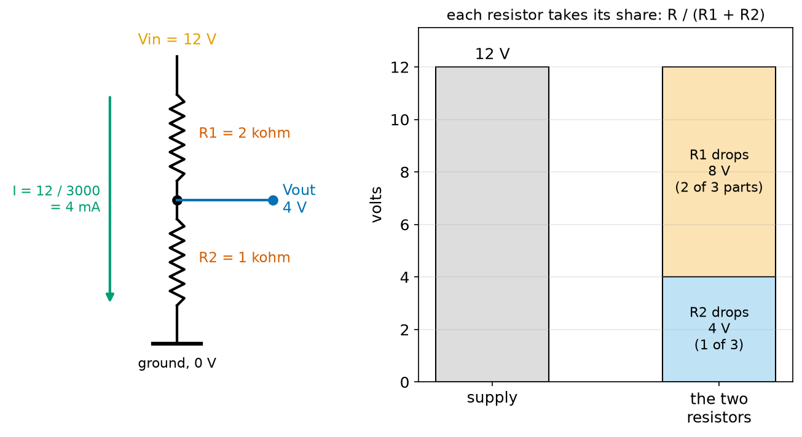
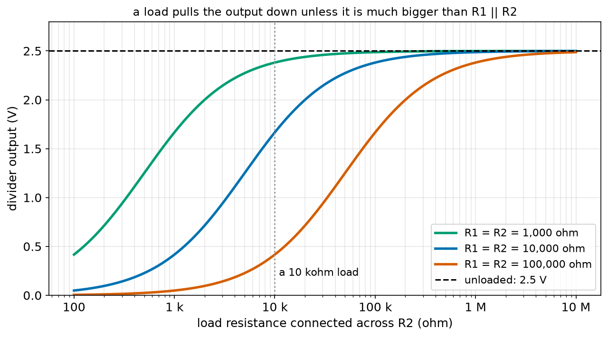
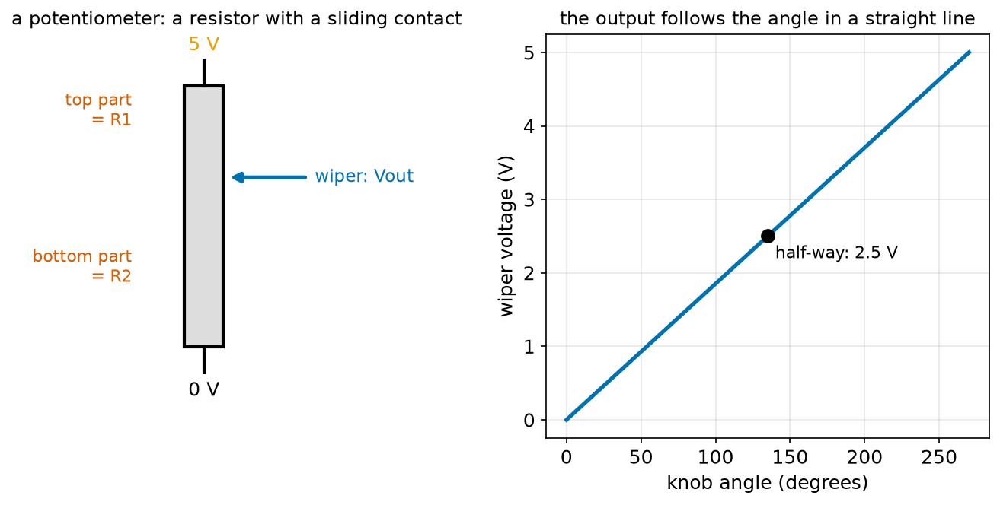
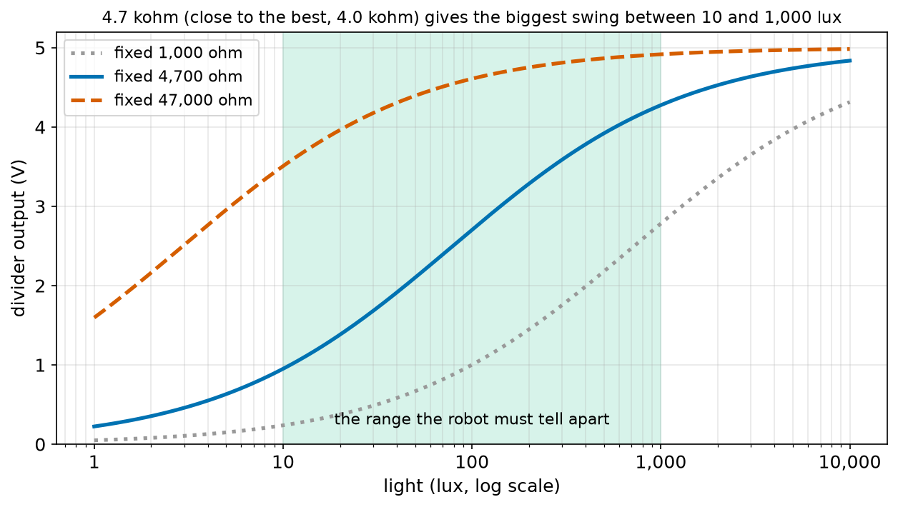
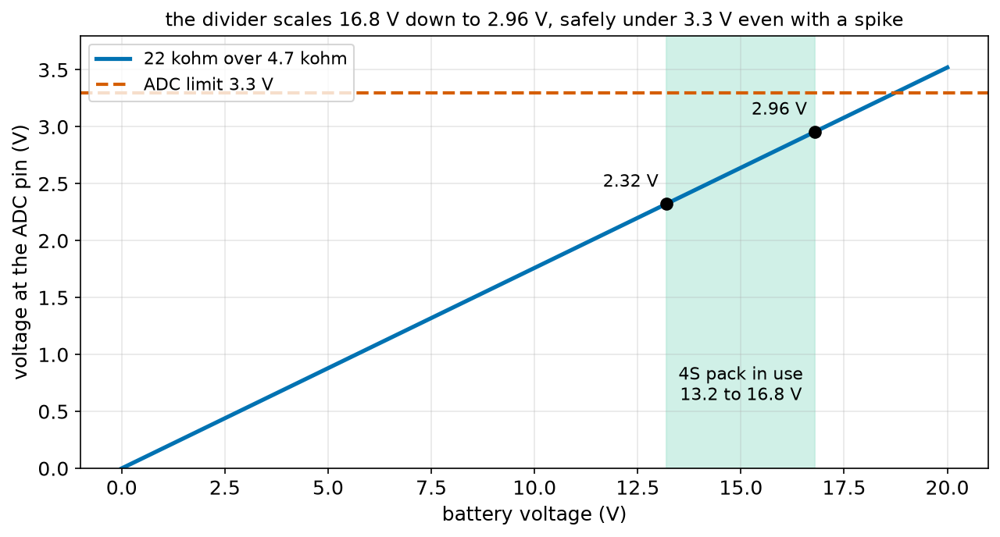
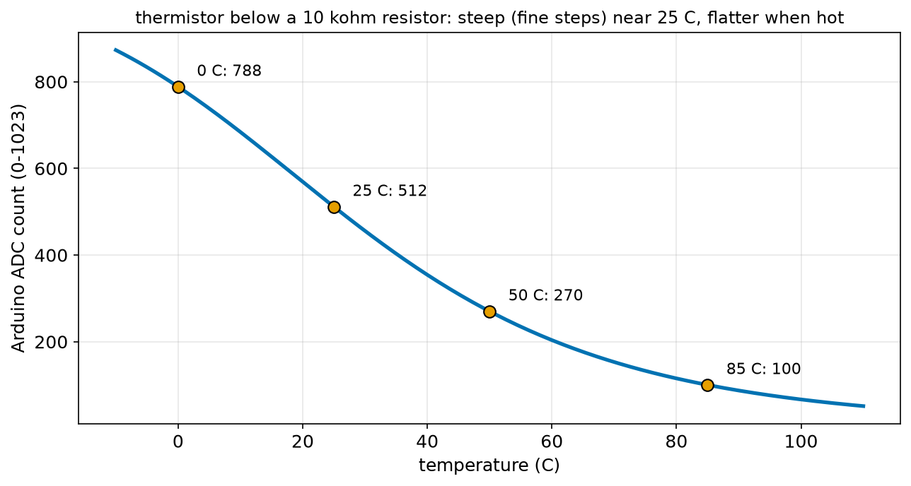

# Chapter 79 — Voltage Dividers

> **Part 5 · Chapter 79 of 749**
> **You need:** Chapter 52 (logarithms), Chapter 74 (the thermistor), Chapter 75 (Ohm's law), Chapter 77 (series and parallel) and Chapter 78 (the bridge and the solver).
> **You will make:** a program that shows how a divider behaves with and without a load, a battery monitor that lets a 3.3 V flight controller read a 16.8 V drone pack, a light sensor whose fixed resistor is chosen for the best signal, and a program that turns an Arduino reading into a motor-driver temperature.

---

## What you will learn

- The **voltage divider**: two resistors in series, with the output taken from the middle.
- The divider formula **Vout = Vin × R2 / (R1 + R2)**, and where it comes from.
- How to choose the two resistors: the **ratio** sets the voltage, the **size** sets the current wasted and how stiff the output is.
- **Loading**: why a divider's output sags when you connect something to it, and how much.
- The **potentiometer**: a divider you can turn by hand.
- How to read **resistive sensors** (thermistors, light sensors) with a divider and an ADC, and how to turn the reading back into a temperature or a light level.

---

## New words in this chapter

| Word | Simple meaning |
|---|---|
| **voltage divider** | Two resistors in series across a supply; the voltage at the joint is a fixed fraction of the supply. |
| **ratio** | The fraction R2 / (R1 + R2): how much of the input appears at the output. |
| **tap** | The middle point of a divider, where the output is taken. |
| **load** | Whatever is connected to the divider's output. |
| **loading** | The fall in a divider's output when a load draws current from it. |
| **output resistance** | How "soft" a voltage is: the resistance that seems to sit in series with it. For a divider, R1 in parallel with R2. |
| **potentiometer (pot)** | A resistor with a sliding contact, the **wiper**, that makes an adjustable divider. |
| **LDR** | Light-dependent resistor: its resistance falls as light gets brighter. |
| **ADC** | Analog-to-digital converter (Chapter 75): measures a voltage and gives a number. |
| **full scale** | The largest voltage an ADC can measure, such as 5 V on an Arduino Uno or 3.3 V on many newer boards. |

---

## 79.1 Two resistors, one useful voltage

Chapter 77's series circuit already did it. Three resistors in series on 12 V got 2, 4 and 6 V each: **each resistor took a share of the voltage in proportion to its resistance**. Take just two resistors and pick off the voltage at the joint between them, and you have the most useful little circuit in electronics.

📖 **New word: voltage divider** — two resistors in series across a supply. The voltage at the joint between them (the **tap**) is a fixed fraction of the supply.



*Figure 79.1 — 12 V across 2 kΩ over 1 kΩ. The joint sits at 4 V: one third of the supply, because R2 is one third of the total.*

**How to read this picture:** On the left, R1 (2 kΩ) is on top and R2 (1 kΩ) goes to ground. The same 4 mA flows through both (they are in series). The blue output is taken from the joint. On the right, the bar shows how the 12 V is shared: R1 drops 8 V (two parts out of three) and R2 drops 4 V (one part). The output is the voltage across R2, measured from ground: 4 V.

### The formula

The same current I flows through both resistors (Chapter 77, series Rule 1):

```
I = Vin / (R1 + R2)                            (Ohm's law for the whole pair)
Vout = I × R2                                  (Ohm's law for R2 alone)
Vout = Vin × R2 / (R1 + R2)
```

In words: "the output equals the input times the bottom resistor, divided by the total".

📖 **New word: ratio** — the fraction R2 / (R1 + R2). The output is always the input times this ratio, which is between 0 and 1. A divider can only make a voltage **smaller**.

🔢 **Maths.** Figure 79.1: Vout = 12 × 1,000 ÷ 3,000 = **4 V**.

🔢 **Maths.** Two equal resistors give half: 5 V × 10 k ÷ 20 k = 2.5 V, whatever the size of the resistors.

🔢 **Maths.** Rover's battery (8.4 V when full, Chapter 74) through 10 kΩ over 10 kΩ: 4.2 V, safely under the Arduino's 5 V limit. This is how Rover will watch its own battery.

💡 **Tip.** Only the **ratio** sets the output. 1 kΩ over 1 kΩ and 100 kΩ over 100 kΩ both give half. The **size** matters for two other things, the next two sections.

---

## 79.2 Size, part 1: the current wasted

A divider is always connected across the supply, so current flows through it all the time, doing nothing useful:

```
current = Vin / (R1 + R2)
power wasted = Vin² / (R1 + R2)
```

🔢 **Maths.** From 5 V: 1 kΩ + 1 kΩ wastes 2.5 mA and 12.5 mW; 100 kΩ + 100 kΩ wastes 25 µA and 0.125 mW, a hundred times less.

For a robot that runs for an hour, 2.5 mA is nothing. For a battery-powered sensor that must last a year, or a drone pack sitting on a shelf for a month, it matters a lot (Application 1 finds a divider that would drain 453 mAh a month). So bigger resistors are better here.

---

## 79.3 Size, part 2: loading

Now connect something to the output: an ADC pin, a sensor input, a meter.

📖 **New word: load** — whatever is connected to the divider's output. It draws a little current from the tap.

The load is a resistor (or behaves like one) connected from the tap to ground. That puts it **in parallel with R2** (Chapter 77). The parallel pair is smaller than R2, so the ratio changes and the output **falls**.

📖 **New word: loading** — the fall in a divider's output caused by a load.

🔢 **Maths.** A 10 kΩ over 10 kΩ divider from 5 V gives 2.5 V. Connect a 10 kΩ load: R2 in parallel with the load is 5 kΩ, so Vout = 5 × 5 ÷ 15 = **1.67 V**. The output fell by a third!



*Figure 79.2 — The output of three 2.5 V dividers as the load resistance changes. Small dividers barely notice a load; big ones collapse.*

**How to read this picture:** The horizontal axis is the load's resistance on a log scale. Each curve is a divider with two equal resistors. Far to the right (a huge load resistance, which draws almost no current) all three give 2.5 V. At a 10 kΩ load (dotted line), the 1 kΩ divider still gives 2.38 V, the 10 kΩ divider 1.67 V and the 100 kΩ divider only 0.42 V.

### Output resistance: the one number that predicts loading

Here is a beautiful shortcut. Seen from its output, a divider behaves exactly like a perfect voltage source of its unloaded voltage, with a resistor in series. That resistor is **R1 in parallel with R2**.

📖 **New word: output resistance** — the resistance that seems to sit in series with a voltage. A small output resistance means a "stiff" voltage that a load hardly changes.

🔢 **Maths.** 10 kΩ over 10 kΩ: output resistance = 10 k × 10 k ÷ 20 k = 5 kΩ. With a 10 kΩ load, the source (2.5 V) and its 5 kΩ make a new divider with the load: 2.5 × 10 ÷ (5 + 10) = 1.67 V. The same answer, by a simpler route. (Why R1 in parallel with R2? Imagine the supply replaced by a wire: from the tap, you would see R1 going up to that wire and R2 going down to ground, both ending at "0 V", side by side: in parallel.)

🧠 **The rule of ten.** To keep loading under about 10%, the load's resistance must be at least ten times the divider's output resistance. To keep it under 1%, a hundred times.

So the two size rules pull in opposite directions:

| Bigger resistors | Smaller resistors |
|---|---|
| waste less current | waste more current |
| are loaded more easily | give a stiffer output |

Luckily, most loads in a robot are very light. An Arduino's ADC pin, a microcontroller's digital input and a good multimeter (Chapter 81) all have input resistances of megohms. For those, dividers of 10 kΩ to 100 kΩ are fine. (ADC pins have one extra need, a quick top-up of charge when they sample; their datasheets ask for an output resistance under about 10 kΩ, or a small capacitor at the pin, which Chapter 84 explains.)

⚠️ **Careful.** Never use a divider to **power** something. A motor, an LED or a sensor that draws real current will pull the output down, and the voltage will change every time the current does. Dividers make **signals**; regulators (Chapter 90) make **power**.

---

## 79.4 The potentiometer: a divider with a knob

📖 **New word: potentiometer** (a "pot") — a resistor track with a third contact, the **wiper**, that slides along it. The track's two ends go to the supply and to ground; the wiper is the tap. As you turn the knob, the wiper moves, and R1 and R2 change while their total stays the same.



*Figure 79.3 — Left: the track and the wiper. Right: the wiper voltage against the knob angle.*

**How to read this picture:** On the left, the grey track runs from 5 V to 0 V. The wiper (blue arrow) splits it into a top part, R1, and a bottom part, R2. On the right, the output rises in a straight line with the angle of the knob, from 0 V at one end of its 270° travel to 5 V at the other. Half-way gives 2.5 V.

🔢 **Maths.** A 10 kΩ pot with the wiper 30% of the way up from the bottom: R2 = 3 kΩ, R1 = 7 kΩ. From 5 V: Vout = 5 × 3 ÷ 10 = 1.5 V.

🤖 **Robot link.** Potentiometers are everywhere in robots:

- Inside every **hobby servo** (Chapter 143), a pot is geared to the output shaft. The servo's electronics read the wiper voltage to know the shaft's angle.
- A **joystick** is two pots at right angles, one for left–right and one for forward–back. The controller reads the two voltages as a direction.
- A simple **robot arm** can use a pot on each joint as an angle sensor, before buying encoders (Chapter 122).

---

## 79.5 Reading resistive sensors

Many sensors are just resistors that change with something in the world: a thermistor with temperature (Chapter 74), a light-dependent resistor with light, a force-sensitive resistor with pressure, a soil probe with moisture (Chapter 74, Application 5). A microcontroller cannot measure resistance directly, but it can measure voltage. A divider turns one into the other: put the sensor in place of one resistor, a fixed resistor in place of the other, and read the tap.

📖 **New word: LDR** — light-dependent resistor. A small disc with a wiggly track of a light-sensitive material. Its resistance falls as light gets brighter: perhaps 20 kΩ in a dim room (10 lux) and 800 Ω in bright office light (1,000 lux).

### Which fixed resistor?

The fixed resistor should make the output **swing as much as possible** across the range you care about. A simple and very good rule: choose the fixed resistor equal to the **geometric mean** of the sensor's resistance at the two ends of the range:

```
R_fixed = √(R_at_one_end × R_at_other_end)
```

🔢 **Maths.** The LDR above, from 10 lux (20,000 Ω) to 1,000 lux (796 Ω): R_fixed = √(20,000 × 796) = √15,920,000 = 3,990 Ω. The nearest standard value is 3.9 kΩ or 4.7 kΩ. The program `light_sensor.py` (Application 3) checks seven values and finds that 4.7 kΩ gives a 3.32 V swing, while 47 kΩ gives only 1.41 V.

Why the geometric mean? The output depends on the ratio of the two resistances. The geometric mean sits "half-way" between the two ends on a log scale (Chapter 52), so the ratio swings equally far either side of 1, and the output swings equally either side of half the supply.



*Figure 79.4 — The divider's output against light, for three fixed resistors. 4.7 kΩ spreads the green range over the most voltage.*

**How to read this picture:** The horizontal axis is light on a log scale; the green band is the range the robot must tell apart. With 47 kΩ (red dashed), the output is already near the top in dim light, so it hardly changes. With 1 kΩ (grey dotted), it stays near the bottom until bright light. With 4.7 kΩ (blue), the output climbs steadily right across the band, from 0.95 V to 4.28 V.

### Turning the reading back into a quantity

The ADC gives a number. To get back to the temperature or the light level, reverse each step:

```
count → Vout:          Vout = count / (steps − 1) × Vin
Vout → sensor ohms:    turn the divider formula round
ohms → quantity:       the sensor's own formula turned round (Chapter 74 did this for the thermistor)
```

With the sensor as R2 (to ground) and the fixed resistor as R1: Vout / Vin = R_s / (R_f + R_s). Call the ratio k. Then k R_f + k R_s = R_s, so **R_s = R_f × k / (1 − k)**. Application 2 does this for the thermistor.

---

## Code

File `code/ch079/divider.py`:

```python
# divider.py - the voltage divider: Vout = Vin x R2 / (R1 + R2), and what happens when you load it
def divider(v_in, r1, r2):
    """Output voltage of an unloaded divider: R1 on top, R2 to ground."""
    return v_in * r2 / (r1 + r2)


def parallel(a, b):
    return a * b / (a + b)


print("unloaded dividers from 5 V:")
for r1, r2 in [(1000, 1000), (2000, 1000), (1000, 2000), (10000, 10000), (100000, 100000)]:
    print(f"  R1 = {r1:6d}, R2 = {r2:6d}: Vout = {divider(5.0, r1, r2):.3f} V, "
          f"current {5.0 / (r1 + r2) * 1000:.3f} mA, wasted {5.0 ** 2 / (r1 + r2) * 1000:.3f} mW")

print()
print("the same 1:1 dividers with a 10 kohm load across R2:")
for r in [1000, 10000, 100000]:
    loaded = divider(5.0, r, parallel(r, 10000))       # the load is in parallel with R2
    print(f"  R1 = R2 = {r:6d}: unloaded 2.500 V, loaded {loaded:.3f} V  ({(loaded - 2.5) / 2.5:+.1%})")

print()
print("the divider's output acts like a source of Vout with a resistance R1 || R2 in series:")
for r in [1000, 10000, 100000]:
    r_out = parallel(r, r)
    print(f"  R1 = R2 = {r:6d}: output resistance {r_out:8.0f} ohm; with 10 kohm load: "
          f"{2.5 * 10000 / (r_out + 10000):.3f} V")
```

| Line | Code | What it does (simple English) |
|---|---|---|
| 1 | `# divider.py …` | A comment. |
| 2 | `def divider(v_in, r1, r2):` | The divider formula as a function. |
| 3 | `"""…"""` | The docstring. |
| 4 | `return v_in * r2 / (r1 + r2)` | Vin × R2 / (R1 + R2). |
| 5–6 | (blank) | Spacing. |
| 7 | `def parallel(a, b):` | Two resistors in parallel (Chapter 77's product over sum). |
| 8 | `return a * b / (a + b)` | The formula. |
| 9–10 | (blank) | Spacing. |
| 11 | `print("unloaded dividers from 5 V:")` | A heading. |
| 12 | `for r1, r2 in [ … ]:` | Five dividers. |
| 13–14 | `print(…)` | The output, the current through the pair, and the power wasted, V² / (R1 + R2). The f-string is split over two lines; Python joins strings that sit side by side. |
| 15 | (blank) | Spacing. |
| 16 | `print()` | An empty line. |
| 17 | `print("the same 1:1 …")` | A heading. |
| 18 | `for r in [1000, 10000, 100000]:` | Three sizes of a 1:1 divider. |
| 19 | `loaded = divider(5.0, r, parallel(r, 10000))` | The load sits in parallel with R2, so R2 is replaced by the pair. |
| 20 | `print(…)` | The loaded output and the change as a percentage. |
| 21 | (blank) | Spacing. |
| 22 | `print()` | An empty line. |
| 23 | `print("the divider's output …")` | A heading. |
| 24 | `for r in [1000, 10000, 100000]:` | The same three dividers. |
| 25 | `r_out = parallel(r, r)` | The output resistance, R1 ∥ R2. |
| 26–27 | `print(…)` | The output resistance, and the loaded voltage found the short way: 2.5 V through r_out into the 10 kΩ load. |

Output:

```
unloaded dividers from 5 V:
  R1 =   1000, R2 =   1000: Vout = 2.500 V, current 2.500 mA, wasted 12.500 mW
  R1 =   2000, R2 =   1000: Vout = 1.667 V, current 1.667 mA, wasted 8.333 mW
  R1 =   1000, R2 =   2000: Vout = 3.333 V, current 1.667 mA, wasted 8.333 mW
  R1 =  10000, R2 =  10000: Vout = 2.500 V, current 0.250 mA, wasted 1.250 mW
  R1 = 100000, R2 = 100000: Vout = 2.500 V, current 0.025 mA, wasted 0.125 mW

the same 1:1 dividers with a 10 kohm load across R2:
  R1 = R2 =   1000: unloaded 2.500 V, loaded 2.381 V  (-4.8%)
  R1 = R2 =  10000: unloaded 2.500 V, loaded 1.667 V  (-33.3%)
  R1 = R2 = 100000: unloaded 2.500 V, loaded 0.417 V  (-83.3%)

the divider's output acts like a source of Vout with a resistance R1 || R2 in series:
  R1 = R2 =   1000: output resistance      500 ohm; with 10 kohm load: 2.381 V
  R1 = R2 =  10000: output resistance     5000 ohm; with 10 kohm load: 1.667 V
  R1 = R2 = 100000: output resistance    50000 ohm; with 10 kohm load: 0.417 V
```

The last two blocks give identical numbers by two different methods, which confirms the output-resistance shortcut. Notice the rule of ten: the 1 kΩ divider (output resistance 500 Ω, twenty times less than the load) loses under 5%.

---

## Small examples

**Example 1.** 9 V, R1 = 3 kΩ, R2 = 6 kΩ: Vout = 9 × 6 ÷ 9 = 6 V.

**Example 2.** 5 V, R1 = 10 kΩ, R2 = 4.7 kΩ: Vout = 5 × 4.7 ÷ 14.7 = 1.60 V.

**Example 3.** To get 3.3 V from 5 V, the ratio is 0.66: R1 = 1.7 kΩ and R2 = 3.3 kΩ (or the standard pair 1.8 kΩ over 3.3 kΩ: 3.24 V).

**Example 4.** A 47 kΩ over 10 kΩ divider: output resistance 47 × 10 ÷ 57 = 8.25 kΩ.

**Example 5.** That divider from 12 V gives 2.105 V. With a 1 MΩ load: 2.105 × 1,000 ÷ 1,008.25 = 2.088 V, a 0.8% drop.

**Example 6.** A 10 kΩ pot at 75% of its travel on 3.3 V: 2.475 V.

**Example 7.** A thermistor reads 4.7 kΩ in a 10 kΩ-over-thermistor divider on 5 V: Vout = 5 × 4.7 ÷ 14.7 = 1.60 V.

**Example 8.** A reading of 400 on a 10-bit ADC (5 V): Vout = 400 ÷ 1,023 × 5 = 1.955 V; k = 0.391; with a 10 kΩ fixed resistor, R_s = 10,000 × 0.391 ÷ 0.609 = 6.42 kΩ.

---

## 🏭 Real robot applications

### Application 1 (worked in full) — 🚁 A battery monitor for a drone's flight controller

**1. The real problem.** Every mobile robot must know its battery voltage, to warn the operator and to come home in time. A drone's flight controller has a 3.3 V, 12-bit ADC (4,096 steps). Its 4S pack goes from 16.8 V (full) down to 13.2 V (time to land, Chapter 74). Connecting 16.8 V to a 3.3 V pin would destroy it. A divider must scale the pack down.

**2. Why this theory.** A divider makes a fixed fraction of the pack voltage. The ratio must keep the highest possible pack voltage (with a safety margin for spikes) under 3.3 V, but as close to it as possible, so the reading uses most of the ADC's steps. The resistor sizes then set the wasted current and the output resistance.

**3. The numbers.** Full scale 3.3 V. Highest pack voltage 16.8 V, plus a 10% margin. Standard resistor values (the E6 series, Chapter 82): 1.0, 1.5, 2.2, 3.3, 4.7 and 6.8, times powers of ten. Total resistance at least 20 kΩ to limit the wasted current.

**4. The maths.**

```
largest ratio = 3.3 ÷ 16.8 ÷ 1.1 = 0.1786
22 kΩ over 4.7 kΩ: ratio = 4.7 ÷ 26.7 = 0.1760          (just under the limit)
16.8 V → 2.957 V     13.2 V → 2.324 V
one ADC step = 3.3 ÷ 4,096 = 0.806 mV at the pin = 0.806 ÷ 0.1760 = 4.58 mV of pack voltage
current = 16.8 ÷ 26,700 = 0.629 mA      output resistance = 22 × 4.7 ÷ 26.7 = 3.87 kΩ
```

**5. The code.** File `code/ch079/battery_monitor.py`:

```python
# battery_monitor.py - let a 3.3 V flight controller measure a 4S drone battery (up to 16.8 V)
ADC_MAX_V = 3.3
ADC_STEPS = 4096           # a 12-bit ADC (Chapter 101)
V_FULL = 16.8
STANDARD = [1000, 1500, 2200, 3300, 4700, 6800, 10000, 15000, 22000, 33000, 47000, 68000, 100000]

# the largest ratio allowed, with a 10% margin for spikes
max_ratio = ADC_MAX_V / V_FULL / 1.1
print(f"Vout / Vin must stay below {max_ratio:.4f}")

best = None
for r2 in STANDARD:
    for r1 in STANDARD:
        ratio = r2 / (r1 + r2)
        if ratio <= max_ratio and r1 + r2 >= 20000:          # under the limit, and not wasting much current
            if best is None or ratio > best[2]:
                best = (r1, r2, ratio)
r1, r2, ratio = best
print(f"chosen: R1 = {r1} ohm, R2 = {r2} ohm, ratio {ratio:.4f}")
print(f"full pack 16.8 V -> {16.8 * ratio:.3f} V at the ADC")
print(f"empty pack 13.2 V -> {13.2 * ratio:.3f} V at the ADC")
step_v = ADC_MAX_V / ADC_STEPS / ratio
print(f"one ADC step = {ADC_MAX_V / ADC_STEPS * 1000:.3f} mV at the ADC = {step_v * 1000:.2f} mV of battery voltage")
current = V_FULL / (r1 + r2)
print(f"the divider draws {current * 1000:.3f} mA: {current * 1000 * 24 * 30:.0f} mAh in a month of storage")
print(f"its output resistance is {r1 * r2 / (r1 + r2):.0f} ohm")

print()
print("reading back: the flight controller turns an ADC count into the battery voltage")
for count in [3000, 3500, 3700]:
    v_adc = count / ADC_STEPS * ADC_MAX_V
    v_batt = v_adc / ratio
    print(f"  count {count}: {v_adc:.3f} V at the ADC -> battery {v_batt:.2f} V = {v_batt / 4:.3f} V per cell")
```

| Line | Code | What it does (simple English) |
|---|---|---|
| 1 | `# battery_monitor.py …` | A comment. |
| 2–5 | `ADC_MAX_V`, `ADC_STEPS`, `V_FULL`, `STANDARD` | The ADC, the pack and the resistor values we can buy. |
| 6 | (blank) | Spacing. |
| 7 | `# the largest ratio …` | A comment. |
| 8 | `max_ratio = ADC_MAX_V / V_FULL / 1.1` | 3.3 ÷ 16.8 with a 10% margin. |
| 9 | `print(…)` | Shows it. |
| 10 | (blank) | Spacing. |
| 11 | `best = None` | No choice yet (Chapter 20's "best so far" pattern). |
| 12–13 | `for r2 in STANDARD: for r1 in STANDARD:` | Try every pair (Chapter 20's nested loops): 169 pairs. |
| 14 | `ratio = r2 / (r1 + r2)` | This pair's ratio. |
| 15 | `if ratio <= max_ratio and r1 + r2 >= 20000:` | Keep only safe pairs that do not waste much current. |
| 16–17 | `if best is None or ratio > best[2]: best = …` | Of those, keep the largest ratio, to use the most ADC steps. |
| 18 | `r1, r2, ratio = best` | Unpack the winner. |
| 19–21 | `print(…)` | The choice, and what full and empty packs give at the pin. |
| 22 | `step_v = ADC_MAX_V / ADC_STEPS / ratio` | One ADC step, scaled back up to pack volts. |
| 23 | `print(…)` | The resolution. |
| 24 | `current = V_FULL / (r1 + r2)` | Ohm's law for the pair. |
| 25 | `print(…)` | The current, and the mAh over 30 days of 24 hours. |
| 26 | `print(…)` | The output resistance R1 ∥ R2. |
| 27 | (blank) | Spacing. |
| 28 | `print()` | An empty line. |
| 29 | `print("reading back: …")` | A heading. |
| 30 | `for count in [3000, 3500, 3700]:` | Three ADC readings. |
| 31 | `v_adc = count / ADC_STEPS * ADC_MAX_V` | Count back to volts at the pin. |
| 32 | `v_batt = v_adc / ratio` | Undo the divider. |
| 33 | `print(…)` | The pack voltage and the voltage per cell. |

Output:

```
Vout / Vin must stay below 0.1786
chosen: R1 = 22000 ohm, R2 = 4700 ohm, ratio 0.1760
full pack 16.8 V -> 2.957 V at the ADC
empty pack 13.2 V -> 2.324 V at the ADC
one ADC step = 0.806 mV at the ADC = 4.58 mV of battery voltage
the divider draws 0.629 mA: 453 mAh in a month of storage
its output resistance is 3873 ohm

reading back: the flight controller turns an ADC count into the battery voltage
  count 3000: 2.417 V at the ADC -> battery 13.73 V = 3.433 V per cell
  count 3500: 2.820 V at the ADC -> battery 16.02 V = 4.005 V per cell
  count 3700: 2.981 V at the ADC -> battery 16.93 V = 4.234 V per cell
```



*Figure 79.6 — The ADC pin's voltage against the pack's voltage. The working range (green) maps to 2.32–2.96 V, under the 3.3 V limit.*

**How to read this picture:** The blue line is the divider: a straight line through zero with slope 0.176. The green band is the pack's working range. Even a pack at 18.7 V, well above full, would only just reach the red 3.3 V limit.

**6. The result.** A 22 kΩ over 4.7 kΩ divider lets the flight controller read the pack to about 5 mV, far better than needed (a cell's voltage changes by about 0.6 V from full to empty). The output resistance (3.9 kΩ) is low enough for the ADC. The program also reveals a real trap: if the divider is left connected to a pack in storage, it drains 453 mAh a month, enough to empty a stored pack below its safe limit over a winter. Real flight controllers connect the divider only when the drone is powered on, through its main switch.

**7. Going further.** Many boards use a much bigger divider (say 100 kΩ over 22 kΩ, 0.14 mA) and add a small capacitor at the ADC pin (Chapter 84), which gives the ADC its quick charge while keeping the drain low. Chapter 101 reads such a divider with the Arduino, and Chapter 151 adds the battery monitor to Rover's power budget. Chapter 621 explains why the per-cell voltage is only a rough guide to how much flight is left.

### Application 2 (worked in full) — 🤖 Reading Rover's motor-driver temperature

**1. The real problem.** Chapter 76 glued a thermistor to Rover's motor driver and decided to slow down at 70 °C and stop at 85 °C. Chapter 74 could only say "measure the resistance". Now we build the measurement: a 10 kΩ fixed resistor from 5 V, the thermistor to ground, and the tap to an Arduino Uno ADC pin (10 bits: counts 0 to 1,023).

**2. Why this theory.** The divider turns the thermistor's resistance into a voltage; the ADC turns the voltage into a count. To get the temperature back, the program reverses both: count to ratio, ratio to resistance (the divider formula turned round), resistance to temperature (Chapter 74's formula turned round).

**3. The numbers.** Thermistor 10 kΩ at 25 °C, B = 3950. Fixed resistor 10 kΩ. Supply 5 V. 10-bit ADC.

**4. The maths.** At 85 °C the thermistor is 1,087 Ω (Chapter 74). Vout = 5 × 1,087 ÷ 11,087 = 0.490 V. Count = 0.490 ÷ 5 × 1,023 = 100. Back again: k = 100 ÷ 1,023 = 0.0978; R = 10,000 × 0.0978 ÷ 0.9022 = 1,083 Ω; temperature 85.1 °C.

**5. The code.** File `code/ch079/thermistor_reader.py`:

```python
# thermistor_reader.py - read a motor driver's temperature: thermistor + fixed resistor + 10-bit ADC
import math

R_25, B = 10000.0, 3950.0       # the thermistor of Chapter 74
R_FIXED = 10000.0               # on top, from 5 V
V_IN = 5.0
STEPS = 1024                    # Arduino Uno's 10-bit ADC


def thermistor(temp_c):
    return R_25 * math.exp(B * (1 / (temp_c + 273.15) - 1 / 298.15))


def count_at(temp_c):
    """The ADC count the Arduino would read at this temperature (thermistor to ground)."""
    v = V_IN * thermistor(temp_c) / (R_FIXED + thermistor(temp_c))
    return round(v / V_IN * (STEPS - 1))


def temperature_from_count(count):
    """Turn the count back into a temperature: divider formula reversed, then Chapter 74's formula reversed."""
    ratio = count / (STEPS - 1)                     # Vout / Vin
    r_therm = R_FIXED * ratio / (1 - ratio)         # from Vout/Vin = Rt / (Rf + Rt)
    inv_t = 1 / 298.15 + math.log(r_therm / R_25) / B
    return 1 / inv_t - 273.15


print(f"{'temp':>6s} {'thermistor':>11s} {'count':>6s} {'read back':>10s} {'1 count =':>10s}")
for t in [0, 25, 50, 70, 85, 100]:
    c = count_at(t)
    per_count = abs(temperature_from_count(c + 1) - temperature_from_count(c))
    print(f"{t:4d} C {thermistor(t):9.0f} ohm {c:6d} {temperature_from_count(c):8.1f} C {per_count:8.2f} C")
```

| Line | Code | What it does (simple English) |
|---|---|---|
| 1 | `# thermistor_reader.py …` | A comment. |
| 2 | `import math` | For `exp` and `log`. |
| 3 | (blank) | Spacing. |
| 4–7 | `R_25, B`, `R_FIXED`, `V_IN`, `STEPS` | The thermistor, the fixed resistor, the supply and the ADC. |
| 8–9 | (blank) | Spacing. |
| 10–11 | `def thermistor(temp_c): …` | Chapter 74's formula. |
| 12–13 | (blank) | Spacing. |
| 14 | `def count_at(temp_c):` | What the Arduino would read. |
| 15 | `"""…"""` | The docstring. |
| 16 | `v = V_IN * thermistor(temp_c) / (R_FIXED + thermistor(temp_c))` | The divider formula with the thermistor as R2. |
| 17 | `return round(v / V_IN * (STEPS - 1))` | The ADC count: the fraction of full scale times 1,023, rounded to a whole number as a real ADC does. |
| 18–19 | (blank) | Spacing. |
| 20 | `def temperature_from_count(count):` | The reverse. |
| 21 | `"""…"""` | The docstring. |
| 22 | `ratio = count / (STEPS - 1)` | Count back to Vout ÷ Vin. |
| 23 | `r_therm = R_FIXED * ratio / (1 - ratio)` | R_s = R_f × k / (1 − k), from section 79.5. |
| 24–25 | `inv_t = …`, `return …` | Chapter 74's formula turned round. |
| 26–27 | (blank) | Spacing. |
| 28 | `print(…)` | The header. |
| 29 | `for t in [0, 25, 50, 70, 85, 100]:` | Six temperatures. |
| 30 | `c = count_at(t)` | The count. |
| 31 | `per_count = abs(…)` | How many degrees one count is worth here: read back count c + 1 and count c, and subtract. |
| 32 | `print(…)` | The row. |

Output:

```
  temp  thermistor  count  read back  1 count =
   0 C     33621 ohm    788      0.0 C     0.10 C
  25 C     10000 ohm    512     25.0 C     0.09 C
  50 C      3588 ohm    270     50.0 C     0.13 C
  70 C      1760 ohm    153     70.0 C     0.23 C
  85 C      1087 ohm    100     85.1 C     0.36 C
 100 C       698 ohm     67     99.8 C     0.56 C
```



*Figure 79.5 — The ADC count against temperature for a thermistor below a 10 kΩ resistor.*

**How to read this picture:** The count falls as the driver gets hotter, because the thermistor's resistance falls and it takes a smaller share of the 5 V. The curve is steepest around room temperature, where one count is under 0.1 °C, and flattens when hot, where one count is worth 0.36 °C at 85 °C.

**6. The result.** The Arduino can read the driver's temperature to better than half a degree everywhere it matters, and the two decisions become simple comparisons: "count below 153: slow down", "count below 100: stop". Doing the comparisons in counts means the Arduino never has to compute a logarithm in its fast loop. Without the divider there would be no way to turn the thermistor into anything the Arduino could read.

**7. Going further.** To make the reading most precise at 70–85 °C, the rule of section 79.5 says the fixed resistor should be about √(1,760 × 1,087) = 1.4 kΩ instead of 10 kΩ; Lab 79.2 tests that. Chapter 101 runs this on a real Arduino, and Chapter 134 smooths the noisy counts with a moving average.

### Application 3 — 🦋 The light sensors of a light-seeking robot

Chapter 93's Moth robot needs two light sensors, one on each side, so that it can turn towards the brighter side. Each is an LDR in a divider. `light_sensor.py` (in this chapter's code folder) chooses the fixed resistor:

```
LDR: 20000 ohm at 10 lux, 796 ohm at 1000 lux
  fixed R  V at 10 lux  V at 1000 lux  difference
   1000        0.238 V        2.784 V     2.546 V
   2200        0.495 V        3.671 V     3.176 V
   4700        0.951 V        4.276 V     3.324 V
   6800        1.269 V        4.476 V     3.207 V
  10000        1.667 V        4.631 V     2.965 V
  22000        2.619 V        4.825 V     2.206 V
  47000        3.507 V        4.917 V     1.409 V
best fixed resistor = sqrt(20000 x 796) = 3991 ohm
```

The best swing comes from 4.7 kΩ, matching the geometric-mean rule. Moth will feed the two divider outputs into transistors (Chapter 87) instead of an ADC, but the divider design is the same. Rover uses the same idea for its line sensor: a light sensor looking down at the floor gives a high or a low voltage over a dark line or a light floor (Chapter 292).

### Application 4 — 🎮 Joysticks and servo feedback

The joystick on a robot's remote control is two 10 kΩ potentiometers. At rest, each wiper is in the middle and gives 2.5 V (or 1.65 V on a 3.3 V board). Pushing the stick forward moves one wiper towards 5 V; the controller turns 2.5 → 5 V into a speed of 0 → full forward, and 2.5 → 0 V into full reverse. Inside every hobby servo (Chapter 143) is a pot geared to the output shaft. Its wiper voltage tells the servo's controller the shaft's angle, and the controller turns the motor until that voltage matches the command: a closed loop (Chapter 2) whose sensor is a voltage divider. Pots wear out with use, which is why expensive servos and robot arms use magnetic or optical encoders instead (Chapter 122).

### Application 5 — 🔌 A 5 V signal into a 3.3 V board

A 5 V sensor's digital output must sometimes go into a 3.3 V microcontroller such as an ESP32 or a Raspberry Pi, whose pins can be damaged by 5 V. A divider of 1 kΩ over 2 kΩ turns 5 V into 3.33 V and 0 V into 0 V. Its output resistance (667 Ω) is low enough for the fast edges of a digital signal. This is the cheapest "level shifter" there is, and it only works in one direction (5 V down to 3.3 V) and for signals, not power. Chapter 91 explains logic levels and better level shifters.

---

## 🔧 Hands-on lab

### Lab 79.1 — Build and load a divider (hardware, or Tinkercad)

You need: a 9 V battery or 5 V USB supply, two 10 kΩ resistors, two 100 kΩ resistors, one 10 kΩ and one 1 kΩ to act as loads, and a multimeter or the simulator's meter.

1. Build the 10 kΩ over 10 kΩ divider. Measure the tap. Predict it first.
2. Connect a 10 kΩ load from the tap to ground. Measure again.
3. Repeat with the 100 kΩ pair, then with a 1 kΩ load.

**What you should see:** On 9 V, the 10 kΩ pair gives 4.5 V, falling to 3.0 V with the 10 kΩ load and to 0.75 V with the 1 kΩ load. The 100 kΩ pair gives 4.5 V, falling to 0.75 V with 10 kΩ and 0.088 V with 1 kΩ. Your meter's own input (usually 10 MΩ) barely affects the 10 kΩ divider but takes about 0.5% off the 100 kΩ one: the meter is a load too.

| If it does not work | Likely cause | Fix |
|---|---|---|
| The tap reads the full supply | R2 is not connected to ground | Check the bottom resistor's leg |
| The tap reads 0 V | R1 is not connected to the supply | Check the top resistor's leg |
| Readings drift as you touch the probes | Your body is loading a high-resistance divider | Hold the probes by their plastic handles |

**Challenge:** Use the output-resistance rule to predict each loaded voltage before you measure it, and compare.

### Lab 79.2 — Tune the thermistor reader (simulation)

Copy `thermistor_reader.py`.

1. Change `R_FIXED` to 1,500 Ω. Print the table again. How many degrees is one count worth at 85 °C now? At 0 °C?
2. Add a 10% error to `R_FIXED` in `temperature_from_count` only (as if the real resistor were 11 kΩ but the program believes 10 kΩ). How wrong is the reading at 85 °C?
3. Turn the decisions into counts: write a function that returns the count for any temperature, and print the thresholds for 70 °C and 85 °C with the new fixed resistor.

**What you should see:** With 1.5 kΩ, one count at 85 °C is about 0.13 °C (nearly three times finer than with 10 kΩ), while at 0 °C one count becomes about 0.45 °C. You trade precision where you do not need it for precision where you do. The new thresholds are counts 552 (70 °C) and 430 (85 °C). A 10% resistor error makes the 85 °C reading show 88.1 °C, about 3 °C wrong: use 1% resistors in measuring circuits (Chapter 82).

| If it does not work | Likely cause | Fix |
|---|---|---|
| `ZeroDivisionError` | A count of 1,023 makes 1 − ratio zero | A count at the very top means a broken thermistor wire: report a fault instead |
| `ValueError: math domain error` | A count of 0 makes the log of zero | A count of 0 means a short circuit: report a fault |

**Challenge:** Add those two fault checks to `temperature_from_count`, raising a `ValueError` with a clear message (Chapter 25).

### Lab 79.3 — A light meter you can believe (simulation)

Copy `light_sensor.py`.

1. Write `lux_from_volts(v, r_fixed)` that reverses both steps: the divider, then the LDR's power law (R = 20,000 × (lux / 10)^−0.7 turned round with logarithms or powers).
2. Test it: for 10, 100 and 1,000 lux, compute the voltage and then read it back.
3. With a 10-bit ADC on 5 V and the 4.7 kΩ fixed resistor, how many lux is one ADC count worth at 10 lux and at 1,000 lux?

**What you should see:** The lux comes back exactly. Turning R = 20,000 × (lux/10)^−0.7 round gives lux = 10 × (R / 20,000)^(−1/0.7). One count is worth about 0.09 lux at 10 lux and about 11 lux at 1,000 lux. In ratio terms that is roughly the same, about 1% of the reading at both ends, which is what a log-scale sensor should give.

| If it does not work | Likely cause | Fix |
|---|---|---|
| The lux comes back as a complex number | A negative number raised to a fractional power | Check that R is positive: the voltage must be between 0 and 5 V |

**Challenge:** Add a second LDR on the other side of an imaginary Moth, put one at 200 lux and the other at 300 lux, and print which way the robot should turn and how big the voltage difference is.

---

## Common mistakes

⚠️ **Putting R1 and R2 the wrong way round.** The output is the voltage across the **bottom** resistor (the one to ground): Vin × R2 / (R1 + R2).

⚠️ **Using a divider to power something.** It sags with the load. Dividers make signals; regulators make power.

⚠️ **Forgetting the load.** An input with a resistance near the divider's output resistance pulls the output down.

⚠️ **Choosing huge resistors to save current** and then wondering why an ADC reads wrong or a meter changes the reading.

⚠️ **Letting a divider drain a stored battery.** Switch it off with the robot.

⚠️ **Forgetting the margin.** A divider that gives exactly 3.3 V at a full pack will exceed it during a spike or when charging.

⚠️ **Reading an ADC count of 0 or 1,023 as a real measurement.** At the very ends, the sensor is usually disconnected or shorted.

---

## Practice

🏋️ **1.** 12 V across 3.3 kΩ (top) and 2.2 kΩ (bottom). Find the output.

🏋️ **2.** You need 2.5 V from 9 V with a bottom resistor of 10 kΩ. What top resistor?

🏋️ **3.** A divider of 4.7 kΩ over 4.7 kΩ on 5 V feeds a 47 kΩ load. Find the loaded output, using the output-resistance method.

🏋️ **4.** What is the current through a 100 kΩ over 47 kΩ divider on 24 V, and how much power does it waste?

🏋️ **5.** A 6S drone pack (25.2 V full) must be read by a 3.3 V ADC with a 10% margin. What is the largest ratio allowed? Which pair from the standard list in Application 1, with a total of at least 20 kΩ, comes closest without going over?

🏋️ **6.** A 10 kΩ potentiometer on 3.3 V gives 1.1 V at its wiper. How far round is it (as a fraction of its travel)?

🏋️ **7.** A force-sensitive resistor is 100 kΩ with no force and 1 kΩ when pressed hard. What fixed resistor gives the best swing?

🏋️ **8.** A thermistor divider (10 kΩ on top, thermistor below, 5 V, 10-bit ADC) reads 300. Find the thermistor's resistance.

🏋️ **9.** Rover's battery (up to 8.4 V) goes through 10 kΩ over 10 kΩ to a 5 V, 10-bit ADC. The reading is 780. What is the battery voltage?

🏋️ **10.** A divider's output resistance is 8 kΩ. What is the smallest load resistance that keeps the loading under 1%?

🏋️ **11.** Write `choose_divider(v_max, adc_full, margin, min_total, standard)` that returns the best (R1, R2) pair as in Application 1, and use it for Rover (8.4 V, 5 V ADC, 10% margin, at least 20 kΩ).

---

## Answers

**1.** 12 × 2.2 ÷ 5.5 = 4.8 V.

**2.** Ratio 2.5 ÷ 9 = 0.2778. R1 + R2 = 10 k ÷ 0.2778 = 36 kΩ, so R1 = 26 kΩ.

**3.** Unloaded 2.5 V; output resistance 2.35 kΩ. Loaded: 2.5 × 47 ÷ (2.35 + 47) = 2.381 V.

**4.** I = 24 ÷ 147,000 = 0.163 mA. P = 24² ÷ 147,000 = 3.9 mW.

**5.** 3.3 ÷ 25.2 ÷ 1.1 = 0.1190. Checking the pairs with a total of at least 20 kΩ, the largest ratio under 0.1190 is **22 kΩ over 2.2 kΩ**: 2.2 ÷ 24.2 = 0.0909, so 25.2 V gives 2.29 V. (Pairs such as 33 kΩ over 4.7 kΩ, 0.1247, are just over the limit.) The standard list is coarse, so the best ratio is well under the limit. Program 11 does the search.

**6.** 1.1 ÷ 3.3 = one third of the way up from the ground end.

**7.** √(100,000 × 1,000) = 10 kΩ.

**8.** k = 300 ÷ 1,023 = 0.2933. R = 10,000 × 0.2933 ÷ 0.7067 = 4,150 Ω.

**9.** 780 ÷ 1,023 × 5 = 3.812 V at the pin, × 2 = 7.62 V.

**10.** 100 × 8 kΩ = 800 kΩ.

**11.**

```python
def choose_divider(v_max, adc_full, margin, min_total, standard):
    max_ratio = adc_full / v_max / margin
    best = None
    for r2 in standard:
        for r1 in standard:
            ratio = r2 / (r1 + r2)
            if ratio <= max_ratio and r1 + r2 >= min_total:
                if best is None or ratio > best[2]:
                    best = (r1, r2, ratio)
    return best

STANDARD = [1000, 1500, 2200, 3300, 4700, 6800, 10000, 15000, 22000, 33000, 47000, 68000, 100000]
print(choose_divider(8.4, 5.0, 1.1, 20000, STANDARD))
print(choose_divider(25.2, 3.3, 1.1, 20000, STANDARD))
```

```
(10000, 10000, 0.5)
(22000, 2200, 0.09090909090909091)
```

For Rover: 10 kΩ over 10 kΩ, ratio 0.5, so a full 8.4 V battery gives 4.2 V at the pin (the limit with the margin was 0.541). For the 6S pack: 22 kΩ over 2.2 kΩ, as in question 5.

---

## Summary

🧠 A **voltage divider** is two resistors in series; the tap gives **Vout = Vin × R2 / (R1 + R2)**. It can only make a voltage smaller.

🧠 The **ratio** sets the voltage. The **size** sets two things that pull against each other: the current wasted (Vin ÷ (R1 + R2)) and how easily a load drags the output down.

🧠 Seen from its output, a divider is its unloaded voltage behind an **output resistance of R1 ∥ R2**. Keep the load at least 10 times bigger (100 times for 1%).

🧠 Dividers make **signals**, never power.

🧠 A **potentiometer** is a divider with a moving tap: joysticks, servo feedback, knobs.

🧠 A **resistive sensor** plus a fixed resistor makes a divider an ADC can read. Choose the fixed resistor as **√(R_low × R_high)** of the range you care about.

🧠 To read back, reverse each step: count → ratio → sensor resistance (R_f × k / (1 − k)) → the quantity.

---

## Next chapter

Chapter 80 moves from paper to real parts. You will learn to read **circuit diagrams** (the symbols for every part used so far), build circuits on a **breadboard** without soldering, choose and use wires and connectors, and turn a diagram into a working circuit step by step, checking it before the power goes on.
