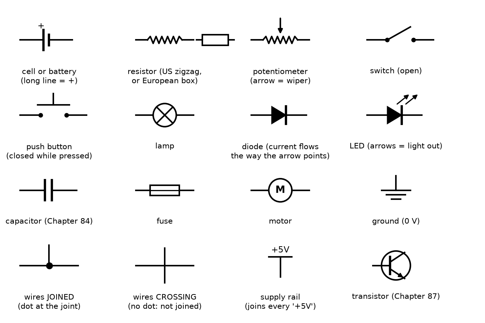
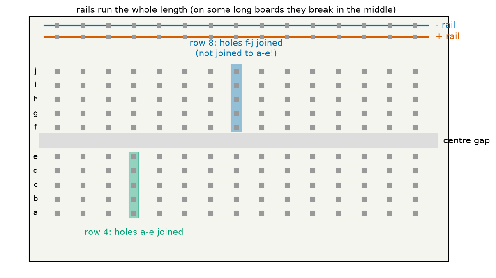
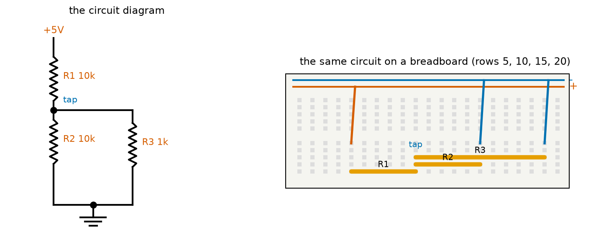
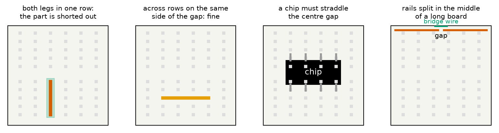
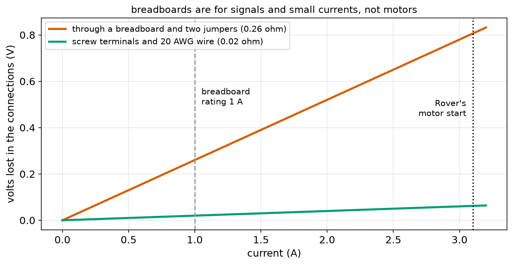
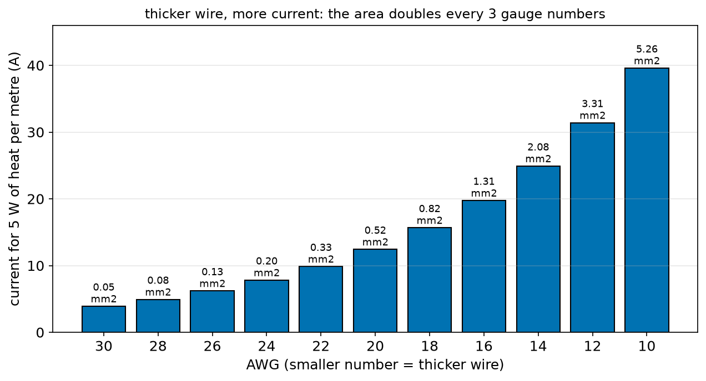

# Chapter 80 — Breadboards, Wires and Reading Circuit Diagrams

> **Part 5 · Chapter 80 of 749**
> **You need:** Chapter 22 (dictionaries and sets), Chapter 74 (resistance of a wire), Chapter 75 (voltage drop), Chapter 76 (heat in wires), Chapter 77 (series and parallel) and Chapter 78 (the circuit solver).
> **You will make:** a program that shows why motors do not belong on a breadboard, a breadboard checker that finds short circuits, shorted parts and open circuits before you switch on, and a wire-gauge table for choosing every wire in a robot.

---

## What you will learn

- How to read a **circuit diagram**: the symbols for every part in Part 5, and the rules for lines, dots and labels.
- How a **breadboard** is joined up inside, and how to turn a diagram into a breadboard layout.
- The most common breadboard mistakes, and how to find them.
- **Wires**: solid and stranded, gauges (AWG and mm²), colours, and how much current each can carry.
- **Connectors**: jumper wires, pin headers, screw terminals and crimped plugs, and what each is good for.
- A safe routine for building and checking a circuit **before** the power goes on.

---

## New words in this chapter

| Word | Simple meaning |
|---|---|
| **circuit diagram (schematic)** | A drawing of a circuit that shows how parts are joined, using standard symbols. |
| **symbol** | The standard little drawing for one kind of part. |
| **net** | Everything that is joined together electrically: one node, however many wires it has. |
| **breadboard** | A plastic board full of holes with metal springs inside, for building circuits without soldering. |
| **strip** | One row of five joined holes on a breadboard. |
| **rail** | A long line of joined holes along a breadboard's edge, used for + and −. |
| **jumper wire** | A short wire with a pin at each end, for breadboards. |
| **solid wire** | Wire with one thick copper core. Stiff; good for breadboards. |
| **stranded wire** | Wire made of many thin copper strands. Flexible; good for anything that moves. |
| **AWG** | American Wire Gauge: a wire-size number. A **smaller** number means a **thicker** wire. |
| **pin header** | A strip of metal pins on a board, which jumper wires and plugs push onto. |
| **screw terminal** | A small block where a wire is clamped under a screw. Good for higher currents. |
| **crimp** | Squeezing a metal contact onto a wire with a special tool, to make a plug. |
| **prototype** | A first, rough build of a circuit or robot, to test the idea. |

---

## 80.1 Why diagrams?

Look at a real robot's electronics and you see a tangle of wires of every colour going in every direction. You cannot tell from the tangle what is joined to what. A **circuit diagram** shows only the thing that matters: **which points are joined**. Where the parts sit, how long the wires are and which colour they have do not appear.

📖 **New word: circuit diagram** (also called a **schematic**) — a drawing that shows how the parts of a circuit are joined, using standard symbols.

You have been reading simple diagrams since Chapter 74. This chapter collects the symbols and the rules, so that you can read the diagram in any datasheet or project from now on.

---

## 80.2 The symbols



*Figure 80.1 — The symbols for the parts of Part 5. Each one shows the part's job, not what it looks like.*

**How to read this picture:** Each symbol sits above its name. A few points to notice:

- **Cell or battery**: the **long** line is **+**. Several cells are drawn as several pairs of lines.
- **Resistor**: the zigzag is used in the USA and Japan; the plain box in Europe. They mean the same thing.
- **Potentiometer**: a resistor with an arrow pointing at it: the wiper (Chapter 79).
- **Diode** and **LED**: the triangle points the way conventional current can flow (Chapter 86 explains). The LED has two little arrows for the light coming out.
- **Ground**: the three shrinking lines. Every ground symbol in a diagram is joined to every other, even if no line is drawn between them.
- **Supply rail**: a label such as **+5V** on a short bar. Every point labelled +5V is joined to every other point labelled +5V.

📖 **New word: symbol** — the standard drawing for one kind of part. Symbols are set by international standards, so a diagram from Japan, Germany or the USA can be read anywhere.

Every symbol also carries a **label**: R1, R2, C1, D1, M1, and usually a **value**: 10k, 100 nF, 1N4007. "10k" means 10 kΩ; the Ω is often left out. "4k7" means 4.7 kΩ; the letter takes the place of the decimal point, because a small dot can be lost when a diagram is printed or copied.

---

## 80.3 The rules for lines

A diagram's lines are wires with no resistance. Four rules:

1. **A line is a perfect wire.** Every point along one line, and along every line joined to it, is the same node.
2. **A dot means joined.** Where three or four lines meet with a dot, they are joined.
3. **No dot means not joined.** Two lines that cross without a dot simply pass over each other (Figure 80.1, bottom row).
4. **Same name, same node.** Labels such as GND, +5V or BATT+ join every point with that name, without drawing a line.

📖 **New word: net** — one node, with every wire and pin that touches it. Engineers say "the 5 V net" or "the net called TAP". Chapter 78's nodes and this chapter's nets are the same thing.

💡 **Tip.** Good diagrams are drawn with the higher voltages near the top and ground at the bottom, and with signals flowing from left to right. Then the drawing itself looks like the "heights" picture of Chapter 74.

---

## 80.4 Inside a breadboard

📖 **New word: breadboard** — a plastic board full of holes, with springy metal strips underneath. Push a part's legs or a wire's pin into a hole and the spring grips it. No soldering is needed, so you can build, change and rebuild a circuit in minutes. (The name comes from the 1950s, when hobbyists nailed parts to a wooden board for cutting bread.)



*Figure 80.2 — Which holes are joined. Each row of five holes (a–e, or f–j) is one strip; the two halves are separated by the centre gap; the rails run along the edges.*

**How to read this picture:** The grey squares are holes. In row 4 (green), the five holes a–e are joined by one metal strip underneath: anything pushed into any of them is joined. In row 8 (blue), holes f–j form a **different** strip: the centre gap separates the two halves. Along the top edge are two **rails**, each joining all the holes along its length; by custom, the red one is +, the blue one is −.

📖 **New word: strip** — one row of five joined holes.

📖 **New word: rail** — a long line of joined holes along the edge, used to carry the supply (+) and ground (−) to every part of the board.

⚠️ **Careful.** On many full-length breadboards, each rail is split into two halves in the middle (look for a gap in the red and blue lines printed on the board). The two halves are **not** joined until you add a short wire across the break.

### From a diagram to a layout

To build a circuit, give each **net** of the diagram its own **strip** (or a rail), then put each part's legs into the strips of the nets it touches.



*Figure 80.3 — Left: a divider with a load, as a diagram. Right: the same circuit on a breadboard. Each net has its own row.*

**How to read this picture:** The diagram has four nets: +5V, the tap, ground and the bottom of nothing else. On the board, R1 runs from row 5 (joined to the + rail by the red wire) to row 10 (the tap). R2 runs from row 10 to row 15 (joined to the − rail). R3 runs from row 10 to row 20 (joined to the − rail). Row 10 holds three legs: R1's lower leg, R2's upper leg and R3's upper leg. That is the dot on the diagram.

A good routine:

1. Number the nets on the diagram: 1, 2, 3 …
2. Give each net a row on the board (or a rail for + and −). Write the row numbers on the diagram.
3. Place each part between the rows of its two nets.
4. Add jumper wires from the rails to the rows that need them.
5. **Check before power** (section 80.7).

---

## 80.5 Common breadboard mistakes



*Figure 80.4 — Four things that catch every beginner.*

**How to read this picture:**

1. **Both legs in one strip.** A part whose two legs sit in the same row has both ends on the same net: it is **shorted out** and does nothing. A resistor must go **across** rows.
2. **Across rows on the same side: fine.** A part that spans several rows on the a–e side is correct: each leg is in its own strip.
3. **Chips straddle the gap.** A chip's two rows of pins sit on either side of the centre gap, so each pin gets its own strip. A chip pushed into one half would have its opposite pins joined in pairs.
4. **Split rails.** If one end of a long board has power and the other does not, the rails are probably split in the middle. Add a bridge wire.

Other mistakes you will make (everyone does):

- A leg that looks pushed in but is resting **on top** of the spring, not inside it. Push firmly; give it a gentle tug to check.
- Being off by one row. Count twice.
- A part pushed into the **rail** instead of row 1.
- Bent or very thin legs (some sensors) that do not grip. Solder them to a pin header first (Chapter 92).

---

## 80.6 Wires and connectors

### Solid or stranded?

📖 **New word: solid wire** — one copper core. It is stiff, holds its shape, and pushes neatly into a breadboard. But bend it back and forth a few dozen times and it breaks.

📖 **New word: stranded wire** — many thin strands twisted together. It is flexible and survives millions of bends, so it is the only choice for anything that moves: a robot's arm, a cable to a wheel, a drone's battery lead. Its loose strands do not go into a breadboard well unless they end in a pin.

### Size: AWG and mm²

Wires are sold by their cross-section area in mm² (Chapter 74) or by their **gauge**.

📖 **New word: AWG** — American Wire Gauge. A **smaller** number is a **thicker** wire. Three gauge numbers down doubles the area (and halves the resistance). AWG 20 is about 0.5 mm²; AWG 12 is about 3.3 mm².

The program `wire_gauge.py` (Application 2) prints the table you need: diameter, area, resistance per metre, and the current that heats a metre of wire by 5 W, a safe limit for wires bundled inside a robot (half of Chapter 76's 10 W per metre for a single wire in open air).

### Colours

Wires carry no meaning in their colour, but people do. Use a consistent code so that anyone (including you, next month) can follow the wiring:

| Colour | Use |
|---|---|
| **red** | the + of the battery, or the main supply |
| **black** | ground, the − of the battery |
| **orange** or **yellow** | other supplies (5 V, 3.3 V) |
| **blue, green, white** | signals |
| **any two matching colours** | the two wires of a motor (swap them to reverse it) |

Hobby servos use their own code: brown or black for ground, red for power, and orange, yellow or white for the signal.

### Connectors

| Connector | Good for | Current |
|---|---|---|
| **jumper wire** into a breadboard | signals while prototyping | under 1 A |
| **pin header** (2.54 mm pitch) and Dupont plugs | signals, sensors, servo leads | about 1–3 A |
| **screw terminal** | motor and battery wires | 5–15 A |
| **crimped plugs** (JST, Molex) | finished robots, everything that must not fall out | 1–10 A |
| **XT30, XT60, XT90** | drone and robot batteries | 15, 30–60, 90 A |
| **soldered joint** (Chapter 92) | anything permanent | as much as the wire |

📖 **New word: pin header** — a strip of metal pins, 2.54 mm (0.1 inch) apart, soldered to a board. Sensors and microcontrollers come with them.

📖 **New word: screw terminal** — a block where a stripped wire is clamped under a screw. Firm, easy to change, and good for higher currents.

📖 **New word: crimp** — to squeeze a small metal contact onto the end of a wire with a crimping tool, so it can click into a plastic plug housing.

---

## 80.7 Check before power

Most damaged parts are damaged in the first second after the power goes on. Make this routine a habit:

1. **Compare the board with the diagram, net by net.** Tick each part on the diagram as you check it.
2. **Look for shorts.** Is there any path from + to − that does not go through a part? Is any wire's bare end touching another?
3. **Check the polarity** of every part that has one: batteries, LEDs, diodes, electrolytic capacitors (Chapter 84), chips.
4. **Measure the resistance from + to − with the power off** (Chapter 81). If it is near 0 Ω, there is a short.
5. **Power up with a current limit** if you have a bench supply (set it to a little above the expected current), or through a fuse.
6. **Feel for heat** in the first 10 seconds, and switch off at once if anything is hot or smells.

📖 **New word: prototype** — a first, quick build of a circuit, to check that the idea works. Breadboards are for prototypes. A finished robot has soldered boards and crimped plugs, because breadboard contacts work loose with vibration.

---

## Code

File `code/ch080/breadboard_current.py`:

```python
# breadboard_current.py - why motors do not belong on a breadboard: contact resistance and heat
CONTACT_OHM = 0.015         # each spring contact on a typical breadboard (it varies: 0.005 to 0.05)
JUMPER_OHM = 0.10           # one 20 cm jumper wire of AWG 24 with its two pins
CONTACTS_IN_PATH = 4        # out and back, two contacts each way
JUMPERS_IN_PATH = 2
RATED_A = 1.0               # what most breadboards are rated for

r_path = CONTACTS_IN_PATH * CONTACT_OHM + JUMPERS_IN_PATH * JUMPER_OHM
print(f"resistance of the path through the breadboard: {r_path:.3f} ohm")
print(f"{'current':>8s} {'lost volts':>11s} {'heat in one contact':>20s} {'ok?':>5s}")
for amps in [0.02, 0.1, 0.5, 1.0, 1.5, 3.0]:
    lost = amps * r_path
    contact_heat = amps ** 2 * CONTACT_OHM
    ok = "yes" if amps <= RATED_A else "NO"
    print(f"{amps:6.2f} A {lost:9.3f} V {contact_heat * 1000:15.1f} mW {ok:>7s}")

print()
print("an LED (20 mA) or a sensor loses under 0.01 V: fine.")
print("Rover's motors starting at 3.1 A would lose", f"{3.1 * r_path:.2f} V", "and heat each contact by",
      f"{3.1 ** 2 * CONTACT_OHM * 1000:.0f} mW: wire motors with screw terminals or soldered joints (Chapter 92).")
```

| Line | Code | What it does (simple English) |
|---|---|---|
| 1 | `# breadboard_current.py …` | A comment. |
| 2–6 | `CONTACT_OHM` … `RATED_A` | The resistance of one spring contact and one jumper, how many of each the current passes through, and the board's rating. |
| 7 | (blank) | Spacing. |
| 8 | `r_path = …` | Everything in the path is in series (Chapter 77): add them. |
| 9 | `print(…)` | Shows it. |
| 10 | `print(…)` | The header. |
| 11 | `for amps in [ … ]:` | Six currents, from an LED's 20 mA to 3 A. |
| 12 | `lost = amps * r_path` | Ohm's law: the voltage lost in the connections. |
| 13 | `contact_heat = amps ** 2 * CONTACT_OHM` | I² R heat in a single spring contact (Chapter 76). |
| 14 | `ok = "yes" if amps <= RATED_A else "NO"` | Compare with the rating. |
| 15 | `print(…)` | The row. |
| 16 | (blank) | Spacing. |
| 17 | `print()` | An empty line. |
| 18–20 | `print(…)` | The conclusion, with Rover's motor start current. |

Output:

```
resistance of the path through the breadboard: 0.260 ohm
 current  lost volts  heat in one contact   ok?
  0.02 A     0.005 V             0.0 mW     yes
  0.10 A     0.026 V             0.2 mW     yes
  0.50 A     0.130 V             3.8 mW     yes
  1.00 A     0.260 V            15.0 mW     yes
  1.50 A     0.390 V            33.8 mW      NO
  3.00 A     0.780 V           135.0 mW      NO

an LED (20 mA) or a sensor loses under 0.01 V: fine.
Rover's motors starting at 3.1 A would lose 0.81 V and heat each contact by 144 mW: wire motors with screw terminals or soldered joints (Chapter 92).
```



*Figure 80.6 — Volts lost in the connections, through a breadboard (red) and through screw terminals with proper wire (green).*

**How to read this picture:** Both lines grow with the current (Ohm's law). The breadboard's line is thirteen times steeper. At an LED's 20 mA, both losses are invisible. At Rover's 3.1 A motor start, the breadboard loses 0.81 V, more than a tenth of the battery, and heats each spring contact by 144 mW, enough to soften the plastic over time and make the contact worse. Breadboards are for signals.

---

## Small examples

**Example 1.** A label "4k7" is 4.7 kΩ; "2R2" is 2.2 Ω; "1M" is 1 MΩ.

**Example 2.** Three lines meet with a dot: one net. Two lines cross with no dot: two nets.

**Example 3.** Two ground symbols on opposite sides of a diagram, with no line between them: still joined.

**Example 4.** A resistor in holes a12 and e12: shorted out (both legs in strip 12, a–e).

**Example 5.** A resistor in holes a12 and a15: correct, strips 12 and 15.

**Example 6.** A wire in c7 and a part's leg in h7: **not** joined (different halves).

**Example 7.** AWG 22 to AWG 16 is 6 gauge numbers down: twice twice the area, so four times the area.

**Example 8.** 1 m of AWG 24 (82 mΩ) carrying 0.5 A loses 41 mV.

---

## 🏭 Real robot applications

### Application 1 (worked in full) — 🏫 A breadboard checker for a robotics lab

**1. The real problem.** In a school robotics lab, students build circuits on breadboards before soldering them for their robots. Many first attempts have a mistake that damages a part when the power goes on. The teacher wants a program that takes a description of what is plugged in where, finds the nets, and warns about the three commonest mistakes before power: a short from + to −, a part with both legs on one net, and a part with a leg on a net that goes nowhere. If all is well, it should solve the circuit and print every voltage. Industry does the same with "design rule checks" before a circuit board is made.

**2. Why this theory.** A breadboard's holes belong to strips, and jumper wires join strips into nets: exactly the "same node" rules of section 80.3. Once every pin is assigned to a net, the mistakes are simple tests on sets (Chapter 22), and the nets become the nodes of Chapter 78's solver.

**3. The numbers.** The circuit of Figure 80.3: 5 V on the + rail, R1 = 10 kΩ from row 5 to row 10, R2 = 10 kΩ from row 10 to row 15, R3 = 1 kΩ from row 10 to row 20, and wires from the rails to rows 5, 15 and 20. Three faulty versions: R2 with both legs in row 10; the wire to row 15 forgotten; and a stray wire joining the + and − rails.

**4. The maths.** The correct circuit: R2 and R3 in parallel give 909 Ω; with R1 the total is 10.909 kΩ; the current from the supply is 0.458 mA; the tap is at 0.458 × 0.909 = 0.417 V (the heavy 1 kΩ "load" drags the divider down from 2.5 V, as Chapter 79 warned).

**5. The code.** File `code/ch080/breadboard.py` (it uses `nodal.py` from Chapter 78, copied into the same folder):

```python
# breadboard.py - which holes of a breadboard are joined? Find the nets, catch mistakes, then solve the circuit
from nodal import solve


def strip_of(hole):
    """The metal strip a hole belongs to. 'c12' -> 'L12' (a-e of row 12), 'h12' -> 'R12', 'T+5' -> 'T+'."""
    if hole[0] in "TB":                       # power rails along the Top and Bottom edges
        return hole[:2]
    column, row = hole[0], hole[1:]
    return ("L" if column in "abcde" else "R") + row


def find_nets(parts, wires):
    """Group strips that are joined by jumper wires. Returns a dict: strip -> net number."""
    strips = set()
    for _, _, pins in parts:
        strips.update(strip_of(h) for h in pins)
    for a, b in wires:
        strips.update([strip_of(a), strip_of(b)])
    net = {s: k for k, s in enumerate(sorted(strips))}
    changed = True
    while changed:                            # keep merging until nothing changes
        changed = False
        for a, b in wires:
            na, nb = net[strip_of(a)], net[strip_of(b)]
            if na != nb:
                low, high = min(na, nb), max(na, nb)
                for s in net:
                    if net[s] == high:
                        net[s] = low
                changed = True
    return net


def check(parts, wires, supply_plus, supply_minus):
    net = find_nets(parts, wires)
    problems = []
    if net[strip_of(supply_plus)] == net[strip_of(supply_minus)]:
        problems.append("SHORT CIRCUIT: the supply's + and - are on the same net")
    for name, _, pins in parts:
        if len({net[strip_of(h)] for h in pins}) == 1:
            problems.append(f"{name}: all its legs are on one net, so it does nothing (it is shorted out)")
    used = {}
    for name, _, pins in parts:
        for h in pins:
            used.setdefault(net[strip_of(h)], []).append(name)
    for n, names in used.items():
        if len(names) == 1 and n not in (net[strip_of(supply_plus)], net[strip_of(supply_minus)]):
            problems.append(f"{names[0]}: one leg is on a net that goes nowhere (an open circuit)")
    return net, problems


def show(title, parts, wires):
    print(f"--- {title} ---")
    net, problems = check(parts, wires, "T+1", "T-1")
    for p in problems:
        print("  PROBLEM:", p)
    if problems:
        return
    # number the nets for the solver: ground's net becomes node 0
    gnd = net[strip_of("T-1")]
    ids = {gnd: 0}
    for n in sorted(set(net.values())):
        if n not in ids:
            ids[n] = len(ids)
    resistors = [(ids[net[strip_of(p[0])]], ids[net[strip_of(p[1])]], ohms) for _, ohms, p in parts]
    plus = ids[net[strip_of("T+1")]]
    v = solve(len(ids) - 1, resistors, [(plus, 0, 5.0, 1e-9)])
    print("  no problems found")
    for name, ohms, pins in parts:
        a, b = ids[net[strip_of(pins[0])]], ids[net[strip_of(pins[1])]]
        print(f"  {name:4s} {ohms:6.0f} ohm: {v[a]:5.3f} V -> {v[b]:5.3f} V, current {(v[a] - v[b]) / ohms * 1000:6.3f} mA")


# a 10 k over 10 k divider in row 10, and a 1 k resistor as the 'load' from the tap to ground
good_parts = [("R1", 10000, ["a5", "a10"]), ("R2", 10000, ["b10", "b15"]), ("R3", 1000, ["c10", "c20"])]
good_wires = [("T+1", "e5"), ("e15", "T-3"), ("e20", "T-5")]
show("correct layout", good_parts, good_wires)

# mistake 1: R2 put in with both legs in row 10
show("R2 in one row", [("R1", 10000, ["a5", "a10"]), ("R2", 10000, ["b10", "d10"]), ("R3", 1000, ["c10", "c20"])], good_wires)

# mistake 2: a wire to the bottom of R2 forgotten
show("missing wire", good_parts, [("T+1", "e5"), ("e20", "T-5")])

# mistake 3: a jumper meant for the tap lands on the - rail and the + rail joined to it by accident
show("rails joined", good_parts, good_wires + [("T+7", "T-7")])
```

| Line | Code | What it does (simple English) |
|---|---|---|
| 1 | `# breadboard.py …` | A comment. |
| 2 | `from nodal import solve` | Chapter 78's solver. |
| 3–4 | (blank) | Spacing. |
| 5 | `def strip_of(hole):` | Which metal strip a hole is on. Holes are named like "c12" (column c, row 12) and rail holes like "T+5" (top + rail, hole 5). |
| 6 | `"""…"""` | The docstring, with examples. |
| 7–8 | `if hole[0] in "TB": return hole[:2]` | A rail hole: the whole rail is one strip, named "T+", "T-", "B+" or "B-". |
| 9 | `column, row = hole[0], hole[1:]` | Split "c12" into "c" and "12" (Chapter 15's slices). |
| 10 | `return ("L" if column in "abcde" else "R") + row` | Columns a–e are the left strip of the row, f–j the right strip. |
| 11–12 | (blank) | Spacing. |
| 13 | `def find_nets(parts, wires):` | Work out which strips are joined into nets. |
| 14 | `"""…"""` | The docstring. |
| 15–19 | `strips = set()` … | Collect every strip that any part or wire touches (a set, Chapter 22, has no repeats). |
| 20 | `net = {s: k for k, s in enumerate(sorted(strips))}` | Start with every strip in its own net, numbered 0, 1, 2 … (a dictionary comprehension). |
| 21–22 | `changed = True`, `while changed:` | Repeat until a full pass changes nothing. |
| 23 | `changed = False` | Assume this pass changes nothing. |
| 24 | `for a, b in wires:` | Each jumper joins the strips at its two ends. |
| 25 | `na, nb = …` | Their current net numbers. |
| 26 | `if na != nb:` | Not yet in the same net? |
| 27–30 | `low, high = …` and the inner loop | Merge: every strip numbered `high` is renumbered `low`. |
| 31 | `changed = True` | Something changed, so go round again. |
| 32 | `return net` | The finished map from strip to net. |
| 33–34 | (blank) | Spacing. |
| 35 | `def check(parts, wires, supply_plus, supply_minus):` | Look for the three mistakes. |
| 36 | `net = find_nets(parts, wires)` | The nets. |
| 37 | `problems = []` | A list of messages. |
| 38–39 | `if net[…plus] == net[…minus]: …` | The supply's + and − in one net: a short circuit. |
| 40–42 | `for name, _, pins in parts: if len({…}) == 1: …` | A set of the nets of a part's legs; if it has only one member, every leg is on one net. |
| 43–46 | `used = {}` … `append(name)` | For each net, list the parts that touch it (`setdefault` makes an empty list the first time). |
| 47–49 | `for n, names in used.items(): if len(names) == 1 and …: …` | A net touched by only one part, and not a supply net, goes nowhere: an open circuit. |
| 50 | `return net, problems` | Both results. |
| 51–52 | (blank) | Spacing. |
| 53 | `def show(title, parts, wires):` | Check a layout, and solve it if it is good. |
| 54 | `print(f"--- {title} ---")` | A heading. |
| 55 | `net, problems = check(parts, wires, "T+1", "T-1")` | The supply is on the top rails. |
| 56–57 | `for p in problems: print(…)` | Report each problem. |
| 58–59 | `if problems: return` | Never "power up" a faulty layout. |
| 60 | `# number the nets …` | A comment. |
| 61–65 | `gnd = …`, `ids = {gnd: 0}` and the loop | Renumber the nets for the solver, with the ground net as node 0. |
| 66 | `resistors = [ … ]` | Each part becomes (node, node, ohms). |
| 67 | `plus = ids[net[strip_of("T+1")]]` | The node of the + rail. |
| 68 | `v = solve(…)` | A 5 V supply from that node to ground. |
| 69 | `print("  no problems found")` | Good news. |
| 70–72 | `for name, ohms, pins in parts: …` | Each part's two node voltages and its current. |
| 73–74 | (blank) | Spacing. |
| 75–78 | `good_parts`, `good_wires`, `show(…)` | The correct layout of Figure 80.3. |
| 79–80 | mistake 1 | R2 with both legs in row 10. |
| 81–82 | mistake 2 | The wire from row 15 to the − rail is missing. |
| 83–84 | mistake 3 | An extra wire joins the + and − rails. |

Output:

```
--- correct layout ---
  no problems found
  R1    10000 ohm: 5.000 V -> 0.417 V, current  0.458 mA
  R2    10000 ohm: 0.417 V -> 0.000 V, current  0.042 mA
  R3     1000 ohm: 0.417 V -> 0.000 V, current  0.417 mA
--- R2 in one row ---
  PROBLEM: R2: all its legs are on one net, so it does nothing (it is shorted out)
--- missing wire ---
  PROBLEM: R2: one leg is on a net that goes nowhere (an open circuit)
--- rails joined ---
  PROBLEM: SHORT CIRCUIT: the supply's + and - are on the same net
```

**6. The result.** The checker finds each mistake before the power goes on, and for the good layout it gives the voltages a student should measure: 0.417 V at the tap, 0.458 mA from the supply. The current law holds at the tap (0.458 = 0.042 + 0.417 mA, to rounding). Without such a check, the third layout would short the supply the moment it was switched on; with a USB supply that usually just trips its protection, but with a battery it melts the jumper wire.

**7. Going further.** Professional tools (KiCad, Altium) run exactly these checks on a diagram before it becomes a circuit board: "electrical rule checks" for unconnected pins and shorted supplies, then "design rule checks" for the board itself. Chapter 92 moves from breadboards to soldered boards, and Chapter 151 checks Rover's whole wiring this way.

### Application 2 (worked in full) — 🚁🤖 Choosing every wire in a robot

**1. The real problem.** A builder wants a table to choose wires for Rover (signals, 0.53 A driving, 3.1 A start), a 4S survey drone (40 A to the power board, 10 A to each motor) and a sensor head (20 mA signals). Wires are sold by AWG, so the table must turn AWG into area, resistance and a safe current.

**2. Why this theory.** Each AWG step is a fixed factor in diameter: 92^(1/39) = 1.123. The area follows (π d² / 4), the resistance per metre is ρ / A (Chapter 74), and the safe current is the one whose I² R heat per metre stays under a limit (Chapter 76). Inside a robot, wires are bundled and enclosed, so we use 5 W per metre, half of Chapter 76's open-air figure.

**3. The numbers.** AWG 36 has a diameter of 0.127 mm; each gauge down multiplies it by 1.123. Copper ρ = 1.68 × 10⁻⁸ Ω m. Heat limit 5 W/m.

**4. The maths.** AWG 20: d = 0.127 × 92^(16/39) = 0.812 mm; A = π × 0.406² = 0.518 mm²; R = 1.68 × 10⁻⁸ ÷ 0.518 × 10⁻⁶ = 32.5 mΩ/m; safe I = √(5 ÷ 0.0325) = 12.4 A.

**5. The code.** File `code/ch080/wire_gauge.py`:

```python
# wire_gauge.py - American Wire Gauge (AWG) sizes: diameter, area, resistance and a safe current
import math

RHO = 1.68e-8
HEAT_LIMIT_W_PER_M = 5.0           # half of Chapter 76's 10 W/m, for wires bundled inside a robot


def awg_diameter_mm(n):
    """The AWG formula: each gauge number down makes the wire 1.123 times thicker."""
    return 0.127 * 92 ** ((36 - n) / 39)


print(f"{'AWG':>4s} {'diameter':>9s} {'area':>9s} {'mohm/m':>8s} {'safe A':>7s}  typical robot use")
uses = {30: "wire-wrap, inside sensors", 26: "thin signal wires", 24: "breadboard jumpers, servo leads",
        22: "signal and small power wires (Rover)", 20: "Rover's battery and motor wires",
        18: "small robot power", 16: "4 A to 15 A power", 14: "drone power board",
        12: "drone battery lead (40 A)", 10: "large drone, humanoid battery"}
for n in [30, 28, 26, 24, 22, 20, 18, 16, 14, 12, 10]:
    d = awg_diameter_mm(n)
    area = math.pi * (d / 2) ** 2                       # mm^2
    r = RHO / (area * 1e-6) * 1000                       # milliohms per metre
    safe = math.sqrt(HEAT_LIMIT_W_PER_M / (r / 1000))    # I = sqrt(P / R) for 1 m
    print(f"{n:4d} {d:7.3f} mm {area:6.3f} mm2 {r:8.1f} {safe:7.1f}  {uses.get(n, '')}")

print()
print("rule of thumb: 3 gauge numbers down = twice the area = half the resistance")
print(f"  AWG 20 / AWG 23 area ratio: {(awg_diameter_mm(20) / awg_diameter_mm(23)) ** 2:.3f}")
```

| Line | Code | What it does (simple English) |
|---|---|---|
| 1 | `# wire_gauge.py …` | A comment. |
| 2 | `import math` | For π and square roots. |
| 3 | (blank) | Spacing. |
| 4–5 | `RHO`, `HEAT_LIMIT_W_PER_M` | Copper, and the heat allowed per metre. |
| 6–7 | (blank) | Spacing. |
| 8 | `def awg_diameter_mm(n):` | The AWG formula. |
| 9 | `"""…"""` | The docstring. |
| 10 | `return 0.127 * 92 ** ((36 - n) / 39)` | AWG 36 is 0.127 mm; AWG 0000 is 92 times thicker; the 39 steps between them are equal ratios (a geometric sequence, Chapter 53). |
| 11–12 | (blank) | Spacing. |
| 13 | `print(…)` | The header. |
| 14–17 | `uses = { … }` | A dictionary of typical uses, by gauge. |
| 18 | `for n in [ … ]:` | Every second gauge from 30 to 10. |
| 19 | `d = awg_diameter_mm(n)` | The diameter. |
| 20 | `area = math.pi * (d / 2) ** 2` | The area of a circle. |
| 21 | `r = RHO / (area * 1e-6) * 1000` | ρ / A for 1 m, in milliohms. |
| 22 | `safe = math.sqrt(HEAT_LIMIT_W_PER_M / (r / 1000))` | P = I² R turned round: I = √(P / R). |
| 23 | `print(…)` | The row. `uses.get(n, '')` gives an empty string for gauges with no entry. |
| 24 | (blank) | Spacing. |
| 25 | `print()` | An empty line. |
| 26–27 | `print(…)` | Checks the "3 gauges = twice the area" rule. |

Output:

```
 AWG  diameter      area   mohm/m  safe A  typical robot use
  30   0.255 mm  0.051 mm2    329.9     3.9  wire-wrap, inside sensors
  28   0.321 mm  0.081 mm2    207.5     4.9  
  26   0.405 mm  0.129 mm2    130.5     6.2  thin signal wires
  24   0.511 mm  0.205 mm2     82.1     7.8  breadboard jumpers, servo leads
  22   0.644 mm  0.326 mm2     51.6     9.8  signal and small power wires (Rover)
  20   0.812 mm  0.518 mm2     32.5    12.4  Rover's battery and motor wires
  18   1.024 mm  0.823 mm2     20.4    15.7  small robot power
  16   1.291 mm  1.309 mm2     12.8    19.7  4 A to 15 A power
  14   1.628 mm  2.081 mm2      8.1    24.9  drone power board
  12   2.053 mm  3.309 mm2      5.1    31.4  drone battery lead (40 A)
  10   2.588 mm  5.261 mm2      3.2    39.6  large drone, humanoid battery

rule of thumb: 3 gauge numbers down = twice the area = half the resistance
  AWG 20 / AWG 23 area ratio: 2.005
```



*Figure 80.5 — The current that makes 5 W of heat per metre, for every second gauge from AWG 30 to AWG 10, with each wire's area.*

**How to read this picture:** Gauges run from thin (left) to thick (right). The bars grow more slowly than the areas: from AWG 30 to AWG 10 the area grows a hundred times but the current only ten times, because the heat goes with the current **squared**.

**6. The result.** Rover's battery and motor wires can be AWG 20 (0.52 mm², Chapter 74's "0.5 mm²"): 12 A of headroom for a 3.1 A start. Its signal wires can be AWG 24 or 26. The drone's 40 A battery lead needs at least AWG 12, which by this table carries only 31 A inside a closed body; drone builders get away with it because the lead is short, in the propellers' airflow, and full current lasts seconds (Chapter 75 chose 4 mm² ≈ AWG 11–12 for the voltage drop; the heat agrees). For a 10 A motor, AWG 18 or 16.

**7. Going further.** Real wiring tables also depend on the insulation's temperature rating (PVC 80 °C, silicone 200 °C, which is why drone wires are silicone) and on bundling. Aircraft and spacecraft use official "derating" tables that are stricter still. Chapter 151 sizes Rover's wiring as part of its power budget, and Chapter 645 wires the course's drone.

### Application 3 — 🏭 Wiring harnesses in a car factory

A car-welding robot cell has hundreds of wires between the controller cabinet and the robots, sensors and safety devices. They are made into **harnesses**: bundles of wires cut to length, labelled at both ends with a printed sleeve ("X12-3: gripper close valve"), and fitted with crimped plugs, so that a broken robot can be swapped in an hour. Every wire's number matches a line on the cell's diagrams, which may run to 200 pages. The rules of this chapter (one net, one name; colours with meaning; diagrams that show connections, not positions) are what make such a system possible to build and repair.

### Application 4 — 🦿 Cables through a humanoid's joints

The wires to a humanoid's ankle motor pass through the hip, the knee and the ankle, bending every step: about ten million bends a year for a robot walking all day. Solid wire would snap within hours; even ordinary stranded wire fails. Robot makers use special high-flex cable with very fine strands (0.05 mm), silicone or PTFE insulation, and routes that twist the cable along its length rather than bending it sharply. The number of wires through each joint is kept as small as possible by putting the motor driver next to the motor and sending only power and a digital bus (CAN or EtherCAT, Chapter 696) through the joint: two power wires and two or four signal wires instead of dozens.

### Application 5 — 🚀 From breadboard to flight hardware

A university CubeSat team (a 10 cm satellite) develops its sensors on breadboards, exactly as in this chapter. But nothing from the breadboard flies. The circuit is redrawn in a design tool, checked with electrical rule checks like Application 1's, turned into a printed circuit board, assembled, and then shaken on a vibration table at the launch rocket's levels and cycled between −40 °C and +85 °C in a vacuum chamber. Breadboard springs would let go in the first second of launch vibration. Connectors that fly are locked with screws or latches, and every wire is tied down every few centimetres. The breadboard is where ideas are tested; the soldered board (Chapter 92) is what goes into the robot.

---

## 🔧 Hands-on lab

### Lab 80.1 — From diagram to breadboard (hardware)

You need: a breadboard, a 5 V USB supply with a breadboard adapter (or a 4 × AA pack), jumper wires, resistors (10 kΩ × 2, 1 kΩ), and a multimeter if you have one (Chapter 81 shows safe use).

1. Copy the diagram of Figure 80.3 into your notebook. Number its nets and write a row number beside each.
2. Build it on the breadboard, following your numbers. Use red wire for +, black for −.
3. Before connecting power, check every net against the diagram and tick it.
4. Connect power. Measure the tap. Then pull out R3 and measure again.

**What you should see:** With R3, the tap reads about 0.42 V (the checker's 0.417 V). Without R3, it rises to about 2.5 V: the unloaded divider. If your supply is 4.8 V (four NiMH cells), the numbers scale: 0.40 V and 2.4 V.

| If it does not work | Likely cause | Fix |
|---|---|---|
| The tap reads 5 V | R2 and R3 are not reaching ground: the − rail is not connected, or the rail is split | Check the black wire; bridge a split rail |
| The tap reads 0 V | R1 is not reaching +, or it is in the same row twice | Check R1's legs |
| The reading jumps when you touch a part | A leg is resting on top of a spring | Push it in firmly |

**Challenge:** Add an LED with a 220 Ω resistor in series from + to −, as a "power on" light. Draw it on your diagram first (Figure 80.1's LED symbol; its flat side, the line, goes towards −). Chapter 82 explains why the resistor is needed.

### Lab 80.2 — Read a real diagram (no hardware)

Find the diagram ("schematic") of a cheap sensor board, such as the HC-SR04 ultrasonic sensor or a TB6612 motor driver breakout, by searching its name with the word "schematic".

1. List every symbol you recognise from Figure 80.1.
2. Find the supply nets: what are they called? (VCC, 5V, VM, GND …)
3. Find every resistor and write its value, turning labels such as 4k7 and 10R into ohms.
4. Find one voltage divider, if there is one, and work out its ratio.

**What you should see:** You will recognise most symbols. The TB6612 board's diagram has two supply nets (VM for the motors, VCC for the logic) and ground, which is exactly Chapter 5's "two power paths". Unfamiliar symbols (chips drawn as rectangles with named pins) are explained in Chapters 87–91.

| If it does not work | Likely cause | Fix |
|---|---|---|
| The diagram is a picture of the board, not a schematic | You found a "board layout" | Search for "schematic" or "circuit diagram" |
| Symbols look different | European and American styles | Compare with both versions in Figure 80.1 |

**Challenge:** Redraw one small part of the diagram neatly by hand, with higher voltages at the top and ground at the bottom.

### Lab 80.3 — Extend the checker (simulation)

Copy `breadboard.py` and `nodal.py` into one folder.

1. Add a fourth faulty layout: R3 placed in holes c10 and h10 (across the centre gap, both in row 10). What does the checker say? Is the checker right?
2. Add a check that warns when a part's leg is in a rail hole that is not on the top rails (for example a "B+" hole), because in this program the bottom rails are not powered.
3. Add a list of **expected** voltages to each layout, and make `show` print "OK" or "WRONG" beside each part.

**What you should see:** c10 is in the left strip of row 10 and h10 is in the right strip of row 10: different strips. So R3 now joins the tap to the right strip of row 10, which nothing else touches: the checker reports an open circuit, correctly. The bottom-rail warning appears for any "B" hole. With expected voltages, the good layout prints "OK" for all three parts.

| If it does not work | Likely cause | Fix |
|---|---|---|
| `KeyError` for a hole name | A hole like "k5" (there is no column k) | Add a check that the column is a–j and raise a clear error |
| The checker says "no problems" for the gap mistake | `strip_of` treats f–j as the same strip as a–e | Check the "L"/"R" line |

**Challenge:** Add LEDs to the checker as parts with a direction: warn if an LED's + leg is on a lower voltage net than its − leg once the circuit is solved (you will meet the reason in Chapter 82).

---

## Common mistakes

⚠️ **Reading a crossing as a joint.** No dot, no joint.

⚠️ **Forgetting that same-named labels are joined.** Every GND is one net.

⚠️ **Putting both legs of a part in one strip.** It is shorted out.

⚠️ **Assuming the two halves of a breadboard row are joined.** They are not: the centre gap separates them.

⚠️ **Assuming a long rail is continuous.** Look for the break.

⚠️ **Running motor current through a breadboard.** It is rated for about 1 A and loses voltage and heats at its contacts.

⚠️ **Using solid wire for anything that moves.** It snaps; use stranded.

⚠️ **Choosing wire by eye.** Use the gauge table: a thin wire carrying a big current gets hot.

⚠️ **Switching on before checking.** Compare net by net, look for shorts, check polarity.

---

## Practice

🏋️ **1.** Write the values in ohms: 2k2, 470R, 1M5, 0R1.

🏋️ **2.** In a diagram, four lines meet at a point with no dot. How many nets are there at that point?

🏋️ **3.** A resistor is placed in holes b7 and g7. Is it working? Explain.

🏋️ **4.** A chip is pushed into rows 10–13 with all its pins in columns c and d. What is wrong?

🏋️ **5.** How many times bigger is the area of AWG 16 than AWG 22? Check with the table.

🏋️ **6.** A robot needs 6 A for 2 m (there and back = 4 m of wire). Which smallest gauge from the table keeps the heat under 5 W/m, and how much voltage does that wire lose?

🏋️ **7.** A circuit has nets +5V, GND, A and B. R1 joins +5V and A, R2 joins A and B, R3 joins B and GND. Give a breadboard layout using rows 3, 6 and 9 and the two rails.

🏋️ **8.** A path through a breadboard has 0.3 Ω. A 0.8 A servo is powered through it from 5 V. What does the servo get?

🏋️ **9.** Which connector from the table would you use for: a 12 A motor in a finished robot? A 20 mA sensor during prototyping? A 50 A drone battery?

🏋️ **10.** List the six steps of "check before power".

🏋️ **11.** Use `find_nets` from `breadboard.py` to show that holes a3, e3 and a wire from e3 to j8 put a3 and h8 on the same net. Print the net numbers.

---

## Answers

**1.** 2,200 Ω; 470 Ω; 1,500,000 Ω; 0.1 Ω.

**2.** Two: the lines cross without a dot, so each straight line through the point is its own net. (A careful drawer avoids four lines meeting at a point, so this case cannot be misread.)

**3.** Yes. b7 is on the left strip of row 7 and g7 on the right strip of row 7: two different strips, so its legs are on two nets. It spans the gap, which is fine for a resistor.

**4.** The chip does not straddle the gap. Pins in columns c and d of the same row are joined, so each pair of opposite pins is shorted together. Move it so that one row of pins is in column e and the other in column f.

**5.** 6 gauge numbers is two doublings: 4 times. Table: 1.309 ÷ 0.326 = 4.0.

**6.** AWG 24 allows 7.8 A. Its resistance is 82.1 mΩ/m, so 4 m is 0.328 Ω and the loss is 6 × 0.328 = 1.97 V. That is a lot: the heat rule passes, but the voltage drop (Chapter 75) says use AWG 18 (4 × 0.0204 = 0.082 Ω, 0.49 V) or thicker.

**7.** One possible layout: R1 from a3 to a6, R2 from b6 to b9, R3 from c9 to the − rail; a red wire from the + rail to e3. Net +5V is row 3, net A is row 6, net B is row 9, GND is the − rail.

**8.** It loses 0.8 × 0.3 = 0.24 V, so it gets 4.76 V, and the voltage changes every time the servo's current changes. Power servos from screw terminals.

**9.** Screw terminal or a crimped plug rated above 12 A; a jumper wire on a breadboard; an XT60 (or XT90 for margin).

**10.** Compare net by net with the diagram; look for shorts; check polarity; measure + to − with the power off; power up with a current limit or a fuse; feel for heat in the first seconds.

**11.**

```python
from breadboard import find_nets, strip_of
net = find_nets([("R", 100, ["a3", "e3"])], [("e3", "j8")])
print(net[strip_of("a3")], net[strip_of("h8")])
```

```
0 0
```

Both are in net 0. (The `from breadboard import …` line also runs the four example layouts at the bottom of `breadboard.py`, because that file has no main guard; Lab 80.3 is a good moment to add one, as Chapter 26 showed.)

---

## Summary

🧠 A **circuit diagram** shows only connections. Learn the **symbols** (Figure 80.1): the long line of a cell is +, a triangle points the way current flows, three shrinking lines are ground.

🧠 **Lines are perfect wires. A dot joins; no dot means crossing. Same name, same net.**

🧠 A **breadboard**'s holes are joined in **strips** of five (a–e and f–j separately) and along the **rails**. Give each net its own strip; put each part **across** strips; chips **straddle** the gap.

🧠 **Solid** wire for breadboards, **stranded** for anything that moves. **AWG**: smaller number, thicker wire; 3 gauges down doubles the area.

🧠 Breadboards are for **signals and small currents** (under about 1 A). Motors and batteries go on screw terminals, crimped plugs or solder.

🧠 **Check before power**: net by net, shorts, polarity, a resistance check, a current limit, and a hand to feel for heat.

---

## Next chapter

Chapter 81 is about the **multimeter**, the most important tool on your bench and the first thing you need to buy (Chapter 9). You will learn to measure voltage (across), current (through) and resistance (power off), to choose the right setting and socket, why a meter on the current setting placed across a battery blows its fuse, and how to use the meter to find the faults this chapter warned about.
