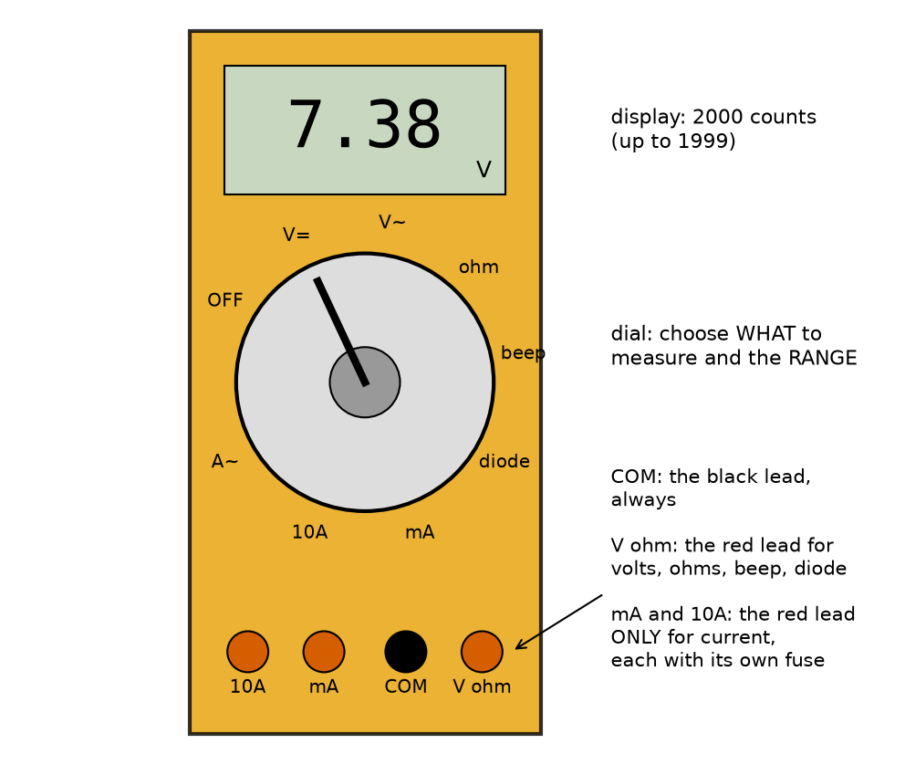
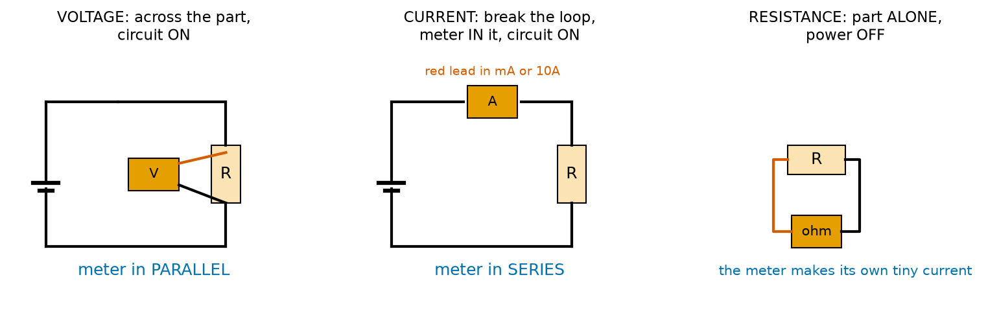
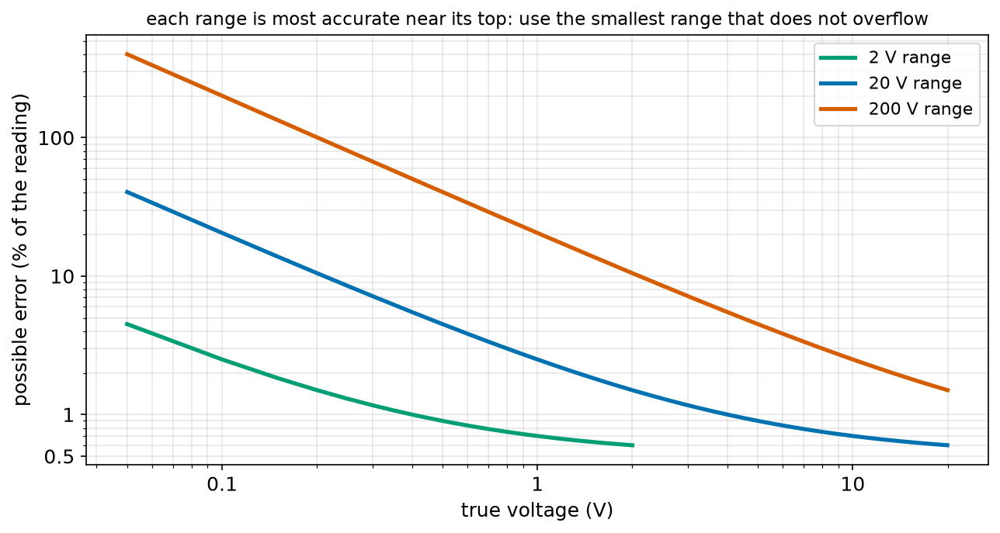
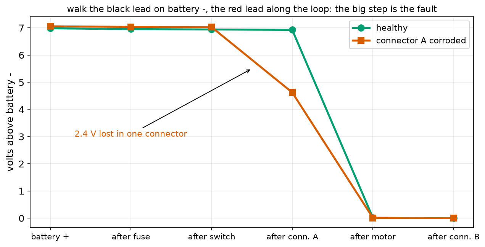
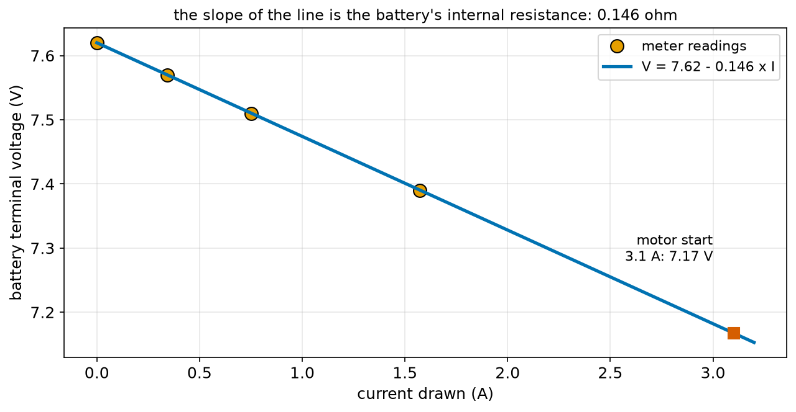
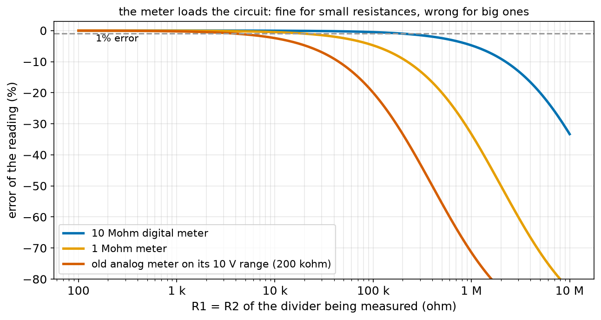

# Chapter 81 — The Multimeter: Measuring Safely

> **Part 5 · Chapter 81 of 749**
> **You need:** Chapter 7 (safety, fuses and mains), Chapter 74 (voltage across, current through), Chapter 75 (Ohm's law and internal resistance), Chapter 77 (series and parallel), Chapter 78 (the voltage law and the solver), Chapter 79 (loading) and Chapter 80 (breadboards).
> **You will make:** a program that shows how much a voltmeter disturbs what it measures, a program that explains a meter's accuracy figures, a program that shows what an ammeter does to a circuit, a fault finder that locates a bad connection with a "voltage walk", and a measurement of a battery's internal resistance.

---

## What you will learn

- What a **multimeter** measures, and what its dial, display and sockets mean.
- How to measure **voltage** (across, circuit on), **current** (in series, circuit on) and **resistance** (power off).
- Why a meter on the wrong setting can **blow its fuse** or damage the circuit, and the safety rules that prevent it.
- What a meter does to the circuit it measures: **loading** by a voltmeter and **burden** by an ammeter.
- What **"±(0.5% + 2 digits)"** means, and how to choose a range.
- Two professional techniques: the **voltage walk** to find a bad connection, and measuring a battery's **internal resistance**.

---

## New words in this chapter

| Word | Simple meaning |
|---|---|
| **multimeter** | One instrument that measures voltage, current, resistance and more. |
| **lead (probe)** | One of the two wires from the meter, with a metal tip to touch the circuit. |
| **COM** | The "common" socket: the black lead always goes here. |
| **range** | The largest value a setting can show, such as "20 V". |
| **OL** | "Over limit": the value is too big for the range (some meters show a single "1"). |
| **counts** | The largest number the display can show, such as 2000 (it shows up to 1999). |
| **resolution** | The smallest change the display can show on a range. |
| **accuracy** | How far the reading may be from the truth, usually as % of the reading plus some digits. |
| **input resistance** | The resistance a voltmeter puts across what it measures (about 10 MΩ). |
| **burden voltage** | The voltage an ammeter takes from the circuit, because of its small internal resistor. |
| **continuity** | Whether there is an unbroken path; the meter beeps if there is. |
| **CAT rating** | A safety category (CAT I to IV) saying where a meter may be used safely. |
| **voltage walk** | Measuring the voltage at each point round a loop to find where it is lost. |

---

## 81.1 One tool, many measurements

Up to now, every voltage and current in Part 5 came from a calculation. This chapter is about **measuring** them in a real circuit. The tool is the **multimeter**.

📖 **New word: multimeter** — an instrument that measures voltage, current and resistance, and usually also tests continuity (with a beep) and diodes. "Multi" because it is several meters in one box.

Chapter 9 put a multimeter first on the shopping list, at Chapter 81: this is the moment. A basic digital meter costs $10–25 and is enough for the whole course. Look for: auto-off, a continuity beep, a 10 A current range with its own fuse, and a CAT III 600 V rating, which signals that the inside is built properly (section 81.8).



*Figure 81.1 — The display, the dial and the four sockets of a typical meter.*

**How to read this picture:** The display shows the reading, here 7.38 V. The dial chooses **what** to measure (V= for DC volts, V~ for AC volts, Ω for resistance, the beep for continuity, the diode symbol, mA and 10A for current) and, on many meters, the **range**. The four sockets at the bottom: the black lead always goes into **COM**. The red lead goes into **V Ω** for almost everything, and into **mA** or **10A** only when measuring current.

📖 **New word: lead** (or probe) — one of the meter's two insulated wires, with a metal tip. Hold leads only by their plastic handles, behind the finger guards.

📖 **New word: COM** — the "common" socket. The black lead always goes here, and it is the meter's reference: readings are "red lead minus black lead".

---

## 81.2 Measuring voltage: across, circuit on

Chapter 74 said voltage is always **between two points**. So the meter's two leads go on two points: **across** the part.



*Figure 81.2 — Left: voltage, across the part. Middle: current, in the loop. Right: resistance, part alone with the power off.*

**How to read this picture:** On the left, the meter touches the two ends of the resistor while the circuit runs: it is in parallel with the part. In the middle, the loop has been opened and the meter fills the gap, so the current must go through it: it is in series. On the right, the resistor has been taken out (or the power is off) and the meter alone is connected to it.

The steps:

1. Black lead in COM, red lead in V Ω.
2. Dial to **V=** (DC volts: batteries and robot circuits). V~ is for the mains, which we never measure (Chapter 7).
3. Choose a range above the voltage you expect (or use auto-range).
4. Black probe on the lower point (usually ground), red probe on the point you want.
5. Read. A minus sign means the red probe is on the lower voltage: swap the probes or just note the sign.

🔢 **Maths.** Rover's battery reads 7.62 V on the 20 V range. On a 2000-count meter the 20 V range shows two decimal places, so the display is "7.62".

### Loading: a voltmeter is a big resistor

📖 **New word: input resistance** — a voltmeter is, inside, a very large resistor (typically 10 MΩ) with a tiny current measured through it. Connected across a part, it is in **parallel** with that part.

Chapter 79 showed what a parallel load does to a divider: it pulls the voltage down. A voltmeter is a load too. For a divider of two 10 kΩ resistors (output resistance 5 kΩ), a 10 MΩ meter changes the reading by 0.05%: nothing. For two 1 MΩ resistors (output resistance 500 kΩ), it reads 4.8% low. The program `meter_loading.py` in the Code section prints the full table.

🧠 **The rule of a hundred.** A voltmeter reads within about 1% if its input resistance is at least 100 times the output resistance of what it measures. A 10 MΩ meter is fine for anything up to about 100 kΩ.

---

## 81.3 Measuring current: in series, circuit on, red lead moved

Current is a flow **through** a point (Chapter 74). To measure it, the current must flow **through the meter**. So you must **break** the loop and put the meter **in the gap**: in series.

1. **Switch off** the circuit.
2. Move the red lead to the **mA** socket (up to about 200 mA) or the **10A** socket (for more, or when unsure).
3. Dial to the matching current setting.
4. Open the loop at one point (pull a wire out of the breadboard), and connect the meter across the gap: red to the side that comes from +, black to the side that goes on to −.
5. Switch on. Read.
6. **Switch off, and move the red lead back to V Ω.** This step is the one people forget.

⚠️ **Careful: the most common way to break a meter.** On a current setting, with the red lead in mA or 10A, the meter is almost a **short circuit**: its internal resistance is 1 Ω or less. If you now touch the leads **across** a battery, as you would for a voltage, Chapter 75's short-circuit maths applies: Rover's battery would push about 7.2 ÷ (1 + 0.15) = 6 A through the mA input. That is why every current socket has a **fuse** inside the meter, and why that fuse is the part that most often needs replacing. Some meters even beep a warning if the lead is in a current socket while the dial is on volts.

### Burden: an ammeter is a small resistor

📖 **New word: burden voltage** — to measure current, the meter passes it through a small resistor inside (a shunt, Chapter 75) and measures the voltage across that. The shunt is in series with the circuit, so it takes a little voltage and slightly reduces the current. Typical shunts: about 1 Ω on the mA socket and 0.01 Ω on the 10 A socket.

🔢 **Maths.** An LED circuit with 3 V across 150 Ω: 20 mA. With the meter's 1 Ω added in series: 3 ÷ 151 = 19.87 mA, 0.7% low, and the meter takes 20 mV. For a stalled motor (4.95 Ω including the battery's inside), the 1 Ω shunt would cut the current by 17%, and its fuse would blow anyway; on the 10 A socket the error is 0.2%.

💡 **Tip.** Often you do not need the current setting at all. Measure the **voltage** across a known resistor in the circuit and use Ohm's law: I = V ÷ R. That needs no wire to be pulled, and it cannot blow the fuse. Chapter 75's shunt resistor is exactly this idea, built into the robot.

---

## 81.4 Measuring resistance: power off, part alone

To measure resistance, the meter pushes a tiny known current of its own through the part and measures the voltage across it: R = V ÷ I.

1. **Switch the power off.** Any other voltage in the circuit would confuse the measurement, and can damage the meter.
2. Red lead in V Ω, dial to Ω.
3. Ideally, take the part **out** of the circuit (or lift one leg). Other parts in parallel with it would also carry the meter's current, and you would measure the parallel combination (Chapter 77).
4. Touch the probes to the two ends. Do not hold both ends with your fingers: your body (about 100 kΩ, Chapter 74) would be in parallel with the part.

Short the two probes together first. A good meter reads about 0.1–0.3 Ω: the resistance of its own leads. Subtract that when measuring small resistances.

### Continuity: the beep

📖 **New word: continuity** — an unbroken path. On the beep setting the meter sounds whenever the resistance between its probes is low (under about 30–50 Ω). It is the quickest way to:

- check a wire or a fuse is not broken (beep = good);
- check a solder joint or a breadboard row (Chapter 80);
- **find a short**: with the power off, touch + and −; a beep means a short circuit.

The **diode** setting shows the voltage a diode or an LED needs to conduct (Chapter 86); a red LED shows about 1.8 V and glows faintly.

---

## 81.5 Ranges, counts and accuracy

📖 **New word: range** — the largest value a setting can show. On a manual meter you choose it with the dial (200 mV, 2 V, 20 V, 200 V …). An auto-ranging meter chooses for you.

📖 **New word: OL** — "over limit": the value is bigger than the range. Many cheap meters show a single "1" at the left instead. Turn up the range.

📖 **New word: counts** — the largest number the display can show. A "2000-count" meter shows up to 1999; a "6000-count" meter up to 5999.

📖 **New word: resolution** — the smallest step the display can show on a range: the range divided by the counts. On the 20 V range of a 2000-count meter, 20 ÷ 2000 = 0.01 V.

📖 **New word: accuracy** — how far the reading may be from the true value. Datasheets write it as **±(% of the reading + digits)**. "±(0.5% + 2 digits)" on the 20 V range means: 0.5% of what it shows, plus 2 steps of 0.01 V.

🔢 **Maths.** Rover's battery at 7.2 V on the 20 V range: ±(0.005 × 7.2 + 2 × 0.01) = ±(0.036 + 0.02) = ±0.056 V. The true value is somewhere from 7.144 to 7.256 V. On the 200 V range it would be ±0.236 V.



*Figure 81.4 — The possible error as a percentage of the reading, on three ranges of a 2000-count meter.*

**How to read this picture:** Both axes are log scales. Each curve is one range, and each ends at its full scale. Every curve falls from left to right: on any range, small readings have large percentage errors, because the "2 digits" part is fixed. Near the top of each range the error is about 0.6%. So choose the **smallest range that does not show OL**.

🧠 **A meter's last digit is not the truth.** Use the accuracy to decide whether two readings really differ. "7.51 V and 7.53 V" on this meter are the same within its accuracy.

---

## 81.6 Finding faults: the voltage walk

The voltage law (Chapter 78) gives a powerful way to find a bad connection while the circuit is running.

📖 **New word: voltage walk** — put the black probe on the battery's − terminal and leave it there. Move the red probe along the loop, point by point, from the battery's + terminal towards the load and back. Write down each reading. Healthy wires and connections lose only millivolts; the load loses almost all the voltage. **A big step anywhere else is the fault.**



*Figure 81.5 — Readings round Rover's left motor loop, healthy (green) and with a corroded connector (red).*

**How to read this picture:** Each point is a place on the loop, from the battery's + terminal to after the last connector. The green line stays near 7 V through the fuse, the switch and connector A, then drops to 0 across the motor: healthy. The red line drops 2.4 V across connector A before the motor even starts: that connector is the fault. The motor gets only 4.6 V and turns slowly.

A voltage walk finds faults that a resistance check with the power off often misses: a connector can show 0.1 Ω to a meter's tiny current, yet fail under the motor's 1.4 A because only a few strands of wire, or a thin corroded patch, carry the current. Application 1 builds the simulation.

---

## 81.7 Measuring a battery's internal resistance

Chapter 75 used 0.15 Ω for Rover's battery's internal resistance and promised a way to measure it. Here it is, with nothing but a meter and a few resistors.

1. Measure the battery with no load: the **open-circuit voltage**, V_open.
2. Connect a known load resistor R (rated for the power, Chapter 76) and measure the voltage V while it is connected.
3. The current is I = V ÷ R. The voltage that went missing, V_open − V, was lost inside the battery, so R_inside = (V_open − V) ÷ I.
4. Repeat with two more resistors, and average.



*Figure 81.6 — The battery's voltage against the current drawn. The slope of the line is the internal resistance.*

**How to read this picture:** The orange dots are four readings: no load, then 22, 10 and 4.7 Ω loads. They lie on a straight line (the voltage law: V = V_open − I × R_inside). The line falls 0.146 V for each ampere, so the battery's internal resistance is 0.146 Ω. Extending the line to Rover's 3.1 A motor start predicts that the battery will sag to 7.17 V.

Application 2 does the calculation in Python. Chapter 89 shows how internal resistance grows as a battery ages and gets cold, which makes this simple measurement a health check.

---

## 81.8 Safety

📖 **New word: CAT rating** — a safety category printed near the sockets (CAT I, II, III or IV, with a voltage). It says where the meter is built to survive the voltage spikes that can occur: CAT II for things plugged into a socket, CAT III for building wiring, CAT IV at the building's supply. A meter without a CAT rating is for low-voltage electronics only.

The rules:

- **Never measure the mains** (Chapter 7). Robot work happens at 48 V or less. Even a CAT III meter does not make a beginner safe on mains.
- **Check the leads and the dial before every measurement**: where is the red lead, what is the dial set to?
- **Current: break the loop and put the meter in series. Never across a supply.** Move the red lead back to V Ω afterwards.
- **Resistance and continuity: power off.**
- Hold the probes behind their **finger guards**. Never touch the metal tips while measuring.
- Use the **10 A** socket only for short measurements (10–30 seconds) if the meter says so; the shunt inside gets hot (Chapter 76).
- Replace a blown meter fuse only with the **same type and rating** (Chapter 7's fuse rules apply to meters too).
- On high-energy batteries (drones, humanoids), a slip of a probe tip between two terminals is a short circuit. Use probes with short exposed tips or insulating caps.

---

## Code

File `code/ch081/meter_loading.py`:

```python
# meter_loading.py - a voltmeter is a big resistor: how much does it disturb what it measures?
def parallel(a, b):
    return a * b / (a + b)


V_IN = 10.0
print("measuring the tap of an R-over-R divider on 10 V (true value 5.000 V)")
print(f"{'R1 = R2':>10s} {'10 Mohm meter':>14s} {'1 Mohm meter':>13s} {'20 kohm/V analog on 10 V range':>31s}")
for r in [1e3, 1e4, 1e5, 1e6]:
    readings = []
    for meter in [10e6, 1e6, 20000 * 10]:              # an old analog meter: 20 kohm per volt of range
        bottom = parallel(r, meter)                    # the meter sits across R2
        readings.append(V_IN * bottom / (r + bottom))
    print(f"{r:10.0f} " + " ".join(f"{v:9.3f} V ({(v - 5) / 5:+.1%})" for v in readings))

print()
print("rule: the meter's input resistance should be at least 100 x the circuit's output resistance (R1 || R2)")
```

| Line | Code | What it does (simple English) |
|---|---|---|
| 1 | `# meter_loading.py …` | A comment. |
| 2–3 | `def parallel(a, b): …` | Two resistors in parallel. |
| 4–5 | (blank) | Spacing. |
| 6 | `V_IN = 10.0` | The divider's supply. |
| 7–8 | `print(…)` | Headings. |
| 9 | `for r in [1e3, 1e4, 1e5, 1e6]:` | Four dividers, from 1 kΩ to 1 MΩ per resistor. |
| 10 | `readings = []` | The three meters' readings for this divider. |
| 11 | `for meter in [10e6, 1e6, 20000 * 10]:` | Three meters: a modern 10 MΩ digital, a 1 MΩ one, and an old moving-needle meter rated "20 kΩ per volt", which on its 10 V range is 200 kΩ. |
| 12 | `bottom = parallel(r, meter)` | The meter sits across R2. |
| 13 | `readings.append(V_IN * bottom / (r + bottom))` | The loaded divider's output: what the meter shows. |
| 14 | `print(…)` | The three readings and their errors. |
| 15 | (blank) | Spacing. |
| 16 | `print()` | An empty line. |
| 17 | `print("rule: …")` | The rule of a hundred. |

Output:

```
measuring the tap of an R-over-R divider on 10 V (true value 5.000 V)
   R1 = R2  10 Mohm meter  1 Mohm meter  20 kohm/V analog on 10 V range
      1000     5.000 V (-0.0%)     4.998 V (-0.0%)     4.988 V (-0.2%)
     10000     4.998 V (-0.0%)     4.975 V (-0.5%)     4.878 V (-2.4%)
    100000     4.975 V (-0.5%)     4.762 V (-4.8%)     4.000 V (-20.0%)
   1000000     4.762 V (-4.8%)     3.333 V (-33.3%)     1.429 V (-71.4%)
```

```
rule: the meter's input resistance should be at least 100 x the circuit's output resistance (R1 || R2)
```



*Figure 81.3 — The error caused by three meters as the divider's resistors grow.*

**How to read this picture:** Each curve is a meter. On the left (small resistors) all three read correctly. Moving right, each curve falls away when the divider's output resistance approaches the meter's input resistance. The 10 MΩ meter stays within 1% up to about 100 kΩ resistors; the old analog meter only up to about 4 kΩ.

File `code/ch081/accuracy.py`:

```python
# accuracy.py - what does '+/-(0.5% + 2 digits)' mean on a 2000-count meter?
RANGES = [0.2, 2.0, 20.0, 200.0]        # the DC volt ranges of a cheap 2000-count meter (full scale 1999 counts)
PERCENT = 0.005                          # 0.5% of the reading
DIGITS = 2                               # plus 2 counts of the last digit


def measure(true_v, full_scale):
    step = full_scale / 2000             # one count: the smallest change the display can show
    if true_v >= full_scale:
        return None, None, step          # the display shows '1' or 'OL': over the range
    shown = round(true_v / step) * step
    error = PERCENT * true_v + DIGITS * step
    return shown, error, step


for true_v in [1.234, 7.2, 16.8]:
    print(f"true voltage {true_v} V:")
    for fs in RANGES:
        shown, err, step = measure(true_v, fs)
        if shown is None:
            print(f"  {fs:6.1f} V range: OL (over the range)")
        else:
            print(f"  {fs:6.1f} V range: shows {shown:.4g} V, step {step * 1000:g} mV, could be off by +/-{err * 1000:.1f} mV ({err / true_v:.2%})")
print()
print("choose the smallest range that does not overflow: it gives the finest step and the smallest error")
```

| Line | Code | What it does (simple English) |
|---|---|---|
| 1 | `# accuracy.py …` | A comment. |
| 2–4 | `RANGES`, `PERCENT`, `DIGITS` | The ranges and the accuracy figure from a datasheet. |
| 5–6 | (blank) | Spacing. |
| 7 | `def measure(true_v, full_scale):` | What the meter shows, and how wrong it might be. |
| 8 | `step = full_scale / 2000` | The resolution on this range. |
| 9–10 | `if true_v >= full_scale: return None, None, step` | Too big: the display shows OL. |
| 11 | `shown = round(true_v / step) * step` | The display rounds to the nearest step. |
| 12 | `error = PERCENT * true_v + DIGITS * step` | 0.5% of the reading plus 2 steps. |
| 13 | `return shown, error, step` | All three. |
| 14–15 | (blank) | Spacing. |
| 16 | `for true_v in [1.234, 7.2, 16.8]:` | A small voltage, Rover's battery and a full 4S pack. |
| 17 | `print(…)` | A heading. |
| 18 | `for fs in RANGES:` | Each range. |
| 19 | `shown, err, step = measure(true_v, fs)` | Simulate the reading. |
| 20–21 | `if shown is None: print(…)` | Over the range. |
| 22–23 | `else: print(…)` | What it shows, the step, and the possible error. `:.4g` prints up to 4 significant figures. |
| 24–25 | `print()`, `print(…)` | The lesson. |

Output:

```
true voltage 1.234 V:
     0.2 V range: OL (over the range)
     2.0 V range: shows 1.234 V, step 1 mV, could be off by +/-8.2 mV (0.66%)
    20.0 V range: shows 1.23 V, step 10 mV, could be off by +/-26.2 mV (2.12%)
   200.0 V range: shows 1.2 V, step 100 mV, could be off by +/-206.2 mV (16.71%)
true voltage 7.2 V:
     0.2 V range: OL (over the range)
     2.0 V range: OL (over the range)
    20.0 V range: shows 7.2 V, step 10 mV, could be off by +/-56.0 mV (0.78%)
   200.0 V range: shows 7.2 V, step 100 mV, could be off by +/-236.0 mV (3.28%)
true voltage 16.8 V:
     0.2 V range: OL (over the range)
     2.0 V range: OL (over the range)
    20.0 V range: shows 16.8 V, step 10 mV, could be off by +/-104.0 mV (0.62%)
   200.0 V range: shows 16.8 V, step 100 mV, could be off by +/-284.0 mV (1.69%)

choose the smallest range that does not overflow: it gives the finest step and the smallest error
```

File `code/ch081/burden.py`:

```python
# burden.py - an ammeter is a small resistor in the loop: how much does it change the current?
SHUNTS = {"mA socket (200 mA range)": 1.0, "10 A socket": 0.01}     # typical resistances inside a cheap meter

circuits = [
    # name, supply volts, circuit resistance in ohms (without the meter)
    ("LED and 150 ohm resistor on 5 V (LED drop removed: 3 V across 150 ohm)", 3.0, 150.0),
    ("a 100 ohm sensor on 5 V", 5.0, 100.0),
    ("Rover's stalled motor on 7.2 V (4.8 ohm + 0.15 inside)", 7.2, 4.95),
]
for name, v, r in circuits:
    true_i = v / r
    print(f"{name}: true current {true_i * 1000:.1f} mA")
    for socket, shunt in SHUNTS.items():
        measured = v / (r + shunt)                   # the shunt is in series with everything
        burden = measured * shunt                    # the voltage the meter itself takes
        print(f"  {socket:26s}: reads {measured * 1000:8.1f} mA ({(measured - true_i) / true_i:+.1%}), meter takes {burden * 1000:6.1f} mV")
print()
print("the stalled motor's 1.45 A is far above the 200 mA range: on the mA socket the meter's fuse would blow")
```

| Line | Code | What it does (simple English) |
|---|---|---|
| 1 | `# burden.py …` | A comment. |
| 2 | `SHUNTS = { … }` | The meter's two current inputs and their internal resistances. |
| 3 | (blank) | Spacing. |
| 4–9 | `circuits = [ … ]` | Three circuits. For the LED, the LED's own 2 V is left out: what remains is 3 V across 150 Ω (Chapter 82 explains why that is fair). |
| 10 | `for name, v, r in circuits:` | Each circuit. |
| 11 | `true_i = v / r` | The current with no meter. |
| 12 | `print(…)` | Shows it. |
| 13 | `for socket, shunt in SHUNTS.items():` | Each meter input (Chapter 22's `items`). |
| 14 | `measured = v / (r + shunt)` | With the meter in series, its shunt adds to the loop's resistance. |
| 15 | `burden = measured * shunt` | The burden voltage, V = I × R. |
| 16 | `print(…)` | The reading, its error, and the burden. |
| 17 | (blank) | Spacing. |
| 18–19 | `print()`, `print(…)` | The warning about the motor. |

Output:

```
LED and 150 ohm resistor on 5 V (LED drop removed: 3 V across 150 ohm): true current 20.0 mA
  mA socket (200 mA range)  : reads     19.9 mA (-0.7%), meter takes   19.9 mV
  10 A socket               : reads     20.0 mA (-0.0%), meter takes    0.2 mV
a 100 ohm sensor on 5 V: true current 50.0 mA
  mA socket (200 mA range)  : reads     49.5 mA (-1.0%), meter takes   49.5 mV
  10 A socket               : reads     50.0 mA (-0.0%), meter takes    0.5 mV
Rover's stalled motor on 7.2 V (4.8 ohm + 0.15 inside): true current 1454.5 mA
  mA socket (200 mA range)  : reads   1210.1 mA (-16.8%), meter takes 1210.1 mV
  10 A socket               : reads   1451.6 mA (-0.2%), meter takes   14.5 mV

the stalled motor's 1.45 A is far above the 200 mA range: on the mA socket the meter's fuse would blow
```

The 10 A socket disturbs every circuit less, because its shunt is a hundred times smaller; the price is resolution, since its display steps are 10 mA, too coarse for an LED.

---

## Small examples

**Example 1.** A 2000-count meter on the 2 V range shows up to 1.999 V with a step of 1 mV.

**Example 2.** On the 200 mV range, 0.150 V shows as 150.0 (mV).

**Example 3.** Accuracy ±(0.8% + 3 digits) on the 20 V range, reading 12.00 V: ±(0.096 + 0.03) = ±0.126 V.

**Example 4.** A 10 MΩ meter across a 1 kΩ resistor changes it to 999.9 Ω: no visible effect.

**Example 5.** Probes shorted read 0.2 Ω. A resistor reads 1.4 Ω. Its true value is about 1.2 Ω.

**Example 6.** 0.36 V across a known 0.1 Ω shunt: I = 3.6 A, without pulling any wire.

**Example 7.** Open circuit 3.95 V; with a 10 Ω load 3.80 V. I = 0.38 A; R_inside = 0.15 ÷ 0.38 = 0.39 Ω.

**Example 8.** A beep between the + and − of a powered-off board: there is a short (or a big capacitor, Chapter 84, which beeps briefly while it charges).

---

## 🏭 Real robot applications

### Application 1 (worked in full) — 🤖 Finding a bad connector with a voltage walk

**1. The real problem.** Rover's left wheel has become slower than the right. Both motors are the same type, the software sends the same command, and the motors look fine. Something in the left motor's wiring is wasting voltage. A resistance check with the power off shows nothing wrong. The technician does a voltage walk with the motor running.

**2. Why this theory.** The voltage law (Chapter 78): round the loop, the drops add up to the battery's push. Healthy connections drop millivolts (Ohm's law with milliohms); the motor drops nearly everything. A connector that drops volts is the fault.

**3. The numbers.** Battery 7.2 V with 0.15 Ω inside. Fuse 0.02 Ω, switch 0.01 Ω, two connectors 0.01 Ω each, motor stalled for the test (wheel held) 4.8 Ω. Faulty case: connector A corroded to 2.5 Ω.

**4. The maths.** Healthy: total 4.85 Ω + 0.15 = 5.0 Ω, I = 1.44 A; the connectors drop 1.44 × 0.01 = 14 mV each; the motor 6.91 V. Faulty: total 7.34 + 0.15 = 7.49 Ω, I = 0.96 A; connector A drops 0.96 × 2.5 = 2.40 V.

**5. The code.** File `code/ch081/voltage_walk.py` (with Chapter 78's `nodal.py` in the same folder):

```python
# voltage_walk.py - find a bad connection by measuring the voltage at each point round a loop
from nodal import solve

# Rover's left motor loop: battery + -> fuse -> switch -> connector A -> motor -> connector B -> battery -
parts = ["fuse", "switch", "connector A", "motor", "connector B"]
good = [0.02, 0.01, 0.01, 4.8, 0.01]           # ohms of each part when healthy
bad = [0.02, 0.01, 2.5, 4.8, 0.01]             # connector A is corroded: 2.5 ohm


def walk(resistances):
    # nodes 1..6 along the loop; node 1 is battery +, node 6 is battery - (ground, so we use 0)
    n = len(resistances)
    res = []
    for k, r in enumerate(resistances):
        a = k + 1
        b = k + 2 if k < n - 1 else 0
        res.append((a, b, r))
    v = solve(n, res, [(1, 0, 7.2, 0.15)])
    return v


for label, rs in [("healthy", good), ("connector A corroded", bad)]:
    v = walk(rs)
    i = (v[1] - v[2]) / rs[0]
    print(f"--- {label}: current {i:.3f} A ---")
    pts = [v[k] for k in range(1, len(rs) + 1)] + [0.0]
    for k, name in enumerate(parts):
        drop = pts[k] - pts[k + 1]
        flag = "   <-- too much for a connection!" if name != "motor" and drop > 0.1 else ""
        print(f"  across {name:12s}: {drop:6.3f} V{flag}")
```

| Line | Code | What it does (simple English) |
|---|---|---|
| 1 | `# voltage_walk.py …` | A comment. |
| 2 | `from nodal import solve` | Chapter 78's solver. |
| 3 | (blank) | Spacing. |
| 4 | `# Rover's left motor loop: …` | The order of parts round the loop. |
| 5 | `parts = [ … ]` | Their names. |
| 6–7 | `good = [ … ]`, `bad = [ … ]` | Their resistances, healthy and with the fault. |
| 8–9 | (blank) | Spacing. |
| 10 | `def walk(resistances):` | Solve the loop and return every node voltage. |
| 11 | `# nodes 1..6 …` | A comment. |
| 12 | `n = len(resistances)` | Five parts. |
| 13 | `res = []` | The resistor list for the solver. |
| 14 | `for k, r in enumerate(resistances):` | Each part in turn. |
| 15 | `a = k + 1` | The node before it. |
| 16 | `b = k + 2 if k < n - 1 else 0` | The node after it; after the last part comes the battery's − terminal, which is ground (node 0). |
| 17 | `res.append((a, b, r))` | Add the part. |
| 18 | `v = solve(n, res, [(1, 0, 7.2, 0.15)])` | The battery, with its 0.15 Ω inside, from node 1 to ground. |
| 19 | `return v` | The node voltages. |
| 20–21 | (blank) | Spacing. |
| 22 | `for label, rs in [ … ]:` | Healthy, then faulty. |
| 23 | `v = walk(rs)` | Solve. |
| 24 | `i = (v[1] - v[2]) / rs[0]` | The loop current, from the drop across the fuse. |
| 25 | `print(…)` | A heading with the current. |
| 26 | `pts = [v[k] for k in range(1, len(rs) + 1)] + [0.0]` | The readings of the walk: each node, then the battery's − terminal. |
| 27 | `for k, name in enumerate(parts):` | Each part. |
| 28 | `drop = pts[k] - pts[k + 1]` | The difference between two neighbouring readings: the drop across that part. |
| 29 | `flag = …` | Any connection (not the motor) dropping more than 0.1 V is suspect. |
| 30 | `print(…)` | The drop and the warning. |

Output:

```
--- healthy: current 1.440 A ---
  across fuse        :  0.029 V
  across switch      :  0.014 V
  across connector A :  0.014 V
  across motor       :  6.912 V
  across connector B :  0.014 V
--- connector A corroded: current 0.961 A ---
  across fuse        :  0.019 V
  across switch      :  0.010 V
  across connector A :  2.403 V   <-- too much for a connection!
  across motor       :  4.614 V
  across connector B :  0.010 V
```

**6. The result.** The walk points straight at connector A: 2.4 V lost in a part that should lose 14 mV. The motor receives only 4.6 V instead of 6.9 V, which is why the left wheel is slow. Replacing the connector fixes it. A power-off resistance check missed it because a meter's few milliamps flow through the few good strands; under load, the bad patch heats and its resistance rises. Without the walk, the technician might have replaced a perfectly good motor.

**7. Going further.** Electricians call this "voltage drop testing" and use it on cars, trains and factory machines, often with the rule "no connection should drop more than 0.1–0.2 V under load". Chapter 129 builds current and voltage measurement into a robot so it can check itself, and Chapter 746 covers systematic testing and debugging of robots.

### Application 2 (worked in full) — 🔋 Is Rover's battery healthy?

**1. The real problem.** Rover's motors have started to reset the Arduino when they start (the voltage dips too low). Is the battery wearing out? A worn battery has a higher internal resistance (Chapter 89), which makes it sag more under load. The test of section 81.7 measures it with a meter and three power resistors.

**2. Why this theory.** The voltage law round the loop: V_open = I × R_inside + V_terminals. The current comes from Ohm's law across the known load. Each load gives one estimate; several loads give a line whose slope is the internal resistance (Chapter 43's straight lines).

**3. The numbers.** Example readings for Rover's six NiMH cells (replace them with your own): no load 7.62 V; 22 Ω: 7.57 V; 10 Ω: 7.51 V; 4.7 Ω: 7.39 V. The 4.7 Ω resistor takes 7.39² ÷ 4.7 = 11.6 W, so it must be a 25 W power resistor, used for a few seconds only (Chapter 76).

**4. The maths.** With 4.7 Ω: I = 7.39 ÷ 4.7 = 1.572 A; lost inside 7.62 − 7.39 = 0.23 V; R_inside = 0.23 ÷ 1.572 = 0.146 Ω.

**5. The code.** File `code/ch081/internal_resistance.py`:

```python
# internal_resistance.py - measure a battery's internal resistance with a meter and two load resistors
# (example measurements of Rover's 6 x AA NiMH pack; replace them with your own)
readings = [
    # load resistor in ohms (None = no load), measured voltage at the terminals
    (None, 7.62),
    (22.0, 7.57),
    (10.0, 7.51),
    (4.7, 7.39),
]
v_open = readings[0][1]
print(f"open-circuit voltage: {v_open:.2f} V")
estimates = []
for r_load, v in readings[1:]:
    i = v / r_load                       # Ohm's law for the load resistor
    r_in = (v_open - v) / i              # the missing volts were lost inside the battery
    estimates.append(r_in)
    print(f"  {r_load:5.1f} ohm load: {v:.2f} V, current {i:.3f} A -> internal resistance {r_in:.3f} ohm")
avg = sum(estimates) / len(estimates)
print(f"average: {avg:.3f} ohm")
print(f"so a dead short would draw about {v_open / avg:.0f} A, and Rover's 3.1 A start sags the pack by {3.1 * avg:.2f} V")
```

| Line | Code | What it does (simple English) |
|---|---|---|
| 1–2 | comments | What the program does, and a reminder that the numbers are an example. |
| 3–9 | `readings = [ … ]` | The four measurements as (load, voltage) pairs; `None` means no load. |
| 10 | `v_open = readings[0][1]` | The first reading's voltage: no load. |
| 11 | `print(…)` | Shows it. |
| 12 | `estimates = []` | One estimate per load. |
| 13 | `for r_load, v in readings[1:]:` | Every reading except the first (a slice, Chapter 21). |
| 14 | `i = v / r_load` | The current through the load. |
| 15 | `r_in = (v_open - v) / i` | The missing voltage divided by the current. |
| 16 | `estimates.append(r_in)` | Keep it. |
| 17 | `print(…)` | The row. |
| 18 | `avg = sum(estimates) / len(estimates)` | The average. |
| 19 | `print(…)` | Shows it. |
| 20 | `print(…)` | What it means: the short-circuit current and the sag at motor start. |

Output:

```
open-circuit voltage: 7.62 V
   22.0 ohm load: 7.57 V, current 0.344 A -> internal resistance 0.145 ohm
   10.0 ohm load: 7.51 V, current 0.751 A -> internal resistance 0.146 ohm
    4.7 ohm load: 7.39 V, current 1.572 A -> internal resistance 0.146 ohm
average: 0.146 ohm
so a dead short would draw about 52 A, and Rover's 3.1 A start sags the pack by 0.45 V
```

**6. The result.** The three estimates agree (0.145–0.146 Ω), and they match the 0.15 Ω used since Chapter 75: this example battery is healthy. A sag of 0.45 V at motor start leaves 7.17 V, plenty for the 5 V regulator, so the resets must have another cause (a ground offset, Chapter 78, is a good suspect). If the measurement had given 0.5 Ω, the sag would be 1.55 V, and the battery would be the problem. Notice the precision trap: the 22 Ω reading depends on a 0.05 V difference, only 5 counts on the 20 V range, so the heaviest load gives the most trustworthy estimate.

**7. Going further.** Battery testers and smart chargers do this automatically with a short pulse of current; drone chargers display each cell's internal resistance so pilots can retire weak packs. Chapter 89 shows how internal resistance changes with temperature, age and state of charge, and Chapter 621 uses it to estimate a drone's flight time more honestly.

### Application 3 — 🚁 The pre-flight cell check

Before every flight, a careful drone pilot checks each cell of the pack, not only the total. The pack's balance connector (Chapter 89) has one wire to each junction between cells, so the meter can measure each cell in turn: black probe on the first pin (the pack's −), red probe on the second (cell 1), then black on pin 2 and red on pin 3 (cell 2), and so on. Healthy cells after charging are all within about 0.02 V of each other, for example 4.18, 4.19, 4.18, 4.17 V. A cell that reads 0.1 V lower than the others is weak and will reach the empty limit first in flight (Chapter 77, series: the same current flows through every cell). A cheap plug-in checker does the same job, but understanding the meter method tells you what the checker is doing and lets you check the checker.

### Application 4 — 🏭 Clamp meters in a factory

A maintenance technician in a car factory cannot break the loop of a 400 V, 30 A robot drive to put a meter in series. Instead they use a **clamp meter**: two jaws that close around one wire and sense the magnetic field that the current makes (Chapter 85), with no electrical contact at all. AC clamp meters work with a coil; DC clamp meters use a Hall-effect sensor (Chapter 129). They are less accurate than a meter in series (perhaps ±2%), but they are fast and safe on high-power equipment. Factories also fit permanent current sensors on every robot axis and log the readings: a motor whose current slowly rises month after month is a bearing that is wearing out, and it can be replaced during a planned stop rather than after a breakdown.

### Application 5 — 🚀🔬 Measuring milliohms: four-wire measurement

Chapter 75's shunt resistors and Chapter 80's connectors have resistances of a few milliohms, smaller than an ordinary meter's own leads (about 0.2 Ω). Laboratories and satellite builders measure them with a **four-wire** (Kelvin) method: two wires carry a known, large current (say 1 A) through the part, and two separate wires, touching the part just inside the first pair, measure the voltage across it. No current flows in the voltage wires, so their resistance adds no voltage (Ohm's law: zero current, zero drop), and R = V ÷ I is the part's resistance alone. A 1 mΩ joint at 1 A gives 1 mV, easy to measure. Spacecraft builders use it to check every high-current joint before launch, because a joint that is 10 times worse than it should be gets 10 times hotter in a vacuum, where there is no air to cool it.

---

## 🔧 Hands-on lab

### Lab 81.1 — First measurements (hardware)

You need: a multimeter, a AA cell, a 9 V battery (or Rover's pack), resistors of 100 Ω, 10 kΩ and 1 MΩ, a breadboard.

1. Short the probes on the Ω setting. Write down the leads' resistance.
2. Measure each resistor out of the circuit. Compare with its colour code (Chapter 82 teaches the colours) and its tolerance.
3. Measure the AA cell and the 9 V battery on the DC volt setting. Try the 2 V range for the AA cell and the 20 V range for both; note the difference in displayed digits.
4. Measure the 1 MΩ resistor while holding both ends with your fingers, then again holding only one end.

**What you should see:** The leads read about 0.1–0.3 Ω. The resistors are within their tolerance (5% for gold-band resistors). A fresh alkaline AA reads about 1.55–1.6 V; a NiMH cell about 1.3–1.4 V. On the 2 V range the AA shows three decimals (for example 1.582), on the 20 V range two (1.58). Holding both ends of the 1 MΩ resistor lowers the reading noticeably (perhaps to 500–900 kΩ), because your body is in parallel with it.

| If it does not work | Likely cause | Fix |
|---|---|---|
| The display shows "1" or "OL" | The range is too small | Turn the dial up one range |
| A negative voltage | The probes are swapped | Red to +, black to − |
| The reading jumps about | Poor contact between the probe tip and the part | Press firmly; clean the part's leads |

**Challenge:** Measure the same AA cell on the 200 V range, and use section 81.5 to work out how wrong that reading could be.

### Lab 81.2 — Current, safely (hardware)

You need: the meter, a 5 V USB supply or 4 × AA pack, a 220 Ω resistor and an LED, a breadboard.

1. Build: + → 220 Ω → LED → −. Check it lights.
2. Measure the voltage across the resistor. Work out the current with I = V ÷ R.
3. Switch off. Move the red lead to mA, set the dial to mA. Pull the wire from the + rail and connect the meter across the gap. Switch on and read the current.
4. Switch off. **Move the red lead back to V Ω.** Put the wire back.

**What you should see:** About 3 V across the 220 Ω resistor (5 V minus the LED's 2 V) and so about 13–14 mA by Ohm's law. The meter in series reads almost the same, perhaps 0.1 mA less because of its burden. The two methods agree, and the first one needs no wire to be pulled.

| If it does not work | Likely cause | Fix |
|---|---|---|
| The meter reads 0 mA and the LED is off | The meter's mA fuse is blown, or the lead is in the wrong socket | Check the socket; test the fuse with the continuity setting (from the other socket) |
| The LED lights but the meter reads 0 | The meter is connected in parallel with the gap's wire, not instead of it | Remove the wire; the meter must be the only path |

**Challenge:** Measure the current with the meter on the 10 A socket instead. How many digits does it show now, and why is it less useful for an LED?

### Lab 81.3 — Measure your battery's internal resistance (hardware and simulation)

You need: the meter, Rover's battery pack or a 4 × AA pack, and power resistors of about 22 Ω, 10 Ω and 4.7 Ω (5 W or more), or car bulbs of known current. **Connect each load for only a few seconds**; the resistors get hot.

1. Measure the open-circuit voltage.
2. Connect each load in turn; read the voltage while it is connected; disconnect at once.
3. Put your readings into `internal_resistance.py` and run it.
4. Plot V against I and draw the best straight line (Chapter 43 or Chapter 33's `polyfit`).

**What you should see:** A straight line falling from the open-circuit voltage. Fresh NiMH AAs give about 0.02–0.03 Ω per cell, so a 6-cell pack around 0.15 Ω; alkaline AAs are worse, about 0.15–0.3 Ω per cell, and get worse as they empty. The three estimates should agree within about 20%; the heaviest load gives the most reliable one.

| If it does not work | Likely cause | Fix |
|---|---|---|
| The estimates are wildly different | The voltage differences are only a few counts | Use the most sensitive range and the heaviest load |
| The voltage keeps falling while the load is on | The battery is warming and emptying, or the resistor is getting hot | Read quickly, within 2 seconds |
| A negative internal resistance | The open-circuit reading was taken after the load, when the battery had recovered less | Take the open-circuit reading again just before each load |

**Challenge:** Repeat the measurement with the battery cold (an hour in a refrigerator, in a sealed bag to keep it dry). How much does the internal resistance rise? Chapter 89 explains why.

---

## Common mistakes

⚠️ **Measuring a voltage with the red lead still in the mA or 10A socket.** It shorts the battery through the meter and blows the fuse. Check the sockets every time.

⚠️ **Putting an ammeter across a part instead of in series.** Current is measured **through**: break the loop.

⚠️ **Measuring resistance with the power on**, or with other parts in parallel.

⚠️ **Holding both probe tips with your fingers** when measuring a large resistance.

⚠️ **Reading the last digit as exact.** Use the accuracy figure.

⚠️ **Using a big range "to be safe" and getting a coarse, inaccurate reading.** Use the smallest range that does not overflow.

⚠️ **Forgetting that the meter loads high-resistance circuits.** The rule of a hundred.

⚠️ **Measuring mains to "see what it does".** Never.

---

## Practice

🏋️ **1.** Where do the leads go, and what is the dial set to, to measure (a) a battery's voltage, (b) an LED's current, (c) a resistor's value?

🏋️ **2.** A 2000-count meter is on the 20 V range. What is the largest voltage it can show, and its step?

🏋️ **3.** Accuracy ±(0.5% + 2 digits). The 2 V range shows 1.500 V. Give the range of possible true values.

🏋️ **4.** A 10 MΩ meter measures the tap of a 470 kΩ over 470 kΩ divider on 5 V. What does it read, and what is the error?

🏋️ **5.** The mA socket's shunt is 1 Ω. You measure a sensor drawing 80 mA from 3.3 V. What is the burden voltage, and what percentage of the supply is it?

🏋️ **6.** Why does a meter on the current setting, placed across a 7.2 V battery with 0.15 Ω inside, blow its fuse? Estimate the current with a 1 Ω shunt.

🏋️ **7.** A voltage walk round a loop on 12 V reads: 12.0, 11.98, 11.96, 8.20, 0.05, 0.0 V. Which part is faulty, and how much does it drop?

🏋️ **8.** Open circuit 12.6 V; with a 6 Ω load, 12.2 V. Find the internal resistance.

🏋️ **9.** The probes alone read 0.25 Ω. A wire reads 0.31 Ω. What is the wire's resistance? Can an ordinary meter measure it well?

🏋️ **10.** A drone pack's balance pins read (from the − pin): 0, 4.15, 8.30, 12.36, 16.50 V. What is each cell's voltage? Is one weak?

🏋️ **11.** Write `fit_internal(readings)` that takes the (load, voltage) list of Application 2 and returns V_open and R_inside from a best-fit straight line through (I, V) with `numpy.polyfit`. Compare with the average method.

---

## Answers

**1.** (a) Black in COM, red in V Ω, dial on V=, probes across the battery. (b) Black in COM, red in mA, dial on mA, meter in series in the LED's loop. (c) Black in COM, red in V Ω, dial on Ω, power off, resistor alone.

**2.** 19.99 V, in steps of 0.01 V.

**3.** ±(0.0075 + 0.002) = ±0.0095 V, so 1.4905 to 1.5095 V.

**4.** Output resistance 235 kΩ. The meter and 470 kΩ in parallel: 448.9 kΩ. Reading = 5 × 448.9 ÷ 918.9 = 2.443 V instead of 2.5 V: 2.3% low.

**5.** 0.08 × 1 = 80 mV, which is 2.4% of 3.3 V. The sensor may notice.

**6.** The meter is almost a short: I ≈ 7.2 ÷ (1 + 0.15) = 6.3 A, thirty times the 200 mA range. The fuse is there to blow instead of the meter.

**7.** The drops are 0.02, 0.02, 3.76, 8.15 and 0.05 V. The fourth reading point is after the faulty part: the third part drops 3.76 V, which is far too much for a connection (the 8.15 V drop is the load).

**8.** I = 12.2 ÷ 6 = 2.033 A. R = 0.4 ÷ 2.033 = 0.197 Ω.

**9.** About 0.06 Ω, but a 2000-count meter's 200 Ω range has a step of 0.1 Ω, so it cannot measure this well. Use a four-wire method (Application 5) or measure the voltage drop with a known current.

**10.** Cells: 4.15, 4.15, 4.06, 4.14 V. The third cell is 0.09 V lower than the others: weak.

**11.**

```python
import numpy as np

def fit_internal(readings):
    i = np.array([0.0] + [v / r for r, v in readings[1:]])
    v = np.array([v for _, v in readings])
    slope, intercept = np.polyfit(i, v, 1)       # best straight line V = slope * I + intercept
    return intercept, -slope

readings = [(None, 7.62), (22.0, 7.57), (10.0, 7.51), (4.7, 7.39)]
v_open, r_in = fit_internal(readings)
print(f"V_open {v_open:.3f} V, internal resistance {r_in:.4f} ohm")
```

```
V_open 7.620 V, internal resistance 0.1464 ohm
```

The line fit gives 0.146 Ω, the same as the average. It uses all the readings at once, including the no-load one, and is less upset by one bad reading.

---

## Summary

🧠 A **multimeter** measures volts, amps and ohms. Black lead in **COM** always; red in **V Ω** for almost everything.

🧠 **Voltage: across, circuit on.** The meter is a big resistor (about 10 MΩ) in parallel; keep it 100 times bigger than the circuit's output resistance.

🧠 **Current: break the loop, meter in series, red lead in mA or 10A.** The meter is a small resistor (burden). Never put it across a supply; move the red lead back afterwards.

🧠 **Resistance and continuity: power off, part alone.** Subtract the leads' own resistance.

🧠 Choose the **smallest range** that does not show OL. Accuracy is **± (% of reading + digits)**: the last digit is not the truth.

🧠 A **voltage walk** under load finds bad connections: any connection dropping more than about 0.1 V is suspect.

🧠 **Internal resistance** = voltage lost ÷ current, measured with known loads. It tells you whether a battery is healthy.

🧠 Never measure the mains. Respect the CAT rating, the fuses and the finger guards.

---

## Next chapter

Chapter 82 lights up the first real component of the course: the **LED**. You will learn why an LED needs a resistor, how to calculate it from the supply voltage, the LED's forward voltage and the current you want, how to read resistor colour codes and standard values, and how to drive LEDs from a robot's 5 V and 3.3 V pins without damaging them.
