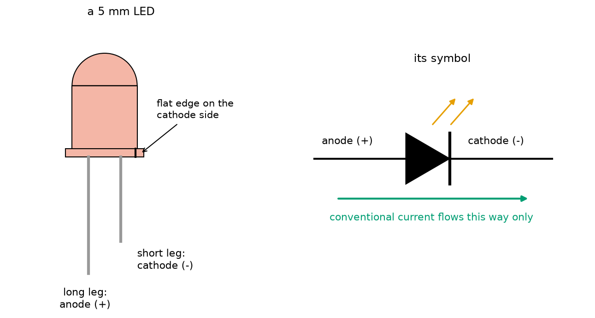
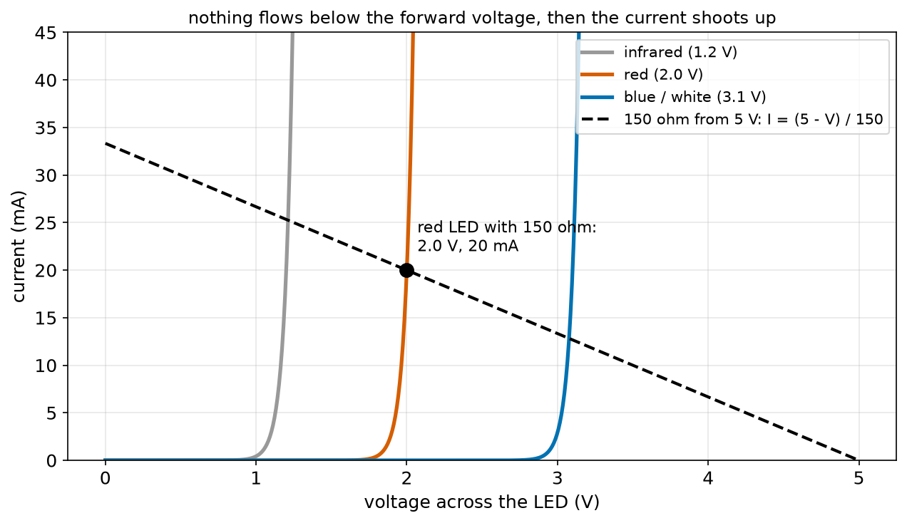
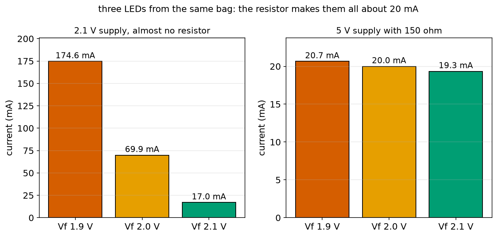
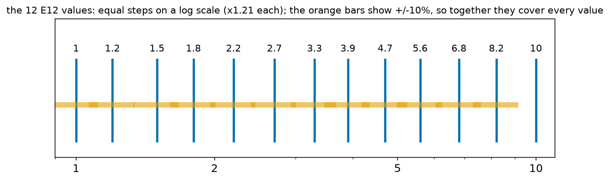
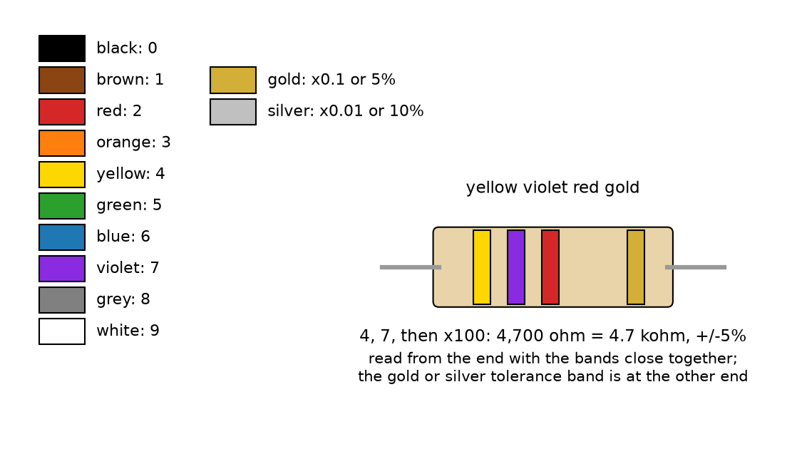
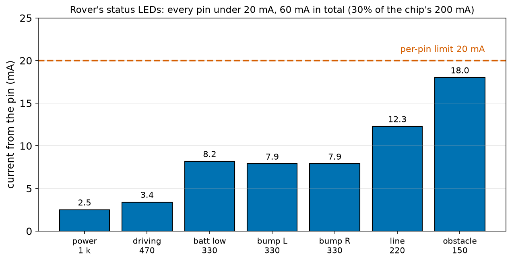

# Chapter 82 — LEDs and Resistors

> **Part 5 · Chapter 82 of 749**
> **You need:** Chapter 44 (bisection), Chapter 52 (exponentials), Chapter 75 (Ohm's law and non-ohmic parts), Chapter 76 (power), Chapter 77 (series), Chapter 80 (breadboards and symbols) and Chapter 81 (the multimeter).
> **You will make:** a program that chooses an LED's resistor from standard values, a model of an LED that shows why it needs a resistor, a resistor colour-code reader, a check of how many LEDs an Arduino can drive, and the design of the infrared emitter in Rover's line sensor.

---

## What you will learn

- What an **LED** is, which leg is which, and why it only conducts one way.
- The LED's **forward voltage**, and why its current shoots up steeply above it.
- Why every LED needs a **series resistor**, and how to calculate it: **R = (V_supply − V_f) ÷ I**.
- How resistors are made, sold and marked: **standard values** (E12), **tolerance**, **colour codes** and **power ratings**.
- How much current a microcontroller pin can give, and how to stay inside its limits.
- How to design for the **worst case**, not just the typical one.

---

## New words in this chapter

| Word | Simple meaning |
|---|---|
| **LED** | Light-emitting diode: a semiconductor part that gives out light when current flows through it the right way. |
| **diode** | A part that lets current flow only one way (Chapter 86). |
| **anode** | The + leg of an LED or diode: the long leg. |
| **cathode** | The − leg: the short leg, on the side of the flat edge. |
| **forward voltage (V_f)** | The voltage an LED needs across it to conduct its rated current. It depends on the colour. |
| **series resistor** | A resistor in series with an LED that sets its current. |
| **current-limiting** | Keeping a current below a safe value. |
| **E12 series** | The 12 standard resistor values in each decade: 1.0, 1.2, 1.5, 1.8, 2.2, 2.7, 3.3, 3.9, 4.7, 5.6, 6.8, 8.2. |
| **tolerance** | How far a part's real value may be from its marked value, such as ±5%. |
| **colour code** | Coloured bands on a resistor that show its value and tolerance. |
| **worst case** | The combination of tolerances that gives the most extreme result. |
| **infrared (IR)** | Light just beyond red, invisible to people but seen by sensors and phone cameras. |

---

## 82.1 What an LED is

📖 **New word: LED** — light-emitting diode. A tiny chip of semiconductor (Chapter 73) inside a clear plastic case. When current flows through it in the right direction, the chip gives out light. LEDs are in every robot: status lights, displays, headlights, infrared sensors, camera lights.

An LED is a kind of **diode**: a part that lets current flow one way only. Chapter 86 explains how diodes work inside; here we need only how to use them.

📖 **New word: diode** — a part that lets conventional current flow in one direction and blocks it in the other.



*Figure 82.1 — Left: a 5 mm LED. Right: its circuit symbol.*

**How to read this picture:** On the left, the LED has a long leg and a short leg. The long leg is the **anode (+)**; the short leg is the **cathode (−)**, and the rim of the case is flat on the cathode side, which helps once the legs have been cut. On the right, the symbol: a triangle pointing at a bar, with two arrows for the light. Conventional current flows in the direction the triangle points, from anode to cathode.

📖 **New word: anode** — the + leg (long leg). **Cathode** — the − leg (short leg, flat side). A memory aid: the **c**athode is the **c**ut-short leg.

Connected the wrong way round, an LED simply stays dark. A few volts in the wrong direction do it no harm; more than about 5 V can.

---

## 82.2 Forward voltage: the LED's step

Chapter 75 showed an LED's current–voltage curve: almost nothing flows until the voltage reaches a certain level, and then the current shoots up. Here it is again, for three colours.



*Figure 82.2 — The current through three LEDs as the voltage across them rises, with the "load line" of a 150 Ω resistor from 5 V.*

**How to read this picture:** Each coloured curve stays flat at zero, then turns sharply upward. The voltage where it turns is the **forward voltage**: about 1.2 V for infrared, 2.0 V for red and 3.1 V for blue and white. The black dashed line is the 150 Ω resistor: if the LED had 0 V across it, the resistor would pass 33 mA; if the LED took all 5 V, none. The circuit settles where the LED's curve crosses the resistor's line: for the red LED, 2.0 V and 20 mA. Section 82.3 explains why that crossing point is what we want.

📖 **New word: forward voltage (V_f)** — the voltage across an LED when it carries its rated current (usually 20 mA). It depends mainly on the colour, because each colour's semiconductor has a different "step" for the electrons to fall down (bluer light carries more energy per bit of light, so it needs a bigger step):

| Colour | V_f (typical) |
|---|---|
| infrared | 1.2 V |
| red | 1.8–2.0 V |
| yellow, orange | 2.0–2.1 V |
| green (yellow-green) | 2.1–2.2 V |
| true green, blue, white | 2.9–3.3 V |

Datasheets give a range, for example "red: 1.8 V min, 2.0 V typical, 2.2 V max", because no two LEDs are exactly alike.

### How steep is steep?

Above the forward voltage, the current grows **exponentially** (Chapter 52): for a typical LED, about **2.7 times for every 0.05 V more**. The program `led_model.py` in the Code section shows what that means for a red LED rated 20 mA at 2.0 V:

```
1.9 V ->   2.9 mA
2.0 V ->  20.0 mA
2.1 V -> 136.8 mA
2.2 V -> 936.3 mA
```

A tenth of a volt more than its rating, and the LED takes seven times its current. It burns out in a second.

---

## 82.3 Why every LED needs a resistor

You cannot set an LED's current by choosing its voltage: the curve is far too steep, and the forward voltage changes from LED to LED and with temperature. Instead, put a **resistor in series** with it.

📖 **New word: series resistor** (or current-limiting resistor) — a resistor in series with an LED. It takes whatever voltage the LED does not, and Ohm's law then fixes the current.

The voltage law (Chapter 78) round the loop: V_supply = V_LED + V_resistor. The LED takes about its forward voltage, almost whatever the current. So the resistor gets the rest, and its current, which is the LED's current (series!), is set by Ohm's law:

```
R = (V_supply − V_f) ÷ I
```

In words: "the resistor equals the supply voltage minus the LED's forward voltage, divided by the current you want".

🔢 **Maths.** A red LED (2.0 V) from 5 V at 20 mA: R = (5 − 2) ÷ 0.020 = **150 Ω**. This is the example from Chapters 40 and 75.

🔢 **Maths.** A blue LED (3.1 V) from 5 V at 10 mA: R = (5 − 3.1) ÷ 0.010 = 190 Ω. Choose the next standard value up, 220 Ω (section 82.4): I = 1.9 ÷ 220 = 8.6 mA.

🔢 **Maths.** The resistor's power (Chapter 76): P = I² R = 0.02² × 150 = 0.06 W. A standard ¼ W resistor is fine.

### Why the resistor makes the current steady

Here is the real reason the resistor works so well. Take three red LEDs from the same bag, with forward voltages of 1.9, 2.0 and 2.1 V.



*Figure 82.3 — The current in three slightly different LEDs. Left: on 2.1 V with almost no resistor. Right: on 5 V through 150 Ω.*

**How to read this picture:** On the left, the supply is set just above the LEDs' forward voltage with almost no resistance (0.5 Ω). The three LEDs take 175, 70 and 17 mA: a tenfold spread, and the first one burns out. On the right, the same three LEDs through 150 Ω from 5 V take 20.7, 20.0 and 19.3 mA: almost identical.

With the resistor, a 0.1 V difference in the LED changes the resistor's voltage from 3.0 to 2.9 V, a change of only 3%. So the current changes by only 3%. The more of the supply the resistor takes, the steadier the current. This is the same "big series resistance makes a steady current" idea that you will meet again in transistor circuits (Chapter 87).

⚠️ **Careful: 3.3 V and blue LEDs.** A blue or white LED (3.1 V) from a 3.3 V pin leaves only 0.2 V for the resistor. A 22 Ω resistor gives about 9 mA, but an LED with V_f = 3.2 V would get only 4.5 mA and one with 3.0 V would get 14 mA. It works, but the brightness varies a lot. Use a red, yellow or green LED on 3.3 V boards, or drive blue LEDs from 5 V through a transistor (Chapter 87).

---

## 82.4 Real resistors: values, tolerance, codes and power

### Standard values: the E12 series

Shops do not sell a 190 Ω or a 300 Ω resistor in the common ranges. Resistors come in **standard values**, spaced so that each is about 21% bigger than the one before.

📖 **New word: E12 series** — the 12 standard values in each factor of ten: **1.0, 1.2, 1.5, 1.8, 2.2, 2.7, 3.3, 3.9, 4.7, 5.6, 6.8, 8.2**, then 10, 12, 15 … 82, then 100, 120 … and so on. A starter kit usually has these values from 10 Ω to 1 MΩ.



*Figure 82.5 — The twelve E12 values are equally spaced on a log scale. With a ±10% tolerance, together they cover every possible value.*

**How to read this picture:** The blue lines are the values. On a log scale (Chapter 52) they are evenly spaced, because each is 10^(1/12) = 1.21 times the one before. The orange bars show ±10% around each value; they touch or overlap, so any resistance you could want is within 10% of some E12 value. Finer series exist (E24 with 24 values, E96 with 96) for more precise work.

💡 **Tip.** For an LED, round the calculated resistor **up** to the next standard value. The current comes out a little lower than planned, which is the safe direction.

### Tolerance

📖 **New word: tolerance** — how far a part's real value may be from its marked value. Common carbon-film resistors are ±5% (a 150 Ω resistor is somewhere between 142.5 and 157.5 Ω); metal-film ones ±1%. For LEDs, 5% is fine. For measuring circuits such as Chapter 79's thermistor reader, use 1%.

### The colour code

Resistors are too small to print numbers on, so their value is shown with coloured bands.



*Figure 82.4 — Each colour is a digit. Yellow violet red gold is 4, 7, × 100: 4.7 kΩ ± 5%.*

**How to read this picture:** The colours from black to white stand for the digits 0 to 9. On a four-band resistor, the first two bands are digits, the third is the multiplier (how many zeros to add), and the fourth is the tolerance (gold = 5%, silver = 10%). Read from the end where the bands are grouped together. Five-band resistors (usually 1%) have three digits, a multiplier and a tolerance (brown = 1%).

📖 **New word: colour code** — the system of coloured bands that marks a resistor's value and tolerance.

🔢 **Examples.** Brown black red: 1, 0, × 100 = 1 kΩ. Brown green brown: 1, 5, × 10 = 150 Ω. Red red brown: 2, 2, × 10 = 220 Ω. Brown black orange: 1, 0, × 1,000 = 10 kΩ. Gold as a multiplier means × 0.1: red red gold is 2.2 Ω.

A memory sentence for the order (Black, Brown, Red, Orange, Yellow, Green, Blue, Violet, Grey, White) is "**B**ig **B**rown **R**abbits **O**ften **Y**ield **G**reat **B**ig **V**ocal **G**roans **W**hen gently touched". When in doubt, measure it with your multimeter (Chapter 81).

### Power rating

Every resistor has a **power rating** (Chapter 76): ⅛ W and ¼ W for the small ones in kits, ½ W, 1 W, 2 W and bigger for larger bodies. Check P = I² R and stay at half the rating or less.

---

## 82.5 How much can a microcontroller pin give?

From Chapter 94 onwards, a robot's microcontroller will switch LEDs on and off from its pins. A pin is a small supply with limits:

| Board | Pin voltage | Recommended per pin | Absolute max per pin | Whole chip |
|---|---|---|---|---|
| Arduino Uno (ATmega328P) | 5 V | 20 mA | 40 mA | 200 mA |
| ESP32 | 3.3 V | 12–20 mA | 40 mA | (depends) |
| Raspberry Pi | 3.3 V | 8–16 mA | 16 mA | about 50 mA total |

"Absolute maximum" means "above this the chip may be damaged". Design for the recommended value.

Modern LEDs are very bright: 2–5 mA is clearly visible indoors, and 20 mA is dazzling up close. So a status LED on an Arduino pin usually gets 330 Ω to 1 kΩ, not 150 Ω. Application 1 checks all of Rover's status LEDs against these limits.

⚠️ **Careful.** A pin's voltage sags a little as its current grows (an Uno's pin gives about 4.7 V at 10 mA and 4.2 V at 40 mA): the pin itself has an output resistance of about 25 Ω (Chapter 79). Never connect an LED to a pin without a resistor: the only thing limiting the current would be that small internal resistance, and the pin would be overloaded.

---

## 82.6 Several LEDs

**In series**, one resistor can serve several LEDs, because the same current flows through all of them (Chapter 77). The forward voltages add, so there must be enough supply: three red LEDs need 6 V plus some for the resistor. From 12 V: R = (12 − 6) ÷ 0.020 = 300 Ω (use 330 Ω). One LED failing open turns the whole string off.

**In parallel**, each LED must have **its own resistor**. Sharing one resistor causes current hogging (Chapter 77): the LED with the lowest forward voltage takes most of the current.

---

## Code

File `code/ch082/led_resistor.py`:

```python
# led_resistor.py - choose the series resistor for an LED: R = (V_supply - V_forward) / I
E12 = [1.0, 1.2, 1.5, 1.8, 2.2, 2.7, 3.3, 3.9, 4.7, 5.6, 6.8, 8.2]       # the standard resistor values


def next_standard(r):
    """The smallest E12 value that is at least r (so the current is a little LESS than asked)."""
    decade = 1.0
    while decade * 10 <= r:
        decade *= 10
    while decade > r:
        decade /= 10
    for scale in [decade, decade * 10]:
        for v in E12:
            if v * scale >= r - 1e-9:
                return v * scale


LEDS = {"red": 2.0, "yellow": 2.1, "green": 2.2, "blue": 3.1, "white": 3.1}
print(f"{'LED':7s} {'supply':>7s} {'want':>6s} {'exact R':>8s} {'use':>7s} {'actual I':>9s} {'R power':>8s}")
for supply in [5.0, 3.3]:
    for colour, vf in LEDS.items():
        want = 0.010                                    # 10 mA: bright enough for a status light
        exact = (supply - vf) / want
        use = next_standard(exact)
        actual = (supply - vf) / use
        print(f"{colour:7s} {supply:5.1f} V {want * 1000:4.0f} mA {exact:7.0f} {use:6.0f} {actual * 1000:7.1f} mA {actual ** 2 * use * 1000:6.1f} mW")
    print()
print("a blue or white LED from 3.3 V has only 0.2 V left for the resistor: its current depends strongly on Vf")
```

| Line | Code | What it does (simple English) |
|---|---|---|
| 1 | `# led_resistor.py …` | A comment. |
| 2 | `E12 = [ … ]` | The twelve standard values in one decade. |
| 3–4 | (blank) | Spacing. |
| 5 | `def next_standard(r):` | Round a resistance up to a value you can buy. |
| 6 | `"""…"""` | The docstring. |
| 7–11 | `decade = 1.0` and two `while` loops | Find the power of ten just below r: for 190 Ω, the decade is 100. |
| 12 | `for scale in [decade, decade * 10]:` | Look in this decade, then the next (for values above 8.2 × decade). |
| 13–15 | `for v in E12: if v * scale >= r - 1e-9: return v * scale` | The first standard value that is not smaller than r. The tiny `1e-9` stops a float like 119.99999 from being treated as below 120 (Chapter 54). |
| 16–17 | (blank) | Spacing. |
| 18 | `LEDS = { … }` | Five colours and their typical forward voltages. |
| 19 | `print(…)` | The header. |
| 20 | `for supply in [5.0, 3.3]:` | A 5 V board and a 3.3 V board. |
| 21 | `for colour, vf in LEDS.items():` | Each LED colour. |
| 22 | `want = 0.010` | 10 mA. |
| 23 | `exact = (supply - vf) / want` | The formula of section 82.3. |
| 24 | `use = next_standard(exact)` | Round up. |
| 25 | `actual = (supply - vf) / use` | The current with the real resistor. |
| 26 | `print(…)` | The row, with the resistor's power I² R in milliwatts. |
| 27 | `print()` | A blank line between the two supplies. |
| 28 | `print(…)` | The warning. |

Output:

```
LED      supply   want  exact R     use  actual I  R power
red       5.0 V   10 mA     300    330     9.1 mA   27.3 mW
yellow    5.0 V   10 mA     290    330     8.8 mA   25.5 mW
green     5.0 V   10 mA     280    330     8.5 mA   23.8 mW
blue      5.0 V   10 mA     190    220     8.6 mA   16.4 mW
white     5.0 V   10 mA     190    220     8.6 mA   16.4 mW

red       3.3 V   10 mA     130    150     8.7 mA   11.3 mW
yellow    3.3 V   10 mA     120    120    10.0 mA   12.0 mW
green     3.3 V   10 mA     110    120     9.2 mA   10.1 mW
blue      3.3 V   10 mA      20     22     9.1 mA    1.8 mW
white     3.3 V   10 mA      20     22     9.1 mA    1.8 mW

a blue or white LED from 3.3 V has only 0.2 V left for the resistor: its current depends strongly on Vf
```

Every resistor's power is tiny (under 30 mW), so the smallest ⅛ W resistors would do.

File `code/ch082/led_model.py`:

```python
# led_model.py - an LED's current rises steeply with voltage; a resistor makes the current steady
import math

N_VT = 0.052                 # the steepness: the current is multiplied by e (2.72) for every 0.052 V more


def led_current(v, vf_at_20ma):
    """A simple exponential LED model: 20 mA at its rated forward voltage."""
    return 0.020 * math.exp((v - vf_at_20ma) / N_VT)


def solve_with_resistor(supply, r, vf_at_20ma):
    """Find the LED voltage where the resistor's current equals the LED's current (bisection, Chapter 44)."""
    lo, hi = 0.0, supply
    for _ in range(60):
        mid = (lo + hi) / 2
        if led_current(mid, vf_at_20ma) > (supply - mid) / r:   # LED wants more than the resistor allows
            hi = mid
        else:
            lo = mid
    return (supply - lo) / r, lo


print("1) an LED connected straight to a supply (no resistor): the current explodes")
for v in [1.8, 1.9, 2.0, 2.1, 2.2, 2.3]:
    print(f"   {v:.1f} V -> {led_current(v, 2.0) * 1000:9.1f} mA")

print()
print("2) three red LEDs from the same bag (Vf at 20 mA = 1.9, 2.0, 2.1 V)")
print(f"   {'':14s} {'Vf 1.9 V':>10s} {'Vf 2.0 V':>10s} {'Vf 2.1 V':>10s}")
for supply, r in [(2.1, 0.5), (5.0, 150.0), (12.0, 500.0)]:
    row = []
    for vf in [1.9, 2.0, 2.1]:
        i, _ = solve_with_resistor(supply, r, vf)
        row.append(f"{i * 1000:7.1f} mA")
    print(f"   {supply:4.1f} V, {r:5.1f} ohm  " + "  ".join(row))
print()
print("the more of the supply the resistor takes, the less the LED's own variation matters")
```

| Line | Code | What it does (simple English) |
|---|---|---|
| 1 | `# led_model.py …` | A comment. |
| 2 | `import math` | For `exp`. |
| 3 | (blank) | Spacing. |
| 4 | `N_VT = 0.052` | How steep the curve is: every 0.052 V more multiplies the current by e. (Chapter 86 explains where this number comes from.) |
| 5–6 | (blank) | Spacing. |
| 7 | `def led_current(v, vf_at_20ma):` | The model: the current at voltage v for an LED rated 20 mA at `vf_at_20ma`. |
| 8 | `"""…"""` | The docstring. |
| 9 | `return 0.020 * math.exp((v - vf_at_20ma) / N_VT)` | Exactly 20 mA at the rated voltage, growing exponentially above it and shrinking below. |
| 10–11 | (blank) | Spacing. |
| 12 | `def solve_with_resistor(supply, r, vf_at_20ma):` | Find where the LED's curve crosses the resistor's line. There is no neat formula, so we search. |
| 13 | `"""…"""` | The docstring. |
| 14 | `lo, hi = 0.0, supply` | The LED's voltage is somewhere between 0 and the supply. |
| 15 | `for _ in range(60):` | Sixty halvings: far more precise than needed (Chapter 44's bisection). |
| 16 | `mid = (lo + hi) / 2` | Try the middle. |
| 17 | `if led_current(mid, …) > (supply - mid) / r:` | At this voltage, would the LED take more current than the resistor can pass? |
| 18–20 | `hi = mid` / `else: lo = mid` | Then the true voltage is lower; otherwise higher. |
| 21 | `return (supply - lo) / r, lo` | The current (from the resistor) and the LED's voltage. |
| 22–23 | (blank) | Spacing. |
| 24–26 | part 1 | Print the current at six voltages with no resistor. |
| 27 | (blank) | Spacing. |
| 28–30 | `print()` and headings | Part 2. |
| 31 | `for supply, r in [ … ]:` | Three set-ups: almost no resistor, 150 Ω from 5 V, 500 Ω from 12 V. |
| 32–35 | `row = []` and the inner loop | Solve for each of the three LEDs. |
| 36 | `print(…)` | One row per set-up. |
| 37–38 | `print()`, `print(…)` | The lesson. |

Output:

```
1) an LED connected straight to a supply (no resistor): the current explodes
   1.8 V ->       0.4 mA
   1.9 V ->       2.9 mA
   2.0 V ->      20.0 mA
   2.1 V ->     136.8 mA
   2.2 V ->     936.3 mA
   2.3 V ->    6405.8 mA

2) three red LEDs from the same bag (Vf at 20 mA = 1.9, 2.0, 2.1 V)
                    Vf 1.9 V   Vf 2.0 V   Vf 2.1 V
    2.1 V,   0.5 ohm    174.6 mA     69.9 mA     17.0 mA
    5.0 V, 150.0 ohm     20.7 mA     20.0 mA     19.3 mA
   12.0 V, 500.0 ohm     20.2 mA     20.0 mA     19.8 mA

the more of the supply the resistor takes, the less the LED's own variation matters
```

(The model is simple: a real LED has a little internal resistance too, so its current does not quite reach amperes before it fails. The lesson is the same.)

File `code/ch082/colour_code.py`:

```python
# colour_code.py - read and write the coloured bands on a resistor
COLOURS = ["black", "brown", "red", "orange", "yellow", "green", "blue", "violet", "grey", "white"]
MULTIPLIER = {c: 10 ** k for k, c in enumerate(COLOURS)}
MULTIPLIER.update({"gold": 0.1, "silver": 0.01})
TOLERANCE = {"brown": "1%", "red": "2%", "gold": "5%", "silver": "10%"}


def decode(bands):
    """4 bands: digit, digit, multiplier, tolerance. 5 bands: digit, digit, digit, multiplier, tolerance."""
    digits = bands[:-2]
    value = 0
    for b in digits:
        value = value * 10 + COLOURS.index(b)
    return value * MULTIPLIER[bands[-2]], TOLERANCE[bands[-1]]


def encode(ohms, bands=4, tolerance="gold"):
    """The colours for a value, e.g. 4700 -> yellow violet red gold."""
    n_digits = bands - 2
    exponent = 0
    while ohms >= 10 ** n_digits - 0.5:
        ohms /= 10
        exponent += 1
    while ohms < 10 ** (n_digits - 1) - 1e-9:
        ohms *= 10
        exponent -= 1
    digits = str(round(ohms)).zfill(n_digits)
    mult = {-1: "gold", -2: "silver"}.get(exponent, COLOURS[exponent] if exponent >= 0 else None)
    return [COLOURS[int(d)] for d in digits] + [mult, tolerance]


def pretty(ohms):
    for unit, size in [("M", 1e6), ("k", 1e3)]:
        if ohms >= size:
            return f"{ohms / size:g} {unit}ohm"
    return f"{ohms:g} ohm"


for bands in [["brown", "black", "red", "gold"], ["yellow", "violet", "red", "gold"],
              ["brown", "green", "black", "gold"], ["red", "red", "black", "brown", "brown"],
              ["blue", "grey", "gold", "gold"]]:
    value, tol = decode(bands)
    print(f"{' '.join(bands):34s} -> {pretty(value)} +/-{tol}")
print()
for ohms in [150, 220, 1000, 4700, 10000, 2.2, 100000]:
    print(f"{pretty(ohms):9s} -> {' '.join(encode(ohms))}")
```

| Line | Code | What it does (simple English) |
|---|---|---|
| 1 | `# colour_code.py …` | A comment. |
| 2 | `COLOURS = [ … ]` | The colours in order: each one's position in the list is its digit. |
| 3 | `MULTIPLIER = {c: 10 ** k …}` | As a multiplier, colour k means × 10ᵏ (a dictionary comprehension). |
| 4 | `MULTIPLIER.update({ … })` | Gold and silver as multipliers: × 0.1 and × 0.01. |
| 5 | `TOLERANCE = { … }` | The tolerance colours. |
| 6–7 | (blank) | Spacing. |
| 8 | `def decode(bands):` | Colours to a value. |
| 9 | `"""…"""` | The docstring. |
| 10 | `digits = bands[:-2]` | All but the last two bands are digits. |
| 11–13 | `value = 0` and the loop | Build the number digit by digit: "4", "7" → 4 → 47. `COLOURS.index(b)` finds a colour's digit. |
| 14 | `return value * MULTIPLIER[bands[-2]], TOLERANCE[bands[-1]]` | Times the multiplier, with the tolerance. |
| 15–16 | (blank) | Spacing. |
| 17 | `def encode(ohms, bands=4, tolerance="gold"):` | A value to colours. |
| 18 | `"""…"""` | The docstring. |
| 19 | `n_digits = bands - 2` | Two digits on a 4-band resistor. |
| 20 | `exponent = 0` | How many tens we divide out. |
| 21–23 | first `while` | Divide by 10 until only two significant digits are left: 4700 → 47, exponent 2. |
| 24–26 | second `while` | For small values, multiply up instead: 2.2 → 22, exponent −1. |
| 27 | `digits = str(round(ohms)).zfill(n_digits)` | The digits as text, padded with zeros if needed. |
| 28 | `mult = …` | The multiplier colour: gold for −1, silver for −2, otherwise the colour of the exponent. |
| 29 | `return [ … ] + [mult, tolerance]` | The digit colours, the multiplier and the tolerance. |
| 30–31 | (blank) | Spacing. |
| 32–36 | `def pretty(ohms): …` | Print a value as "4.7 kohm" or "1 Mohm". |
| 37–38 | (blank) | Spacing. |
| 39–43 | the decoding loop | Five resistors to read, including a 5-band one. |
| 44 | `print()` | An empty line. |
| 45–46 | the encoding loop | Seven values to mark. |

Output:

```
brown black red gold               -> 1 kohm +/-5%
yellow violet red gold             -> 4.7 kohm +/-5%
brown green black gold             -> 15 ohm +/-5%
red red black brown brown          -> 2.2 kohm +/-1%
blue grey gold gold                -> 6.8 ohm +/-5%

150 ohm   -> brown green brown gold
220 ohm   -> red red brown gold
1 kohm    -> brown black red gold
4.7 kohm  -> yellow violet red gold
10 kohm   -> brown black orange gold
2.2 ohm   -> red red gold gold
100 kohm  -> brown black yellow gold
```

---

## Small examples

**Example 1.** A green LED (2.2 V) from 5 V at 15 mA: R = 2.8 ÷ 0.015 = 187 Ω → use 220 Ω (12.7 mA).

**Example 2.** A white LED (3.1 V) from 12 V at 20 mA: R = 8.9 ÷ 0.02 = 445 Ω → 470 Ω (18.9 mA, 0.17 W: use a ½ W resistor).

**Example 3.** Two red LEDs in series from 9 V at 20 mA: R = (9 − 4) ÷ 0.02 = 250 Ω → 270 Ω.

**Example 4.** A red LED with 1 kΩ from 5 V: 3 mA. Visible indoors, and gentle on the battery.

**Example 5.** Orange orange brown gold: 3, 3, × 10 = 330 Ω ± 5%.

**Example 6.** A 330 Ω ± 5% resistor can be 313.5 to 346.5 Ω.

**Example 7.** An LED at 20 mA and 2 V uses 0.04 W; its 150 Ω resistor uses 0.06 W. The LED circuit takes 0.1 W from 5 V.

**Example 8.** Ten LEDs at 20 mA from an Uno's pins: 200 mA, exactly the chip's total limit. Too much: use lower currents or a driver chip.

---

## 🏭 Real robot applications

### Application 1 (worked in full) — 🤖 Rover's status lights

**1. The real problem.** Rover will show its state with seven LEDs driven straight from Arduino Uno pins: power (green), driving (blue), battery low (red), two bumper lights (yellow), line seen (red) and obstacle (red). Each must be clearly visible, but no pin may exceed 20 mA, and the whole chip must stay well under 200 mA, because the same chip also runs the robot.

**2. Why this theory.** R = (V_pin − V_f) ÷ I for each LED. The pin's voltage under load is about 4.7 V (section 82.5). The currents add on the chip (all the pins are in parallel on its supply, Chapter 77).

**3. The numbers.** Pin 4.7 V. Forward voltages from the table: green 2.2, blue 3.1, red 2.0, yellow 2.1 V. Resistors chosen for brightness where it matters (the obstacle warning bright, the power light dim): 1 kΩ, 470, 330, 330, 330, 220 and 150 Ω.

**4. The maths.** Power LED: (4.7 − 2.2) ÷ 1,000 = 2.5 mA. Obstacle LED: (4.7 − 2.0) ÷ 150 = 18 mA, under the 20 mA limit.

**5. The code.** File `code/ch082/pin_budget.py`:

```python
# pin_budget.py - how many LEDs can an Arduino Uno drive straight from its pins?
PIN_HIGH_V = 4.7             # a pin's voltage when it supplies about 10 mA (it sags a little under load)
PIN_LIMIT_MA = 20            # the recommended current per pin (absolute maximum 40 mA)
CHIP_LIMIT_MA = 200          # the most the whole chip should supply from all its pins together

leds = [
    # name, forward voltage, resistor in ohms
    ("power (green)", 2.2, 1000),
    ("driving (blue)", 3.1, 470),
    ("battery low (red)", 2.0, 330),
    ("bumper left (yellow)", 2.1, 330),
    ("bumper right (yellow)", 2.1, 330),
    ("line seen (red)", 2.0, 220),
    ("obstacle (red)", 2.0, 150),
]
total = 0.0
print(f"{'LED':24s} {'R':>6s} {'current':>9s} {'per pin':>8s}")
for name, vf, r in leds:
    i = (PIN_HIGH_V - vf) / r * 1000
    total += i
    print(f"{name:24s} {r:6d} {i:7.1f} mA {'ok' if i <= PIN_LIMIT_MA else 'TOO MUCH':>8s}")
print(f"{'all LEDs on at once':24s} {'':6s} {total:7.1f} mA = {total / CHIP_LIMIT_MA:.0%} of the chip's limit")
print()
print("a modern LED is clearly visible at 2-5 mA indoors: 1 kohm from 5 V is plenty for a status light")
```

| Line | Code | What it does (simple English) |
|---|---|---|
| 1 | `# pin_budget.py …` | A comment. |
| 2–4 | `PIN_HIGH_V`, `PIN_LIMIT_MA`, `CHIP_LIMIT_MA` | The pin and chip limits. |
| 5 | (blank) | Spacing. |
| 6–15 | `leds = [ … ]` | Rover's seven LEDs. |
| 16 | `total = 0.0` | A running total. |
| 17 | `print(…)` | The header. |
| 18 | `for name, vf, r in leds:` | Each LED. |
| 19 | `i = (PIN_HIGH_V - vf) / r * 1000` | Ohm's law for the resistor, in mA. |
| 20 | `total += i` | Add it to the chip's total. |
| 21 | `print(…)` | The row, checked against the per-pin limit. |
| 22 | `print(…)` | The total and its share of the chip's limit. |
| 23–24 | `print()`, `print(…)` | A design note. |

Output:

```
LED                           R   current  per pin
power (green)              1000     2.5 mA       ok
driving (blue)              470     3.4 mA       ok
battery low (red)           330     8.2 mA       ok
bumper left (yellow)        330     7.9 mA       ok
bumper right (yellow)       330     7.9 mA       ok
line seen (red)             220    12.3 mA       ok
obstacle (red)              150    18.0 mA       ok
all LEDs on at once                60.1 mA = 30% of the chip's limit

a modern LED is clearly visible at 2-5 mA indoors: 1 kohm from 5 V is plenty for a status light
```



*Figure 82.6 — The current each status LED takes from its pin, against the 20 mA limit.*

**How to read this picture:** Each bar is one LED, labelled with its resistor. All are under the red dashed per-pin limit. The brightest, the obstacle warning, takes 18 mA; the power light only 2.5 mA. Together they take 60 mA, 30% of what the chip may supply.

**6. The result.** All seven LEDs can run straight from the Uno's pins, even all at once. Using bigger resistors for the less important lights keeps the total down and makes the important warning stand out. If Rover later needed a bright headlight (100 mA or more), it would be driven through a transistor (Chapter 87), never from a pin. Without the resistor calculations, a beginner who used 47 Ω "for brightness" would ask 57 mA from a pin and slowly damage the chip.

**7. Going further.** Many robots use addressable RGB LEDs (WS2812, "NeoPixels"), which contain their own tiny driver and are controlled by a data signal, so the pin supplies only information, not current. Chapter 98 blinks Rover's first LED, and Chapter 102 dims it with PWM.

### Application 2 (worked in full) — 🤖 The infrared emitter in Rover's line sensor

**1. The real problem.** Rover's line sensor (Chapter 5) shines invisible infrared light at the floor and measures how much bounces back: a black line reflects much less than a light floor (Chapter 292). Each sensor has an IR LED that must run at about 20 mA, never above its 50 mA absolute limit, from the 5 V rail. The design must work for every combination of tolerances: a 5 V rail that is really 4.75 to 5.25 V, LEDs whose V_f is 1.1 to 1.3 V, and resistors that are ±5%.

📖 **New word: infrared (IR)** — light with a wavelength just longer than red, invisible to people. Sensors, TV remotes and night cameras use it. A phone camera can often see it: point one at a TV remote and press a button.

**2. Why this theory.** R = (V_supply − V_f) ÷ I sets the typical current. The **worst case** combines the tolerances in the direction that pushes the current highest (high supply, low V_f, resistor at the low end) and lowest (the opposite).

📖 **New word: worst case** — the combination of tolerances that gives the most extreme result. Engineers design so that even the worst case is safe.

**3. The numbers.** V_f 1.2 V (1.1 to 1.3). Supply 5.0 V (4.75 to 5.25). Target 20 mA, absolute maximum 50 mA. Resistors ±5%.

**4. The maths.**

```
exact R = (5.0 − 1.2) ÷ 0.020 = 190 Ω     → next standard value: 220 Ω
typical I = 3.8 ÷ 220 = 17.3 mA
highest I = (5.25 − 1.1) ÷ (220 × 0.95) = 4.15 ÷ 209 = 19.9 mA
lowest  I = (4.75 − 1.3) ÷ (220 × 1.05) = 3.45 ÷ 231 = 14.9 mA
```

**5. The code.** File `code/ch082/ir_emitter.py`:

```python
# ir_emitter.py - the infrared LED in Rover's line sensor: choose its resistor, then check the worst case
VF_IR = 1.2                 # an infrared LED's forward voltage at 20 mA (lower than visible LEDs)
VF_SPREAD = 0.1             # the datasheet: 1.1 to 1.3 V
SUPPLY = 5.0
SUPPLY_SPREAD = 0.25        # a 5 V rail can be 4.75 to 5.25 V
WANT_MA = 20.0
MAX_MA = 50.0               # the LED's absolute maximum continuous current
E12 = [100, 120, 150, 180, 220, 270, 330]

exact = (SUPPLY - VF_IR) / (WANT_MA / 1000)
print(f"exact resistor for {WANT_MA:.0f} mA: {exact:.0f} ohm")
for r in E12:
    if r >= exact:
        chosen = r
        break
print(f"next standard value up: {chosen} ohm")

worst_high = (SUPPLY + SUPPLY_SPREAD - (VF_IR - VF_SPREAD)) / (chosen * 0.95) * 1000      # high supply, low Vf, R 5% low
worst_low = (SUPPLY - SUPPLY_SPREAD - (VF_IR + VF_SPREAD)) / (chosen * 1.05) * 1000        # low supply, high Vf, R 5% high
typical = (SUPPLY - VF_IR) / chosen * 1000
print(f"typical {typical:.1f} mA, worst case {worst_low:.1f} to {worst_high:.1f} mA (limit {MAX_MA:.0f} mA)")
power = (worst_high / 1000) ** 2 * chosen * 0.95
print(f"resistor power in the worst case {power * 1000:.0f} mW: a 1/4 W resistor is fine")

print()
print("five sensors along a line-following bar, all lit all the time:")
print(f"  {5 * typical:.0f} mA from the 5 V rail, {5 * typical / 1000 * SUPPLY:.2f} W")
print("  pulsing them only while reading (Chapter 102) cuts that by the duty cycle")
```

| Line | Code | What it does (simple English) |
|---|---|---|
| 1 | `# ir_emitter.py …` | A comment. |
| 2–8 | `VF_IR` … `E12` | The LED, the supply, their spreads, the target, the limit and some standard values. |
| 9 | (blank) | Spacing. |
| 10–11 | `exact = …`, `print(…)` | The exact resistor. |
| 12–15 | `for r in E12: if r >= exact: chosen = r; break` | The first standard value at or above it (`break` leaves the loop, Chapter 19). |
| 16 | `print(…)` | Shows the choice. |
| 17 | (blank) | Spacing. |
| 18 | `worst_high = …` | Every tolerance in the direction that raises the current. |
| 19 | `worst_low = …` | Every tolerance in the direction that lowers it. |
| 20 | `typical = …` | The nominal values. |
| 21 | `print(…)` | All three, with the limit. |
| 22–23 | `power = …`, `print(…)` | The resistor's worst-case power, I² R. |
| 24 | (blank) | Spacing. |
| 25–28 | `print()` and three lines | The cost of five sensors lit all the time. |

Output:

```
exact resistor for 20 mA: 190 ohm
next standard value up: 220 ohm
typical 17.3 mA, worst case 14.9 to 19.9 mA (limit 50 mA)
resistor power in the worst case 82 mW: a 1/4 W resistor is fine

five sensors along a line-following bar, all lit all the time:
  86 mA from the 5 V rail, 0.43 W
  pulsing them only while reading (Chapter 102) cuts that by the duty cycle
```

**6. The result.** A 220 Ω resistor keeps every possible IR LED between 14.9 and 19.9 mA: always bright enough for the sensor and never near the 50 mA limit. The worst case stays under the 20 mA target because we rounded the resistor up. The program also reveals a hidden cost: five sensors lit continuously take 86 mA, almost half of Rover's 5 V rail budget (Chapter 77 found 187 mA in total). Line sensors on battery robots are therefore often pulsed: switched on for a millisecond while the reading is taken.

**7. Going further.** Commercial line-sensor modules (such as the TCRT5000) contain the IR LED and a light-sensitive transistor in one package; Chapter 87 explains the transistor half, and Chapter 292 builds the line follower. Pulsing has a second benefit: the sensor can take one reading with the LED on and one with it off and subtract them, which removes the effect of sunlight and room lights.

### Application 3 — 🚁 Navigation lights on a drone

A drone flying at dusk must show lights so that people can see which way it faces: red on the left arm, green on the right, white at the back, as on aircraft and ships. Running them from a 4S pack (13.2 to 16.8 V) with one resistor per LED would waste most of the power in the resistors: a white LED at 20 mA from 16.8 V wastes (16.8 − 3.1) × 0.02 = 0.27 W in its resistor and only 0.06 W makes light. So each arm uses a **string** of LEDs in series: four red LEDs (8 V) with one resistor, or three white ones (9.3 V). The string's current still changes as the pack empties (from 16.8 to 13.2 V the resistor's voltage falls from 8.8 to 5.2 V for the red string, so the current falls by 40%), which is why better drones use a small constant-current driver chip instead of a resistor. Chapter 616 describes the drone's electronics.

### Application 4 — 🏭 Strobed lights for machine vision

A factory robot that picks parts from a moving conveyor takes a photo every time a part passes the camera. To freeze the motion, the ring of LEDs around the camera is flashed for only 100 microseconds, like a camera flash. Because the flash is so short, the LEDs can be driven at **ten times** their continuous rating (perhaps 1 A instead of 100 mA): what destroys an LED is heat (Chapter 76), and a 100 µs pulse every 50 ms (a duty cycle of 0.2%) heats it very little. The LED datasheet gives a "pulse current" rating for exactly this. Chapter 131 introduces cameras as sensors, and Chapter 486 covers the image processing that follows.

### Application 5 — 🚀 LEDs on a Mars rover's arm

The MAHLI camera on NASA's Curiosity rover, mounted on its robot arm, carries its own LEDs: white ones to light rocks at night, and ultraviolet ones that make some minerals glow. Every LED on a spacecraft is chosen for the worst case like Application 2, but with more causes: temperatures from −100 °C to +40 °C (the forward voltage rises in the cold, so the current falls), radiation that slowly dims the LEDs over the years, and no possibility of repair. Designers drive them from controlled current sources rather than plain resistors, and run them at well under their rating (derating, Chapter 76) so that they last the whole mission.

---

## 🔧 Hands-on lab

### Lab 82.1 — Light an LED, measure everything (hardware, or Tinkercad)

You need: a 5 V supply (USB adapter or 4 × AA), a red LED, resistors of 150 Ω, 330 Ω, 1 kΩ and 10 kΩ, a breadboard and the multimeter.

1. Read each resistor's colours and write its value. Check with the meter (Chapter 81).
2. Build: + → 330 Ω → LED anode (long leg) → LED cathode → −. It should light.
3. Measure the voltage across the LED and across the resistor. Add them.
4. Work out the current from the resistor's voltage (I = V ÷ R).
5. Repeat with 150 Ω, 1 kΩ and 10 kΩ. Note how bright the LED looks each time.
6. Turn the LED round. What happens?

**What you should see:** With 330 Ω, the LED shows about 1.9–2.0 V and the resistor about 3.0 V; they add to the supply (the voltage law). The current is about 9 mA. With 150 Ω: about 20 mA, bright. With 1 kΩ: about 3 mA, still clearly visible. With 10 kΩ: about 0.3 mA, a faint glow in a dim room. The LED's voltage barely changes (about 1.8 to 2.0 V) while the current changes 60 times: the steep curve of Figure 82.2. Turned round, the LED is dark and the full supply appears across it.

| If it does not work | Likely cause | Fix |
|---|---|---|
| The LED is dark | It is the wrong way round | Long leg towards + |
| The LED is dark either way | Both legs in one breadboard strip, or the resistor is in the same row as the LED's other leg | Check the rows (Chapter 80) |
| The LED flashed once and died | No resistor | Always include it; use a new LED |

**Challenge:** Measure the LED's voltage at each current and draw your own current–voltage curve. Compare its shape with Figure 82.2.

### Lab 82.2 — Design and check (simulation)

1. Use `led_resistor.py`'s `next_standard` to choose resistors for: a white LED at 15 mA from 5 V; three red LEDs in series at 20 mA from 12 V; a yellow LED at 5 mA from 3.3 V.
2. For each, compute the resistor's power and choose a power rating at least twice it.
3. Use `colour_code.py`'s `encode` to print the colours of each resistor you chose.

**What you should see:** White: (5 − 3.1) ÷ 0.015 = 127 Ω → 150 Ω (12.7 mA, 24 mW). Three reds: (12 − 6) ÷ 0.02 = 300 Ω → 330 Ω (18.2 mA, 0.11 W → ¼ W). Yellow: (3.3 − 2.1) ÷ 0.005 = 240 Ω → 270 Ω (4.4 mA, 5 mW). Colours: brown green brown; orange orange brown; red violet brown.

| If it does not work | Likely cause | Fix |
|---|---|---|
| `next_standard` returns None | A value above 82 × the decade, outside the two decades searched | Check the decade loop, or add a third scale |
| The three-LED current is wrong | Forgot to add the three forward voltages | 3 × 2.0 = 6 V |

**Challenge:** Add a function `worst_case(supply, s_tol, vf, vf_tol, r, r_tol)` and use it on each design.

### Lab 82.3 — Infrared you can see (hardware)

You need: a TV remote, and a phone camera (the front "selfie" camera often works better, because some rear cameras filter infrared).

1. Point the remote at the phone camera and press a button. Watch the screen.
2. If you have an IR LED from a sensor kit, light it through a 220 Ω resistor from 5 V and look at it with the camera.
3. Measure its forward voltage with the meter, as in Lab 82.1.

**What you should see:** The remote's LED flickers purple-white on the phone's screen while your eyes see nothing. The kit's IR LED glows steadily on the screen. Its forward voltage is about 1.1–1.3 V, lower than any visible LED, matching the table in section 82.2.

| If it does not work | Likely cause | Fix |
|---|---|---|
| Nothing visible on the screen | That camera has an infrared filter | Try the other camera on the phone |
| The IR LED reads about 3 V | It is a white or blue LED in a clear case | Check the part's label; IR LEDs are often in grey or dark-blue cases |

**Challenge:** Cover the IR LED with different materials (paper, black plastic, your finger) and watch through the camera. Which ones does infrared pass through? (Some black plastics that look opaque are clear to infrared, which is why they are used as sensor windows.)

---

## Common mistakes

⚠️ **No resistor.** The LED (or the pin driving it) is destroyed.

⚠️ **The LED backwards.** Long leg (anode) to +.

⚠️ **Forgetting to subtract the forward voltage.** R = (V_s − V_f) ÷ I, not V_s ÷ I.

⚠️ **Rounding the resistor down.** Round up: the current comes out slightly lower, which is safe.

⚠️ **Sharing one resistor between LEDs in parallel.** Each LED in parallel needs its own resistor.

⚠️ **Asking a pin for too much.** 20 mA per pin, and watch the total for the chip.

⚠️ **Blue or white LEDs on 3.3 V with a tiny resistor.** The current varies a lot; prefer red, yellow or green, or a transistor.

⚠️ **Reading the colour code from the wrong end.** Start from the end where the bands are grouped; the gold or silver band is last.

---

## Practice

🏋️ **1.** Which leg of an LED is the anode? How else can you tell the cathode?

🏋️ **2.** Find the resistor for a red LED (2.0 V) from 9 V at 15 mA, and round it to E12.

🏋️ **3.** Find the resistor for a blue LED (3.1 V) from 5 V at 5 mA, and its power.

🏋️ **4.** Four yellow LEDs (2.1 V each) in series from 12 V at 20 mA. What resistor?

🏋️ **5.** Read: red red red gold; brown black black gold; violet green brown gold; brown black green gold.

🏋️ **6.** Give the colours for 680 Ω, 47 kΩ and 1.5 Ω.

🏋️ **7.** A 220 Ω ± 5% resistor in a red LED circuit on 5 V: what is the range of possible currents (take V_f = 2.0 V exactly)?

🏋️ **8.** An LED and 1 kΩ from an ESP32 pin at 3.3 V. Red LED: what current? Is it visible?

🏋️ **9.** Why does a resistor make the current in three slightly different LEDs almost the same, while a supply set at the LED's voltage does not?

🏋️ **10.** A robot has 16 status LEDs at 10 mA each on one Uno. Is that allowed? What could you do?

🏋️ **11.** Write `led_design(supply, vf, i_target, r_tol=0.05, vf_tol=0.1, supply_tol=0.0)` that chooses the next E12 resistor and returns (resistor, typical mA, lowest mA, highest mA, resistor power in mW at the highest current). Test it on the IR emitter (5.0 V, 1.2 V, 20 mA, supply_tol = 0.25).

---

## Answers

**1.** The long leg. The cathode (short leg) is on the side where the case rim is flat; in the symbol, it is the bar at the triangle's point.

**2.** (9 − 2) ÷ 0.015 = 467 Ω → 470 Ω (14.9 mA).

**3.** (5 − 3.1) ÷ 0.005 = 380 Ω → 390 Ω. I = 4.9 mA; P = 0.0049² × 390 = 9.3 mW.

**4.** (12 − 8.4) ÷ 0.02 = 180 Ω (exactly E12: 20 mA). Choose 180 Ω, or 220 Ω for margin (16.4 mA).

**5.** 2.2 kΩ; 10 Ω; 750 Ω; 1 MΩ. All ± 5%.

**6.** 680 Ω: blue grey brown gold. 47 kΩ: yellow violet orange gold. 1.5 Ω: brown green gold gold.

**7.** 3 V across 209 to 231 Ω: 13.0 to 14.4 mA (13.6 mA typical).

**8.** (3.3 − 2.0) ÷ 1,000 = 1.3 mA. Yes, visible indoors, though dim.

**9.** With a resistor, the LED's small voltage difference changes the resistor's voltage only a little (3.0 V versus 2.9 V), so the current changes only a little. Without one, the supply sets the LED's voltage directly, and the LED's curve is so steep that 0.1 V means a factor of seven in current.

**10.** 16 × 10 = 160 mA: under 200 mA, but only just, and the chip still has to run the robot. Better: use 3–5 mA per LED (1 kΩ), or a driver chip or addressable LEDs that do not draw their current from the pins.

**11.**

```python
E12 = [1.0, 1.2, 1.5, 1.8, 2.2, 2.7, 3.3, 3.9, 4.7, 5.6, 6.8, 8.2]

def next_e12(r):
    scale = 1.0
    while scale * 10 <= r:
        scale *= 10
    for s in [scale, scale * 10]:
        for v in E12:
            if v * s >= r - 1e-9:
                return v * s

def led_design(supply, vf, i_target, r_tol=0.05, vf_tol=0.1, supply_tol=0.0):
    r = next_e12((supply - vf) / i_target)
    typical = (supply - vf) / r
    low = (supply - supply_tol - (vf + vf_tol)) / (r * (1 + r_tol))
    high = (supply + supply_tol - (vf - vf_tol)) / (r * (1 - r_tol))
    return r, typical * 1000, low * 1000, high * 1000, high ** 2 * r * (1 - r_tol) * 1000

print(led_design(5.0, 1.2, 0.020, supply_tol=0.25))
```

```
(220.00000000000003, 17.27272727272727, 14.935064935064934, 19.85645933014354, 82.4043062200957)
```

The same 220 Ω, 14.9 to 19.9 mA and 82 mW as Application 2. (The 220.00000000000003 is the float rounding of Chapter 54: 2.2 × 100.)

---

## Summary

🧠 An **LED** conducts only from **anode** (long leg, +) to **cathode** (short leg, flat side, −) and gives out light.

🧠 Each colour has a **forward voltage**: IR 1.2 V, red 2.0 V, yellow 2.1 V, green 2.2 V, blue and white about 3.1 V. Above it, the current rises **exponentially**: 0.1 V more can mean seven times the current.

🧠 Always use a **series resistor**: **R = (V_supply − V_f) ÷ I**. The more of the supply the resistor takes, the steadier the current.

🧠 Resistors come in **E12** values (1.0, 1.2, 1.5, 1.8, 2.2, 2.7, 3.3, 3.9, 4.7, 5.6, 6.8, 8.2 × powers of ten), have a **tolerance** (±5% or ±1%), a **colour code** and a **power rating**. Round LED resistors **up**.

🧠 Microcontroller pins: about **20 mA per pin** (Uno) and a total limit for the chip. 2–5 mA is enough for an indicator.

🧠 Design for the **worst case**: combine every tolerance in the direction that hurts.

---

## Next chapter

Chapter 83 connects the outside world to a robot's inputs: **switches and buttons**. You will learn the kinds of switches (toggle, push button, micro switch, reed switch), why an input pin connected to nothing reads random values ("floating"), how **pull-up and pull-down resistors** fix it, how to choose their values, and why a mechanical switch "bounces" and sends many presses instead of one.
