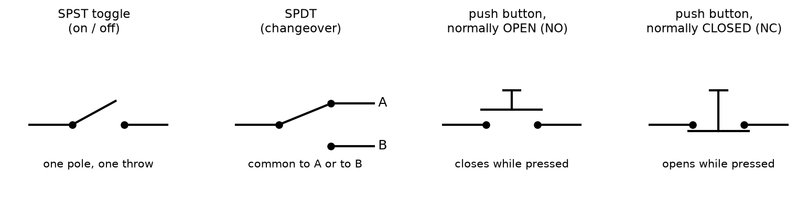
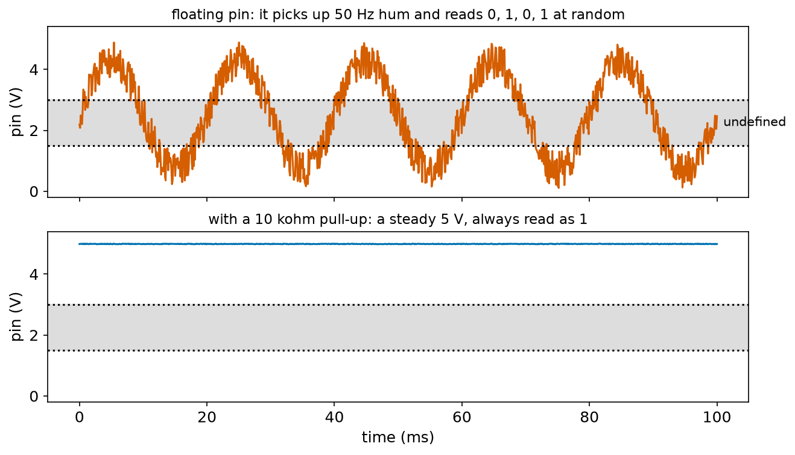
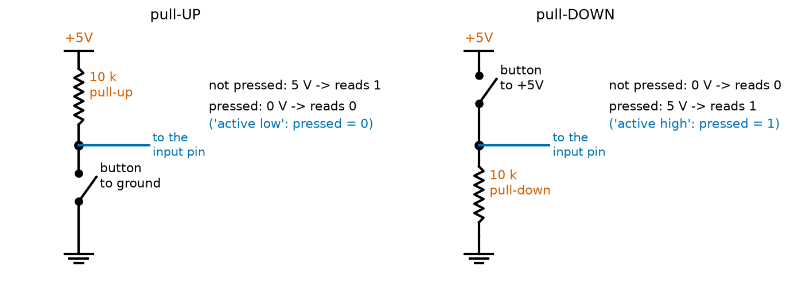
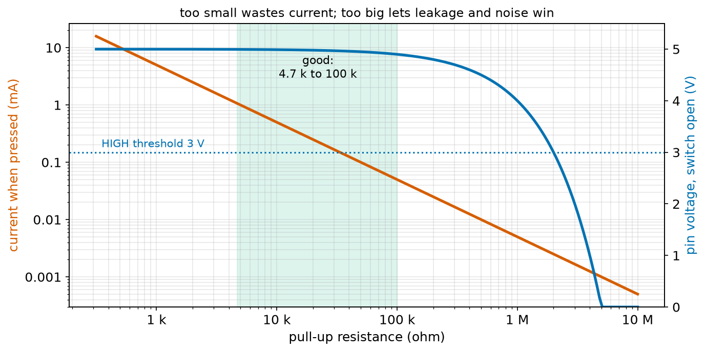
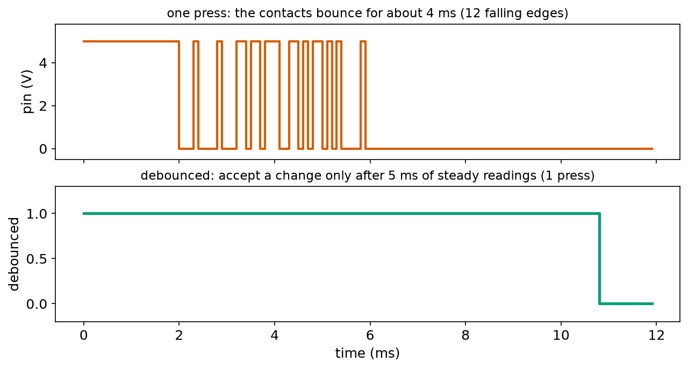
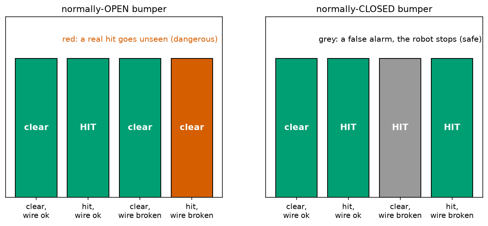

# Chapter 83 — Switches and Buttons, Pull-up and Pull-down Resistors

> **Part 5 · Chapter 83 of 749**
> **You need:** Chapter 7 (the emergency stop), Chapter 17 (booleans and fail-safe flags), Chapter 19 (homing with a limit switch), Chapter 31 (random numbers), Chapter 75 (Ohm's law), Chapter 79 (dividers and loading) and Chapter 82 (pin limits).
> **You will make:** a simulation of a "floating" input that reads at random, a program that chooses a pull-up resistor, a simulation of switch bounce with a debouncer, and a check of which bumper switch keeps a robot safe when a wire breaks.

---

## What you will learn

- The kinds of switches robots use: **toggle, push button, micro switch, reed switch**, and what **poles**, **throws**, **NO** and **NC** mean.
- Why an input pin connected to nothing reads at random: it is **floating**.
- How a **pull-up** or **pull-down** resistor gives an input a definite value, and how to choose it.
- What **active low** and **active high** mean.
- Why a mechanical switch **bounces**, and how to **debounce** it.
- How to wire switches so that a fault makes the robot **safer**, not more dangerous.

---

## New words in this chapter

| Word | Simple meaning |
|---|---|
| **switch** | A part that opens or closes a path for current by moving metal contacts. |
| **pole** | A separate circuit that a switch controls. |
| **throw** | A position a pole can connect to. |
| **SPST / SPDT** | Single pole, single throw (on/off); single pole, double throw (changeover). |
| **momentary** | Only changes while you press it, like a push button. |
| **NO / NC** | Normally open (closes when pressed) / normally closed (opens when pressed). |
| **micro switch** | A small, precise switch with a lever, used as a bumper or limit switch. |
| **reed switch** | Two thin metal reeds in a glass tube that touch when a magnet comes near. |
| **input pin** | A microcontroller pin set to read a voltage as 0 or 1. |
| **floating** | Connected to nothing, so its voltage drifts and its reading is random. |
| **pull-up / pull-down resistor** | A resistor that holds an input at the supply (up) or at ground (down) when nothing else drives it. |
| **active low / active high** | "On" is read as 0 / "on" is read as 1. |
| **bounce** | The rapid opening and closing of switch contacts for a few milliseconds when they meet. |
| **debounce** | To ignore the bounce and see one clean change. |

---

## 83.1 Switches

📖 **New word: switch** — a part that opens or closes a path for current by moving metal contacts. Chapter 73 called it "a gap you can open and close".

Switches are described by two numbers.

📖 **New word: pole** — one separate circuit that the switch controls. A two-pole switch controls two circuits at once with one lever.

📖 **New word: throw** — one position a pole can connect to. A single-throw switch is just on or off; a double-throw switch connects its common contact to one of two others.



*Figure 83.1 — The symbols of four common switches.*

**How to read this picture:** The **SPST** (single pole, single throw) is a plain on/off switch: Rover's power switch. The **SPDT** (single pole, double throw) connects its common contact either to A or to B, never both. The two push buttons look alike but behave oppositely: the **NO** (normally open) button is open until pressed; the **NC** (normally closed) button is closed until pressed.

📖 **New word: momentary** — a switch that changes only while it is held, like a push button or a bumper. A toggle or slide switch stays where you leave it.

📖 **New words: NO and NC** — normally open and normally closed: the state of the contacts when nothing presses them.

The switches you will meet most in robots:

| Switch | What it is | Used for |
|---|---|---|
| **toggle, slide, rocker** | stays where you put it | the main power switch |
| **push button** (tactile) | small, momentary, NO | user input: start, mode, reset |
| **micro switch** | a small, precise switch with a metal lever; usually has NO, NC and common contacts (SPDT) | bumpers, limit switches at the ends of an axis |
| **reed switch** | two thin magnetic reeds in a glass tube; a nearby magnet pulls them together | detecting a door, a wheel turn, a piston's position, with no contact |
| **emergency stop** | a big red latching button with NC contacts (Chapter 7) | stopping the robot |
| **DIP switch** | a row of tiny switches on a board | setting an address or an option once |

📖 **New word: micro switch** — a small, precise switch, often with a lever or a roller, that clicks over at a tiny movement (a fraction of a millimetre). Its three pins are common (C), normally open (NO) and normally closed (NC).

📖 **New word: reed switch** — a glass tube with two thin, springy, magnetic metal reeds inside. A magnet held near the tube makes them touch. No moving parts outside the glass, so it is sealed against dust and water.

---

## 83.2 Reading a switch: the problem of the floating pin

From Chapter 94 onwards, a robot's microcontroller reads switches through its **input pins**.

📖 **New word: input pin** — a microcontroller pin set up to read a voltage. It decides whether the voltage is "low" (read as 0) or "high" (read as 1). On an Arduino Uno, anything under about 1.5 V reads as 0 and anything over about 3 V reads as 1; between them the answer is not defined (Chapter 91 explains these levels).

An input pin is, in effect, a huge resistor to ground: about 100 MΩ, with a tiny bit of capacitance (Chapter 84). It draws almost no current. That is good, because it does not load whatever it reads (Chapter 79). But it causes a surprising problem.

Connect a push button between the pin and ground, and nothing else. Pressed: the pin is joined to ground and reads 0. Not pressed: the pin is joined to **nothing**. What does it read?

📖 **New word: floating** — connected to nothing that sets its voltage. A floating pin's voltage drifts with whatever it picks up: the electric field from mains wires in the walls (Chapter 73: charges push and pull at a distance), static from your hand, signals in nearby wires. Its reading changes at random.



*Figure 83.2 — Top: a floating pin's voltage, wandering through the undefined zone. Bottom: the same pin with a 10 kΩ pull-up, steady at 5 V.*

**How to read this picture:** The grey band is the undefined zone between 1.5 and 3 V. On top, the floating pin picks up the 50 Hz hum of the mains wiring in the room (a cycle every 20 ms) plus noise, and swings through the band, so it reads 1, 0, 1, 0 … with nobody touching the button. Below, a pull-up resistor holds the same pin at 5 V; it always reads 1.

The program `floating.py` in the Code section shows the effect on twenty readings:

```
floating      : 00000111011101010000
pull-up    10 k : 11111111111111111111
```

A robot that read its bumper this way would stop and start at random. The cure is one resistor.

---

## 83.3 Pull-up and pull-down resistors

📖 **New word: pull-up resistor** — a resistor from the input pin to the supply. When the switch is open, the pin is joined to the supply through the resistor; it draws almost no current, so there is almost no voltage across the resistor (Ohm's law), and the pin sits at the supply voltage: it reads 1. When the switch (from the pin to ground) closes, the pin is pulled firmly to 0 V, and a small current flows through the resistor to ground.

📖 **New word: pull-down resistor** — the opposite: a resistor from the pin to ground, with the switch from the pin to the supply. Open: the pin reads 0. Pressed: 1.



*Figure 83.3 — Left: a pull-up with the button to ground. Right: a pull-down with the button to +5 V.*

**How to read this picture:** In both, the blue wire goes to the input pin. On the left, the 10 kΩ resistor pulls the pin up to 5 V until the button connects it to ground: pressed reads 0. On the right, the resistor pulls the pin down to 0 V until the button connects it to 5 V: pressed reads 1.

📖 **New words: active low and active high** — a signal is **active low** if "pressed" or "on" is read as 0, as with a pull-up. It is **active high** if "on" is 1. Active low is surprising at first, but it is the more common choice, for three reasons:

- Microcontrollers have **built-in pull-up** resistors (about 20–50 kΩ on an Uno) that can be switched on in software (Chapter 99). Most do not have pull-downs. With a built-in pull-up, the switch needs only two wires, to the pin and to ground, and no extra parts.
- A switch to **ground** never puts the supply on a long wire, so a wire that rubs through to the robot's metal frame (usually at ground) does no harm.
- Many older logic chips were faster at pulling down than up.

In software, "active low" is just a `not` (Chapter 17): `pressed = not pin_reading`.

### Is it a divider?

Yes. With the switch open, the pin is the tap of a divider made of the pull-up (on top) and the pin's own 100 MΩ (below): 5 × 100 M ÷ 100.01 M = 4.9995 V. With the switch closed, the bottom of the divider is a near-zero resistance: 0 V. Chapter 79's rules explain what happens when the pull-up is too big.

---

## 83.4 Choosing the value

Two limits pull in opposite directions.

**Too small** wastes current. When the button is pressed, the pull-up sits straight across the supply: I = 5 V ÷ R. A 470 Ω pull-up wastes 10.6 mA every time the bumper is held, and 53 mW of heat (Chapter 76).

**Too big** gives too weak a pull. Any current leaking out of the pin (up to about 1 µA, by the datasheet, more with a long dusty wire) drops I × R across the resistor. With 4.7 MΩ, 1 µA would drop 4.7 V, and the "high" pin would read 0. A big pull-up also lets noise in more easily (it is a weak divider with a high output resistance, Chapter 79), and it makes the pin slow to rise after the button is released, because the pin's small capacitance must be charged through it (Chapter 84 explains the time R × C).



*Figure 83.4 — Red: the current wasted while the button is pressed. Blue: the pin's voltage with the button open and 1 µA of leakage.*

**How to read this picture:** The red line (left axis, log scale) falls as the resistor grows: bigger resistors waste less. The blue curve (right axis) stays at 5 V until the resistor reaches about 100 kΩ, then falls, crossing the 3 V threshold at 2 MΩ. The green band, 4.7 kΩ to 100 kΩ, is safe on both counts.

🧠 **Use 10 kΩ** for an ordinary switch, or the microcontroller's built-in pull-up. Use 1–4.7 kΩ for a switch at the end of a long wire in an electrically noisy robot (a stronger pull resists noise).

---

## 83.5 Bounce

Press a button and look closely at the pin with an oscilloscope (Chapter 129). It does not go cleanly from 1 to 0. It goes 1, 0, 1, 0, 1, 0 … several times before staying at 0.

📖 **New word: bounce** — when two metal contacts meet, they hit, spring apart, hit again, and so on, like a dropped ball, for about 1 to 10 milliseconds. Each bounce opens and closes the circuit.



*Figure 83.5 — Top: the pin during one press, sampled every 0.1 ms. Bottom: the same press after debouncing.*

**How to read this picture:** On top, the button is pressed at 2 ms. The pin falls, jumps back up, falls again, and so on, 12 times in 4 ms, before settling at 0. Below, the debounced signal changes only once, when the input has been steady for 5 ms.

To us a millisecond is nothing. A microcontroller reading the pin 10,000 times a second sees twelve presses. A robot counting button presses to choose a mode would skip through modes at random; a robot counting wheel turns with a reed switch would count too many.

📖 **New word: debounce** — to turn the bouncing signal into one clean change. Two ways:

- **In software** (Chapter 99): accept a new state only after the pin has shown it steadily for a few milliseconds (5 ms is typical). This needs no parts.
- **In hardware**: a resistor and a capacitor smooth the bounce away (Chapter 84 explains how), sometimes followed by a special input that cleans up slow edges (a "Schmitt trigger", Chapter 91).

---

## 83.6 Switches and safety

Chapter 17 taught a fail-safe rule for software: "unknown means unsafe". Switches need the same thinking. A wire can break, a connector can fall out, a switch can wear out. **What does the robot see then?**

With a pull-up, an open circuit (a broken wire) reads exactly like an **open switch**: 1. So:

- If "safe to drive" is signalled by a **closed** switch, a broken wire reads "not safe": the robot stops. This is fail-safe.
- If "danger" is signalled by a **closed** switch, a broken wire reads "no danger" forever: the robot never notices. This is fail-dangerous.

This is why emergency stop buttons (Chapter 7) use **normally closed** contacts: the circuit is closed while everything is fine, and pressing the button, or cutting the cable, or a loose connector, all open it and stop the robot. Application 1 applies the same idea to Rover's bumpers.

---

## Code

File `code/ch083/floating.py`:

```python
# floating.py - an input pin connected to nothing reads at random; a pull-up resistor fixes it
import random

random.seed(4)
LOW_MAX, HIGH_MIN = 1.5, 3.0          # an Uno reads below 1.5 V as LOW and above 3.0 V as HIGH (Chapter 91)
PIN_OHM = 100e6                       # an input pin is a huge resistance: about 100 Mohm


def read(volts):
    if volts <= LOW_MAX:
        return "0"
    if volts >= HIGH_MIN:
        return "1"
    return random.choice("01")         # in between, the pin may read either way


def floating_voltage(t):
    """With nothing connected, the pin's voltage drifts with whatever it picks up: mains hum, your hand, nearby wires."""
    return 2.5 + 2.4 * random.uniform(-1, 1)


def pulled_up_voltage(pickup_ua, r_pull):
    """With a pull-up to 5 V, a picked-up current of a few microamps moves the pin by only I x R."""
    return 5.0 - pickup_ua * 1e-6 * r_pull


print("20 readings, button NOT pressed:")
print("  floating      :", "".join(read(floating_voltage(t)) for t in range(20)))
for r in [10e3, 100e3, 1e6]:
    readings = "".join(read(pulled_up_voltage(random.uniform(0, 2), r)) for t in range(20))
    print(f"  pull-up {r / 1000:5.0f} k :", readings, f"(worst pin voltage {pulled_up_voltage(2, r):.2f} V)")
```

| Line | Code | What it does (simple English) |
|---|---|---|
| 1 | `# floating.py …` | A comment. |
| 2 | `import random` | For random pickup (Chapter 31). |
| 3 | (blank) | Spacing. |
| 4 | `random.seed(4)` | The same "random" results every run, so the output below matches. |
| 5 | `LOW_MAX, HIGH_MIN = 1.5, 3.0` | The Uno's thresholds. |
| 6 | `PIN_OHM = 100e6` | The pin's input resistance (for reference; the model below does not need it). |
| 7–8 | (blank) | Spacing. |
| 9 | `def read(volts):` | What the pin reports for a voltage. |
| 10–13 | the two `if`s | Clearly low → "0"; clearly high → "1". |
| 14 | `return random.choice("01")` | In the undefined zone, either answer can come out. |
| 15–16 | (blank) | Spacing. |
| 17 | `def floating_voltage(t):` | A floating pin's voltage at some moment. |
| 18 | `"""…"""` | The docstring. |
| 19 | `return 2.5 + 2.4 * random.uniform(-1, 1)` | Anywhere from 0.1 to 4.9 V: whatever it happens to pick up. |
| 20–21 | (blank) | Spacing. |
| 22 | `def pulled_up_voltage(pickup_ua, r_pull):` | A pulled-up pin with some picked-up current. |
| 23 | `"""…"""` | The docstring. |
| 24 | `return 5.0 - pickup_ua * 1e-6 * r_pull` | The picked-up current flows through the pull-up and moves the pin by I × R. |
| 25–26 | (blank) | Spacing. |
| 27 | `print(…)` | A heading. |
| 28 | `print("  floating …", "".join(…))` | Twenty readings of the floating pin, joined into one string (Chapter 21). |
| 29 | `for r in [10e3, 100e3, 1e6]:` | Three pull-up values. |
| 30 | `readings = "".join(…)` | Twenty readings, each with 0–2 µA of pickup. |
| 31 | `print(…)` | The readings, and the pin's voltage with the worst pickup. |

Output:

```
20 readings, button NOT pressed:
  floating      : 00000111011101010000
  pull-up    10 k : 11111111111111111111 (worst pin voltage 4.98 V)
  pull-up   100 k : 11111111111111111111 (worst pin voltage 4.80 V)
  pull-up  1000 k : 11111111111111111111 (worst pin voltage 3.00 V)
```

All three pull-ups read correctly here, but notice the margin: with 1 MΩ the worst-case pin is at 3.00 V, exactly on the threshold. A little more pickup and it would start reading 0s. 10 kΩ keeps 2 V of margin.

File `code/ch083/pullup_choice.py`:

```python
# pullup_choice.py - how big should a pull-up resistor be? Two limits pull in opposite directions
V = 5.0
LEAK_A = 1e-6               # the most current a pin plus a long dusty wire may leak (datasheet: up to 1 uA)
HIGH_MIN = 3.0              # the pin must stay above this when the switch is open
PIN_C = 50e-12              # the pin plus 30 cm of wire store about 50 pF (Chapter 84)

print(f"{'pull-up':>9s} {'current when pressed':>21s} {'power':>8s} {'open-switch voltage':>20s} {'rise time':>10s}")
for r in [470, 1e3, 4.7e3, 10e3, 47e3, 100e3, 1e6, 4.7e6]:
    pressed_ma = V / r * 1000                 # the switch connects the resistor straight to ground
    power_mw = V ** 2 / r * 1000
    open_v = V - LEAK_A * r                   # leakage pulls the pin down a little through R
    rise_us = 2.2 * r * PIN_C * 1e6           # time to go from 10% to 90% after release (Chapter 84)
    ok = "ok" if open_v >= HIGH_MIN + 1.0 and pressed_ma <= 1.0 else ""
    print(f"{r / 1000:7.2f} k {pressed_ma:15.3f} mA {power_mw:6.2f} mW {open_v:15.2f} V {rise_us:8.2f} us  {ok}")
print()
print("small R: wastes current while pressed. Huge R: leakage and noise can pull the pin below HIGH, and it is slow.")
print("10 kohm (or the Arduino's built-in 20-50 kohm) sits comfortably in the middle")
```

| Line | Code | What it does (simple English) |
|---|---|---|
| 1 | `# pullup_choice.py …` | A comment. |
| 2–5 | `V`, `LEAK_A`, `HIGH_MIN`, `PIN_C` | The supply, the worst leakage, the threshold, and the pin's small capacitance. |
| 6 | (blank) | Spacing. |
| 7 | `print(…)` | The header. |
| 8 | `for r in [ … ]:` | Eight values from 470 Ω to 4.7 MΩ. |
| 9 | `pressed_ma = V / r * 1000` | Ohm's law with the button pressed. |
| 10 | `power_mw = V ** 2 / r * 1000` | V² / R (Chapter 76). |
| 11 | `open_v = V - LEAK_A * r` | The voltage the leakage steals across R. |
| 12 | `rise_us = 2.2 * r * PIN_C * 1e6` | How long the pin takes to rise after release: 2.2 × R × C (a rule from Chapter 84; trust it for now). |
| 13 | `ok = …` | Good if the pin stays at least 1 V above the threshold and the pressed current is under 1 mA. |
| 14 | `print(…)` | The row. |
| 15–17 | `print()` and two lines | The conclusion. |

Output:

```
  pull-up  current when pressed    power  open-switch voltage  rise time
   0.47 k          10.638 mA  53.19 mW            5.00 V     0.05 us  
   1.00 k           5.000 mA  25.00 mW            5.00 V     0.11 us  
   4.70 k           1.064 mA   5.32 mW            5.00 V     0.52 us  
  10.00 k           0.500 mA   2.50 mW            4.99 V     1.10 us  ok
  47.00 k           0.106 mA   0.53 mW            4.95 V     5.17 us  ok
 100.00 k           0.050 mA   0.25 mW            4.90 V    11.00 us  ok
1000.00 k           0.005 mA   0.03 mW            4.00 V   110.00 us  ok
4700.00 k           0.001 mA   0.01 mW            0.30 V   517.00 us  

small R: wastes current while pressed. Huge R: leakage and noise can pull the pin below HIGH, and it is slow.
10 kohm (or the Arduino's built-in 20-50 kohm) sits comfortably in the middle
```

1 MΩ passes the simple test but only just, and it is a hundred times slower and much more open to noise than 10 kΩ. 4.7 MΩ fails completely: with 1 µA of leakage the pin sits at 0.3 V and reads "pressed" forever.

---

## Small examples

**Example 1.** A 10 kΩ pull-up on 5 V, button pressed: 0.5 mA, 2.5 mW.

**Example 2.** The same on 3.3 V: 0.33 mA.

**Example 3.** An Uno's built-in pull-up (say 35 kΩ) with a 2 µA leak: the pin sits at 5 − 0.07 = 4.93 V.

**Example 4.** Active low with a pull-up: pin reads 0 → pressed. In Python: `pressed = (reading == 0)`.

**Example 5.** A double-pole switch (DPST) turns off the motor supply and tells the Arduino at the same time: one pole for each.

**Example 6.** A button bouncing for 6 ms, read every 1 ms: up to 6 false changes.

**Example 7.** A reed switch and a magnet on a wheel, one pulse per turn, wheel at 3 turns per second: a pulse every 333 ms, so a 5 ms debounce is easily short enough.

**Example 8.** An NC limit switch whose cable is cut reads "at the limit": the axis refuses to move further, which is safe.

---

## 🏭 Real robot applications

### Application 1 (worked in full) — 🤖 Rover's bumpers: which contact, which resistor?

**1. The real problem.** Rover has two bumper micro switches at the front (Chapter 5). If the distance sensor misses an obstacle, the bumper is the last line of defence. Each micro switch has three pins: common, NO and NC. Which should be used, and with what pull-up? A bumper that fails silently is worse than no bumper, because people trust it.

**2. Why this theory.** With a pull-up, an open circuit reads 1. A broken wire is an open circuit. So the wiring decides whether a broken wire looks like "clear" or like "hit". The fail-safe rule (section 83.6): a fault must look like danger.

**3. The numbers.** Pull-up 10 kΩ to 5 V (or the Arduino's built-in one). Bumper cable 30 cm. Two possible wirings: NO (common to ground, NO to the pin) or NC (common to ground, NC to the pin).

**4. The maths.** NO: clear → contacts open → pin 1; hit → closed → pin 0; broken wire → open → pin 1 = "clear". NC: clear → contacts closed → pin 0; hit → open → pin 1; broken wire → open → pin 1 = "hit". The pull-up current: with NC, the contacts are closed almost all the time, so 0.5 mA flows continuously; with NO, only during a hit.

**5. The code.** File `code/ch083/fail_safe.py`:

```python
# fail_safe.py - normally-open or normally-closed bumper switch: what happens when a wire breaks?
# with a pull-up: a closed switch to ground reads 0, an open switch (or a broken wire) reads 1


def pin(contact_closed, wire_ok=True):
    if not wire_ok:
        return 1                      # a broken wire is just an open circuit: the pull-up wins
    return 0 if contact_closed else 1


def no_bumper(hit, wire_ok=True):
    """Normally-open: the contacts close when the bumper is hit. Pin 0 means 'hit'."""
    return "HIT" if pin(contact_closed=hit, wire_ok=wire_ok) == 0 else "clear"


def nc_bumper(hit, wire_ok=True):
    """Normally-closed: the contacts open when the bumper is hit. Pin 1 means 'hit'."""
    return "HIT" if pin(contact_closed=not hit, wire_ok=wire_ok) == 1 else "clear"


print(f"{'situation':34s} {'normally-open':>14s} {'normally-closed':>16s}")
for label, hit, ok in [("no obstacle, wiring fine", False, True), ("robot hits a wall, wiring fine", True, True),
                       ("no obstacle, wire broken", False, False), ("robot hits a wall, wire broken", True, False)]:
    print(f"{label:34s} {no_bumper(hit, ok):>14s} {nc_bumper(hit, ok):>16s}")
print()
print("normally-open + broken wire: the robot never knows it hit something (unsafe, and silent)")
print("normally-closed + broken wire: the robot thinks it hit something and stops (safe, and you notice)")
```

| Line | Code | What it does (simple English) |
|---|---|---|
| 1–2 | comments | The question, and the pull-up rule. |
| 3–4 | (blank) | Spacing. |
| 5 | `def pin(contact_closed, wire_ok=True):` | What the input pin reads. |
| 6–7 | `if not wire_ok: return 1` | A broken wire: nothing pulls the pin down, so the pull-up makes it 1. |
| 8 | `return 0 if contact_closed else 1` | Closed to ground → 0; open → 1. |
| 9–10 | (blank) | Spacing. |
| 11 | `def no_bumper(hit, wire_ok=True):` | The NO wiring. |
| 12 | `"""…"""` | The docstring. |
| 13 | `return "HIT" if pin(contact_closed=hit, …) == 0 else "clear"` | The contacts close when hit; the software reads 0 as "hit". |
| 14–15 | (blank) | Spacing. |
| 16 | `def nc_bumper(hit, wire_ok=True):` | The NC wiring. |
| 17 | `"""…"""` | The docstring. |
| 18 | `return "HIT" if pin(contact_closed=not hit, …) == 1 else "clear"` | The contacts open when hit; the software reads 1 as "hit". |
| 19–20 | (blank) | Spacing. |
| 21 | `print(…)` | The header. |
| 22–23 | `for label, hit, ok in [ … ]:` | Four situations: clear or hit, wire fine or broken. |
| 24 | `print(…)` | What each wiring reports. |
| 25–27 | `print()` and two lines | The conclusion. |

Output:

```
situation                           normally-open  normally-closed
no obstacle, wiring fine                    clear            clear
robot hits a wall, wiring fine                HIT              HIT
no obstacle, wire broken                    clear              HIT
robot hits a wall, wire broken              clear              HIT

normally-open + broken wire: the robot never knows it hit something (unsafe, and silent)
normally-closed + broken wire: the robot thinks it hit something and stops (safe, and you notice)
```



*Figure 83.6 — What each bumper reports in four situations. Green: correct. Red: a real hit missed. Grey: a false alarm.*

**How to read this picture:** With normally-open contacts (left), a broken wire makes the robot blind to a real hit (red). With normally-closed contacts (right), a broken wire gives a false alarm (grey): the robot stops and refuses to go on, and somebody fixes the wire.

**6. The result.** Rover's bumpers will use the NC contact, read with the built-in pull-up: 0 means clear, 1 means hit or fault. The cost is 0.5 mA per bumper flowing all the time through a 10 kΩ pull-up (or about 0.15 mA with the built-in one), trivial next to Rover's 530 mA. The benefit: every broken wire, loose connector and worn-out switch shows up at once as a "hit", instead of hiding until the day the bumper is needed.

**7. Going further.** Safety-rated robots go further: two independent channels for each safety input, both of which must agree (Application 3), and "test pulses" sent down the wires to detect a wire shorted to the supply, which NC wiring alone cannot catch. Chapter 99 reads Rover's bumpers in code, and Chapter 744 covers the standards that require these designs.

### Application 2 (worked in full) — 🏭 Homing an axis on a limit switch

**1. The real problem.** Chapter 19 homed a robot axis: drive slowly towards a limit switch until it closes, then call that position zero. A 3D printer, a CNC machine and a robot arm's linear axis all do this at power-up. The software counts how many times the switch closes, to detect "already pressed at start" and other faults. With a bouncing switch, the count is wrong. How bad is the bounce, and how long must the debounce be?

**2. Why this theory.** Contacts bounce for a few milliseconds (section 83.5). The controller samples the switch thousands of times a second, so it sees every bounce. A debounce rule (accept a change only after it has been steady for a set time) removes them, at the cost of a small delay.

**3. The numbers.** Sampling every 100 µs (10 kHz). Bounce lasting about 4 ms, with gaps that get shorter. Debounce time 5 ms. The axis approaches at 5 mm/s.

**4. The maths.** A 5 ms debounce delays the "home found" signal by up to 5 ms after the last bounce: at 5 mm/s that is 0.025 mm of extra travel, smaller than the switch's own repeatability (about 0.01–0.05 mm). Fast homing at 100 mm/s would overshoot by 0.5 mm, which is why machines home fast once, back off, and then home slowly a second time.

**5. The code.** File `code/ch083/bounce.py`:

```python
# bounce.py - a mechanical switch bounces for a few milliseconds; count the false presses, then debounce
import random

random.seed(7)
SAMPLE_US = 100             # read the pin every 100 microseconds (10,000 times a second)


def bouncing_press(press_at_ms, bounce_ms=4.0):
    """A list of (time_ms, state) changes: the contact chatters before settling closed (0 = pressed, pull-up)."""
    changes = [(0.0, 1)]
    t = press_at_ms
    state = 0
    while t < press_at_ms + bounce_ms:
        changes.append((t, state))
        t += random.uniform(0.05, 0.6) * (1 - (t - press_at_ms) / bounce_ms) + 0.02   # gaps grow shorter... then stop
        state = 1 - state
    changes.append((t, 0))
    return changes


def level_at(changes, t_ms):
    s = changes[0][1]
    for when, state in changes:
        if when <= t_ms:
            s = state
    return s


changes = bouncing_press(press_at_ms=2.0)
samples = [level_at(changes, k * SAMPLE_US / 1000) for k in range(int(12 / (SAMPLE_US / 1000)))]

falls = sum(1 for a, b in zip(samples, samples[1:]) if a == 1 and b == 0)
print(f"one press of the button, sampled every {SAMPLE_US} us for 12 ms")
print(f"the pin went from HIGH to LOW {falls} times: a naive counter would see {falls} presses")

# debounce: accept a new state only after it has stayed the same for STABLE_MS
STABLE_MS = 5.0
need = int(STABLE_MS * 1000 / SAMPLE_US)
accepted, run, last, presses = 1, 0, 1, 0
for s in samples:
    run = run + 1 if s == last else 1
    last = s
    if run >= need and s != accepted:
        accepted = s
        if s == 0:
            presses += 1
print(f"after debouncing (state must be steady for {STABLE_MS:.0f} ms): {presses} press")
```

| Line | Code | What it does (simple English) |
|---|---|---|
| 1 | `# bounce.py …` | A comment. |
| 2 | `import random` | For the random bounce gaps. |
| 3 | (blank) | Spacing. |
| 4 | `random.seed(7)` | Repeatable results. |
| 5 | `SAMPLE_US = 100` | How often the controller reads the pin. |
| 6–7 | (blank) | Spacing. |
| 8 | `def bouncing_press(press_at_ms, bounce_ms=4.0):` | Make a list of moments when the contact changes. |
| 9 | `"""…"""` | The docstring. |
| 10 | `changes = [(0.0, 1)]` | Start released (1, with a pull-up). |
| 11–12 | `t = press_at_ms`, `state = 0` | The first touch. |
| 13 | `while t < press_at_ms + bounce_ms:` | Chatter until the bounce time is over. |
| 14 | `changes.append((t, state))` | Record the change. |
| 15 | `t += …` | The next change comes after a random gap that shrinks as the bounce dies away. |
| 16 | `state = 1 - state` | Flip: open ↔ closed. |
| 17 | `changes.append((t, 0))` | Finally settled closed. |
| 18 | `return changes` | The list. |
| 19–20 | (blank) | Spacing. |
| 21–26 | `def level_at(changes, t_ms): …` | The pin's level at any moment: the state of the last change at or before that time. |
| 27–28 | (blank) | Spacing. |
| 29 | `changes = bouncing_press(press_at_ms=2.0)` | One press at 2 ms. |
| 30 | `samples = [ … ]` | Read the pin every 0.1 ms for 12 ms: 120 samples. |
| 31 | (blank) | Spacing. |
| 32 | `falls = sum(1 for a, b in zip(samples, samples[1:]) if a == 1 and b == 0)` | Count every 1 → 0 change between neighbouring samples (Chapter 21's `zip`). |
| 33–34 | `print(…)` | The naive count. |
| 35 | (blank) | Spacing. |
| 36 | `# debounce: …` | A comment. |
| 37 | `STABLE_MS = 5.0` | How long a new state must last. |
| 38 | `need = int(STABLE_MS * 1000 / SAMPLE_US)` | 50 samples in a row. |
| 39 | `accepted, run, last, presses = 1, 0, 1, 0` | The accepted state, the length of the current run of equal samples, the previous sample, and the press counter. |
| 40 | `for s in samples:` | Every sample in order, as a microcontroller would see them. |
| 41 | `run = run + 1 if s == last else 1` | Same as before: the run grows; different: a new run starts. |
| 42 | `last = s` | Remember it. |
| 43–46 | `if run >= need and s != accepted: …` | A new state that has lasted long enough is accepted; count it if it is a press. |
| 47 | `print(…)` | The debounced count. |

Output:

```
one press of the button, sampled every 100 us for 12 ms
the pin went from HIGH to LOW 12 times: a naive counter would see 12 presses
after debouncing (state must be steady for 5 ms): 1 press
```

**6. The result.** One press looks like twelve to a fast controller. With a 5 ms debounce it is one press, delayed by 5 ms after the last bounce. During homing at 5 mm/s that delay costs 0.025 mm of overtravel, far too small to matter, and the home position is repeatable. Without debouncing, a homing routine that stops on the first edge works, but one that counts edges or re-arms after release goes wrong.

**7. Going further.** Many machines replace mechanical limit switches with optical or magnetic (Hall-effect, Chapter 129) sensors, which do not bounce and do not wear out. Chapter 99 writes the debounce in Arduino C++, and Chapter 104 uses it inside a state machine.

### Application 3 — 🏭 Two-channel emergency stops

The emergency stop of a factory robot cell (Chapter 7) has **two** sets of NC contacts in one button, wired to two separate inputs of a safety controller. The controller checks that both channels open together, within a few milliseconds, whenever the button is pressed, and that both are closed before the robot may restart. If one channel's wire breaks, that channel opens while the other stays closed: the controller sees the disagreement, stops the robot and refuses to restart until it is repaired. A single fault anywhere in the wiring can never hide a press. This "two-channel, cross-checked, normally closed" design is required by the safety standards for industrial robots (Chapter 744).

### Application 4 — 🏭🚪 Reed switches on doors and cylinders

The guard doors around a robot cell carry a magnet, and the door frame a reed switch (usually a coded, safety-rated version that cannot be fooled with an ordinary magnet). Open the door, and the robot stops. Inside the cell, pneumatic grippers and cylinders (Chapter 147) have a magnet in their piston, and reed switches strapped to the outside of the cylinder tell the controller when the piston has reached each end: no wires through the cylinder wall, nothing to wear out, and no seals to leak. The same idea counts wheel turns on a bicycle computer, and a robot lawnmower uses a reed switch and a magnet in its docking station to know it is home.

### Application 5 — 🦿 Foot switches on a small walking robot

A small legged robot needs to know which feet are on the ground (Chapter 668). The cheapest way is a micro switch under each foot, pressed by the robot's weight. With four legs and a gait that lifts each foot twice a second, each switch opens and closes eight times a second; a 5 ms debounce leaves plenty of time between steps. The switches are wired NC-to-ground with pull-ups, so a broken wire reads "foot in the air", which makes the controller keep the other three feet planted rather than step onto a leg it cannot feel. Bigger robots replace the switches with force sensors (Chapter 128) that say how much weight each foot carries, not just whether it touches.

---

## 🔧 Hands-on lab

### Lab 83.1 — See a floating input (hardware or Wokwi)

You need: the multimeter, a 10 kΩ resistor, a push button, a breadboard and a 5 V supply. If you have an Arduino already (Chapter 95), this lab is even clearer with it; otherwise use the meter.

1. Connect a long wire (30 cm) to an empty breadboard row. Measure the voltage between that row and ground with the meter. Move your hand near the wire.
2. Add a 10 kΩ resistor from that row to +5 V. Measure again, moving your hand.
3. Add a push button from that row to ground. Measure while pressing and releasing.
4. Rebuild it as a pull-down (resistor to ground, button to +5 V) and measure again.

**What you should see:** In step 1 the meter shows a wandering voltage, often tens or hundreds of millivolts, changing as your hand moves (the meter's own 10 MΩ input partly "pulls down" the wire, Chapter 81, so a real input pin would float even more). With the pull-up, the meter shows a steady 5.0 V that your hand cannot move. Pressed, it shows 0.0 V. As a pull-down: 0.0 V released and 5.0 V pressed.

| If it does not work | Likely cause | Fix |
|---|---|---|
| The pin reads 0 V all the time with the pull-up | The button's legs are in the wrong rows, so it is always closed | Square tactile buttons have pins joined in pairs: rotate it 90° |
| The pressed reading is 2.5 V, not 0 | The "button" is a resistor of similar value, or a loose contact | Check the button with the continuity beep |

**Challenge:** Use the meter's current setting (Chapter 81) to measure the current through the pull-up while the button is pressed. Compare with 5 V ÷ 10 kΩ.

### Lab 83.2 — Design the inputs of a robot (simulation)

A robot has: a start button, two NC bumpers, an NC emergency stop sense contact, a reed switch on its docking contacts, and a mode switch (SPDT, two positions). All are read with pull-ups.

1. For each input, write which reading means "active", and what a broken wire reads as.
2. Write a Python function `inputs_ok(readings)` that takes a dictionary of pin readings and returns a list of warnings, including "bumper or e-stop wiring may be faulty" when a bumper and the e-stop both read 1 at start-up.
3. For the SPDT mode switch, the robot uses two pins (one per throw). What reading pattern is impossible in a healthy switch, and what does it mean?

**What you should see:** Start button: 0 = pressed; a broken wire looks like "never pressed" (the robot simply will not start: annoying but safe). Bumpers and e-stop: 1 = hit or stop; a broken wire looks like a hit. Reed switch: 0 = docked; broken wire looks like "not docked" (the robot keeps trying to dock: safe). Mode switch: exactly one pin should read 0; both 0 is impossible (a short between them), and both 1 means the common wire is broken or the switch is between positions. Reading both pins turns a hidden fault into a detected one.

| If it does not work | Likely cause | Fix |
|---|---|---|
| Every input says "active" | The active-low logic was applied twice | Decide once, per input, whether 0 or 1 means active |

**Challenge:** Add a debounce counter to each input inside your function, so it can be called every millisecond with fresh readings.

### Lab 83.3 — Debounce experiments (simulation)

Copy `bounce.py`.

1. Change `bounce_ms` to 1, 4 and 10 ms. How many false presses does the naive counter see each time (keep the seed)?
2. Change `STABLE_MS` to 0.5, 2, 5 and 20 ms with a 10 ms bounce. Which values still report exactly one press?
3. Simulate a **release** as well (the contacts also bounce when they open). Add it 30 ms after the press and count presses with a 5 ms debounce.
4. A human can press a button at most about 10 times a second. What is the longest debounce time that never misses a real press?

**What you should see:** Longer bounces give more false edges. A debounce time shorter than the longest gap between bounces lets some through; anything longer than the bounce (here 10 ms or more for a 10 ms bounce) gives one press. With a release added, there is still one press (the release is a change to 1, not counted as a press). At 10 presses a second, each press and release last about 50 ms, so a debounce up to about 30–40 ms is safe; 5–20 ms is the usual choice.

| If it does not work | Likely cause | Fix |
|---|---|---|
| Zero presses detected | `STABLE_MS` is longer than the time the button stays pressed in the simulation | Extend the sampling window from 12 ms |
| Different counts each run | The seed was removed | Keep `random.seed(7)` while comparing |

**Challenge:** Write a second debouncer that uses a counter that goes up by one for each 0 sample and down by one for each 1 sample (limited to 0 and 20), and changes state only at the ends. Compare its delay with the first one.

---

## Common mistakes

⚠️ **Leaving an input floating.** Every switch input needs a pull-up or a pull-down (built in or added).

⚠️ **Forgetting that a pull-up makes the signal active low.** Pressed reads 0.

⚠️ **Putting the pull-up and the switch both to +5 V.** The pin then always reads 1. The switch goes to the opposite rail from the resistor.

⚠️ **Wiring a switch straight from +5 V to ground with no resistor.** Pressing it shorts the supply.

⚠️ **Choosing a huge pull-up (megohms) to save current.** Leakage and noise win.

⚠️ **Counting raw edges from a mechanical switch.** Debounce first.

⚠️ **Using normally-open contacts for safety inputs.** A broken wire then hides the danger.

⚠️ **Turning a square tactile button the wrong way round on a breadboard.** Its pins are joined in pairs; if the paired pins are in different rows, the button looks permanently pressed.

---

## Practice

🏋️ **1.** What do SPST, SPDT, DPDT, NO and NC mean?

🏋️ **2.** A button connects a pin to ground, with nothing else on the pin. What does the pin read when the button is not pressed? Why?

🏋️ **3.** A 4.7 kΩ pull-up on 3.3 V: what current flows when the button is pressed, and what power is wasted?

🏋️ **4.** A pin leaks 0.5 µA. What is the largest pull-up that keeps a 5 V pin above 4.5 V when the switch is open?

🏋️ **5.** A switch to +5 V with a 10 kΩ pull-down. What does the pin read when the switch is pressed? Is this active high or low?

🏋️ **6.** In Python, a bumper read with a pull-up and NC contacts gives `reading`. Write one line that sets `hit` correctly.

🏋️ **7.** A button bounces for 3 ms and is read every 0.5 ms. Roughly how many false edges could the program see?

🏋️ **8.** An e-stop uses NO contacts. Describe a failure that would make it useless, and why NC is better.

🏋️ **9.** Two sensors share one 10 kΩ pull-up resistor on the same wire (both pull to ground when active). What can the program tell, and what can it not?

🏋️ **10.** A reed switch counts a wheel's turns. The wheel turns at up to 15 turns per second. What is the longest debounce time you can use?

🏋️ **11.** Write `debounce(samples, stable)` that returns the list of accepted states, one per sample, using the rule of `bounce.py`. Test it on `[1,1,0,1,0,0,0,0,0,1,1,1,1,1]` with `stable=3`.

---

## Answers

**1.** SPST: one circuit, on/off. SPDT: one circuit, switched to one of two contacts. DPDT: two separate circuits, each switched between two contacts, by one lever. NO: open until pressed. NC: closed until pressed.

**2.** It floats: nothing sets its voltage, so it picks up noise and reads 0 or 1 at random.

**3.** 3.3 ÷ 4,700 = 0.70 mA. P = 3.3² ÷ 4,700 = 2.3 mW.

**4.** 0.5 V ÷ 0.5 µA = 1 MΩ.

**5.** 1 (5 V). Active high.

**6.** `hit = (reading == 1)` (NC with a pull-up: contacts open when hit, so the pin reads 1).

**7.** 3 ms ÷ 0.5 ms = 6 samples during the bounce, so up to about 3 false presses (6 changes).

**8.** A broken wire, a loose connector or a worn contact leaves the circuit open, which with NO contacts reads "not pressed" forever: pressing the button would do nothing. With NC, any of those faults opens the circuit and stops the robot at once, so it is noticed.

**9.** It can tell that **at least one** sensor is active (the wire goes to 0), but not which one. This "wired-OR" is used on purpose for things like "any bumper hit".

**10.** At 15 turns per second a turn takes 66.7 ms; the magnet passes the switch for perhaps a third of it, about 22 ms. The debounce must be shorter than the shortest closed (and open) time: about 10 ms or less.

**11.**

```python
def debounce(samples, stable):
    accepted, run, last = samples[0], 0, samples[0]
    out = []
    for s in samples:
        run = run + 1 if s == last else 1
        last = s
        if run >= stable and s != accepted:
            accepted = s
        out.append(accepted)
    return out

print(debounce([1, 1, 0, 1, 0, 0, 0, 0, 0, 1, 1, 1, 1, 1], 3))
```

```
[1, 1, 1, 1, 1, 1, 0, 0, 0, 0, 0, 1, 1, 1]
```

The single 0 at position 2 is ignored; the run of 0s is accepted at its third sample; the return to 1 is accepted at its third sample.

---

## Summary

🧠 Switches are described by **poles** (circuits) and **throws** (positions): SPST, SPDT, DPDT. Momentary switches are **NO** or **NC**.

🧠 A pin connected to nothing is **floating** and reads at random. Every switch input needs a **pull-up** (resistor to the supply, switch to ground: **active low**) or a **pull-down** (resistor to ground, switch to the supply: **active high**).

🧠 Choose about **10 kΩ** (or the built-in pull-up). Too small wastes current when pressed; too big lets leakage and noise win, and is slow.

🧠 Mechanical contacts **bounce** for 1–10 ms. **Debounce**: accept a change only after it has been steady for a few milliseconds.

🧠 With a pull-up, a **broken wire reads like an open switch**. Use **normally closed** contacts for safety inputs, so faults look like danger and stop the robot.

---

## Next chapter

Chapter 84 introduces a part that stores charge: the **capacitor**. You will learn what a farad is, how a capacitor charges and discharges through a resistor with the time constant R × C (the exponential of Chapter 52), why the chips in a robot need small capacitors next to them, how a capacitor smooths a bouncing switch or a noisy sensor, and why a big one can deliver a dangerous spark.
