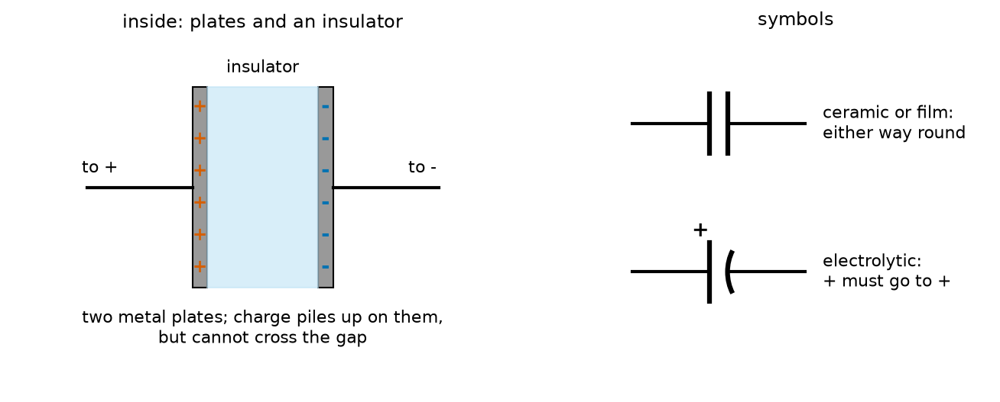
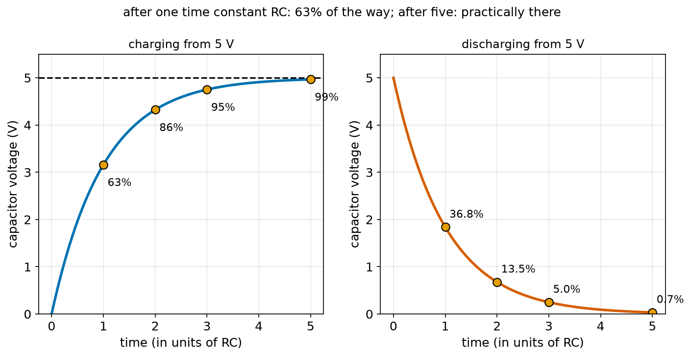
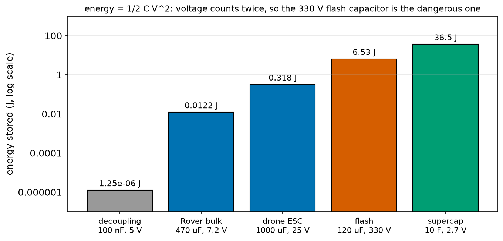
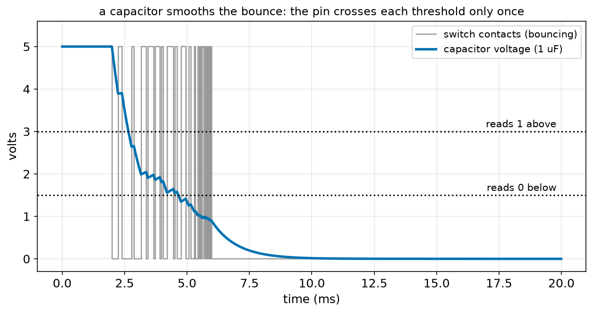
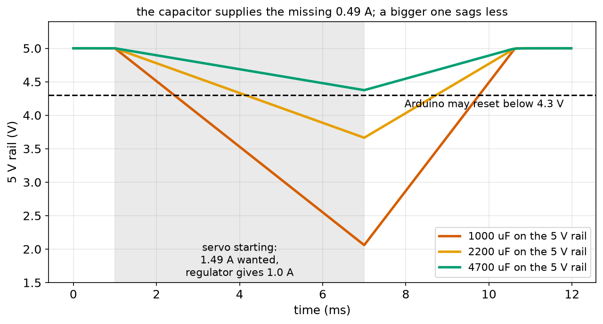
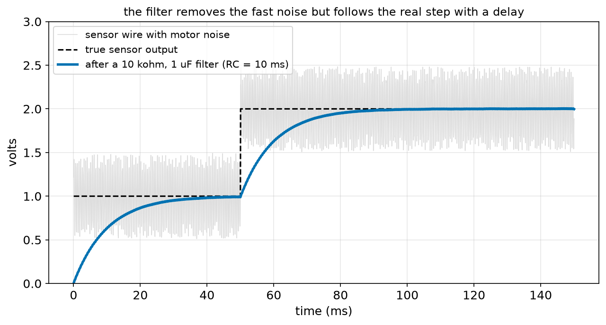

# Chapter 84 — Capacitors

> **Part 5 · Chapter 84 of 749**
> **You need:** Chapter 52 (exponential growth and decay), Chapter 71 (stepping in time with Euler's method), Chapter 73 (charge and static electricity), Chapter 75 (Ohm's law), Chapter 76 (energy and power), Chapter 79 (dividers) and Chapter 83 (bounce and pull-ups).
> **You will make:** a simulation of a capacitor charging through a resistor, checked against the exact curve; a table of the charge and energy in real capacitors; a simulation of a robot's 5 V rail sagging when a servo starts, and the capacitor that saves it; and an RC filter that cleans motor noise off a sensor wire.

---

## What you will learn

- What a **capacitor** is: two plates that store **charge**, with **Q = C × V**.
- The unit of capacitance, the **farad**, and its everyday sizes (µF, nF, pF).
- How a capacitor charges and discharges through a resistor, with the **time constant τ = R × C**.
- The key rule **I = C × (rate of change of V)**: a capacitor resists quick changes of voltage.
- The energy stored, **E = ½ C V²**, and why big capacitors can be dangerous.
- Four jobs capacitors do in every robot: **decoupling**, **bulk storage**, **filtering** and **timing**.

---

## New words in this chapter

| Word | Simple meaning |
|---|---|
| **capacitor** | A part made of two conductors separated by an insulator, which stores charge. |
| **capacitance (C)** | How much charge a capacitor stores for each volt across it. |
| **farad (F)** | The unit of capacitance: one coulomb per volt. |
| **µF, nF, pF** | Microfarad (10⁻⁶ F), nanofarad (10⁻⁹ F), picofarad (10⁻¹² F). |
| **dielectric** | The insulator between the plates. |
| **electrolytic** | A capacitor type with large capacitance that has a + and a − leg and must be connected the right way. |
| **ceramic** | A small, non-polarised capacitor type, usually under a few µF. |
| **voltage rating** | The most voltage a capacitor may have across it. |
| **time constant (τ)** | R × C: the time a capacitor takes to charge 63% of the way through a resistor. |
| **decoupling capacitor** | A small capacitor right next to a chip's supply pins that supplies its sudden small currents. |
| **bulk capacitor** | A large capacitor on a supply that covers bigger, longer current demands. |
| **brown-out** | A dip in the supply voltage that makes a microcontroller reset or misbehave. |
| **RC filter** | A resistor and a capacitor that smooth away fast changes (noise) in a signal. |
| **supercapacitor** | A capacitor with an enormous capacitance (farads) but a low voltage rating. |

---

## 84.1 Two plates and a gap

Take two metal plates, put a thin insulator between them, and connect them to a battery. Chapter 73 showed that charge cannot cross an insulator. But the battery can still push electrons **onto** one plate and pull them **off** the other. The two plates end up with equal and opposite charges, held there by their attraction to each other across the gap (opposite charges attract, Chapter 73).

📖 **New word: capacitor** — two conductors (plates) separated by an insulator. It stores charge on its plates.

📖 **New word: dielectric** — the insulator between the plates: air, plastic film, ceramic, or a thin oxide layer.



*Figure 84.1 — Left: two plates with an insulator between them, charged + and −. Right: the symbols for an ordinary and for a polarised (electrolytic) capacitor.*

**How to read this picture:** On the left, the battery has piled positive charge on the left plate and negative charge on the right. No charge crosses the blue insulator; it just sits on the plates. On the right, the ordinary symbol is two parallel lines, the plates. The electrolytic symbol has one curved plate and a + sign: it must be connected with + to the higher voltage.

The more voltage you apply, the more charge piles up, in proportion:

```
Q = C × V
```

In words: "the charge stored equals the capacitance times the voltage across the capacitor".

📖 **New word: capacitance (C)** — the charge stored per volt. A big capacitance stores a lot of charge for a small voltage, like a wide tank that holds a lot of water for a small depth.

📖 **New word: farad (F)** — the unit of capacitance: **1 farad stores 1 coulomb per volt**. Named after Michael Faraday.

A farad is enormous. Everyday capacitors are measured in:

| Unit | Size | Typical use |
|---|---|---|
| **pF** (picofarad) | 10⁻¹² F | radio circuits; the 100 pF "human body" of Chapter 73 |
| **nF** (nanofarad) | 10⁻⁹ F | 100 nF decoupling capacitors next to every chip |
| **µF** (microfarad, often written "uF") | 10⁻⁶ F | 10–4,700 µF bulk capacitors on supplies |
| **F** | 1 F | supercapacitors (section 84.6) |

🔢 **Maths.** A 100 nF capacitor at 5 V stores Q = 100 × 10⁻⁹ × 5 = 5 × 10⁻⁷ C. A 470 µF capacitor at 7.2 V stores 470 × 10⁻⁶ × 7.2 = 0.0034 C. Compare Rover's battery: 7,200 C (Chapter 73). Capacitors store very little charge; their value is in how **fast** they can give it.

🔢 **Maths.** Chapter 73 said a person stores charge "like a 100 pF capacitor". At 15,000 V: Q = 100 × 10⁻¹² × 15,000 = 1.5 × 10⁻⁶ C, the number used there.

### Kinds of capacitors

| Kind | Range | Notes |
|---|---|---|
| **ceramic** | 1 pF to about 10 µF | tiny, cheap, either way round; marked with a code like "104" = 10 × 10⁴ pF = 100 nF |
| **film** | 1 nF to a few µF | stable, either way round |
| **electrolytic** (aluminium) | 1 µF to 10,000 µF and more | big, cheap, **polarised**: the − leg is marked with a stripe |
| **tantalum** | 0.1 to 100 µF | small, polarised; can fail by catching fire if reversed |
| **supercapacitor** | 0.1 F to thousands of F | low voltage (2.7 V per cell), stores real energy |

📖 **New word: electrolytic** — a capacitor whose insulator is a very thin oxide layer grown on aluminium foil, which gives a large capacitance in a small can. It is polarised: connected backwards, the oxide breaks down, the capacitor heats, and it can burst. **Always check the stripe (−) before power.**

📖 **New word: voltage rating** — the most voltage a capacitor may safely have across it, printed on it ("25V"). Above it, the insulator breaks down. Choose at least 1.5 times the highest voltage the capacitor will see: a 16 V capacitor for Rover's 8.4 V, a 35 V or 50 V capacitor for a 6S drone's 25.2 V.

---

## 84.2 Charging through a resistor

Connect an empty capacitor to a 5 V supply through a 10 kΩ resistor. What happens?

At the first instant, the capacitor is empty: 0 V across it. So the whole 5 V is across the resistor, and the current is 5 ÷ 10,000 = 0.5 mA. Charge flows in, and the capacitor's voltage rises. But as it rises, less voltage is left for the resistor, so the current falls, so the capacitor fills more slowly. The closer it gets, the slower it goes. This is exactly the shape of Chapter 52's "approach": an exponential.



*Figure 84.2 — Left: the capacitor's voltage while charging from 5 V through a resistor. Right: while discharging from 5 V through the same resistor.*

**How to read this picture:** The horizontal axis counts time in units of R × C. On the left, the voltage rises quickly at first and then levels off: 63% of the way after one RC, 86% after two, 95% after three and 99% after five. On the right, discharging, the voltage falls by the same proportions: 36.8% is left after one RC and 0.7% after five.

📖 **New word: time constant (τ)** — the product **R × C**, in seconds (ohms × farads = seconds). It sets the speed of charging and discharging:

```
charging:     V(t) = V_supply × (1 − e^(−t / RC))
discharging:  V(t) = V_start × e^(−t / RC)
```

🔢 **Maths.** R = 10 kΩ, C = 100 µF: τ = 10,000 × 0.0001 = 1 s. After 1 s the capacitor is at 63% of 5 V = 3.16 V; after 5 s, at 4.97 V.

🔢 **Maths.** Chapter 52 promised this circuit: R = 10 kΩ, C = 10 µF gives τ = 0.1 s. Many microcontroller boards use exactly such a pair on their **reset** pin. At power-up, the capacitor is empty, so the reset pin is held low (resetting the chip); it rises through the resistor and releases the reset after about one time constant, by which time the power supply has settled. Rover's Arduino does the same thing inside its chip.

### Why it is exponential: the key rule

Where does the curve come from? Charge is current × time (Chapter 73), and the capacitor's voltage is its charge ÷ C. So in a short time dt, a current I adds I × dt of charge and raises the voltage by I × dt ÷ C:

```
I = C × (change in V) ÷ (change in time)
```

In words: "the current into a capacitor equals its capacitance times how fast its voltage is changing". A fast change needs a big current; a steady voltage needs no current at all. **A capacitor resists quick changes in voltage.** This one rule explains every job capacitors do in a robot.

With the resistor, the current is (V_supply − V) ÷ R, so in each small step:

```
V_new = V + (V_supply − V) ÷ R ÷ C × dt
```

This is the same Euler step as Chapter 71, and as Chapter 76's heating model: "the gap still to fill, divided by the time constant, times dt". The program `rc_charge.py` in the Code section runs it and matches the exact formula to three decimal places.

### Capacitors in parallel and series

Capacitors in **parallel** add (the plates are side by side, so it is like one bigger plate): 100 µF + 100 µF = 200 µF. In **series** they combine like resistors in parallel: 1/C = 1/C₁ + 1/C₂. The rules are the opposite way round from resistors, and engineers usually only need the parallel one: to get a big capacitance, put several capacitors side by side.

---

## 84.3 The energy in a capacitor

Charging a capacitor stores energy. It is not Q × V (which Chapter 74 would give for charge falling through a fixed voltage), because the first coulombs went in at low voltage and only the last ones at full voltage. On average they went in at half the voltage, so:

```
E = ½ × Q × V = ½ × C × V²
```



*Figure 84.3 — The energy stored in five real capacitors, on a log scale.*

**How to read this picture:** Each bar is one capacitor, and each step up the axis is a factor of 100. A decoupling capacitor stores about a millionth of a joule; Rover's bulk capacitor 0.012 J; a drone's ESC capacitor 0.32 J. The camera-flash capacitor stores 6.5 J at 330 V, and a small supercapacitor 36 J at only 2.7 V.

⚠️ **Careful: big capacitors stay charged.** A capacitor keeps its charge after the power is switched off, sometimes for minutes or hours. The flash capacitor in a disposable camera holds 330 V and 6.5 J: touching it gives a painful and dangerous shock. Drone ESCs and humanoid power boards have capacitors at 25–60 V that can make a big spark if a screwdriver bridges them. Before working on high-voltage or high-energy boards, **discharge** the capacitors through a resistor (for example 1 kΩ, 5 W, held with insulated pliers) and check with the meter (Chapter 81) that the voltage is gone. Many power boards include a permanent "bleeder" resistor that does this automatically within a few seconds.

---

## 84.4 Job 1: decoupling capacitors

A microcontroller does not draw a steady current. Every time its internal clock ticks, millions of tiny switches change state at once, and the chip takes a short spike of current, a few nanoseconds long. The supply is centimetres away, at the end of wires and board tracks that cannot deliver current that fast (they behave like small coils, Chapter 85). Without help, each spike makes the chip's own supply dip by a fraction of a volt, and the chip may make mistakes.

📖 **New word: decoupling capacitor** — a small capacitor, usually 100 nF ceramic, placed as close as possible to a chip's supply pin and ground pin. It acts as a tiny local tank: during a spike, it gives charge from right next to the chip, and between spikes the supply refills it.

The rule I = C × (rate of change of V) says it all: the chip demands a big current for a few nanoseconds; the capacitor can supply it with only a tiny change in voltage.

🔢 **Maths.** A chip takes an extra 50 mA for 10 ns. That is 50 × 10⁻³ × 10 × 10⁻⁹ = 5 × 10⁻¹⁰ C. From a 100 nF capacitor: ΔV = Q ÷ C = 5 × 10⁻¹⁰ ÷ 10⁻⁷ = 5 mV. Without the capacitor, the dip could be hundreds of millivolts.

🧠 **Every chip gets a 100 nF capacitor across its supply pins, as close as possible.** Every sensor breakout board you buy already has one; when you design your own (Chapter 92), you add them.

---

## 84.5 Job 2: bulk capacitors and brown-outs

Motors and servos also take sudden currents, but bigger and longer: amperes for milliseconds. A **bulk capacitor**, hundreds or thousands of microfarads, sits on the supply rail to help.

📖 **New word: bulk capacitor** — a large capacitor (usually electrolytic) on a supply rail, near the load that needs sudden current.

📖 **New word: brown-out** — a dip in the supply voltage, short of a complete blackout, that makes a microcontroller reset or behave strangely. The classic beginner's mystery: "Rover resets every time the servo moves." Application 1 works through it.

The same rule gives the size: if a load needs ΔI more than the supply can give, for a time Δt, then the capacitor supplies it, and its voltage drops by

```
ΔV = ΔI × Δt ÷ C       so       C = ΔI × Δt ÷ ΔV_allowed
```

---

## 84.6 Job 3: filtering; job 4: timing

An **RC filter** is a resistor in series with a signal and a capacitor from the signal to ground. Slow changes (the real signal) pass through, because the capacitor has time to follow them. Fast changes (noise) do not, because the capacitor cannot change its voltage quickly through the resistor.

📖 **New word: RC filter** (low-pass filter) — a resistor and a capacitor that pass slow changes and block fast ones. Its "corner frequency" is f = 1 ÷ (2π R C): changes much slower than this pass, changes much faster are reduced. With 10 kΩ and 1 µF, τ = 10 ms and f = 16 Hz.

This is the electronic twin of Chapter 52's exponential moving average filter: each step, the output moves a fraction dt ÷ τ of the way towards the input. Application 2 builds one for a noisy sensor.

**Timing** uses the time constant directly: the reset delay of section 84.2, and the RC debounce of Figure 84.6.



*Figure 84.6 — The grey line is a bouncing switch (Chapter 83). The blue line is the voltage on a 1 µF capacitor across it.*

**How to read this picture:** Each time the contacts close, the capacitor discharges a little; each time they bounce open, it charges back a little through the pull-up. Because charging (through 10 kΩ) is slower than discharging (through 1 kΩ), the voltage steps down unevenly and crosses each threshold only once. The microcontroller sees one clean press. A "Schmitt trigger" input (Chapter 91) makes this even more reliable.

### Supercapacitors

📖 **New word: supercapacitor** — a capacitor with an enormous capacitance (1 to 3,000 F) made from porous carbon with a huge internal surface. Its voltage rating is low (about 2.7 V per cell), but it can store real energy, charge in seconds, and survive hundreds of thousands of cycles. A 10 F, 2.7 V cell stores 36 J, enough to keep a small microcontroller running for minutes, but a battery of the same size stores about 100 times more energy.

---

## Code

File `code/ch084/rc_charge.py`:

```python
# rc_charge.py - a capacitor charging through a resistor: simulate it in small steps, compare with the exact curve
import math

V_SUPPLY = 5.0
R = 10_000.0          # ohms
C = 100e-6            # farads (100 microfarads)
TAU = R * C           # the time constant, seconds
DT = TAU / 1000

print(f"R = {R:.0f} ohm, C = {C * 1e6:.0f} uF, time constant RC = {TAU:.3f} s")
v, t = 0.0, 0.0
marks = [1, 2, 3, 5]
print(f"{'time':>8s} {'simulated':>10s} {'exact':>8s} {'% of 5 V':>9s}")
while marks:
    i = (V_SUPPLY - v) / R          # Ohm's law: the resistor's current depends on the gap still to fill
    v = v + i / C * DT              # the capacitor's voltage rises by (charge added) / C
    t = t + DT
    if t >= marks[0] * TAU - DT / 2:
        exact = V_SUPPLY * (1 - math.exp(-t / TAU))
        print(f"{marks[0]:4d} RC  {v:8.3f} V {exact:6.3f} V {v / V_SUPPLY:8.1%}")
        marks.pop(0)

print()
print("discharging the same capacitor from 5 V through the same resistor:")
for n in [1, 2, 3, 5]:
    print(f"  after {n} RC = {n * TAU:.0f} s: {V_SUPPLY * math.exp(-n):.3f} V ({math.exp(-n):.1%} left)")
```

| Line | Code | What it does (simple English) |
|---|---|---|
| 1 | `# rc_charge.py …` | A comment. |
| 2 | `import math` | For `exp`. |
| 3 | (blank) | Spacing. |
| 4–7 | `V_SUPPLY`, `R`, `C`, `TAU` | The circuit; `10_000.0` is 10,000 (Python allows `_` in numbers, Chapter 13). |
| 8 | `DT = TAU / 1000` | A thousand steps per time constant: small enough for Euler (Chapter 71). |
| 9 | (blank) | Spacing. |
| 10 | `print(…)` | The circuit and its time constant. |
| 11 | `v, t = 0.0, 0.0` | Start empty. |
| 12 | `marks = [1, 2, 3, 5]` | The moments to report, in time constants. |
| 13 | `print(…)` | The header. |
| 14 | `while marks:` | Until every mark has been reported (an empty list is false, Chapter 17). |
| 15 | `i = (V_SUPPLY - v) / R` | The resistor's current, from the voltage still across it. |
| 16 | `v = v + i / C * DT` | Charge I × dt arrives; the voltage rises by that ÷ C. |
| 17 | `t = t + DT` | The clock. |
| 18 | `if t >= marks[0] * TAU - DT / 2:` | Reached the next mark (half a step early, to avoid a float near-miss, Chapter 54)? |
| 19 | `exact = …` | The exact formula. |
| 20 | `print(…)` | Simulated, exact, and as a percentage. |
| 21 | `marks.pop(0)` | Remove that mark. |
| 22 | (blank) | Spacing. |
| 23–26 | the discharge lines | The discharging voltages from the exact formula. |

Output:

```
R = 10000 ohm, C = 100 uF, time constant RC = 1.000 s
    time  simulated    exact  % of 5 V
   1 RC     3.162 V  3.161 V    63.2%
   2 RC     4.324 V  4.323 V    86.5%
   3 RC     4.751 V  4.751 V    95.0%
   5 RC     4.966 V  4.966 V    99.3%

discharging the same capacitor from 5 V through the same resistor:
  after 1 RC = 1 s: 1.839 V (36.8% left)
  after 2 RC = 2 s: 0.677 V (13.5% left)
  after 3 RC = 3 s: 0.249 V (5.0% left)
  after 5 RC = 5 s: 0.034 V (0.7% left)
```

The simulation and the exact formula agree to the third decimal place: the tiny difference is Euler's first-order error (Chapter 71).

File `code/ch084/cap_energy.py`:

```python
# cap_energy.py - charge and energy stored in some capacitors: Q = C x V, E = 1/2 x C x V^2
caps = [
    # name, farads, volts
    ("decoupling capacitor next to a chip", 100e-9, 5.0),
    ("bulk capacitor on Rover's motor driver", 470e-6, 7.2),
    ("big bulk capacitor on a drone ESC", 1000e-6, 25.2),
    ("supercapacitor (small backup cell)", 10.0, 2.7),
    ("camera flash capacitor", 120e-6, 330.0),
]
print(f"{'capacitor':40s} {'C':>10s} {'V':>7s} {'charge':>10s} {'energy':>10s}")
for name, c, v in caps:
    q = c * v
    e = 0.5 * c * v * v
    c_txt = f"{c * 1e9:.0f} nF" if c < 1e-6 else (f"{c * 1e6:.0f} uF" if c < 1 else f"{c:.0f} F")
    print(f"{name:40s} {c_txt:>10s} {v:5.1f} V {q:8.4g} C {e:8.4g} J")

print()
print("for comparison: one AA cell stores about 10,000 J; Chapter 73's static spark was 0.011 J")
```

| Line | Code | What it does (simple English) |
|---|---|---|
| 1 | `# cap_energy.py …` | A comment. |
| 2–8 | `caps = [ … ]` | Five capacitors: name, capacitance in farads, voltage. |
| 9 | `print(…)` | The header. |
| 10 | `for name, c, v in caps:` | Each one. |
| 11 | `q = c * v` | Q = C V. |
| 12 | `e = 0.5 * c * v * v` | E = ½ C V². |
| 13 | `c_txt = …` | Write the capacitance in nF, µF or F, whichever reads best (a chained one-line if, Chapter 18). |
| 14 | `print(…)` | The row; `:8.4g` prints 4 significant figures and switches to scientific notation for tiny numbers. |
| 15–17 | `print()` and a line | A comparison. |

Output:

```
capacitor                                         C       V     charge     energy
decoupling capacitor next to a chip          100 nF   5.0 V    5e-07 C 1.25e-06 J
bulk capacitor on Rover's motor driver       470 uF   7.2 V 0.003384 C  0.01218 J
big bulk capacitor on a drone ESC           1000 uF  25.2 V   0.0252 C   0.3175 J
supercapacitor (small backup cell)             10 F   2.7 V       27 C    36.45 J
camera flash capacitor                       120 uF 330.0 V   0.0396 C    6.534 J

for comparison: one AA cell stores about 10,000 J; Chapter 73's static spark was 0.011 J
```

Rover's bulk capacitor stores about the same energy as Chapter 73's 15,000 V static spark, but at 7.2 V it cannot push it through your skin. The camera flash stores almost as much charge as the drone capacitor, but at thirteen times the voltage, so twenty times the energy, and at a voltage that can.

---

## Small examples

**Example 1.** A "104" ceramic capacitor: 10 followed by 4 zeros = 100,000 pF = 100 nF.

**Example 2.** A "472": 4,700 pF = 4.7 nF.

**Example 3.** 1 kΩ and 1 µF: τ = 1 ms. 220 kΩ and 4.7 µF: τ = 1.03 s.

**Example 4.** A capacitor charging to 12 V through τ = 2 s reaches 7.6 V after 2 s and 11.9 V after 10 s.

**Example 5.** 2,200 µF supplying 1 A for 2 ms drops by 1 × 0.002 ÷ 0.0022 = 0.91 V.

**Example 6.** To keep that drop under 0.25 V: C = 0.002 ÷ 0.25 = 8,000 µF.

**Example 7.** Two 470 µF in parallel: 940 µF. In series: 235 µF.

**Example 8.** An RC filter with 4.7 kΩ and 100 nF: τ = 0.47 ms, corner frequency 339 Hz.

---

## 🏭 Real robot applications

### Application 1 (worked in full) — 🤖 Why Rover resets when the servo moves

**1. The real problem.** At stage 4, Rover gets a small servo on its 5 V rail to turn its distance sensor (Chapter 143). Every time the servo starts moving, the Arduino resets. The cause is a brown-out: a servo starting from rest draws a burst of current, about 1.3 A for a few milliseconds, on top of the rail's normal 0.19 A (Chapter 77). The 5 V regulator can give at most 1 A. What happens to the rail, and what bulk capacitor stops the reset?

**2. Why this theory.** While the load wants more than the regulator can give, the capacitor supplies the difference, and its voltage falls at the rate ΔI ÷ C (I = C × rate of change of V). The Arduino may reset below about 4.3 V, so the capacitor must keep the drop under 0.7 V.

**3. The numbers.** Regulator 5.0 V, limit 1.0 A. Normal load 0.19 A. Servo start 1.3 A extra for 6 ms. Shortfall ΔI = 0.19 + 1.3 − 1.0 = 0.49 A. Reset below 4.3 V.

**4. The maths.**

```
drop = ΔI × Δt ÷ C = 0.49 × 0.006 ÷ C = 0.00294 ÷ C
1,000 µF: 2.94 V drop → 2.06 V: reset
2,200 µF: 1.34 V drop → 3.66 V: reset
4,700 µF: 0.63 V drop → 4.37 V: ok (just)
needed for a 0.7 V drop: C = 0.00294 ÷ 0.7 = 4,200 µF
```

**5. The code.** File `code/ch084/brownout.py`:

```python
# brownout.py - a servo starts and asks for more current than the 5 V regulator can give: does the Arduino reset?
REG_V = 5.0              # the regulator's output when it is not overloaded
REG_LIMIT_A = 1.0        # the most it can supply; above this its voltage collapses
BASE_A = 0.19            # Rover's 5 V rail normally (Chapter 77)
SERVO_START_A = 1.3      # a servo's current for the first few milliseconds of a move
START_MS = 6.0
RESET_V = 4.3            # below this the Arduino may reset or misbehave
DT = 1e-6                # 1 microsecond steps


def lowest_voltage(c_farads):
    v, t, lowest = REG_V, 0.0, REG_V
    while t < 0.012:
        load = BASE_A + (SERVO_START_A if 0.001 <= t < 0.001 + START_MS / 1000 else 0.0)
        # the regulator gives what the load wants, up to its limit, and recharges the capacitor if it is low
        supply = min(REG_LIMIT_A, load + (REG_V - v) * 50)
        v = v + (supply - load) / c_farads * DT        # I = C dV/dt, turned round: dV = I dt / C
        v = min(max(v, 0.0), REG_V)                   # the rail cannot go below 0 V or above the regulator
        lowest = min(lowest, v)
        t += DT
    return lowest


print(f"servo start: {BASE_A + SERVO_START_A:.2f} A wanted, regulator gives at most {REG_LIMIT_A:.1f} A, for {START_MS:.0f} ms")
for c_uf in [100, 470, 1000, 2200, 4700]:
    low = lowest_voltage(c_uf * 1e-6)
    shortfall = BASE_A + SERVO_START_A - REG_LIMIT_A
    estimate = REG_V - shortfall * START_MS / 1000 / (c_uf * 1e-6)
    verdict = "ok" if low >= RESET_V else "RESET"
    print(f"  {c_uf:5d} uF on the rail: lowest {low:5.2f} V (simple estimate {max(estimate, 0):5.2f} V)  {verdict}")
```

| Line | Code | What it does (simple English) |
|---|---|---|
| 1 | `# brownout.py …` | A comment. |
| 2–8 | `REG_V` … `DT` | The regulator, the loads, the reset level and a 1 µs time step. |
| 9–10 | (blank) | Spacing. |
| 11 | `def lowest_voltage(c_farads):` | Simulate 12 ms with a given capacitor and return the lowest rail voltage. |
| 12 | `v, t, lowest = …` | Start at 5 V. |
| 13 | `while t < 0.012:` | 12 ms of simulated time. |
| 14 | `load = …` | 0.19 A always, plus 1.3 A from 1 ms to 7 ms (the servo starting). |
| 15 | `# the regulator …` | A comment. |
| 16 | `supply = min(REG_LIMIT_A, load + (REG_V - v) * 50)` | The regulator supplies the load, plus a recharge current if the rail is low, but never more than 1 A. |
| 17 | `v = v + (supply - load) / c_farads * DT` | Whatever the regulator cannot supply comes out of the capacitor: ΔV = I Δt ÷ C. |
| 18 | `v = min(max(v, 0.0), REG_V)` | Keep the rail between 0 and 5 V. |
| 19 | `lowest = min(lowest, v)` | Track the lowest point. |
| 20 | `t += DT` | The clock. |
| 21 | `return lowest` | The answer. |
| 22–23 | (blank) | Spacing. |
| 24 | `print(…)` | The situation. |
| 25 | `for c_uf in [ … ]:` | Five capacitor sizes. |
| 26 | `low = lowest_voltage(c_uf * 1e-6)` | Simulate. |
| 27–28 | `shortfall = …`, `estimate = …` | The simple formula ΔV = ΔI Δt ÷ C, to compare. |
| 29 | `verdict = …` | Reset or not. |
| 30 | `print(…)` | The row. |

Output:

```
servo start: 1.49 A wanted, regulator gives at most 1.0 A, for 6 ms
    100 uF on the rail: lowest  0.00 V (simple estimate  0.00 V)  RESET
    470 uF on the rail: lowest  0.00 V (simple estimate  0.00 V)  RESET
   1000 uF on the rail: lowest  2.06 V (simple estimate  2.06 V)  RESET
   2200 uF on the rail: lowest  3.66 V (simple estimate  3.66 V)  RESET
   4700 uF on the rail: lowest  4.37 V (simple estimate  4.37 V)  ok
```



*Figure 84.4 — The 5 V rail during a servo start, with three bulk capacitors.*

**How to read this picture:** The grey band is the 6 ms while the servo wants 1.49 A. During it, each rail falls in a straight line (a constant 0.49 A drawn from the capacitor), more steeply for a smaller capacitor. Only the 4,700 µF capacitor stays above the dashed reset level. After the servo's start, the regulator refills the capacitor and the rail returns to 5 V.

**6. The result.** A 4,700 µF, 10 V electrolytic capacitor across the 5 V rail, next to the servo connector, stops the resets, with almost no margin. The simulation and the simple formula agree exactly, because the shortfall is constant. (A real servo's current is not a perfect square pulse, and a real rail sags more gently than this as the load's current falls with voltage, so this model is pessimistic.) The better engineering answers are to give the servo its own regulator, or power it from the battery side (Chapter 90), so that its bursts never reach the Arduino's rail. A bulk capacitor buys milliseconds; it cannot make a weak supply strong.

**7. Going further.** Microcontrollers have a "brown-out detector" that deliberately resets the chip cleanly when the supply falls too low, rather than letting it run wrongly: a reset is annoying, but a chip running on 3.5 V at full speed can corrupt memory. Chapter 90 chooses Rover's regulators, Chapter 143 covers servos, and Chapter 151 builds Rover's full power budget with peak currents.

### Application 2 (worked in full) — 🏭 An RC filter on a noisy sensor wire

**1. The real problem.** An analog distance sensor on a warehouse robot sends a voltage between 0.5 and 3 V down a 30 cm wire to the controller's ADC (Chapter 101). The wire runs beside the motor cables, and the motors' fast switching (Chapter 140's PWM at 2 kHz) puts a buzz of ±0.4 V onto it, plus random spikes. The readings jump by more than the distance change the robot needs to see. A resistor and a capacitor at the ADC pin can remove most of it.

**2. Why this theory.** The noise changes 2,000 times a second; the real distance changes over tens of milliseconds as the robot moves. An RC filter with a time constant of 10 ms passes changes slower than about 16 Hz and strongly reduces faster ones. The same Euler step as section 84.2 simulates it.

**3. The numbers.** R = 10 kΩ, C = 1 µF, τ = 10 ms, corner frequency 1 ÷ (2π × 0.01) = 15.9 Hz. Noise: a 2 kHz buzz of 0.4 V peak plus ±0.1 V random. The true signal steps from 1 V to 2 V at 50 ms.

**4. The maths.** A 2 kHz buzz is 2,000 ÷ 15.9 = 126 times above the corner frequency, so the filter reduces it by about 126 times: 0.4 V becomes about 3 mV. The random part, with its own fast changes, is reduced too. The price: after a real step, the output takes 2.2 × τ = 22 ms to cover 90% of it.

**5. The code.** File `code/ch084/rc_filter.py`:

```python
# rc_filter.py - an RC filter on a noisy sensor wire: less noise, but a little delay
import math
import random

random.seed(3)
R = 10_000.0
C = 1e-6
TAU = R * C                    # 10 ms
DT = 1e-5                      # 10 microsecond steps
NOISE_V = 0.4                  # motor noise picked up by the wire, peak (a 2 kHz buzz plus random spikes)

v_cap, t = 0.0, 0.0
raw_dev, filt_dev = [], []
rise_time = None
while t < 0.15:
    true = 1.0 if t < 0.05 else 2.0                       # the sensor's real output steps from 1 V to 2 V at 50 ms
    raw = true + NOISE_V * math.sin(2 * math.pi * 2000 * t) + random.uniform(-0.1, 0.1)
    v_cap = v_cap + (raw - v_cap) / TAU * DT              # the capacitor's voltage follows the input, slowly
    t += DT
    if 0.03 < t < 0.05:
        raw_dev.append(abs(raw - true))
        filt_dev.append(abs(v_cap - true))
    if rise_time is None and t > 0.05 and v_cap >= 1.9:
        rise_time = t - 0.05
print(f"RC = {TAU * 1000:.0f} ms, corner frequency 1 / (2 pi R C) = {1 / (2 * math.pi * TAU):.1f} Hz")
print(f"noise before the filter: average {sum(raw_dev) / len(raw_dev) * 1000:.0f} mV, worst {max(raw_dev) * 1000:.0f} mV")
print(f"noise after the filter:  average {sum(filt_dev) / len(filt_dev) * 1000:.1f} mV, worst {max(filt_dev) * 1000:.1f} mV")
print(f"the price: after a real step, the output takes {rise_time * 1000:.0f} ms to reach 90% of it")
```

| Line | Code | What it does (simple English) |
|---|---|---|
| 1 | `# rc_filter.py …` | A comment. |
| 2–3 | `import math`, `import random` | For `sin` and the random noise. |
| 4 | (blank) | Spacing. |
| 5 | `random.seed(3)` | Repeatable noise. |
| 6–10 | `R`, `C`, `TAU`, `DT`, `NOISE_V` | The filter and the noise. |
| 11 | (blank) | Spacing. |
| 12 | `v_cap, t = 0.0, 0.0` | The capacitor starts empty. |
| 13 | `raw_dev, filt_dev = [], []` | Errors before and after filtering, collected while the signal is steady. |
| 14 | `rise_time = None` | Not measured yet. |
| 15 | `while t < 0.15:` | 150 ms. |
| 16 | `true = …` | The real sensor output: 1 V, then 2 V from 50 ms. |
| 17 | `raw = …` | What arrives on the wire: the truth plus the buzz plus random noise. |
| 18 | `v_cap = v_cap + (raw - v_cap) / TAU * DT` | The RC step: the capacitor moves a fraction dt ÷ τ of the way towards the input (the same as Chapter 52's moving-average filter). |
| 19 | `t += DT` | The clock. |
| 20–22 | `if 0.03 < t < 0.05: …` | From 30 to 50 ms the capacitor has settled; record both errors. |
| 23–24 | `if rise_time is None and …: rise_time = …` | The first moment after the step when the output reaches 1.9 V (90% of the step). |
| 25–28 | four `print` lines | The corner frequency, the noise before and after, and the delay. |

Output:

```
RC = 10 ms, corner frequency 1 / (2 pi R C) = 15.9 Hz
noise before the filter: average 257 mV, worst 498 mV
noise after the filter:  average 21.7 mV, worst 51.9 mV
the price: after a real step, the output takes 23 ms to reach 90% of it
```



*Figure 84.5 — The noisy wire (light grey), the true signal (black dashed) and the filtered signal (blue).*

**How to read this picture:** The grey band is the raw wire, buzzing ±0.5 V around the truth. The blue line, after the filter, is almost smooth: it follows the 1 V level, then rises along an exponential to 2 V after the real step at 50 ms. (At the very start it also climbs from 0 V, because the capacitor starts empty.)

**6. The result.** The filter cuts the average noise from 257 mV to 22 mV, more than ten times, with one resistor and one capacitor. (The remaining noise is mostly the random part, whose slow components get through.) The price is a delay of about 23 ms in following a real change. For a robot moving at 1 m/s that is 23 mm of travel before the reading catches up, acceptable for a warehouse robot slowing down for an obstacle, but too slow for a fast-balancing robot. Choosing τ is a trade between smoothness and speed, just as with Chapter 52's filter.

**7. Going further.** Better wiring (twisted pairs, shielding, a star ground as in Chapter 78) reduces the noise before it ever needs filtering. Digital filters in software (Chapter 134) are more flexible, but a small RC filter in front of every ADC input is still standard practice, because it also removes noise that is too fast for the ADC to sample correctly (Chapter 101 explains "aliasing").

### Application 3 — 🚁 Capacitors on a drone's ESC

Each of a drone's four ESCs (Chapter 620) switches 10–30 A on and off tens of thousands of times a second. The battery is at the end of 10–20 cm of wire, which, being a coil of sorts (Chapter 85), cannot deliver current that fast and kicks back voltage spikes each time the current is interrupted. Every ESC therefore has low-loss electrolytic or ceramic capacitors right at its power input, often 220–1,000 µF rated 35 V for a 6S pack. Builders who lengthen the battery leads often add an extra capacitor: without it, the spikes can rise above the MOSFETs' voltage rating (Chapter 88), and the ESC fails with a puff of smoke. The capacitor is the ESC's local reservoir, exactly like the decoupling capacitor next to a chip, scaled up a hundred thousand times.

### Application 4 — 🤖 Riding through a power cut with a supercapacitor

A warehouse robot swaps batteries by itself at a station; for a second or two during the swap it has no battery at all. A bank of supercapacitors keeps its computer alive in the gap. The computer draws 20 W; for 3 seconds that is 60 J. Supercapacitors deliver energy as their voltage falls, ½ C (V₁² − V₂²). If the bank is charged to 16 V and the computer's power supply works down to 8 V, it releases ½ C (256 − 64) = 96 C joules, so 60 J needs C = 0.63 F, rounded up to a 1 F, 16 V module (six 6 F cells in series, Chapter 77). Without it, every battery swap would reboot the robot and lose its map.

### Application 5 — 🏭 Capacitive touch and proximity sensing

Chapter 73's cobot "skin" sensed a person's hand before contact. Each sensing pad is one plate of a capacitor; the robot's metal frame (at ground) and the surroundings are the other. A hand coming near adds capacitance: the human body is a conductor connected loosely to ground, about 100 pF in total (Chapter 73). The electronics measure the pad's capacitance many times a second by timing how long it takes to charge through a resistor: the RC time constant of section 84.2. A bigger capacitance means a longer time. Phone touch screens, the touch buttons on a robot's head, and liquid-level sensors in a farm robot's spray tank all work this way.

---

## 🔧 Hands-on lab

### Lab 84.1 — Watch a capacitor charge (hardware)

You need: a 1,000 µF electrolytic capacitor rated 16 V or more, a 10 kΩ and a 1 kΩ resistor, a 5 V supply (or 4 × AA), the multimeter, a stopwatch (or a phone), a breadboard.

1. Check the stripe on the capacitor: that leg is −. Discharge the capacitor first by touching its legs to the 1 kΩ resistor for a few seconds.
2. Build: + → 10 kΩ → capacitor + leg; capacitor − leg → −. Connect the meter across the capacitor.
3. Start the stopwatch as you connect the supply. Write down the voltage every 5 seconds for 60 seconds.
4. Disconnect the supply and connect the 10 kΩ straight across the capacitor. Record the discharge the same way.
5. Put your readings into Python and plot them with the exact curves for τ = 10 s.

**What you should see:** τ = 10,000 × 0.001 = 10 s. After 10 s about 3.2 V, after 30 s about 4.75 V, after 50 s nearly 5 V. Real electrolytic capacitors are often 10–20% off their marked value, so your curve may match τ = 9 or 12 s better; fitting it tells you the real capacitance. The meter's own 10 MΩ (Chapter 81) slowly discharges the capacitor too, but its time constant is 10,000 s, so it hardly matters.

| If it does not work | Likely cause | Fix |
|---|---|---|
| The voltage jumps straight to 5 V | The resistor is bypassed (both its legs in one row) | Check the breadboard rows (Chapter 80) |
| The capacitor gets warm | It is in backwards | Disconnect at once; turn it round; if it bulged, throw it away |
| The voltage stops at 4 V | A leaky old capacitor, or the meter is on the wrong range | Try another capacitor; check the range |

**Challenge:** Use the fitted time constant to work out the capacitor's real value. Then put two in parallel and predict the new time constant before measuring.

### Lab 84.2 — Size the bulk capacitor (simulation)

Copy `brownout.py`.

1. Change the servo's start current to 2.0 A for 4 ms. What capacitor is needed now?
2. Instead, raise the regulator's limit to 1.5 A. What capacitor is needed?
3. Write a function that finds the smallest standard capacitor (470, 1,000, 2,200, 4,700, 10,000 µF) that keeps the rail above 4.3 V, and print it for start currents of 0.5, 1.0, 1.5 and 2.0 A (for 6 ms).

**What you should see:** With 2.0 A for 4 ms, the shortfall is 1.19 A and the drop is 0.00476 ÷ C: 10,000 µF gives 0.48 V (ok); 4,700 µF gives 1.01 V (reset). With a 1.5 A regulator and the original servo, the shortfall is 0 (1.49 A < 1.5 A): no capacitor is needed for the brown-out at all. For the function, the total loads are 0.69, 1.19, 1.69 and 2.19 A. At 0.5 A the regulator copes and no capacitor is needed. At 1.0 A the shortfall is 0.19 A, so C = 0.19 × 0.006 ÷ 0.7 = 1,630 µF → 2,200 µF. At 1.5 A: 0.69 × 0.006 ÷ 0.7 = 5,900 µF → 10,000 µF. At 2.0 A: 10,200 µF, more than the largest value in the list, so the function should report that no listed capacitor is enough.

| If it does not work | Likely cause | Fix |
|---|---|---|
| Every capacitor gives "RESET" | The servo current was added twice | `load` is the base plus the servo, once |
| The simulation is very slow | DT is too small for the run time | 1 µs over 12 ms is 12,000 steps: fine. Do not run for seconds |

**Challenge:** Real capacitors have a small internal resistance (ESR, perhaps 0.05 Ω). Add it: the rail drops an extra ΔI × ESR the instant the burst starts. How much does it change the answer?

### Lab 84.3 — Filter design (simulation)

Copy `rc_filter.py`.

1. Try R × C = 1 ms, 3 ms, 10 ms and 30 ms (keep R = 10 kΩ, change C). Print the noise after the filter and the 90% delay for each.
2. Plot noise against delay. Which τ would you choose for a robot that must notice a step within 15 ms?
3. Change the motor noise frequency to 20 kHz (a quieter, modern driver, Chapter 140). With τ = 3 ms, how much noise is left?

**What you should see:** The noise falls and the delay grows as τ grows: roughly, the delay is 2.3 × τ, and the buzz shrinks in proportion to τ. For a delay under 15 ms, τ about 5–6 ms. At 20 kHz the buzz is ten times further above the corner frequency, so a small τ (3 ms) removes it almost completely; most of what is left is the random part. Faster PWM makes filtering easier, which is one reason modern drivers use 20 kHz or more (Chapter 140).

| If it does not work | Likely cause | Fix |
|---|---|---|
| The delay is `None` | The filter is too slow to reach 1.9 V within 150 ms | Run longer for big τ |
| The noise does not change with τ | DT is not small compared with the noise period | DT must be well under 1 / (2,000 × 20) = 25 µs; 10 µs is fine at 2 kHz, use 1 µs at 20 kHz |

**Challenge:** Put two RC filters one after the other (each with τ / 2). Compare the noise and the delay with one filter of the same total delay.

---

## Common mistakes

⚠️ **Putting an electrolytic capacitor in backwards.** It heats, bulges, and can burst. The stripe is −.

⚠️ **Exceeding the voltage rating.** Choose at least 1.5 times the highest voltage.

⚠️ **Touching or shorting a charged capacitor.** Big ones keep their charge after the power is off. Discharge through a resistor and check with the meter.

⚠️ **Mixing up µF and nF.** 104 means 100 nF, not 104 µF.

⚠️ **Placing a decoupling capacitor far from the chip.** It must be right at the supply pins; a long wire defeats it.

⚠️ **Expecting a capacitor to fix a weak supply.** It covers milliseconds, not seconds. A supply that cannot carry the average current must be replaced.

⚠️ **Using the series and parallel rules the wrong way round.** Capacitors in parallel add.

⚠️ **Forgetting the filter's delay.** Smoother signals arrive later.

---

## Practice

🏋️ **1.** A 220 µF capacitor has 9 V across it. How much charge does it hold, and how much energy?

🏋️ **2.** What capacitance is marked "103"? "224"?

🏋️ **3.** Find τ for 47 kΩ and 22 µF. How long until the capacitor is 95% charged?

🏋️ **4.** A capacitor charges through a resistor towards 12 V with τ = 0.5 s. What is its voltage after 0.5 s, 1 s and 2.5 s?

🏋️ **5.** A 100 µF capacitor at 6 V discharges through 1 kΩ. What is its voltage after 0.2 s?

🏋️ **6.** A motor driver draws an extra 3 A for 0.5 ms that the battery wires cannot deliver quickly. What capacitor keeps the dip under 0.5 V?

🏋️ **7.** Three 1,000 µF capacitors in parallel. What is the total? What if they were in series?

🏋️ **8.** An RC filter needs a corner frequency of about 50 Hz with a 10 kΩ resistor. What capacitor?

🏋️ **9.** Which uses more energy to charge: a 1,000 µF capacitor to 10 V, or a 100 µF capacitor to 30 V?

🏋️ **10.** A supercapacitor bank of 5 F is charged to 12 V. How much energy does it release while falling to 6 V?

🏋️ **11.** Write `time_to(v_target, v_supply, r, c)` that returns how long a capacitor charging through r takes to reach `v_target` from 0 V (turn the charging formula round with a logarithm, Chapter 52). Check it against `rc_charge.py`: 63.2% of 5 V with τ = 1 s should take 1 s.

---

## Answers

**1.** Q = 220 × 10⁻⁶ × 9 = 1.98 mC. E = ½ × 220 × 10⁻⁶ × 81 = 8.9 mJ.

**2.** 103: 10 × 10³ pF = 10 nF. 224: 22 × 10⁴ pF = 220 nF.

**3.** τ = 47,000 × 22 × 10⁻⁶ = 1.034 s. 95% after 3τ = 3.1 s.

**4.** 12 × (1 − e⁻¹) = 7.59 V; 12 × (1 − e⁻²) = 10.38 V; 12 × (1 − e⁻⁵) = 11.92 V.

**5.** τ = 0.1 s; 0.2 s = 2τ: 6 × e⁻² = 0.81 V.

**6.** C = 3 × 0.0005 ÷ 0.5 = 3,000 µF (use 3,300 µF).

**7.** Parallel: 3,000 µF. Series: 333 µF.

**8.** C = 1 ÷ (2π × 50 × 10,000) = 318 nF; use 330 nF.

**9.** ½ × 0.001 × 100 = 0.05 J against ½ × 0.0001 × 900 = 0.045 J. The 1,000 µF one, just.

**10.** ½ × 5 × (144 − 36) = 270 J.

**11.**

```python
import math

def time_to(v_target, v_supply, r, c):
    return -r * c * math.log(1 - v_target / v_supply)

print(time_to(0.632 * 5, 5, 10_000, 100e-6))
print(time_to(4.3, 5, 10_000, 10e-6))
```

```
0.9996723408132061
0.19661128563728328
```

63.2% takes one time constant (1 s, the tiny difference because 0.632 is a rounded value of 1 − e⁻¹). The second line answers a reset-circuit question: with 10 kΩ and 10 µF, the reset pin reaches 4.3 V after 0.20 s.

---

## Summary

🧠 A **capacitor** is two plates and an insulator. It stores charge: **Q = C × V**. The unit is the **farad**; real ones are pF, nF and µF.

🧠 **Electrolytics** are polarised (stripe = −). Respect the **voltage rating** (1.5 × the highest voltage).

🧠 Through a resistor, a capacitor charges and discharges **exponentially** with **τ = R × C**: 63% after one τ, 99% after five.

🧠 **I = C × (rate of change of V)**: a capacitor resists quick changes in voltage. A shortfall ΔI for Δt drops it by **ΔI Δt ÷ C**.

🧠 Energy **E = ½ C V²**. Big or high-voltage capacitors keep a dangerous charge: discharge them before touching.

🧠 Four jobs: **decoupling** (100 nF at every chip), **bulk** storage (against brown-outs), **filtering** (RC, corner 1 ÷ 2πRC, at the cost of delay) and **timing** (reset delays, debouncing).

---

## Next chapter

Chapter 85 meets the capacitor's partner: the **inductor**, a coil of wire. Where a capacitor resists quick changes in voltage, an inductor resists quick changes in **current**, and when a current through a coil is suddenly switched off, it fights back with a voltage spike that can be hundreds of volts. You will see why every motor, relay and solenoid makes such spikes, and why they destroy the transistors that switch them unless something is done.
