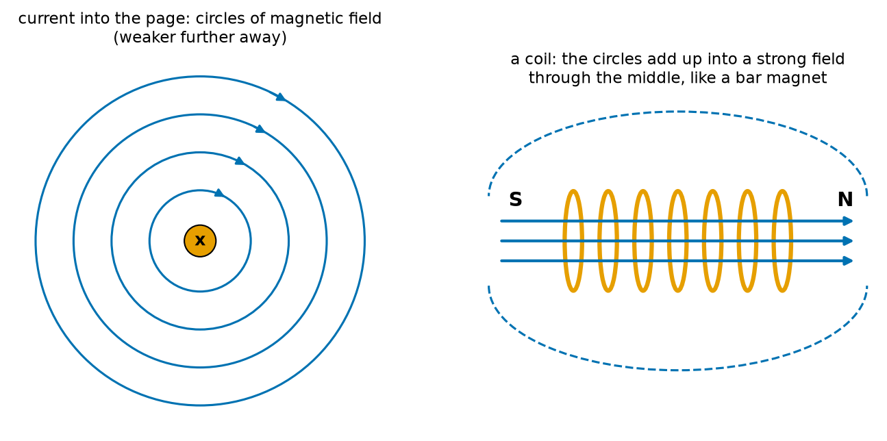
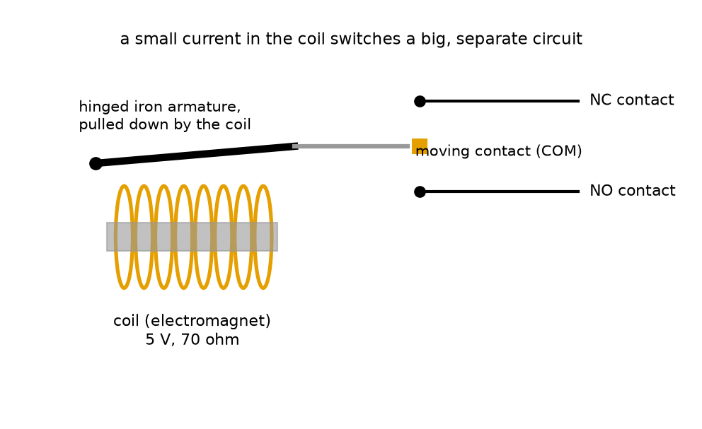
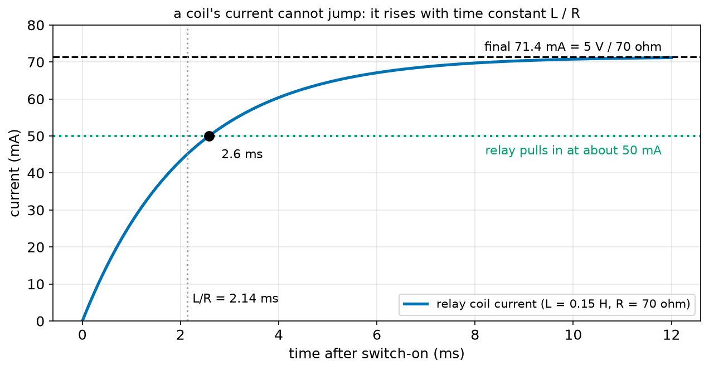
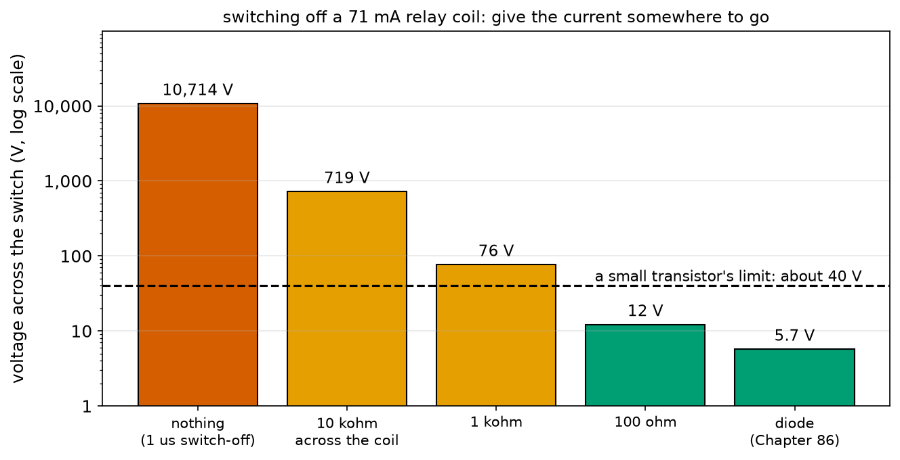
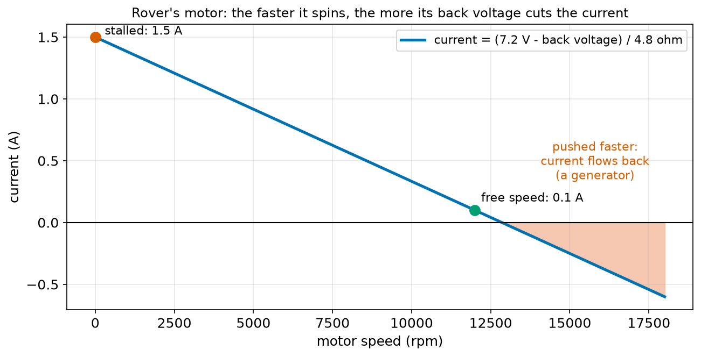
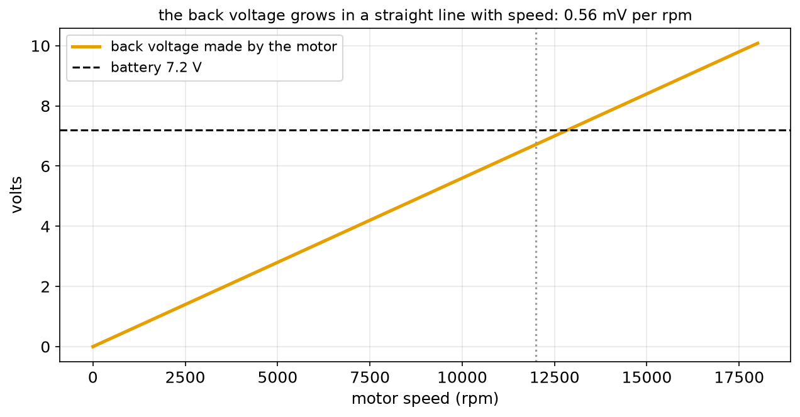

# Chapter 85 — Inductors and Coils (Why Motors Make Voltage Spikes)

> **Part 5 · Chapter 85 of 749**
> **You need:** Chapter 52 (exponential approach), Chapter 68 (Rover's motor and its free speed), Chapter 71 (Euler steps), Chapter 75 (stall current and back voltage), Chapter 76 (energy), Chapter 78 (the voltage law) and Chapter 84 (capacitors and I = C dV/dt).
> **You will make:** a simulation of the current rising in a relay coil, a calculation of the huge voltage spike when a coil is switched off and the ways to tame it, and a model of Rover's motor as both a motor and a generator.

---

## What you will learn

- That an electric current makes a **magnetic field**, and a **coil** concentrates it into an **electromagnet**.
- What an **inductor** is, its unit the **henry**, and the key rule **V = L × (rate of change of I)**.
- Why the current in a coil **cannot jump**: it rises with the time constant **L / R**.
- Why switching a coil **off** makes a voltage **spike** that can reach hundreds or thousands of volts.
- Why every **motor, relay and solenoid** is a coil, and why the transistors that switch them need protection (Chapter 86).
- How a spinning motor makes its own **back voltage**, and becomes a **generator** when pushed.

---

## New words in this chapter

| Word | Simple meaning |
|---|---|
| **magnetic field** | The region around a magnet or a current where magnetic forces act. |
| **electromagnet** | A coil of wire, often around iron, that becomes a magnet while current flows in it. |
| **inductor** | A coil designed to resist changes in its current. |
| **inductance (L)** | How strongly a coil resists changes in its current. |
| **henry (H)** | The unit of inductance: 1 V across it changes the current by 1 A every second. |
| **mH, µH** | Millihenry (10⁻³ H), microhenry (10⁻⁶ H). |
| **induced voltage** | A voltage made in a coil when the magnetic field through it changes. |
| **voltage spike** | A short, very high voltage, here made when a coil's current is suddenly stopped. |
| **relay** | A switch moved by an electromagnet, so a small current can switch a big, separate circuit. |
| **solenoid** | A coil that pulls an iron plunger in a straight line: a valve, a latch, a kicker. |
| **back voltage (back EMF)** | The voltage a spinning motor makes, which opposes the supply. |
| **generator** | A machine that turns motion into electricity: a motor driven backwards. |

---

## 85.1 Currents make magnets

In 1820, the Danish teacher Hans Christian Ørsted noticed during a lecture that a compass needle swung when he switched on a current in a nearby wire. Electricity and magnetism were linked.

📖 **New word: magnetic field** — the region around a magnet, or around a wire carrying current, where magnetic forces act. We draw it as lines; a compass needle lines up with them.



*Figure 85.1 — Left: a wire carrying current into the page has circles of magnetic field around it. Right: wind the wire into a coil, and the circles add up into a strong field through the middle.*

**How to read this picture:** On the left, the orange dot is a wire seen end-on; the blue circles are the field, strongest close to the wire. On the right, each turn of the coil (orange) makes its own little circles, and inside the coil they all point the same way, so they add: a strong, straight field runs through the middle and loops round outside (dashed). One end acts as a north pole, the other as a south pole, exactly like a bar magnet.

📖 **New word: electromagnet** — a coil carrying current, usually wound around a piece of iron (which strengthens the field hundreds of times). It is a magnet you can switch on and off.

Electromagnets are everywhere in robots:

- every **electric motor** (Chapter 137) uses coils to push against magnets;
- a **relay** (Figure 85.6) uses an electromagnet to move a switch;
- a **solenoid** pulls an iron plunger: valves on factory robots, door latches, the kicker on a football robot;
- an **electromagnet gripper** picks up steel parts and drops them when switched off.

📖 **New word: relay** — a switch moved by an electromagnet. A small current in the coil (for example 71 mA at 5 V) pulls an iron armature that moves contacts in a completely separate circuit, which may carry amps at a higher voltage.



*Figure 85.6 — When current flows in the coil, the iron armature is pulled down and the moving contact switches from the NC contact to the NO contact.*

**How to read this picture:** The orange coil, wound on an iron core, becomes a magnet when powered. It pulls the hinged armature down, which moves the common contact from the NC (normally closed) contact to the NO (normally open) contact (Chapter 83's names). The coil's circuit and the contacts' circuit are not connected electrically at all.

📖 **New word: solenoid** — a coil that pulls an iron plunger into its middle when powered. A spring pushes it back out when the power is off.

---

## 85.2 Changing fields make voltages

The link works the other way too. In 1831, Michael Faraday (the farad's Faraday) found that when the magnetic field through a coil **changes**, a voltage appears across the coil's ends. Move a magnet into a coil, and a meter connected to the coil flicks; hold the magnet still, and the meter reads zero; pull it out, and the meter flicks the other way.

📖 **New word: induced voltage** — a voltage made in a coil by a changing magnetic field through it. The faster the change, the bigger the voltage. This is how every generator, every transformer and every wireless charger works.

Now put the two discoveries together. A current in a coil makes a field through that same coil. If the current changes, its own field changes, and that change induces a voltage in the coil itself. The induced voltage always **opposes the change**: if you try to increase the current, the coil pushes back; if you try to decrease it, the coil pushes to keep it going.

📖 **New word: inductor** — a coil designed to have this property strongly. It **resists changes in its current**, the way a heavy flywheel resists changes in its speed (Chapter 66).

📖 **New word: inductance (L)** — how strongly a coil resists changes in current. The unit is the **henry (H)**, after Joseph Henry. Robot coils range from microhenries (µH) in power converters (Chapter 90), through millihenries (mH) in motor windings, to about 0.1 H in a small relay's coil.

The rule, which mirrors the capacitor's rule of Chapter 84:

```
V = L × (change in I) ÷ (change in time)
```

In words: "the voltage across an inductor equals its inductance times how fast its current is changing". A steady current needs no voltage (apart from the wire's resistance). A fast change needs a big voltage.

| Capacitor (Chapter 84) | Inductor (this chapter) |
|---|---|
| I = C × rate of change of V | V = L × rate of change of I |
| resists quick changes of **voltage** | resists quick changes of **current** |
| stores energy ½ C V² in its electric field | stores energy ½ L I² in its magnetic field |
| charging time constant R × C | current rise time constant L ÷ R |

---

## 85.3 Switching a coil on: the current rises slowly

Connect a relay coil (0.15 H, 70 Ω) to 5 V. At the first instant, the current is zero and wants to jump to 5 ÷ 70 = 71.4 mA. The coil will not allow a jump: the whole 5 V appears across its inductance, which lets the current grow at a rate of 5 ÷ 0.15 = 33 A per second. As the current grows, more of the 5 V is taken by the resistance (Ohm's law), less is left for the inductance, and the growth slows. The voltage law (Chapter 78) says:

```
V_supply = I × R + L × (rate of change of I)
```

This is the same shape as Chapter 84's capacitor charging, with current instead of voltage:

```
I(t) = (V ÷ R) × (1 − e^(−t × R / L))       time constant τ = L ÷ R
```



*Figure 85.2 — The current in a 5 V relay coil after switch-on.*

**How to read this picture:** The current starts at zero and rises along the familiar exponential towards 71.4 mA (dashed). After one time constant, L / R = 2.14 ms, it has reached 63%. The relay needs about 50 mA to pull its armature in (green dotted line), which the current reaches after 2.6 ms. So a relay always switches a few milliseconds after its coil is powered.

🔢 **Maths.** τ = 0.15 ÷ 70 = 0.00214 s = 2.14 ms. After 5τ = 10.7 ms the current is 99% of its final value.

🔢 **Maths.** Rover's motor winding has about 1.5 mH and 4.8 Ω: τ = 0.0015 ÷ 4.8 = 0.31 ms. When the motor driver switches the voltage on, the current takes about a third of a millisecond to build. Chapter 140 uses this: switching the motor on and off 20,000 times a second (every 0.05 ms) is too fast for the current to follow, so the current stays almost steady at the average. The inductance of the motor smooths its own current.

---

## 85.4 Switching a coil off: the spike

Now the dangerous part. The relay coil carries 71.4 mA, and a transistor (Chapter 87) switches it off in about a microsecond. The coil resists the change: it will push as hard as it must to keep that 71.4 mA flowing.

How hard? V = L × change in I ÷ change in time:

```
V = 0.15 × 0.0714 ÷ 0.000001 = 10,714 V
```

Ten thousand volts! In reality the voltage never gets there: at some point, something breaks down and lets the current through. Usually that something is the transistor that was trying to switch off, which is destroyed, or a tiny spark jumps across its pins.

📖 **New word: voltage spike** — a short, very high voltage. Coils make one every time their current is stopped quickly.

The energy behind the spike is the energy stored in the coil's magnetic field:

```
E = ½ × L × I²
```

🔢 **Maths.** ½ × 0.15 × 0.0714² = 0.00038 J = 0.38 mJ. Tiny, but delivered into a transistor in a microsecond, it is the power of 380 W for that microsecond (Chapter 76). Chapter 73's static spark killed chips with even less.

You have met this before: it is how a car's ignition coil makes 20,000 V for the spark plug from a 12 V battery, on purpose. And it is the reason every robot circuit that switches a motor, a relay or a solenoid must give the coil's current **somewhere to go** when it is switched off.

### Giving the current somewhere to go

If a resistor is placed across the coil, the coil's current can continue round through the resistor when the switch opens. The coil's voltage rises only as far as it needs to push 71.4 mA through that resistor: I × R.



*Figure 85.3 — The voltage across the switch at the moment a 71.4 mA relay coil is switched off, for different escape paths (log scale).*

**How to read this picture:** With no path, the spike is over 10,000 V. A 10 kΩ resistor across the coil limits it to 719 V; 1 kΩ to 76 V; 100 Ω to 12 V. A **diode** (Chapter 86) limits it to about 5.7 V: the supply plus 0.7 V. The dashed line is the 40 V limit of a typical small transistor: only the 100 Ω resistor and the diode keep the switch safe.

A small resistor keeps the spike low, but wastes current all the time the coil is on (5 V across 100 Ω is 50 mA, more than the relay itself). The diode is better: it conducts only in the direction the coil's current wants to flow after switch-off, and not at all while the coil is on. Chapter 86 explains diodes and this "flyback" job in full.

🧠 **Every coil you switch off needs a path for its current.** Motors, relays, solenoids, electromagnets, even long cables. No path, no transistor.

---

## 85.5 Motors are coils, and generators too

A DC motor (Chapter 137) is a set of coils that turn inside a magnet. Two things follow.

First, a motor is an **inductor**: switching it off makes a spike, just like a relay but bigger. Rover's motor at its 1.5 A stall current with 1.5 mH, switched off in a microsecond: V = 0.0015 × 1.5 ÷ 0.000001 = 2,250 V. Motor drivers have diodes built in for exactly this reason (Chapter 139).

Second, a spinning motor's coils move through the magnet's field, so a voltage is **induced** in them, exactly as Faraday found. This voltage grows in proportion to the speed and opposes the supply.

📖 **New word: back voltage** (engineers say **back EMF**, from "electromotive force") — the voltage a spinning motor makes in its own coils. It is the "own voltage that pushes back" that Chapter 75 mentioned.

The current is set by what is left after the back voltage (the voltage law again):

```
I = (V_supply − back voltage) ÷ R          back voltage = K × speed
```

K is the **motor constant**: volts of back voltage per unit of speed. For Rover's motor, which runs freely at 12,000 rpm on 7.2 V and draws 0.1 A there, K = (7.2 − 0.1 × 4.8) ÷ 1,256.6 rad/s = 5.35 mV per rad/s, or 0.56 mV per rpm.



*Figure 85.4 — Rover's motor current falls in a straight line as its speed rises, because the back voltage grows.*

**How to read this picture:** At zero speed (stalled) there is no back voltage, so the full 7.2 V drives 1.5 A through the 4.8 Ω winding. As the speed rises, the back voltage takes more of the 7.2 V, leaving less for the resistance, and the current falls. At free speed it is only 0.1 A. Beyond about 12,850 rpm, which the motor can only reach if something pushes it, the back voltage is bigger than the battery and the current flows backwards: the motor has become a **generator**.

📖 **New word: generator** — a machine that turns motion into electricity. Every DC motor is one when turned by something else.



*Figure 85.5 — The back voltage grows in a straight line with speed and passes the battery's 7.2 V just above free speed.*

**How to read this picture:** The orange line is the back voltage: 0.56 mV for every rpm. At free speed (dotted line) it is 6.72 V, just under the battery. Push the motor 50% faster, to 18,000 rpm, and it makes 10 V.

---

## Code

File `code/ch085/rl_rise.py`:

```python
# rl_rise.py - the current in a coil cannot jump: it rises with the time constant L / R
import math

V = 5.0
R = 70.0              # a small 5 V relay's coil resistance, ohms
L = 0.15              # its inductance, henries
TAU = L / R
DT = TAU / 1000

print(f"relay coil: R = {R:.0f} ohm, L = {L} H, time constant L/R = {TAU * 1000:.2f} ms, final current {V / R * 1000:.1f} mA")
i, t = 0.0, 0.0
marks = [1, 2, 3, 5]
while marks:
    v_coil = V - i * R              # the voltage law: whatever the resistance does not take, the inductance does
    i = i + v_coil / L * DT         # V = L x (rate of change of I), turned round
    t = t + DT
    if t >= marks[0] * TAU - DT / 2:
        exact = V / R * (1 - math.exp(-t / TAU))
        print(f"  after {marks[0]} L/R = {t * 1000:5.2f} ms: {i * 1000:5.1f} mA (exact {exact * 1000:5.1f} mA)")
        marks.pop(0)
print()
print("the relay needs about 50 mA to pull in, so it closes roughly", f"{-TAU * math.log(1 - 0.050 / (V / R)) * 1000:.1f} ms after switch-on")
```

| Line | Code | What it does (simple English) |
|---|---|---|
| 1 | `# rl_rise.py …` | A comment. |
| 2 | `import math` | For `exp` and `log`. |
| 3 | (blank) | Spacing. |
| 4–8 | `V`, `R`, `L`, `TAU`, `DT` | The coil, its time constant L / R, and a step of a thousandth of it. |
| 9 | (blank) | Spacing. |
| 10 | `print(…)` | The coil's numbers. |
| 11 | `i, t = 0.0, 0.0` | No current at the start. |
| 12 | `marks = [1, 2, 3, 5]` | Report after 1, 2, 3 and 5 time constants. |
| 13 | `while marks:` | Until all reported. |
| 14 | `v_coil = V - i * R` | The voltage law round the loop: the supply minus the resistance's share is left for the inductance. |
| 15 | `i = i + v_coil / L * DT` | V = L × rate of change of I, so the current grows by V ÷ L × dt (an Euler step, Chapter 71). |
| 16 | `t = t + DT` | The clock. |
| 17–21 | `if t >= …: …` | At each mark, print the simulated and exact currents, and remove the mark. |
| 22 | `print()` | An empty line. |
| 23 | `print(…)` | When the current reaches 50 mA: the charging formula turned round with a logarithm (Chapter 52). |

Output:

```
relay coil: R = 70 ohm, L = 0.15 H, time constant L/R = 2.14 ms, final current 71.4 mA
  after 1 L/R =  2.14 ms:  45.2 mA (exact  45.2 mA)
  after 2 L/R =  4.29 ms:  61.8 mA (exact  61.8 mA)
  after 3 L/R =  6.43 ms:  67.9 mA (exact  67.9 mA)
  after 5 L/R = 10.71 ms:  70.9 mA (exact  70.9 mA)

the relay needs about 50 mA to pull in, so it closes roughly 2.6 ms after switch-on
```

The simulation and the exact formula agree, and the pattern is the same as Chapter 84's capacitor: 63%, 86%, 95%, 99%.

File `code/ch085/back_emf.py`:

```python
# back_emf.py - a spinning motor is also a generator: its 'back voltage' grows with speed and cuts the current
import math

V_SUPPLY = 7.2
R = 4.8                      # winding resistance: 7.2 V / 1.5 A stall (Chapter 75)
FREE_RPM = 12000             # Rover's motor with no load (Chapter 68)
I_FREE = 0.10                # current at free speed: just enough to overcome friction inside the motor

free_rad_s = FREE_RPM * 2 * math.pi / 60
K = (V_SUPPLY - I_FREE * R) / free_rad_s        # volts of back voltage per rad/s of speed
print(f"motor constant K = {K * 1000:.3f} mV per rad/s  ({K * 1000 * 2 * math.pi / 60:.3f} mV per rpm)")
print()
print(f"{'speed (rpm)':>12s} {'back voltage':>13s} {'left for R':>11s} {'current':>9s}")
for rpm in [0, 3000, 6000, 9000, 12000]:
    w = rpm * 2 * math.pi / 60
    back = K * w
    current = (V_SUPPLY - back) / R               # Ohm's law on what is left for the winding
    print(f"{rpm:12d} {back:11.2f} V {V_SUPPLY - back:9.2f} V {current:7.3f} A")
print()
print("pushed by hand (or rolling downhill) faster than free speed, the motor makes MORE than 7.2 V:")
for rpm in [12000, 15000, 18000]:
    w = rpm * 2 * math.pi / 60
    back = K * w
    print(f"  {rpm} rpm: back voltage {back:.2f} V -> current {(V_SUPPLY - back) / R:+.3f} A (negative = flowing back INTO the battery)")
```

| Line | Code | What it does (simple English) |
|---|---|---|
| 1 | `# back_emf.py …` | A comment. |
| 2 | `import math` | For π. |
| 3 | (blank) | Spacing. |
| 4–7 | `V_SUPPLY`, `R`, `FREE_RPM`, `I_FREE` | Rover's motor: supply, winding resistance, free speed, and the small current at free speed. |
| 8 | (blank) | Spacing. |
| 9 | `free_rad_s = …` | rpm to radians per second (Chapter 64). |
| 10 | `K = (V_SUPPLY - I_FREE * R) / free_rad_s` | At free speed, the back voltage is the supply minus the small resistance drop; dividing by the speed gives K. |
| 11 | `print(…)` | K in two units. |
| 12 | `print()` | An empty line. |
| 13 | `print(…)` | The header. |
| 14 | `for rpm in [ … ]:` | Five speeds. |
| 15 | `w = …` | In rad/s. |
| 16 | `back = K * w` | The back voltage grows in proportion to speed. |
| 17 | `current = (V_SUPPLY - back) / R` | Ohm's law on the voltage left for the winding. |
| 18 | `print(…)` | The row. |
| 19 | `print()` | An empty line. |
| 20 | `print(…)` | A heading. |
| 21–24 | the second loop | Faster than free speed: the current comes out negative. |

Output:

```
motor constant K = 5.348 mV per rad/s  (0.560 mV per rpm)

 speed (rpm)  back voltage  left for R   current
           0        0.00 V      7.20 V   1.500 A
        3000        1.68 V      5.52 V   1.150 A
        6000        3.36 V      3.84 V   0.800 A
        9000        5.04 V      2.16 V   0.450 A
       12000        6.72 V      0.48 V   0.100 A

pushed by hand (or rolling downhill) faster than free speed, the motor makes MORE than 7.2 V:
  12000 rpm: back voltage 6.72 V -> current +0.100 A (negative = flowing back INTO the battery)
  15000 rpm: back voltage 8.40 V -> current -0.250 A (negative = flowing back INTO the battery)
  18000 rpm: back voltage 10.08 V -> current -0.600 A (negative = flowing back INTO the battery)
```

This model explains the two currents of Chapter 75 (1.5 A stalled, much less when spinning) and Chapter 68's falling torque line: the current, and so the torque (Chapter 138), fall in a straight line with speed because the back voltage rises in a straight line with speed.

---

## Small examples

**Example 1.** A coil of 10 mH with its current changing at 100 A/s: V = 0.01 × 100 = 1 V.

**Example 2.** A 47 µH inductor in a power converter, with 2 V across it: the current changes at 2 ÷ 0.000047 = 42,600 A/s, so 0.43 A in 10 µs.

**Example 3.** A 12 V solenoid of 24 Ω and 50 mH: final current 0.5 A, τ = 2.1 ms.

**Example 4.** Its stored energy at 0.5 A: ½ × 0.05 × 0.25 = 6.25 mJ.

**Example 5.** Switching that solenoid off in 10 µs: V = 0.05 × 0.5 ÷ 0.00001 = 2,500 V (if nothing catches the current).

**Example 6.** With a 47 Ω resistor across it: the spike is 0.5 × 47 = 23.5 V above the supply.

**Example 7.** Rover's motor at 9,000 rpm: back voltage 5.04 V, current (7.2 − 5.04) ÷ 4.8 = 0.45 A.

**Example 8.** A motor with K = 0.01 V per rad/s turned at 1,000 rad/s by hand makes 10 V.

---

## 🏭 Real robot applications

### Application 1 (worked in full) — 🏭 Switching a relay without killing the transistor

**1. The real problem.** A robot cell's controller must switch a 24 V pneumatic valve on and off. A microcontroller pin cannot carry the valve's current, so it switches a small 5 V relay (71 mA) through a transistor (Chapter 87), and the relay's contacts switch the valve. A student builds it, and the transistor dies after a few switchings. The relay coil is the culprit: every time the transistor switches off, the coil's current has nowhere to go.

**2. Why this theory.** V = L × rate of change of I. The faster the transistor switches off, the bigger the spike. Any path that lets the coil's current continue limits the spike to I × R_path (or a diode's 0.7 V). The energy ½ L I² must go somewhere: into a resistor or a diode as heat, or into the transistor, destroying it.

**3. The numbers.** Relay coil 70 Ω, 0.15 H, 5 V. Transistor switch-off time 1 µs, maximum voltage 40 V. Candidate escape paths: none, 10 kΩ, 1 kΩ, 100 Ω, 10 Ω, diode.

**4. The maths.**

```
I = 5 ÷ 70 = 71.4 mA          energy ½ L I² = 0.38 mJ
no path:     V = 0.15 × 0.0714 ÷ 10⁻⁶ = 10,714 V
resistor R:  the transistor sees 5 V + 0.0714 × R
             10 kΩ: 719 V   1 kΩ: 76 V   100 Ω: 12.1 V   10 Ω: 5.7 V
the current then dies away with τ = L ÷ (70 + R)
```

**5. The code.** File `code/ch085/spike.py`:

```python
# spike.py - switch off a coil: the current wants to keep flowing, and the voltage jumps to whatever it takes
V = 5.0
R_COIL = 70.0
L = 0.15
I0 = V / R_COIL                  # the current flowing at the moment of switch-off
SWITCH_OFF_S = 1e-6              # a transistor switches off in about a microsecond

print(f"coil current at switch-off: {I0 * 1000:.1f} mA, stored energy 1/2 L I^2 = {0.5 * L * I0 ** 2 * 1000:.3f} mJ")
print()
print("1) nothing to catch the current: the transistor tries to stop it in 1 us")
v_spike = L * I0 / SWITCH_OFF_S
print(f"   V = L x dI/dt = {L} x {I0:.4f} / {SWITCH_OFF_S} = {v_spike:,.0f} V")
print("   (in reality the transistor breaks down, or a spark jumps, long before that)")
print()
print("2) a resistor across the coil gives the current another path")
print(f"{'escape resistor':>17s} {'spike at switch':>16s} {'current dies in (5 tau)':>24s}")
for r_esc in [10_000, 1_000, 100, 10]:
    spike_at_switch = V + I0 * r_esc          # the coil pushes I0 through the escape resistor, on top of the supply
    tau = L / (R_COIL + r_esc)
    print(f"{r_esc:13d} ohm {spike_at_switch:12.1f} V {5 * tau * 1000:18.2f} ms")
print()
print("3) a diode across the coil (Chapter 86): the spike is limited to the supply + about 0.7 V")
print(f"   switch sees about {V + 0.7:.1f} V; the current dies in about {5 * L / R_COIL * 1000:.0f} ms")
```

| Line | Code | What it does (simple English) |
|---|---|---|
| 1 | `# spike.py …` | A comment. |
| 2–6 | `V`, `R_COIL`, `L`, `I0`, `SWITCH_OFF_S` | The coil, its steady current, and how fast the transistor tries to stop it. |
| 7 | (blank) | Spacing. |
| 8 | `print(…)` | The current and the stored energy ½ L I². |
| 9 | `print()` | An empty line. |
| 10–13 | case 1 | V = L × ΔI ÷ Δt with no escape path. `:,.0f` adds thousands commas. |
| 14 | `print()` | An empty line. |
| 15–16 | headings | Case 2. |
| 17 | `for r_esc in [10_000, 1_000, 100, 10]:` | Four escape resistors. |
| 18 | `spike_at_switch = V + I0 * r_esc` | The coil keeps 71.4 mA flowing through the escape resistor; its top end rises I × R above the supply, and the transistor sees that. |
| 19 | `tau = L / (R_COIL + r_esc)` | The current then dies through both resistances in series. |
| 20 | `print(…)` | The row. |
| 21 | `print()` | An empty line. |
| 22–23 | case 3 | A diode: about 0.7 V. The current dies through the coil's own 70 Ω. |

Output:

```
coil current at switch-off: 71.4 mA, stored energy 1/2 L I^2 = 0.383 mJ

1) nothing to catch the current: the transistor tries to stop it in 1 us
   V = L x dI/dt = 0.15 x 0.0714 / 1e-06 = 10,714 V
   (in reality the transistor breaks down, or a spark jumps, long before that)

2) a resistor across the coil gives the current another path
  escape resistor  spike at switch  current dies in (5 tau)
        10000 ohm        719.3 V               0.07 ms
         1000 ohm         76.4 V               0.70 ms
          100 ohm         12.1 V               4.41 ms
           10 ohm          5.7 V               9.38 ms

3) a diode across the coil (Chapter 86): the spike is limited to the supply + about 0.7 V
   switch sees about 5.7 V; the current dies in about 11 ms
```

**6. The result.** Without an escape path, each switch-off tries to put thousands of volts across a 40 V transistor; it survives a few times and then fails. A 100 Ω resistor across the coil keeps the spike to 12 V but wastes 50 mA while the relay is on. A diode keeps the spike to 5.7 V and wastes nothing while the relay is on. There is one trade-off: the smaller the spike, the longer the current takes to die away (11 ms with the diode against 0.07 ms with 10 kΩ), so the relay releases a little more slowly. For a valve that switches a few times a second, that does not matter.

**7. Going further.** When fast release matters (a high-speed valve), engineers use a diode in series with a Zener diode, which allows a controlled spike of, say, 24 V and kills the current much faster (Chapter 86). Ready-made relay modules for Arduino include the transistor and the diode on the board. Chapter 87 builds the transistor switch, and Chapter 147 covers solenoids and valves.

### Application 2 (worked in full) — 🤖 Pushing a robot powers it up

**1. The real problem.** A student pushes a switched-off Rover across the floor by hand, quickly, and its LEDs flicker on. Robot vacuums and wheelchairs show the same effect, and in bigger robots it can damage electronics. Where does the power come from?

**2. Why this theory.** Rover's wheels turn the motors through the 30:1 gearbox (Chapter 68). A turning motor is a generator: its back voltage is K × speed. If it is high enough, current flows from the motor, through the motor driver's built-in protection diodes (Chapter 139), onto the battery rail, and powers the electronics.

**3. The numbers.** K = 0.56 mV per rpm (section 85.5). Wheel radius 0.033 m. Gear ratio 30. The 5 V regulator (Chapter 90) needs about 6.5 V at its input to produce 5 V, and the electronics start to flicker at about 3–4 V.

**4. The maths.** Pushing Rover at a brisk walk of 1.5 m/s: wheel speed = 1.5 ÷ 0.033 = 45.5 rad/s; motor speed = 30 × 45.5 = 1,364 rad/s = 13,000 rpm; back voltage = 0.56 × 13,000 ÷ 1,000 = 7.3 V. Above the battery's own voltage, and certainly enough to light the electronics. At a gentle 0.5 m/s: 2.4 V, not enough.

**5. The code.** The same `back_emf.py` gives the voltage for any motor speed; a few lines turn the pushing speed into motor speed:

```python
for push in [0.5, 1.0, 1.5, 2.0]:                  # how fast the robot is pushed, m/s
    motor_rpm = push / 0.033 * 30 * 60 / (2 * 3.14159)
    print(f"pushed at {push} m/s: motor at {motor_rpm:6.0f} rpm, makes {motor_rpm * 0.560 / 1000:5.2f} V")
```

| Line | Code | What it does (simple English) |
|---|---|---|
| 1 | `for push in [ … ]:` | Four pushing speeds. |
| 2 | `motor_rpm = …` | Ground speed ÷ wheel radius = wheel rad/s; × 30 for the gearbox; × 60 ÷ 2π for rpm. |
| 3 | `print(…)` | The motor speed and its back voltage at 0.560 mV per rpm. |

Output:

```
pushed at 0.5 m/s: motor at   4341 rpm, makes  2.43 V
pushed at 1.0 m/s: motor at   8681 rpm, makes  4.86 V
pushed at 1.5 m/s: motor at  13022 rpm, makes  7.29 V
pushed at 2.0 m/s: motor at  17362 rpm, makes  9.72 V
```

**6. The result.** Pushed at walking speed, Rover's own motors make enough voltage to power its electronics, and at 2 m/s, 9.7 V: more than its battery's full 8.4 V. Small robots survive this, but on a big robot (a 48 V humanoid pushed over, a warehouse robot towed away) the generated voltage can exceed what its electronics are rated for. The rules: do not push robots fast while switched off, and design the power board to absorb or limit generated voltage (a "brake chopper" resistor or a clamp, as in Chapter 76's Application 5).

**7. Going further.** The same effect is useful: it is regenerative braking, which returns energy to the battery when a robot slows down. It also gives a free speed sensor: briefly switch a motor off and measure its back voltage, and you know its speed without an encoder. Some cheap robots and model trains do exactly that. Chapter 138 develops the full motor equations, and Chapter 223 builds the motor model with its inductance.

### Application 3 — 🏭 Inductive proximity sensors on factory robots

Most metal-detecting sensors on factory machines are coils. An oscillating current in a small coil at the sensor's face makes a changing magnetic field. When a metal part comes within a few millimetres, the field induces swirling currents in the metal (eddy currents), which take energy from the coil and change its behaviour; the sensor's electronics detect the change and switch an output. There are no moving parts and no contact, so they last for hundreds of millions of detections in oil, dust and vibration, and they are used to confirm that a gripper has closed, that a part is in place, or that an axis is at home (Chapter 83's limit switch, without the bounce).

### Application 4 — 🏠 Wireless charging for docking robots

Some robot vacuums, lawnmowers and warehouse robots charge without metal contacts. A coil in the dock carries an alternating current, which makes a changing magnetic field; a matching coil underneath the robot sits in that field, and a voltage is induced in it (Faraday), which charges the battery. No exposed contacts means nothing to corrode in a wet garden, and no sparks in a dusty warehouse. The price is efficiency: typically 80–90%, against 99% for metal contacts, and the coils must line up within a few centimetres, which is why such robots dock carefully.

### Application 5 — 🦿 Electromagnet grippers and quick release

A robot arm in a recycling plant picks steel scrap with an electromagnet: 24 V, 2 A, perhaps 0.5 H. To drop a part, it must kill the magnet quickly; but the magnet's current, ½ × 0.5 × 2² = 1 J of stored energy, does not want to stop. A plain diode across the coil lets the current die away slowly (τ = L ÷ R = 0.5 ÷ 12 = 42 ms, about 0.2 s to vanish), and the part hangs on for a moment. Faster designs let the voltage rise to a controlled 100 V or so through a Zener or a resistor (Application 1's trade-off), so the energy is burned off in a few milliseconds, and some even reverse the current briefly to cancel the iron's leftover magnetism. The coil's energy, ½ L I², sets how fast any magnet can let go.

---

## 🔧 Hands-on lab

### Lab 85.1 — Make an electromagnet (hardware)

You need: about 2 m of thin insulated wire (AWG 24–28), a large iron nail or bolt, a 1.5 V AA cell, a 10 Ω resistor rated 1 W, a compass, some paper clips.

1. Wind about 100 turns of wire tightly around the nail, leaving 15 cm free at each end. Strip the ends.
2. Connect the coil to the AA cell **through** the 10 Ω resistor (to limit the current, Chapter 75: about 0.15 A).
3. Hold the nail near the paper clips. Bring the compass near each end of the nail.
4. Reverse the cell. What happens to the compass?
5. Disconnect after 30 seconds at most (the cell and resistor get warm).

**What you should see:** The nail picks up a few paper clips while the current flows and drops most of them when it stops (a little leftover magnetism may hold one). The compass needle points one way at one end and the other way at the other end: north and south poles. Reversing the cell swaps the poles.

| If it does not work | Likely cause | Fix |
|---|---|---|
| Nothing happens | The wire's insulation was not stripped at the ends, or the cell is flat | Strip the ends; check the cell with the meter |
| The resistor gets very hot | It is rated ¼ W: 0.15² × 10 = 0.23 W | Use a 1 W resistor |
| Weak magnet | Too few turns, or the turns are loose | Wind more turns, tightly |

**Challenge:** Wind 200 turns and compare how many clips it lifts. The field grows with turns × current.

### Lab 85.2 — The spike you can see (hardware, careful)

You need: the electromagnet from Lab 85.1 (or a small relay's coil), a 9 V battery, a neon lamp (NE-2, about 70 V to light) or a small LED, two short wires.

1. Connect the neon lamp across the coil's two ends. Connect the 9 V battery across the coil too, with one wire held so you can break the connection by hand.
2. With the battery connected, the lamp stays dark: 9 V is far below its 70 V.
3. Break the battery connection quickly. Watch the lamp.
4. Now replace the neon lamp with an LED (no resistor) and repeat. Then try the LED the other way round.

**What you should see:** At the moment you break the connection, the neon lamp flashes: the coil's spike was at least 70 V, from a 9 V battery. With an LED, one way round it flashes briefly at disconnection (the coil's current flows through it), the other way round it stays dark: the LED is acting as the escape path of section 85.4, and only one direction works. This is the job a diode does in Chapter 86.

| If it does not work | Likely cause | Fix |
|---|---|---|
| No flash | Too few turns or too little current; the spike is too small | Use a relay coil or a coil with more turns and an iron core |
| The LED glows steadily while connected | It is across the 9 V and conducting | That is the wrong way round for this test; with the coil's 9 V it may be damaged: add a 1 kΩ resistor in series for the steady test |

⚠️ **Careful.** The spike is real but the energy is tiny here; still, do not hold both coil ends with bare fingers when breaking the circuit, and never do this with larger coils.

**Challenge:** Measure the coil's resistance with the meter and estimate its current. If the neon lamp lights at 70 V, what is the smallest inductance your coil could have for a switch-off time of 1 ms?

### Lab 85.3 — Explore the motor model (simulation)

Copy `back_emf.py`.

1. Add a column for the **power** taken from the battery (V × I) and the **power lost** as heat in the winding (I² R). At which speed is the share lost as heat smallest?
2. Reduce the battery to 6.0 V (nearly empty). What is the new free speed (current 0.1 A)?
3. Rover drives at 1 m/s. What is its motor speed, its back voltage, and its current?

**What you should see:** The heat share is 100% when stalled and smallest near free speed (at free speed 0.048 W of 0.72 W: about 7%). With 6.0 V, the free speed falls in proportion: (6.0 − 0.48) ÷ 0.00535 rad/s = 1,032 rad/s = 9,860 rpm. At 1 m/s the motor turns at 8,680 rpm, makes 4.86 V and draws (7.2 − 4.86) ÷ 4.8 = 0.49 A, close to the 0.53 A that Chapter 7 assumed for driving (the gearbox's friction adds a little more).

| If it does not work | Likely cause | Fix |
|---|---|---|
| Negative heat | Squared the current wrongly, or used the negative current in the generator rows | I² is always positive |

**Challenge:** Add the battery's 0.15 Ω internal resistance in series (Chapter 81). How much does it lower the stall current and the free speed?

---

## Common mistakes

⚠️ **Switching a coil off with nothing to catch its current.** The spike destroys the switch. Always provide a path: usually a diode (Chapter 86).

⚠️ **Thinking a coil's current can change instantly.** It rises and falls with τ = L ÷ R.

⚠️ **Forgetting that a motor is a coil.** It makes spikes and needs the same protection.

⚠️ **Mixing up the capacitor and inductor rules.** A capacitor resists changes in voltage; an inductor resists changes in current.

⚠️ **Pushing a big robot fast while it is switched off.** Its motors become generators.

⚠️ **Choosing the escape path without thinking about release time.** A diode gives the lowest spike but the slowest release.

---

## Practice

🏋️ **1.** What happens to a compass near a wire when a current is switched on in it? What did Ørsted conclude?

🏋️ **2.** A 20 mH coil's current changes from 0 to 0.5 A in 10 ms at a steady rate. What voltage is across its inductance?

🏋️ **3.** A 12 V relay has a 400 Ω, 0.8 H coil. Find its final current and its time constant.

🏋️ **4.** How long after switch-on does that relay's current reach 63% and 95% of its final value?

🏋️ **5.** Find the energy stored in that coil when the current is steady.

🏋️ **6.** The relay is switched off in 2 µs with no escape path. What voltage would the coil try to make?

🏋️ **7.** A 220 Ω resistor is put across the coil instead. What voltage does the switch see, and how long does the current take to die away (5τ)?

🏋️ **8.** A motor has R = 2 Ω and K = 0.02 V per rad/s, on 12 V. Find its stall current, its current at 300 rad/s, and its free speed (taking the free-speed current as 0).

🏋️ **9.** That motor is turned at 800 rad/s by a falling load. What voltage does it make? Does current flow into or out of the 12 V battery?

🏋️ **10.** Why does a diode across a relay coil make the relay release more slowly than a 1 kΩ resistor would?

🏋️ **11.** Write `coil_current(v, r, l, t_on, t_off, dt)` that simulates a coil switched on at time 0 and switched off at `t_on` with a diode across it (when off, the voltage across the inductance is −(I R + 0.7)), and returns lists of times and currents. Plot it for the relay of this chapter with `t_on` = 20 ms.

---

## Answers

**1.** The needle swings: the current makes a magnetic field. Electricity and magnetism are linked.

**2.** Rate of change = 0.5 ÷ 0.01 = 50 A/s; V = 0.02 × 50 = 1 V.

**3.** 12 ÷ 400 = 30 mA. τ = 0.8 ÷ 400 = 2 ms.

**4.** 63% after 2 ms; 95% after 6 ms.

**5.** ½ × 0.8 × 0.03² = 0.36 mJ.

**6.** V = 0.8 × 0.03 ÷ 0.000002 = 12,000 V.

**7.** 12 + 0.03 × 220 = 18.6 V. τ = 0.8 ÷ 620 = 1.29 ms, so about 6.5 ms.

**8.** Stall: 12 ÷ 2 = 6 A. At 300 rad/s: back voltage 6 V, current (12 − 6) ÷ 2 = 3 A. Free speed: 12 ÷ 0.02 = 600 rad/s.

**9.** 0.02 × 800 = 16 V. That is more than 12 V, so current flows **into** the battery: (12 − 16) ÷ 2 = −2 A.

**10.** With a diode, the coil's voltage during release is only about 0.7 V plus I × R_coil, so its current falls slowly (V = L × rate of change, and V is small). With 1 kΩ, the voltage is about 70 V, so the current falls a hundred times faster, and the armature lets go sooner.

**11.**

```python
def coil_current(v, r, l, t_on, t_off, dt):
    t, i, ts, cs = 0.0, 0.0, [], []
    while t < t_off:
        if t < t_on:
            v_l = v - i * r                       # switched on: supply minus resistance
        else:
            v_l = -(i * r + 0.7) if i > 0 else 0  # switched off: current circulates through the diode
        i = max(i + v_l / l * dt, 0.0)
        ts.append(t)
        cs.append(i)
        t += dt
    return ts, cs

ts, cs = coil_current(5.0, 70.0, 0.15, 0.020, 0.040, 1e-5)
print(f"at switch-off: {cs[1999] * 1000:.1f} mA; 2 ms later: {cs[2199] * 1000:.1f} mA; 4 ms later: {cs[2399] * 1000:.2f} mA")
```

```
at switch-off: 71.4 mA; 2 ms later: 22.1 mA; 4 ms later: 2.59 mA
```

After switch-off the current falls faster than a plain exponential would (which would still have 28 mA left after 2 ms), because the diode's fixed 0.7 V adds to the resistance's push. It reaches zero 4.5 ms after switch-off and then stays there. (The "about 11 ms" of `spike.py` was the simple 5 × L ÷ R estimate, which ignores the diode's 0.7 V.)

---

## Summary

🧠 A current makes a **magnetic field**; a **coil** concentrates it into an **electromagnet**. Motors, relays, solenoids and electromagnet grippers all use this.

🧠 A **changing** field through a coil **induces** a voltage (Faraday). A coil's own changing current induces a voltage that **opposes the change**: its **inductance L**, in **henries**.

🧠 **V = L × (rate of change of I)**. A coil's current cannot jump: it rises and falls with **τ = L ÷ R**.

🧠 Switching a coil off quickly makes a **voltage spike** that can reach thousands of volts. The energy is **½ L I²**. Always give the current a path: a resistor (spike = I × R) or, best, a **diode** (Chapter 86).

🧠 A spinning motor makes a **back voltage** = K × speed, which cuts its current: **I = (V − K ω) ÷ R**. Pushed faster than its free speed, a motor is a **generator**.

---

## Next chapter

Chapter 86 explains the part that has appeared in every warning of this chapter: the **diode**, a one-way valve for current. You will learn how it conducts with about 0.7 V across it in one direction and blocks in the other, how a **flyback diode** across a coil catches the spike, how diodes protect robots from batteries connected backwards, and what **Zener** and **Schottky** diodes add.
