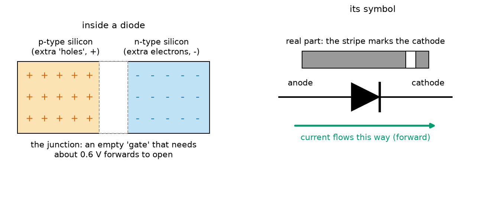
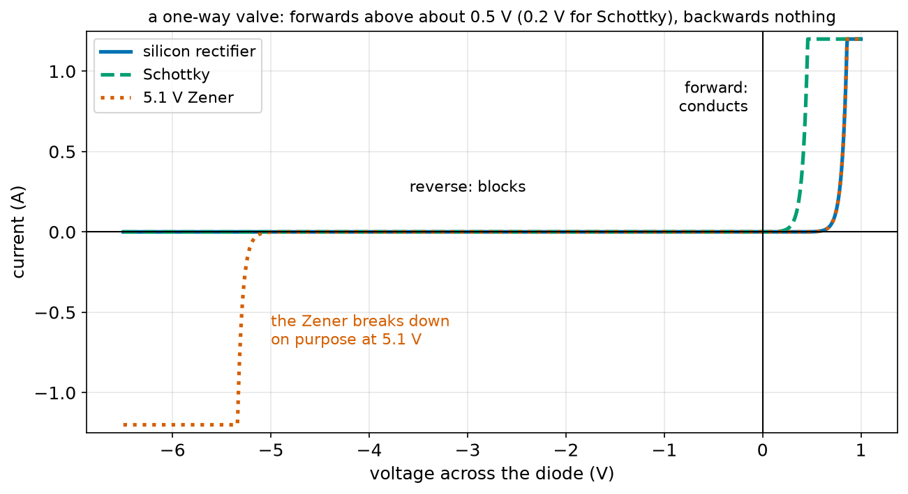
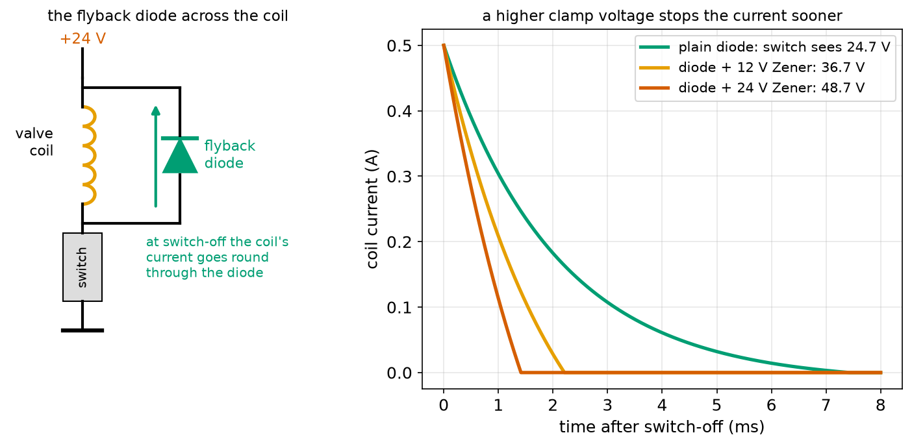
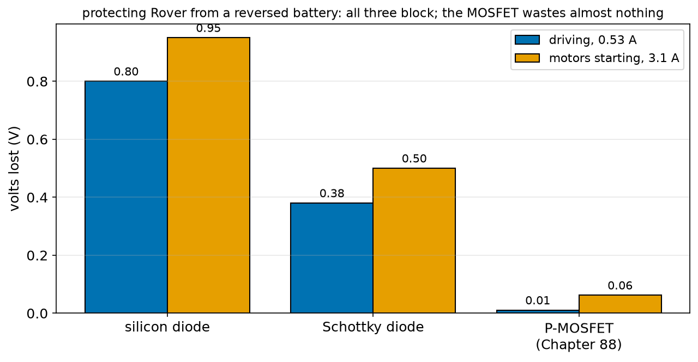
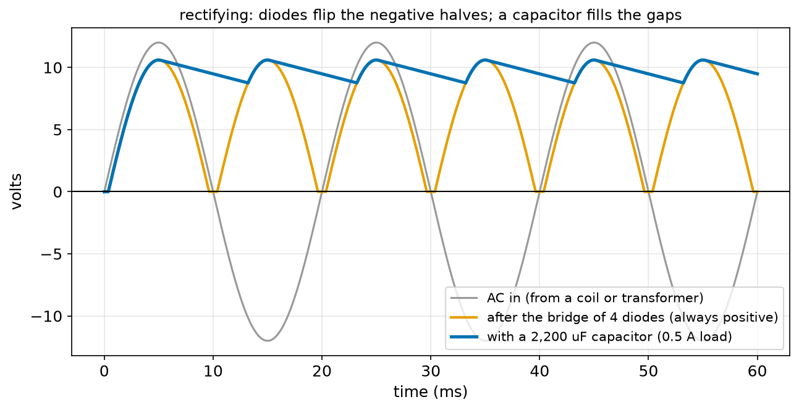

# Chapter 86 — Diodes and Flyback Protection

> **Part 5 · Chapter 86 of 749**
> **You need:** Chapter 73 (semiconductors), Chapter 77 (series cells and the solar shade problem), Chapter 78 (the charging dock), Chapter 82 (LEDs and the exponential curve), Chapter 84 (capacitors) and Chapter 85 (coils and voltage spikes).
> **You will make:** a table of how three kinds of diode conduct, a comparison of flyback circuits that protect a valve's switch, a comparison of ways to protect Rover from a battery put in backwards, and a calculation of what bypass diodes save on a shaded solar panel.

---

## What you will learn

- What a **diode** is: a one-way valve for current, made from a **p–n junction** of silicon.
- Its **forward voltage** (about 0.7 V for silicon, 0.3–0.4 V for **Schottky**) and its tiny **reverse leakage**.
- The **flyback diode**: how a diode across a coil catches the spike of Chapter 85.
- How diodes protect a robot from a **reversed battery**, and why a MOSFET does it better (Chapter 88).
- **Zener** diodes, which conduct backwards at a chosen voltage, and what they are good for.
- Three more jobs: **combining** two supplies, **bypassing** shaded solar cells, and **rectifying** AC into DC.

---

## New words in this chapter

| Word | Simple meaning |
|---|---|
| **diode** | A part that lets current flow one way (forward) and blocks it the other way (reverse). |
| **p-type / n-type** | Silicon with a pinch of another element added, giving it spare positive "holes" (p) or spare electrons (n). |
| **p–n junction** | The boundary where p-type and n-type silicon meet: the heart of a diode. |
| **anode / cathode** | The diode's + side and − side; the stripe on the body marks the cathode. |
| **forward voltage (V_f)** | The voltage across a conducting diode: about 0.7 V for silicon. |
| **reverse leakage** | The tiny current that flows backwards through a blocking diode. |
| **breakdown voltage** | The reverse voltage at which a diode stops blocking. |
| **Schottky diode** | A diode with a lower forward voltage (0.2–0.45 V) and a little more leakage. |
| **Zener diode** | A diode made to break down backwards at a precise voltage, used to clamp or set a voltage. |
| **flyback diode** | A diode across a coil that gives the coil's current a path when it is switched off. |
| **reverse polarity protection** | A circuit that stops damage when a battery is connected the wrong way round. |
| **rectifier** | A diode, or a group of diodes, that turns AC into DC. |
| **TVS diode** | A transient voltage suppressor: a diode that absorbs short spikes, such as static sparks. |

---

## 86.1 A one-way valve

Chapter 82 said an LED is a kind of diode and lets current through only one way. Every diode does that; most just do not light up.

📖 **New word: diode** — a part that conducts in one direction (**forward**) and blocks in the other (**reverse**): a one-way valve for current, like the valve in a bicycle tyre that lets air in but not out.

### How it works, very briefly

Chapter 73 said pure silicon is a poor conductor, but adding a tiny pinch of another element changes it. Add phosphorus, and the silicon gets spare free electrons: **n-type**. Add boron, and it gets spare "holes", places missing an electron, which behave like positive charges moving about: **p-type**.

📖 **New words: p-type and n-type** — silicon with spare positive holes (p) or spare electrons (n).

📖 **New word: p–n junction** — the boundary inside a single crystal where the p-type part meets the n-type part. Near the boundary, electrons and holes meet and cancel each other, leaving a thin layer with no free charges at all: an insulator.



*Figure 86.1 — Left: p-type and n-type silicon with the empty layer between them. Right: the diode symbol and a real diode with its cathode stripe.*

**How to read this picture:** On the left, the + signs are holes in the p-type side and the − signs are electrons in the n-type side. The white strip in the middle is the empty layer: it blocks current like a closed gate. Push the p side positive (forward) by about 0.6 V or more, and the gate is pushed open: current flows. Push it the other way (reverse), and the gate only gets wider. On the right, the symbol's triangle points the way conventional current flows; the bar is the cathode, marked on a real diode by a stripe.

📖 **New words: anode and cathode** — the p side (+, where current goes in) and the n side (−, where it comes out). The stripe on the body is the cathode, like the bar in the symbol.

---

## 86.2 The diode's curve



*Figure 86.2 — How three kinds of diode conduct, forward (right of zero) and reverse (left).*

**How to read this picture:** To the right of zero (forward), each diode conducts almost nothing until a certain voltage, then the current shoots up, exactly like Chapter 82's LEDs: about 0.6–0.85 V for silicon (blue), 0.25–0.45 V for Schottky (green dashed). To the left (reverse), the silicon and Schottky diodes block. The Zener (red dotted) blocks until the reverse voltage reaches 5.1 V, then conducts heavily: it breaks down on purpose.

📖 **New word: forward voltage (V_f)** — the voltage across a conducting diode. For silicon it is about **0.6–0.7 V** at small currents and 0.8–1.0 V at amperes. Because the curve is so steep, engineers usually just say "a silicon diode drops 0.7 V".

The forward curve is the same exponential as the LED's (Chapter 82), and the steepness number used there, about 0.05 V for every factor of e (2.7) in current, comes from the physics of the junction: about 26 mV at room temperature, times a factor of 1 to 2 for real diodes.

📖 **New word: reverse leakage** — the tiny current that still flows backwards through a blocking diode: about a microamp for silicon, more for Schottky, and more when hot.

📖 **New word: breakdown voltage** — the reverse voltage at which an ordinary diode stops blocking (and is usually destroyed): 50 V to 1,000 V for common rectifiers. Choose a diode whose breakdown voltage is well above anything it will see.

### Kinds of diode

| Diode | V_f | Breakdown | Typical use in robots |
|---|---|---|---|
| **1N4148** (small signal) | 0.7 V at 10 mA | 100 V | signals, logic, small flyback |
| **1N4001–1N4007** (rectifier) | 0.8–1.0 V at 1 A | 50–1,000 V | flyback for relays and small motors, reverse protection |
| **1N5819, SB540** (Schottky) | 0.3–0.5 V | 40 V | low-loss reverse protection, power converters (Chapter 90), fast flyback |
| **Zener** (e.g. 5.1 V, 12 V) | 0.7 V forward | its rated voltage, on purpose | clamping, simple voltage references |
| **LED** | 1.2–3.3 V | about 5 V | light, indicators (Chapter 82) |
| **TVS** | — | a chosen clamp voltage | absorbing spikes and static on connectors |

📖 **New word: Schottky diode** — a diode made from a metal–silicon junction instead of p–n. It has a lower forward voltage (so it wastes less power) and switches faster, but leaks more backwards and has lower breakdown voltages.

📖 **New word: Zener diode** — a diode built to break down backwards at a precise voltage (2.4 V to 200 V) without damage, as long as its current is limited. Backwards across a supply, it holds the voltage at its rating, like a safety valve that opens at a set pressure.

---

## 86.3 Flyback diodes

Chapter 85 showed the problem: switching off a coil's current makes a voltage spike that can reach thousands of volts and destroy the transistor doing the switching. The cure: a diode across the coil, pointing **backwards** relative to the supply.

📖 **New word: flyback diode** (also called a freewheeling, snubber or catch diode) — a diode connected across a coil (a relay, solenoid, motor or electromagnet), with its cathode to the + side of the supply.



*Figure 86.3 — Left: the flyback diode across a valve coil. Right: the coil's current after switch-off, caught by a plain diode or by a diode with a Zener.*

**How to read this picture:** On the left, while the switch is on, current flows down from +24 V through the coil to the switch; the diode faces backwards and blocks, so it does nothing. When the switch opens, the coil keeps its current flowing (Chapter 85), and the only path is up through the diode and back into the top of the coil: the green arrow. The coil's voltage rises only to about 0.7 V above the supply, so the switch sees about 24.7 V. On the right, the current then dies away, slowly with a plain diode (about 7 ms), faster when a Zener in series with the diode lets the voltage rise to a controlled level.

Two facts to remember:

1. **The diode must face backwards.** Cathode (stripe) to the + supply side of the coil. Put in the other way, it is a short circuit across the supply the moment the switch closes.
2. **It must carry the coil's full current** for the short time after switch-off. A relay's 70 mA: a 1N4148 is fine. A motor's amps: a 1N4001 or a Schottky.

The cost of a plain diode is a **slow release**: the current dies with only 0.7 V plus I × R pushing it down (Chapter 85, practice 11). For relays and valves where speed matters, a **Zener in series** with the diode lets the spike rise to, say, 12 or 24 V above the supply, which kills the current several times faster, while still keeping the switch safe. Application 1 works through it.

🤖 **Robot link.** Motor drivers such as Rover's TB6612 (Chapter 141) contain these diodes, one across each switch, because a motor is a coil and the driver switches it thousands of times a second (Chapter 140). When you drive a motor, relay or solenoid with your own transistor (Chapter 87), you must add the diode yourself.

---

## 86.4 Reverse polarity protection

Sooner or later, somebody plugs a robot's battery in backwards. Without protection, every chip gets a negative supply and is destroyed in a moment.

📖 **New word: reverse polarity protection** — a circuit that prevents damage if the supply is connected the wrong way round.

Three ways, in order of cost and quality:

1. **A diode in series** with the + supply. The right way round, current flows and the diode drops 0.7–1.0 V. The wrong way round, it blocks. Simple, but it wastes the forward voltage all the time: about 11% of Rover's 7.2 V.
2. **A Schottky diode in series.** The same, but it drops only 0.4–0.5 V.
3. **A P-channel MOSFET** (Chapter 88), arranged so that it switches on only when the battery is the right way round. It acts like a 0.02 Ω resistor when on: 0.011 V lost at Rover's 0.53 A.



*Figure 86.4 — The voltage lost by three protection methods, while Rover drives and when its motors start.*

**How to read this picture:** Each pair of bars is one method. The silicon diode loses 0.8–0.95 V; the Schottky about half that; the MOSFET almost nothing (0.01 V while driving, 0.06 V at the 3.1 A start). All three block completely when the battery is reversed.

A cheaper idea, used on many boards, is a fuse plus a diode **across** the supply, backwards. Reversed, the diode conducts heavily and blows the fuse. It protects the circuit, but the fuse must then be replaced.

---

## 86.5 More jobs for diodes

### Combining supplies ("OR-ing")

Chapter 78's dock connected the charger and the battery straight together, and the battery could push current back into the charger. With a diode from each source to the robot's rail, whichever source has the higher voltage supplies the robot, and neither can push current into the other. Two Schottky diodes are the simplest way to let a robot run from its dock or its battery, whichever is higher.

### Bypass diodes on solar panels

Chapter 77 left a problem: in a series string of solar cells, one shaded cell limits the current of all of them. A **bypass diode** across each group of cells gives the current a way around a shaded group. Application 3 has the numbers.

### Rectifiers: AC to DC

📖 **New word: rectifier** — diodes that turn alternating current (AC, which reverses direction many times a second) into direct current (DC, one direction). Four diodes in a "bridge" flip the negative half of each cycle to positive.



*Figure 86.6 — AC in (grey), after a bridge of four diodes (orange), and after a smoothing capacitor (blue).*

**How to read this picture:** The grey sine wave swings from +12 V to −12 V, 50 times a second. After the bridge, every half-cycle is positive (orange), 1.4 V lower because the current passes through two diodes. A 2,200 µF capacitor (Chapter 84) fills the gaps: it charges at each peak and supplies the 0.5 A load between peaks, sagging about 2 V before the next peak tops it up. Every mains charger, and the receiving coil of a wireless charging dock (Chapter 85), starts with this.

### Static and spike protection

📖 **New word: TVS diode** — a transient voltage suppressor: a diode (a sturdy kind of Zener) placed between a signal wire and ground, which does nothing in normal use and conducts hard when a spike or a static spark (Chapter 73) arrives, steering it to ground before it reaches a chip. Chapter 73 promised these: they sit on robot connectors that people touch.

---

## Code

File `code/ch086/diode_iv.py`:

```python
# diode_iv.py - how much current flows through three kinds of diode at each voltage?
import math

N_VT = 0.050                       # the steepness (about 0.026 V x 2 for a real diode at room temperature)


def silicon(v):
    """A silicon rectifier diode: 1 A at 0.85 V forward; blocks backwards (a tiny leak) until about -1000 V."""
    return 1.0 * math.exp((v - 0.85) / N_VT) if v > 0 else -1e-6


def schottky(v):
    """A Schottky diode: 1 A at 0.45 V forward, but it leaks more backwards."""
    return 1.0 * math.exp((v - 0.45) / N_VT) if v > 0 else -1e-4


def zener(v, vz=5.1):
    """A 5.1 V Zener: like silicon forwards, and it conducts backwards once the reverse voltage reaches vz."""
    if v >= 0:
        return silicon(v)
    return -0.010 * math.exp((-v - vz) / 0.05) if -v > vz - 0.4 else -1e-6


print(f"{'voltage':>8s} {'silicon':>12s} {'Schottky':>12s} {'5.1 V Zener':>12s}")
for v in [-6.0, -5.1, -5.0, -1.0, 0.0, 0.3, 0.45, 0.6, 0.7, 0.85]:
    row = [silicon(v), schottky(v), zener(v)]
    print(f"{v:6.2f} V " + " ".join(f"{i * 1000:10.3f} mA" if abs(i) <= 1.0 else f"{'over 1 A':>13s}" for i in row))
print()
print("forward: almost nothing until about 0.5 V (silicon) or 0.2 V (Schottky), then a steep rise")
print("reverse: only a tiny leak, except the Zener, which holds the voltage at about 5.1 V")
```

| Line | Code | What it does (simple English) |
|---|---|---|
| 1 | `# diode_iv.py …` | A comment. |
| 2 | `import math` | For `exp`. |
| 3 | (blank) | Spacing. |
| 4 | `N_VT = 0.050` | The curve's steepness, as in Chapter 82. |
| 5–6 | (blank) | Spacing. |
| 7–9 | `def silicon(v): …` | Forward: an exponential that reaches 1 A at 0.85 V. Reverse: a constant 1 µA leak. |
| 10–11 | (blank) | Spacing. |
| 12–14 | `def schottky(v): …` | The same shape, shifted to 1 A at 0.45 V, with a 100 µA leak. |
| 15–16 | (blank) | Spacing. |
| 17 | `def zener(v, vz=5.1):` | A 5.1 V Zener. |
| 18 | `"""…"""` | The docstring. |
| 19–20 | `if v >= 0: return silicon(v)` | Forwards it is an ordinary diode. |
| 21 | `return -0.010 * math.exp(…) if -v > vz - 0.4 else -1e-6` | Backwards: a tiny leak until the reverse voltage nears 5.1 V, then an exponential rise (10 mA at exactly 5.1 V). |
| 22–23 | (blank) | Spacing. |
| 24 | `print(…)` | The header. |
| 25 | `for v in [ … ]:` | Ten voltages, reverse and forward. |
| 26 | `row = [ … ]` | The three diodes' currents. |
| 27 | `print(…)` | Each in mA, or "over 1 A" once the model passes where a real diode would be conducting hard. |
| 28–30 | `print()` and two lines | The lessons. |

Output:

```
 voltage      silicon     Schottky  5.1 V Zener
 -6.00 V     -0.001 mA     -0.100 mA      over 1 A
 -5.10 V     -0.001 mA     -0.100 mA    -10.000 mA
 -5.00 V     -0.001 mA     -0.100 mA     -1.353 mA
 -1.00 V     -0.001 mA     -0.100 mA     -0.001 mA
  0.00 V     -0.001 mA     -0.100 mA     -0.001 mA
  0.30 V      0.017 mA     49.787 mA      0.017 mA
  0.45 V      0.335 mA   1000.000 mA      0.335 mA
  0.60 V      6.738 mA      over 1 A      6.738 mA
  0.70 V     49.787 mA      over 1 A     49.787 mA
  0.85 V   1000.000 mA      over 1 A   1000.000 mA

forward: almost nothing until about 0.5 V (silicon) or 0.2 V (Schottky), then a steep rise
reverse: only a tiny leak, except the Zener, which holds the voltage at about 5.1 V
```

At 0.3 V forward, the Schottky already passes 50 mA while the silicon diode passes 0.017 mA: that 0.4 V difference is the Schottky's whole advantage. (At exactly 0 V the model shows the tiny leak; a real diode has 0 current at 0 V.)

---

## Small examples

**Example 1.** A 1N4007 passing 1 A drops about 0.9 V and dissipates 0.9 W (Chapter 76).

**Example 2.** A Schottky at 2 A dropping 0.45 V dissipates 0.9 W: the same heat at twice the current.

**Example 3.** An LED and a silicon diode in series from 5 V with 150 Ω: (5 − 2.0 − 0.7) ÷ 150 = 15.3 mA.

**Example 4.** A 5.1 V Zener with a 470 Ω resistor from 12 V: the Zener holds 5.1 V; the resistor carries (12 − 5.1) ÷ 470 = 14.7 mA.

**Example 5.** A bridge rectifier from 12 V peak AC: about 12 − 1.4 = 10.6 V peak DC.

**Example 6.** Two Schottky diodes OR-ing a 7.2 V battery and an 8.4 V charger: the rail is about 8.4 − 0.4 = 8.0 V, all from the charger.

**Example 7.** A flyback diode across a 12 V, 0.3 A solenoid must carry 0.3 A briefly: a 1N4001 (1 A) is fine.

**Example 8.** A diode put in the wrong way as a flyback diode: when the switch closes, it shorts the supply through the switch. Fuse or switch destroyed.

---

## 🏭 Real robot applications

### Application 1 (worked in full) — 🏭 A fast-releasing valve on a pick-and-place robot

**1. The real problem.** A pick-and-place robot's vacuum gripper is controlled by a 24 V solenoid valve (48 Ω, 0.1 H, 0.5 A). To place parts quickly, the valve must close fast after the controller switches it off. With a plain flyback diode, the valve's current takes several milliseconds to die, and the gripper lets go late. At 3 picks a second, every millisecond counts. The switching transistor is rated 60 V.

**2. Why this theory.** After switch-off, the coil's current circulates through the flyback path. The voltage across the inductance is −(I × R + V_clamp), so it falls faster when V_clamp is bigger (Chapter 85: V = L × rate of change of I). A Zener in series with the diode sets V_clamp. The switch sees the supply plus V_clamp, which must stay under its 60 V rating.

**3. The numbers.** 24 V, 48 Ω, 0.1 H: 0.5 A, stored energy ½ × 0.1 × 0.5² = 12.5 mJ. Clamps: diode alone (0.7 V); diode + 12 V Zener (12.7 V); diode + 24 V Zener (24.7 V); diode + 33 V Zener (33.7 V).

**4. The maths.** With a plain diode, the current falls roughly with τ = L ÷ R = 2.1 ms, so to 1% after about 4.6 τ. With a 24 V Zener, the extra 24 V pushes the current down at an extra 24 ÷ 0.1 = 240 A/s on top: 0.5 A is gone in about 1.4 ms. The switch sees 24 + 24.7 = 48.7 V: under 60 V.

**5. The code.** File `code/ch086/flyback.py`:

```python
# flyback.py - switch off a 24 V valve coil: a plain diode is gentle but slow, a diode plus Zener is fast
V = 24.0
R = 48.0                 # a 24 V, 0.5 A solenoid valve
L = 0.10                 # henries
DT = 1e-6
I0 = V / R


def release(clamp_v):
    """After switch-off the coil's current flows through the clamp: the voltage across the inductance is -(I R + clamp)."""
    i, t, peak = I0, 0.0, 0.0
    while i > 0.01 * I0:                 # until the current is down to 1%
        v_l = -(i * R + clamp_v)
        i = max(i + v_l / L * DT, 0.0)
        t += DT
    return t, V + clamp_v                # the switch sees the supply plus the clamp voltage


print(f"valve coil: {V:.0f} V, {R:.0f} ohm, {L} H, current {I0:.2f} A, energy {0.5 * L * I0 ** 2 * 1000:.1f} mJ")
print(f"{'catching the current with':32s} {'switch sees':>12s} {'current gone (1%) after':>25s}")
for name, clamp in [("plain diode (0.7 V)", 0.7), ("diode + 12 V Zener", 12.7), ("diode + 24 V Zener", 24.7), ("diode + 33 V Zener", 33.7)]:
    t, vsw = release(clamp)
    print(f"{name:32s} {vsw:9.1f} V {t * 1000:18.2f} ms")
print()
print("a switch rated 60 V is safe with all of these; the Zener ones release the valve up to 5 times faster")
```

| Line | Code | What it does (simple English) |
|---|---|---|
| 1 | `# flyback.py …` | A comment. |
| 2–6 | `V`, `R`, `L`, `DT`, `I0` | The valve coil, a 1 µs step, and its steady current. |
| 7–8 | (blank) | Spacing. |
| 9 | `def release(clamp_v):` | Simulate the release with a given clamp voltage. |
| 10 | `"""…"""` | The docstring. |
| 11 | `i, t, peak = I0, 0.0, 0.0` | Start at the full current. |
| 12 | `while i > 0.01 * I0:` | Until 1% is left. |
| 13 | `v_l = -(i * R + clamp_v)` | The voltage law round the coil–diode loop: the coil's resistance and the clamp both oppose the current. |
| 14 | `i = max(i + v_l / L * DT, 0.0)` | V = L × rate of change of I; the current cannot go below 0, because the diode blocks backwards. |
| 15 | `t += DT` | The clock. |
| 16 | `return t, V + clamp_v` | The release time and the switch's voltage. |
| 17–18 | (blank) | Spacing. |
| 19–20 | `print(…)` | The coil and the header. |
| 21 | `for name, clamp in [ … ]:` | Four clamps. |
| 22–23 | `t, vsw = …`, `print(…)` | The row. |
| 24–25 | `print()`, `print(…)` | The conclusion. |

Output:

```
valve coil: 24 V, 48 ohm, 0.1 H, current 0.50 A, energy 12.5 mJ
catching the current with         switch sees   current gone (1%) after
plain diode (0.7 V)                   24.7 V               6.81 ms
diode + 12 V Zener                    36.7 V               2.17 ms
diode + 24 V Zener                    48.7 V               1.39 ms
diode + 33 V Zener                    57.7 V               1.11 ms
```

```
a switch rated 60 V is safe with all of these; the Zener ones release the valve up to 5 times faster
```

**6. The result.** A diode with a 24 V Zener releases the valve in 1.4 ms instead of 6.8 ms, and the switch sees 48.7 V, safely under its 60 V rating. The 33 V Zener is even faster but leaves only 2.3 V of margin, too little for a part whose real Zener voltage may be 5% high. At three picks a second, 5 ms saved per cycle is a few per cent more parts per hour. Without any flyback path, the first switch-off would try to put thousands of volts across the 60 V switch.

**7. Going further.** The energy, 12.5 mJ per cycle, must go somewhere: with a plain diode, mostly into the coil's own resistance; with a Zener, mostly into the Zener (12.5 mJ × 3 per second = 37 mW, easy). For big coils, a resistor–capacitor "snubber" or an active clamp does the job. Chapter 147 covers solenoids and valves, and Chapter 87 builds the transistor that switches them.

### Application 2 (worked in full) — 🤖 Protecting Rover from a reversed battery

**1. The real problem.** Rover's six AA cells sit in a holder; a student puts the pack's plug in backwards (or a cell holder is wired wrongly). Every part of Rover would receive −7.2 V. Which protection should Rover use, and what does each cost while driving?

**2. Why this theory.** A diode in series blocks reverse current but always drops its forward voltage. Power lost = V_f × I (Chapter 76). A MOSFET, which Chapter 88 explains, acts like a tiny resistor when on, so it loses only I × R_on.

**3. The numbers.** Rover draws 0.53 A when driving and 3.1 A when the motors start. Silicon diode (1N5400): 0.80 V at 0.53 A, 0.95 V at 3.1 A. Schottky (SB540): 0.38 V and 0.50 V. P-channel MOSFET: 0.02 Ω.

**4. The maths.** Silicon: 0.80 × 0.53 = 0.42 W while driving, 11% of the battery's voltage (and so of its energy) wasted. Schottky: 0.38 × 0.53 = 0.20 W, 5.3%. MOSFET: 0.53² × 0.02 = 0.006 W, 0.15%.

**5. The code.** File `code/ch086/reverse_protection.py`:

```python
# reverse_protection.py - protect Rover from a battery put in backwards: what does each method cost?
V_BATT = 7.2
methods = [
    # name, voltage lost when the battery is the right way round (at 0.53 A and at 3.1 A)
    ("nothing (no protection)", 0.0, 0.0),
    ("silicon diode in series (1N5400)", 0.80, 0.95),
    ("Schottky diode in series (SB540)", 0.38, 0.50),
    ("P-channel MOSFET (Chapter 88), 0.02 ohm", 0.53 * 0.02, 3.1 * 0.02),
]
print(f"{'method':42s} {'lost at 0.53 A':>15s} {'heat':>8s} {'lost at 3.1 A':>14s} {'heat':>8s}")
for name, v1, v2 in methods:
    print(f"{name:42s} {v1:12.3f} V {v1 * 0.53 * 1000:5.0f} mW {v2:11.3f} V {v2 * 3.1 * 1000:5.0f} mW")
print()
print("battery reversed:")
print("  no protection: the motor driver and the Arduino get -7.2 V and are destroyed in a moment")
print("  any of the three: the diode or MOSFET blocks, nothing flows, nothing is harmed")
print()
print(f"share of Rover's energy lost while driving: silicon {0.80 / V_BATT:.1%}, Schottky {0.38 / V_BATT:.1%}, MOSFET {0.53 * 0.02 / V_BATT:.2%}")
```

| Line | Code | What it does (simple English) |
|---|---|---|
| 1 | `# reverse_protection.py …` | A comment. |
| 2 | `V_BATT = 7.2` | Rover's battery. |
| 3–9 | `methods = [ … ]` | Four options with the voltage each loses at the two currents (diodes from datasheets; the MOSFET as I × R). |
| 10 | `print(…)` | The header. |
| 11 | `for name, v1, v2 in methods:` | Each option. |
| 12 | `print(…)` | The voltage lost and the heat (V × I) at each current. |
| 13–17 | `print()` and four lines | What happens with a reversed battery. |
| 18 | `print(…)` | Each option's loss as a share of the battery voltage. |

Output:

```
method                                      lost at 0.53 A     heat  lost at 3.1 A     heat
nothing (no protection)                           0.000 V     0 mW       0.000 V     0 mW
silicon diode in series (1N5400)                  0.800 V   424 mW       0.950 V  2945 mW
Schottky diode in series (SB540)                  0.380 V   201 mW       0.500 V  1550 mW
P-channel MOSFET (Chapter 88), 0.02 ohm           0.011 V     6 mW       0.062 V   192 mW

battery reversed:
  no protection: the motor driver and the Arduino get -7.2 V and are destroyed in a moment
  any of the three: the diode or MOSFET blocks, nothing flows, nothing is harmed

share of Rover's energy lost while driving: silicon 11.1%, Schottky 5.3%, MOSFET 0.15%
```

**6. The result.** A Schottky diode is the simplest good choice for now: it protects Rover completely and costs 5% of its energy, about 10 minutes of a 3-hour run. The silicon diode would cost twice that and get warm at motor start (3 W for a moment). Once Chapter 88 has explained MOSFETs, Rover's power board will use a P-channel MOSFET instead, losing only 0.15%. Without any protection, one mistake with a battery plug destroys the Arduino and the motor driver together.

**7. Going further.** Many robot battery connectors are **keyed** (shaped so they only fit one way), which prevents most mistakes mechanically; electronic protection catches the rest, such as a wrongly wired replacement plug. Chapter 90 adds protection to Rover's regulator, and Chapter 151 includes the protection loss in Rover's power budget.

### Application 3 — 🌾 Bypass diodes on a farm robot's solar panel

Chapter 77 asked what a single leaf does to a robot's 36-cell panel. The program `solar_bypass.py` answers, with each cell giving 0.5 V and 5 A in full sun, and the shaded cell able to pass only 1 A:

```
full sun: 18 V x 5 A = 90 W
one cell shaded, no bypass diodes: 18 V x 1 A = 18 W (20%)
with bypass diodes: bypass the shaded group -> 11.6 V x 5 A = 58 W
the best of the two choices: 58 W (64% of full sun)
```

Without bypass diodes, the series string runs at the shaded cell's 1 A: one leaf costs 80% of the power. With a Schottky bypass diode across each group of 12 cells, the robot's charge controller (Chapter 90) can let the shaded group be skipped: the other 24 cells deliver their full 5 A at 12 V, minus the bypass diode's 0.4 V, so 58 W. Every commercial panel has these diodes in its junction box. The shaded cell is protected too: without the bypass, the other cells would force current backwards through it and heat it into a "hot spot" that can crack the panel.

### Application 4 — 🏠 Two power sources, one robot

A robot vacuum on its dock runs from the dock's supply; off the dock, from its battery. Two Schottky diodes, one from each source to the robot's power rail, decide automatically: whichever voltage is higher supplies the robot, and neither source can push current back into the other. This is simpler than Chapter 78's direct connection, where the charger also charged the battery through the same rail; real docks use a separate charging circuit (Chapter 89) and diode-OR the robot's own supply. The diode's 0.4 V loss is the price; bigger robots use "ideal diode" chips, which are MOSFETs (Chapter 88) controlled to behave like a diode with almost no voltage drop.

### Application 5 — 🚁 Protecting a drone's signal connectors

A drone's flight controller has connectors for the receiver, GPS and telemetry radio, which people plug and unplug with their fingers, often on dry, windy fields. Chapter 73 showed that a finger can carry a few thousand volts of static. Each signal pin therefore has a TVS or ESD protection diode to ground (often several in one tiny chip), rated to absorb the human-body spark of Chapter 73 (8,000 V, about 5 A for a fraction of a microsecond). In normal use the diodes do nothing, since they block below about 6 V; when a spark arrives, they conduct and steer it to ground in a nanosecond. The same chips sit on every USB port.

---

## 🔧 Hands-on lab

### Lab 86.1 — Find the one-way valve (hardware)

You need: a 1N4001 (or similar) diode, a 1N5819 Schottky if you have one, a red LED, a 1 kΩ resistor, a 5 V supply, the multimeter.

1. Set the meter to the **diode** setting (Chapter 81). Touch red to the anode and black to the cathode (stripe). Read. Then swap the probes.
2. Build: + → 1 kΩ → diode (anode first) → −. Measure the voltage across the diode and across the resistor.
3. Turn the diode round. Measure again.
4. Repeat steps 1–2 with the Schottky and with the LED.

**What you should see:** On the diode setting the 1N4001 reads about 0.55–0.65 V forwards and "OL" backwards; the Schottky about 0.2–0.3 V; the LED about 1.8 V (and glows faintly). In the circuit, the 1N4001 shows about 0.65 V and the resistor 4.35 V (4.35 mA). Turned round, the diode shows the full 5 V and the resistor 0 V: no current. The Schottky shows about 0.3 V forwards.

| If it does not work | Likely cause | Fix |
|---|---|---|
| OL both ways | The diode is open (broken), or the meter is not on the diode setting | Check the setting; try another diode |
| About 0 V both ways | The diode is shorted (destroyed) | Replace it |

**Challenge:** Measure the forward voltage at 1 mA (with 4.7 kΩ) and at 30 mA (with 150 Ω). How much does it change? Compare with the exponential model of `diode_iv.py`.

### Lab 86.2 — Catch the spike (hardware)

You need: the electromagnet or relay coil and the neon lamp from Lab 85.2, a 1N4001 diode, the 9 V battery.

1. Repeat Lab 85.2's spike test with the neon lamp across the coil: it flashes at switch-off.
2. Add the 1N4001 across the coil, cathode (stripe) to the end connected to the battery's +. Repeat.
3. Turn the diode round and briefly connect the battery (just touch it for a moment). What happens?

**What you should see:** Without the diode, the neon flashes at disconnection. With the diode the right way round, it stays dark: the spike is clamped to about 0.7 V above the supply. The wrong way round, the diode conducts straight across the battery while it is connected: the diode and the battery get warm and the coil does nothing. That is exactly the mistake section 86.3 warns about, which is why you only touch the battery briefly.

| If it does not work | Likely cause | Fix |
|---|---|---|
| The neon still flashes with the diode | The diode is the wrong way round, or not connected right at the coil | Stripe to the + end; connect it right at the coil's ends |

**Challenge:** Add a small relay and let the coil switch it. Listen to the click as the relay releases, with and without a 12 V Zener in series with the diode. Can you hear a difference in how quickly it clicks off?

### Lab 86.3 — Design the flyback (simulation)

Copy `flyback.py`.

1. Change it for a 12 V, 0.3 A solenoid with L = 0.05 H (R = 40 Ω). Find the release time with a plain diode and with 6.8 V, 12 V and 18 V Zeners.
2. The switch is rated 30 V. Which Zeners are allowed?
3. Add the energy that ends up in the Zener: the integral of V_Zener × I over the release (add V_z × I × dt in the loop).

**What you should see:** Plain diode: about 3.4 ms; 6.8 V Zener: about 1.2 ms; 12 V Zener: about 0.82 ms; 18 V Zener: about 0.61 ms. The switch sees 12 + 0.7 + V_Zener: 12.7, 19.5, 24.7 and 30.7 V, so the 18 V Zener puts the switch over its 30 V rating; the 12 V Zener is the largest allowed. Of the coil's stored ½ × 0.05 × 0.3² = 2.25 mJ, the Zener takes about 1.03 mJ (6.8 V), 1.33 mJ (12 V) and 1.54 mJ (18 V): the bigger the Zener, the more of the energy it takes and the less goes into the coil's own resistance.

| If it does not work | Likely cause | Fix |
|---|---|---|
| Release time is 0 | The starting current is above the loop's 1% test incorrectly, or I0 is 0 | Check I0 = V ÷ R |
| Energy bigger than ½ L I² | Energy was added after the current reached 0 | Only add while i > 0 |

**Challenge:** Plot the switch's voltage against time for each clamp.

---

## Common mistakes

⚠️ **Fitting a flyback diode the wrong way round.** It shorts the supply. Cathode (stripe) to the + side of the coil.

⚠️ **Forgetting the flyback diode** on a relay, solenoid or motor you switch yourself.

⚠️ **Choosing a diode too small for the current.** Check its current and power rating (V_f × I).

⚠️ **Forgetting the 0.7 V** a series diode costs, especially on low voltages: a series diode on a 3.3 V supply leaves 2.6 V.

⚠️ **Using a Zener without a resistor** to limit its current.

⚠️ **Choosing a Zener clamp too close to the switch's rating.** Add the supply, the diode and the Zener's tolerance.

⚠️ **Reading the diode's stripe as the anode.** The stripe is the cathode, the bar in the symbol.

---

## Practice

🏋️ **1.** Which side of a diode has the stripe, and which way does conventional current flow through it?

🏋️ **2.** Two silicon diodes in series, forward, from 5 V through 220 Ω. Find the current.

🏋️ **3.** A diode drops 0.9 V at 2 A. How much power does it turn into heat?

🏋️ **4.** A 3.3 V Zener and a resistor from 9 V must pass 10 mA. What resistor?

🏋️ **5.** A relay coil carries 80 mA. Can a 1N4148 (rated 200 mA) be its flyback diode? Which way round?

🏋️ **6.** A 12 V, 0.25 A solenoid has a plain flyback diode. What voltage does its switch see at switch-off?

🏋️ **7.** A robot draws 2 A from 12 V through a series Schottky (0.45 V). What share of its power is lost in the diode?

🏋️ **8.** A charger at 13.0 V and a battery at 12.4 V are OR-ed with Schottky diodes (0.4 V). Which supplies the robot, and at what voltage?

🏋️ **9.** A bridge rectifier from 9 V peak AC with silicon diodes: what is the peak DC voltage?

🏋️ **10.** Why does a plain flyback diode make a relay release more slowly than a diode plus a Zener?

🏋️ **11.** Write `best_zener(v_supply, switch_rating, margin, choices)` that returns the largest Zener voltage from a list such that the supply + 0.7 + the Zener voltage × (1 + margin) stays under the switch's rating. Test it with 24 V, a 60 V switch, 5% margin and Zeners [6.8, 12, 15, 18, 24, 27, 33].

---

## Answers

**1.** The stripe marks the cathode. Current flows from the anode to the cathode, in the direction the symbol's triangle points.

**2.** (5 − 1.4) ÷ 220 = 16.4 mA.

**3.** 0.9 × 2 = 1.8 W.

**4.** (9 − 3.3) ÷ 0.010 = 570 Ω → 560 Ω (10.2 mA).

**5.** Yes: 80 mA is well within 200 mA, and only for a short time. Cathode to the coil's + supply end.

**6.** 12 + 0.7 = 12.7 V.

**7.** 0.45 ÷ 12 = 3.75%.

**8.** The charger (higher): the rail is about 13.0 − 0.4 = 12.6 V. The battery's diode is blocked (12.4 − 12.6 is negative).

**9.** 9 − 1.4 = 7.6 V.

**10.** After switch-off, the voltage pushing the coil's current down is I × R + V_clamp (Chapter 85: V = L × rate of change of I). A plain diode adds only 0.7 V; a Zener adds its full voltage, so the current falls much faster.

**11.**

```python
def best_zener(v_supply, switch_rating, margin, choices):
    ok = [z for z in choices if v_supply + 0.7 + z * (1 + margin) < switch_rating]
    return max(ok) if ok else None

print(best_zener(24, 60, 0.05, [6.8, 12, 15, 18, 24, 27, 33]))
```

```
33
```

24 + 0.7 + 33 × 1.05 = 59.35 V, just under 60 V. That is legal by the rule but leaves almost no margin for spikes from the wiring; Application 1 chose 24 V for a safer 11 V of headroom. A rule in code is only as good as the margin you give it.

---

## Summary

🧠 A **diode** is a one-way valve: it conducts **forward** (anode to cathode, stripe = cathode) and blocks **reverse**.

🧠 Forward, it drops about **0.7 V** (silicon) or **0.3–0.45 V** (**Schottky**); its curve is the same steep exponential as an LED's. Reverse, it leaks a tiny current until its **breakdown voltage**.

🧠 A **flyback diode** across every coil you switch (cathode to +) catches the switch-off spike. A **Zener** in series makes the release faster, at the cost of a higher, but controlled, spike.

🧠 A series diode gives **reverse polarity protection** at the cost of its forward voltage; a **P-MOSFET** (Chapter 88) does it almost for free.

🧠 Diodes also **combine supplies** (OR-ing), **bypass** shaded solar cells, **rectify** AC to DC, and (as **TVS** diodes) protect connectors from static.

🧠 A **Zener** breaks down backwards at a set voltage, safely, when its current is limited.

---

## Next chapter

Chapter 87 introduces the part that made modern electronics possible: the **transistor**. You will learn how a small current into a bipolar transistor's base controls a much bigger current through it, so that a 5 mA signal from an Arduino pin can switch a 500 mA lamp or a relay; how to choose the base resistor; and how to make sure the transistor is fully on, so that it does not overheat. The flyback diode of this chapter will sit next to it in every circuit.
