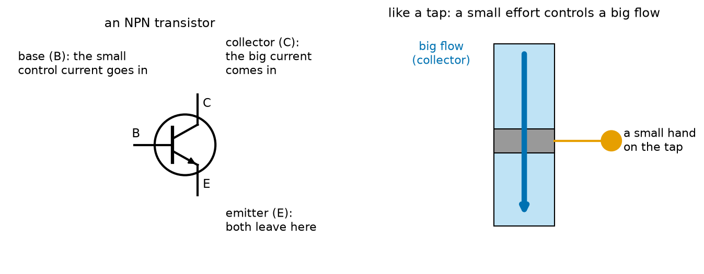
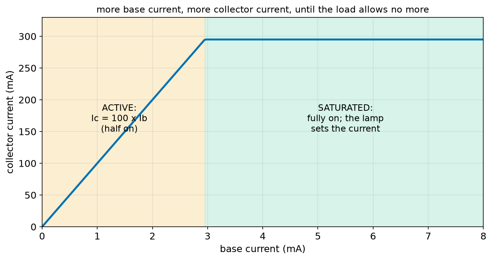
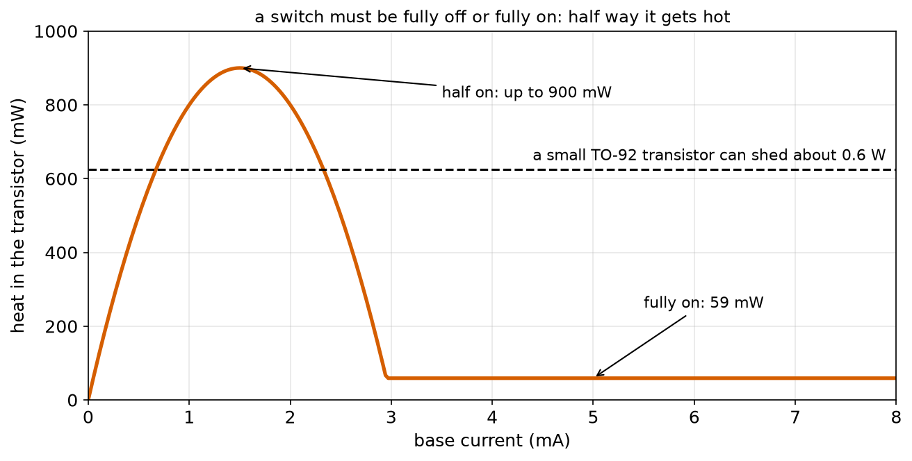
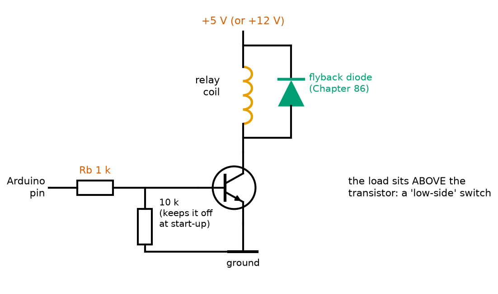
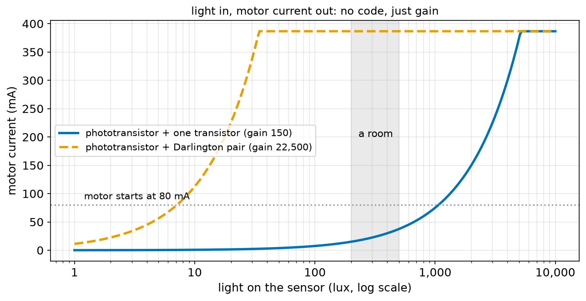
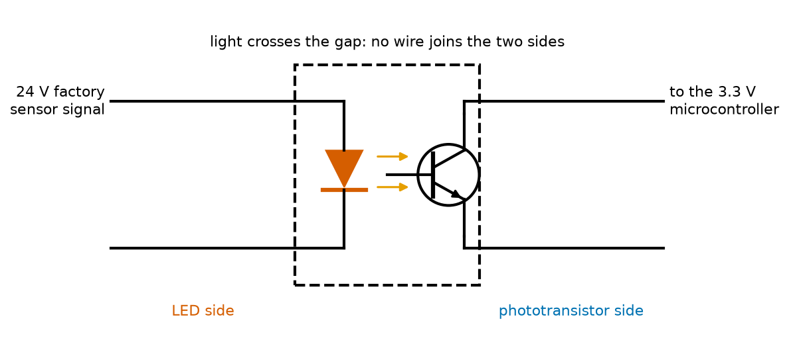

# Chapter 87 — Transistors as Switches (BJT)

> **Part 5 · Chapter 87 of 749**
> **You need:** Chapter 76 (heat and thermal resistance), Chapter 79 (light sensors in dividers), Chapter 82 (pin current limits and standard values), Chapter 83 (pull-down resistors), Chapter 85 (coils and spikes) and Chapter 86 (diodes and flyback).
> **You will make:** a model of an NPN transistor switching a lamp that shows why "half on" is dangerous, a program that chooses base resistors for four robot loads, and a light-controlled motor built from a phototransistor and a power transistor: the heart of Chapter 93's Moth.

---

## What you will learn

- What a **bipolar junction transistor (BJT)** is, and its three legs: **base, collector, emitter**.
- How a small **base current** controls a much bigger **collector current**: the **current gain β**.
- The three states of a transistor switch: **off**, **active** (half on) and **saturated** (fully on).
- How to design a **low-side switch** from a microcontroller pin: choosing the **base resistor**.
- Why a switching transistor must be **fully on**, never half on.
- **Phototransistors**, **Darlington pairs** and **optocouplers**, and where robots use them.

---

## New words in this chapter

| Word | Simple meaning |
|---|---|
| **transistor** | A semiconductor part in which a small signal controls a large current. |
| **BJT** | Bipolar junction transistor: a transistor controlled by a current into its base. |
| **NPN / PNP** | The two kinds of BJT. NPN is the common one for switching loads to ground. |
| **base, collector, emitter** | The BJT's three legs: the control input, where the big current enters, and where both currents leave (NPN). |
| **current gain (β or h_FE)** | Collector current ÷ base current while the transistor is not saturated: typically 100–300. |
| **active region** | The "half on" state, where collector current = β × base current. |
| **saturation** | The "fully on" state: the transistor is driven so hard that the load, not the transistor, sets the current. |
| **V_CE(sat)** | The small voltage left across a saturated transistor: 0.1–0.3 V. |
| **low-side switch** | A switch placed between the load and ground. |
| **forced beta** | The ratio Ic ÷ Ib a designer chooses, well below β, to make sure of saturation. |
| **phototransistor** | A transistor whose base current is made by light. |
| **Darlington pair** | Two transistors joined so that their gains multiply. |
| **optocoupler** | An LED and a phototransistor in one package: a signal crosses by light, with no wire. |

---

## 87.1 A small current controlling a big one

The transistor, invented at Bell Labs in 1947, is the reason we have computers, phones and robots. A modern processor contains billions of them. In this chapter we use just one at a time, as a **switch** that a microcontroller pin can operate.

📖 **New word: transistor** — a semiconductor part with three legs, in which a small signal on one leg controls a large current between the other two.

A microcontroller pin can give about 20 mA (Chapter 82). A relay needs 71 mA (Chapter 85), a lamp 300 mA, a motor amps. The pin cannot drive them directly. A transistor can, controlled by a few milliamps from the pin.

📖 **New word: BJT** — bipolar junction transistor, the original kind. It is a sandwich of three silicon layers: in an **NPN**, a thin p-type layer between two n-type layers (Chapter 86 explained p and n). Its control input is a **current**. Chapter 88's MOSFET is controlled by a voltage instead.



*Figure 87.1 — Left: the NPN symbol with its three legs. Right: the picture to keep in mind, a tap where a small hand controls a big flow.*

**How to read this picture:** On the left, the base (B) is the control input. The collector (C) is where the big current comes in from the load. The emitter (E), marked by the arrow, is where both currents leave, to ground. The arrow points the way conventional current flows out ("**N**ot **P**ointing i**N**" for NPN). On the right, the small hand on the tap is the base current; the big flow through the pipe is the collector current.

📖 **New words: base, collector, emitter** — the three legs. For an NPN used as a switch: the emitter goes to ground, the load goes between the supply and the collector, and the control signal goes into the base through a resistor.

The base and the emitter form a p–n junction: **a diode** (Chapter 86). So to push current into the base, the base must be about **0.7 V** above the emitter, and a resistor must limit that current, exactly like an LED's resistor (Chapter 82).

---

## 87.2 Current gain and the three states

While the transistor is "half on", the collector current is the base current multiplied by a fixed number:

```
Ic = β × Ib
```

📖 **New word: current gain (β)** — beta, also written h_FE in datasheets: collector current ÷ base current. Typically 100 to 300. It varies a lot from one transistor to the next (a datasheet might say "100 to 300"), and with temperature and current.

🔢 **Maths.** With β = 100, a base current of 1 mA lets 100 mA flow from collector to emitter.

But the collector current cannot be bigger than the load allows. A 12 V lamp of 40 Ω can never draw more than 12 ÷ 40 = 0.3 A, however hard the base is driven. So a transistor switch has three states:

| State | Base current | Collector current | Voltage across the transistor | Used for |
|---|---|---|---|---|
| **off** | 0 | 0 | the full supply | switch open |
| **active** (half on) | some | β × Ib, less than the load allows | in between | amplifiers, **not** switches |
| **saturated** (fully on) | more than enough | set by the load | about 0.2 V (V_CE(sat)) | switch closed |

📖 **New word: active region** — the "half on" state, where Ic = β × Ib and the transistor shares the supply voltage with the load.

📖 **New word: saturation** — the "fully on" state: the base is driven so hard that the transistor would pass more current than the load allows. The load then sets the current, and only a small voltage, **V_CE(sat)** of about 0.1–0.3 V, is left across the transistor.



*Figure 87.2 — The collector current of a β = 100 transistor switching a 12 V, 40 Ω lamp, as its base current rises.*

**How to read this picture:** In the orange region, the collector current grows in a straight line with the base current: 100 mA for 1 mA, 200 mA for 2 mA. At 2.95 mA it reaches 295 mA, everything the lamp allows with 0.2 V left across the transistor. Beyond that (green), more base current changes nothing: the transistor is saturated, fully on.

---

## 87.3 Why a switch must be fully on

Power in the transistor is the voltage across it times the current through it (Chapter 76). Look at the three states with the 12 V lamp:

- **Off**: 12 V across, 0 A through: 0 W.
- **Saturated**: 0.2 V across, 0.295 A through: **0.059 W**.
- **Half on**, say 150 mA: the lamp takes 150 mA × 40 Ω = 6 V, so 6 V is left across the transistor: 6 × 0.15 = **0.9 W**.



*Figure 87.4 — The heat in the transistor against its base current, switching the 12 V lamp.*

**How to read this picture:** With no base current, no heat. As the base current rises, the transistor is half on and the heat rises fast, peaking at 900 mW when it takes half the supply. Once saturated (2.95 mA and above), the heat drops to 59 mW and stays there. The dashed line is what a small TO-92 transistor can shed in free air (about 0.6 W, Chapter 76). Half on, it overheats; fully on, it stays cool.

🧠 **A transistor used as a switch must be either fully off or fully on.** Half on is for amplifiers. A switch that is only half on wastes power and burns.

### Forced beta: making sure of saturation

Since β varies from transistor to transistor (100 to 300 for the same part number) and falls when cold and at high currents, designers do not give the base "just enough" current. They give several times more, by designing for a **forced beta** of about 10 to 20.

📖 **New word: forced beta** — the ratio Ic ÷ Ib that the designer chooses, well below the transistor's minimum β, so that every transistor of that type will saturate.

```
Ib = Ic ÷ forced beta
Rb = (V_pin − 0.7) ÷ Ib
```

🔢 **Maths.** The 12 V lamp: Ic = 0.3 A. With a forced beta of 20: Ib = 15 mA. From a 4.7 V Arduino pin: Rb = (4.7 − 0.7) ÷ 0.015 = 267 Ω → choose the next standard value **down**, 220 Ω (a smaller resistor gives more base current, the safe direction): Ib = 18.2 mA. The pin can give that (under 20 mA), but only just.

---

## 87.4 The low-side switch



*Figure 87.3 — An Arduino pin switching a relay coil through an NPN transistor.*

**How to read this picture:** The relay coil sits between the + supply and the transistor's collector; the emitter goes to ground. The pin drives the base through Rb (1 kΩ). A 10 kΩ resistor from base to ground keeps the transistor off whenever the pin is not driving it, for example while the Arduino is starting up and its pins float (Chapter 83). The flyback diode across the coil (Chapter 86) catches the spike when the transistor switches off.

📖 **New word: low-side switch** — the switch sits on the "low side" of the load, between it and ground. An NPN transistor is a natural low-side switch, because its emitter is at ground, so the pin's few volts are enough to turn it on, whatever the load's supply voltage (5 V, 12 V, 24 V).

The parts and their jobs:

| Part | Job |
|---|---|
| **NPN transistor** (2N2222, BC337, 2N3904 for small currents) | the switch |
| **Rb** | sets the base current; protects the pin and the base |
| **10 kΩ base pull-down** | keeps the switch off while the pin floats |
| **flyback diode** | protects the transistor from the coil's spike |
| **common ground** | the pin's ground and the load's ground must be joined (Chapter 5) |

A **PNP** transistor is the mirror image: emitter to the + supply, load between collector and ground, and the base pulled **down** to turn it on. It makes a "high-side" switch. Chapter 139's H-bridge uses both kinds together to drive a motor in either direction.

### Limits: when to stop using a BJT

A BJT needs base current all the time it is on. For a 0.5 A load with a forced beta of 20, that is 25 mA: more than a pin may give. Application 1's program finds the limit: about **0.3 A** from an Arduino pin. For bigger loads, use a **MOSFET** (Chapter 88), which needs almost no current to hold it on.

---

## 87.5 Light-controlled transistors

📖 **New word: phototransistor** — a transistor whose base is exposed to light through a clear case. Light falling on the base junction makes a small current there, which the transistor multiplies by its gain. So the collector current is proportional to the light: more light, more current. It is like an LDR (Chapter 79) but faster and more sensitive.

Feed a phototransistor's current into the base of a second, power transistor, and light controls a motor directly, with no microcontroller and no code. That is exactly how Chapter 93's Moth will steer towards light.

One transistor's gain may not be enough. Two transistors joined so that the first one's emitter current feeds the second one's base multiply their gains:

📖 **New word: Darlington pair** — two transistors connected so that their gains multiply: 150 × 150 = 22,500. The pair behaves like one very sensitive transistor. The price: its V_CE(sat) is about 0.7–1 V instead of 0.2 V, so it gets warmer as a switch.



*Figure 87.5 — Motor current against the light on a phototransistor, driving one transistor (blue) or a Darlington pair (orange).*

**How to read this picture:** The horizontal axis is light on a log scale. With one power transistor, the motor only starts (80 mA, dotted line) above about 1,000 lux: a bright desk lamp. With a Darlington pair, it starts at about 7 lux and is fully on by 35 lux, so ordinary room light (grey band) already drives it at full speed. One transistor is too insensitive, two are too sensitive: Chapter 93 solves this by comparing **two** sensors, so that only the **difference** in light matters.

### Optocouplers

📖 **New word: optocoupler** — an LED and a phototransistor sealed together in one small package, facing each other. Current in the LED makes light; the light turns on the phototransistor. The signal crosses the gap as light: there is **no electrical connection** between the two sides.



*Figure 87.6 — Inside an optocoupler: an LED on one side, a phototransistor on the other, and only light between them.*

**How to read this picture:** The left side belongs to one circuit (here a 24 V factory sensor); the right side to another (a 3.3 V microcontroller). Current from the sensor lights the LED; the light switches the phototransistor, which pulls the microcontroller's input low. The dashed box is the sealed package. A fault, a spike or a ground offset (Chapter 78) on one side cannot reach the other.

---

## Code

File `code/ch087/bjt_model.py`:

```python
# bjt_model.py - a simple NPN transistor switching a 12 V lamp: off, half-on, and fully on (saturated)
V_CC = 12.0
R_LOAD = 40.0              # a 12 V, 0.3 A lamp (taken as a 40 ohm resistor)
BETA = 100                 # current gain: collector current = 100 x base current (when not saturated)
V_CE_SAT = 0.2             # the smallest voltage left across a fully-on transistor


def collector(ib):
    """Collector current and the voltage across the transistor, for a base current ib."""
    ic_max = (V_CC - V_CE_SAT) / R_LOAD          # the most the load lets through
    ic = min(BETA * ib, ic_max)                  # the transistor wants beta x ib, but the load sets a ceiling
    vce = V_CC - ic * R_LOAD
    return ic, vce


print(f"lamp alone on 12 V would draw {V_CC / R_LOAD * 1000:.0f} mA")
print(f"{'base current':>13s} {'collector':>10s} {'across transistor':>18s} {'heat in transistor':>19s}  state")
for ib_ma in [0.0, 0.5, 1.0, 2.0, 2.95, 5.0, 15.0]:
    ic, vce = collector(ib_ma / 1000)
    p = ic * vce
    state = "OFF" if ic == 0 else ("SATURATED (fully on)" if vce <= V_CE_SAT + 1e-9 else "half on: DANGER")
    print(f"{ib_ma:10.2f} mA {ic * 1000:7.0f} mA {vce:15.2f} V {p * 1000:15.0f} mW  {state}")
```

| Line | Code | What it does (simple English) |
|---|---|---|
| 1 | `# bjt_model.py …` | A comment. |
| 2–5 | `V_CC`, `R_LOAD`, `BETA`, `V_CE_SAT` | The supply, the lamp, the gain and the saturation voltage. |
| 6–7 | (blank) | Spacing. |
| 8 | `def collector(ib):` | The transistor model. |
| 9 | `"""…"""` | The docstring. |
| 10 | `ic_max = (V_CC - V_CE_SAT) / R_LOAD` | The most current the lamp allows with the transistor fully on (Ohm's law). |
| 11 | `ic = min(BETA * ib, ic_max)` | The transistor passes β × Ib, unless that is more than the load allows: then it is saturated. |
| 12 | `vce = V_CC - ic * R_LOAD` | The voltage law: what the lamp does not take is across the transistor. |
| 13 | `return ic, vce` | Both. |
| 14–15 | (blank) | Spacing. |
| 16–17 | `print(…)` | The lamp's own current and the header. |
| 18 | `for ib_ma in [ … ]:` | Seven base currents. |
| 19 | `ic, vce = collector(ib_ma / 1000)` | mA to A. |
| 20 | `p = ic * vce` | Heat in the transistor (Chapter 76). |
| 21 | `state = …` | Off, saturated, or half on. |
| 22 | `print(…)` | The row. |

Output:

```
lamp alone on 12 V would draw 300 mA
 base current  collector  across transistor  heat in transistor  state
      0.00 mA       0 mA           12.00 V               0 mW  OFF
      0.50 mA      50 mA           10.00 V             500 mW  half on: DANGER
      1.00 mA     100 mA            8.00 V             800 mW  half on: DANGER
      2.00 mA     200 mA            4.00 V             800 mW  half on: DANGER
      2.95 mA     295 mA            0.20 V              59 mW  SATURATED (fully on)
      5.00 mA     295 mA            0.20 V              59 mW  SATURATED (fully on)
     15.00 mA     295 mA            0.20 V              59 mW  SATURATED (fully on)
```

Look at the rows between 0.5 and 2 mA: the transistor heats by 500–800 mW, more than a small one can shed. From 2.95 mA up, it is saturated and makes only 59 mW. The 15 mA row is the forced-beta design of section 87.3: five times more base current than needed, and exactly the same result, which is the point: it still saturates if the real β is only 30.

---

## Small examples

**Example 1.** β = 200, Ib = 0.5 mA: Ic = 100 mA (if the load allows it).

**Example 2.** A 5 V, 100 Ω load: Ic(max) = (5 − 0.2) ÷ 100 = 48 mA. Saturation needs Ib > 48 ÷ 100 = 0.48 mA with β = 100.

**Example 3.** For that load with a forced beta of 10: Ib = 4.8 mA. From a 4.7 V pin: Rb = 4.0 ÷ 0.0048 = 833 Ω → 820 Ω.

**Example 4.** From a 3.3 V ESP32 pin, the same 4.8 mA: Rb = (3.3 − 0.7) ÷ 0.0048 = 542 Ω → 470 Ω.

**Example 5.** A saturated transistor at 0.5 A with 0.25 V across it: 0.125 W.

**Example 6.** A Darlington at 0.5 A with 0.9 V across it: 0.45 W. Nearly four times warmer.

**Example 7.** A phototransistor giving 200 µA into a β = 150 transistor: 30 mA.

**Example 8.** The base pull-down of 10 kΩ takes 0.7 V ÷ 10,000 = 0.07 mA of the base current: negligible.

---

## 🏭 Real robot applications

### Application 1 (worked in full) — 🤖 Switching loads from an Arduino pin

**1. The real problem.** Rover's Arduino must switch four loads it cannot power from a pin: a 5 V relay (71 mA), a small cooling fan (150 mA), a 12 V lamp for night work (300 mA) and an LED strip (500 mA). For each, choose an NPN transistor and a base resistor that make sure of saturation, while keeping the pin under 20 mA.

**2. Why this theory.** Saturation needs Ib = Ic ÷ forced beta, with a forced beta of 20 for a transistor whose minimum β is 100. The base resistor sets Ib from the pin's voltage minus the base's 0.7 V (the base–emitter diode). Round the resistor **down** to a standard value, so that the base current is a little larger, not smaller.

**3. The numbers.** Pin 4.7 V. V_BE 0.7 V. Forced beta 20. Transistors: 2N2222 or BC337 (600–800 mA, β at least 100). Pin limit 20 mA.

**4. The maths.** Relay: Ib = 71 ÷ 20 = 3.55 mA; Rb = 4.0 ÷ 0.00355 = 1,127 Ω → 1 kΩ (4.0 mA). LED strip: Ib = 25 mA, Rb = 160 Ω → 150 Ω, but that asks 26.7 mA of the pin: too much.

**5. The code.** File `code/ch087/base_resistor.py`:

```python
# base_resistor.py - choose the base resistor so the transistor is fully on, with a safe pin current
E12 = [1.0, 1.2, 1.5, 1.8, 2.2, 2.7, 3.3, 3.9, 4.7, 5.6, 6.8, 8.2]
V_PIN = 4.7                # an Arduino pin's high voltage under a few mA of load (Chapter 82)
V_BE = 0.7                 # base-emitter voltage of a silicon transistor (a diode, Chapter 86)
FORCED_BETA = 20           # we give 5x more base current than beta_min=100 would need: certain saturation


def next_lower_e12(r):
    """The largest E12 value not above r (a smaller resistor gives MORE base current: the safe direction)."""
    best = None
    scale = 1.0
    while scale <= r * 10:
        for v in E12:
            if v * scale <= r + 1e-9:
                best = v * scale
        scale *= 10
    return best


loads = [("5 V relay coil", 0.071), ("small DC fan", 0.150), ("12 V lamp", 0.300), ("LED strip", 0.500)]
print(f"{'load':16s} {'Ic':>7s} {'Ib needed':>10s} {'exact Rb':>9s} {'use':>7s} {'pin current':>12s} {'verdict':>22s}")
for name, ic in loads:
    ib = ic / FORCED_BETA
    rb = (V_PIN - V_BE) / ib
    use = next_lower_e12(rb)
    pin = (V_PIN - V_BE) / use
    part = "2N2222 / BC337 is fine" if pin <= 0.020 else "TOO MUCH for a pin: MOSFET (Ch 88)"
    print(f"{name:16s} {ic * 1000:5.0f} mA {ib * 1000:7.2f} mA {rb:8.0f} {use:6.0f} {pin * 1000:9.2f} mA  {part}")
print()
print("the pin may give at most 20 mA: a plain transistor can switch up to about 0.3 A from an Arduino pin")
print("add 10 kohm from base to ground so the transistor stays OFF while the pin floats during start-up (Chapter 83)")
```

| Line | Code | What it does (simple English) |
|---|---|---|
| 1 | `# base_resistor.py …` | A comment. |
| 2–5 | `E12`, `V_PIN`, `V_BE`, `FORCED_BETA` | Standard values, the pin, the base diode and the design ratio. |
| 6–7 | (blank) | Spacing. |
| 8 | `def next_lower_e12(r):` | Round a resistance **down** to a standard value. |
| 9 | `"""…"""` | The docstring. |
| 10–16 | the loops | Try every E12 value in every decade up to r, keeping the last one not above r. |
| 17 | `return best` | The largest standard value not above r. |
| 18–19 | (blank) | Spacing. |
| 20 | `loads = [ … ]` | The four loads and their currents. |
| 21 | `print(…)` | The header. |
| 22 | `for name, ic in loads:` | Each load. |
| 23 | `ib = ic / FORCED_BETA` | The base current to give. |
| 24 | `rb = (V_PIN - V_BE) / ib` | Ohm's law for the base resistor: its voltage is the pin minus the base's 0.7 V. |
| 25 | `use = next_lower_e12(rb)` | A real resistor. |
| 26 | `pin = (V_PIN - V_BE) / use` | The actual pin (and base) current. |
| 27 | `part = …` | Within the pin's 20 mA, or not. |
| 28 | `print(…)` | The row. |
| 29–31 | `print()` and two lines | The conclusion and the pull-down reminder. |

Output:

```
load                  Ic  Ib needed  exact Rb     use  pin current                verdict
5 V relay coil      71 mA    3.55 mA     1127   1000      4.00 mA  2N2222 / BC337 is fine
small DC fan       150 mA    7.50 mA      533    470      8.51 mA  2N2222 / BC337 is fine
12 V lamp          300 mA   15.00 mA      267    220     18.18 mA  2N2222 / BC337 is fine
LED strip          500 mA   25.00 mA      160    150     26.67 mA  TOO MUCH for a pin: MOSFET (Ch 88)

the pin may give at most 20 mA: a plain transistor can switch up to about 0.3 A from an Arduino pin
add 10 kohm from base to ground so the transistor stays OFF while the pin floats during start-up (Chapter 83)
```

**6. The result.** The relay (1 kΩ), the fan (470 Ω) and the lamp (220 Ω) can each be switched by a BC337 from an Arduino pin, with the flyback diode of Chapter 86 on the relay and the fan. The LED strip needs 26.7 mA of base current, more than a pin may give: it needs a MOSFET (Chapter 88), or a Darlington. Without a forced beta, a designer who used "Ib = Ic ÷ 100" would get transistors that are only half on whenever the real β is low (cold mornings, a weak batch), and they would overheat, as in Figure 87.4.

**7. Going further.** Chips such as the ULN2003 contain seven Darlington switches with their flyback diodes built in, and are the classic way to drive small stepper motors and relays from a microcontroller (Application 3). Chapter 98 switches a pin in code, and Chapter 139 builds an H-bridge from four transistors to drive Rover's motors both ways.

### Application 2 (worked in full) — 🦋 Light that drives a motor: Moth's principle

**1. The real problem.** Chapter 93 will build Moth, a robot that steers towards light with **no code at all**. Its sense–think–act loop (Chapter 2) is made of transistors: a light sensor makes a current, and that current, multiplied, drives a motor. How much gain is needed, and how bright must the light be?

**2. Why this theory.** A phototransistor turns light into a small current (here 0.5 µA per lux). Feeding it into a power transistor's base multiplies it by β. The motor current is the smaller of β × I_photo and what the motor allows when fully on.

**3. The numbers.** Battery 6.0 V (4 × AA). Phototransistor 0.5 µA per lux. Power transistor β = 150. Motor 15 Ω (so 387 mA when fully on), starts turning at 80 mA. Room light about 300 lux; a desk lamp close up, several thousand lux.

**4. The maths.** The motor starts when 150 × 0.5 µA × lux = 80 mA, at lux = 0.080 ÷ (150 × 0.5 × 10⁻⁶) = 1,067 lux. Full speed at 0.387 ÷ 7.5 × 10⁻⁵ = 5,156 lux. With a Darlington pair (β = 22,500), the start falls to 7.1 lux.

**5. The code.** File `code/ch087/light_switch.py`:

```python
# light_switch.py - a phototransistor feeds a power transistor: more light, more motor current (Moth's idea)
V = 6.0                     # Moth's battery: 4 x AA
PHOTO_UA_PER_LUX = 0.5      # the phototransistor passes about 0.5 uA for each lux falling on it
BETA = 150                  # the power transistor's gain
R_MOTOR = 15.0              # a small toy motor (taken as 15 ohm)
V_CE_SAT = 0.2
I_START = 0.08              # the motor needs about 80 mA to start turning

i_max = (V - V_CE_SAT) / R_MOTOR
print(f"motor current when fully on: {i_max * 1000:.0f} mA")
print(f"{'light (lux)':>12s} {'photo current':>14s} {'motor current':>14s}  motor")
for lux in [10, 100, 300, 600, 1000, 2000, 5000]:
    ib = lux * PHOTO_UA_PER_LUX * 1e-6         # the phototransistor's current becomes the power transistor's base current
    ic = min(BETA * ib, i_max)
    state = "stopped" if ic < I_START else ("full speed" if ic >= i_max - 1e-9 else "turning")
    print(f"{lux:12d} {ib * 1e6:11.0f} uA {ic * 1000:11.0f} mA  {state}")
print()
print(f"the motor starts at about {I_START / BETA / (PHOTO_UA_PER_LUX * 1e-6):.0f} lux and is at full speed above {i_max / BETA / (PHOTO_UA_PER_LUX * 1e-6):.0f} lux")
print()
print("one transistor needs a bright desk lamp. Two in a 'Darlington pair' multiply their gains:")
beta2 = BETA * BETA
print(f"  gain {BETA} x {BETA} = {beta2}: the motor starts at about {I_START / beta2 / (PHOTO_UA_PER_LUX * 1e-6):.1f} lux")
print("  so sensitive that ordinary room light switches it fully on: Moth (Chapter 93) compares TWO sensors instead")
```

| Line | Code | What it does (simple English) |
|---|---|---|
| 1 | `# light_switch.py …` | A comment. |
| 2–7 | `V` … `I_START` | The battery, the sensor, the gain, the motor and its starting current. |
| 8 | (blank) | Spacing. |
| 9 | `i_max = (V - V_CE_SAT) / R_MOTOR` | The motor's current with the transistor saturated. |
| 10–11 | `print(…)` | That current, and the header. |
| 12 | `for lux in [ … ]:` | Seven light levels. |
| 13 | `ib = …` | The phototransistor's current, which is the power transistor's base current. |
| 14 | `ic = min(BETA * ib, i_max)` | Multiplied by β, up to the motor's limit. |
| 15 | `state = …` | Stopped, turning, or full speed. |
| 16 | `print(…)` | The row. |
| 17–18 | `print()`, `print(…)` | The light levels for starting and full speed: the formulas of step 4. |
| 19–23 | the Darlington lines | The same with β × β. |

Output:

```
motor current when fully on: 387 mA
 light (lux)  photo current  motor current  motor
          10           5 uA           1 mA  stopped
         100          50 uA           8 mA  stopped
         300         150 uA          22 mA  stopped
         600         300 uA          45 mA  stopped
        1000         500 uA          75 mA  stopped
        2000        1000 uA         150 mA  turning
        5000        2500 uA         375 mA  turning

the motor starts at about 1067 lux and is at full speed above 5156 lux

one transistor needs a bright desk lamp. Two in a 'Darlington pair' multiply their gains:
  gain 150 x 150 = 22500: the motor starts at about 7.1 lux
  so sensitive that ordinary room light switches it fully on: Moth (Chapter 93) compares TWO sensors instead
```

**6. The result.** With one transistor, the motor turns only when a bright lamp is close: a robot that would sit still in a normal room. With a Darlington, room light alone runs it at full speed, so it could not tell where the light is. The way out is the idea of Chapter 3's tortoise: **two** sensors, one on each side, each driving the **opposite** side's motor through its own transistor (or comparing the two). Then what matters is which side is brighter. Notice also that in the "turning" range the transistor is half on (Figure 87.4): Moth's transistors will run warm, which Chapter 93 must check.

**7. Going further.** Chapter 93 builds the full Moth circuit, measures it and tunes it. The same light-to-current-to-motor chain, with a microcontroller in the middle, is Rover's line follower (Chapter 292). Chapter 129 covers phototransistors and photodiodes as measuring sensors.

### Application 3 — 🏭 Driving a stepper motor with a Darlington array

Small stepper motors (Chapter 145), such as the 28BYJ-48 used in camera sliders, cheap robot arms and 3D printer accessories, have four coils that must be switched on in a sequence. Each coil needs about 100–200 mA at 5 V or 12 V: too much for a pin. The ULN2003 chip holds seven Darlington pairs, each with its base resistor and a flyback diode built in, so a microcontroller pin connects straight to its input. Its drawback is the Darlington's 0.9–1 V saturation voltage: at 200 mA per coil it makes about 0.2 W of heat per channel, and the motor gets 1 V less than the supply. For bigger steppers, MOSFET driver chips have replaced it (Chapter 145).

### Application 4 — 🏭 Optocouplers between a factory and a microcontroller

Factory sensors and machines usually signal with 24 V, through long cables full of electrical noise, and sometimes with faults that put dangerous voltages on the wires. A robot cell's controller reads them through **optocouplers** (Figure 87.6): the 24 V signal lights an LED through a resistor (Chapter 82: (24 − 1.2) ÷ 0.005 = 4.7 kΩ for 5 mA), and the phototransistor on the other side pulls a 3.3 V input low (Chapter 83). No fault on the factory side can reach the controller's chips, and ground offsets between distant machines (Chapter 78) do not matter, because the two grounds are not connected. Industrial input cards contain 8, 16 or 32 optocouplers in a row.

### Application 5 — 🚁 A lost-drone buzzer

When a drone crashes in tall grass, a loud buzzer helps find it. A 5 V buzzer draws about 30 mA, more than the flight controller's 3.3 V pins should give (often 8–12 mA, Chapter 82). A small NPN transistor (2N3904 or MMBT3904) with a 1 kΩ base resistor switches it: Ib = (3.3 − 0.7) ÷ 1,000 = 2.6 mA, a forced beta of 30 / 2.6 ≈ 12, well saturated. Many flight controllers have exactly this circuit built in, with a "BUZ−" pad that is the transistor's collector: the buzzer goes between +5 V and that pad, making a low-side switch. The same circuit switches the drone's LED strips through a MOSFET when they draw more (Chapter 88).

---

## 🔧 Hands-on lab

### Lab 87.1 — Switch an LED with a transistor (hardware, or Tinkercad)

You need: a 2N2222, BC337 or 2N3904 NPN transistor, an LED with a 330 Ω resistor, resistors of 1 kΩ, 10 kΩ and 100 kΩ, a 5 V supply, the multimeter. (No Arduino yet: a wire to + acts as the "pin".)

1. Find the transistor's legs from its datasheet (search its name + "pinout"): for a TO-92 case, the order is printed in the datasheet; it differs between part numbers.
2. Build: +5 V → 330 Ω → LED → collector; emitter → ground. Base → 10 kΩ → a loose wire.
3. Touch the loose wire to +5 V: the LED lights. Touch it to ground: off. Leave it unconnected: what happens?
4. Measure the voltage across the transistor (collector to emitter) when on.
5. Replace the 10 kΩ with 100 kΩ and then 1 MΩ. Measure the collector-to-emitter voltage each time.

**What you should see:** With 10 kΩ: Ib = 4.3 ÷ 10,000 = 0.43 mA; the LED wants about 9 mA, so a forced beta of about 20: saturated, about 0.1 V across the transistor. With 100 kΩ (43 µA): β × Ib may be just enough or not, depending on your transistor's β; with 1 MΩ (4.3 µA), the transistor is half on, the LED is dim, and several volts are across the transistor. Left unconnected, the base may pick up noise and the LED may glow faintly or flicker: add a 10 kΩ pull-down from base to ground and it stays off.

| If it does not work | Likely cause | Fix |
|---|---|---|
| The LED is always on | Collector and emitter swapped, or the base wired to + permanently | Check the pinout |
| The LED never lights | The LED is backwards, or the emitter is not grounded | Check both |
| The transistor gets hot | No base resistor, or the LED's resistor is missing | Disconnect; add the resistors |

**Challenge:** Use your meter's diode setting (Chapter 81) to find the base of an unknown NPN transistor: the base–emitter and base–collector junctions both read about 0.6–0.7 V with the red probe on the base.

### Lab 87.2 — A light-controlled LED (hardware)

You need: a phototransistor (for example an L14G or a TEPT5600; or use an LDR divider as a stand-in), the NPN transistor, an LED with 330 Ω, a 10 kΩ resistor, a 5 V supply.

1. Build: +5 V → phototransistor (collector to +) → its emitter → base of the NPN. Add 10 kΩ from the base to ground. LED and 330 Ω from +5 V to the NPN's collector; emitter to ground.
2. Cover the phototransistor with your hand, then shine a torch on it.
3. Try a 100 kΩ resistor from base to ground instead of 10 kΩ.

**What you should see:** Covered, the LED is off; in torch light it is bright; in room light it may be dim or off. The 10 kΩ base resistor steals some of the phototransistor's current (it must reach about 0.7 V ÷ 10 kΩ = 70 µA before the NPN starts to turn on), so it sets the sensitivity: with 100 kΩ, only 7 µA is stolen, and the circuit becomes about ten times more sensitive. This "threshold" resistor is the main tuning knob of Moth in Chapter 93.

| If it does not work | Likely cause | Fix |
|---|---|---|
| The LED is always on | The phototransistor is wired backwards and is acting as a diode, or the pull-down is missing | Check its flat side/longer leg against the datasheet |
| The LED never lights, even in torch light | The phototransistor's current is too small for 10 kΩ | Use 47 kΩ or 100 kΩ |

**Challenge:** Replace the NPN with two NPNs as a Darlington pair (the first one's emitter into the second one's base). How does the sensitivity change?

### Lab 87.3 — Explore the switch model (simulation)

Copy `bjt_model.py`.

1. Change β to 30 (a cold, low-gain transistor). With Ib = 15 mA (the forced-beta design), is it still saturated? With Ib = 2.95 mA?
2. Change the lamp to a 24 V, 0.5 A load (48 Ω). What base current saturates it with β = 100? What with a forced beta of 20?
3. Add a column for the transistor's temperature rise with θ = 200 °C/W (a TO-92 in free air, Chapter 76).

**What you should see:** With β = 30, 15 mA still saturates it (30 × 15 = 450 mA > 295 mA), but 2.95 mA gives only 89 mA, half on, with 0.75 W of heat. With the 24 V load: 4.96 mA for β = 100; 24.8 mA for a forced beta of 20, which is beyond a pin's 20 mA: a MOSFET is better (Chapter 88). Half on, the 800 mW rows give a 160 °C rise: destroyed. Saturated, 59 mW gives 12 °C.

| If it does not work | Likely cause | Fix |
|---|---|---|
| The "SATURATED" label never appears | The comparison with `V_CE_SAT` is too strict for floats | Keep the `+ 1e-9` tolerance (Chapter 54) |

**Challenge:** Plot heat against base current for β = 30, 100 and 300 on one graph. Where should the design point be so that every transistor is saturated?

---

## Common mistakes

⚠️ **No base resistor.** The base–emitter junction is a diode: without a resistor it draws a huge current from the pin.

⚠️ **Designing for "just enough" base current.** β varies widely; use a forced beta of 10–20.

⚠️ **Leaving the transistor half on.** It overheats. Switches must be fully on or fully off.

⚠️ **No flyback diode** on a relay, solenoid or motor (Chapter 86).

⚠️ **Forgetting the common ground.** The pin's ground and the transistor's emitter must be joined.

⚠️ **Wrong pinout.** TO-92 transistors do not all use the same leg order. Check the datasheet.

⚠️ **Using a BJT for big loads from a pin.** Above about 0.3 A the base current gets too large: use a MOSFET.

⚠️ **No base pull-down.** While the microcontroller starts up, a floating pin can switch a motor on for a moment.

---

## Practice

🏋️ **1.** Name the three legs of an NPN transistor and say which is the control input.

🏋️ **2.** A transistor with β = 150 has 0.4 mA of base current and a load that allows up to 200 mA. What is the collector current? Is it saturated?

🏋️ **3.** The same transistor with 2 mA of base current. Collector current? Saturated?

🏋️ **4.** A 9 V buzzer draws 40 mA. Design the base resistor from a 4.7 V pin with a forced beta of 15.

🏋️ **5.** The same buzzer from a 3.3 V pin.

🏋️ **6.** A saturated transistor carries 250 mA with 0.15 V across it. How much heat? And half on, with 4 V across it and 150 mA through it?

🏋️ **7.** Why must a transistor used as a switch be fully on or fully off?

🏋️ **8.** Two transistors with β = 120 and β = 80 in a Darlington pair. What is the total gain? A 10 µA input gives what collector current (if the load allows)?

🏋️ **9.** An optocoupler's LED is driven from 12 V at 5 mA (V_f = 1.2 V). What resistor?

🏋️ **10.** A pin can give 20 mA. With a forced beta of 20, what is the largest load current a BJT can switch from that pin?

🏋️ **11.** Write `design_switch(load_a, v_pin, forced_beta=20, pin_limit=0.020)` that returns the base resistor (rounded down to E12) and the pin current, or `None` and a message if the pin limit would be exceeded. Test it on 0.05 A, 0.2 A and 0.45 A from a 4.7 V pin.

---

## Answers

**1.** Base (control input), collector, emitter.

**2.** β × Ib = 60 mA, less than 200 mA, so Ic = 60 mA: active (half on), not saturated.

**3.** β × Ib = 300 mA, more than the load allows, so Ic = 200 mA: saturated.

**4.** Ib = 40 ÷ 15 = 2.67 mA. Rb = 4.0 ÷ 0.00267 = 1,500 Ω (exactly E12: 1.5 kΩ).

**5.** Rb = 2.6 ÷ 0.00267 = 975 Ω → 820 Ω (rounded down: 3.2 mA).

**6.** 0.25 × 0.15 = 37.5 mW. Half on: 4 × 0.15 = 0.6 W, sixteen times more.

**7.** Off, no current flows; fully on, almost no voltage is across it. Either way, voltage × current is small. Half on, both are large, so it heats up (Figure 87.4).

**8.** 120 × 80 = 9,600. 10 µA × 9,600 = 96 mA.

**9.** (12 − 1.2) ÷ 0.005 = 2,160 Ω → 2.2 kΩ (4.9 mA).

**10.** 20 × 20 mA = 400 mA, in theory; in practice keep the pin at about 15 mA, so about 0.3 A.

**11.**

```python
E12 = [1.0, 1.2, 1.5, 1.8, 2.2, 2.7, 3.3, 3.9, 4.7, 5.6, 6.8, 8.2]

def lower_e12(r):
    best, scale = None, 1.0
    while scale <= r * 10:
        for v in E12:
            if v * scale <= r + 1e-9:
                best = v * scale
        scale *= 10
    return best

def design_switch(load_a, v_pin, forced_beta=20, pin_limit=0.020):
    ib = load_a / forced_beta
    rb = lower_e12((v_pin - 0.7) / ib)
    pin = (v_pin - 0.7) / rb
    if pin > pin_limit:
        return None, f"needs {pin * 1000:.1f} mA from the pin: use a MOSFET"
    return rb, f"pin current {pin * 1000:.1f} mA"

for load in [0.05, 0.2, 0.45]:
    print(load, design_switch(load, 4.7))
```

```
0.05 (1500.0, 'pin current 2.7 mA')
0.2 (390.0, 'pin current 10.3 mA')
0.45 (None, 'needs 26.7 mA from the pin: use a MOSFET')
```

---

## Summary

🧠 A **BJT** is a current-controlled switch and amplifier. In an **NPN**: the small current goes in at the **base**, the big current comes in at the **collector**, and both leave at the **emitter**.

🧠 The base–emitter junction is a **diode** (0.7 V): always use a **base resistor**: **Rb = (V_pin − 0.7) ÷ Ib**.

🧠 In the **active** region, **Ic = β × Ib** (β about 100–300, very variable). In **saturation**, the load sets the current and only **0.1–0.3 V** is left across the transistor.

🧠 A switch must be **fully on or fully off**: half on, it overheats. Design with a **forced beta** of 10–20, and round Rb **down**.

🧠 The **low-side switch**: load between supply and collector, emitter to ground, base resistor, **base pull-down**, **flyback diode**, **common ground**. From a pin, a BJT can switch up to about 0.3 A.

🧠 **Phototransistors** turn light into current; **Darlington pairs** multiply gains; **optocouplers** pass signals by light between circuits that must not be connected.

---

## Next chapter

Chapter 88 introduces the transistor that switches almost everything in modern robots: the **MOSFET**. It is controlled by a **voltage**, not a current, so it needs almost no power to hold on; when on it acts like a tiny resistor, so it can switch tens of amps with little heat. You will choose MOSFETs for Rover's LED strip and its reverse-battery protection, and learn why a drone's speed controller uses six of them.
