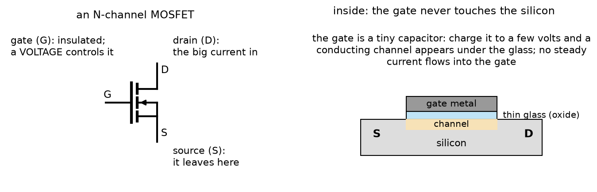
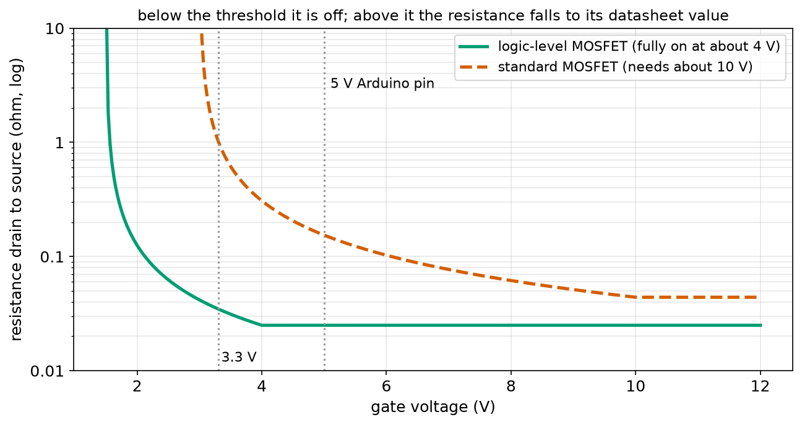
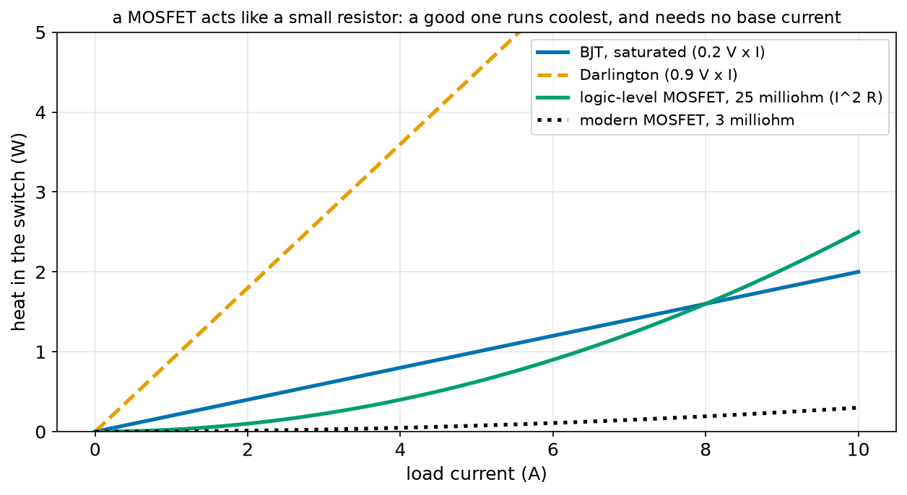
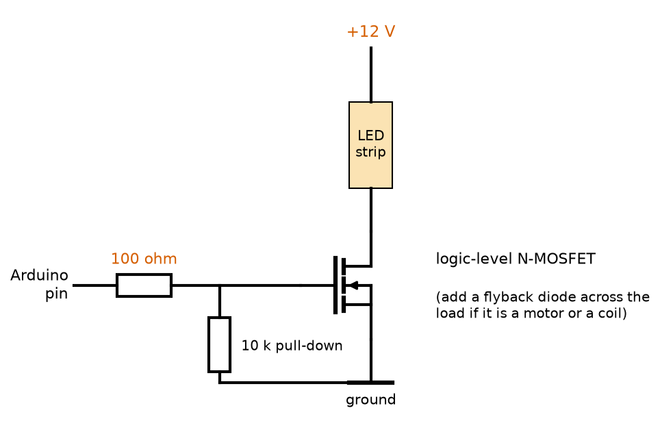
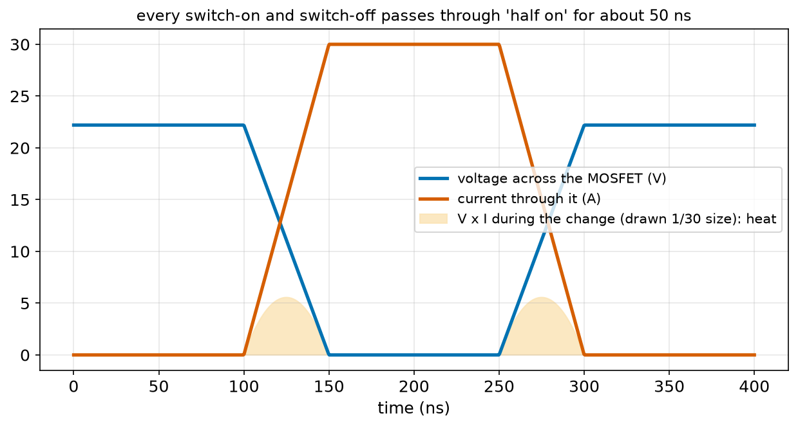
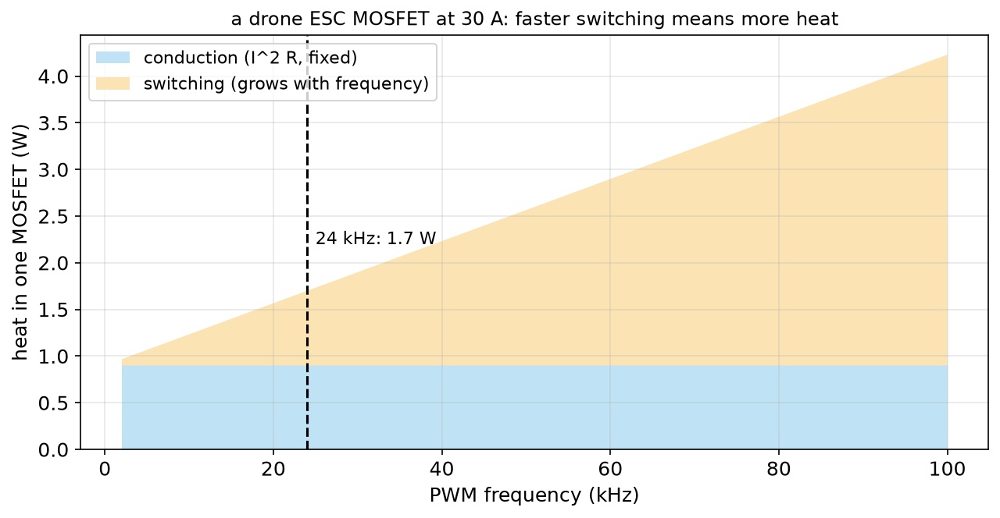

# Chapter 88 — MOSFETs

> **Part 5 · Chapter 88 of 749**
> **You need:** Chapter 74 (drone battery voltages), Chapter 76 (heat, I² R and thermal resistance), Chapter 83 (pull-down resistors), Chapter 84 (capacitors and I = C dV/dt), Chapter 86 (diodes, flyback and reverse protection) and Chapter 87 (BJT switches and why a switch must be fully on).
> **You will make:** a model of how a MOSFET's resistance depends on its gate voltage, a table that chooses MOSFETs for five robot loads, and a calculation of the heat in one MOSFET of a drone's motor controller.

---

## What you will learn

- What a **MOSFET** is: a transistor controlled by a **voltage** on an insulated **gate**.
- Its legs, **gate, drain, source**, and its key numbers: **threshold voltage** and **R_DS(on)**.
- Why a fully-on MOSFET behaves like a **tiny resistor**, so its heat is **I² × R_DS(on)**.
- Why robots driven by 5 V or 3.3 V pins need **logic-level** MOSFETs.
- The **low-side MOSFET switch**, with its gate resistor and pull-down.
- **Switching losses**: why every on–off change costs a little heat, which grows with the PWM frequency.
- The **body diode**, **P-channel** MOSFETs, and reverse-battery protection that wastes almost nothing.

---

## New words in this chapter

| Word | Simple meaning |
|---|---|
| **MOSFET** | Metal–oxide–semiconductor field-effect transistor: a transistor controlled by the voltage on an insulated gate. |
| **gate, drain, source** | The MOSFET's three legs: the control input, where the current enters (N-channel), and where it leaves. |
| **N-channel / P-channel** | The two kinds. N-channel switches loads to ground (low side); P-channel switches the + side (high side). |
| **threshold voltage (V_GS(th))** | The gate voltage at which the MOSFET just begins to conduct. |
| **R_DS(on)** | The resistance between drain and source when the MOSFET is fully on. |
| **logic-level MOSFET** | A MOSFET that is fully on with only 4.5 V (or 2.5 V) on its gate. |
| **gate charge (Q_g)** | The charge needed to fill the gate's capacitance and switch the MOSFET on. |
| **gate resistor** | A small resistor in series with the gate that slows the switching a little and limits the pin's current. |
| **conduction loss** | Heat made while the MOSFET is on: I² × R_DS(on). |
| **switching loss** | Heat made during each change between off and on, when it is briefly half on. |
| **body diode** | A diode built into every MOSFET, from source to drain. |
| **ESC** | Electronic speed controller: the circuit that drives a drone's or a robot's brushless motor with MOSFETs. |

---

## 88.1 A transistor controlled by voltage

Chapter 87's BJT needs a steady **current** into its base all the time it is on: 15 mA for a 0.3 A lamp, and more than a pin can give for bigger loads. The MOSFET removes that limit.

📖 **New word: MOSFET** — metal–oxide–semiconductor field-effect transistor. Its control input, the **gate**, is a small metal plate separated from the silicon by a very thin layer of glass (silicon oxide). The gate never touches the silicon, so **no steady current flows into it**. Instead, the **voltage** on the gate attracts charges into the silicon underneath and creates a conducting channel between the other two legs.



*Figure 88.1 — Left: the N-channel MOSFET symbol. Right: inside, the gate sits on a thin layer of glass above the silicon.*

**How to read this picture:** On the left, the gate (G) is drawn separate from the channel, showing that it is insulated. The drain (D) is where current comes in from the load, the source (S) where it leaves to ground. On the right, the gate metal sits on the blue glass layer. Charging the gate to a few volts pulls electrons up from the silicon into a thin "channel" (orange) under the glass, which joins the source to the drain.

📖 **New words: gate, drain, source** — the three legs. In an N-channel MOSFET used as a low-side switch: the source goes to ground, the load goes between the supply and the drain, and the control voltage goes to the gate.

The gate and the silicon form a tiny **capacitor** (Chapter 84): a few nanofarads. To switch the MOSFET on, we charge that capacitor; to switch it off, we discharge it. Once charged, it holds its voltage with no current at all. A MOSFET held on draws nothing from the pin. That is its great advantage.

---

## 88.2 Threshold and on-resistance

Two numbers from the datasheet tell you almost everything:

📖 **New word: threshold voltage (V_GS(th))** — the gate-to-source voltage at which the MOSFET **just begins** to conduct (typically 1–2 V for logic-level parts, 2–4 V for standard parts). At the threshold it is far from fully on; it is "half on", which Chapter 87 showed is dangerous.

📖 **New word: R_DS(on)** — the resistance between drain and source when the MOSFET is **fully on**, at a stated gate voltage (for example "R_DS(on) = 0.022 Ω at V_GS = 4.5 V"). It ranges from ohms for tiny parts to about 1 milliohm for big ones.



*Figure 88.2 — The drain–source resistance of two MOSFETs as the gate voltage rises (log scale).*

**How to read this picture:** Below its threshold, each MOSFET is off (off the top of the chart). Just above the threshold, its resistance is high: it is half on. As the gate voltage rises, the resistance falls to its datasheet value and stays there. The green **logic-level** part is fully on at about 4 V, so a 5 V Arduino pin (dotted line) turns it fully on, and even 3.3 V gets it close. The red **standard** part is only partly on at 5 V (154 mΩ instead of 44 mΩ) and needs about 10 V on its gate.

📖 **New word: logic-level MOSFET** — a MOSFET whose datasheet gives R_DS(on) at V_GS = 4.5 V (for 5 V systems) or 2.5 V (for 3.3 V systems). Check this line of the datasheet, not the threshold voltage: a low threshold does not mean fully on at 5 V.

⚠️ **Careful.** The most common MOSFET mistake in hobby robots is driving a standard MOSFET (such as the popular IRF540 or IRFZ44, without the "L") straight from a 5 V pin. It turns on partly, its resistance is several times its datasheet value, and it overheats at high currents: Chapter 87's "half on" problem again.

---

## 88.3 A MOSFET as a small resistor

When fully on, a MOSFET is not a junction like a BJT's (with its fixed 0.2 V); it is a **resistor**. So the heat in it is (Chapter 76):

```
heat = I² × R_DS(on)
```

🔢 **Maths.** A logic-level MOSFET with 25 mΩ switching Rover's motor at its 1.5 A stall: 1.5² × 0.025 = 0.056 W. A BJT saturated at 0.2 V: 0.2 × 1.5 = 0.3 W, plus 75 mA of base current at a forced beta of 20.

🔢 **Maths.** A modern 3 mΩ MOSFET at 10 A: 100 × 0.003 = 0.3 W. A BJT at 10 A: 2 W, plus half an ampere of base current.



*Figure 88.4 — The heat in four kinds of switch as the load current rises.*

**How to read this picture:** The BJT (blue) and Darlington (orange) make heat in proportion to the current (a fixed voltage × current). The MOSFETs make heat in proportion to the current **squared** (I² R): very little at small currents, more at large ones. A small 25 mΩ MOSFET beats a BJT up to 8 A; a modern 3 mΩ part beats everything at every current. And none of the MOSFETs needs a base current.

This is why MOSFETs switch almost everything in modern robots: motor drivers, battery protection, LED strips, power converters (Chapter 90).

📖 **New words: N-channel and P-channel** — an N-channel MOSFET is turned on by making its gate **more positive** than its source; it switches loads to ground (a **low-side** switch, like Chapter 87's NPN). A P-channel MOSFET is turned on by making its gate **more negative** than its source; it switches the + side (a **high-side** switch, like a PNP). N-channel parts have lower resistance for the same size and price, so they are used wherever possible.

---

## 88.4 The low-side MOSFET switch



*Figure 88.3 — An Arduino pin switching a 12 V LED strip with a logic-level N-channel MOSFET.*

**How to read this picture:** The LED strip (with its own built-in resistors) sits between +12 V and the drain; the source goes to ground. The pin drives the gate through a 100 Ω resistor. A 10 kΩ resistor from gate to ground keeps the MOSFET off whenever the pin is not driving it (during start-up, or if a wire falls off). The 12 V supply's ground and the Arduino's ground must be joined.

| Part | Job |
|---|---|
| **logic-level N-channel MOSFET** | the switch |
| **gate resistor** (47–220 Ω) | limits the pin's current while it charges the gate, and slows the edges slightly to reduce electrical noise |
| **gate pull-down** (10–100 kΩ) | keeps the switch off while the pin floats (Chapter 83); without it, the gate can hold a charge and leave the MOSFET half on |
| **flyback diode** | across any motor, relay or solenoid (Chapter 86) |
| **common ground** | essential, as always |

📖 **New word: gate resistor** — the small resistor in series with the gate. The gate is a capacitor; at the instant the pin switches, it draws a short pulse of current (I = C dV/dt, Chapter 84) that only the resistor limits. 100 Ω from 5 V limits it to 50 mA for a few nanoseconds, which the pin can survive.

🔢 **Maths.** How long does the gate take to charge? A logic-level MOSFET's gate holds about 2 nF; through 100 Ω, τ = R × C = 100 × 2 × 10⁻⁹ = 0.2 µs. The MOSFET switches fully in about 1 µs: fast enough for PWM at tens of kilohertz (Chapter 140).

---

## 88.5 Switching losses

A MOSFET makes heat in two ways.

📖 **New word: conduction loss** — the heat while it is fully on: I² × R_DS(on), during the fraction of time it is on.

📖 **New word: switching loss** — the heat during each change between off and on. For a few tens of nanoseconds, the MOSFET passes through "half on": the current through it is rising while the voltage across it is still high.



*Figure 88.5 — The voltage across a MOSFET (blue) and the current through it (red) as it switches on and then off, with the heat made during each change (shaded).*

**How to read this picture:** Before 100 ns the MOSFET is off: 22.2 V across, no current. From 100 to 150 ns it switches on: the current rises while the voltage falls, and for that moment both are large, so V × I is large (the shaded hump). From 150 to 250 ns it is fully on: no voltage across it, no heat (apart from I² R). From 250 to 300 ns it switches off, with another hump.

Each hump is roughly a triangle with an area of ½ × V × I × (switching time). Every PWM cycle has two humps, so the switching heat grows in proportion to the PWM frequency:

```
switching heat ≈ ½ × V × I × (t_on + t_off) × frequency
```

🔢 **Maths.** At 22.2 V, 30 A, 50 ns each way and 24 kHz: ½ × 22.2 × 30 × 100 × 10⁻⁹ × 24,000 = 0.80 W.

The gate also costs energy: each switch-on moves its gate charge Q_g from the driver.

📖 **New word: gate charge (Q_g)** — the charge needed to switch the MOSFET fully on: 10–100 nC for power MOSFETs. The average current the gate driver must supply is Q_g × frequency, but the peak current during each switch can be amps, which is why big MOSFETs have dedicated "gate driver" chips instead of a microcontroller pin.

---

## 88.6 The body diode, P-channel parts and reverse protection

📖 **New word: body diode** — because of the way a MOSFET is built, every MOSFET contains a diode from its source to its drain (in an N-channel part, pointing from source to drain). When the MOSFET is off, current can still flow backwards through this diode. Motor drivers make use of it: it acts as a built-in flyback diode (Chapter 86) for the switch next to it.

The body diode also makes a clever reverse-battery protection with a **P-channel** MOSFET, placed in the + supply line with its drain towards the battery:

- Battery the right way round: current first flows through the body diode, which raises the source; the gate (connected to ground through a resistor) is now well below the source, so the MOSFET turns fully on and bypasses its own diode. The loss is only I² × R_DS(on).
- Battery reversed: the body diode is reversed and blocks; the gate is not below the source, so the MOSFET stays off. Nothing flows.

Chapter 86 compared it with diodes: 0.011 V lost at Rover's 0.53 A, against 0.38 V for a Schottky.

---

## Code

File `code/ch088/mosfet_model.py`:

```python
# mosfet_model.py - how much does a MOSFET resist, for each gate voltage? Logic-level vs standard parts
def r_on(v_gs, v_th, r_min, v_full):
    """A simple model: off below the threshold, then the resistance falls until the gate reaches v_full."""
    if v_gs <= v_th:
        return float("inf")
    if v_gs >= v_full:
        return r_min
    return r_min * (v_full - v_th) / (v_gs - v_th)        # falls as the gate rises above the threshold


PARTS = {
    "logic-level (IRLZ44N-like)": dict(v_th=1.5, r_min=0.025, v_full=4.0),
    "standard (IRF540-like)": dict(v_th=3.0, r_min=0.044, v_full=10.0),
}
LOAD_A = 5.0
print(f"switching {LOAD_A:.0f} A: resistance and heat for each gate voltage")
print(f"{'gate':>6s}" + "".join(f"{name:>32s}" for name in PARTS))
for vg in [2.0, 3.3, 4.5, 5.0, 10.0]:
    cells = []
    for p in PARTS.values():
        r = r_on(vg, **p)
        cells.append("OFF" if r == float("inf") else f"{r * 1000:6.0f} mohm, {LOAD_A ** 2 * r:5.2f} W")
    print(f"{vg:5.1f} V" + "".join(f"{c:>32s}" for c in cells))
print()
print("from a 5 V Arduino pin only the logic-level part is fully on; the standard part needs about 10 V on its gate")
```

| Line | Code | What it does (simple English) |
|---|---|---|
| 1 | `# mosfet_model.py …` | A comment. |
| 2 | `def r_on(v_gs, v_th, r_min, v_full):` | The model: gate voltage, threshold, datasheet resistance, and the gate voltage at which it is reached. |
| 3 | `"""…"""` | The docstring. |
| 4–5 | `if v_gs <= v_th: return float("inf")` | Below the threshold: off, an infinite resistance (`float("inf")` is Python's infinity). |
| 6–7 | `if v_gs >= v_full: return r_min` | Fully on: the datasheet value. |
| 8 | `return r_min * (v_full - v_th) / (v_gs - v_th)` | In between, the resistance falls as the gate rises above the threshold. (Real curves differ in detail; the shape is right.) |
| 9–10 | (blank) | Spacing. |
| 11–14 | `PARTS = { … }` | Two typical parts, each described by a dictionary of the three model numbers. |
| 15 | `LOAD_A = 5.0` | The current being switched. |
| 16–17 | `print(…)` | Headings; the second joins the part names into one line. |
| 18 | `for vg in [ … ]:` | Five gate voltages. |
| 19 | `cells = []` | One cell per part. |
| 20 | `for p in PARTS.values():` | Each part's numbers. |
| 21 | `r = r_on(vg, **p)` | `**p` unpacks the dictionary into keyword arguments (Chapter 75's `**known`). |
| 22 | `cells.append(…)` | "OFF", or the resistance and the heat I² R. |
| 23 | `print(…)` | The row. |
| 24–25 | `print()`, `print(…)` | The conclusion. |

Output:

```
switching 5 A: resistance and heat for each gate voltage
  gate      logic-level (IRLZ44N-like)          standard (IRF540-like)
  2.0 V               125 mohm,  3.12 W                             OFF
  3.3 V                35 mohm,  0.87 W              1027 mohm, 25.67 W
  4.5 V                25 mohm,  0.62 W               205 mohm,  5.13 W
  5.0 V                25 mohm,  0.62 W               154 mohm,  3.85 W
 10.0 V                25 mohm,  0.62 W                44 mohm,  1.10 W

from a 5 V Arduino pin only the logic-level part is fully on; the standard part needs about 10 V on its gate
```

At 5 V on the gate, the standard part makes 3.85 W at 5 A, more than six times the logic-level part, and enough to destroy it without a heat sink. On a 3.3 V board it would make 25 W: smoke within seconds.

---

## Small examples

**Example 1.** R_DS(on) = 0.05 Ω at 2 A: heat 0.2 W, voltage across 0.1 V.

**Example 2.** The same at 4 A: 0.8 W. Twice the current, four times the heat.

**Example 3.** Two identical MOSFETs in parallel: half the resistance, and each carries half the current: total heat halves.

**Example 4.** A gate of 3 nF charged through 220 Ω: τ = 0.66 µs.

**Example 5.** Q_g = 50 nC at 20 kHz: average gate current 1 mA.

**Example 6.** Switching heat at 12 V, 5 A, 100 ns per change, 20 kHz: ½ × 12 × 5 × 200 × 10⁻⁹ × 20,000 = 0.12 W.

**Example 7.** A TO-220 MOSFET in free air (62 °C/W) making 1 W: 62 °C above the room.

**Example 8.** A P-channel MOSFET of 0.015 Ω protecting a 10 A robot: 1.5 W of heat; a Schottky at 0.5 V: 5 W.

---

## 🏭 Real robot applications

### Application 1 (worked in full) — 🤖 Choosing MOSFETs for five robot loads

**1. The real problem.** Chapter 87's program found that a BJT driven from an Arduino pin can switch only about 0.3 A. A robot designer needs switches for five loads: an LED strip (0.5 A), Rover's motor at stall (1.5 A), a 12 V fan (2 A), a big wheel motor (10 A) and a drone motor (30 A). Four MOSFETs are in the parts box: a tiny 2N7000, a small AO3400 surface-mount part, the IRLZ44N in a TO-220 case, and a modern 30 V power MOSFET soldered to a copper board. Which works for which load, and how hot does each get?

**2. Why this theory.** Fully on, a MOSFET's heat is I² × R_DS(on) (at the gate voltage the pin gives: 4.5 V). Its temperature rise is heat × θ (Chapter 76). Each part also has a maximum current.

**3. The numbers.**

| Part | R_DS(on) at 4.5 V | Max current | θ to air | Case |
|---|---|---|---|---|
| 2N7000 | 1.8 Ω | 0.2 A | 300 °C/W | TO-92 |
| AO3400 | 0.033 Ω | 5 A | 125 °C/W | SOT-23 |
| IRLZ44N | 0.025 Ω | 47 A | 62 °C/W | TO-220, no heat sink |
| modern 30 V FET | 0.003 Ω | 100 A | 40 °C/W | on a copper board |

**4. The maths.** The big wheel motor (10 A) on the IRLZ44N: 100 × 0.025 = 2.5 W; 2.5 × 62 = 155 °C rise: 180 °C, too hot. On the modern part: 100 × 0.003 = 0.3 W, a 12 °C rise.

**5. The code.** File `code/ch088/choose_mosfet.py`:

```python
# choose_mosfet.py - which MOSFET for which robot load? Heat = I^2 x R_on, temperature rise = heat x theta
ROOM = 25.0
parts = [
    # name, R_on at 4.5 V gate (ohm), max current (A), theta to air (C/W), case
    ("2N7000 (tiny)", 1.8, 0.2, 300, "TO-92"),
    ("AO3400 (small SMD)", 0.033, 5.0, 125, "SOT-23"),
    ("IRLZ44N (logic level)", 0.025, 47.0, 62, "TO-220, no heat sink"),
    ("modern 30 V power FET", 0.003, 100.0, 40, "on a copper board"),
]
loads = [("LED strip", 0.5), ("Rover motor stall", 1.5), ("12 V fan", 2.0), ("big wheel motor", 10.0), ("drone motor", 30.0)]

print(f"{'load':18s}" + "".join(f"{p[0]:>24s}" for p in parts))
for lname, amps in loads:
    cells = []
    for name, r, imax, theta, case in parts:
        if amps > imax:
            cells.append("too small")
            continue
        heat = amps ** 2 * r
        temp = ROOM + heat * theta
        cells.append(f"{heat:6.3f} W {temp:5.0f} C" + (" HOT" if temp > 100 else ""))
    print(f"{lname:18s}" + "".join(f"{c:>24s}" for c in cells))
print()
print("compare a BJT switching the 0.5 A LED strip: 0.2 V x 0.5 A = 0.1 W plus 25 mA of base current from the pin")
```

| Line | Code | What it does (simple English) |
|---|---|---|
| 1 | `# choose_mosfet.py …` | A comment. |
| 2 | `ROOM = 25.0` | The air temperature. |
| 3–9 | `parts = [ … ]` | The four parts' numbers. |
| 10 | `loads = [ … ]` | The five loads. |
| 11 | (blank) | Spacing. |
| 12 | `print(…)` | The header: one column per part. |
| 13 | `for lname, amps in loads:` | One row per load. |
| 14 | `cells = []` | The row's cells. |
| 15 | `for name, r, imax, theta, case in parts:` | Each part. |
| 16–18 | `if amps > imax: … continue` | Over its rating: "too small", and skip to the next part (Chapter 19's `continue`). |
| 19 | `heat = amps ** 2 * r` | I² R. |
| 20 | `temp = ROOM + heat * theta` | Its temperature in free air. |
| 21 | `cells.append(…)` | The heat and temperature, marked HOT above 100 °C. |
| 22 | `print(…)` | The row. |
| 23–24 | `print()`, `print(…)` | A comparison with a BJT. |

Output:

```
load                         2N7000 (tiny)      AO3400 (small SMD)   IRLZ44N (logic level)   modern 30 V power FET
LED strip                        too small         0.008 W    26 C         0.006 W    25 C         0.001 W    25 C
Rover motor stall                too small         0.074 W    34 C         0.056 W    28 C         0.007 W    25 C
12 V fan                         too small         0.132 W    42 C         0.100 W    31 C         0.012 W    25 C
big wheel motor                  too small               too small     2.500 W   180 C HOT         0.300 W    37 C
drone motor                      too small               too small    22.500 W  1420 C HOT     2.700 W   133 C HOT

compare a BJT switching the 0.5 A LED strip: 0.2 V x 0.5 A = 0.1 W plus 25 mA of base current from the pin
```

**6. The result.** The LED strip that defeated Chapter 87's BJT is easy for any of the three larger MOSFETs, which barely warm up, and the Arduino pin supplies no steady current at all. The tiny 2N7000 is only for signals (under 0.2 A). The IRLZ44N handles everything up to a few amps without a heat sink but needs one at 10 A. Only the modern 3 mΩ part manages 10 A bare, and even it runs hot at 30 A: real drone ESCs use several such MOSFETs in parallel per switch, mounted on a board designed to spread heat, in the propellers' airflow (Application 2). The "1,420 °C" in the table is the program telling you that this choice would simply destroy the part.

**7. Going further.** Datasheets give R_DS(on) at 25 °C; it rises by about 50% at 100 °C, so a hot MOSFET makes more heat and gets hotter still. Good designs check the hot value. Chapter 141 looks at motor driver boards, which package four MOSFETs with their gate drivers, and Chapter 151 adds the switches' heat to Rover's power budget.

### Application 2 (worked in full) — 🚁 The MOSFETs inside a drone's ESC

**1. The real problem.** Each of a racing drone's four motors is driven by an ESC (Chapter 620) containing six MOSFETs, switching the motor's three wires between the battery's + and − thousands of times a second (Chapter 146 explains the brushless motor). At full throttle, each phase carries 30 A from a 6S pack (22.2 V). How much heat does each MOSFET make, and how does the switching frequency matter?

📖 **New word: ESC** — electronic speed controller: the board that turns a flight controller's speed command into switched power for a brushless motor.

**2. Why this theory.** Each MOSFET makes conduction heat (I² R while on, here half the time) plus switching heat (½ V I × switching time, twice per cycle, times the frequency). The gate driver must also supply Q_g × f of average current.

**3. The numbers.** 22.2 V, 30 A, R_DS(on) 2 mΩ, 50 ns per switching edge, on half the time, Q_g = 30 nC, gate at 10 V. PWM frequencies 8, 24, 48 and 96 kHz.

**4. The maths.** Conduction: 30² × 0.002 × 0.5 = 0.90 W. Switching at 24 kHz: ½ × 22.2 × 30 × 100 × 10⁻⁹ × 24,000 = 0.80 W. Total 1.70 W per MOSFET; six MOSFETs: about 10 W of heat in an ESC the size of a postage stamp.

**5. The code.** File `code/ch088/switching_loss.py`:

```python
# switching_loss.py - one MOSFET in a drone ESC: heat from being on, plus heat from every switch-over
V_BUS = 22.2            # 6S drone pack (Chapter 74)
I_MOTOR = 30.0          # current in one phase at full throttle
R_ON = 0.002            # 2 milliohms when fully on
T_SWITCH = 50e-9        # 50 ns to go from off to on (and the same from on to off)
DUTY = 0.5              # on for half of each cycle (Chapter 102)
Q_GATE = 30e-9          # 30 nC of charge to fill the gate each time it switches on
V_GATE = 10.0

conduction = I_MOTOR ** 2 * R_ON * DUTY
print(f"conduction heat (I^2 R while on, half the time): {conduction:.2f} W")
print(f"{'PWM frequency':>14s} {'switching heat':>15s} {'total':>8s} {'gate driver current':>20s}")
for f in [8_000, 24_000, 48_000, 96_000]:
    switching = 0.5 * V_BUS * I_MOTOR * (2 * T_SWITCH) * f      # a triangle of V x I during each on and off transition
    gate_ma = Q_GATE * f * 1000
    print(f"{f / 1000:10.0f} kHz {switching:12.2f} W {conduction + switching:6.2f} W {gate_ma:15.2f} mA")
print()
print("faster PWM: smoother motor current, but more switching heat; 24 kHz is a common choice for drones")
```

| Line | Code | What it does (simple English) |
|---|---|---|
| 1 | `# switching_loss.py …` | A comment. |
| 2–8 | `V_BUS` … `V_GATE` | The ESC's numbers. |
| 9 | (blank) | Spacing. |
| 10 | `conduction = I_MOTOR ** 2 * R_ON * DUTY` | I² R, but only for the half of the time it is on. |
| 11 | `print(…)` | Shows it. |
| 12 | `print(…)` | The header. |
| 13 | `for f in [ … ]:` | Four PWM frequencies. |
| 14 | `switching = 0.5 * V_BUS * I_MOTOR * (2 * T_SWITCH) * f` | Two triangles per cycle (on and off), each ½ × V × I × 50 ns, times the cycles per second. |
| 15 | `gate_ma = Q_GATE * f * 1000` | The gate charge moved every cycle, times cycles per second: the average gate current. |
| 16 | `print(…)` | The row. |
| 17–18 | `print()`, `print(…)` | The trade-off. |

Output:

```
conduction heat (I^2 R while on, half the time): 0.90 W
 PWM frequency  switching heat    total  gate driver current
         8 kHz         0.27 W   1.17 W            0.24 mA
        24 kHz         0.80 W   1.70 W            0.72 mA
        48 kHz         1.60 W   2.50 W            1.44 mA
        96 kHz         3.20 W   4.10 W            2.88 mA
```

```
faster PWM: smoother motor current, but more switching heat; 24 kHz is a common choice for drones
```



*Figure 88.6 — The heat in one ESC MOSFET at 30 A: the conduction part is fixed; the switching part grows with frequency.*

**How to read this picture:** The blue band is the conduction loss, 0.9 W whatever the frequency. The orange band on top is the switching loss, growing in a straight line with frequency. At 24 kHz (dashed line) the total is 1.7 W; at 96 kHz it would be 4.1 W.

**6. The result.** At 24 kHz, each MOSFET makes 1.7 W, about evenly split between being on and switching. Doubling the frequency adds 0.8 W per MOSFET (5 W per ESC) without making the motor stronger; halving it to 8 kHz saves heat but makes the motor's current ripple more and its whine audible (8 kHz is in the range people hear well). Drone ESCs therefore run at 24–48 kHz and rely on the propellers' airflow for cooling. The average gate current is under 1 mA, but each switch-on needs amps for nanoseconds, so every ESC has dedicated gate-driver chips.

**7. Going further.** Newer transistors made of gallium nitride (GaN) switch in a few nanoseconds instead of 50, cutting switching loss by ten times, and are appearing in high-end motor drivers and chargers. Chapter 140 explains PWM, Chapter 146 brushless motors, and Chapter 620 the ESC's signals.

### Application 3 — 🤖 Rover's reverse-battery protection, finished

Chapter 86 chose a Schottky diode for now. With a P-channel MOSFET instead (section 88.6), Rover loses 0.011 V at 0.53 A and 0.06 V at its 3.1 A start, a hundred times less than a diode. A part such as a small 20 V P-channel MOSFET in a SOT-23 case (R_DS(on) about 0.02–0.05 Ω at 4.5 V) costs a few cents. The circuit needs one more part: a Zener (Chapter 86) from gate to source if the battery could exceed the MOSFET's gate rating (often ±12 V or ±20 V). Rover's 8.4 V is safely under. Chapter 151's power board will include it.

### Application 4 — 🔋 Disconnect switches in a battery pack

Every lithium battery pack in a drone, a humanoid or an e-bike has a small protection board with two N-channel MOSFETs in series, back to back (so that their body diodes point in opposite directions and together can block current both ways). If a cell's voltage goes too low or too high, if the current is too large (a short circuit, Chapter 75) or if the pack gets too hot (Chapter 74's thermistor), the protection chip turns the MOSFETs off within microseconds. Chapter 89 explains why lithium cells need this. The MOSFETs are chosen for very low R_DS(on), a few milliohms, because the full pack current passes through them all the time.

### Application 5 — 🦿 A humanoid's joint driver

A full-size humanoid's knee motor runs from a 48 V pack (Chapter 74) and draws up to 20–40 A when the robot stands up or lands from a step. Its driver, often mounted on the motor itself, uses six MOSFETs rated 80–100 V (enough above 48 V to survive the spikes of Chapter 85 when the current changes), each with a few milliohms. At 20 A and 3 mΩ, each MOSFET's conduction loss is 1.2 W; at 30 kHz with 50 ns edges, its switching loss is ½ × 48 × 20 × 100 × 10⁻⁹ × 30,000 = 1.44 W. The driver's heat is carried away through the motor's metal housing. Higher voltage is used precisely to keep the current, and so the I² R heat, down (Chapter 76).

---

## 🔧 Hands-on lab

### Lab 88.1 — Switch an LED strip or a motor with a MOSFET (hardware)

You need: a logic-level N-channel MOSFET (IRLZ44N, IRLB8721 or AO3400 on an adapter), a 100 Ω and a 10 kΩ resistor, a load (a 12 V LED strip, a 12 V fan, or a 6 V motor with its flyback diode), its supply, the multimeter.

1. Find the MOSFET's pinout in its datasheet (for TO-220 parts it is usually gate, drain, source from the left, looking at the label).
2. Build Figure 88.3: load from + to the drain, source to ground, 100 Ω from a "control" wire to the gate, 10 kΩ from gate to ground. Join the load supply's ground to the control ground.
3. Touch the control wire to +5 V: the load runs. To ground: it stops.
4. With the load running, measure the voltage between drain and source. Use it and the load's current to work out R_DS(on).
5. Disconnect the control wire and the 10 kΩ, touch the gate to +5 V for a moment, then let it go. What happens?

**What you should see:** With 5 V on the gate, the drain–source voltage is a few millivolts to a few tens of millivolts (for example 0.03 V at 1 A: 30 mΩ). The MOSFET stays cool. In step 5, without the pull-down, the load **keeps running** after you let go: the gate capacitor holds its charge (Chapter 84). Touch the gate to ground and it stops. That is why the pull-down is essential.

| If it does not work | Likely cause | Fix |
|---|---|---|
| The load never stops | Drain and source swapped (the body diode conducts) | Check the pinout |
| The load runs weakly and the MOSFET gets hot | A standard (not logic-level) MOSFET, half on at 5 V | Use a logic-level part, or drive the gate with 10 V |
| The load never starts | Grounds not joined | Join the load supply's ground to the control ground |

**Challenge:** Measure the drain–source voltage with 3.3 V on the gate instead of 5 V, and compare R_DS(on). Is your MOSFET suitable for a 3.3 V board?

### Lab 88.2 — Pick the part (simulation)

Copy `choose_mosfet.py`.

1. Add a fifth part: two IRLZ44N in parallel (half the resistance; θ for each is unchanged, but each carries half the current).
2. Add a column for the IRLZ44N with a small heat sink (θ = 20 °C/W instead of 62).
3. Find the largest current each part can carry while staying under 100 °C. (Turn the formula round: I = √((100 − 25) ÷ (θ × R)).)

**What you should see:** Two IRLZ44N in parallel at 10 A: each carries 5 A, makes 0.625 W and reaches 64 °C: fine. With a heat sink, a single IRLZ44N at 10 A reaches 25 + 2.5 × 20 = 75 °C. The current limits for 100 °C: AO3400 4.3 A, IRLZ44N 7.0 A bare (12.2 A with the heat sink), modern FET 25 A.

| If it does not work | Likely cause | Fix |
|---|---|---|
| The parallel pair is hotter than one part | The full current was used for each part | Each carries half: (I ÷ 2)² × R |

**Challenge:** R_DS(on) rises by about 0.5% per °C. Make the heat depend on the temperature and loop until the temperature stops changing. How much hotter does the bare IRLZ44N at 7 A really get?

### Lab 88.3 — Frequency against heat (simulation)

Copy `switching_loss.py`.

1. Change the switching time to 10 ns (a GaN transistor) and print the table again.
2. A designer wants the total loss per MOSFET below 1.5 W at 30 A. What is the highest PWM frequency allowed with 50 ns edges? With 10 ns edges?
3. Rover's driver switches 1.5 A at 7.2 V with 200 ns edges and 0.5 Ω (Chapter 76). Compute its switching and conduction losses at 1 kHz and 20 kHz.

**What you should see:** With 10 ns edges, the switching loss is five times smaller (0.16 W at 24 kHz). For 1.5 W total with 50 ns: switching may be 0.6 W, so f = 0.6 ÷ (0.5 × 22.2 × 30 × 100 × 10⁻⁹) = 18 kHz; with 10 ns: 90 kHz. For Rover's driver at 20 kHz: switching ½ × 7.2 × 1.5 × 400 × 10⁻⁹ × 20,000 = 0.043 W, tiny next to its conduction loss of 1.5² × 0.5 × 0.5 = 0.56 W: for small, slow drivers, R_DS(on) is what matters.

| If it does not work | Likely cause | Fix |
|---|---|---|
| Switching loss is a million times too big | Nanoseconds entered as whole numbers | Use 50e-9, not 50 |

**Challenge:** Plot total loss against frequency for 50 ns and 10 ns on one graph, and mark where each crosses 1.5 W.

---

## Common mistakes

⚠️ **Driving a standard MOSFET from a 5 V or 3.3 V pin.** Check the datasheet for R_DS(on) at 4.5 V (or 2.5 V): use a logic-level part.

⚠️ **Leaving the gate without a pull-down.** The gate capacitor holds its charge; the MOSFET can stay on, or half on, by itself.

⚠️ **Trusting the threshold voltage.** At V_GS(th) the MOSFET is barely on, not fully on.

⚠️ **Drain and source swapped.** The body diode then conducts, and the switch cannot turn the load off.

⚠️ **Forgetting the flyback diode** on motors and coils.

⚠️ **Forgetting switching loss** at high PWM frequencies.

⚠️ **Touching the gate pin with charged fingers.** The gate's thin glass is easily punctured by static (Chapter 73): handle MOSFETs like chips.

⚠️ **Exceeding the gate's voltage rating** (often ±20 V): a 24 V supply on the gate destroys it.

---

## Practice

🏋️ **1.** Name the three legs of a MOSFET. Which one is the control input, and why does it need no steady current?

🏋️ **2.** A MOSFET has R_DS(on) = 0.04 Ω. Find its heat at 3 A and at 6 A.

🏋️ **3.** A datasheet says "V_GS(th) = 2.0–4.0 V; R_DS(on) = 0.03 Ω at V_GS = 10 V". Is it a good choice for a 3.3 V microcontroller? Explain.

🏋️ **4.** What does the 10 kΩ resistor from gate to ground do?

🏋️ **5.** A gate of 1.5 nF is charged through 220 Ω. Find the time constant.

🏋️ **6.** At 12 V, 8 A, 80 ns per edge and 20 kHz, find the switching loss.

🏋️ **7.** A MOSFET in TO-220 (62 °C/W, no heat sink) carries 6 A with R_DS(on) = 0.02 Ω. How hot does it get in a 30 °C robot body?

🏋️ **8.** Why do ESCs not simply use the highest possible PWM frequency?

🏋️ **9.** A robot draws 5 A through a reverse-protection P-MOSFET of 0.012 Ω. Compare its loss with a Schottky diode dropping 0.45 V.

🏋️ **10.** Two identical MOSFETs in parallel carry 10 A together. Each has 0.01 Ω. What is the heat in each, and in total? Compare with one MOSFET carrying 10 A.

🏋️ **11.** Write `max_current(r_on, theta, t_max=100, room=25)` and `best_part(amps, parts)` that returns the part with the lowest temperature that can carry the current. Test with the parts of Application 1 and 3 A, 8 A and 20 A.

---

## Answers

**1.** Gate (control), drain, source. The gate is insulated from the silicon by glass: it is a capacitor, so once charged it needs no current to stay on.

**2.** 9 × 0.04 = 0.36 W; 36 × 0.04 = 1.44 W.

**3.** No: its threshold may be up to 4 V, above 3.3 V, and its resistance is only promised at 10 V. It might not turn on at all. Choose a part with R_DS(on) given at 2.5 V.

**4.** It discharges the gate whenever the pin is not driving it (start-up, a loose wire), so the MOSFET stays off.

**5.** 220 × 1.5 × 10⁻⁹ = 0.33 µs.

**6.** ½ × 12 × 8 × 160 × 10⁻⁹ × 20,000 = 0.154 W.

**7.** 36 × 0.02 = 0.72 W; 0.72 × 62 = 45 °C rise: 75 °C.

**8.** The switching loss grows in proportion to the frequency (two triangles of V × I per cycle). Beyond 24–48 kHz the extra heat buys almost no improvement in the motor's behaviour.

**9.** MOSFET: 25 × 0.012 = 0.3 W. Schottky: 0.45 × 5 = 2.25 W, more than seven times more.

**10.** Each carries 5 A: 25 × 0.01 = 0.25 W each, 0.5 W in total. One MOSFET at 10 A: 100 × 0.01 = 1 W. Two in parallel halve the total heat and spread it over two parts.

**11.**

```python
import math

parts = [("2N7000", 1.8, 0.2, 300), ("AO3400", 0.033, 5.0, 125),
         ("IRLZ44N", 0.025, 47.0, 62), ("modern FET", 0.003, 100.0, 40)]

def max_current(r_on, theta, t_max=100, room=25):
    return math.sqrt((t_max - room) / (theta * r_on))

def best_part(amps, parts):
    ok = []
    for name, r, imax, theta in parts:
        if amps <= min(imax, max_current(r, theta)):
            ok.append((25 + amps ** 2 * r * theta, name))
    return min(ok) if ok else None

for a in [3, 8, 20]:
    print(a, best_part(a, parts))
```

```
3 (26.08, 'modern FET')
8 (32.68, 'modern FET')
20 (73.0, 'modern FET')
```

The modern part wins every time (at 3 A it is only 1.1 °C above the room). If it were not available, at 3 A the IRLZ44N (39 °C) or the AO3400 (62 °C) would also do; at 8 A only the modern part stays under 100 °C bare.

---

## Summary

🧠 A **MOSFET** is controlled by the **voltage** on an insulated **gate**: the gate is a small capacitor, so no steady current is needed to hold it on.

🧠 Its legs: **gate, drain, source**. **N-channel** switches to ground (low side); **P-channel** switches the + side.

🧠 Fully on, it is a **resistor, R_DS(on)**: heat = **I² × R_DS(on)**. Good parts have a few milliohms.

🧠 Check R_DS(on) **at your gate voltage**: from 5 V or 3.3 V pins, use **logic-level** MOSFETs. The threshold voltage only says where it starts to conduct.

🧠 The low-side switch: **gate resistor** (about 100 Ω), **gate pull-down** (10 kΩ), **flyback diode** for coils, **common ground**.

🧠 Every switch-over passes through "half on": **switching loss ≈ ½ V I (t_on + t_off) × frequency**. Faster PWM, more heat.

🧠 Every MOSFET has a **body diode**; a P-channel MOSFET in the supply line gives reverse-battery protection that wastes almost nothing.

---

## Next chapter

Chapter 89 is about the energy source of almost every mobile robot: the **battery**. You will compare battery chemistries (alkaline, NiMH, lithium-ion, LiPo, LiFePO₄), learn what capacity, energy and the **C rating** really mean, see why a battery's voltage falls under load and as it empties, and learn the safety rules for charging, storing and using lithium batteries that Chapter 7 promised.
