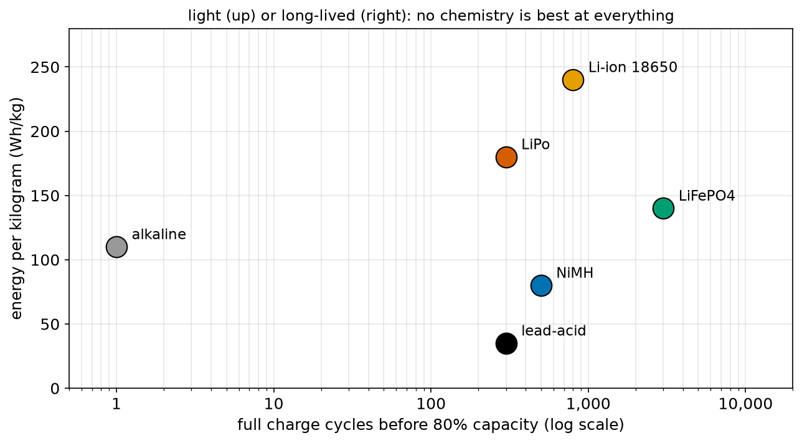
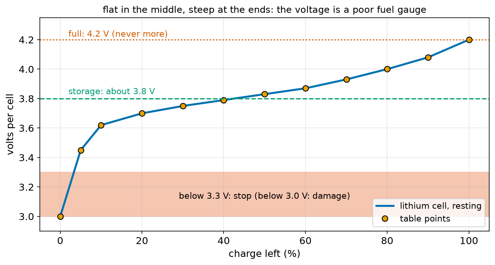
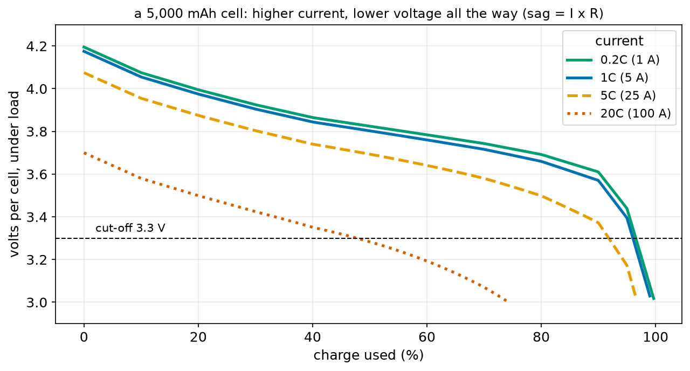
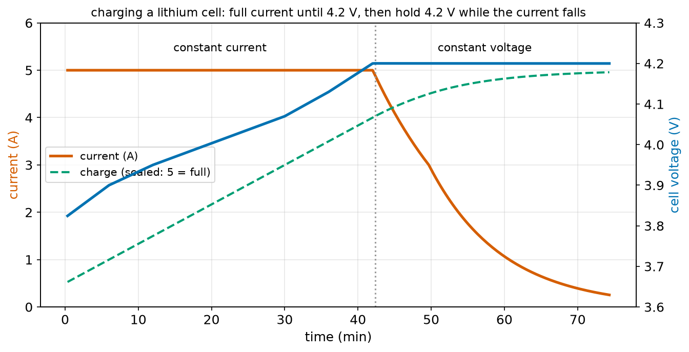
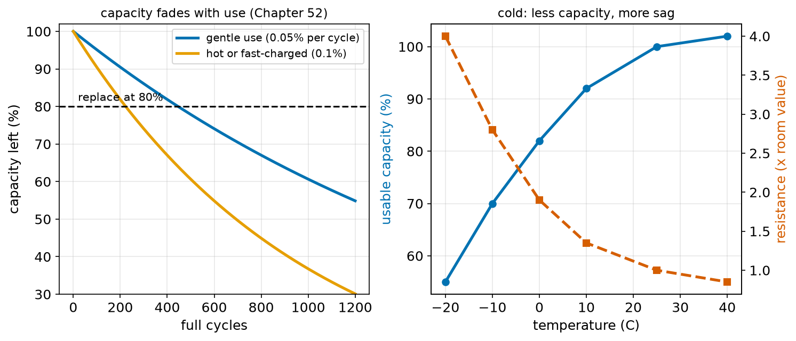
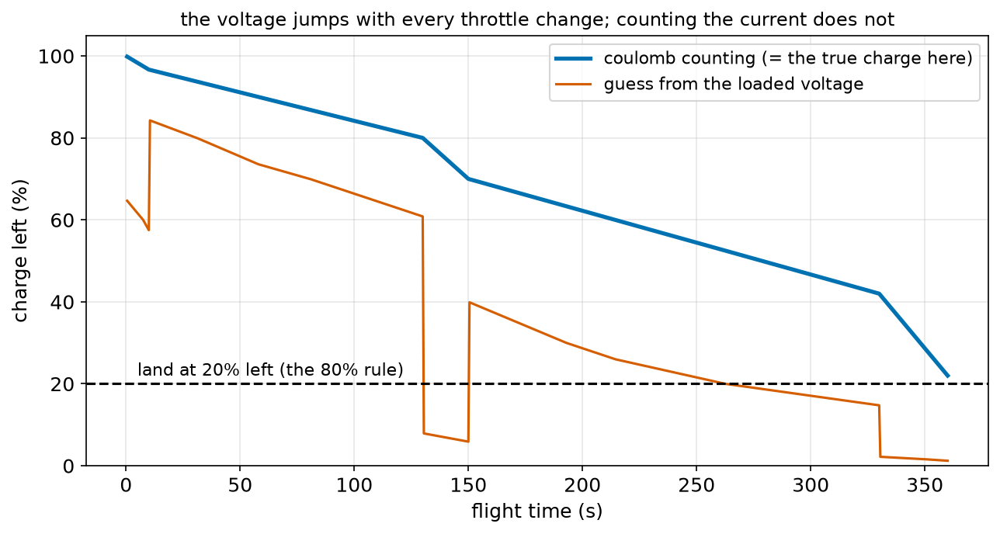

# Chapter 89 — Batteries: Types, Capacity, C Rating, Safety

> **Part 5 · Chapter 89 of 749**
> **You need:** Chapter 5 (Rover's battery and Wh = V × Ah), Chapter 7 (battery safety and thermal runaway), Chapter 52 (capacity loss as an exponential), Chapter 73 (mAh as charge), Chapter 74 (cells in series, nominal voltages), Chapter 75 (internal resistance), Chapter 76 (I² R heat), Chapter 77 (packs: S and P) and Chapter 81 (measuring internal resistance).
> **You will make:** a model of a lithium cell's voltage at every state of charge, a comparison of battery chemistries for Rover, a check of what a drone pack's C rating allows, a simulation of a lithium charger, and a flight-time gauge that counts coulombs.

---

## What you will learn

- What is inside a battery, and the main **chemistries** robots use: alkaline, **NiMH**, lead-acid, **Li-ion**, **LiPo**, **LiFePO₄**.
- What **capacity** (mAh), **energy** (Wh) and **energy density** (Wh/kg) mean, and why Wh = V × Ah.
- What the **C rating** says about current, and how **internal resistance** makes the voltage **sag**.
- Why a battery's voltage is a poor **fuel gauge**, and how **coulomb counting** does better.
- How lithium cells are **charged** (constant current, then constant voltage), **balanced** and **stored**.
- How batteries **age**, suffer in the **cold**, and why lithium batteries can catch fire, with the rules that prevent it.

---

## New words in this chapter

| Word | Simple meaning |
|---|---|
| **cell** | One single electrochemical unit, such as one AA or one 3.7 V lithium pouch. |
| **battery (pack)** | One or more cells joined together (Chapter 77). |
| **chemistry** | The materials inside a cell, which decide its voltage, energy and safety. |
| **capacity** | How much charge a battery holds, in mAh or Ah (Chapter 73). |
| **energy density** | Energy stored per kilogram (Wh/kg). |
| **state of charge (SoC)** | How full the battery is, from 0% (empty) to 100% (full). |
| **open-circuit voltage** | The voltage of a resting battery, with no current flowing. |
| **sag** | The fall in a battery's voltage while current flows: I × internal resistance. |
| **C rating** | Current expressed as a multiple of capacity: 1C empties the battery in one hour. |
| **cut-off voltage** | The voltage at which a cell must stop being discharged. |
| **coulomb counting** | Measuring the current many times a second and adding up the charge used. |
| **CC/CV charging** | Constant current, then constant voltage: how lithium cells are charged. |
| **balancing** | Making all the cells in a series pack equally full. |
| **BMS** | Battery management system: the electronics that watch and protect a pack. |
| **cycle** | One full discharge and recharge. |
| **thermal runaway** | A lithium cell heating itself uncontrollably until it vents and burns (Chapter 7). |

---

## 89.1 What a battery is

A **cell** turns chemical energy into electrical energy. Inside are two different materials (the **electrodes**) in a liquid or gel (the **electrolyte**). The chemistry pushes electrons out of one electrode, round the external circuit, and back into the other: that push is the cell's voltage (Chapter 74). Charging a rechargeable cell runs the chemistry backwards.

📖 **New words: cell and battery** — a cell is one unit; a battery (or pack) is several cells joined in series and parallel (Chapter 77). People often say "battery" for both.

📖 **New word: chemistry** — the materials inside. Each chemistry has its own voltage per cell, its own energy per kilogram, its own life, and its own dangers.



*Figure 89.1 — Six chemistries: energy per kilogram (up) against how many full cycles they last (right, log scale).*

**How to read this picture:** Higher is lighter for the same energy; further right lasts longer. Li-ion cells (such as 18650s) store the most energy per kilogram. LiFePO₄ lasts by far the longest. NiMH and lead-acid are heavy. Alkaline cells are not rechargeable (one "cycle"). LiPo sits below Li-ion in energy but above everything in the current it can deliver (the table in section 89.3).

| Chemistry | V per cell (nominal) | Wh/kg | Full cycles | Typical robot use |
|---|---|---|---|---|
| alkaline | 1.5 | 110 | 1 | remote controls, toys (not rechargeable) |
| **NiMH** | 1.2 | 80 | 500 | Rover, school robots: safe and forgiving |
| lead-acid | 2.0 | 35 | 300 | old warehouse robots, wheelchairs |
| **LiFePO₄** | 3.2 | 140 | 3,000 | warehouse AGVs, farm robots: very safe, long life |
| **Li-ion** (cylinders) | 3.6–3.7 | 240 | 800 | humanoids, robot vacuums, e-bikes |
| **LiPo** (pouches) | 3.7 | 180 | 300 | drones: enormous current |

🔢 **Maths.** Rover's 14.4 Wh (Chapter 5) weighs about 180 g as NiMH cells, 80 g as LiPo, 60 g as Li-ion. Rover uses NiMH anyway: they are cheap, safe to charge and do not catch fire when abused, which matters more for a first robot than 100 g.

---

## 89.2 Capacity and energy

📖 **New word: capacity** — how much charge a battery holds, in milliamp-hours (mAh) or amp-hours (Ah). Chapter 73 showed it is a count of coulombs: 1 mAh = 3.6 C.

Chapter 5 gave a rule to trust "until Chapter 89": **energy (Wh) = voltage (V) × capacity (Ah)**. Chapter 74 proved it: a volt is a joule per coulomb, so volts × coulombs = joules, and dividing by 3,600 gives watt-hours. The rule is exact if the voltage stays constant; in reality the voltage falls as the battery empties (section 89.4), so engineers use the **nominal** voltage, a typical middle value (Chapter 74).

📖 **New word: energy density** — energy per kilogram (Wh/kg). For mobile robots, which carry their battery around, it is often the most important number of all. Even the best lithium cells hold about 250 Wh/kg; petrol holds 12,000 Wh/kg. That is why battery robots and drones work for minutes or hours, not days.

📖 **New word: state of charge (SoC)** — how full the battery is: 100% full, 0% empty.

### The 80% rule

Earlier chapters used only 80% of a lithium battery's capacity (Chapters 4, 67, 73). Here is why. The last 10–20% of a lithium cell's charge comes out at a voltage that falls steeply (Figure 89.2), its internal resistance rises (more sag, section 89.4), and discharging below about 3.0 V per cell damages it permanently. Stopping at about 20% left keeps the cell healthy and leaves a reserve for the flight home. Charging to exactly 100% every time also ages lithium cells faster, so some robots stop at 90%.

---

## 89.3 The C rating: how fast

📖 **New word: C rating** — a current expressed as a multiple of the capacity. For a 5,000 mAh battery, **1C = 5 A** (it would empty in 1 hour), 2C = 10 A (30 minutes), 0.5C = 2.5 A (2 hours). A pack labelled "25C" may deliver up to 25 × 5 A = 125 A continuously.

```
time to empty ≈ 1 ÷ C-rate hours        maximum current = capacity × C rating
```

🔢 **Maths.** A drone hovering at 25 A from a 5,000 mAh pack is running at 5C: 1 ÷ 5 = 0.2 h = 12 minutes for the whole pack; 9.6 minutes with the 80% rule. Chapter 73 found the same 9.6 minutes by counting coulombs.

🔢 **Maths.** Rover's AA NiMH cells (2,000 mAh) at Rover's 0.53 A: 0.27C, about 3.8 hours (Chapter 73).

Different chemistries tolerate very different C rates: an alkaline AA struggles at 0.5C, NiMH manages 2–5C, Li-ion cylinders 3–10C, and racing-drone LiPo pouches 50–100C for seconds. Asking more than the rating gives heavy sag, heat and a short life.

---

## 89.4 Voltage, sag and the fuel-gauge problem

### The resting voltage

📖 **New word: open-circuit voltage** — the voltage of a battery that has rested for a while with no current flowing. For a lithium cell it ranges from 4.2 V (full) to 3.0 V (empty), but not in a straight line.



*Figure 89.2 — A lithium cell's resting voltage at each state of charge.*

**How to read this picture:** Between about 20% and 80%, the curve is quite flat: the voltage changes by only 0.3 V across 60% of the charge. Near the top it rises to 4.2 V, and near the bottom it plunges below 3.5 V. The shaded band below 3.3 V is where discharge must stop; below 3.0 V the cell is damaged. The dashed green line at 3.8 V is the storage voltage (section 89.6), which Chapter 7 gave.

📖 **New word: cut-off voltage** — the voltage at which discharge must stop: about 3.3 V per lithium cell under load (3.0 V absolute minimum), 1.0 V per NiMH cell.

### Sag under load

Chapter 75 measured Rover's battery's internal resistance (0.146 Ω, Chapter 81). Every battery has one, from its chemistry and its connections. While current flows, the battery's terminals show less than its resting voltage:

📖 **New word: sag** — the drop in a battery's voltage under load: **V_terminal = V_rest − I × R_internal**.



*Figure 89.3 — The voltage of one 5,000 mAh lithium cell while being emptied at four different currents.*

**How to read this picture:** Each curve shows the cell's voltage as charge is used. At 0.2C (1 A, green) the voltage is almost the resting voltage. At 5C (25 A, dashed orange) it is about 0.13 V lower all the way. At 20C (100 A, dotted red) it starts 0.5 V lower and crosses the 3.3 V cut-off when only about half the charge has been used: at very high currents, much of the capacity cannot be used at all, because the sag hits the cut-off first.

### Why the voltage is a poor fuel gauge

The program `lipo_model.py` (Code section) reads a cell's voltage under load and asks what state of charge it suggests:

```
a cell at 50% charge, under different currents (sag = I x R):
     0 A: 3.830 V -> a voltage-only estimate would say 50% charge left
    25 A: 3.705 V -> a voltage-only estimate would say 21% charge left
    60 A: 3.530 V -> a voltage-only estimate would say 7% charge left
```

The same half-full cell "reads" 50%, 21% or 7%, depending only on the throttle. A gauge based on voltage alone jumps around in flight and is useful only when the battery has rested.

📖 **New word: coulomb counting** — the better way. A current sensor (Chapter 75's shunt) measures the current many times a second; the controller adds up current × time (Chapter 73: charge = current × time) to know exactly how many mAh have been used. Phones, laptops, electric cars and drones all do this. Its weakness is slow drift from small measurement errors, so it is corrected with the resting voltage whenever the battery has been still for a while. Application 1 compares the two methods.

---

## 89.5 Charging lithium cells: CC/CV

A lithium cell must never be charged above 4.20 V (4.35 V for some "HV" cells). Above that, metallic lithium can form inside and the cell can catch fire. Lithium chargers therefore work in two phases.

📖 **New word: CC/CV charging** — **constant current** first: the charger pushes a fixed current (often 0.5C to 1C) and the cell's voltage rises. When the voltage reaches 4.20 V, the charger switches to **constant voltage**: it holds exactly 4.20 V, and the current falls by itself as the cell fills. Charging ends when the current has fallen to about C/20.



*Figure 89.4 — Current (red), voltage (blue) and charge (green, scaled) while a 5,000 mAh cell charges at 1C.*

**How to read this picture:** For the first 42 minutes the current stays at 5 A and the voltage creeps up. At 4.2 V the charger stops raising the voltage; from then on the current falls along a curve, and the last 20% of charge takes another half hour. The green line shows the charge: 80% after about 45 minutes, nearly full after 74.

Why does the current fall? With the voltage held at 4.2 V, only the difference between 4.2 V and the cell's rising resting voltage pushes current through the internal resistance (Ohm's law). As the cell fills, the difference shrinks.

NiMH cells (Rover's) are charged differently: at constant current, with the charger watching for a tiny voltage dip or a temperature rise that marks "full". Never charge NiMH cells on a lithium charger, or the other way round.

### Balancing

In a series pack, the same current flows through every cell (Chapter 77). If one cell has slightly less capacity, it fills first and empties first. Without care, it is over-charged at the top and over-discharged at the bottom, ages faster, and the gap grows with every cycle.

📖 **New word: balancing** — bringing every cell in a series pack to the same state of charge. Hobby lithium packs have a **balance connector** with one wire to each junction between cells (Chapter 81's pre-flight check used it), and a balance charger bleeds a little current from the fullest cells through resistors until all match.

📖 **New word: BMS** — battery management system: the electronics in a pack that measure every cell's voltage, the current (coulomb counting) and the temperature (Chapter 74's thermistor), balance the cells, and disconnect the pack with MOSFETs (Chapter 88) if anything goes out of limits. Every Li-ion pack in a humanoid, a robot vacuum or an e-bike has one.

---

## 89.6 Ageing, temperature and storage

📖 **New word: cycle** — one full discharge and recharge. Two half discharges count as one cycle.

Every cycle wears a cell a little: Chapter 52 modelled it as 0.05% of capacity lost per cycle, giving 80% capacity after about 446 cycles. Heat, fast charging and deep discharges speed it up.



*Figure 89.6 — Left: capacity left after each number of cycles, for gentle and harsh use. Right: usable capacity and internal resistance against temperature.*

**How to read this picture:** On the left, gentle use (blue) reaches the usual "replace at 80%" line after about 450 cycles; hot or fast-charged use (orange) after about 220. On the right, as the cell gets colder, its usable capacity falls (blue: 82% at 0 °C, 55% at −20 °C) and its internal resistance rises (red: four times higher at −20 °C), so it sags much more. Chapter 81's challenge to measure a cold battery shows exactly this.

### Storage

A lithium battery stored full ages fastest, especially when warm; stored empty, it can fall below the safe minimum as it slowly self-discharges. Store lithium batteries at about **3.8 V per cell** (about 50% charge), cool and dry, in a fire-resistant bag or box. NiMH cells can be stored at any charge but lose a few per cent a month by themselves ("low self-discharge" types much less).

---

## 89.7 Lithium safety

Chapter 7 introduced the danger. Now the reasons.

📖 **New word: thermal runaway** — inside a damaged, over-charged or over-heated lithium cell, a chemical reaction starts that releases heat. The heat speeds up the reaction, which makes more heat (Chapter 7's growing loop). In seconds the cell reaches several hundred degrees, vents flammable gas, and can burst into flames that are hard to put out. In a pack, one cell heats its neighbours and the fire spreads.

What starts it:

| Cause | What happens | Prevention |
|---|---|---|
| **over-charging** (above 4.2 V per cell) | lithium metal forms inside; short circuit between electrodes | a correct lithium charger, set to the right cell count; a BMS |
| **short circuit** | huge current (Chapter 75: a single cell can deliver over 100 A), I² R heat inside | fuse, insulated terminals, careful wiring |
| **physical damage** (crash, puncture, crushing) | the separator between electrodes is broken: an internal short | protective case; retire any puffed, dented or punctured pack |
| **over-discharge** then recharge | copper from the electrodes dissolves and forms internal shorts on recharge | cut-off voltage; never charge a pack that sat below 3.0 V per cell |
| **heat** | the reaction starts by itself above about 130–150 °C | keep away from heat; limit current (C rating) |

The rules for robots:

1. Charge only with a charger made for the chemistry, set to the right number of cells, **never unattended**, on a non-flammable surface or in a LiPo bag.
2. Never charge a cold (below 0 °C), hot, puffed or damaged pack.
3. Fuse every pack near its terminals (Chapter 7).
4. Respect the cut-off voltage and the C rating.
5. Store at about 3.8 V per cell, cool, in a fireproof container.
6. A pack that is swelling ("puffed") is generating gas: take it outside, away from anything that burns, and dispose of it properly.
7. If a lithium battery catches fire: get away, call for help; small packs can be smothered with sand or a lot of water from a distance, but the safe choice is to let professionals deal with it.

---

## Code

File `code/ch089/lipo_model.py`:

```python
# lipo_model.py - a simple model of one lithium cell: its resting voltage at each state of charge, and its sag
import numpy as np

# measured-style table: state of charge (0 = empty, 1 = full) -> resting ('open-circuit') voltage of one cell
SOC_POINTS = [0.00, 0.05, 0.10, 0.20, 0.30, 0.40, 0.50, 0.60, 0.70, 0.80, 0.90, 1.00]
OCV_POINTS = [3.00, 3.45, 3.62, 3.70, 3.75, 3.79, 3.83, 3.87, 3.93, 4.00, 4.08, 4.20]


def ocv(soc):
    """Resting voltage of one cell at a state of charge, by straight lines between the table's points (Chapter 43)."""
    return float(np.interp(soc, SOC_POINTS, OCV_POINTS))


def soc_from_ocv(v):
    """The reverse: state of charge from a resting voltage."""
    return float(np.interp(v, OCV_POINTS, SOC_POINTS))


if __name__ == "__main__":
    print(f"{'charge left':>12s} {'resting voltage':>16s}")
    for s in [1.0, 0.9, 0.8, 0.5, 0.2, 0.1, 0.05, 0.0]:
        print(f"{s:11.0%} {ocv(s):13.2f} V")
    print()
    r_cell = 0.005                 # a good 5,000 mAh drone cell: about 5 milliohms inside
    print("a cell at 50% charge, under different currents (sag = I x R):")
    for amps in [0, 5, 25, 60, 125]:
        v = ocv(0.5) - amps * r_cell
        print(f"  {amps:4d} A: {v:.3f} V -> a voltage-only estimate would say {soc_from_ocv(v):.0%} charge left")
```

| Line | Code | What it does (simple English) |
|---|---|---|
| 1 | `# lipo_model.py …` | A comment. |
| 2 | `import numpy as np` | For `np.interp`. |
| 3 | (blank) | Spacing. |
| 4 | `# measured-style table …` | A comment. |
| 5–6 | `SOC_POINTS`, `OCV_POINTS` | Twelve points of the curve in Figure 89.2: a typical lithium cell's resting voltage at each state of charge. |
| 7–8 | (blank) | Spacing. |
| 9 | `def ocv(soc):` | Resting voltage for any state of charge. |
| 10 | `"""…"""` | The docstring. |
| 11 | `return float(np.interp(soc, SOC_POINTS, OCV_POINTS))` | `np.interp` joins the table's points with straight lines and reads off the value in between (linear interpolation, Chapter 43). |
| 12–13 | (blank) | Spacing. |
| 14–16 | `def soc_from_ocv(v): …` | The same table read the other way round: voltage to charge. |
| 17–18 | (blank) | Spacing. |
| 19 | `if __name__ == "__main__":` | The demonstration runs only when this file is run directly; other programs import `ocv` from it (Chapter 26). |
| 20–22 | the first table | Resting voltage at eight states of charge. |
| 23 | `print()` | An empty line. |
| 24 | `r_cell = 0.005` | A drone cell's internal resistance. |
| 25 | `print(…)` | A heading. |
| 26 | `for amps in [ … ]:` | Five currents. |
| 27 | `v = ocv(0.5) - amps * r_cell` | The terminal voltage of a half-full cell: rest minus sag. |
| 28 | `print(…)` | What a gauge reading that voltage as if it were resting would say. |

Output:

```
 charge left  resting voltage
       100%          4.20 V
        90%          4.08 V
        80%          4.00 V
        50%          3.83 V
        20%          3.70 V
        10%          3.62 V
         5%          3.45 V
         0%          3.00 V

a cell at 50% charge, under different currents (sag = I x R):
     0 A: 3.830 V -> a voltage-only estimate would say 50% charge left
     5 A: 3.805 V -> a voltage-only estimate would say 44% charge left
    25 A: 3.705 V -> a voltage-only estimate would say 21% charge left
    60 A: 3.530 V -> a voltage-only estimate would say 7% charge left
   125 A: 3.205 V -> a voltage-only estimate would say 2% charge left
```

File `code/ch089/chemistries.py`:

```python
# chemistries.py - which battery chemistry for which robot? Energy per kilogram, life, power and safety
chem = [
    # name, nominal V per cell, Wh per kg, full cycles, max continuous discharge (C), rechargeable, notes
    ("alkaline (AA)", 1.5, 110, 1, 0.5, False, "cheap, one use, weak at high current"),
    ("NiMH (AA)", 1.2, 80, 500, 2, True, "safe and forgiving (Rover)"),
    ("lead-acid", 2.0, 35, 300, 1, True, "heavy, cheap, old warehouse robots"),
    ("LiFePO4", 3.2, 140, 3000, 3, True, "very safe, long life: AGVs, farm robots"),
    ("Li-ion (18650)", 3.6, 240, 800, 3, True, "high energy: laptops, e-bikes, humanoids"),
    ("LiPo (pouch)", 3.7, 180, 300, 50, True, "huge current: drones"),
]
print(f"{'chemistry':16s} {'V/cell':>7s} {'Wh/kg':>6s} {'cycles':>7s} {'max C':>6s}  notes")
for name, v, whkg, cycles, c, rech, note in chem:
    print(f"{name:16s} {v:7.1f} {whkg:6d} {cycles:7d} {c:6.1f}  {note}")

print()
print("mass of a 14.4 Wh battery (Rover's) in each chemistry, cells only:")
for name, v, whkg, *_ in chem:
    print(f"  {name:16s} {14.4 / whkg * 1000:5.0f} g")
```

| Line | Code | What it does (simple English) |
|---|---|---|
| 1 | `# chemistries.py …` | A comment. |
| 2–10 | `chem = [ … ]` | Typical values for six chemistries (real cells vary). |
| 11 | `print(…)` | The header. |
| 12–13 | `for … in chem: print(…)` | One row each. |
| 14 | (blank) | Spacing. |
| 15–16 | `print()`, `print(…)` | A heading. |
| 17 | `for name, v, whkg, *_ in chem:` | `*_` collects the remaining items of each tuple, which we do not need (Chapter 22's unpacking). |
| 18 | `print(…)` | Mass = energy ÷ energy per kilogram. |

Output:

```
chemistry         V/cell  Wh/kg  cycles  max C  notes
alkaline (AA)        1.5    110       1    0.5  cheap, one use, weak at high current
NiMH (AA)            1.2     80     500    2.0  safe and forgiving (Rover)
lead-acid            2.0     35     300    1.0  heavy, cheap, old warehouse robots
LiFePO4              3.2    140    3000    3.0  very safe, long life: AGVs, farm robots
Li-ion (18650)       3.6    240     800    3.0  high energy: laptops, e-bikes, humanoids
LiPo (pouch)         3.7    180     300   50.0  huge current: drones

mass of a 14.4 Wh battery (Rover's) in each chemistry, cells only:
  alkaline (AA)      131 g
  NiMH (AA)          180 g
  lead-acid          411 g
  LiFePO4            103 g
  Li-ion (18650)      60 g
  LiPo (pouch)        80 g
```

---

## Small examples

**Example 1.** A 3S 2,200 mAh LiPo: 11.1 V × 2.2 Ah = 24.4 Wh.

**Example 2.** Its 30C rating: 66 A maximum.

**Example 3.** A robot drawing 4 A from it runs at 1.8C: about 33 minutes to empty, 26 minutes with the 80% rule.

**Example 4.** Four cells of 3.7 V, 3,000 mAh in 4S1P: 14.8 V, 3 Ah, 44.4 Wh. In 2S2P: 7.4 V, 6 Ah, 44.4 Wh (Chapter 77).

**Example 5.** A cell rests at 3.95 V: about 73% full (Figure 89.2). Under 20 A with 10 mΩ inside, it shows 3.75 V and looks 30% full.

**Example 6.** Charging a 2,000 mAh cell at 0.5C: 1 A for the constant-current phase, about 1.5–2 hours in total.

**Example 7.** After 300 gentle cycles: 0.9995³⁰⁰ = 86% of the original capacity.

**Example 8.** A pack stored at 4.2 V per cell and 40 °C ages several times faster than one stored at 3.8 V and 15 °C.

---

## 🏭 Real robot applications

### Application 1 (worked in full) — 🚁 Knowing when to land

**1. The real problem.** A survey drone flies on a 4S 5,000 mAh 25C LiPo. Its flight is uneven: take-off, cruising, climbs, a full-throttle burst against wind. The pilot needs a reliable "time to land" warning when 80% of the charge has been used. Should the drone judge it from the pack's voltage or count the coulombs? And does the flight stay inside the pack's C rating?

**2. Why this theory.** C rating × capacity gives the current limit; I × R gives the sag and I² R the heat in the pack. The voltage under load depends on the current (sag), so it misleads; the charge used is the sum of current × time, which does not.

**3. The numbers.** 5.0 Ah, 25C (125 A), 4 cells of 5 mΩ = 20 mΩ. Flight: 10 s at 60 A, 120 s at 25 A, 20 s at 90 A, 180 s at 28 A, 30 s at 120 A. The flight controller measures every 0.1 s.

**4. The maths.** At full throttle (120 A, 24C): sag 120 × 0.020 = 2.4 V, heat 120² × 0.020 = 288 W inside the pack. Charge used: (10 × 60 + 120 × 25 + 20 × 90 + 180 × 28 + 30 × 120) ÷ 3.6 = 3,900 mAh: 78% of the pack.

**5. The code.** File `code/ch089/c_rating.py` checks the current, sag and heat:

```python
# c_rating.py - what does '5000 mAh 25C' promise? Current limit, sag and heat for a drone pack
from lipo_model import ocv

CAPACITY_AH = 5.0
C_RATING = 25
CELLS = 4
R_CELL = 0.005            # 5 milliohms per cell when new

max_a = CAPACITY_AH * C_RATING
r_pack = CELLS * R_CELL
print(f"{CAPACITY_AH * 1000:.0f} mAh, {C_RATING}C: up to {max_a:.0f} A continuous; pack resistance {r_pack * 1000:.0f} milliohms")
print(f"{'situation':22s} {'amps':>6s} {'C':>6s} {'pack voltage':>13s} {'sag':>7s} {'heat in pack':>13s}")
for name, amps in [("hover", 25), ("climbing", 60), ("full throttle", 120), ("short burst", 150)]:
    v = CELLS * ocv(0.5) - amps * r_pack            # half-charged pack under load
    heat = amps ** 2 * r_pack
    flag = "  (over the rating!)" if amps > max_a else ""
    print(f"{name:22s} {amps:6d} {amps / CAPACITY_AH:5.0f}C {v:10.2f} V {amps * r_pack:5.2f} V {heat:10.0f} W{flag}")
print()
print("hover time from the C rate: 1 / 5C = 0.2 h = 12 min for the whole pack; with the 80% rule, about 9.6 min")
```

| Line | Code | What it does (simple English) |
|---|---|---|
| 1 | `# c_rating.py …` | A comment. |
| 2 | `from lipo_model import ocv` | The resting-voltage curve. |
| 3 | (blank) | Spacing. |
| 4–7 | `CAPACITY_AH` … `R_CELL` | The pack. |
| 8 | (blank) | Spacing. |
| 9 | `max_a = CAPACITY_AH * C_RATING` | The C rating's promise. |
| 10 | `r_pack = CELLS * R_CELL` | Four cells in series: their resistances add (Chapter 77). |
| 11–12 | `print(…)` | The pack and the header. |
| 13 | `for name, amps in [ … ]:` | Four flight situations. |
| 14 | `v = CELLS * ocv(0.5) - amps * r_pack` | A half-full pack's voltage under that current. |
| 15 | `heat = amps ** 2 * r_pack` | I² R inside the pack (Chapter 76). |
| 16 | `flag = …` | A warning above the rating. |
| 17 | `print(…)` | The row; `amps / CAPACITY_AH` is the C rate. |
| 18–19 | `print()`, `print(…)` | The hover time. |

Output:

```
5000 mAh, 25C: up to 125 A continuous; pack resistance 20 milliohms
situation                amps      C  pack voltage     sag  heat in pack
hover                      25     5C      14.82 V  0.50 V         12 W
climbing                   60    12C      14.12 V  1.20 V         72 W
full throttle             120    24C      12.92 V  2.40 V        288 W
short burst               150    30C      12.32 V  3.00 V        450 W  (over the rating!)

hover time from the C rate: 1 / 5C = 0.2 h = 12 min for the whole pack; with the 80% rule, about 9.6 min
```

File `code/ch089/coulomb_count.py` compares the two gauges during the flight:

```python
# coulomb_count.py - two ways for a drone to know how much battery is left during a flight
from lipo_model import ocv, soc_from_ocv

CAPACITY_MAH = 5000.0
CELLS = 4
R_PACK = 0.020
DT = 0.1                                   # the flight controller measures 10 times a second

# a flight plan: (seconds, current in A)
plan = [(10, 60), (120, 25), (20, 90), (180, 28), (30, 120)]

soc, used_mah, t = 1.0, 0.0, 0.0
print(f"{'time':>6s} {'current':>8s} {'true charge':>12s} {'coulomb count':>14s} {'from voltage':>13s}")
for seconds, amps in plan:
    for _ in range(int(seconds / DT)):
        used_mah += amps * DT / 3.6        # A x s = coulombs; / 3.6 = mAh (Chapter 74)
        soc -= amps * DT / 3600 / (CAPACITY_MAH / 1000)
        t += DT
    v_pack = CELLS * ocv(soc) - amps * R_PACK
    guess_v = soc_from_ocv(v_pack / CELLS)          # naive: read the loaded voltage as if it were resting
    count = 1 - used_mah / CAPACITY_MAH
    print(f"{t:5.0f}s {amps:6d} A {soc:11.1%} {count:13.1%} {guess_v:12.1%}")
print(f"used {used_mah:.0f} mAh of {CAPACITY_MAH:.0f}; the 80% rule allows {0.8 * CAPACITY_MAH:.0f} mAh: time to land")
```

| Line | Code | What it does (simple English) |
|---|---|---|
| 1 | `# coulomb_count.py …` | A comment. |
| 2 | `from lipo_model import ocv, soc_from_ocv` | The curve, both ways. |
| 3 | (blank) | Spacing. |
| 4–7 | `CAPACITY_MAH`, `CELLS`, `R_PACK`, `DT` | The pack and the measuring interval. |
| 8 | (blank) | Spacing. |
| 9–10 | `plan = [ … ]` | The flight: (seconds, amps) for each part. |
| 11 | (blank) | Spacing. |
| 12 | `soc, used_mah, t = 1.0, 0.0, 0.0` | Full at take-off. |
| 13 | `print(…)` | The header. |
| 14 | `for seconds, amps in plan:` | Each part of the flight. |
| 15 | `for _ in range(int(seconds / DT)):` | Every 0.1 s. |
| 16 | `used_mah += amps * DT / 3.6` | Coulomb counting: current × time, in mAh. |
| 17 | `soc -= …` | The true state of charge (in this simulation, the same calculation). |
| 18 | `t += DT` | The clock. |
| 19 | `v_pack = CELLS * ocv(soc) - amps * R_PACK` | The voltage the pack shows under load. |
| 20 | `guess_v = soc_from_ocv(v_pack / CELLS)` | A naive gauge: read the loaded voltage per cell as if it were resting. |
| 21 | `count = 1 - used_mah / CAPACITY_MAH` | The coulomb counter's answer. |
| 22 | `print(…)` | The row at the end of each part. |
| 23 | `print(…)` | The verdict. |

Output:

```
  time  current  true charge  coulomb count  from voltage
   10s     60 A       96.7%         96.7%        57.5%
  130s     25 A       80.0%         80.0%        60.8%
  150s     90 A       70.0%         70.0%         5.9%
  330s     28 A       42.0%         42.0%        14.7%
  360s    120 A       22.0%         22.0%         1.2%
used 3900 mAh of 5000; the 80% rule allows 4000 mAh: time to land
```



*Figure 89.5 — The charge left during the flight, by counting coulombs (blue) and by reading the loaded voltage (red).*

**How to read this picture:** The blue line falls steadily, faster when the current is high. The red line jumps down every time the throttle goes up (more sag) and up again when it goes down. A voltage-based gauge would have called "land now" after 2 minutes and then changed its mind; the coulomb counter gives the right answer: land after 6 minutes with 22% left.

**6. The result.** Every part of the flight stays within the pack's 25C rating (the full-throttle burst reaches 24C), but that burst heats the pack by 288 W, so it must be short. The coulomb counter shows 78% used, so the drone should land now. A voltage-only gauge would be useless in flight: it reads 1.2% during the burst and 60% while cruising. Real flight controllers do exactly this coulomb counting, and use the resting voltage on the ground to set the starting point. (In this simulation the count is perfect; a real current sensor's 1–2% error makes it drift slowly, which is why it is reset at every landing.)

**7. Going further.** As packs age, their internal resistance rises (more sag) and their capacity falls (fewer real mAh than the label says); smart chargers measure both, and flight controllers can be told the real capacity. Chapter 621 covers drone LiPos in full, and Chapter 151 builds Rover's power budget with these ideas.

### Application 2 (worked in full) — 🏥 Charging a hospital robot at its dock

**1. The real problem.** A delivery robot carries medicines between hospital wards all day on a 10 Ah lithium pack. Between jobs it docks to charge. The hospital wants to know how long a full charge takes from 10%, and how much it can recover in a 15-minute break. Chapter 78's simple dock could not even reach full charge; real chargers use CC/CV.

**2. Why this theory.** In the constant-current phase, the charge rises at the charging current (mAh per hour = mA). In the constant-voltage phase, the current is (4.2 − V_rest) ÷ R, which shrinks as the cell fills. Simulating both phases in steps (Chapter 71) gives the time.

**3. The numbers.** For one 5,000 mAh cell (the pack is two in parallel, which charge the same way at twice the current): 1C = 5 A in CC; 4.20 V in CV; charging path resistance 0.040 Ω (the cell plus wires, connector and charger leads); stop at C/20 = 0.25 A; start at 10%.

**4. The maths.** CC phase: from 10% the cell gains 5 A ÷ 5 Ah = 100% per hour, 1.67% a minute, until its terminal voltage (rest + 5 A × 0.04 Ω = rest + 0.2 V) reaches 4.2 V, which happens when the resting voltage is 4.0 V, at about 80%: after about 42 minutes. Then the current falls.

**5. The code.** File `code/ch089/cc_cv_charge.py`:

```python
# cc_cv_charge.py - how a charger fills a lithium cell: constant current, then constant voltage
from lipo_model import ocv

CAPACITY_AH = 5.0
R_CELL = 0.040              # charging path: the cell, its wires, the connector and the charger's leads
I_CHARGE = 5.0              # 1C
V_MAX = 4.20                # never above this
I_STOP = CAPACITY_AH / 20   # finish when the current has fallen to C/20 (0.25 A)
DT = 1.0                    # seconds

soc, t, phase = 0.10, 0.0, "CC"
log = []
while True:
    if phase == "CC":
        i = I_CHARGE
        if ocv(soc) + i * R_CELL >= V_MAX:      # the terminal voltage has reached 4.2 V: switch to constant voltage
            phase = "CV"
    if phase == "CV":
        i = (V_MAX - ocv(soc)) / R_CELL         # hold 4.2 V: the current is whatever that voltage pushes through
        if i <= I_STOP:
            break
    soc = min(soc + i * DT / 3600 / CAPACITY_AH, 1.0)
    t += DT
    if int(t) % 300 == 0:
        log.append((t / 60, phase, i, ocv(soc) + i * R_CELL, soc))

for minutes, ph, i, v, s in log:
    print(f"{minutes:5.0f} min  {ph}  current {i:4.2f} A  terminal {v:.3f} V  charge {s:5.1%}")
print(f"finished after {t / 60:.0f} min at {soc:.1%}")
```

| Line | Code | What it does (simple English) |
|---|---|---|
| 1 | `# cc_cv_charge.py …` | A comment. |
| 2 | `from lipo_model import ocv` | The cell's resting voltage. |
| 3 | (blank) | Spacing. |
| 4–9 | `CAPACITY_AH` … `DT` | The cell, the charging path's resistance, the two charging limits and the step. |
| 10 | (blank) | Spacing. |
| 11 | `soc, t, phase = 0.10, 0.0, "CC"` | Start at 10%, in constant current. |
| 12 | `log = []` | Rows to print. |
| 13 | `while True:` | Until charging ends (`break`). |
| 14–17 | the CC branch | Push 5 A; if the terminal voltage (rest + I R) has reached 4.2 V, switch to CV. |
| 18–21 | the CV branch | Hold 4.2 V: the current is the voltage difference ÷ R. Stop at C/20. |
| 22 | `soc = min(soc + i * DT / 3600 / CAPACITY_AH, 1.0)` | Add the charge of this second. |
| 23 | `t += DT` | The clock. |
| 24–25 | `if int(t) % 300 == 0: log.append(…)` | Every 5 minutes, record a row. |
| 26 | (blank) | Spacing. |
| 27–28 | the printing loop | The rows. |
| 29 | `print(…)` | The total time. |

Output:

```
    5 min  CC  current 5.00 A  terminal 3.887 V  charge 18.3%
   10 min  CC  current 5.00 A  terminal 3.933 V  charge 26.7%
   15 min  CC  current 5.00 A  terminal 3.970 V  charge 35.0%
   20 min  CC  current 5.00 A  terminal 4.003 V  charge 43.3%
   25 min  CC  current 5.00 A  terminal 4.037 V  charge 51.7%
   30 min  CC  current 5.00 A  terminal 4.070 V  charge 60.0%
   35 min  CC  current 5.00 A  terminal 4.120 V  charge 68.3%
   40 min  CC  current 5.00 A  terminal 4.177 V  charge 76.7%
   45 min  CV  current 4.10 A  terminal 4.200 V  charge 84.5%
   50 min  CV  current 2.90 A  terminal 4.200 V  charge 90.3%
   55 min  CV  current 1.76 A  terminal 4.200 V  charge 94.1%
   60 min  CV  current 1.07 A  terminal 4.200 V  charge 96.4%
   65 min  CV  current 0.65 A  terminal 4.200 V  charge 97.8%
   70 min  CV  current 0.39 A  terminal 4.200 V  charge 98.7%
finished after 74 min at 99.2%
```

**6. The result.** A full charge from 10% takes about 74 minutes, but 80% is reached in about 43 minutes, and the last 20% takes another half hour. A 15-minute break recovers 25% of the pack (from 10% to 35%), almost two hours of light work. So the hospital plans "opportunity charging": the robot docks for 10–20 minutes whenever it is idle and never needs a long charge during the day, and the last slow 20% is skipped, which also helps the cells live longer.

**7. Going further.** The charging path's resistance matters: halving it (better connectors, Chapter 80) lengthens the fast CC phase. Some robots charge at 2C for the first part and accept shorter battery life in exchange. Chapter 90 shows how a charger produces its controlled current and voltage, and Chapter 151 plans a robot's charging schedule.

### Application 3 — 🚀 Keeping batteries warm on Mars

Figure 89.6 shows that lithium cells lose capacity and gain resistance in the cold, and must not be charged below 0 °C at all. Martian nights fall below −80 °C. NASA's rovers therefore keep their lithium-ion batteries inside an insulated "warm box", with electric heaters (Chapter 76's V² ÷ R) controlled by thermostats, and use waste heat from the radioisotope generator (Chapter 76, Application 4) to help. The heaters themselves use battery energy, so mission planners trade heating against driving every day. A rover that let its batteries freeze would lose them permanently.

### Application 4 — 🦿 A humanoid's 13S pack and its BMS

A full-size humanoid carries a 13S Li-ion pack (48.1 V nominal, Chapter 74), often 13S6P: 78 cylindrical cells. Its BMS measures all 13 series voltages, the pack current and several temperatures many times a second, balances the cells at the top of each charge, and opens its disconnect MOSFETs (Chapter 88) within microseconds if a cell goes above 4.2 V or below 3.0 V, if the current exceeds the limit (a fall can short a damaged cable), or if a cell passes 60 °C. It also reports the state of charge, by coulomb counting, to the robot's computer, which plans its tasks around it. A humanoid that ran its pack below the cut-off in the middle of a step would simply fall.

### Application 5 — 🏭 LiFePO₄ in warehouse and farm robots

Warehouse AGVs (Chapter 4) and farm robots often choose LiFePO₄ cells, despite their lower energy per kilogram (140 Wh/kg against 240). The reasons are in Figure 89.1 and the safety table: they last about 3,000 cycles (charged several times a day, a robot can use 1,500 cycles a year), and their chemistry does not release oxygen when overheated, so thermal runaway is far less violent. Their nominal voltage is 3.2 V per cell (3.65 V full, 2.5 V empty), so a "24 V" robot pack is 8S, and their very flat voltage curve makes coulomb counting even more necessary than for other lithium cells.

---

## 🔧 Hands-on lab

### Lab 89.1 — Read battery labels (no tools)

Find five batteries: an AA, a phone or power bank, a laptop (label on the battery or charger), a drone or RC pack if you have one, and a car battery if possible.

1. Write down each one's chemistry, voltage, capacity and (if shown) C rating or Wh.
2. Work out the missing numbers: Wh from V × Ah, Ah from Wh ÷ V, maximum current from the C rating.
3. Weigh the small ones on a kitchen scale and work out their energy density in Wh/kg.

**What you should see:** A phone cell: 3.85 V, about 4,000 mAh, 15 Wh, about 60 g: 250 Wh/kg. An alkaline AA: about 1.5 V × 2.5 Ah = 3.75 Wh in 23 g: about 160 Wh/kg when drained slowly (less at high current). A 3S 2,200 mAh 30C LiPo: 24.4 Wh, 66 A maximum, about 180 g: 135 Wh/kg (the wires, case and connector count too). The heaviest per Wh is the car battery (lead-acid, about 35 Wh/kg).

| If it does not work | Likely cause | Fix |
|---|---|---|
| The power bank's Wh does not equal its "5 V" × mAh | Its mAh is rated at the cell's 3.7 V (Chapter 74) | Use 3.7 V |
| A label shows only Wh | Common on laptop and drone packs (for air travel rules) | Ah = Wh ÷ V |

**Challenge:** Airlines allow lithium batteries up to 100 Wh in cabin luggage. Which of your batteries would need special permission?

### Lab 89.2 — The voltage gauge problem, measured (hardware)

You need: Rover's NiMH pack or 4 × AA rechargeables, the multimeter, a power resistor (10 Ω, 5 W), and a few hours.

1. Charge the pack fully. Let it rest for an hour and measure its open-circuit voltage.
2. Connect the 10 Ω load. Every 15 minutes, measure the voltage under load, disconnect the load for 2 minutes, and measure the resting voltage.
3. Stop when the voltage under load reaches 1.0 V per cell.
4. Plot both voltages against time. Count the mAh used (current ≈ voltage ÷ 10 Ω, times time).

**What you should see:** Both curves fall slowly and steadily for most of the time, then drop sharply near the end, like Figure 89.2. The loaded voltage is a steady 0.05–0.1 V below the resting one (I × R_internal, Chapter 81). The NiMH curve is even flatter than lithium in the middle, so its voltage tells you even less about the charge left. The total charge used should be close to the label's capacity (about 2,000 mAh for good AA NiMH cells at this gentle 0.35C).

| If it does not work | Likely cause | Fix |
|---|---|---|
| The capacity is far below the label | Old cells, or not fully charged | Try new cells; charge with a proper NiMH charger |
| The resistor gets very hot | 10 Ω on 4.8–7.2 V is 2.3–5.2 W | Use a 10 W resistor, or 22 Ω |

**Challenge:** Repeat with the pack at 5 °C (in a refrigerator, sealed in a bag). How much capacity is lost, and how much bigger is the sag?

### Lab 89.3 — Design a flight (simulation)

Copy `coulomb_count.py` and `c_rating.py` (with `lipo_model.py` in the same folder).

1. Add a current sensor error: the measured current is 3% higher than the true one. How far apart are the coulomb count and the true charge after the flight?
2. Find how long the drone may hover at 25 A after take-off (10 s at 60 A) before reaching 80% used.
3. Change the pack to 6S 5,000 mAh (same cells). The same power needs less current: hover at 25 × 4 ÷ 6 = 16.7 A. How long may it hover now, and how much does the pack's I² R heat fall?

**What you should see:** With a 3% sensor error, the count reads 3% more used than reality (about 3.9 points out of 78): a safe error, because it lands a little early; a sensor that read low would be dangerous. Hover time: (4,000 − 167) mAh ÷ 25 A × 3.6 = 552 s = 9.2 minutes. With 6S, the pack holds 1.5 times the energy, hover at 16.7 A lasts about 13.8 minutes, and the pack's heat at hover falls from 12.5 W to 16.7² × 0.030 = 8.3 W.

| If it does not work | Likely cause | Fix |
|---|---|---|
| The error makes the count read LESS used | The error was applied to the true charge instead of the measurement | Multiply only the measured current |

**Challenge:** Add a resting-voltage correction: whenever the current is under 2 A for 10 seconds, reset the coulomb count to the resting-voltage estimate. Does it remove the drift?

---

## Common mistakes

⚠️ **Believing the voltage under load is the charge left.** Sag makes it read low; use coulomb counting or a rested voltage.

⚠️ **Running lithium cells below the cut-off.** Below 3.0 V per cell they are damaged; do not recharge a cell that has been there.

⚠️ **Charging lithium cells with the wrong charger or cell count.** Over-charging starts fires. Never leave a charging lithium pack unattended.

⚠️ **Ignoring the C rating.** Above it, the pack sags, overheats and ages fast.

⚠️ **Storing lithium packs full** (or empty). Store at about 3.8 V per cell, cool.

⚠️ **Charging below 0 °C.** It damages lithium cells permanently.

⚠️ **Using a puffed or damaged pack.** It is already failing.

⚠️ **Mixing old and new cells, or different types, in one pack.** The weakest cell decides, and it is over-stressed.

---

## Practice

🏋️ **1.** A 2S 1,500 mAh LiPo: find its nominal voltage, full voltage, cut-off voltage and energy.

🏋️ **2.** That pack is rated 40C. What is its maximum continuous current?

🏋️ **3.** A robot draws 3 A from a 6,000 mAh pack. What C rate is that, and how long does 80% of the pack last?

🏋️ **4.** A cell rests at 3.70 V (Figure 89.2). About how full is it? Under 30 A with 6 mΩ inside, what would it show?

🏋️ **5.** Why does a lithium charger switch from constant current to constant voltage?

🏋️ **6.** A pack loses 0.08% of capacity per cycle. After how many cycles is it at 80%? (Chapter 52.)

🏋️ **7.** A 4S pack reads 15.2 V at rest. What is the average cell voltage, and roughly how full is it?

🏋️ **8.** A 3.7 V, 2,500 mAh Li-ion cell weighs 46 g. What is its energy density?

🏋️ **9.** A robot uses 1,200 mAh in 40 minutes. What is its average current?

🏋️ **10.** Give three reasons a lithium cell can go into thermal runaway, and one prevention for each.

🏋️ **11.** Write `flight_time(capacity_mah, usable, segments)` that takes a list of (current_A, seconds) segments, returns how many seconds the drone can fly before reaching the usable limit (stopping part way through a segment if needed), and test it with 5,000 mAh, 0.8 and the flight plan of Application 1 repeated twice.

---

## Answers

**1.** Nominal 7.4 V, full 8.4 V, cut-off about 6.6 V (6.0 V absolute minimum). Energy 7.4 × 1.5 = 11.1 Wh.

**2.** 1.5 × 40 = 60 A.

**3.** 3 ÷ 6 = 0.5C. 80% of 6 Ah = 4.8 Ah, ÷ 3 A = 1.6 h = 96 minutes.

**4.** About 20% (3.70 V on the table). Under 30 A: 3.70 − 0.18 = 3.52 V, which a voltage gauge would read as about 7%.

**5.** Above 4.2 V the cell is damaged and can catch fire. Once the terminal voltage reaches 4.2 V, the charger must stop raising it; it holds 4.2 V and lets the current fall as the cell fills.

**6.** n = ln(0.8) ÷ ln(0.9992) = 279 cycles.

**7.** 15.2 ÷ 4 = 3.80 V: about 42% (between 3.79 V at 40% and 3.83 V at 50%).

**8.** 3.7 × 2.5 = 9.25 Wh ÷ 0.046 kg = 201 Wh/kg.

**9.** 1,200 mAh ÷ (40 ÷ 60) h = 1,800 mA = 1.8 A.

**10.** Any three, for example: over-charging (a correct charger and a BMS); short circuit (a fuse, insulated terminals); physical damage (a protective case, retire damaged packs); over-heating (limit current, keep away from heat); recharging after over-discharge (respect the cut-off, never charge a pack below 3.0 V per cell).

**11.**

```python
def flight_time(capacity_mah, usable, segments):
    limit = capacity_mah * usable
    used, t = 0.0, 0.0
    for amps, seconds in segments:
        need = amps * seconds / 3.6
        if used + need >= limit:
            return t + (limit - used) * 3.6 / amps
        used += need
        t += seconds
    return t

plan = [(60, 10), (25, 120), (90, 20), (28, 180), (120, 30)]
print(f"{flight_time(5000, 0.8, plan * 2):.1f} s")
```

```
366.0 s
```

The first pass of the plan uses 3,900 mAh in 360 s. The second pass starts with 60 A, and only 100 mAh remain before the 4,000 mAh limit: 100 × 3.6 ÷ 60 = 6 s. So the drone may fly 366 s.

---

## Summary

🧠 A battery's **chemistry** sets its voltage per cell, its **energy density** (Wh/kg), its life in **cycles**, the current it can give and its safety. NiMH is forgiving, Li-ion is light, LiPo gives huge currents, LiFePO₄ lasts and is safe.

🧠 **Capacity** (mAh) is charge; **energy** (Wh) = nominal V × Ah. Use about **80%** of a lithium battery.

🧠 The **C rating**: 1C empties the battery in an hour; maximum current = capacity × C rating.

🧠 Under load the voltage **sags** by I × R_internal. The resting voltage curve is flat in the middle and steep at the ends, so the **voltage is a poor fuel gauge**; **coulomb counting** adds up current × time.

🧠 Lithium cells charge by **CC/CV**: constant current to 4.20 V, then constant voltage while the current falls. Series packs need **balancing**; a **BMS** watches and protects them.

🧠 Batteries **age** with cycles, heat and fast charging; in the **cold** they lose capacity and sag more. Store lithium at about **3.8 V per cell**.

🧠 **Thermal runaway** comes from over-charging, short circuits, damage, over-discharge and heat. Correct charger, fuse, cut-off, C rating, careful storage, and never charge unattended.

---

## Next chapter

Chapter 90 turns a battery's changing voltage into the steady voltages a robot's electronics need. You will compare **linear regulators** (simple, but they turn the extra voltage into heat) with **switching regulators** (buck and boost converters, which use an inductor and a MOSFET to waste almost nothing), and finally give Rover's Raspberry Pi the power supply Chapter 77 said it needs.
