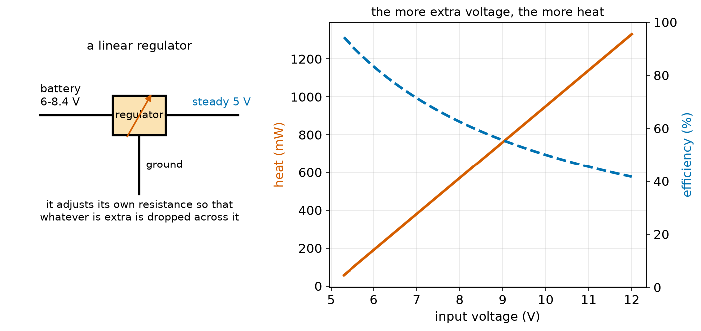
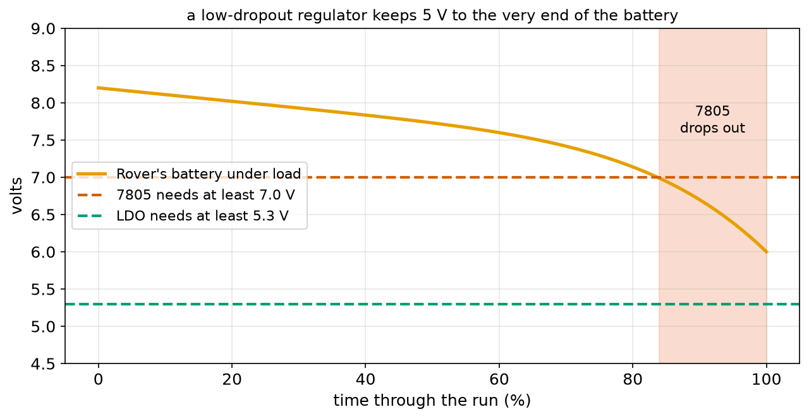
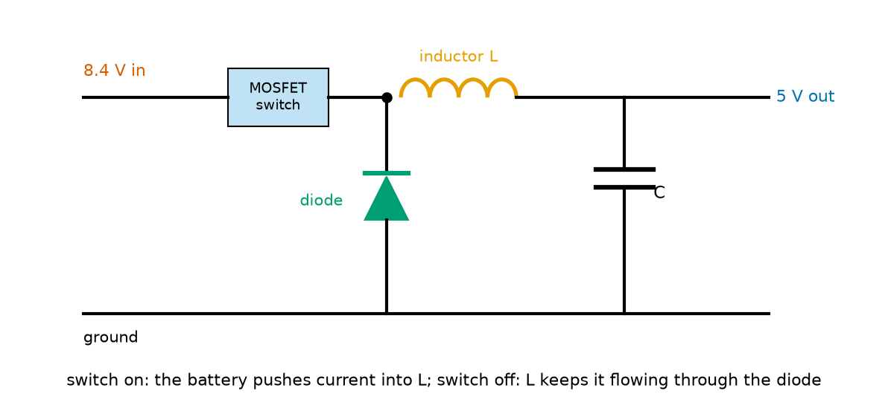
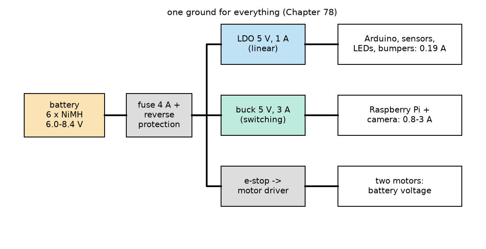
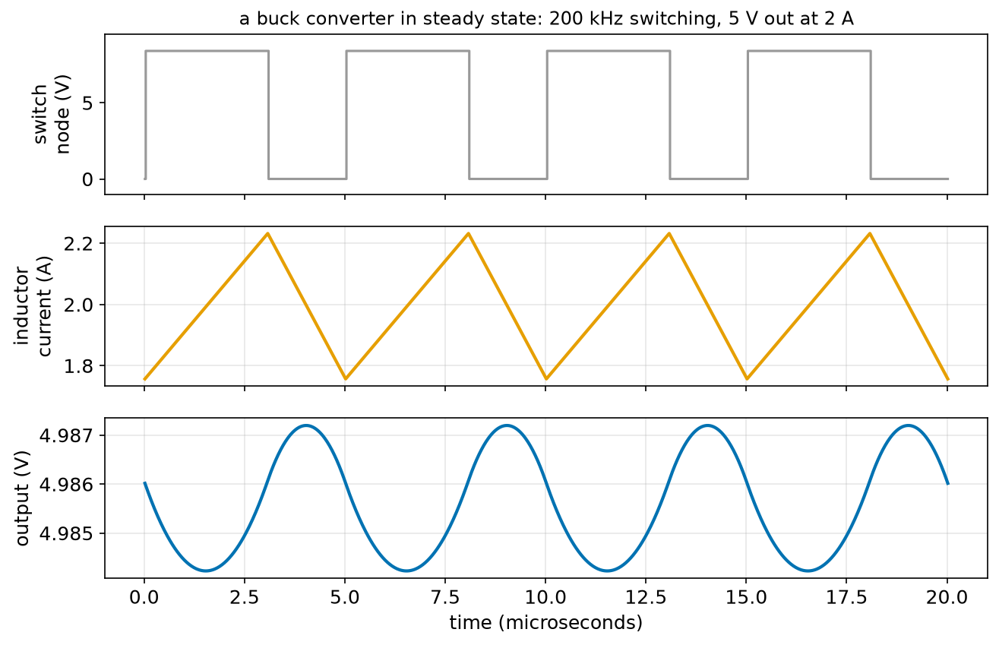

# Chapter 90 — Voltage Regulators and Power Supplies

> **Part 5 · Chapter 90 of 749**
> **You need:** Chapter 5 (Rover's regulator and two power paths), Chapter 71 (Euler steps), Chapter 76 (power, heat and thermal resistance), Chapter 77 (Rover's 5 V rail and the Raspberry Pi), Chapter 84 (capacitors), Chapter 85 (inductors), Chapter 86 (Schottky diodes), Chapter 88 (MOSFETs and switching losses) and Chapter 89 (battery voltage as it empties).
> **You will make:** a check of a linear regulator on Rover's falling battery, a comparison of linear and switching supplies for Rover's Raspberry Pi, and a simulation of a buck converter that makes 5 V from 8.4 V with a MOSFET, an inductor and a capacitor.

---

## What you will learn

- Why robots need **regulators**: batteries change voltage, electronics need it steady.
- How a **linear regulator** works, what **dropout** and **LDO** mean, and why it turns the extra voltage into **heat**.
- How a **switching regulator** (**buck** converter) uses a MOSFET, an inductor and a capacitor to change voltage with little waste.
- **Boost** and **buck-boost** converters, for raising a voltage.
- How to plan a robot's **power tree**, and give each load the right supply.
- **Bench power supplies**, wall adapters and USB power, and how a current limit protects a first test.

---

## New words in this chapter

| Word | Simple meaning |
|---|---|
| **regulator** | A circuit that keeps an output voltage steady while its input or load changes. |
| **linear regulator** | A regulator that drops the extra voltage across itself, like a self-adjusting resistor. |
| **dropout voltage** | The least extra input voltage a regulator needs to keep regulating. |
| **LDO** | Low-dropout regulator: a linear regulator that needs only a few tenths of a volt extra. |
| **efficiency** | Power out ÷ power in. |
| **switching regulator** | A regulator that switches a MOSFET on and off quickly and smooths the result with an inductor and a capacitor. |
| **buck converter** | A switching regulator that lowers the voltage. |
| **boost converter** | A switching regulator that raises the voltage. |
| **duty cycle** | The fraction of each switching cycle that the switch is on. |
| **ripple** | The small, fast wobble left on a switching regulator's output. |
| **BEC** | Battery eliminator circuit: hobby name for the 5 V regulator in a drone or RC model. |
| **power tree** | A plan of all a robot's supplies: which regulator feeds which loads. |
| **bench power supply** | An adjustable lab supply with a voltage setting and a current limit. |

---

## 90.1 Why regulate?

Rover's battery gives 8.4 V when full and 6.0 V when empty (Chapter 74), and it sags when the motors start (Chapter 89). Its Arduino and sensors need a steady 5.0 V (±5%), and its Raspberry Pi needs 5.1 V and up to 3 A. Feed them the battery directly and they would get too much at the start of a run, too little at the end, and a dip every time the motors move.

📖 **New word: regulator** — a circuit that keeps its output voltage steady while its input voltage or its load current changes. It is a small control loop (Chapter 6): it measures its own output, compares it with a reference (setpoint), and adjusts.

There are two families, with very different trade-offs.

---

## 90.2 Linear regulators

📖 **New word: linear regulator** — a regulator that places a transistor in series with the load and adjusts how much it conducts, so that exactly the extra voltage is dropped across it. It behaves like a resistor that sets its own value every microsecond.



*Figure 90.1 — Left: a linear regulator between the battery and the load. Right: its heat and efficiency at 190 mA, as the input voltage rises.*

**How to read this picture:** On the left, the regulator sits in the + line like an adjustable resistor (the red arrow). It always passes the load's full current and drops whatever voltage is extra. On the right, the heat (red) rises in a straight line with the input voltage, and the efficiency (blue dashed) falls: at 10 V in, half the power is heat.

The same current flows in and out (series, Chapter 77), so:

```
heat in the regulator = (V_in − V_out) × I
efficiency = V_out ÷ V_in
```

🔢 **Maths.** Rover's 5 V rail (190 mA, Chapter 77) from a full battery (8.4 V): heat = 3.4 × 0.19 = 0.65 W; efficiency 5 ÷ 8.4 = 60%. Chapter 76 said a TO-220 regulator with no heat sink rises 50 °C per watt: 32 °C. Warm but fine.

🔢 **Maths.** The same regulator feeding a Raspberry Pi (0.8 A) from 7.2 V: heat = 2.2 × 0.8 = 1.76 W: a 88 °C rise, too hot without a heat sink. Chapter 76 promised that Chapter 90 would fix this: section 90.4.

### Dropout

A linear regulator can only take voltage away; it can never add. And it needs a little extra to work.

📖 **New word: dropout voltage** — the least amount by which the input must exceed the output for the regulator to keep regulating. The classic 7805 needs about 2 V: 7 V in for 5 V out. Below that, its output just follows the input, a little lower.

📖 **New word: LDO** — low-dropout regulator: a modern linear regulator (often with a MOSFET inside, Chapter 88) that needs only 0.1–0.5 V extra. An LDO makes 5.0 V from anything above about 5.3 V.



*Figure 90.6 — Rover's battery voltage through a run, against the least input each regulator needs.*

**How to read this picture:** The orange line is the battery, falling slowly and then quickly at the end (Chapter 89). The old 7805 needs 7.0 V (red dashed): it drops out for the last 16% of the run (shaded), and Rover's Arduino would brown out (Chapter 84) while the battery still has charge. An LDO needs only 5.3 V (green dashed) and keeps working to the very end.

### Capacitors, as always

Every regulator's datasheet asks for a capacitor at its input and its output (Chapter 84), typically 1–10 µF ceramic, placed close to its pins. Without them, the regulator's own control loop can oscillate (Chapter 6's unstable loop) and its output fills with noise.

---

## 90.3 Switching regulators

A linear regulator wastes the extra voltage. A switching regulator avoids that with a trick: instead of dropping the extra voltage across a half-on transistor (which Chapter 87 showed is the hot state), it switches a MOSFET **fully on** and **fully off** very fast, and smooths the result.

📖 **New word: switching regulator** — a regulator that switches a MOSFET (Chapter 88) on and off hundreds of thousands of times a second and uses an inductor (Chapter 85) and a capacitor (Chapter 84) to turn the chopped voltage into a smooth one. Typical efficiency: 85–95%.

### The buck converter

📖 **New word: buck converter** — a switching regulator that makes a **lower** voltage (to "buck" means to go against).



*Figure 90.3 — The four parts of a buck converter: a MOSFET switch, a diode, an inductor and a capacitor.*

**How to read this picture:** When the MOSFET is **on**, the battery (8.4 V) is connected to the inductor's left end; the inductor's right end sits at the output (5 V), so 3.4 V is across the inductor and its current rises (V = L × rate of change of I, Chapter 85). When the MOSFET switches **off**, the inductor's current refuses to stop (Chapter 85); it now flows round through the diode, and the inductor's left end is pulled to about −0.4 V, so the current falls slowly. The capacitor smooths what is left.

The output voltage is set by the fraction of time the switch is on:

📖 **New word: duty cycle (D)** — the fraction of each cycle the switch is on: 0.6 means on for 60% of the time.

```
V_out ≈ D × V_in         (ignoring the diode's 0.4 V)
```

In words: "the output is the input times the fraction of time the switch is on". It is the average of the chopped voltage. The regulator's control loop adjusts D all the time to hold the output steady as the battery falls: D = 5 ÷ 8.4 = 0.60 when the battery is full, 5 ÷ 6.0 = 0.83 when it is nearly empty.

📖 **New word: ripple** — the small wobble left on the output at the switching frequency, because the capacitor is charged and discharged a little every cycle. A few millivolts to a few tens of millivolts.

Why is it efficient? The MOSFET is always fully on (tiny I² R, Chapter 88) or fully off (no current). The inductor and capacitor store and release energy but waste almost none. The losses are the MOSFET's conduction and switching losses, the diode's 0.4 V while it conducts, and the inductor's wire resistance. Modern buck converters replace the diode with a second MOSFET ("synchronous" converters) and reach 95%.

The key consequence: **a switching regulator keeps the power, not the current, the same** (apart from its losses). It turns high voltage and low current into low voltage and high current:

```
P_in = P_out ÷ efficiency          I_in = P_out ÷ (efficiency × V_in)
```

🔢 **Maths.** 5 V × 2 A = 10 W out. At 90% from 8.4 V: P_in = 11.1 W, I_in = 1.32 A. A linear regulator would take the full 2 A from the battery (16.8 W) and waste 6.8 W.

### Boost and buck-boost

📖 **New word: boost converter** — a switching regulator that makes a **higher** voltage, by rearranging the same four parts: the inductor is charged from the input with the switch to ground, then releases its energy through the diode at a higher voltage. V_out = V_in ÷ (1 − D). A single 3.7 V lithium cell can power a 5 V circuit through a boost converter.

A **buck-boost** converter does both, so it can make 5 V from an input that goes from above 5 V to below it, such as four NiMH cells (5.6 V full, 4.0 V empty): Chapter 10's tiny cleaner used one.

### The price of switching

| | Linear (LDO) | Switching (buck) |
|---|---|---|
| efficiency | V_out ÷ V_in (60% from 8.4 V to 5 V) | 85–95% at almost any input |
| heat | (V_in − V_out) × I | small |
| output noise | very clean | ripple and fast spikes |
| parts | 1 chip, 2 capacitors | chip, inductor, capacitors (sometimes diode) |
| board layout | easy | must be done carefully (fast-switching currents radiate noise) |
| best for | small currents, small voltage drops, noise-sensitive circuits | anything above about 0.5 W of waste |

📖 **New word: BEC** — "battery eliminator circuit": the hobby name for the 5 V regulator built into RC and drone electronics (originally it eliminated a separate receiver battery). "UBEC" or "SBEC" means a switching one.

---

## 90.4 A power tree for Rover

📖 **New word: power tree** — a plan showing every supply in a robot, what feeds it and what it feeds. Drawing one is the first step in every robot's power design (Chapter 151 makes Rover's complete).



*Figure 90.5 — Rover's power tree: the battery, its protection, and three branches.*

**How to read this picture:** The battery feeds a fuse and reverse protection (Chapters 7, 86, 88). Then it splits three ways: an LDO for the Arduino, sensors and LEDs (0.19 A, quiet and simple); a buck converter for the Raspberry Pi and camera (0.8 A typical, 3 A peak); and, through the e-stop, the motor driver, which takes the battery voltage directly (Chapter 5). All three share one ground (Chapter 78).

Why two separate 5 V supplies? The Pi's current jumps by amps when it starts programs; on the same supply as the Arduino, those jumps would cause brown-outs (Chapter 84). Separate regulators keep the noisy load away from the sensitive one. The motors, the noisiest of all, get the battery directly.

---

## 90.5 Power supplies for the bench

📖 **New word: bench power supply** — an adjustable laboratory supply with two knobs: **voltage** and **current limit**. If the circuit tries to draw more than the limit, the supply holds the current at the limit and lets the voltage fall. That is the best protection a first test can have: a short circuit or a reversed part just draws the limit (say 100 mA) instead of destroying something (Chapter 80's "check before power").

Other supplies a robot builder meets:

| Supply | What it gives | Watch out for |
|---|---|---|
| **USB port** | 5 V, 0.5 A (USB 2), 0.9 A (USB 3), up to 3 A (USB-C) | a laptop port shuts down if overloaded; never back-feed it |
| **USB power bank** | 5 V, 1–3 A, from a lithium cell and a boost converter | some switch off when the current is very small |
| **wall adapter ("wall wart")** | a fixed DC voltage (5, 9, 12 V) at a rated current | its voltage is often higher than labelled at light load |
| **mains-powered supply** | any of the above from 230 V | never open it: mains inside (Chapter 7) |

---

## Code

File `code/ch090/linear_reg.py`:

```python
# linear_reg.py - a linear regulator turns the extra voltage into heat: Rover's 5 V rail from a falling battery
V_OUT = 5.0
I_LOAD = 0.19                     # Rover's 5 V rail (Chapter 77)
THETA = 50.0                      # TO-220 regulator with no heat sink, C per W (Chapter 76)
REGULATORS = {"7805 (old, needs 2 V extra)": 2.0, "LDO (needs 0.3 V extra)": 0.3}

print(f"5 V at {I_LOAD * 1000:.0f} mA from Rover's battery as it empties (6 x NiMH: 8.4 V full, 6.0 V empty)")
print(f"{'battery':>8s} {'heat':>8s} {'temp rise':>10s} {'efficiency':>11s}   " + "   ".join(REGULATORS))
for v_in in [8.4, 7.6, 7.2, 6.8, 6.4, 6.0]:
    heat = (v_in - V_OUT) * I_LOAD                 # same current in and out; the voltage difference becomes heat
    eff = V_OUT / v_in                             # power out / power in = (5 x I) / (v_in x I)
    ok = ["ok" if v_in >= V_OUT + drop else "DROPS OUT" for drop in REGULATORS.values()]
    print(f"{v_in:6.1f} V {heat * 1000:5.0f} mW {heat * THETA:7.1f} C {eff:10.0%}   " + "   ".join(f"{o:>24s}" for o in ok))
print()
print("the old 7805 stops regulating below 7.0 V: Rover's 5 V rail would sag for the last part of every run")
```

| Line | Code | What it does (simple English) |
|---|---|---|
| 1 | `# linear_reg.py …` | A comment. |
| 2–5 | `V_OUT`, `I_LOAD`, `THETA`, `REGULATORS` | The output, the load, the thermal resistance, and two regulators with their dropout voltages. |
| 6 | (blank) | Spacing. |
| 7–8 | `print(…)` | Headings. |
| 9 | `for v_in in [ … ]:` | Six battery voltages from full to empty. |
| 10 | `heat = (v_in - V_OUT) * I_LOAD` | The extra voltage times the current. |
| 11 | `eff = V_OUT / v_in` | The currents cancel, leaving the voltage ratio. |
| 12 | `ok = [ … ]` | For each regulator: does the input exceed the output by its dropout? A list comprehension (Chapter 21). |
| 13 | `print(…)` | The row: heat, temperature rise, efficiency and the two verdicts. |
| 14–15 | `print()`, `print(…)` | The conclusion. |

Output:

```
5 V at 190 mA from Rover's battery as it empties (6 x NiMH: 8.4 V full, 6.0 V empty)
 battery     heat  temp rise  efficiency   7805 (old, needs 2 V extra)   LDO (needs 0.3 V extra)
   8.4 V   646 mW    32.3 C        60%                         ok                         ok
   7.6 V   494 mW    24.7 C        66%                         ok                         ok
   7.2 V   418 mW    20.9 C        69%                         ok                         ok
   6.8 V   342 mW    17.1 C        74%                  DROPS OUT                         ok
   6.4 V   266 mW    13.3 C        78%                  DROPS OUT                         ok
   6.0 V   190 mW     9.5 C        83%                  DROPS OUT                         ok

the old 7805 stops regulating below 7.0 V: Rover's 5 V rail would sag for the last part of every run
```

For Rover's small 5 V rail, a linear LDO is a fine choice: at most 0.65 W of heat, a 32 °C rise, clean output, and it keeps working down to an empty battery.

---

## Small examples

**Example 1.** A 3.3 V LDO with 5 V in, 100 mA out: heat (5 − 3.3) × 0.1 = 0.17 W; efficiency 66%.

**Example 2.** A 7805 from 12 V at 0.5 A: 3.5 W of heat. It needs a heat sink.

**Example 3.** A buck converter at 90% making 12 W from 24 V: input 13.3 W, 0.56 A.

**Example 4.** A buck from 12 V to 3.3 V: duty cycle about 0.28.

**Example 5.** A boost from 3.7 V to 5 V: D = 1 − 3.7 ÷ 5 = 0.26. At 1 A out and 90%: input 5 ÷ 0.9 ÷ 3.7 = 1.5 A.

**Example 6.** An LDO with 0.2 V dropout making 3.3 V can run from a lithium cell down to 3.5 V.

**Example 7.** A bench supply set to 9 V and 50 mA, connected to a circuit with a short: the supply shows 50 mA and about 0 V. Nothing burns.

**Example 8.** A 5 V, 2 A USB charger feeding a robot that wants 2.5 A: the charger's voltage sags or it shuts down.

---

## 🏭 Real robot applications

### Application 1 (worked in full) — 🤖 Powering Rover's Raspberry Pi

**1. The real problem.** At stage 7 (Chapter 5), Rover gets a Raspberry Pi and a camera: 5 V, about 0.8 A typically, up to 3 A at peaks. Chapter 77 found that its existing 1 A regulator cannot carry the Pi too, and Chapter 76 found that a linear regulator for the Pi would get too hot. Should the Pi have its own linear regulator, or a buck converter? How much battery life does each cost?

**2. Why this theory.** A linear regulator takes the same current from the battery as it gives the load, so its efficiency is V_out ÷ V_in and the rest is heat. A buck converter keeps the power (less its losses), so it takes less current from the battery than it gives the load.

**3. The numbers.** Battery 7.2 V nominal, 14.4 Wh, 80% usable = 11.52 Wh. Rover's other loads 3.78 W (Chapter 5). Pi: 5 V at 0.8 A (4 W) typical, 3 A (15 W) peak. Buck efficiency 90%.

**4. The maths.** Typical, linear: 7.2 × 0.8 = 5.76 W from the battery, 1.76 W of heat. Buck: 4 ÷ 0.9 = 4.44 W, 0.44 W of heat, and only 0.62 A from the battery. Peak, linear: 21.6 W in, 6.6 W of heat: impossible without a large heat sink. Buck: 16.7 W in, 1.67 W of heat.

**5. The code.** File `code/ch090/pi_power.py`:

```python
# pi_power.py - powering Rover's Raspberry Pi (5 V, 0.8 A typical, 3 A peak): linear or switching regulator?
V_BATT = 7.2
V_OUT = 5.0
BATTERY_WH = 14.4 * 0.8           # Rover's usable energy (Chapter 5)
OTHER_W = 3.78                    # everything else on Rover (Chapter 5)

for name, i_out in [("typical", 0.8), ("peak", 3.0)]:
    p_out = V_OUT * i_out
    lin_in = V_BATT * i_out                        # a linear regulator: the same current flows in as out
    lin_heat = lin_in - p_out
    buck_in = p_out / 0.90                         # a buck converter at 90% efficiency: the same POWER in (less 10%)
    print(f"{name}: Pi takes {p_out:.1f} W")
    print(f"  linear: battery gives {lin_in:.2f} W ({lin_in / V_BATT:.2f} A), {lin_heat:.2f} W of heat, {p_out / lin_in:.0%} efficient")
    print(f"  buck  : battery gives {buck_in:.2f} W ({buck_in / V_BATT:.2f} A), {buck_in - p_out:.2f} W of heat, 90% efficient")
print()
lin_total = OTHER_W + V_BATT * 0.8
buck_total = OTHER_W + V_OUT * 0.8 / 0.9
print(f"Rover at stage 7 with the linear regulator: {lin_total:.2f} W -> {BATTERY_WH / lin_total * 60:.0f} min")
print(f"Rover at stage 7 with the buck converter:   {buck_total:.2f} W -> {BATTERY_WH / buck_total * 60:.0f} min")
```

| Line | Code | What it does (simple English) |
|---|---|---|
| 1 | `# pi_power.py …` | A comment. |
| 2–5 | `V_BATT` … `OTHER_W` | The battery, the output, the usable energy and Rover's other loads. |
| 6 | (blank) | Spacing. |
| 7 | `for name, i_out in [ … ]:` | Typical and peak. |
| 8 | `p_out = V_OUT * i_out` | The Pi's power. |
| 9 | `lin_in = V_BATT * i_out` | Linear: the battery supplies the same current at its own voltage. |
| 10 | `lin_heat = lin_in - p_out` | The difference is heat. |
| 11 | `buck_in = p_out / 0.90` | Buck: power in = power out ÷ efficiency. |
| 12–14 | `print(…)` | Both options, with the battery current (power ÷ voltage). |
| 15 | `print()` | An empty line. |
| 16–17 | `lin_total`, `buck_total` | Rover's total power with each option. |
| 18–19 | `print(…)` | Run time = usable energy ÷ power (Chapter 67), in minutes. |

Output:

```
typical: Pi takes 4.0 W
  linear: battery gives 5.76 W (0.80 A), 1.76 W of heat, 69% efficient
  buck  : battery gives 4.44 W (0.62 A), 0.44 W of heat, 90% efficient
peak: Pi takes 15.0 W
  linear: battery gives 21.60 W (3.00 A), 6.60 W of heat, 69% efficient
  buck  : battery gives 16.67 W (2.31 A), 1.67 W of heat, 90% efficient

Rover at stage 7 with the linear regulator: 9.54 W -> 72 min
Rover at stage 7 with the buck converter:   8.22 W -> 84 min
```

**6. The result.** The Pi gets its own 5 V, 3 A buck converter. It wastes 0.44 W instead of 1.76 W, runs cool even at 3 A peaks, and gives Rover 12 more minutes per charge (84 against 72). A linear regulator at the Pi's peak would have to shed 6.6 W, needing a heat sink bigger than the Pi itself. The Arduino's rail keeps its LDO, because its small current makes the waste small and the LDO's output is cleaner.

**7. Going further.** These numbers leave out the camera's 1 W (Chapter 5). With it on the same buck converter (5 W at 5 V), Rover takes 3.78 + 5 ÷ 0.9 = 9.34 W and runs for 74 minutes; with a linear regulator, 3.78 + 7.2 × 1.0 = 10.98 W and 63 minutes. Chapter 5's 79 minutes assumed perfect conversion. Small ready-made buck modules cost a few dollars and are the standard way to power single-board computers in robots. Chapter 151 completes Rover's power budget with every regulator's efficiency.

### Application 2 (worked in full) — 🚁 Inside a 5 V BEC: simulating a buck converter

**1. The real problem.** A drone's flight controller, receiver and camera need 5 V at up to 2 A, from a pack between 8.4 V (2S full) and higher. A small buck converter (the "BEC") does it. How does a MOSFET switching 200,000 times a second, an inductor and a capacitor turn 8.4 V into a smooth 5 V? How big is the ripple?

**2. Why this theory.** In each tiny time step, the inductor's current changes by (V across it ÷ L) × dt (Chapter 85), and the capacitor's voltage changes by (net current into it ÷ C) × dt (Chapter 84). Stepping these two rules forward (Chapter 71), with the switch on for the fraction D of each cycle, shows the whole converter at work.

**3. The numbers.** 8.4 V in, 5 V wanted, load 2.5 Ω (2 A). L = 22 µH, C = 100 µF. 200 kHz (a cycle every 5 µs). Schottky diode 0.4 V. Steps of 20 ns (250 per cycle). D = (5 + 0.4) ÷ (8.4 + 0.4) = 0.614.

**4. The maths.** While on, the inductor has 8.4 − 5 = 3.4 V across it: its current rises at 3.4 ÷ 22 × 10⁻⁶ = 155,000 A/s, for 3.07 µs: +0.47 A. While off, it has −5.4 V: it falls at 245,000 A/s for 1.93 µs: −0.47 A. The current zig-zags 0.47 A peak to peak around the load's 2 A. The ripple on the capacitor: ΔV ≈ ΔI ÷ (8 f C) = 0.47 ÷ (8 × 200,000 × 100 × 10⁻⁶) ≈ 3 mV.

**5. The code.** File `code/ch090/buck_sim.py`:

```python
# buck_sim.py - simulate a buck converter: a MOSFET, a diode, an inductor and a capacitor make 5 V from 8.4 V
V_IN = 8.4
V_TARGET = 5.0
L = 22e-6                  # inductor, henries
C = 100e-6                 # output capacitor, farads
R_LOAD = 2.5               # a 2 A load at 5 V
F_SW = 200_000             # switching 200,000 times a second
V_DIODE = 0.4              # Schottky diode (Chapter 86)
DT = 20e-9                 # 20 ns steps: 250 steps per switching cycle

duty = (V_TARGET + V_DIODE) / (V_IN + V_DIODE)    # the fraction of each cycle the MOSFET is on
period = 1 / F_SW
i_l, v_out, t = 0.0, 0.0, 0.0
samples = []
while t < 0.008:                                  # 8 ms: long enough for the start-up wobble to die away
    switch_on = (t % period) < duty * period
    v_node = V_IN if switch_on else -V_DIODE      # MOSFET on: the inductor sees V_IN; off: the diode carries the current
    if not switch_on and i_l <= 0:
        v_node = v_out                            # the inductor current has reached zero: nothing flows
    i_l = max(i_l + (v_node - v_out) / L * DT, 0.0)          # V = L dI/dt (Chapter 85)
    v_out = v_out + (i_l - v_out / R_LOAD) / C * DT         # I = C dV/dt (Chapter 84)
    t += DT
    if t > 0.0075:
        samples.append((v_out, i_l))

vs = [s[0] for s in samples]
ils = [s[1] for s in samples]
print(f"duty cycle {duty:.3f}: the MOSFET is on {duty * period * 1e6:.2f} us of every {period * 1e6:.1f} us")
print(f"output: average {sum(vs) / len(vs):.3f} V, ripple {(max(vs) - min(vs)) * 1000:.1f} mV peak to peak")
print(f"inductor current: average {sum(ils) / len(ils):.2f} A, from {min(ils):.2f} to {max(ils):.2f} A")
p_out = (sum(vs) / len(vs)) ** 2 / R_LOAD
print(f"load power {p_out:.2f} W; input current only while the MOSFET is on: average {sum(ils) / len(ils) * duty:.2f} A from 8.4 V")
```

| Line | Code | What it does (simple English) |
|---|---|---|
| 1 | `# buck_sim.py …` | A comment. |
| 2–9 | `V_IN` … `DT` | The converter's parts and the step. |
| 10 | (blank) | Spacing. |
| 11 | `duty = (V_TARGET + V_DIODE) / (V_IN + V_DIODE)` | The duty cycle that gives 5 V, allowing for the diode's 0.4 V in the off part of each cycle. |
| 12 | `period = 1 / F_SW` | 5 µs. |
| 13 | `i_l, v_out, t = 0.0, 0.0, 0.0` | Start with nothing: no current, no output. |
| 14 | `samples = []` | Readings from the last half-millisecond. |
| 15 | `while t < 0.008:` | 8 ms: 400,000 steps. |
| 16 | `switch_on = (t % period) < duty * period` | Where are we in the cycle? `%` gives the time since the cycle began (Chapter 13). On for the first 61.4%. |
| 17 | `v_node = V_IN if switch_on else -V_DIODE` | The voltage at the inductor's left end. |
| 18–19 | `if not switch_on and i_l <= 0: v_node = v_out` | If the inductor's current has fallen to zero, nothing flows (it cannot go backwards through the diode). |
| 20 | `i_l = max(i_l + (v_node - v_out) / L * DT, 0.0)` | The inductor rule, rearranged: change in I = V ÷ L × dt. |
| 21 | `v_out = v_out + (i_l - v_out / R_LOAD) / C * DT` | The capacitor rule: current in from the inductor, minus current out to the load. |
| 22 | `t += DT` | The clock. |
| 23–24 | `if t > 0.0075: samples.append(…)` | Keep readings once the converter has settled. |
| 25 | (blank) | Spacing. |
| 26–27 | `vs = …`, `ils = …` | Separate the two kinds of reading. |
| 28–32 | four `print` lines | The duty cycle, the output and its ripple, the inductor current, and the power. |

Output:

```
duty cycle 0.614: the MOSFET is on 3.07 us of every 5.0 us
output: average 4.986 V, ripple 3.0 mV peak to peak
inductor current: average 1.99 A, from 1.76 to 2.23 A
load power 9.94 W; input current only while the MOSFET is on: average 1.22 A from 8.4 V
```



*Figure 90.4 — Four switching cycles of the simulated buck converter: the switch node, the inductor current and the output.*

**How to read this picture:** Top: the switch node jumps between 8.4 V (switch on) and about 0 V (diode on), every 5 µs. Middle: the inductor's current climbs while the switch is on and falls while it is off, a zig-zag between 1.76 and 2.23 A around the load's 2 A. Bottom: the output wobbles by only 3 mV around 4.986 V, because the 100 µF capacitor absorbs the zig-zag.

**6. The result.** Four ordinary parts turn 8.4 V into 5.0 V with 3 mV of ripple, matching the hand calculation. The battery supplies only 1.22 A on average for the load's 2 A: 10.2 W in for 9.9 W out, about 97% (this simulation leaves out the MOSFET's own losses; real ones reach 88–95%). A linear regulator in the same place would take 2 A from the battery and burn 6.8 W. (The output settles at 4.986 V rather than exactly 5.000 V; a real converter's feedback loop would nudge the duty cycle until it is exact.)

**7. Going further.** Real converters measure their output and adjust D continuously, so the output stays at 5.00 V as the battery and the load change: a control loop that Chapter 216 analyses. At the start, the simulation's output overshoots and wobbles for a few milliseconds (the inductor and capacitor resonate, Chapter 85's energy sloshing between L and C); real converters include a "soft start" for this. Chapter 616 looks at the drone's power board, which contains several such converters.

### Application 3 — 🏠 A boost converter in a small robot

A small robot vacuum's bumper sensor board, or a wearable robot sensor, runs from a single lithium cell (4.2 V down to 3.3 V, Chapter 89) but needs 5 V for some of its chips. A boost converter makes 5 V from it: D = 1 − V_in ÷ V_out, from 0.16 (full cell) to 0.34 (nearly empty). The price is input current: at 1 A out, 5 W, and 90%, the cell supplies 5.56 W, which is 1.3 A at 4.2 V but 1.7 A at 3.3 V. As the cell empties, the boost converter draws more current from it, which increases its sag (Chapter 89): designers check that the cell can still deliver at the end of its charge.

### Application 4 — 🦿 A humanoid's power tree

A full-size humanoid's 48 V pack (Chapter 74) feeds the leg and arm motor drivers directly. Buck converters make 24 V for small actuators and grippers, 12 V for the cameras and fans, 5 V for sensors and 3.3 V or 1.8 V for the computer's chips: four or five levels, each from the one above or straight from 48 V. Each converter is chosen for its load's current and noise needs: a noise-sensitive measurement circuit may get a buck converter followed by an LDO ("post-regulation"), which removes the ripple at the cost of a small extra loss. The power tree, with every converter's efficiency, decides how much of the battery's energy reaches the robot's motors, and Chapter 696 draws Hero's complete tree.

### Application 5 — 🌾 Solar charging with maximum power point tracking

A solar-powered farm robot (Chapters 77 and 86) charges its battery from a panel whose output depends on the sunlight. A panel's current falls as its voltage rises, so its power (V × I) has a maximum at one particular voltage (about 18 V for a 36-cell panel in full sun). The charger is a buck converter whose controller does not regulate a fixed voltage; instead it keeps adjusting the duty cycle to find the input voltage at which the panel gives the most power: "maximum power point tracking" (MPPT). Compared with connecting the panel straight to the battery, MPPT gains 15–30% more energy, more on cloudy days. It is the same buck converter, with a cleverer control loop.

---

## 🔧 Hands-on lab

### Lab 90.1 — Measure a linear regulator's heat (hardware)

You need: a 5 V regulator (7805 or an LDO such as the LM2940 or AMS1117-5.0), its two capacitors (as in its datasheet), a 9 V battery or a bench supply, a 33 Ω 1 W resistor as a load (150 mA at 5 V), the multimeter.

1. Build the regulator with its capacitors. Connect the load.
2. Measure the input voltage, the output voltage and the current (Chapter 81, or the voltage across the known load ÷ 33 Ω).
3. Work out the power in, the power out, the heat and the efficiency.
4. Touch the regulator after a minute (carefully: it may be hot).
5. If you have a bench supply, lower the input voltage in steps and find where the output starts to fall: the dropout.

**What you should see:** With 9 V in: 5.0 V out, 150 mA; power in 1.35 W, out 0.75 W, heat 0.6 W, efficiency 56%. The regulator is noticeably warm (about 30 °C above the room in free air). The 7805's output starts to fall below about 7 V in; an LDO's below about 5.3 V.

| If it does not work | Likely cause | Fix |
|---|---|---|
| The output is the same as the input | Pins swapped (input and output) | Check the datasheet's pinout; regulators differ |
| The output wobbles or the regulator gets very hot with no load | It is oscillating: missing capacitors | Add the datasheet's capacitors close to the pins |

**Challenge:** Repeat with a small buck converter module (a few dollars) and compare the efficiency at the same load. Feel the difference in temperature.

### Lab 90.2 — Design Rover's supplies (simulation)

Copy `pi_power.py`.

1. Add a third option: an LDO for the Pi (dropout 0.3 V). At what battery voltage does it drop out, and what is its efficiency at 7.2 V?
2. Run the run-time comparison for a battery at the end of its charge (6.0 V) and at the start (8.4 V), for the linear and buck options.
3. A buck converter's efficiency falls at very light loads (it still switches): assume 70% when the Pi is idle at 0.3 A. Recompute the idle case.

**What you should see:** The LDO drops out below 5.3 V (fine for Rover's battery) but its efficiency is the same as any linear regulator: 69% at 7.2 V. At 8.4 V the linear option wastes 2.7 W (60% efficient); at 6.0 V, 0.8 W (83%); the buck stays near 90% at both. At 0.3 A idle, the buck at 70% takes 2.14 W against the linear's 2.16 W: almost the same. Switching regulators shine at high currents and large voltage drops; at light loads the difference shrinks.

| If it does not work | Likely cause | Fix |
|---|---|---|
| The linear regulator seems efficient at 8.4 V | Efficiency computed as V_in ÷ V_out | It is V_out ÷ V_in |

**Challenge:** Write a function that chooses "linear" or "buck" for a load, given the input voltage, output voltage and current, using the rule "linear if the wasted power is under 0.3 W".

### Lab 90.3 — Play with the buck converter (simulation)

Copy `buck_sim.py`.

1. Halve the capacitor to 50 µF. What happens to the ripple? Halve the inductor to 11 µH instead. What happens to the inductor's current ripple?
2. Change the load to 25 Ω (0.2 A). Look at the minimum inductor current. What happens when it reaches zero?
3. Change V_IN to 6.0 V (a nearly empty Rover battery) and recompute the duty cycle. Does the output stay at about 5 V?

**What you should see:** Half the capacitor: about twice the output ripple (about 6 mV). Half the inductor: twice the current zig-zag (about 0.94 A peak to peak) and also more output ripple. At 0.2 A, the zig-zag of ±0.24 A reaches zero: the inductor's current stops for part of each cycle ("discontinuous mode"), and with a fixed duty cycle the output rises above 5 V, which a real converter's control loop would correct. At 6.0 V in, D = 5.4 ÷ 6.4 = 0.84 and the output stays at about 5 V.

| If it does not work | Likely cause | Fix |
|---|---|---|
| The simulation takes a very long time | DT too small for 8 ms | 20 ns over 8 ms is 400,000 steps: about a second in Python. Do not go below 10 ns |
| The output keeps growing at light load | Discontinuous mode with a fixed duty cycle | That is the real behaviour without feedback; add a simple loop that lowers D when v_out > 5 V |

**Challenge:** Add feedback: every cycle, change `duty` by 0.0005 × (5.0 − v_out). Start the simulation at 8.4 V, then drop V_IN to 6.5 V halfway. Does the output stay at 5 V?

---

## Common mistakes

⚠️ **Using a linear regulator for a big voltage drop at a big current.** Heat = (V_in − V_out) × I. Above about half a watt, use a buck converter.

⚠️ **Forgetting the dropout.** A 7805 needs 7 V in for 5 V out; check the battery's lowest voltage.

⚠️ **Leaving out the input and output capacitors.** Regulators can oscillate without them.

⚠️ **Putting the Pi (or servos) on the same regulator as the microcontroller.** Their current jumps cause brown-outs.

⚠️ **Assuming a switching regulator's input current equals its output current.** It is (P_out ÷ efficiency) ÷ V_in: often much less.

⚠️ **Trusting a "3 A" module at 3 A without a heat sink.** Check its efficiency and temperature.

⚠️ **Testing a new circuit straight from a battery.** Use a bench supply with a current limit the first time.

⚠️ **Feeding 5 V back into a computer's USB port** from the robot's supply. Use one supply or the other, not both.

---

## Practice

🏋️ **1.** A linear regulator makes 3.3 V at 200 mA from 5 V. Find its heat and efficiency.

🏋️ **2.** The same from a 12 V supply.

🏋️ **3.** Which regulators can make 5 V from a 2S lithium pack that falls to 6.6 V: a 7805, an LDO with 0.4 V dropout, a buck converter?

🏋️ **4.** A buck converter makes 5 V at 3 A from 22.2 V with 88% efficiency. Find the input power and current.

🏋️ **5.** What duty cycle does an ideal buck converter need for 3.3 V from 12 V? For 5 V from 6 V?

🏋️ **6.** An ideal boost converter makes 12 V from 3.7 V. What is its duty cycle? With 0.5 A out at 85%, what is the input current?

🏋️ **7.** A buck converter's inductor current zig-zags by 0.6 A at 400 kHz into 47 µF. Estimate the output ripple.

🏋️ **8.** Why does a robot often have two separate 5 V regulators?

🏋️ **9.** A bench supply is set to 12 V and 0.2 A. A circuit with a short circuit is connected. What do the supply's displays show?

🏋️ **10.** A 7805 drops 7 V at 0.4 A with θ = 50 °C/W. How hot does it get in a 25 °C room? What θ is needed to stay below 100 °C?

🏋️ **11.** Write `choose_regulator(v_in_min, v_in_max, v_out, amps)` that returns "LDO" if the worst-case linear heat is under 1 W and the minimum input exceeds v_out + 0.3, "buck" if v_in_min > v_out + 0.5, "boost" if v_in_max < v_out, and "buck-boost" otherwise. Test it on: Rover's Arduino rail (6.0–8.4 V, 5 V, 0.19 A), the Pi (6.0–8.4 V, 5 V, 3 A), a single lithium cell to 5 V (3.3–4.2 V, 1 A), and four NiMH cells to 5 V (4.0–5.6 V, 0.5 A).

---

## Answers

**1.** (5 − 3.3) × 0.2 = 0.34 W; 3.3 ÷ 5 = 66%.

**2.** (12 − 3.3) × 0.2 = 1.74 W; 27.5%. Use a buck converter.

**3.** A 7805 needs 7 V: it drops out at 6.6 V. The LDO needs 5.4 V: fine. A buck converter: fine (most need about 0.5–1 V of headroom).

**4.** P_out = 15 W; P_in = 15 ÷ 0.88 = 17.0 W; I_in = 17.0 ÷ 22.2 = 0.77 A.

**5.** 3.3 ÷ 12 = 0.275. 5 ÷ 6 = 0.83.

**6.** D = 1 − 3.7 ÷ 12 = 0.69. P_out = 6 W; P_in = 7.06 W; I_in = 1.91 A.

**7.** ΔV ≈ 0.6 ÷ (8 × 400,000 × 47 × 10⁻⁶) = 4 mV.

**8.** To keep loads with large current jumps (a single-board computer, servos) from causing brown-outs on the microcontroller's supply, and to give each the right kind of regulator.

**9.** About 0.2 A and nearly 0 V: the supply limits the current, and its voltage collapses into the short.

**10.** 7 × 0.4 = 2.8 W; 2.8 × 50 = 140 °C rise: 165 °C, far too hot. To stay below 100 °C: θ ≤ 75 ÷ 2.8 = 27 °C/W, so a heat sink (and better: a buck converter).

**11.**

```python
def choose_regulator(v_in_min, v_in_max, v_out, amps):
    linear_heat = (v_in_max - v_out) * amps
    if linear_heat < 1.0 and v_in_min > v_out + 0.3:
        return "LDO"
    if v_in_min > v_out + 0.5:
        return "buck"
    if v_in_max < v_out:
        return "boost"
    return "buck-boost"

for name, args in [("Arduino rail", (6.0, 8.4, 5.0, 0.19)), ("Raspberry Pi", (6.0, 8.4, 5.0, 3.0)),
                   ("one lithium cell", (3.3, 4.2, 5.0, 1.0)), ("four NiMH cells", (4.0, 5.6, 5.0, 0.5))]:
    print(f"{name:17s} {choose_regulator(*args)}")
```

```
Arduino rail      LDO
Raspberry Pi      buck
one lithium cell  boost
four NiMH cells   buck-boost
```

The Arduino rail's worst case is 0.65 W of heat at 8.4 V: under the 1 W limit, so an LDO, as section 90.4 chose. The Pi would waste up to 10 W in a linear regulator: buck.

---

## Summary

🧠 A **regulator** keeps a voltage steady while the battery and the load change. It is a small control loop.

🧠 A **linear regulator** drops the extra voltage across itself: heat = **(V_in − V_out) × I**, efficiency = **V_out ÷ V_in**. Simple and clean, but wasteful for big drops or big currents.

🧠 It needs a minimum extra input, the **dropout**: about 2 V for a 7805, 0.1–0.5 V for an **LDO**.

🧠 A **buck converter** switches a MOSFET on and off quickly and smooths the result with an **inductor** and a **capacitor**: **V_out ≈ D × V_in**, 85–95% efficient, with a little **ripple**. It keeps power, not current: I_in = P_out ÷ (efficiency × V_in).

🧠 **Boost** converters raise a voltage (V_out = V_in ÷ (1 − D)); **buck-boost** converters do both.

🧠 Plan a **power tree**: separate supplies for noisy and sensitive loads, one common ground. Test new circuits on a **bench supply with a current limit**.

---

## Next chapter

Chapter 91 moves from power to information. You will learn the difference between **digital** signals (just high or low) and **analog** signals (any value), the voltage **logic levels** that 5 V and 3.3 V chips use to tell high from low, why a 5 V signal can damage a 3.3 V chip, how **level shifters** connect them, and what **noise margins** and **Schmitt triggers** do to keep robot signals clean.
