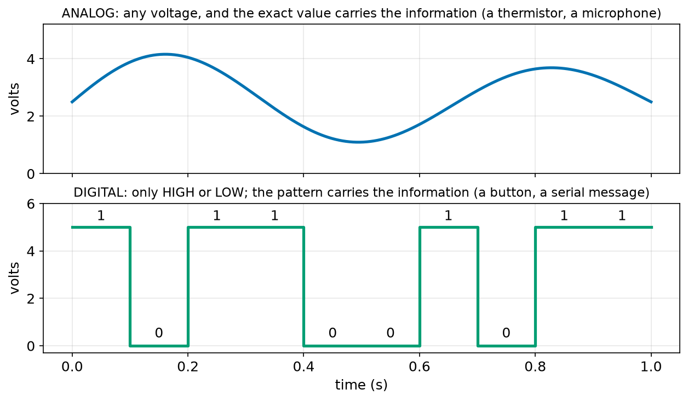
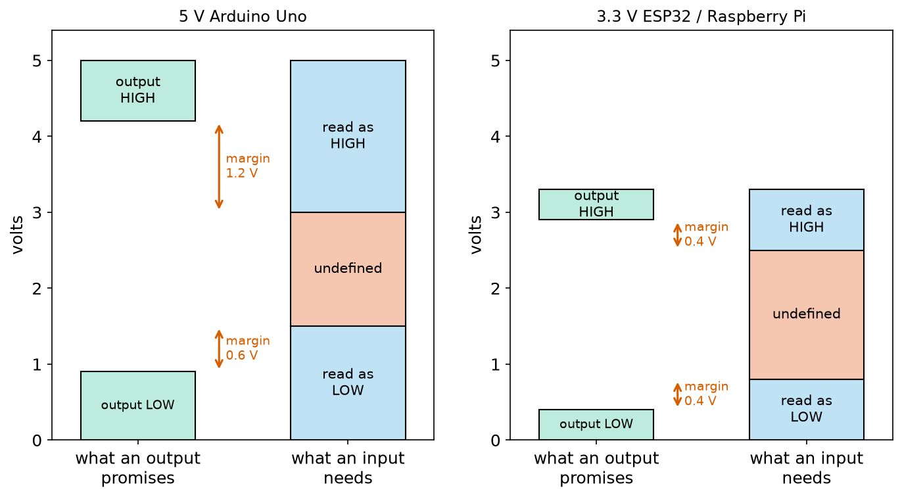
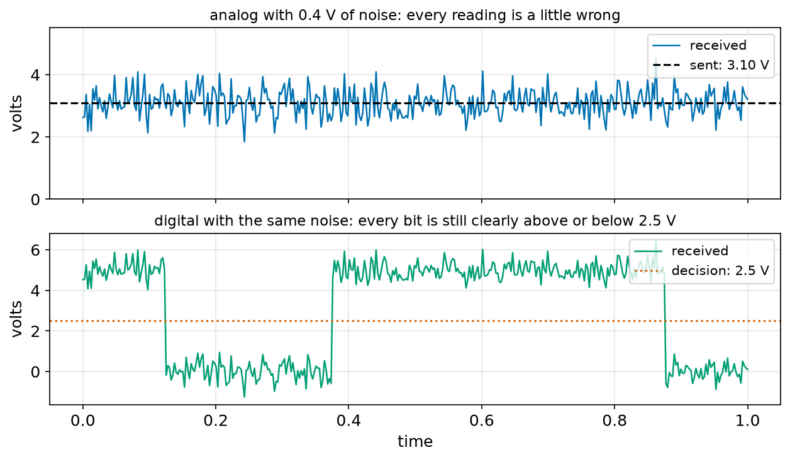
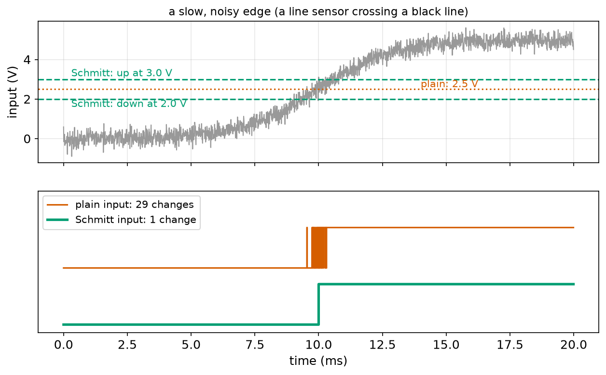
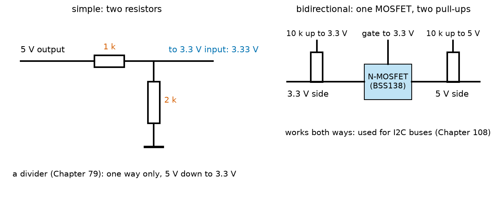
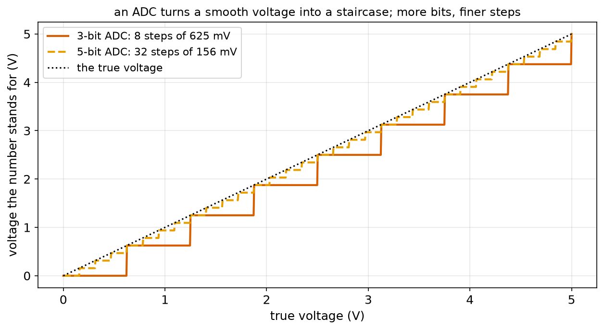

# Chapter 91 — Digital and Analog Signals, Logic Levels

> **Part 5 · Chapter 91 of 749**
> **You need:** Chapter 31 (random numbers and `random.gauss`), Chapter 79 (voltage dividers and what an input "sees"), Chapter 83 (pull-up resistors and floating inputs), Chapter 84 (capacitors and RC time constants), Chapter 86 (diodes) and Chapter 88 (MOSFETs).
> **You will make:** a checker that tells you whether one chip can safely talk to another, a test that sends a number through a noisy wire as an analog voltage and as digital bits, a Schmitt-trigger simulation that cleans a noisy sensor edge, and a level-shifter design that lets Rover's 5 V Arduino and 3.3 V Raspberry Pi talk without damage.

---

## What you will learn

- The difference between an **analog** signal (any voltage, and the exact value matters) and a **digital** signal (only HIGH or LOW).
- How numbers become **bits**, and how 8 bits make a **byte**.
- What **logic levels** are: the voltages a chip promises on its outputs and needs on its inputs.
- What **noise margins** are, and why digital signals survive noise that ruins analog ones.
- How a **Schmitt trigger** uses two thresholds to clean up a slow, noisy edge.
- Why a 5 V output can **damage** a 3.3 V chip, and how **level shifters** (a divider, or a MOSFET) connect them safely.
- How an **ADC** turns an analog voltage into a number, and what its **resolution** means.

---

## New words in this chapter

| Word | Simple meaning |
|---|---|
| **analog signal** | A signal whose exact voltage carries the information, like a thermometer's reading. |
| **digital signal** | A signal that is only HIGH or LOW; the pattern of highs and lows carries the information. |
| **bit** | One digital digit: 0 or 1. |
| **byte** | Eight bits together: a number from 0 to 255. |
| **logic level** | The voltage ranges that count as HIGH and LOW for a family of chips. |
| **V_OH, V_OL** | The lowest voltage an output promises for HIGH, and the highest for LOW. |
| **V_IH, V_IL** | The lowest voltage an input surely reads as HIGH, and the highest it surely reads as LOW. |
| **noise margin** | How much noise a signal can pick up before it might be misread. |
| **absolute maximum** | A voltage a pin must never see, even for a moment, or it may be damaged. |
| **level shifter** | A small circuit that connects chips with different logic voltages. |
| **Schmitt trigger** | An input with two thresholds: one for going up, a lower one for coming down. |
| **hysteresis** | The gap between a Schmitt trigger's two thresholds. |
| **ADC** | Analog-to-digital converter: turns a voltage into a number. |
| **resolution** | The size of one step of an ADC: the smallest change it can see. |

---

## 91.1 Two kinds of signals

Up to now, Part 5 has been about **power**: batteries, regulators, motors and heat. From this chapter on, it is also about **information**. A wire can carry a message as well as energy. The message is carried by its voltage, and there are two very different ways to do that.

📖 **New word: analog signal** — a signal in which the exact voltage *is* the message. A thermistor divider (Chapter 79) gives a slightly different voltage for every degree of temperature; a microphone gives a voltage that wobbles with the sound; a potentiometer on a robot arm's joint gives a voltage that tells the angle. Every tiny change of voltage means something.

📖 **New word: digital signal** — a signal that is only ever in one of two states: **HIGH** (near the supply voltage) or **LOW** (near 0 V). The exact voltage does not matter, only which of the two it is. A button (pressed or not), a bumper (touching or not), and the data wires between Rover's Arduino and its sensors all carry digital signals. Long messages are sent as a **pattern** of highs and lows, one after another.



*Figure 91.1 — Top: an analog signal can be any voltage, and its exact value matters. Bottom: a digital signal is only HIGH (5 V) or LOW (0 V), and the pattern 1 0 1 1 0 0 1 0 1 1 carries the message.*

**How to read this picture:** Time runs left to right in both plots. The blue curve on top moves smoothly through every voltage between about 1 V and 4.2 V: if you read it at 0.2 s you get about 4.0 V, and that number is the message. The green line below jumps between only two levels. Each tenth of a second is one **bit**, written above it: 1 for HIGH, 0 for LOW. Nobody cares whether a HIGH is 4.9 V or 5.0 V; it is just "1".

🤖 **Robot connection.** Most robot sensors start analog (light, temperature, sound, position) but most robot brains are digital. So every robot has places where analog becomes digital (an ADC, section 91.7) and digital becomes analog again (PWM for a motor, Chapter 102).

---

## 91.2 Bits and bytes

📖 **New word: bit** — one digital digit, 0 or 1. It is the answer to one yes-or-no question.

One bit is not enough for most messages. "How bright is it?" needs more than "bright or dark". So digital systems put several bits together, the way we put decimal digits together. In decimal, each place is worth ten times the one to its right (1, 10, 100, …). In **binary**, each place is worth **two** times the one to its right:

| Place (from the right) | 8th | 7th | 6th | 5th | 4th | 3rd | 2nd | 1st |
|---|---|---|---|---|---|---|---|---|
| Worth | 128 | 64 | 32 | 16 | 8 | 4 | 2 | 1 |
| Bits of 158 | 1 | 0 | 0 | 1 | 1 | 1 | 1 | 0 |

So the bits 10011110 mean 128 + 16 + 8 + 4 + 2 = **158**.

📖 **New word: byte** — eight bits together. A byte can hold any whole number from 00000000 (0) to 11111111 (255): 256 different values. With 10 bits you get 2¹⁰ = 1,024 values; with 12 bits, 4,096; with 16 bits, 65,536.

🔢 **Number of values with n bits = 2ⁿ.** Each extra bit doubles it.

A sensor value can travel as a byte: 0.62 of full scale becomes 0.62 × 255 = 158.1, rounded to 158, sent as the eight bits above. The program `noise_compare.py` (in the Code section) does exactly that.

---

## 91.3 Logic levels: what counts as HIGH?

A digital input has to decide, "Is this voltage HIGH or LOW?" Real wires are never exactly 0 V or 5 V. An output pin that is driving an LED may sag to 4.5 V; a long wire may pick up a few tenths of a volt from a motor. So chip makers do not promise exact voltages. They promise **ranges**.

📖 **New word: logic level** — the voltage ranges that a family of chips uses for HIGH and LOW. There are four numbers, two for outputs and two for inputs:

| Name | Meaning | 5 V Arduino Uno | 3.3 V ESP32 / Raspberry Pi |
|---|---|---|---|
| **V_OH** | An output's HIGH is **at least** this | 4.2 V | 2.9 V |
| **V_OL** | An output's LOW is **at most** this | 0.9 V | 0.4 V |
| **V_IH** | An input reads HIGH if the voltage is **at least** this | 3.0 V | 2.5 V |
| **V_IL** | An input reads LOW if the voltage is **at most** this | 1.5 V | 0.8 V |

(These are the usual worst-case numbers from the datasheets, rounded. The Uno's outputs are rated at 20 mA of load; with a light load they come much closer to 5 V and 0 V. Always check the datasheet of your own chips.)

Between V_IL and V_IH lies a **forbidden zone**. An input that sees, say, 2.2 V on an Uno may read HIGH or LOW, and may change its mind from one moment to the next. It is the same problem as a floating input (Chapter 83), and it is just as dangerous for a robot.



*Figure 91.2 — What an output promises (green) and what an input needs (blue), for a 5 V Arduino Uno (left) and a 3.3 V ESP32 or Raspberry Pi (right). The orange band is undefined. The red arrows are the noise margins.*

**How to read this picture:** In each panel, the left column is an output and the right column an input of the same family. An output's HIGH is somewhere inside the upper green box; an input reads HIGH anywhere in the upper blue box. Because the green box sits *above* the bottom of the blue box, every promised HIGH lands safely inside "read as HIGH", with room to spare: the red arrow. The same is true for LOW at the bottom. Compare the panels: the 3.3 V family's arrows are much shorter.

🧠 **The four numbers are a contract.** The output says, "My HIGH will never be below V_OH." The input says, "Anything above V_IH, I will read as HIGH." If V_OH ≥ V_IH, the two chips agree.

---

## 91.4 Noise margins, and why digital wins

📖 **New word: noise margin** — the difference between what an output promises and what an input needs:

🔢 **Noise margin HIGH = V_OH − V_IH**   **Noise margin LOW = V_IL − V_OL**

For the Uno: 4.2 − 3.0 = **1.2 V** for HIGH and 1.5 − 0.9 = **0.6 V** for LOW. A HIGH from one Uno to another can pick up 1.2 V of noise (a dip caused by a motor, say) and still be read correctly. For the 3.3 V family: 2.9 − 2.5 = **0.4 V** both ways. Lower voltages save power and allow faster chips, but they leave less room for noise.

A negative noise margin means the chips do not agree: the output's worst HIGH may be read as undefined. The program `logic_levels.py` checks every pair.

Now the big idea of this chapter. Suppose a motor adds noise to a wire. On an **analog** wire, every bit of noise becomes an error in the value, because the voltage *is* the value. On a **digital** wire, noise does nothing at all, as long as it does not push a HIGH below V_IH or a LOW above V_IL.



*Figure 91.3 — Top: an analog value of 3.10 V with 0.4 V of noise. Bottom: digital bits with exactly the same noise added.*

**How to read this picture:** The top trace should be a flat line at 3.10 V (black dashes) but jumps between about 2 V and 4 V: whichever moment you read it, the value is wrong by up to a volt. The bottom trace has exactly the same wiggles, added to 5 V and 0 V bits. It is just as ugly, but every HIGH stays well above the 2.5 V decision line and every LOW well below it. The receiver reads 1 0 0 1 1 1 1 0 perfectly.

🧠 **Digital signals are robust because they throw away information on purpose.** By caring only about "above or below the line", they ignore every small error. That is why robots send sensor values between chips as digital numbers, not as voltages.

There is a limit. When the noise is as big as the signal, digital fails too, and it fails suddenly: a whole bit flips, and the number can be completely wrong (you will see a reading of 0.118 instead of 0.620). That is why digital messages carry **checksums**, extra bits that let the receiver detect a damaged message (Chapter 533).

---

## 91.5 The Schmitt trigger: two thresholds instead of one

A plain digital input has one switching point, somewhere in the forbidden zone; say 2.5 V. That works well for clean, fast edges, which cross 2.5 V in a few nanoseconds. But some signals change **slowly**: a line sensor (Chapter 118) whose light slowly changes as the robot drives over the edge of a black line, a capacitor charging through a resistor (Chapter 84), a bumper switch whose contacts bounce (Chapter 99).

When a slow, noisy signal is near 2.5 V, the noise pushes it across the line again and again. The input sees HIGH, LOW, HIGH, LOW, … dozens of times for a single real change. A robot counting the black lines on a track would count one line many times.

📖 **New word: Schmitt trigger** — an input with **two** thresholds. While its output is LOW, it waits for the input to rise above an **upper** threshold (say 3.0 V) before switching to HIGH. Once HIGH, it waits for the input to fall below a **lower** threshold (say 2.0 V) before switching back to LOW. Small wiggles in between do nothing.

📖 **New word: hysteresis** — the gap between the two thresholds (here 3.0 − 2.0 = 1.0 V). The word means "lagging behind": the output lags behind small changes of the input. A home thermostat does the same thing: heat on below 19.5 °C, off above 20.5 °C, so it does not click on and off every few seconds.



*Figure 91.4 — Top: a slow rise from 0 to 5 V with 0.25 V of noise, and the thresholds. Bottom: what a plain input (orange, 29 changes) and a Schmitt-trigger input (green, 1 change) report.*

**How to read this picture:** In the top plot, the grey signal crawls up through the threshold zone between about 9 and 11 ms. Near 2.5 V (dotted orange line), the noise carries it back and forth across the line. The orange trace below flickers many times between 9.5 and 10.3 ms: 29 changes. The green trace switches once, at about 10 ms, when the signal first passes 3.0 V; after that the signal never falls back below 2.0 V, so the green trace stays HIGH.

You can buy Schmitt triggers as small chips (the 74HC14 has six of them). Most microcontroller inputs, including the Uno's, have a small Schmitt trigger built in, with a gap of a few tenths of a volt. For very slow or very noisy signals, add a 74HC14 with about a volt of hysteresis, or do it in software (Chapter 99).

---

## 91.6 Mixing 5 V and 3.3 V chips

Robots mix logic families all the time. Rover's Arduino Uno runs at 5 V; its Raspberry Pi and many modern sensors run at 3.3 V; some tiny sensors run at 1.8 V. Connecting them needs care, in both directions.

### A high voltage into a low-voltage input: damage

📖 **New word: absolute maximum** — a voltage a pin must never see, even for a moment. For a 3.3 V chip it is usually the supply plus 0.3 V: **3.6 V**. A 5 V HIGH is 1.4 V too much.

Inside each input, two small protection diodes (Chapter 86) connect the pin to the supply and to ground. When the pin goes above the supply by about 0.6 V, the upper diode conducts, and current flows from the 5 V output, through the diode, into the 3.3 V chip's supply. A small current might survive for a while; a larger one heats the diode, damages the chip, or even powers the whole 3.3 V chip through its input pin when it is meant to be switched off. **The Raspberry Pi's pins are not 5 V tolerant.** A 5 V signal can destroy a Pi.

### A low voltage into a high-voltage input: unreliable

The other way round is not dangerous, but it may not work. A 3.3 V output promises a HIGH of only 2.9 V, while the Uno needs 3.0 V: a noise margin of −0.1 V. Most of the time it works (a lightly loaded 3.3 V output gives about 3.2 V), but "most of the time" is not good enough for a robot. A 1.8 V output into a 5 V input will not work at all.

📖 **New word: level shifter** — a small circuit between two logic families that turns one family's HIGH into the other's.



*Figure 91.5 — Left: a voltage divider turns 5 V into 3.33 V, in one direction only. Right: a MOSFET level shifter with two pull-up resistors works in both directions.*

**How to read this picture:** On the left, the 5 V output drives a 1 kΩ and a 2 kΩ resistor in series to ground; the 3.3 V input is connected to the middle, which sits at 5 × 2 ÷ 3 = 3.33 V when the output is HIGH (Chapter 79), and 0 V when it is LOW. On the right, the N-MOSFET sits between the two sides of the wire; its gate is held at 3.3 V, and each side has a 10 kΩ pull-up resistor to its own supply.

**The divider** is the simplest shifter: two resistors, one direction (from 5 V down to 3.3 V). It suits signals that only go one way, such as UART TX → RX (Chapter 107) or SPI clock and data from the Arduino (Chapter 109).

**The MOSFET shifter** (a BSS138 N-MOSFET, Chapter 88) works both ways:

1. **Nobody pulls low.** Both pull-ups hold their sides HIGH: 3.3 V on one side, 5 V on the other. The gate and the source are both at 3.3 V, so V_GS = 0 and the MOSFET is off. Each side shows its own HIGH.
2. **The 3.3 V side pulls low.** Now the source is at 0 V and the gate at 3.3 V: V_GS = 3.3 V, the MOSFET turns on, and pulls the 5 V side low too.
3. **The 5 V side pulls low.** The MOSFET's built-in body diode (Chapter 88) conducts and pulls the 3.3 V side down to about 0.6 V; then V_GS is about 2.7 V, the MOSFET turns fully on, and pulls it down to nearly 0 V.

This works for **open-drain** buses like I2C (Chapter 108), where chips only ever pull a wire low and the pull-ups make it high. Ready-made boards with four of these circuits cost a dollar or two.

There are also level-shifter chips (such as the TXS0108E or the 74LVC245) for fast signals, and some 3.3 V chips have **5 V-tolerant** inputs: check the datasheet for "5 V tolerant" before relying on it.

---

## 91.7 From analog to digital: the ADC

A robot's brain is digital, but its world is analog. The bridge is an **ADC**.

📖 **New word: ADC** — an analog-to-digital converter. It measures a voltage between 0 V and a reference voltage (V_REF, often the supply) and gives a whole number. The Uno's ADC has 10 bits: it gives a number from 0 to 1,023. The ESP32's has 12 bits: 0 to 4,095.

🔢 **One step = V_REF ÷ 2ⁿ**   **reading = voltage ÷ one step, rounded down**   **voltage ≈ reading × one step**

For the Uno: one step = 5 ÷ 1,024 = 4.88 mV. A voltage of 2.4637 V gives 2.4637 ÷ 0.004883 = 504.6, rounded down to **504**, which stands for 504 × 4.88 mV = 2.4609 V: 2.76 mV too low.

📖 **New word: resolution** — the size of one step. It is the smallest change the ADC can notice. A finer resolution needs more bits.



*Figure 91.6 — The voltage each ADC reading stands for, against the true voltage, for a 3-bit ADC (8 steps) and a 5-bit ADC (32 steps), with a 5 V reference.*

**How to read this picture:** The dotted black line is perfect: the reading would stand for exactly the true voltage. The red staircase is a 3-bit ADC: each flat step is 625 mV wide, so every voltage from 1.25 V to 1.87 V gives the same reading. The orange staircase (5 bits) has 156 mV steps and stays much closer to the line. Real ADCs have 10 to 16 bits: their staircases are far too fine to see at this size.

A plain digital input is just a **1-bit ADC**: above or below the middle. Chapter 101 covers the Uno's ADC in practice.

---

## 91.8 Two reminders from earlier chapters

⚠️ **A digital input needs a defined voltage.** An unconnected input floats (Chapter 83) and reads random values, and it can sit in the forbidden zone, where a CMOS input also wastes current. Use a pull-up or pull-down, and tie the inputs of unused gates in a logic chip to ground or the supply.

⚠️ **Every digital chip needs a 100 nF capacitor** across its supply pins, close to the chip (Chapter 84). When its outputs switch, it takes short gulps of current; without the capacitor, these gulps put noise on the supply, which eats into every noise margin.

---

## Code

File `code/ch091/logic_levels.py`:

```python
# logic_levels.py - can this output safely talk to that input? Logic levels, noise margins and damage
FAMILIES = {
    # name: (supply, V_OH min, V_OL max, V_IH min, V_IL max, absolute max input)
    "5 V Arduino Uno": (5.0, 4.2, 0.9, 3.0, 1.5, 5.5),
    "3.3 V ESP32 / Pi": (3.3, 2.9, 0.4, 2.5, 0.8, 3.6),
    "1.8 V sensor": (1.8, 1.4, 0.4, 1.2, 0.6, 2.1),
}


def check(driver, receiver):
    d = FAMILIES[driver]
    r = FAMILIES[receiver]
    v_oh, v_ol = d[1], d[2]
    v_ih, v_il, v_max = r[3], r[4], r[5]
    if d[0] > v_max:
        return "DAMAGE: the high level is above the input's absolute maximum"
    nm_high = v_oh - v_ih             # how much noise a HIGH can take before it might be misread
    nm_low = v_il - v_ol              # how much noise a LOW can take
    if nm_high < 0:
        return f"NO: a high ({v_oh} V) may not reach the input's {v_ih} V threshold"
    if nm_low < 0:
        return "NO: a low is not low enough"
    return f"ok (noise margins: high {nm_high:.1f} V, low {nm_low:.1f} V)"


for name, (vdd, voh, vol, vih, vil, vmax) in FAMILIES.items():
    print(f"{name:18s} outputs: high >= {voh} V, low <= {vol} V;  reads: high >= {vih} V, low <= {vil} V")
print()
for drv in FAMILIES:
    for rcv in FAMILIES:
        if drv != rcv:
            print(f"{drv:18s} -> {rcv:18s}: {check(drv, rcv)}")
```

| Line | Code | What it does (simple English) |
|---|---|---|
| 1 | `# logic_levels.py …` | A comment: what the program is for. |
| 2 | `FAMILIES = {` | Starts a dictionary (Chapter 22): one entry per logic family. |
| 3 | `# name: (supply, …)` | A comment that explains the order of the six numbers. |
| 4–6 | `"5 V Arduino Uno": (5.0, 4.2, …)` | Each family's supply, V_OH, V_OL, V_IH, V_IL and absolute maximum input, from section 91.3. A tuple (Chapter 22) keeps the six numbers together. |
| 7 | `}` | Ends the dictionary. |
| 8–9 | (blank) | Spacing. |
| 10 | `def check(driver, receiver):` | A function (Chapter 24): can the `driver` family's output talk to the `receiver` family's input? |
| 11–12 | `d = …`, `r = …` | Look up the numbers of both families. |
| 13 | `v_oh, v_ol = d[1], d[2]` | The output promises from the driver. |
| 14 | `v_ih, v_il, v_max = r[3], r[4], r[5]` | The input needs and the absolute maximum from the receiver. |
| 15–16 | `if d[0] > v_max: return "DAMAGE…"` | First, safety: if the driver's HIGH (up to its supply voltage) is above the receiver's absolute maximum, stop here. |
| 17 | `nm_high = v_oh - v_ih` | The HIGH noise margin from section 91.4. |
| 18 | `nm_low = v_il - v_ol` | The LOW noise margin. |
| 19–20 | `if nm_high < 0: return …` | A negative margin: the worst HIGH may not be read as HIGH. |
| 21–22 | `if nm_low < 0: return …` | The same for LOW. |
| 23 | `return f"ok …"` | Safe and reliable: report both margins with one decimal. |
| 24–25 | (blank) | Spacing. |
| 26 | `for name, (vdd, …) in FAMILIES.items():` | Loop over the dictionary, unpacking each tuple into six names. |
| 27 | `print(…)` | One line per family: what it promises and what it needs. `:18s` pads the name to 18 characters so the columns line up. |
| 28 | `print()` | An empty line. |
| 29–30 | `for drv …`, `for rcv …` | Two loops: every family as driver, with every family as receiver. |
| 31 | `if drv != rcv:` | Skip a family talking to itself (that always works). |
| 32 | `print(…)` | Print the pair and the verdict from `check`. |

Output:

```
5 V Arduino Uno    outputs: high >= 4.2 V, low <= 0.9 V;  reads: high >= 3.0 V, low <= 1.5 V
3.3 V ESP32 / Pi   outputs: high >= 2.9 V, low <= 0.4 V;  reads: high >= 2.5 V, low <= 0.8 V
1.8 V sensor       outputs: high >= 1.4 V, low <= 0.4 V;  reads: high >= 1.2 V, low <= 0.6 V

5 V Arduino Uno    -> 3.3 V ESP32 / Pi  : DAMAGE: the high level is above the input's absolute maximum
5 V Arduino Uno    -> 1.8 V sensor      : DAMAGE: the high level is above the input's absolute maximum
3.3 V ESP32 / Pi   -> 5 V Arduino Uno   : NO: a high (2.9 V) may not reach the input's 3.0 V threshold
3.3 V ESP32 / Pi   -> 1.8 V sensor      : DAMAGE: the high level is above the input's absolute maximum
1.8 V sensor       -> 5 V Arduino Uno   : NO: a high (1.4 V) may not reach the input's 3.0 V threshold
1.8 V sensor       -> 3.3 V ESP32 / Pi  : NO: a high (1.4 V) may not reach the input's 2.5 V threshold
```

Not one pair of different families can be wired directly. Going **down** in voltage risks damage; going **up** is unreliable. Every mixed connection needs a level shifter, or chips whose datasheets say otherwise.

File `code/ch091/noise_compare.py`:

```python
# noise_compare.py - send a value over a noisy wire, as an analog voltage and as digital bits
import random

random.seed(5)
V = 5.0
TRUE_VALUE = 0.62                 # the sensor's reading: 62% of full scale
BITS = 8

# analog: the value is the voltage itself; every bit of noise becomes an error
# digital: the value is sent as 8 bits, each 0 V or 5 V; noise only matters if it crosses the 2.5 V decision line
code = round(TRUE_VALUE * (2 ** BITS - 1))
bits = [(code >> k) & 1 for k in range(BITS)]

print(f"value to send: {TRUE_VALUE:.3f} (digital code {code} = {''.join(str(b) for b in reversed(bits))})")
print(f"{'noise (V)':>10s} {'analog received':>16s} {'analog error':>13s} {'digital received':>17s} {'bit errors':>11s}")
for noise in [0.05, 0.2, 0.5, 1.0, 2.0, 3.0]:
    a = (TRUE_VALUE * V + random.gauss(0, noise)) / V
    rx_bits = [1 if b * V + random.gauss(0, noise) > V / 2 else 0 for b in bits]
    errors = sum(1 for b, r in zip(bits, rx_bits) if b != r)
    rx = sum(r << k for k, r in enumerate(rx_bits)) / (2 ** BITS - 1)
    print(f"{noise:10.2f} {a:16.3f} {a - TRUE_VALUE:+13.3f} {rx:17.3f} {errors:11d}")
print()
print("small noise: analog is slightly wrong, digital is exactly right (the error is only the 1/255 step)")
print("huge noise: both fail; digital fails suddenly, and checksums (Chapter 533) can at least detect it")
```

| Line | Code | What it does (simple English) |
|---|---|---|
| 1 | `# noise_compare.py …` | A comment. |
| 2 | `import random` | Random numbers for the noise (Chapter 31). |
| 3 | (blank) | Spacing. |
| 4 | `random.seed(5)` | Fixes the random numbers so that you get exactly the output below. |
| 5 | `V = 5.0` | The signal voltage: 5 V for full scale, and for a digital HIGH. |
| 6 | `TRUE_VALUE = 0.62` | The value to send: 62% of full scale. As an analog voltage that is 3.10 V. |
| 7 | `BITS = 8` | The digital version uses one byte. |
| 8 | (blank) | Spacing. |
| 9–10 | `# analog: … # digital: …` | Comments: the two ways of sending. |
| 11 | `code = round(TRUE_VALUE * (2 ** BITS - 1))` | 0.62 × 255 = 158.1, rounded to 158. `**` is "to the power of". |
| 12 | `bits = [(code >> k) & 1 for k in range(BITS)]` | Splits 158 into its 8 bits. `code >> k` moves the number k places to the right; `& 1` keeps only the last bit. So `bits[0]` is the 1s place, `bits[7]` the 128s place. |
| 13 | (blank) | Spacing. |
| 14 | `print(f"value to send …")` | Shows the value, the code, and its bits from the 128s place down (`reversed`). `''.join(…)` glues the digits into one string. |
| 15 | `print(…)` | Column headings, each padded to a fixed width. |
| 16 | `for noise in [ … ]:` | Six noise levels, from tiny (0.05 V) to huge (3 V). |
| 17 | `a = (TRUE_VALUE * V + random.gauss(0, noise)) / V` | Analog: 3.10 V plus random noise (Chapter 31), turned back into a fraction of full scale. |
| 18 | `rx_bits = [ … ]` | Digital: each bit is sent as 0 V or 5 V, noise is added, and the receiver decides 1 if above 2.5 V, else 0. |
| 19 | `errors = sum(1 for b, r in zip(bits, rx_bits) if b != r)` | Counts the bits that arrived wrong. `zip` pairs each sent bit with its received bit. |
| 20 | `rx = sum(r << k …) / (2 ** BITS - 1)` | Rebuilds the number from the received bits (`r << k` is r × 2ᵏ), then turns it back into a fraction. |
| 21 | `print(…)` | One row: noise, analog result and error, digital result, bit errors. `:+13.3f` always shows the sign. |
| 22–24 | `print()`, `print(…)` | The conclusions. |

Output:

```
value to send: 0.620 (digital code 158 = 10011110)
 noise (V)  analog received  analog error  digital received  bit errors
      0.05            0.608        -0.012             0.620           0
      0.20            0.600        -0.020             0.620           0
      0.50            0.579        -0.041             0.620           0
      1.00            0.625        +0.005             0.620           0
      2.00            0.887        +0.267             0.608           2
      3.00            0.795        +0.175             0.118           1

small noise: analog is slightly wrong, digital is exactly right (the error is only the 1/255 step)
huge noise: both fail; digital fails suddenly, and checksums (Chapter 533) can at least detect it
```

Up to 1 V of noise, the digital value arrives as exactly 0.620 every time, while the analog value is off by up to 4%. (At 1.00 V the analog error happens to be small: that is luck, one random draw. Run it again with another seed and it will not be.) At 2 V and 3 V of noise, bits flip. Look at the last row: just **one** wrong bit turned 0.620 into 0.118, because the flipped bit was the 128s place. Digital errors are rare but large.

File `code/ch091/schmitt.py`:

```python
# schmitt.py - a slow, noisy edge read by a plain input and by a Schmitt-trigger input
import math
import random

random.seed(2)
DT = 1e-5
THRESHOLD = 2.5                 # a plain input switches at one voltage
UP, DOWN = 3.0, 2.0             # a Schmitt input: switch up only above 3.0 V, down only below 2.0 V

plain, schmitt = 0, 0
plain_changes, schmitt_changes = 0, 0
t = 0.0
while t < 0.02:
    clean = 5.0 / (1 + math.exp(-(t - 0.01) / 0.0015))          # a slow rise from 0 to 5 V (a line sensor crossing an edge)
    v = clean + random.gauss(0, 0.25)                            # plus noise from the motors
    new_plain = 1 if v > THRESHOLD else 0
    if new_plain != plain:
        plain_changes += 1
        plain = new_plain
    if schmitt == 0 and v > UP:
        schmitt, schmitt_changes = 1, schmitt_changes + 1
    elif schmitt == 1 and v < DOWN:
        schmitt, schmitt_changes = 0, schmitt_changes + 1
    t += DT
print(f"one slow rise with 0.25 V of noise, read every {DT * 1e6:.0f} us:")
print(f"  plain input (switches at {THRESHOLD} V): {plain_changes} changes")
print(f"  Schmitt input (up at {UP} V, down at {DOWN} V): {schmitt_changes} change")
```

| Line | Code | What it does (simple English) |
|---|---|---|
| 1 | `# schmitt.py …` | A comment. |
| 2–3 | `import math`, `import random` | `math.exp` for the smooth rise; `random.gauss` for the noise. |
| 4 | (blank) | Spacing. |
| 5 | `random.seed(2)` | Repeatable noise. |
| 6 | `DT = 1e-5` | The input is read every 10 µs (10 microseconds). |
| 7 | `THRESHOLD = 2.5` | The plain input's one switching point. |
| 8 | `UP, DOWN = 3.0, 2.0` | The Schmitt trigger's two switching points: 1.0 V of hysteresis. |
| 9 | (blank) | Spacing. |
| 10 | `plain, schmitt = 0, 0` | Both inputs start LOW. |
| 11 | `plain_changes, schmitt_changes = 0, 0` | Counters for how many times each output changes. |
| 12 | `t = 0.0` | The clock. |
| 13 | `while t < 0.02:` | Run for 20 ms. |
| 14 | `clean = 5.0 / (1 + math.exp(…))` | A smooth S-shaped rise from 0 V to 5 V, centred at 10 ms, taking a few milliseconds: like a line sensor as the robot crosses the edge of a black line. |
| 15 | `v = clean + random.gauss(0, 0.25)` | Adds 0.25 V of random noise, like the noise motors put on a sensor wire. |
| 16 | `new_plain = 1 if v > THRESHOLD else 0` | The plain input: HIGH above 2.5 V, LOW below. |
| 17–19 | `if new_plain != plain: …` | If its answer changed, count the change and remember the new state. |
| 20–21 | `if schmitt == 0 and v > UP: …` | The Schmitt input, while LOW, goes HIGH only above 3.0 V. |
| 22–23 | `elif schmitt == 1 and v < DOWN: …` | While HIGH, it goes LOW only below 2.0 V. Anything between leaves it as it is. |
| 24 | `t += DT` | Next moment. |
| 25–27 | `print(…)` | The results. `DT * 1e6` turns seconds into microseconds. |

Output:

```
one slow rise with 0.25 V of noise, read every 10 us:
  plain input (switches at 2.5 V): 29 changes
  Schmitt input (up at 3.0 V, down at 2.0 V): 1 change
```

One real change; the plain input reported 29 (15 rises and 14 falls). The Schmitt trigger reported exactly one.

File `code/ch091/quantize.py`:

```python
# quantize.py - turning an analog voltage into a number: how fine are the steps?
V_REF = 5.0
signal = 2.4637                  # a sensor's voltage

print(f"true voltage {signal} V")
print(f"{'ADC bits':>9s} {'steps':>7s} {'one step':>10s} {'reading':>8s} {'back to volts':>14s} {'error':>9s}")
for bits in [1, 4, 8, 10, 12, 16]:
    steps = 2 ** bits
    step_v = V_REF / steps
    reading = min(int(signal / step_v), steps - 1)       # the ADC rounds down to a whole step (Chapter 101)
    back = reading * step_v
    print(f"{bits:9d} {steps:7d} {step_v * 1000:7.2f} mV {reading:8d} {back:11.4f} V {(back - signal) * 1000:+7.2f} mV")
print()
print("a 1-bit 'ADC' is just a digital input: above or below the middle")
```

| Line | Code | What it does (simple English) |
|---|---|---|
| 1 | `# quantize.py …` | A comment. |
| 2 | `V_REF = 5.0` | The ADC measures from 0 V to 5 V, like the Uno's. |
| 3 | `signal = 2.4637` | The voltage being measured. |
| 4 | (blank) | Spacing. |
| 5–6 | `print(…)` | The true voltage and the column headings. |
| 7 | `for bits in [ … ]:` | Six ADCs, from 1 bit to 16 bits. |
| 8 | `steps = 2 ** bits` | The number of values (section 91.2). |
| 9 | `step_v = V_REF / steps` | The size of one step: the resolution. |
| 10 | `reading = min(int(signal / step_v), steps - 1)` | How many whole steps fit under the signal. `int` rounds down. `min` stops a 5.0 V input giving one more than the largest reading. |
| 11 | `back = reading * step_v` | The voltage the reading stands for. |
| 12 | `print(…)` | One row. `* 1000` turns volts into millivolts. |
| 13–14 | `print()`, `print(…)` | A closing remark. |

Output:

```
true voltage 2.4637 V
 ADC bits   steps   one step  reading  back to volts     error
        1       2 2500.00 mV        0      0.0000 V -2463.70 mV
        4      16  312.50 mV        7      2.1875 V -276.20 mV
        8     256   19.53 mV      126      2.4609 V   -2.76 mV
       10    1024    4.88 mV      504      2.4609 V   -2.76 mV
       12    4096    1.22 mV     2018      2.4634 V   -0.32 mV
       16   65536    0.08 mV    32292      2.4637 V   -0.02 mV

a 1-bit 'ADC' is just a digital input: above or below the middle
```

The 1-bit "ADC" says 0 (below the middle: 2.4637 V is just under 2.5 V). Each extra bit halves the step. The 8-bit and 10-bit errors happen to be the same here, because 2.4609 V is a whole number of both step sizes; in general more bits mean smaller errors. The Uno's 10 bits give steps of 4.88 mV, plenty for most robot sensors, whose own noise is usually bigger than that (Chapter 114).

---

## Small examples

**Example 1.** An Uno input sees 3.7 V. Above V_IH = 3.0 V: it reads HIGH.

**Example 2.** An Uno input sees 2.0 V. It is between 1.5 V and 3.0 V: undefined. It might read either way.

**Example 3.** An Uno's 10-bit ADC gives 634. The voltage is about 634 × 5 ÷ 1,024 = 3.10 V.

**Example 4.** A divider of 10 kΩ over 20 kΩ on a 5 V output gives 5 × 20 ÷ 30 = 3.33 V, and takes only 5 ÷ 30,000 = 0.17 mA.

**Example 5.** A potentiometer gives 1.00 V to an Uno's ADC: 1.00 ÷ 0.004883 = 204.8, so the reading is 204.

**Example 6.** The HIGH noise margin of the 3.3 V family is 2.9 − 2.5 = 0.4 V: a third of the Uno's 1.2 V.

**Example 7.** The bits 10011110 are 128 + 16 + 8 + 4 + 2 = 158.

**Example 8.** An 8-bit ADC with a 3.3 V reference has steps of 3.3 ÷ 256 = 12.9 mV.

---

## 🏭 Real robot applications

### Application 1 (worked in full) — 🤖 Wiring Rover's Arduino to its Raspberry Pi

**1. The real problem.** At stage 7 (Chapter 5), Rover gets a Raspberry Pi above its Arduino Uno. The usual way to connect them is a USB cable (Chapter 111). But USB takes a port and a bulky cable, so many robot builders use two wires instead: the Uno's TX (transmit) pin to the Pi's RX (receive) pin, and the Pi's TX to the Uno's RX, plus a common ground. This is UART, at 115,200 bits per second (Chapter 107). The Uno is 5 V; the Pi is 3.3 V. Can the wires go straight across?

**2. Why this theory.** Section 91.3's logic levels and section 91.6's absolute maximum tell us whether each direction is safe and reliable. A divider (Chapter 79) or a MOSFET (Chapter 88) can fix each direction, and the RC time constant (Chapter 84) tells us whether the fix is fast enough.

**3. The numbers.** Uno → Pi: the Uno's HIGH is up to 5 V; the Pi's absolute maximum is 3.6 V. Pi → Uno: the Pi's HIGH is at least 2.9 V; the Uno needs 3.0 V. One UART bit at 115,200 bits per second lasts 1 ÷ 115,200 = 8.7 µs. A 1 kΩ / 2 kΩ divider, and a BSS138 with 10 kΩ pull-ups, are the two candidate fixes.

**4. The model.** For the divider: V_out = 5 × R_bottom ÷ (R_top + R_bottom). The Pi's input has about 10 pF of capacitance; the divider "seen" from the input is the two resistors in parallel (Chapter 79), and with the capacitance it makes an RC time constant. For the MOSFET shifter: the 5 V side rises through its 10 kΩ pull-up into the wire's capacitance; the time from 30% to 70% of the way up is ln(0.7 ÷ 0.3) × RC = 0.85 RC (Chapter 84).

**5. The code.** File `code/ch091/level_shift.py`:

```python
# level_shift.py - connecting a 5 V Arduino Uno to a 3.3 V sensor board, both ways
V5, V33 = 5.0, 3.3
ABS_MAX_33 = 3.6                 # the 3.3 V chip's absolute maximum input
V_IH_33 = 2.5                    # the 3.3 V chip reads HIGH above this
V_IH_UNO = 3.0                   # the Uno reads HIGH above this
V_OH_33 = 2.9                    # a 3.3 V output's lowest guaranteed HIGH

# direction 1: Uno output -> 3.3 V input, through a divider (Chapter 79)
R_TOP, R_BOTTOM = 1000.0, 2000.0
v_out = V5 * R_BOTTOM / (R_TOP + R_BOTTOM)
i_div = V5 / (R_TOP + R_BOTTOM)
print("Uno -> 3.3 V chip, divider 1 k over 2 k:")
print(f"  HIGH arrives as {v_out:.2f} V   (needs >= {V_IH_33} V, must stay <= {ABS_MAX_33} V): "
      f"{'ok' if V_IH_33 <= v_out <= ABS_MAX_33 else 'NOT ok'}")
print(f"  the divider wastes {i_div * 1000:.2f} mA while the pin is HIGH")
r_th = R_TOP * R_BOTTOM / (R_TOP + R_BOTTOM)               # what the input "sees" (Chapter 79)
c_in = 10e-12                                              # about 10 pF of pin and wire capacitance
print(f"  edge time constant {r_th:.0f} ohm x 10 pF = {r_th * c_in * 1e9:.1f} ns: fast enough for SPI at several MHz")
print()

# direction 2: 3.3 V output -> Uno input
print("3.3 V chip -> Uno, wired directly:")
print(f"  HIGH may be only {V_OH_33} V, the Uno needs {V_IH_UNO} V: margin {V_OH_33 - V_IH_UNO:+.1f} V -> not guaranteed")
print()

# both ways: BSS138 MOSFET shifter with 10 k pull-ups
R_PULL = 10e3
C_BUS = 50e-12                                             # a short I2C bus: about 50 pF
tau = R_PULL * C_BUS
rise = 0.85 * tau                                          # time to rise from 30% to 70% of 5 V: ln(0.7/0.3) = 0.85
print("BSS138 shifter, 10 k pull-up to 5 V on the Uno side:")
print(f"  HIGH on the Uno side: {V5:.1f} V (the pull-up), margin {V5 - V_IH_UNO:+.1f} V")
print(f"  rise time 30%->70%: {rise * 1e6:.2f} us; one bit at 100 kHz I2C lasts 10 us -> ok")
print(f"  at 400 kHz (2.5 us bits) it uses {rise / 2.5e-6 * 100:.0f}% of a bit: use 4.7 k pull-ups or a shorter bus")
```

| Line | Code | What it does (simple English) |
|---|---|---|
| 1 | `# level_shift.py …` | A comment. The "3.3 V chip" can be the Pi or any 3.3 V sensor board. |
| 2–6 | `V5, V33 …`, `ABS_MAX_33`, `V_IH_33`, `V_IH_UNO`, `V_OH_33` | The two supplies and the four limits from section 91.3 and 91.6. |
| 7 | (blank) | Spacing. |
| 8 | `# direction 1 …` | A comment. |
| 9 | `R_TOP, R_BOTTOM = 1000.0, 2000.0` | The divider: 1 kΩ from the Uno's pin to the middle, 2 kΩ from the middle to ground. |
| 10 | `v_out = V5 * R_BOTTOM / (R_TOP + R_BOTTOM)` | The divider formula (Chapter 79). |
| 11 | `i_div = V5 / (R_TOP + R_BOTTOM)` | The current through both resistors while the Uno's pin is HIGH (Ohm's law, Chapter 75). |
| 12 | `print(…)` | A heading for direction 1. |
| 13–14 | `print(f"…" f"…")` | Is the divided HIGH both high enough (≥ 2.5 V) and safe (≤ 3.6 V)? Two f-strings side by side are joined into one. The `if … else` inside picks "ok" or "NOT ok". |
| 15 | `print(…)` | The divider's wasted current, in mA. |
| 16 | `r_th = R_TOP * R_BOTTOM / (R_TOP + R_BOTTOM)` | The two resistors in parallel: the resistance the input sees (Chapter 79). |
| 17 | `c_in = 10e-12` | 10 pF: a typical input pin plus a short wire. |
| 18 | `print(…)` | The time constant RC, in nanoseconds (`* 1e9`). |
| 19 | `print()` | An empty line. |
| 20 | (blank) | Spacing. |
| 21–24 | direction 2 | A comment, a heading, the 3.3 V HIGH against the Uno's threshold (margin −0.1 V), and an empty line. |
| 25 | (blank) | Spacing. |
| 26–29 | comment, `R_PULL`, `C_BUS`, `tau` | The MOSFET shifter's 10 kΩ pull-up and about 50 pF of wire, and their time constant. |
| 30 | `rise = 0.85 * tau` | The time from 30% to 70% of the way up (step 4). |
| 31–34 | `print(…)` | The 5 V side's HIGH, its margin, and the rise time against the length of one bit at 100 kHz and 400 kHz. |

**6. The result.**

```
Uno -> 3.3 V chip, divider 1 k over 2 k:
  HIGH arrives as 3.33 V   (needs >= 2.5 V, must stay <= 3.6 V): ok
  the divider wastes 1.67 mA while the pin is HIGH
  edge time constant 667 ohm x 10 pF = 6.7 ns: fast enough for SPI at several MHz

3.3 V chip -> Uno, wired directly:
  HIGH may be only 2.9 V, the Uno needs 3.0 V: margin -0.1 V -> not guaranteed

BSS138 shifter, 10 k pull-up to 5 V on the Uno side:
  HIGH on the Uno side: 5.0 V (the pull-up), margin +2.0 V
  rise time 30%->70%: 0.42 us; one bit at 100 kHz I2C lasts 10 us -> ok
  at 400 kHz (2.5 us bits) it uses 17% of a bit: use 4.7 k pull-ups or a shorter bus
```

**7. What it means for the robot.** Rover's wiring becomes:

- **Uno TX → Pi RX: a 1 kΩ / 2 kΩ divider.** The Pi sees 3.33 V, safely below 3.6 V and well above 2.5 V. The 6.7 ns edge is nothing next to an 8.7 µs bit. The 1.67 mA it costs while HIGH is small, and a UART line rests HIGH, so it costs that most of the time: 8 mW from 5 V.
- **Pi TX → Uno RX: one channel of a BSS138 shifter board.** The direct connection would *probably* work, but with a −0.1 V margin and a motor next to it, "probably" is how robots end up with mysterious garbled messages. With the shifter, the Uno sees a full 5 V HIGH with a 2.0 V margin. At 115,200 bits per second, a 0.42 µs rise is 5% of a bit.
- **Ground to ground.** Without a common ground, none of these voltages mean anything (Chapter 74).

A cheap four-channel BSS138 board can do both directions, and Rover's I2C sensors later (Chapter 108) can use its other two channels.

### Application 2 (worked in full) — 🏭 Counting lines on a factory floor with a Schmitt trigger

**1. The real problem.** A small factory robot follows a route of tape lines (Chapter 292). Black stripes across the route mark the stations: the third stripe means "stop at the drilling machine". The robot counts stripes with a reflective line sensor (Chapter 118) whose output rises slowly from 0 V to 5 V over a few milliseconds as the sensor passes over a stripe's edge, and falls again on the far side. The motors put 0.25 V of noise on the sensor wire. The first version, using a plain input with one threshold, stopped at the wrong machine. Why, and how wide must the hysteresis be?

**2. Why this theory.** A slow, noisy edge crosses a single threshold many times (section 91.5). A Schmitt trigger ignores wiggles smaller than its hysteresis. The question is how much hysteresis is enough, against noise of a known size.

**3. The numbers.** One stripe: the sensor rises at 10 ms and falls at 30 ms, each edge taking a few milliseconds. Noise: 0.25 V standard deviation (Chapter 31). Most random noise stays within about ±3 standard deviations, ±0.75 V: a range 1.5 V wide.

**4. The model.** The thresholds are 2.5 V ± half the gap. The robot counts a stripe each time the Schmitt output goes from LOW to HIGH. We try gaps of 0 V (a plain input), 0.2, 0.5, 1.0, 1.5 and 2.0 V, five runs each with different noise, and look for the gap where every run counts exactly one stripe.

**5. The code.** File `code/ch091/hysteresis_sweep.py`:

```python
# hysteresis_sweep.py - how wide must a Schmitt trigger's gap be? Count how many lines a robot "sees"
import math
import random

DT = 1e-5
NOISE = 0.25                                  # volts of motor noise (standard deviation)


def count_lines(gap, seed):
    """Robot drives over ONE black line: the sensor rises 0->5 V, stays, then falls 5->0 V. Count rising edges."""
    random.seed(seed)
    up, down = 2.5 + gap / 2, 2.5 - gap / 2
    state, rising = 0, 0
    t = 0.0
    while t < 0.04:
        clean = 5.0 / (1 + math.exp(-(t - 0.01) / 0.0015)) - 5.0 / (1 + math.exp(-(t - 0.03) / 0.0015))
        v = clean + random.gauss(0, NOISE)
        if state == 0 and v > up:
            state, rising = 1, rising + 1
        elif state == 1 and v < down:
            state = 0
        t += DT
    return rising


print(f"one black line, noise {NOISE} V; lines counted in 5 runs:")
for gap in [0.0, 0.2, 0.5, 1.0, 1.5, 2.0]:
    counts = [count_lines(gap, s) for s in range(5)]
    print(f"  gap {gap:3.1f} V (up {2.5 + gap / 2:.2f}, down {2.5 - gap / 2:.2f}): {counts}")
```

| Line | Code | What it does (simple English) |
|---|---|---|
| 1 | `# hysteresis_sweep.py …` | A comment. |
| 2–3 | `import math`, `import random` | As in `schmitt.py`. |
| 4 | (blank) | Spacing. |
| 5 | `DT = 1e-5` | Read every 10 µs. |
| 6 | `NOISE = 0.25` | The noise's standard deviation, in volts. |
| 7–8 | (blank) | Spacing. |
| 9 | `def count_lines(gap, seed):` | A function: drive over one stripe with this gap and this noise, and return how many stripes were counted. |
| 10 | `"""…"""` | A docstring (Chapter 23): what the function does. |
| 11 | `random.seed(seed)` | Each seed gives a different but repeatable noise. |
| 12 | `up, down = 2.5 + gap / 2, 2.5 - gap / 2` | The two thresholds, centred on 2.5 V. A gap of 0 makes them equal: a plain input. |
| 13 | `state, rising = 0, 0` | The input starts LOW; no stripes counted yet. |
| 14 | `t = 0.0` | The clock. |
| 15 | `while t < 0.04:` | 40 ms: onto the stripe and off again. |
| 16 | `clean = … - …` | A rise centred at 10 ms minus a rise centred at 30 ms: up, stay, then down. |
| 17 | `v = clean + random.gauss(0, NOISE)` | Add the noise. |
| 18–19 | `if state == 0 and v > up: …` | LOW to HIGH: count one stripe. |
| 20–21 | `elif state == 1 and v < down: …` | HIGH to LOW: just change the state. |
| 22 | `t += DT` | Next moment. |
| 23 | `return rising` | The number of stripes this run counted. |
| 24–25 | (blank) | Spacing. |
| 26 | `print(…)` | A heading. |
| 27 | `for gap in [ … ]:` | Six gap widths. |
| 28 | `counts = [count_lines(gap, s) for s in range(5)]` | Five runs, seeds 0 to 4. |
| 29 | `print(…)` | The gap, the two thresholds, and the five counts. |

**6. The result.**

```
one black line, noise 0.25 V; lines counted in 5 runs:
  gap 0.0 V (up 2.50, down 2.50): [34, 31, 34, 44, 34]
  gap 0.2 V (up 2.60, down 2.40): [20, 19, 20, 27, 20]
  gap 0.5 V (up 2.75, down 2.25): [13, 9, 7, 6, 9]
  gap 1.0 V (up 3.00, down 2.00): [2, 1, 1, 3, 1]
  gap 1.5 V (up 3.25, down 1.75): [1, 1, 1, 1, 1]
  gap 2.0 V (up 3.50, down 1.50): [1, 1, 1, 1, 1]
```

**7. What it means for the robot.** With a plain input, one stripe counts as 31 to 44 stripes: the robot "passes" the third stripe almost at once and stops at the very first machine. A small gap helps but not enough. A 1.0 V gap (the same as `schmitt.py`) is nearly right but still double-counts in two runs out of five. Each threshold is only 0.5 V (2 standard deviations) from the middle, and while the signal crawls slowly past 2.5 V, it gets hundreds of chances; a noise spike of 2 standard deviations comes about once in every 20 readings, so one sometimes carries it back across. From **1.5 V** of hysteresis on, every run counts exactly one. The rule of thumb that falls out: **make the hysteresis wider than the noise's full range (about 6 standard deviations)**. Here 6 × 0.25 = 1.5 V.

The fix on the real robot: a 74HC14 Schmitt-trigger chip between the sensor and the microcontroller, or (since a microcontroller can do the same in code) two thresholds in software applied to the ADC reading (Chapter 292). Lowering the noise itself, with a capacitor (Chapter 84) and shorter, twisted wires away from the motors, helps too.

### Application 3 — 🦿 CAN bus: digital signals that survive a humanoid's motors

A humanoid robot has 20 to 40 motor drivers spread through its body, all talking to one computer, next to motors switching tens of amps. A single wire with 3.3 V logic levels would be swamped by the noise. **CAN** (Chapter 538) uses two wires, CAN_H and CAN_L, twisted together. For a "dominant" bit, CAN_H goes up to about 3.5 V and CAN_L down to about 1.5 V; for a "recessive" bit both sit at about 2.5 V. The receiver looks only at the **difference** between the two wires: 2 V or 0 V. Noise from a motor hits both twisted wires almost equally, so the difference hardly changes. This is a noise margin made much bigger by a clever trick, and it is why CAN carries the messages in cars, in humanoids (Chapter 696) and in many robot arms. Each CAN message also carries a 15-bit CRC check, so damaged messages are thrown away.

### Application 4 — 🚁 DShot: drones switched from analog to digital motor commands

A drone's flight controller tells each ESC (motor driver) how fast to spin. The old way was a PWM pulse whose **width** (1.0 to 2.0 ms) was the throttle: an analog value carried in time. Every ESC had to be calibrated, and noise or timing jitter changed the throttle a little. Modern drones use **DShot** (Chapter 620): every command is a 16-bit digital packet, 11 bits of throttle (2,048 values), 1 bit asking for telemetry, and a 4-bit checksum. DShot600 sends 600,000 bits per second, so a full command takes about 27 µs. The ESC either reads the exact number or rejects the packet; no calibration, no drift. It is section 91.4's lesson applied to flying.

### Application 5 — 🏭 Differential encoder signals in a factory

A factory robot arm's motors have encoders (Chapters 122–123) that send thousands of pulses per turn back to a controller up to 20 m away, through cable trays full of 400 V motor cables. A plain 5 V signal over 20 m picks up so much noise that pulses are lost or added, and the arm slowly loses track of its position. Industrial encoders therefore use **RS-422** line drivers (Chapter 532): every signal travels on a twisted pair as A and its opposite, Ā, and the receiver needs a difference of only 0.2 V to decide. Its receivers also have hysteresis (section 91.5). The same idea as CAN, at the speed of an encoder.

---

## 🔧 Hands-on lab

### Lab 91.1 — See a Schmitt trigger's two thresholds (hardware)

You need: a 74HC14 (six Schmitt-trigger inverters) and, if you can get one, a 74HC04 (six plain inverters); a 10 kΩ potentiometer; a red LED and a 330 Ω resistor; a 100 nF capacitor; a 5 V supply (a USB power bank with a breadboard adapter, or a bench supply set to 5.0 V); the multimeter; a breadboard (Chapter 80).

1. Put the 74HC14 on the breadboard. Connect pin 14 to +5 V and pin 7 to ground, with the 100 nF capacitor right across pins 14 and 7 (section 91.8).
2. Connect the potentiometer's ends to +5 V and ground, and its wiper to pin 1 (the first inverter's input).
3. Connect pin 2 (its output) through the 330 Ω resistor and the LED to ground (Chapter 82).
4. Connect the inputs of the other five inverters (pins 3, 5, 9, 11, 13) to ground, so that they do not float.
5. Put the multimeter on the wiper (pin 1). Turn the potentiometer slowly up from 0 V. Write down the voltage at which the LED goes **off** (an inverter: input HIGH → output LOW).
6. Now turn slowly down. Write down the voltage at which the LED comes back **on**.
7. If you have a 74HC04, repeat with it (same pins).

**What you should see:** With the 74HC14, the LED goes off somewhere around 2.5–3 V on the way up and comes back on somewhere around 1.5–2 V on the way down (the exact values differ from chip to chip). Between those two voltages, the LED stays in whatever state it was in: that is the hysteresis, typically about 1 V. With the 74HC04, the LED switches at about the same voltage both ways, near half the supply, and if you hold the potentiometer exactly at that point the LED may flicker or glow dimly.

| If it does not work | Likely cause | Fix |
|---|---|---|
| The LED never lights | LED backwards, or the chip not powered | Check the LED's flat side goes to ground; measure 5 V across pins 14 and 7 |
| The LED is on when the input is HIGH | The other way round from what you expected | Both chips are **inverters**: the output is the opposite of the input |
| The chip gets warm | An output shorted, or the LED with no resistor | Check step 3's wiring |
| Odd behaviour, readings jump | Unused inputs floating | Do step 4 |

**Challenge:** Measure the voltage at pin 2 (the output) for a few input voltages, both on the way up and on the way down, and draw the result as a graph of output against input. You should get a loop: the hysteresis drawn as a picture.

### Lab 91.2 — Add a family to the logic checker (simulation)

Copy `logic_levels.py`.

1. Add a fourth family: a 3.3 V chip with **5 V-tolerant** inputs. Its levels are the same as the 3.3 V family, but its absolute maximum input is 5.5 V.
2. Run it. Can the Uno now drive it directly?
3. Look at the reason the program gives, and decide whether to believe it, using the note under the table in section 91.3.

**What you should see:**

```
5 V Arduino Uno    -> 3.3 V, 5 V-tolerant: NO: a low is not low enough
3.3 V ESP32 / Pi   -> 3.3 V, 5 V-tolerant: ok (noise margins: high 0.4 V, low 0.4 V)
```

The danger is gone (5 V is below 5.5 V), but the checker now complains about the LOW: the Uno's worst LOW (0.9 V) is above this chip's V_IL (0.8 V). The Uno's 0.9 V is its worst case at 20 mA of load; driving a logic input it takes almost no current and its LOW is below 0.1 V. The checker is right to be careful: if the Uno pin also lit an LED, the LOW could really rise that far.

| If it does not work | Likely cause | Fix |
|---|---|---|
| `ValueError: not enough values to unpack` | The new tuple has fewer than six numbers | Give all six: (3.3, 2.9, 0.4, 2.5, 0.8, 5.5) |
| A `SyntaxError` near the new line | A missing comma at the end of the line before | Every entry in the dictionary ends with a comma |

**Challenge:** Add a seventh number to each family, the output's V_OL at light load (0.1 V for all three), and a parameter `light_load=True` to `check` that uses it. Which pairs change their verdict?

### Lab 91.3 — Find the hysteresis for noisier motors (simulation)

Copy `hysteresis_sweep.py`.

1. A bigger robot has noisier motors: change `NOISE` to 0.5.
2. Change the list of gaps to `[1.0, 1.5, 2.0, 2.5, 3.0]` and run it.
3. Does the rule of thumb "hysteresis = 6 × the noise's standard deviation" still hold?

**What you should see:**

```
one black line, noise 0.5 V; lines counted in 5 runs:
  gap 1.0 V (up 3.00, down 2.00): [17, 12, 15, 22, 14]
  gap 1.5 V (up 3.25, down 1.75): [5, 7, 5, 8, 6]
  gap 2.0 V (up 3.50, down 1.50): [2, 2, 1, 3, 1]
  gap 2.5 V (up 3.75, down 1.25): [1, 1, 1, 2, 1]
  gap 3.0 V (up 4.00, down 1.00): [1, 1, 1, 1, 1]
```

Double the noise needs double the gap: 3.0 V = 6 × 0.5 V. The rule holds. But a 3 V gap on a 5 V signal leaves thresholds at 1.0 V and 4.0 V, close to the ends: if the noise got any bigger, the signal could never reach them reliably. At that point the right fix is to lower the noise (shielded or twisted wires, a capacitor, a separate supply for the sensor), not to widen the gap further.

| If it does not work | Likely cause | Fix |
|---|---|---|
| Every gap counts 0 | A threshold above the highest the signal reaches | Keep `up` below about 4.5 V |
| The program is slow | 4,000 steps × 5 runs × 5 gaps | It should take a second or two; do not make DT smaller |

**Challenge:** Real Schmitt triggers are not centred on 2.5 V. Change the function so that `up` and `down` can be set separately, and try the 74HC14 values you measured in Lab 91.1 with `NOISE = 0.25`. How many lines does it count?

---

## Common mistakes

⚠️ **Connecting a 5 V output straight to a 3.3 V input.** It may work for a while and then fail, or kill the 3.3 V chip at once. The Raspberry Pi is not 5 V tolerant. Use a divider or a level shifter.

⚠️ **Trusting a 3.3 V output to drive a 5 V input because "it worked on my desk".** The noise margin is negative in the worst case. Add a shifter where it matters.

⚠️ **Forgetting the common ground.** Logic levels are measured from ground; two boards without a shared ground do not agree on anything.

⚠️ **Using a plain input for a slow or noisy signal.** One real change becomes dozens. Use a Schmitt trigger or two thresholds in software.

⚠️ **Making the hysteresis too narrow.** It must be wider than the noise's full range (about 6 standard deviations).

⚠️ **Leaving unused logic inputs floating.** Tie them to ground or the supply.

⚠️ **Using a divider for a two-way bus like I2C.** A divider works in one direction only; I2C needs the MOSFET shifter.

⚠️ **Believing all the digits of an ADC reading.** A 10-bit ADC with a 5 V reference cannot see changes smaller than 4.88 mV, and the sensor's own noise is often larger.

⚠️ **Forgetting a 100 nF capacitor next to each logic chip.** Supply noise eats the noise margins.

---

## Practice

🏋️ **1.** Say whether each signal is analog or digital: (a) a bumper switch, (b) a thermistor divider, (c) the bits on a UART wire, (d) a microphone's output, (e) a line sensor read by a Schmitt trigger.

🏋️ **2.** An Uno input sees 2.2 V. What does it read?

🏋️ **3.** Work out both noise margins for the 5 V Uno family.

🏋️ **4.** Explain, in two sentences, how a 5 V signal can damage a 3.3 V chip through its input pin.

🏋️ **5.** Rover has 2.2 kΩ and 3.3 kΩ resistors. Can they make a divider from a 5 V output to a 3.3 V input? What voltage and current?

🏋️ **6.** How many values does a 12-bit ADC have? What is its step with a 3.3 V reference?

🏋️ **7.** Why does a Schmitt trigger need **two** thresholds? What would happen with only one?

🏋️ **8.** The bits 01100100 are sent. What number is that?

🏋️ **9.** An Uno's ADC (10 bits, 5 V) reads 512. What voltage is that, roughly?

🏋️ **10.** A 1.8 V sensor's output must go into an ESP32's input. Will it work directly? What would you use?

🏋️ **11.** Rover's Raspberry Pi will later read sensors through an ESP32-style 12-bit ADC with a 3.3 V reference. Change `V_REF` in `quantize.py` to 3.3 and the list of bits to `[10, 12]`. Write down the step, the reading and the error for each.

---

## Answers

**1.** (a) digital; (b) analog; (c) digital; (d) analog; (e) digital (the sensor itself is analog, but the Schmitt trigger turns it into HIGH or LOW).

**2.** 2.2 V is between V_IL = 1.5 V and V_IH = 3.0 V: undefined. It may read either, and may change from moment to moment.

**3.** HIGH: 4.2 − 3.0 = 1.2 V. LOW: 1.5 − 0.9 = 0.6 V.

**4.** Above the 3.3 V supply by more than about 0.6 V, the input's protection diode conducts, and current flows from the 5 V output into the 3.3 V chip's supply. The diode overheats or the chip is powered through its pin, and it can be damaged or destroyed.

**5.** Yes, with 2.2 kΩ on top and 3.3 kΩ below: 5 × 3.3 ÷ 5.5 = 3.0 V, which is above 2.5 V and below 3.6 V. Current: 5 ÷ 5,500 = 0.91 mA.

**6.** 2¹² = 4,096 values. Step: 3.3 ÷ 4,096 = 0.81 mV.

**7.** With one threshold, noise on a slow signal near the threshold pushes it back and forth across, giving many false changes. With two, once the output has switched, the input must move a whole gap the other way before it switches back, which noise smaller than the gap cannot do.

**8.** 64 + 32 + 4 = 100.

**9.** 512 × 5 ÷ 1,024 = 2.5 V.

**10.** No: its HIGH may be only 1.4 V, below the ESP32's 2.5 V threshold (the checker says "NO"). Use a level shifter (a BSS138 board with 10 kΩ pull-ups to 1.8 V and 3.3 V, or a level-shifter chip).

**11.** The two changed lines are `V_REF = 3.3` and `for bits in [10, 12]:`. Output:

```
true voltage 2.4637 V
 ADC bits   steps   one step  reading  back to volts     error
       10    1024    3.22 mV      764      2.4621 V   -1.59 mV
       12    4096    0.81 mV     3057      2.4629 V   -0.78 mV

a 1-bit 'ADC' is just a digital input: above or below the middle
```

A smaller reference makes the steps smaller too: 10 bits on 3.3 V gives 3.22 mV steps instead of 4.88 mV. But the signal must then stay below 3.3 V.

---

## Summary

🧠 An **analog** signal's exact voltage is the message; a **digital** signal is only **HIGH** or **LOW**, and the **pattern** of **bits** is the message. n bits give 2ⁿ values; a **byte** is 8 bits (0–255).

🧠 **Logic levels** are a contract: an output promises **V_OH** and **V_OL**; an input needs **V_IH** and **V_IL**. Between V_IL and V_IH is undefined.

🧠 **Noise margins**, V_OH − V_IH and V_IL − V_OL, are how much noise a signal can take. The Uno has 1.2 V and 0.6 V; 3.3 V chips about 0.4 V.

🧠 Digital signals ignore noise smaller than the margin, which is why robots send values as numbers. When noise is bigger, digital fails suddenly, so messages carry **checksums**.

🧠 A **Schmitt trigger** has two thresholds; its **hysteresis** must be wider than the noise's full range (about 6 standard deviations).

🧠 A 5 V output can **damage** a 3.3 V input (absolute maximum about 3.6 V); a 3.3 V output into a 5 V input is **unreliable**. Use a **divider** (one way) or a **BSS138 MOSFET shifter** (both ways, for I2C), and always share ground.

🧠 An **ADC** turns a voltage into a number with steps of **V_REF ÷ 2ⁿ**: 4.88 mV for the Uno's 10 bits.

---

## Next chapter

Chapter 92 turns breadboard circuits into permanent ones. You will learn to **solder**: how a soldering iron works, how hot it must be, how to make a good joint and recognise a bad one, how to stay safe from burns and fumes, and how to build a small circuit on stripboard. It ends with Rover's first soldered board.
