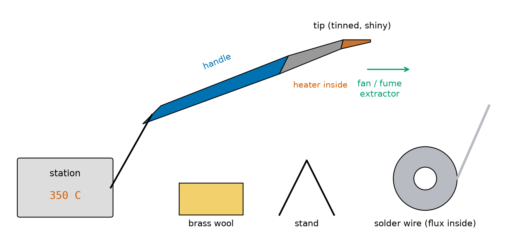
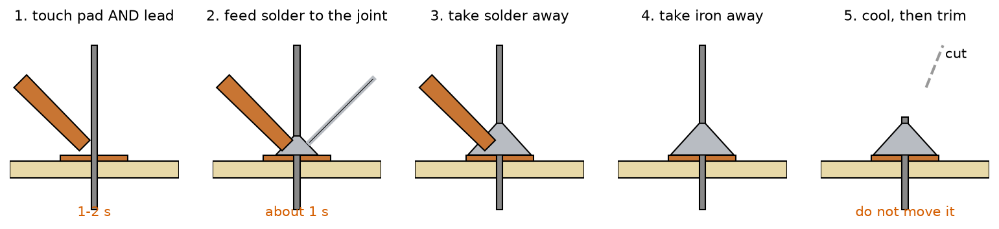
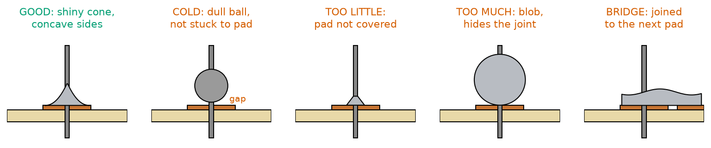
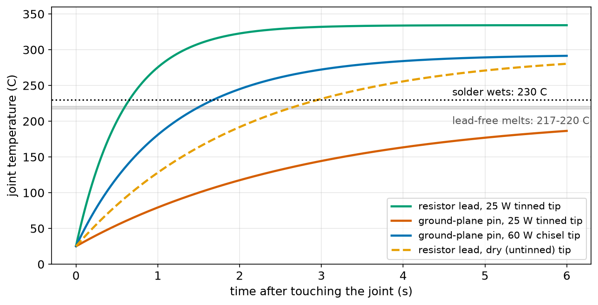
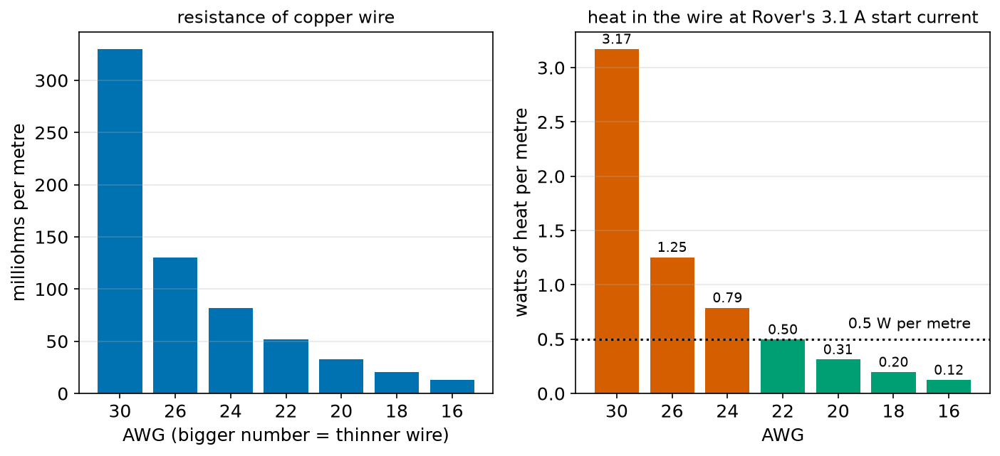
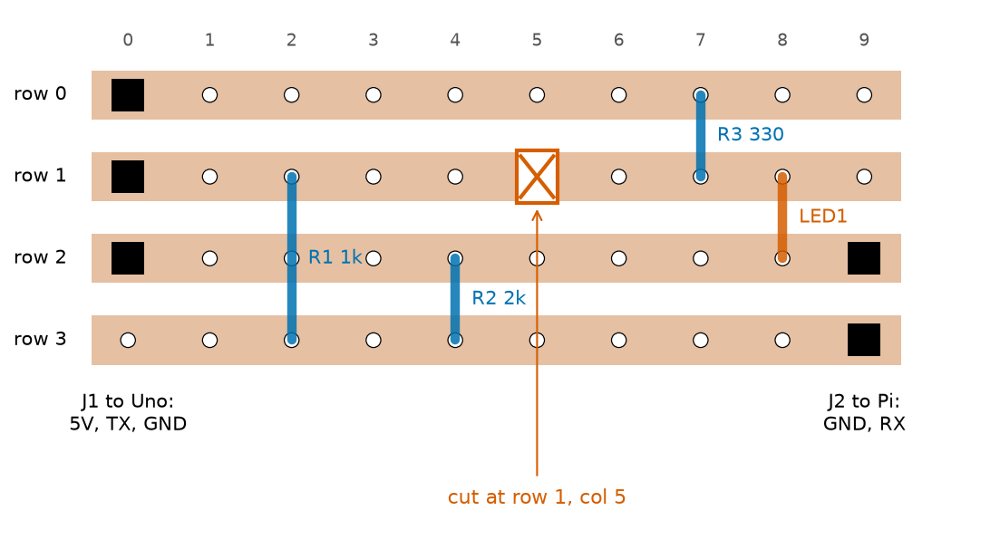

# Chapter 92 — Soldering and Building a Small Circuit

> **Part 5 · Chapter 92 of 749**
> **You need:** Chapter 7 (safety with tools and heat), Chapter 75 (Ohm's law), Chapter 76 (power and heat), Chapter 80 (breadboards and circuit diagrams), Chapter 81 (the multimeter and its continuity beep), Chapter 82 (LEDs and resistors), Chapter 90 (a bench supply's current limit) and Chapter 91 (Rover's 1 kΩ / 2 kΩ divider from the Arduino to the Raspberry Pi).
> **You will make:** a heat model that explains why some joints melt in half a second and some never melt, a wire-gauge chooser for Rover's wires, a calculation of what one bad joint does to a motor, a checker that finds shorts in a stripboard layout before you solder, and Rover's first soldered board.

---

## What you will learn

- What **solder** is, what **flux** does, and how **wetting** makes a joint.
- How to set up a **soldering iron** safely, and how to keep its **tip** clean and **tinned**.
- The **five steps** of a good through-hole joint, and how to recognise **good** and **bad** joints.
- Why big joints need a **hotter, bigger** iron: heat flow, explained with a model.
- How to **solder wires**, use **heat-shrink**, and choose a **wire gauge**.
- How to **desolder** a mistake.
- How to plan, cut and check a circuit on **stripboard**, and power it up safely for the first time.

---

## New words in this chapter

| Word | Simple meaning |
|---|---|
| **solder** | A metal that melts at a low temperature and joins other metals when it cools. |
| **soldering** | Joining metal parts with melted solder. |
| **flux** | A chemical that cleans metal surfaces as they heat, so solder can stick. |
| **wetting** | Melted solder spreading over a clean metal surface and bonding to it, like water on clean glass. |
| **soldering iron** | A hand tool with a hot metal tip, used to heat a joint. |
| **tinning** | Coating a tip or a wire with a thin layer of solder. |
| **pad** | A small copper area on a circuit board where a part is soldered. |
| **through-hole** | A part whose wire leads go through holes in the board. |
| **cold joint** | A bad joint where the solder did not wet: dull, lumpy, and weak. |
| **solder bridge** | Solder that joins two places that should not be joined: a short circuit. |
| **desoldering** | Removing solder to undo a joint. |
| **heat-shrink tubing** | A plastic sleeve that shrinks tightly around a joint when heated. |
| **wire gauge (AWG)** | A number for wire thickness: a bigger number means a thinner wire. |
| **stripboard** | A board with rows of holes joined by copper strips, for building permanent circuits. |
| **net** | A set of pins that a circuit diagram says must all be connected. |

---

## 92.1 Why solder?

A breadboard (Chapter 80) is wonderful for trying ideas. But a robot shakes, bumps into walls, and carries its electronics around all day. Breadboard wires work loose, the springy contacts wear out, and an intermittent contact is the hardest kind of fault to find: it works on the desk and fails on the floor. Rover's circuits that are finished and tested need to be made **permanent**.

📖 **New word: soldering** — joining metal parts with a metal that melts at a much lower temperature than they do. The joint is both a strong mechanical connection and a very low-resistance electrical one (about a thousandth of an ohm).

📖 **New word: solder** — the joining metal. There are two common kinds:

| Solder | Made of | Melts at | Iron temperature |
|---|---|---|---|
| Leaded, "63/37" | 63% tin, 37% lead | 183 °C | 300–330 °C |
| Lead-free, "SAC305" | 96.5% tin, 3% silver, 0.5% copper | 217–220 °C | 340–370 °C |

Leaded solder melts lower and flows more easily, so it is kinder to beginners, but lead is poisonous to eat: wash your hands after using it, and never eat while soldering. Lead-free solder is required in most commercial products and many schools. This chapter uses lead-free numbers; everything works the same way with leaded solder, about 30–40 °C cooler.

📖 **New word: flux** — a chemical that cleans the thin layer of oxide (tarnish) off hot metal, so that solder can touch the bare metal underneath. Without flux, solder rolls off like water off a greasy pan. Solder wire for electronics has flux inside it, in one or more thin cores ("rosin core" or "flux core"). The smoke you see when soldering is flux burning off; it is irritating to breathe, which is why you use a fan.

📖 **New word: wetting** — molten solder spreading out over a clean metal surface and bonding to it, the way water spreads on clean glass. Wetting needs three things at the same moment: **clean** metal (flux does that), **hot** metal (above the solder's melting point, on *both* parts being joined), and **solder**. A good joint is one where the solder wetted both parts.

🧠 **The iron heats the joint; the joint melts the solder.** This is the single most important idea of this chapter. If you melt solder on the iron and drip it onto a cold joint, it will sit on top as a ball without wetting: a cold joint.

---

## 92.2 The soldering setup



*Figure 92.1 — A soldering station with its iron, a brass-wool tip cleaner, an iron stand, a reel of flux-cored solder, and a fan pulling the fumes away.*

**How to read this picture:** The station (left) holds the temperature you set, here 350 °C. Its cable goes to the iron's handle (blue), which you hold like a pen. Inside the grey part is the heater; at the end is the copper tip, coated with iron and then with a shiny layer of solder. Along the bottom: the brass wool for wiping the tip, the stand where the iron always rests when it is not in your hand, and the solder reel. The green arrow is the air pulled away from your face by a small fan or fume extractor.

📖 **New word: soldering iron** — a tool with an electric heater and a metal tip. Cheap irons that plug straight into the wall run at whatever temperature they reach; a **soldering station** measures its tip temperature with a sensor and controls the heater to hold it at the setting. That is a control loop (Chapter 6): when a big joint cools the tip, the station turns the heater up to full power.

Things to look for:

- **Power: 40–80 W** with temperature control. A 25 W iron without control is fine for small parts but struggles with big ones (section 92.4 shows why).
- **Tips**: a **chisel** tip of 2–3 mm is the best all-round tip. A sharp **conical** tip looks precise, but its tiny point carries little heat.
- **Brass wool** in a holder cleans the tip without cooling it. A damp (not wet) sponge also works, but cools the tip a little each time.
- A heavy **stand**. The iron goes back in it every time you let go.

📖 **New word: tinning** — coating a surface with a thin layer of solder. A **tinned** tip is shiny silver; it touches the joint through a thin film of liquid solder, which carries heat many times better than a dry metal-to-metal touch. An untinned tip turns black (oxidised) and will not wet at all. To tin a tip: heat it, wipe it, and immediately melt a little solder onto it. Do this every few joints, and always before putting the iron away.

### Safety

⚠️ **Everything near the tip is hot enough to burn instantly**: 350 °C is hotter than an oven. Never touch the metal part. Always put the iron in its stand. **Never try to catch a falling iron** — step back and let it fall.

⚠️ **Wear safety glasses.** Solder can spit when flux boils, and lead offcuts fly when you trim them.

⚠️ **Use a fan** to pull fumes away from your face, and work in a room with fresh air.

⚠️ **Wash your hands** after soldering, especially with leaded solder, and keep food and drinks away from the bench.

⚠️ **Never solder a circuit that has power connected.** Unplug the battery first.

⚠️ **If you burn yourself**, cool the burn under cold running water for 20 minutes, and tell an adult. See Chapter 7 for the full safety rules.

---

## 92.3 The five steps of a good joint

📖 **New word: pad** — a small copper area on a board, around a hole, where a part is soldered. 📖 **New word: through-hole** — a part whose wire leads go through holes in the board. You put the part on the plain side, push its leads through, and turn the board over to solder on the copper side.



*Figure 92.2 — A through-hole joint on the copper side of a board: heat, feed, remove solder, remove iron, then cool and trim.*

**How to read this picture:** Each panel shows the same joint from the side: the board (beige), the copper pad (orange-brown), and the part's lead (grey) coming up through the hole. The iron's tip (copper colour) comes in from the left. The solder wire comes in from the right in step 2, touching the joint, *not* the iron. By step 3 a cone of solder has formed; the iron leaves last; and in step 5 the lead is cut just above the top of the cone.

1. **Heat the pad and the lead together** (1–2 seconds). Put the flat of the tinned tip so that it touches both. A tiny drop of solder on the tip, between tip and joint, makes a "heat bridge" that helps a lot.
2. **Feed solder into the joint** (about 1 second), on the side opposite the iron. It should melt from the joint's heat and flow around the lead and over the pad.
3. **Take the solder away** when the pad is covered and the joint looks like a small volcano. That takes only a few millimetres of solder wire.
4. **Take the iron away**, about half a second later, so that the last solder flows smoothly.
5. **Do not move anything** for a few seconds while the solder freezes. Then **trim** the lead just above the joint with side cutters, holding the end so it does not fly.

The whole joint takes 2–4 seconds. Much longer can overheat the part or lift the pad off the board; much shorter usually means it did not wet.

### Good and bad joints



*Figure 92.3 — Five joints in cross-section: one good and four common faults.*

**How to read this picture:** The good joint (green title) is a smooth cone with **concave** sides (curving inwards): the solder wetted both the pad and the lead and pulled itself up the lead. The others: a **cold** joint is a dull ball that touches the lead but not the pad (the red "gap"); **too little** solder leaves the pad bare; **too much** makes a ball that hides whether it wetted; a **bridge** joins the pad to its neighbour.

📖 **New word: cold joint** — a joint where the solder did not wet one of the parts, usually because that part was not hot enough. It looks dull, grainy or lumpy, often ball-shaped. It may work at first and then crack when the robot vibrates. `cold_joint.py` (in the Code section) shows what that does to a motor.

📖 **New word: solder bridge** — solder that joins two pads that should be separate: a short circuit. Common on stripboard, where the strips are only 1.5 mm apart.

| Joint | How it looks | Fix |
|---|---|---|
| Good | Shiny (lead-free: slightly satin), smooth cone, concave sides, pad covered | — |
| Cold | Dull, grainy, ball-shaped, or a visible ring around the lead | Reheat with fresh solder (for its flux) until it flows |
| Too little | Pad partly bare, hole not filled | Reheat and add a little solder |
| Too much | A round ball | Remove some with wick (section 92.6) |
| Bridge | Solder across to the next pad or strip | Drag the hot tip through the gap, or use wick |
| Overheated | Brown, burnt flux; pad lifting from the board | Use less time and a better-tinned tip; glue the pad or add a wire |

---

## 92.4 Heat flow: why big joints are hard

A small resistor lead melts solder in half a second. The pin of a connector on a big copper area may never melt it, even with the same iron at the same temperature. Why? Because the iron's temperature setting is not the whole story: **heat has to flow** from the tip into the joint, and the joint keeps losing heat to the board and wires around it.

This is a heat-flow model, like the thermal resistance of Chapter 76 and the RC charging of Chapter 84:

- The tip pushes heat into the joint: **flow = g_contact × (T_tip − T_joint)**. `g_contact` (watts per degree) is how well heat passes from tip to joint. A dry tip touching a round lead at one point passes little; a tinned tip with a drop of solder as a bridge passes several times more; a big chisel tip pressed flat passes more still.
- The joint leaks heat to its surroundings: **loss = g_loss × (T_joint − T_room)**. A small pad on stripboard loses little. A pin on a **ground plane** (a big copper area on a board) or a thick battery wire loses a lot.
- The joint's temperature rises by (flow − loss) ÷ its **heat capacity** each second. Bigger joints have more metal to warm up.
- The tip itself cools when heat leaves it, and the station's heater (25 W or 60 W) puts it back.

If the loss can balance the flow while the joint is still below 230 °C, the joint **never** wets, however long you wait. You just cook the board. `iron_model.py` in the Code section simulates this; Figure 92.4 shows its curves.



*Figure 92.4 — The joint's temperature against time for a small resistor lead and for a pin on a ground plane, with different irons. The dotted line is where lead-free solder wets.*

**How to read this picture:** Every curve starts at room temperature (25 °C) when the iron touches. The green curve (a resistor lead, tinned 25 W tip) shoots past the 230 °C line in about 0.7 s. The dashed orange curve is the same lead with a dry, untinned tip: it takes about 3 s. The red curve is a ground-plane pin with the same small tinned iron: it is still below 190 °C after 6 s, and it can never climb past about 211 °C, so it never reaches the line. The blue curve is the same pin with a 60 W chisel tip: it crosses at about 1.7 s.

🧠 **For a big joint, use a bigger tip and more power, not more time.** Turning the temperature up a little helps too, but a tiny tip at 450 °C mostly burns the flux and the board before the joint has warmed through.

---

## 92.5 Soldering wires

Robots have many wires: battery leads, motor wires, sensor cables. A soldered wire joint needs the same three things (clean, hot, solder) plus **support**, because a wire bends and vibrates.

1. **Strip** about 5 mm of insulation with wire strippers set to the right gauge (not with your teeth, and not with a knife).
2. **Twist** the strands of a stranded wire together so none stick out.
3. **Tin** the wire: heat it, and let solder soak into the strands. It turns silver and stiff.
4. **Slide heat-shrink tubing** onto the wire *before* you join it (everybody forgets this at least once).
5. **Join**: hold the two tinned wires side by side (or the wire against a tinned connector cup), touch the iron, and they fuse with almost no extra solder.
6. **Shrink**: when the joint is cool, slide the tubing over it and heat it with a heat gun (or carefully with the side of the iron) until it grips.

📖 **New word: heat-shrink tubing** — a plastic sleeve that shrinks to about half its diameter when heated. It insulates the joint, and stops the wire bending right at the joint.

⚠️ **Solder makes a wire stiff, so it breaks just where the solder ends** when the wire flexes. Always add strain relief: heat-shrink that covers the joint and some of the insulation, a cable tie, or a dab of hot glue so that the wire bends somewhere else.

### Wire thickness

📖 **New word: wire gauge (AWG)** — American Wire Gauge, a number for a wire's thickness. A **bigger number is a thinner wire**: every 6 gauges halves the diameter, and every 3 gauges roughly halves the cross-section area (and so doubles the resistance).



*Figure 92.5 — Left: the resistance per metre of copper wires from AWG 30 (thin) to AWG 16 (thick). Right: the heat per metre at Rover's 3.1 A start current; red bars are above 0.5 W per metre.*

**How to read this picture:** On the left, the bars fall fast from left to right: AWG 30 has 330 mΩ per metre, AWG 16 only 13 mΩ. On the right, the same resistances times 3.1² (heat = I²R, Chapter 76): an AWG 30 wire would turn 3.2 W into heat in every metre, enough to soften its insulation; AWG 22 sits just at 0.5 W per metre; AWG 20 and thicker stay comfortable.

A wire has two jobs: not to waste voltage (a drop of a tenth of a volt is a reasonable limit) and not to get warm (half a watt per metre is a comfortable limit for small hook-up wire in free air). `wire_gauge.py` (Application 2) chooses the thinnest wire that does both.

---

## 92.6 Desoldering: undoing a mistake

Everybody puts a part in the wrong place sometimes. Two tools remove solder:

📖 **New word: desoldering** — removing the solder from a joint so the part can come out.

- **Desoldering braid** (solder wick): a flat braid of fine copper wires with flux in it. Lay it on the joint, press the iron on top of the braid, and the molten solder runs into the braid by capillary action, like water into a paper towel. Cut off the used part.
- **Solder sucker** (desoldering pump): a spring-loaded plunger. Melt the joint, put the nozzle right next to it, press the button, and it sucks the molten solder away.

For a part with two leads, you can also heat one joint at a time and wiggle the part out a little at each side. Fresh solder first, then wick: adding solder sounds backwards, but its flux helps the old solder flow.

---

## 92.7 Stripboard: from a diagram to a board

📖 **New word: stripboard** — a board with a grid of holes 2.54 mm (0.1 inch) apart, and copper strips running along each row on the underside. Every hole in a strip is connected to the others in that strip. It is like a breadboard's rows, but permanent. (Perfboard is similar but with separate pads around each hole; you join them with wire or solder trails.)

To build a circuit on stripboard:

1. **Draw the circuit diagram** (Chapter 80), and list its **nets**.
2. **Plan the layout on paper or in code**: each net gets a piece of strip. Parts bridge from one strip to another.
3. **Cut** the strips where two nets share a row. A cut is made by twisting a 3.5 mm drill bit (by hand) or a spot-face cutter in a hole, until the copper is cut right through.
4. **Check** the layout against the nets (Application 1 does this in code), then **solder** the parts, lowest first (wire links, resistors, then headers).
5. **Inspect**: look at every joint with a magnifier, and look along every cut against a light.
6. **Test with the multimeter's continuity beep** (Chapter 81): between every pair of neighbouring strips (no beep!), and along each net (beep).
7. **Power up with a current limit** (Chapter 90), and measure the voltages.

📖 **New word: net** — a set of pins that the circuit diagram says must be connected together, like "GND: J1 pin 3, R2, the LED's cathode, J2 pin 1". A layout is right when every net is exactly one piece of copper, and no two nets touch.



*Figure 92.6 — Rover's first soldered board, seen from the parts side with the strips shown in light copper. Black squares are header pins; coloured bars are parts; the red box is a cut in row 1.*

**How to read this picture:** Four strips run left to right. Row 0 is 5 V. Row 1 is cut at column 5: its left half carries the Uno's TX signal, its right half the LED's anode. Row 2 is ground. Row 3 is the Raspberry Pi's RX. J1 (three pins on the left) plugs into the Arduino's 5 V, TX and GND; J2 (two pins on the right) goes to the Pi's GND and RX. R1 (1 kΩ) goes from the TX strip to the RX strip, jumping over the ground strip without touching it (its lead only goes through the holes at its ends). R2 (2 kΩ) stands upright between RX and ground. R3 (330 Ω) and the LED form a power light from 5 V to ground.

---

## Code

File `code/ch092/iron_model.py`:

```python
# iron_model.py - why some joints take 2 seconds and some never melt: heat flow from a soldering iron
T_ROOM = 25.0
T_SET = 350.0                 # the iron's temperature setting, in C
T_WET = 230.0                 # lead-free solder melts at 217-220 C; the joint must be a little hotter to wet
C_TIP = 2.0                   # heat capacity of the tip: J per C (about 5 g of copper)
DT = 0.001


def solder(c_joint, g_loss, g_contact, p_max, seconds=10.0):
    """Return the time (s) for the joint to reach T_WET, and the lowest tip temperature on the way."""
    t_tip, t_joint, t = T_SET, T_ROOM, 0.0
    lowest_tip = t_tip
    while t < seconds:
        p_heater = max(0.0, min(p_max, 5.0 * (T_SET - t_tip)))   # the iron's controller: full power when the tip cools
        flow = g_contact * (t_tip - t_joint)                      # heat from tip into joint, W
        loss = g_loss * (t_joint - T_ROOM)                        # heat the joint loses into the board and wire, W
        t_tip += (p_heater - flow) / C_TIP * DT
        t_joint += (flow - loss) / c_joint * DT
        lowest_tip = min(lowest_tip, t_tip)
        t += DT
        if t_joint >= T_WET:
            return t, lowest_tip
    return None, lowest_tip


JOINTS = {
    # name: (joint heat capacity J/C, loss to surroundings W/C)
    "resistor lead on stripboard": (0.05, 0.004),
    "header pin on a ground plane": (0.4, 0.06),
    "battery wire into a connector": (1.0, 0.03),
}
IRONS = {
    # name: (contact conductance W/C, maximum heater power W)
    "small tip, 25 W iron, no solder on tip": (0.02, 25.0),
    "small tip, 25 W iron, tinned tip": (0.08, 25.0),
    "chisel tip, 60 W station, tinned": (0.30, 60.0),
}
for jname, (c_j, g_l) in JOINTS.items():
    print(jname)
    for iname, (g_c, p) in IRONS.items():
        t, low = solder(c_j, g_l, g_c, p)
        result = f"wets in {t:4.1f} s" if t is not None else "NEVER wets (cold joint)"
        print(f"   {iname:40s} {result:24s} tip dips to {low:4.0f} C")
```

| Line | Code | What it does (simple English) |
|---|---|---|
| 1 | `# iron_model.py …` | A comment. |
| 2 | `T_ROOM = 25.0` | The room, and the joint's starting temperature. |
| 3 | `T_SET = 350.0` | The station's setting. |
| 4 | `T_WET = 230.0` | The joint must reach this for lead-free solder to wet. |
| 5 | `C_TIP = 2.0` | The tip's heat capacity: 2 joules warm it by 1 °C. Copper needs 0.385 J per gram per °C, and a tip is about 5 g. |
| 6 | `DT = 0.001` | Euler steps of 1 ms (Chapter 71). |
| 7–8 | (blank) | Spacing. |
| 9 | `def solder(c_joint, g_loss, g_contact, p_max, seconds=10.0):` | A function (Chapter 24): one joint, one iron. `seconds=10.0` is a default value: give up after 10 s. |
| 10 | `"""…"""` | Its docstring (Chapter 23). |
| 11 | `t_tip, t_joint, t = T_SET, T_ROOM, 0.0` | The tip starts at its setting, the joint at room temperature. |
| 12 | `lowest_tip = t_tip` | Remember how far the tip cools. |
| 13 | `while t < seconds:` | Step through time. |
| 14 | `p_heater = max(0.0, min(p_max, 5.0 * (T_SET - t_tip)))` | The station's controller: 5 W for every degree the tip is too cold, but never more than the heater's maximum and never less than zero. A proportional controller (Chapter 6). |
| 15 | `flow = g_contact * (t_tip - t_joint)` | Heat from tip to joint, in watts: bigger when the difference is bigger. |
| 16 | `loss = g_loss * (t_joint - T_ROOM)` | Heat leaking from the joint into the board and wires. |
| 17 | `t_tip += (p_heater - flow) / C_TIP * DT` | The tip warms by what the heater adds minus what flows out, divided by its heat capacity. |
| 18 | `t_joint += (flow - loss) / c_joint * DT` | The joint warms by what flows in minus what leaks out. |
| 19 | `lowest_tip = min(lowest_tip, t_tip)` | Keep the lowest tip temperature so far. |
| 20 | `t += DT` | Next moment. |
| 21–22 | `if t_joint >= T_WET: return t, lowest_tip` | Wetted: return the time. |
| 23 | `return None, lowest_tip` | Ten seconds and still too cold: `None` means "never". |
| 24–25 | (blank) | Spacing. |
| 26–31 | `JOINTS = { … }` | Three joints: heat capacity and loss. A small lead is tiny and isolated; a ground-plane pin is bigger and leaks heat into the copper plane; a battery wire is big but leaks less. |
| 32–37 | `IRONS = { … }` | Three irons: how well heat gets from tip to joint, and the heater's power. |
| 38 | `for jname, (c_j, g_l) in JOINTS.items():` | Every joint… |
| 39 | `print(jname)` | …with its name as a heading… |
| 40 | `for iname, (g_c, p) in IRONS.items():` | …with every iron. |
| 41 | `t, low = solder(c_j, g_l, g_c, p)` | Run the simulation. |
| 42 | `result = … if t is not None else …` | The time, or "NEVER". |
| 43 | `print(…)` | One line per iron. |

Output:

```
resistor lead on stripboard
   small tip, 25 W iron, no solder on tip   wets in  3.0 s           tip dips to  349 C
   small tip, 25 W iron, tinned tip         wets in  0.7 s           tip dips to  348 C
   chisel tip, 60 W station, tinned         wets in  0.2 s           tip dips to  346 C
header pin on a ground plane
   small tip, 25 W iron, no solder on tip   NEVER wets (cold joint)  tip dips to  349 C
   small tip, 25 W iron, tinned tip         NEVER wets (cold joint)  tip dips to  346 C
   chisel tip, 60 W station, tinned         wets in  1.7 s           tip dips to  339 C
battery wire into a connector
   small tip, 25 W iron, no solder on tip   NEVER wets (cold joint)  tip dips to  349 C
   small tip, 25 W iron, tinned tip         NEVER wets (cold joint)  tip dips to  345 C
   chisel tip, 60 W station, tinned         wets in  3.9 s           tip dips to  333 C
```

Three lessons. **Tinning** the tip makes small joints four times faster (3.0 s → 0.7 s): the contact, not the temperature, was the limit. Big joints **never** wet with a small tip, however long you hold it; the tip temperature hardly changes, so the station is not the problem, the narrow path for heat is. With a chisel tip, everything solders. You can check the "never" without a computer: the joint stops warming when flow = loss. For the ground-plane pin with the tinned small tip, 0.08 × (350 − T) = 0.06 × (T − 25) gives T = 211 °C, below 230 °C.

(These numbers come from a simple model with estimated values. Real joints vary, but the pattern, and the fix, are real.)

File `code/ch092/cold_joint.py`:

```python
# cold_joint.py - what one bad solder joint does to Rover's motor supply
V_BATT = 7.2
R_INTERNAL = 0.146            # Rover's battery (Chapter 81)
R_MOTOR = 4.8                 # one motor, stalled at the start (Chapter 75)
R_DRIVER = 0.5                # the motor driver's switch (Chapter 88)
R_WIRES = 0.03                # good wires and connectors

for name, r_joint in [("good joint", 0.001), ("dull, grainy joint", 0.1), ("cracked cold joint", 1.0),
                      ("cracked, vibrating", 5.0)]:
    r_total = R_INTERNAL + R_DRIVER + R_WIRES + r_joint + R_MOTOR
    i = V_BATT / r_total                                  # Ohm's law for the whole loop (Chapter 75)
    p_joint = i ** 2 * r_joint                            # heat in the joint itself (Chapter 76)
    v_motor = i * R_MOTOR
    print(f"{name:20s} {r_joint:6.3f} ohm: motor gets {v_motor:4.2f} V, {i:4.2f} A; joint heat {p_joint * 1000:6.1f} mW")
```

| Line | Code | What it does (simple English) |
|---|---|---|
| 1 | `# cold_joint.py …` | A comment. |
| 2–6 | `V_BATT`, `R_INTERNAL`, `R_MOTOR`, `R_DRIVER`, `R_WIRES` | Rover's numbers from earlier chapters: everything in series around one motor's loop. |
| 7 | (blank) | Spacing. |
| 8–9 | `for name, r_joint in [ … ]:` | Four joints, from good (1 mΩ) to cracked and vibrating (5 Ω). The list continues on line 9 because it is inside brackets. |
| 10 | `r_total = …` | All the resistances in series add (Chapter 77). |
| 11 | `i = V_BATT / r_total` | Ohm's law gives the current. |
| 12 | `p_joint = i ** 2 * r_joint` | The heat in the joint itself: I²R. |
| 13 | `v_motor = i * R_MOTOR` | The voltage the motor actually gets. |
| 14 | `print(…)` | One line per joint. |

Output:

```
good joint            0.001 ohm: motor gets 6.31 V, 1.31 A; joint heat    1.7 mW
dull, grainy joint    0.100 ohm: motor gets 6.20 V, 1.29 A; joint heat  166.7 mW
cracked cold joint    1.000 ohm: motor gets 5.34 V, 1.11 A; joint heat 1236.1 mW
cracked, vibrating    5.000 ohm: motor gets 3.30 V, 0.69 A; joint heat 2361.8 mW
```

A cracked joint of 1 Ω takes 1 V from the motor and turns **1.2 W** into heat in a blob of metal the size of a grain of rice: hot enough to melt the solder or the insulation next to it. A joint that cracks and touches as the robot vibrates makes one motor weaker than the other, so the robot pulls to one side for no visible reason. Good joints on power wires matter.

---

## Small examples

**Example 1.** A 330 Ω resistor and a red LED (about 2.0 V) on 5 V: (5 − 2.0) ÷ 330 = 9.1 mA. A clear but not dazzling light.

**Example 2.** Lead-free solder melts at 217 °C; leaded at 183 °C. An iron for lead-free is usually set 30–40 °C hotter.

**Example 3.** One metre of AWG 22 wire has 0.052 Ω. At 3.1 A it drops 3.1 × 0.052 = 0.16 V and makes 3.1² × 0.052 = 0.50 W of heat.

**Example 4.** Going from AWG 22 to AWG 16 (6 gauges thicker) doubles the diameter: 0.644 mm → 1.291 mm, and divides the resistance by 4.

**Example 5.** A joint takes 4 seconds with an untinned tip and 1 second with a tinned one. The tip temperature is the same; the contact is better.

**Example 6.** The multimeter beeps between two neighbouring strips that should be separate. There is a bridge or a missed cut between them.

**Example 7.** A 2.5 mm chisel tip on a 60 W station solders both a resistor lead and a battery wire; a 0.5 mm conical tip struggles with the battery wire.

**Example 8.** A stripboard of 10 columns has 4 strips. A cut at column 5 in one row turns that row into two separate pieces of copper: columns 0–4 and 6–9 (the hole at column 5 is drilled away).

---

## 🏭 Real robot applications

### Application 1 (worked in full) — 🤖 Rover's first soldered board

**1. The real problem.** Chapter 91 designed the connection between Rover's Arduino Uno and its Raspberry Pi: a 1 kΩ / 2 kΩ divider from the Uno's TX to the Pi's RX. On a breadboard it works, but it shakes loose when Rover drives. It should become a small permanent board, with a power LED so you can see at a glance that the 5 V rail is on. The board must have no shorts, because a short between the Uno's TX (5 V) and the Pi's RX would put 5 V into the Pi.

**2. Why this theory.** On stripboard, every hole in a strip is connected. The layout is right only if each **net** (section 92.7) is exactly one piece of copper and no two nets share one. That is a question we can answer in code, before any solder is melted.

**3. The numbers.** Five nets: 5V (J1's 5 V pin, R3), UNO_TX (J1's TX pin, R1), PI_RX (R1, R2, J2's RX pin), GND (J1's GND pin, R2, the LED's cathode, J2's GND pin) and LED_A (R3, the LED's anode). The board has 4 rows and 10 columns. The layout of Figure 92.6 puts the parts' pins in these holes (row, column): J1 at (0,0), (1,0), (2,0); J2 at (2,9), (3,9); R1 at (1,2)–(3,2); R2 at (3,4)–(2,4); R3 at (0,7)–(1,7); the LED at (1,8)–(2,8).

**4. The model.** A hole sits on a piece of copper named by its row and by how many cuts lie to its left in that row. Two pins are connected if their holes sit on the same piece. A wanted net is correct if exactly its pins share one piece. A piece with pins from two nets is a **short**; a net whose pins are on different pieces is **open**.

**5. The code.** File `code/ch092/stripboard_check.py`:

```python
# stripboard_check.py - check a stripboard layout before you solder: which holes are really connected?
# The board has copper strips running left to right along each row. A cut at (row, col) breaks the strip there.

PARTS = {
    # part: {pin: (row, col)}
    "J1 (to Uno)": {"5V": (0, 0), "TX": (1, 0), "GND": (2, 0)},
    "J2 (to Pi)": {"GND": (2, 9), "RX": (3, 9)},
    "R1 1k": {"a": (1, 2), "b": (3, 2)},
    "R2 2k": {"a": (3, 4), "b": (2, 4)},
    "R3 330": {"a": (0, 7), "b": (1, 7)},
    "LED1": {"anode": (1, 8), "cathode": (2, 8)},
}
WANTED = {
    "5V": {"J1 (to Uno).5V", "R3 330.a"},
    "UNO_TX": {"J1 (to Uno).TX", "R1 1k.a"},
    "PI_RX": {"R1 1k.b", "R2 2k.a", "J2 (to Pi).RX"},
    "GND": {"J1 (to Uno).GND", "R2 2k.b", "LED1.cathode", "J2 (to Pi).GND"},
    "LED_A": {"R3 330.b", "LED1.anode"},
}


def strip_piece(row, col, cuts):
    """Name the piece of copper a hole sits on: its row, and how many cuts lie to its left."""
    if (row, col) in cuts:
        return None                                   # the hole itself was drilled away
    return (row, sum(1 for (r, c) in cuts if r == row and c < col))


def check(cuts):
    pieces = {}
    for part, pins in PARTS.items():
        for pin, (row, col) in pins.items():
            piece = strip_piece(row, col, cuts)
            if piece is None:
                print(f"  ERROR: {part}.{pin} sits in a cut hole")
                continue
            pieces.setdefault(piece, set()).add(f"{part}.{pin}")
    found = [p for p in pieces.values() if len(p) > 1]
    ok = True
    for name, pins in WANTED.items():
        if pins not in found:
            ok = False
            for f in found:
                if pins & f and f != pins:
                    extra = f - pins
                    missing = pins - f
                    if extra:
                        print(f"  SHORT: net {name} is joined to {sorted(extra)}")
                    if missing:
                        print(f"  OPEN:  net {name} is missing {sorted(missing)}")
                    break
            else:
                print(f"  OPEN:  net {name} is not connected at all")
    if ok:
        print("  all 5 nets correct, no shorts")


print("layout with no cuts:")
check(set())
print("layout with a cut at row 1, column 5:")
check({(1, 5)})
```

| Line | Code | What it does (simple English) |
|---|---|---|
| 1–2 | comments | What the program does, and how a stripboard is connected. |
| 3 | (blank) | Spacing. |
| 4–12 | `PARTS = { … }` | A dictionary of dictionaries (Chapter 22): for each part, each pin's hole as (row, column). |
| 13–19 | `WANTED = { … }` | The five nets from the circuit diagram, each a **set** of "part.pin" names. A **set** is a collection in curly brackets, like a list but with no order and no repeats, so two sets are equal when they hold the same names. |
| 20–21 | (blank) | Spacing. |
| 22 | `def strip_piece(row, col, cuts):` | Which piece of copper does a hole sit on? |
| 23 | `"""…"""` | Its docstring. |
| 24–25 | `if (row, col) in cuts: return None` | A hole that was cut has no copper at all. |
| 26 | `return (row, sum(…))` | The piece's name: the row, and the number of cuts to the left of this hole in this row. Holes with the same name are on the same piece. |
| 27–28 | (blank) | Spacing. |
| 29 | `def check(cuts):` | Check the whole layout for one set of cuts. |
| 30 | `pieces = {}` | Will map each piece of copper to the set of pins on it. |
| 31–32 | two `for` loops | Every pin of every part. |
| 33 | `piece = strip_piece(row, col, cuts)` | Which piece it sits on. |
| 34–36 | `if piece is None: … continue` | A pin in a cut hole is an error; skip to the next pin. |
| 37 | `pieces.setdefault(piece, set()).add(…)` | Add this pin to its piece's set. `setdefault` creates an empty set the first time a piece is seen. |
| 38 | `found = [ … if len(p) > 1]` | The pieces that connect two or more pins: the nets the board really has. |
| 39 | `ok = True` | Innocent until proven guilty. |
| 40 | `for name, pins in WANTED.items():` | Every wanted net… |
| 41 | `if pins not in found:` | …that is not exactly one of the real pieces is a problem. |
| 42 | `ok = False` | Note the failure. |
| 43–44 | `for f in found: if pins & f and f != pins:` | Find a real piece that shares some pins with this net (`&` is the set of names in both). |
| 45–46 | `extra = f - pins`, `missing = pins - f` | Pins on the piece that should not be there; pins of the net that are not on it. `-` is "in the first set but not the second". |
| 47–50 | `if extra: … if missing: …` | Report a short, an open, or both. |
| 51 | `break` | One report per net is enough. |
| 52–53 | `else: print(…)` | A `for` loop's `else` runs only if the loop finished without `break`: no piece shares any pins with this net, so it is not connected at all. |
| 54–55 | `if ok: print(…)` | Everything matched. |
| 56–57 | (blank) | Spacing. |
| 58–61 | two checks | First the layout with no cuts, then with one cut at row 1, column 5. |

**6. The result.**

```
layout with no cuts:
  SHORT: net UNO_TX is joined to ['LED1.anode', 'R3 330.b']
  SHORT: net LED_A is joined to ['J1 (to Uno).TX', 'R1 1k.a']
layout with a cut at row 1, column 5:
  all 5 nets correct, no shorts
```

**7. What it means for the robot.** Without the cut, row 1 joins the Uno's TX to the LED's anode, which sits on R3 from 5 V. The TX pin would be pulled towards 5 V through 330 Ω when it tries to go LOW: the Uno would fight the resistor (about 15 mA), the messages to the Pi would be garbage, and the LED would flicker with the data. One cut at row 1, column 5 fixes all five nets. You would have found this short with the multimeter after soldering, too, but the program finds it before you have melted any solder, and it checks again after every change to the layout.

When the board is built: with the battery disconnected, beep between rows 0 and 1, 1 and 2, 2 and 3 (silence), and across the cut (silence). Then plug in J1 only, with the Uno powered from USB (its current is limited by the computer's port; for boards with their own supply, use a bench supply with a current limit, Chapter 90). The LED lights, and the multimeter on J2's RX pin reads about **3.3 V** (the Uno's TX rests HIGH, so the divider gives 5 × 2 ÷ 3 = 3.33 V). Only then connect the Pi.

### Application 2 (worked in full) — 🔋 Choosing and soldering Rover's power wires

**1. The real problem.** Rover's battery, motor driver and motors are joined by wires. When the motors start, 3.1 A flows from the battery (Chapter 89). What wire thickness does each connection need, and what iron does it take to solder the battery wire into its connector?

**2. Why this theory.** A wire is a resistor (Chapter 74). Its voltage drop is I × R (Ohm's law, Chapter 75), and the heat in it is I² × R (Chapter 76). Its resistance depends on its cross-section area: R = ρ × length ÷ area, with ρ = 1.68 × 10⁻⁸ Ω·m for copper. The AWG formula gives the diameter.

**3. The numbers.** Battery → motor driver: 3.1 A, 0.25 m each way. Driver → one motor: 1.5 A (one motor's stall), 0.20 m. 5 V rail → sensors: 0.19 A (Chapter 77), 0.30 m. A signal wire: 2 mA, 0.15 m. Limits: under 0.1 V drop over the loop (there **and back**: twice the length), and under 0.5 W per metre.

**4. The model.** Diameter (mm) = 0.127 × 92^((36 − AWG) ÷ 39); area = π × d² ÷ 4; R per metre = ρ ÷ area. For each wire, try gauges from thinnest to thickest and stop at the first one within both limits.

**5. The code.** File `code/ch092/wire_gauge.py`:

```python
# wire_gauge.py - which wire thickness for each of Rover's connections?
import math

RHO_COPPER = 1.68e-8          # resistivity of copper, ohm metre


def awg_diameter_mm(awg):
    """The American Wire Gauge formula: every 6 gauges halves the diameter (roughly)."""
    return 0.127 * 92 ** ((36 - awg) / 39)


def ohm_per_m(awg):
    d = awg_diameter_mm(awg) / 1000
    area = math.pi * d ** 2 / 4
    return RHO_COPPER / area


print(f"{'AWG':>4s} {'diameter':>9s} {'ohm per m':>10s}")
for awg in [30, 26, 24, 22, 20, 18, 16]:
    print(f"{awg:4d} {awg_diameter_mm(awg):6.3f} mm {ohm_per_m(awg):10.4f}")
print()

# Rover's wires: name, current (A), one-way length (m); there and back makes the loop twice as long
WIRES = [("battery to motor driver", 3.1, 0.25), ("driver to one motor", 1.5, 0.20),
         ("5 V rail to sensors", 0.19, 0.30), ("signal wire (UART)", 0.002, 0.15)]
print(f"{'wire':25s} {'amps':>6s}  thinnest gauge with under 0.1 V drop and under 0.5 W per metre")
for name, amps, length in WIRES:
    for awg in [30, 26, 24, 22, 20, 18, 16]:
        drop = amps * ohm_per_m(awg) * 2 * length            # Ohm's law over the loop (Chapter 75)
        heat_per_m = amps ** 2 * ohm_per_m(awg)              # I^2 R for one metre (Chapter 76)
        if drop < 0.1 and heat_per_m < 0.5:
            print(f"{name:25s} {amps:6.3f}  AWG {awg}: drop {drop * 1000:5.1f} mV, {heat_per_m:5.3f} W/m")
            break
```

| Line | Code | What it does (simple English) |
|---|---|---|
| 1 | `# wire_gauge.py …` | A comment. |
| 2 | `import math` | For π. |
| 3 | (blank) | Spacing. |
| 4 | `RHO_COPPER = 1.68e-8` | Copper's resistivity: a 1 m long, 1 m² wire would have 1.68 × 10⁻⁸ Ω. |
| 5–6 | (blank) | Spacing. |
| 7–9 | `def awg_diameter_mm(awg): …` | The AWG formula. AWG 36 is 0.127 mm; each gauge thicker multiplies the diameter by 92^(1/39) = 1.123. |
| 10–11 | (blank) | Spacing. |
| 12 | `def ohm_per_m(awg):` | Resistance of one metre of this gauge. |
| 13 | `d = awg_diameter_mm(awg) / 1000` | The diameter in metres. |
| 14 | `area = math.pi * d ** 2 / 4` | The area of a circle: π × d² ÷ 4. |
| 15 | `return RHO_COPPER / area` | R = ρ × length ÷ area, for length 1 m. |
| 16–17 | (blank) | Spacing. |
| 18–21 | the table | Prints the diameter and resistance of seven gauges. |
| 22 | (blank) | Spacing. |
| 23 | comment | The format of `WIRES`. |
| 24–25 | `WIRES = [ … ]` | Rover's four kinds of wire. |
| 26 | `print(…)` | A heading. |
| 27 | `for name, amps, length in WIRES:` | Every wire… |
| 28 | `for awg in [ … ]:` | …tried from thinnest to thickest. |
| 29 | `drop = amps * ohm_per_m(awg) * 2 * length` | The voltage lost over both wires of the loop. |
| 30 | `heat_per_m = amps ** 2 * ohm_per_m(awg)` | The heat in each metre. |
| 31–33 | `if … : print(…); break` | The first gauge that passes both tests is printed, and `break` stops trying thicker ones. |

**6. The result.**

```
 AWG  diameter  ohm per m
  30  0.255 mm     0.3299
  26  0.405 mm     0.1305
  24  0.511 mm     0.0821
  22  0.644 mm     0.0516
  20  0.812 mm     0.0325
  18  1.024 mm     0.0204
  16  1.291 mm     0.0128

wire                        amps  thinnest gauge with under 0.1 V drop and under 0.5 W per metre
battery to motor driver    3.100  AWG 22: drop  80.0 mV, 0.496 W/m
driver to one motor        1.500  AWG 26: drop  78.3 mV, 0.294 W/m
5 V rail to sensors        0.190  AWG 30: drop  37.6 mV, 0.012 W/m
signal wire (UART)         0.002  AWG 30: drop   0.2 mV, 0.000 W/m
```

**7. What it means for the robot.** The battery wire *just* passes with AWG 22 (0.496 W per metre, against a limit of 0.5), so Rover uses **AWG 20** for the battery and a margin for later upgrades; AWG 22 or 24 for the motors; and ordinary thin hook-up wire (AWG 26–30, such as ribbon cable or jumper wire) for signals and the sensor rail. Thin wire is lighter and bends more easily, so it is not "better" to make everything thick.

Soldering the AWG 20 battery wire into its connector is the "battery wire into a connector" joint of `iron_model.py`: the small 25 W tip **never** wets it, and the 60 W chisel tip takes about 4 seconds. Use the big tip, tin both the wire and the connector's cup first, slide the heat-shrink on before you start, and **never solder a connector that is plugged into a battery**: a slip of the iron across its two pins short-circuits the battery (Chapter 89).

### Application 3 — 🚁 Building a racing drone

A racing drone (Chapter 645) is mostly soldered: four ESCs or one 4-in-1 ESC board, four motors with three wires each, a battery lead carrying up to 100 A for a few seconds, a receiver, a camera and a video transmitter. The battery pads are big copper areas joined to the board's inner power planes: exactly the "ground plane" joint that never wets with a small tip. Drone builders use 60–80 W stations with large chisel tips at 380–420 °C and tin the pads first. Then comes vibration: a crash or a damaged propeller shakes the frame hard, and a cold joint on a motor wire can make a motor stop mid-flight. So builders inspect every joint, keep wires short, and add a drop of glue or heat-shrink as strain relief.

### Application 4 — 🏭 Soldering in a factory: reflow ovens and inspection

The robots on a factory floor contain circuit boards with thousands of joints, none soldered by hand. Most parts are **surface-mount**: they sit on pads without holes. A machine prints a paste of tiny solder balls and flux onto every pad through a thin steel stencil, a pick-and-place robot puts the parts on the paste (thousands per hour), and the board rides through a **reflow oven** that heats it along a carefully planned temperature profile: a slow warm-up, a soak so the whole board reaches the same temperature, a short peak about 20–30 °C above the solder's melting point, and controlled cooling. It is the same physics as section 92.4: every joint, big or small, must get hot enough without the small parts overheating. Afterwards an **automated optical inspection** camera compares every joint to pictures of good ones (shape, shine, fillet), and X-rays look under parts whose joints cannot be seen.

### Application 5 — 🛰️ Space and humanoids: joints that must never crack

On a satellite or a Mars rover, nobody can re-solder a cracked joint. Space hardware follows strict workmanship standards (such as the space addendum of the IPC J-STD-001 soldering standard): specific joint shapes, inspection under magnification, and trained, certified people. Wires are tied down every few centimetres so they cannot vibrate during launch. Humanoid robots (Chapter 735) face a milder version of the same problem: wires run through joints that bend thousands of times a day, so they use very flexible multi-strand wire, **crimped** connectors (squeezed, not soldered, so the wire stays flexible right up to the joint), and strain relief at every place where a wire leaves a board.

---

## 🔧 Hands-on lab

### Lab 92.1 — Twenty practice joints (hardware)

You need: a temperature-controlled iron with a 2–3 mm chisel tip, lead-free (or leaded) flux-core solder of 0.7–1.0 mm, brass wool, a stand, safety glasses, a fan, side cutters, a small piece of stripboard, a handful of resistors (cheap ones, or leads cut off from old parts), a magnifier (a phone camera's zoom works).

1. Set up as in Figure 92.1. Set the iron to 350 °C (lead-free) or 320 °C (leaded). Put on the glasses and switch on the fan.
2. When hot, wipe the tip in the brass wool and tin it with a little solder. It should turn shiny.
3. Put a resistor through the board, bend its leads slightly outwards so it does not fall out, and turn the board over.
4. Solder both leads following the five steps (Figure 92.2). Count the seconds out loud.
5. Do 20 joints. Every five, wipe and re-tin the tip.
6. Inspect every joint with the magnifier, compare with Figure 92.3 and the table in section 92.3, and mark each one good or bad.
7. Make one cold joint on purpose: melt solder onto the iron and drip it onto a cold lead. Look at how different it is.
8. Fix every bad joint: reheat it, adding a little fresh solder.

**What you should see:** Your first few joints may be blobs or balls; by the twentieth most should be shiny cones that take 2–4 seconds. The deliberate cold joint is a dull ball that you may be able to flick off with a fingernail when cool. Lead-free joints are a little less shiny (satin) than leaded ones even when good.

| If it does not work | Likely cause | Fix |
|---|---|---|
| Solder balls up on the tip and will not stay | The tip is oxidised (black) | Wipe in brass wool, re-tin at once; if it stays black, use tip tinner paste or replace the tip |
| Solder will not flow onto the pad | The pad is not hot, or is dirty | Touch pad and lead together; add a drop of solder as a heat bridge; clean old stripboard with a fibreglass pen or fine sandpaper |
| Joints bridge to the next strip | Too much solder | Use less; drag the hot tip through the gap |
| The pad lifts off | Too long or too hot | 2–4 s per joint; let the board cool between tries |

**Challenge:** Solder a header with 10 pins in a row, keeping it straight. (Trick: solder one pin, check that it is straight, reheat and adjust if needed, then solder the end pin, and only then the rest.)

### Lab 92.2 — Build Rover's signal board (hardware)

You need: everything from Lab 92.1, a stripboard with at least 4 strips × 10 holes, a 3.5 mm drill bit or spot-face cutter, 1 kΩ, 2 kΩ and 330 Ω resistors, a red LED, a 3-pin and a 2-pin header, the multimeter, a bench supply or the Uno on USB.

1. Copy the layout from Figure 92.6 (from the parts side) onto paper.
2. Make the cut at row 1, column 5 by twisting the drill bit by hand in the hole on the copper side, until a clean ring of board shows.
3. Fit and solder the resistors, then the LED (long lead, the anode, in row 1), then the headers.
4. Inspect: every joint, and the cut against a light.
5. Continuity tests (battery and power disconnected): between rows 0–1, 1–2, 2–3, and across the cut: **no** beep. Along each net (for example J1 GND to J2 GND, J1 GND to the LED's cathode): beep.
6. Connect J1 to the Uno (5 V, TX, GND), with the Uno powered by USB. Leave J2 unconnected for now.
7. Measure: the voltage between J2's GND and RX pins, and the voltage across R3.

**What you should see:** No beeps between strips; beeps along nets. With power: the LED lights; J2's RX reads about 3.3 V (the Uno's TX rests HIGH); R3 has about 3.0 V across it, which means (5 − 2.0) ÷ 330 ≈ 9 mA through the LED. If you upload a program that sends serial data (Chapter 107), the RX voltage drops slightly on a multimeter, because the meter averages the fast highs and lows.

| If it does not work | Likely cause | Fix |
|---|---|---|
| The LED does not light | LED backwards, or a missed joint | The flat side (cathode) goes to row 2; reheat every joint of the LED loop |
| J2 RX reads 5 V | Missing cut or bridge: R2 not connected, or TX shorted to RX | Repeat step 5; look for bridges near columns 2 and 4 |
| J2 RX reads 0 V | R1 not soldered, or the Uno is not powered | Check R1's two joints; check 5 V on J1 |
| The LED flickers when serial data is sent | The cut at row 1 is missing: TX is joined to the LED | Make the cut (Application 1 predicted this) |

**Challenge:** Add one channel of the BSS138 level shifter (Chapter 91) to the same board for the Pi → Uno direction: plan its position in `stripboard_check.py` first (add its parts and nets), find the cuts it needs, and only then solder.

### Lab 92.3 — Explore the models (simulation)

Copy `iron_model.py` and `stripboard_check.py`.

1. In `iron_model.py`, set `T_SET` to 300. Run it. Then also set `T_WET` to 200 (leaded solder, which melts at 183 °C). Compare the two runs with the original.
2. In `stripboard_check.py`, put the LED's cathode in the wrong row: `"cathode": (3, 8)`. What does the checker say, with and without the cut?
3. Put R3's second lead in the hole that is cut: `"b": (1, 5)`. What does the checker say?

**What you should see:**

1. Lead-free at 300 °C is slower everywhere: the small lead with a dry tip needs 4.7 s instead of 3.0 s, the battery wire 5.6 s instead of 3.9 s. With leaded solder at 300 °C (wetting at 200 °C), the times are back to almost exactly the lead-free times at 350 °C (3.0, 0.7, 0.2, 1.7, 3.9 s). That is no accident: the model is linear, and what matters is how far the joint must climb compared with how far the tip is above the room: (200 − 25) ÷ (300 − 25) = 0.64 against (230 − 25) ÷ (350 − 25) = 0.63. It is why leaded solder can be used 50 °C cooler.
2. With the cut:
   ```
   layout with a cut at row 1, column 5:
     SHORT: net PI_RX is joined to ['LED1.cathode']
     OPEN:  net GND is missing ['LED1.cathode']
   ```
   The LED would sit between the LED_A strip and the Pi's RX strip: it would not light, and it would pull current from 5 V into the Pi's RX pin.
3. ```
   layout with a cut at row 1, column 5:
     ERROR: R3 330.b sits in a cut hole
     OPEN:  net LED_A is not connected at all
   ```

| If it does not work | Likely cause | Fix |
|---|---|---|
| `KeyError` | A typo in a part or pin name in `WANTED` | Names must match `PARTS` exactly, including spaces |
| Every net reported as a short | Rows and columns swapped in a pin's position | Positions are (row, column) |

**Challenge:** Add wire links to the checker: a list of pairs of holes joined by a wire on the parts side. Two pieces joined by a link become one net. Use the links to move J2's GND pin to row 3 and see what has to change.

---

## Common mistakes

⚠️ **Melting solder on the iron and dripping it onto the joint.** Heat the joint; let the joint melt the solder.

⚠️ **A dirty, untinned tip.** Wipe and re-tin every few joints, and before putting the iron away.

⚠️ **Too small a tip for a big joint.** Use a bigger chisel tip and more power, not more time.

⚠️ **Moving the joint while it cools.** It freezes grainy and weak.

⚠️ **Forgetting the heat-shrink** before joining two wires.

⚠️ **No strain relief.** Wires break where the solder stops.

⚠️ **Missing a strip cut, or leaving a bridge.** Check the layout before soldering, and beep between strips after.

⚠️ **Powering a new board straight from the battery.** Continuity test first, then a current-limited supply.

⚠️ **Soldering with the power on, or near a plugged-in battery.**

⚠️ **Catching a falling iron.** Let it fall.

⚠️ **Choosing wire by looks.** Work out the drop and the heat for the current it carries.

---

## Practice

🏋️ **1.** Why does a tinned tip solder faster than an untinned one at the same temperature?

🏋️ **2.** Which needs a hotter iron, leaded or lead-free solder? By about how much?

🏋️ **3.** How much heat does one metre of AWG 26 wire make at 3.1 A? Use the table from `wire_gauge.py`.

🏋️ **4.** Rover's battery wire is AWG 22, 0.25 m each way, at 3.1 A. What is the voltage drop over the loop?

🏋️ **5.** What current flows through the LED on Rover's signal board, with a 330 Ω resistor and a 2.0 V red LED on 5 V?

🏋️ **6.** Describe a cold joint: how it looks, why it happens, and how to fix it.

🏋️ **7.** Why does a stripboard layout need cuts? How do you make one?

🏋️ **8.** Why test with the continuity beep before connecting power?

🏋️ **9.** A ground-plane pin with g_contact = 0.08 W/°C and g_loss = 0.06 W/°C, with a tip at 350 °C in a 25 °C room. At what temperature does the joint stop warming? Will lead-free solder wet?

🏋️ **10.** List five safety rules for soldering.

🏋️ **11.** Rover's Raspberry Pi takes up to 3.0 A from its buck converter (Chapter 90), 0.20 m away. Add `("buck to Raspberry Pi", 3.0, 0.20)` to `WIRES` in `wire_gauge.py`. Which gauge does the program choose, and with what drop and heat?

---

## Answers

**1.** A thin film of molten solder fills the tiny gaps between the tip and the joint and carries heat many times better than a dry touch. In `iron_model.py`, tinning raised the contact conductance from 0.02 to 0.08 W/°C, and the small joint wetted in 0.7 s instead of 3.0 s.

**2.** Lead-free (melts at 217–220 °C, against 183 °C): about 30–40 °C hotter, typically 340–370 °C against 300–330 °C.

**3.** 3.1² × 0.1305 = 1.25 W per metre (too much; compare Figure 92.5).

**4.** 3.1 × 0.0516 × 0.5 = 0.080 V (80 mV), as in the program's output.

**5.** (5 − 2.0) ÷ 330 = 9.1 mA.

**6.** It looks dull, grainy or ball-shaped, and may not stick to the pad. It happens when the solder melts but one of the parts (usually the pad) is not hot enough for it to wet, or when the joint moves while freezing. Fix it by reheating pad and lead together with a little fresh solder (for its flux) until it flows into a smooth cone.

**7.** Every hole in a strip is connected; when two different nets share a row, the strip must be broken between them. Twist a 3.5 mm drill bit (by hand) or a spot-face cutter in the hole, on the copper side, until the copper is cut right through.

**8.** A short or a wrong connection found with the beep costs nothing. Found with power, it may cost a chip, a battery, or in Rover's case, the Raspberry Pi.

**9.** It stops warming when flow = loss: 0.08 × (350 − T) = 0.06 × (T − 25), so 28 + 1.5 = 0.14 T, T = 211 °C. That is below the 217 °C melting point, so lead-free solder will not even melt properly: a cold joint.

**10.** For example: always put the iron in its stand; never touch the tip or catch a falling iron; wear safety glasses; use a fan for the fumes; wash your hands after soldering and keep food away; never solder a powered circuit or near a plugged-in battery; cool a burn under cold running water and tell an adult.

**11.** The changed line is the end of `WIRES`, with the new wire added. Output (the new last line):

```
buck to Raspberry Pi       3.000  AWG 22: drop  61.9 mV, 0.464 W/m
```

AWG 22 passes, but close to the heat limit, and a Raspberry Pi is sensitive to its supply voltage (a supply below about 4.65 V makes it warn about "under-voltage"). Many builders use AWG 20 for the Pi's supply too, and keep it short.

---

## Summary

🧠 **Soldering** joins metals with **solder** that melts at 183 °C (leaded) or 217–220 °C (lead-free). **Flux** cleans the metal so the solder can **wet** it.

🧠 **The iron heats the joint; the joint melts the solder.** Five steps: heat pad and lead, feed solder to the joint, remove solder, remove iron, keep still and trim. 2–4 seconds.

🧠 A **good joint** is a smooth, shiny cone with concave sides. **Cold joints**, **bridges**, too little and too much solder are the common faults; fix them by reheating or with **desoldering braid**.

🧠 Heat must **flow** from tip to joint. **Tin** the tip, use a **chisel** tip, and for big joints a bigger tip and more power, not more time.

🧠 Choose **wire gauge** from the current: voltage drop = I × R over the loop, heat = I² × R per metre. Rover: AWG 20 for the battery, thin wire for signals.

🧠 On **stripboard**, every hole in a strip is connected; **cut** strips between nets, check the layout against the **nets**, beep between strips, and power up the first time with a **current limit**.

🧠 Safety: stand, glasses, fan, washed hands, no power while soldering, and never catch a falling iron.

---

## Next chapter

Chapter 93 is Part 5's project. You will build **Moth**, a small robot that drives towards light using no microcontroller and no code at all: two light sensors, two transistors and two motors, wired so that each eye controls the opposite wheel. It uses almost every idea in Part 5, ends with a review of the whole part, and is soldered with what you learned here.
