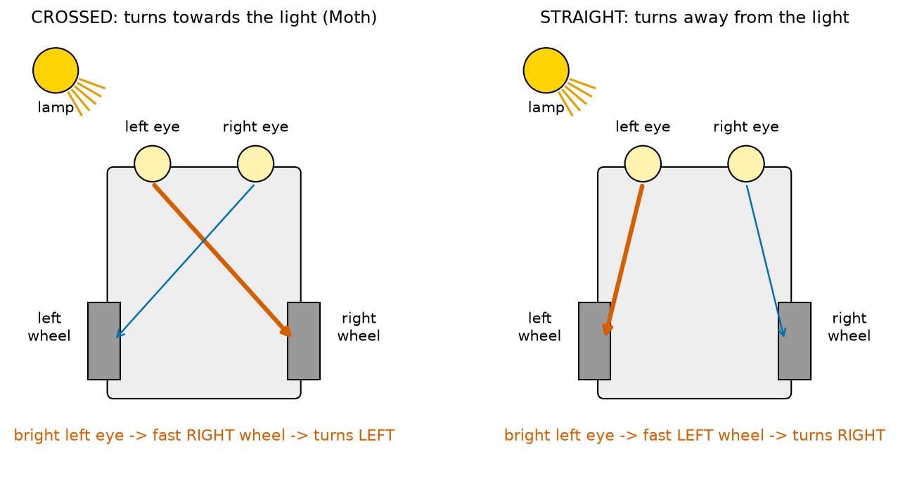
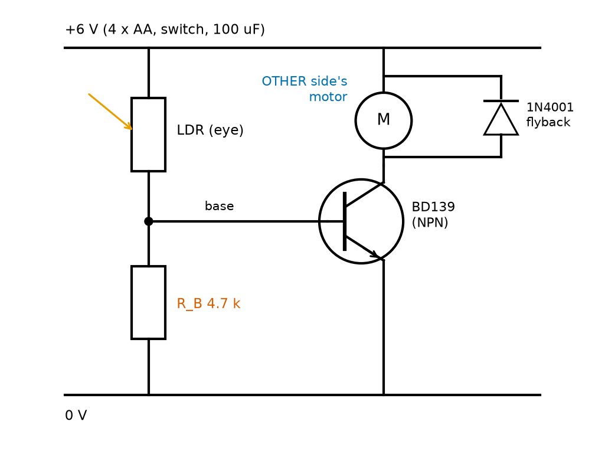
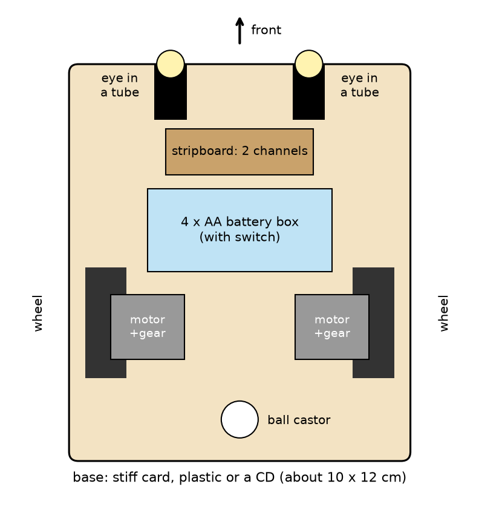
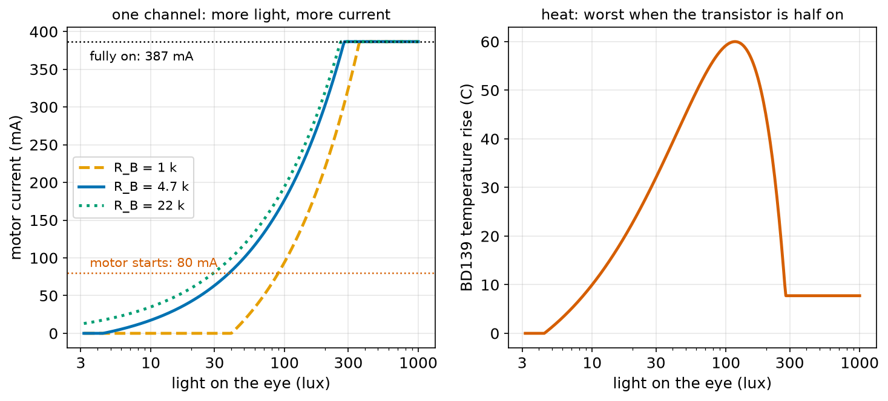
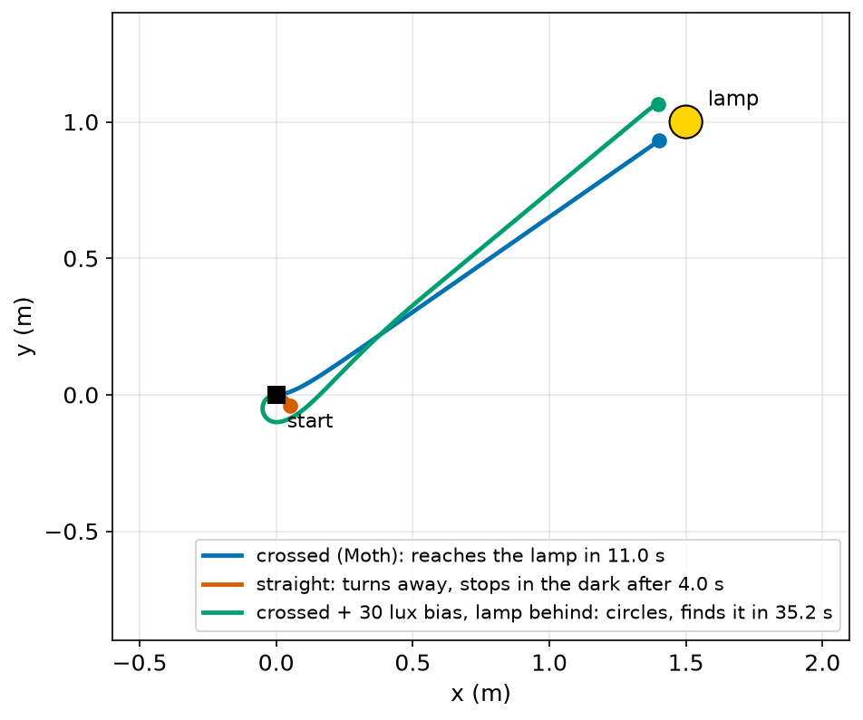
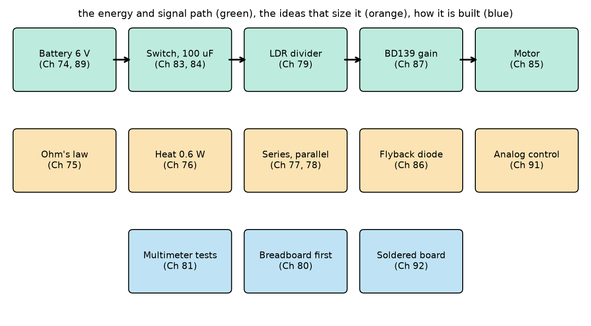

# Chapter 93 — Project: Moth, a Light-Seeking Robot Made Only with Transistors

> **Part 5 · Chapter 93 of 749**
> **You need:** All of Part 5, especially Chapter 79 (Moth's LDR dividers), Chapter 81 (the multimeter), Chapter 86 (flyback diodes), Chapter 87 (transistors and `light_switch.py`), Chapter 76 (heat and thermal resistance), Chapter 80 (breadboards) and Chapter 92 (soldering). From Part 4: Chapter 64 (turning with two wheels) and Chapter 71 (Euler steps).
> **You will make:** Moth, a small two-wheeled robot that drives towards a lamp with no microcontroller and no code inside it; a model of one of its "nerves"; a heat check of its transistors; and a floor simulation that shows why its wires must cross.

---

## What you will learn

- How a robot can **sense, decide and act** with no program at all: the sense–think–act loop of Chapter 2, built from an LDR, a resistor and a transistor.
- Why the wires must **cross**: each eye drives the **opposite** wheel.
- How to design one **channel**: a loaded divider, base current, gain, and the light levels where the motor starts and where it is fully on.
- Why a transistor running **half on** gets hot, and how to choose one that survives.
- How to **build, test and tune** a small circuit: breadboard, multimeter, solder, mount, measure.
- How to **simulate** the whole robot on a floor, and use the simulation to find a weakness and fix it.
- A **review** of all of Part 5.

---

## New words in this chapter

| Word | Simple meaning |
|---|---|
| **phototaxis** | Moving towards light (or away from it). Moths and many insects do it. |
| **photovore / photophobe** | A robot that seeks light / a robot that avoids light. |
| **Braitenberg vehicle** | A thought-experiment robot in which sensors are wired straight to motors, and simple wiring gives behaviour that looks like a choice. |
| **channel** | One complete path from an eye to a motor: LDR, divider, transistor, motor. Moth has two. |
| **bias** | A small, constant extra signal added on purpose to shift how a circuit behaves. |
| **ball castor** | A free-rolling ball that holds up one end of a two-wheeled robot. |

---

## 93.1 The goal

Moth is the second robot in the course's list of projects (ROBOTS.md): a small, cheap machine that drives towards light. It has two **eyes** (light-dependent resistors), two **motors** with wheels, a battery, and between them only resistors, two transistors and two diodes. There is no microcontroller and no program. Yet put it on the floor of a dim room, switch on a lamp, and it turns and drives to the lamp, like a moth to a flame.

📖 **New word: phototaxis** — moving towards light (positive phototaxis) or away from it (negative). Moths, many insects and even single-celled algae do it.

The idea is old. In 1948–49 William Grey Walter built his tortoises Elmer and Elsie (Chapter 3) with two vacuum tubes and found that "simple rules plus real sensors can give behaviour that looks clever." In 1984 the scientist Valentino Braitenberg wrote a small book of thought experiments in which sensors are wired straight to motors.

📖 **New word: Braitenberg vehicle** — one of those imaginary robots. His "vehicle 2" has two light sensors and two motors. Wired straight (left sensor to left motor), it turns away from light, as if afraid. Wired crossed (left sensor to right motor), it turns towards light and speeds up as it approaches, as if attracted. Moth is a real vehicle 2, crossed.

📖 **New words: photovore** and **photophobe** — a light-seeking robot and a light-avoiding robot. Moth is a photovore.

At the end of this chapter you should be able to say: **"Moth drives to a lamp from 1.8 m away in a dim room. I know why each of its parts is there, I measured the light levels where its motors start, I checked that its transistors do not overheat, and I can predict and fix its weaknesses."**



*Figure 93.1 — Moth seen from above, with the lamp to the front-left. Left: crossed wiring. Right: straight wiring.*

**How to read this picture:** The lamp shines more on the left eye than on the right one. The thick red arrow shows where the left eye's (stronger) signal goes; the thin blue arrow, the right eye's (weaker) signal. On the left, the left eye drives the right wheel, which turns faster than the left wheel, so the robot turns to the left: towards the lamp. On the right, the left eye drives the left wheel, so the robot turns to the right: away from the lamp.

---

## 93.2 Parts list

| Part | Notes | Rough cost |
|---|---|---|
| 2 small DC gearmotors with wheels | 3–6 V "TT" or N20 motors; measure their resistance (about 10–20 Ω) | $4 |
| 1 ball castor (or a smooth bead or furniture glide) | holds up the back | $1 |
| a base about 10 × 12 cm | stiff card, plastic sheet, an old CD | free |
| 4 × AA battery box with a switch | 6 V with alkaline cells (Chapter 89) | $1.50 |
| 2 LDRs (light-dependent resistors) | about 20 kΩ at 10 lux, as in Chapter 79 | $0.50 |
| 2 BD139 NPN power transistors | TO-126 case; a BD139-16 has β of 100–250 | $0.60 |
| 2 resistors 4.7 kΩ (or 2 trimmer potentiometers of 10 kΩ) | R_B, the tuning knob | $0.20 |
| 2 diodes 1N4001 | flyback (Chapter 86) | $0.10 |
| 1 capacitor 100 µF, 16 V | across the battery (Chapter 84) | $0.10 |
| a small stripboard, wire, heat-shrink | Chapter 92 | $1 |
| 2 short black tubes (straws painted black, or rolled card) | "blinkers" for the eyes | free |
| double-sided foam tape or hot glue | to mount everything | $1 |
| tools: soldering iron, multimeter, breadboard, side cutters | from Chapters 80, 81, 92 | (you have them) |

Total: about **$10–15**, as ROBOTS.md promised.

💡 **No hardware?** Every result in this chapter comes from the programs in `code/ch093/`. You can follow the whole design in simulation and read the build steps.

---

## 93.3 The plan: one channel

Moth is two identical **channels**, crossed.

📖 **New word: channel** — one complete path from an eye to a motor. In Moth: an LDR and a resistor make a divider (Chapter 79); its middle drives the base of a power transistor (Chapter 87); the transistor switches the **other** side's motor (Chapter 75); a diode protects it from the motor's voltage spikes (Chapter 86).



*Figure 93.2 — One channel: the LDR (top left) and R_B make a divider whose middle drives the BD139's base; the transistor switches the other side's motor; the 1N4001 catches the motor's spike.*

**How to read this picture:** Current enters at the +6 V line at the top. On the left, the LDR and the 4.7 kΩ resistor R_B are in series down to 0 V: a divider. Light (the orange arrow) lowers the LDR's resistance, which raises the voltage at the black dot. That dot is the transistor's base. On the right, the motor (M) and the transistor are in series from +6 V to 0 V: when the base gets current, the transistor lets current flow through the motor. The diode, pointing up (cathode to +6 V), lies across the motor and normally does nothing; when the transistor turns off, it gives the motor's current somewhere to go.

### Following the signal, step by step

1. **Light → resistance.** The LDR from Chapter 79: R = 20,000 × (lux ÷ 10)^−0.7 Ω. At 10 lux, 20 kΩ; at 100 lux, 3,991 Ω; at 300 lux, 1,849 Ω.
2. **Resistance → voltage.** On its own, the divider's middle would sit at V_th = 6 × R_B ÷ (R_LDR + R_B): 3.25 V at 100 lux.
3. **But the base loads it.** A transistor's base behaves like a diode to ground (Chapter 87): it holds the middle near **0.7 V** once it conducts, and takes whatever current the divider can push. This is the "loaded divider" of Chapter 79. Its simplest model is the Thévenin equivalent: the divider acts like a voltage V_th behind a resistance R_th = R_LDR ∥ R_B (the two in parallel, Chapter 77). Then
   🔢 **I_B = (V_th − 0.7) ÷ R_th** (zero if V_th is below 0.7 V).
   At 100 lux: R_th = 2,158 Ω, so I_B = (3.25 − 0.7) ÷ 2,158 = 1.18 mA.
4. **Base current → motor current.** I_C = β × I_B = 150 × 1.18 mA = 177 mA, until the transistor is fully on. Fully on, the motor gets 6 − 0.2 = 5.8 V and takes 5.8 ÷ 15 = **387 mA** (Chapter 87's numbers).
5. **Motor current → speed.** Below about **80 mA**, the motor's friction wins and it does not turn (Chapter 87). Between 80 mA and 387 mA, more current means more speed. Above, it is at full speed.

### Why not just use the Darlington?

Chapter 87 found that a single transistor fed by a phototransistor needed a bright lamp, and that a Darlington pair was so sensitive that ordinary room light turned it fully on. A robot whose both motors are always at full speed cannot steer. Moth's design keeps each transistor in its **"turning" range** (between 80 mA and 387 mA) over the light levels of a dim room with a lamp in it, so that the **difference** between the eyes becomes a difference of wheel speeds. That is the second half of Chapter 87's plan: two sensors, each driving the opposite motor.

### The heat problem

In the turning range the transistor is half on: it has both a large voltage across it and a large current through it. Chapter 76's power P = V × I lands in the transistor. At 177 mA, the motor takes 15 × 0.177 = 2.66 V, so the transistor has 6 − 2.66 = 3.34 V across it and makes 3.34 × 0.177 = **0.59 W** of heat. A tiny TO-92 transistor like the 2N2222 of Chapter 87 (200 °C per watt in free air) would be **120 °C** above the room: it would fail. The BD139 in its bigger TO-126 case (about 100 °C per watt) rises **60 °C**: hot to touch, but within its 150 °C limit. `moth_channel.py` checks this for every light level.

---

## 93.4 Build and test, step by step

### Step 1: Measure your parts

With the multimeter (Chapter 81):

- Each **motor's resistance**: probes on its two terminals, turn the shaft slowly by hand and note the lowest reading. Moth's numbers use 15 Ω.
- Each **LDR's resistance** in three conditions: covered with your hand, in the room light, and with a torch about 30 cm away. Write them down; your LDRs may differ from the model's.

### Step 2: One channel on a breadboard

Build Figure 93.2 on a breadboard (Chapter 80), for now with the motor of the **same** side, and power it from the battery box.

1. Check the BD139's pins in its datasheet: looking at the printed face with the legs down, they are **emitter, collector, base** (E C B) from left to right. Many beginners' circuits fail here.
2. Connect the 100 µF capacitor across the battery (+ to +), close to the board.
3. Switch on. Cover the LDR: the motor stops. Shine the torch on it: the motor runs fast. In between, the speed follows the light.
4. Measure the base voltage (from the black dot to 0 V) in room light: it should be about **0.7 V** whenever the motor turns. That is the base holding the divider down (step 3 of section 93.3).
5. Measure the voltage across the motor and across the transistor (collector to emitter) in room light. They add up to about 6 V (Kirchhoff, Chapter 78).

### Step 3: Find where your motor starts

Slowly move the torch away from the LDR (or cover it more and more) and find the point where the motor just stops. Measure the LDR's resistance there (switch off and disconnect one leg first). Compare with the table from `moth_channel.py`: the model's motor starts at about 40 lux, where the LDR has about 7.6 kΩ.

### Step 4: Build the second channel and cross the wires

Build the second channel the same way. Now connect each transistor to the **opposite** side's motor: the left eye's transistor to the right motor, and the right eye's to the left motor. On the breadboard, hold Moth's base in your hand with the wheels in the air, and shine the torch from the left: the **right** wheel should spin faster.

### Step 5: Solder the board

Move the circuit to stripboard (Chapter 92). Plan the layout on paper first, with one strip for +6 V and one for 0 V, and check every net (Chapter 92's `stripboard_check.py` can do it). Solder the transistors with their legs a few millimetres long, so that they get less heat while you solder. Connect the motors and the battery with AWG 24–26 wire (Chapter 92: about 0.4 A).

### Step 6: Mount everything

Use Figure 93.3 as a guide. Motors at the sides, towards the back; ball castor at the back-middle; battery in the middle; board in front of the battery; the eyes at the front corners, pointing about 35° outwards, each inside a short black tube. Heavy things low and between the wheels (centre of mass, Chapter 70).



*Figure 93.3 — Moth's parts on its base: two motors with wheels, a ball castor, the battery box, the stripboard with both channels, and two eyes in tubes at the front.*

**How to read this picture:** The front is at the top. The two wheels are at the left and right edges, on their motors. The ball castor at the back holds up the third corner. The battery box (blue), the heaviest part, sits between the wheels. The stripboard sits just behind the eyes, so the LDR wires are short. The eyes look forwards and slightly outwards, through black tubes that stop light from the sides and from above.

### Step 7: First run, and the heat check

In a dim room, put a lamp on the floor about 1.5–2 m away, to Moth's front-left. Switch on. Moth should turn left and drive to the lamp. Repeat from different angles. After a minute of driving, carefully touch the transistors: warm to hot is expected (up to about 60 °C above the room in the worst case). If they are too hot to touch for more than a second, check section 93.8's table.

---

## 93.5 One channel in numbers

File `code/ch093/moth_channel.py`:

```python
# moth_channel.py - one of Moth's two "nerves": an LDR divider drives a power transistor that drives a motor
V = 6.0                       # 4 x AA cells
R_AT_10_LUX, GAMMA = 20000.0, 0.7   # the LDR from Chapter 79
R_B = 4700.0                  # the divider's lower resistor: base to ground (Chapter 79's best value)
BETA = 150                    # BD139-16 power transistor gain (Chapter 87)
V_BE = 0.7
R_MOTOR = 15.0                # the small toy motor from Chapter 87
V_CE_SAT = 0.2
I_START = 0.08                # the motor needs about 80 mA to start
THETA = 100.0                 # BD139 (TO-126 case) in free air, C per W (Chapter 76)
I_MAX = (V - V_CE_SAT) / R_MOTOR


def ldr(lux):
    return R_AT_10_LUX * (lux / 10) ** (-GAMMA)


def channel(lux, r_b=R_B):
    """Return base current, motor current and transistor heat for this much light."""
    r_ldr = ldr(lux)
    v_th = V * r_b / (r_ldr + r_b)              # the divider's open-circuit voltage (Chapter 79)
    r_th = r_ldr * r_b / (r_ldr + r_b)          # what the base "sees": LDR and R_B in parallel
    i_b = max(0.0, (v_th - V_BE) / r_th)        # the base pulls the divider down to 0.7 V
    i_c = min(BETA * i_b, I_MAX)                # gain, until the transistor is fully on
    v_ce = V - i_c * R_MOTOR
    heat = v_ce * i_c                           # power in the transistor (Chapter 76)
    return i_b, i_c, heat


if __name__ == "__main__":
    print(f"motor current when fully on: {I_MAX * 1000:.0f} mA")
    print(f"{'lux':>6s} {'LDR':>8s} {'base':>8s} {'motor':>7s} {'heat':>8s} {'temp rise':>9s}  motor")
    for lux in [5, 10, 20, 40, 70, 100, 150, 200, 300, 500]:
        i_b, i_c, heat = channel(lux)
        state = "stopped" if i_c < I_START else ("full speed" if i_c >= I_MAX - 1e-9 else "turning")
        print(f"{lux:6d} {ldr(lux):6.0f} ohm {i_b * 1000:5.2f} mA {i_c * 1000:4.0f} mA {heat * 1000:5.0f} mW {heat * THETA:7.0f} C  {state}")
    worst = max(channel(l / 10)[2] for l in range(10, 10000))
    print()
    print(f"worst transistor heat: {worst * 1000:.0f} mW -> {worst * THETA:.0f} C above the room in a BD139")
    print(f"the same in a 2N2222 (TO-92, 200 C/W): {worst * 200:.0f} C above the room -> too hot")
```

| Line | Code | What it does (simple English) |
|---|---|---|
| 1 | `# moth_channel.py …` | A comment. |
| 2 | `V = 6.0` | Four AA cells. |
| 3 | `R_AT_10_LUX, GAMMA = 20000.0, 0.7` | The LDR model from Chapter 79: 20 kΩ at 10 lux, falling as lux to the power −0.7. |
| 4 | `R_B = 4700.0` | The lower resistor of the divider, from base to ground. |
| 5 | `BETA = 150` | The BD139's current gain. |
| 6 | `V_BE = 0.7` | The base–emitter voltage when the transistor conducts. |
| 7 | `R_MOTOR = 15.0` | The motor, treated as a 15 Ω resistor (as in Chapter 87). |
| 8 | `V_CE_SAT = 0.2` | What is left across a fully-on transistor. |
| 9 | `I_START = 0.08` | Below 80 mA the motor does not turn. |
| 10 | `THETA = 100.0` | The BD139 heats 100 °C for every watt, in free air. |
| 11 | `I_MAX = (V - V_CE_SAT) / R_MOTOR` | The current when the transistor is fully on: 387 mA. |
| 12–13 | (blank) | Spacing. |
| 14–15 | `def ldr(lux): …` | The LDR's resistance at this light level. |
| 16–17 | (blank) | Spacing. |
| 18 | `def channel(lux, r_b=R_B):` | One channel at one light level. `r_b` can be changed (the tuning program does). |
| 19 | `"""…"""` | Its docstring. |
| 20 | `r_ldr = ldr(lux)` | Step 1: light → resistance. |
| 21 | `v_th = V * r_b / (r_ldr + r_b)` | Step 2: the divider's voltage with nothing connected. |
| 22 | `r_th = r_ldr * r_b / (r_ldr + r_b)` | The two resistors in parallel: the divider's own resistance as the base sees it. |
| 23 | `i_b = max(0.0, (v_th - V_BE) / r_th)` | Step 3: the base current. If V_th is below 0.7 V, the base takes nothing: `max` stops a negative answer. |
| 24 | `i_c = min(BETA * i_b, I_MAX)` | Step 4: gain, but never more than the fully-on current. |
| 25 | `v_ce = V - i_c * R_MOTOR` | What is left across the transistor (Kirchhoff, Chapter 78). |
| 26 | `heat = v_ce * i_c` | P = V × I in the transistor. |
| 27 | `return i_b, i_c, heat` | Three results. |
| 28–29 | (blank) | Spacing. |
| 30 | `if __name__ == "__main__":` | The rest runs only when this file is run directly, not when another program imports `channel` from it. `moth_tune.py` and `moth_sim.py` import it. |
| 31–32 | `print(…)` | The full-on current and the headings. |
| 33 | `for lux in [ … ]:` | Ten light levels, from very dim to a bright lamp nearby. |
| 34 | `i_b, i_c, heat = channel(lux)` | Run the channel. |
| 35 | `state = …` | "stopped", "turning" or "full speed". |
| 36 | `print(…)` | One row, with the temperature rise (heat × θ). |
| 37 | `worst = max(…)` | Try 0.1 to 999.9 lux in steps of 0.1 and keep the largest heat. |
| 38–40 | `print(…)` | The worst case, for the BD139 and for a 2N2222. |

Output:

```
motor current when fully on: 387 mA
   lux      LDR     base   motor     heat temp rise  motor
     5  32490 ohm  0.01 mA    2 mA    13 mW       1 C  stopped
    10  20000 ohm  0.12 mA   17 mA   100 mW      10 C  stopped
    20  12311 ohm  0.28 mA   42 mA   227 mW      23 C  stopped
    40   7579 ohm  0.55 mA   83 mA   393 mW      39 C  turning
    70   5122 ohm  0.89 mA  133 mA   532 mW      53 C  turning
   100   3991 ohm  1.18 mA  177 mA   592 mW      59 C  turning
   150   3004 ohm  1.62 mA  242 mA   573 mW      57 C  turning
   200   2456 ohm  2.01 mA  301 mA   446 mW      45 C  turning
   300   1849 ohm  2.72 mA  387 mA    77 mW       8 C  full speed
   500   1293 ohm  3.95 mA  387 mA    77 mW       8 C  full speed

worst transistor heat: 600 mW -> 60 C above the room in a BD139
the same in a 2N2222 (TO-92, 200 C/W): 120 C above the room -> too hot
```

Moth's motors start at about 40 lux and are at full speed by 300 lux: a steering range of light levels between them. The heat is worst around 100–150 lux, when the transistor is half on, and falls when it is fully on (only 0.2 V across it).



*Figure 93.4 — Left: motor current against light on the eye, for three values of R_B. Right: the BD139's temperature rise with R_B = 4.7 kΩ.*

**How to read this picture:** Light is on a logarithmic scale (Chapter 52): each step to the right multiplies the light by about 3. On the left, the blue curve (4.7 kΩ) crosses the red "motor starts" line at about 40 lux and reaches the black "fully on" line at about 280 lux. The orange dashed curve (1 kΩ) is shifted to the right: it starts at about 90 lux. The green dotted curve (22 kΩ) is a little to the left. All three reach full current at almost the same place. On the right, the heat rises with the current, peaks at 60 °C above the room near 120 lux, and drops suddenly once the transistor is fully on.

---

## 93.6 Tuning: what R_B really does

Chapter 87 called the resistor from base to ground the "threshold" resistor: Moth's tuning knob. How much does it move things?

File `code/ch093/moth_tune.py`:

```python
# moth_tune.py - Moth's tuning knob: the lower divider resistor sets the light level where the motor starts
from moth_channel import channel, I_START, I_MAX

print(f"{'R_B':>8s} {'starts at':>10s} {'full speed at':>14s} {'steering range':>15s}")
for r_b in [1000, 2200, 4700, 10000, 22000]:
    start = full = None
    lux = 1.0
    while lux < 20000:
        i_c = channel(lux, r_b)[1]
        if start is None and i_c >= I_START:
            start = lux
        if full is None and i_c >= I_MAX - 1e-9:
            full = lux
            break
        lux *= 1.01                    # step up 1% at a time
    print(f"{r_b:6d} ohm {start:7.0f} lux {full:11.0f} lux {full / start:12.1f} x")
print()
print("R_B mostly moves the starting point; the full-speed point is set by the LDR itself (about 2 k ohm)")
```

| Line | Code | What it does (simple English) |
|---|---|---|
| 1 | `# moth_tune.py …` | A comment. |
| 2 | `from moth_channel import …` | Reuse the channel model; no copying. |
| 3 | (blank) | Spacing. |
| 4 | `print(…)` | Headings. |
| 5 | `for r_b in [ … ]:` | Five values of R_B. |
| 6 | `start = full = None` | Not found yet. |
| 7 | `lux = 1.0` | Start in near darkness. |
| 8 | `while lux < 20000:` | Search upwards. |
| 9 | `i_c = channel(lux, r_b)[1]` | The motor current (`[1]` picks the second of the three results). |
| 10–11 | `if start is None and i_c >= I_START:` | The first light level where the motor turns. |
| 12–14 | `if full is None and i_c >= I_MAX - 1e-9:` … `break` | The first level where it is fully on; then stop searching. `1e-9` avoids a tiny rounding difference. |
| 15 | `lux *= 1.01` | Brighter by 1% each step: equal steps on a log scale. |
| 16 | `print(…)` | The two levels and their ratio. |
| 17–18 | `print()`, `print(…)` | The lesson. |

Output:

```
     R_B  starts at  full speed at  steering range
  1000 ohm      91 lux         365 lux          4.0 x
  2200 ohm      53 lux         305 lux          5.8 x
  4700 ohm      39 lux         282 lux          7.2 x
 10000 ohm      33 lux         268 lux          8.2 x
 22000 ohm      30 lux         263 lux          8.8 x

R_B mostly moves the starting point; the full-speed point is set by the LDR itself (about 2 k ohm)
```

A smaller R_B "steals" more of the LDR's current before the base gets any (it takes 0.7 V ÷ R_B: 0.7 mA for 1 kΩ, 0.15 mA for 4.7 kΩ), so the motor needs more light to start. But the top of the range barely moves: full speed needs about 2.6 mA of base current, which only an LDR below about 2 kΩ can supply, whatever R_B is. So:

- **To make Moth start in dimmer light:** raise R_B (or use a 10 kΩ trimmer and turn it up).
- **To make Moth work in a brighter room**, R_B is not enough; put the eyes deeper in their **tubes**, so less light reaches them. The tubes also make the eyes more directional, which helps the steering.

---

## 93.7 Moth on the floor: simulation

Does the crossed wiring really steer Moth to the lamp? A simulation can answer before (or after) you build it, and it can test things that are hard to try for real.

The model:

- **The lamp** gives 400 lux at 1 m (a bright desk lamp on the floor), falling as 1 ÷ distance², plus 15 lux of dim room light everywhere.
- **Each eye** looks 35° to its side. It receives the room light, plus the lamp's light times the cosine of the angle between where it looks and where the lamp is (none if the lamp is behind it).
- **Each wheel** moves at 0.20 m/s × (I − 80 mA) ÷ (387 − 80 mA), between 0 and 0.20 m/s.
- **The robot** moves forward at the average of its wheel speeds and turns at (v_right − v_left) ÷ 0.10 m (Chapter 64), in Euler steps of 10 ms (Chapter 71).

File `code/ch093/moth_sim.py`:

```python
# moth_sim.py - Moth drives on the floor: two eyes, two transistor channels, two wheels, and a lamp
import math
from moth_channel import channel, I_START, I_MAX

LAMP_LUX_AT_1M = 400.0        # a bright desk lamp on the floor: 400 lux at 1 m, falling as 1 / distance squared
AMBIENT = 15.0                # a dim room
EYE_ANGLE = math.radians(35)  # each eye looks 35 degrees to its side
V_MAX = 0.20                  # wheel speed at full motor current, m/s
TRACK = 0.10                  # distance between the wheels, m
DT = 0.01


def eye_lux(x, y, heading, side, lamp):
    """Light reaching one eye: room light, plus the lamp if the eye is facing it."""
    dx, dy = lamp[0] - x, lamp[1] - y
    d = max(math.hypot(dx, dy), 0.05)
    eye_dir = heading + side * EYE_ANGLE                  # side: +1 left eye, -1 right eye
    facing = math.cos(math.atan2(dy, dx) - eye_dir)        # 1 when the eye looks straight at the lamp
    return AMBIENT + LAMP_LUX_AT_1M / d ** 2 * max(0.0, facing)


def wheel_speed(lux):
    i_c = channel(lux)[1]
    return V_MAX * min(max((i_c - I_START) / (I_MAX - I_START), 0.0), 1.0)


def simulate(crossed, lamp, x=0.0, y=0.0, heading=0.0, seconds=60.0, bias=0.0):
    path = [(x, y)]
    t = 0.0
    while t < seconds:
        left, right = eye_lux(x, y, heading, +1, lamp) + bias, eye_lux(x, y, heading, -1, lamp)
        if crossed:
            v_left, v_right = wheel_speed(right), wheel_speed(left)    # each eye drives the OPPOSITE wheel
        else:
            v_left, v_right = wheel_speed(left), wheel_speed(right)    # each eye drives its own side's wheel
        v = (v_left + v_right) / 2                                     # forward speed
        w = (v_right - v_left) / TRACK                                 # turning speed, rad/s (left is positive)
        x += v * math.cos(heading) * DT
        y += v * math.sin(heading) * DT
        heading += w * DT
        t += DT
        path.append((x, y))
        if math.hypot(lamp[0] - x, lamp[1] - y) < 0.12:
            return path, f"reached the lamp after {t:.1f} s"
        if v_left < 0.001 and v_right < 0.001:                          # under 1 mm/s: stopped
            return path, f"stopped after {t:.1f} s, {math.hypot(lamp[0] - x, lamp[1] - y):.2f} m from the lamp (too dark)"
    return path, f"still driving after {seconds:.0f} s"


if __name__ == "__main__":
    LAMP = (1.5, 1.0)
    for label, crossed, heading in [("crossed wires (Moth), lamp ahead-left", True, 0.0),
                                    ("straight wires, lamp ahead-left", False, 0.0),
                                    ("crossed wires, lamp behind", True, math.pi)]:
        path, result = simulate(crossed, LAMP, heading=heading)
        print(f"{label:40s} {result}")
```

| Line | Code | What it does (simple English) |
|---|---|---|
| 1 | `# moth_sim.py …` | A comment. |
| 2 | `import math` | For angles, cosines and distances. |
| 3 | `from moth_channel import …` | The channel model from section 93.5. |
| 4 | (blank) | Spacing. |
| 5 | `LAMP_LUX_AT_1M = 400.0` | The lamp's brightness at 1 m. |
| 6 | `AMBIENT = 15.0` | The room light everywhere. |
| 7 | `EYE_ANGLE = math.radians(35)` | Each eye's direction, in radians (Chapter 64). |
| 8 | `V_MAX = 0.20` | Wheel speed at full current. |
| 9 | `TRACK = 0.10` | Distance between the wheels. |
| 10 | `DT = 0.01` | 10 ms steps. |
| 11–12 | (blank) | Spacing. |
| 13 | `def eye_lux(x, y, heading, side, lamp):` | The light on one eye, at the robot's position and heading. |
| 14 | `"""…"""` | Its docstring. |
| 15 | `dx, dy = …` | The arrow from the robot to the lamp. |
| 16 | `d = max(math.hypot(dx, dy), 0.05)` | Its length (Pythagoras), never less than 5 cm, to avoid dividing by almost zero. |
| 17 | `eye_dir = heading + side * EYE_ANGLE` | The left eye looks 35° left of the heading, the right eye 35° right. |
| 18 | `facing = math.cos(…)` | The cosine of the angle between the eye's direction and the lamp's: 1 straight ahead, 0 at 90°, negative behind. |
| 19 | `return AMBIENT + …` | Room light plus the lamp's light, inverse-square, times `facing` (never below zero). |
| 20–21 | (blank) | Spacing. |
| 22–24 | `def wheel_speed(lux): …` | Light → motor current (the channel model) → wheel speed, between 0 and V_MAX. |
| 25–26 | (blank) | Spacing. |
| 27 | `def simulate(…, bias=0.0):` | Drive Moth from a starting pose. `crossed` chooses the wiring; `bias` adds extra lux to the left eye (Lab 93.3). |
| 28–29 | `path = …`, `t = 0.0` | Remember every position, and start the clock. |
| 30 | `while t < seconds:` | Up to 60 s. |
| 31 | `left, right = …` | The light on each eye. |
| 32–35 | `if crossed: … else: …` | The wiring: crossed sends each eye to the opposite wheel; straight to its own side. |
| 36 | `v = (v_left + v_right) / 2` | Forward speed: the average. |
| 37 | `w = (v_right - v_left) / TRACK` | Turn rate: a faster right wheel turns the robot left (positive), as in Chapter 64. |
| 38–40 | `x += …`, `y += …`, `heading += …` | One Euler step of position and heading (Chapter 71). |
| 41–42 | `t += DT`, `path.append(…)` | Next moment; remember the position. |
| 43–44 | `if … < 0.12: return …` | Within 12 cm of the lamp: arrived. |
| 45–46 | `if v_left < 0.001 and v_right < 0.001: return …` | Both wheels under 1 mm/s: it has stopped in the dark. |
| 47 | `return path, "still driving …"` | Time ran out. |
| 48–49 | (blank) | Spacing. |
| 50–56 | the main part | The lamp at (1.5, 1.0) m, 1.8 m away; three runs: crossed, straight, and crossed with the lamp behind. |

Output:

```
crossed wires (Moth), lamp ahead-left    reached the lamp after 11.0 s
straight wires, lamp ahead-left          stopped after 4.0 s, 1.78 m from the lamp (too dark)
crossed wires, lamp behind               stopped after 0.0 s, 1.80 m from the lamp (too dark)
```



*Figure 93.5 — Moth's simulated paths from the start (black square) to the lamp (yellow). Blue: crossed wiring. Red: straight wiring. Green: crossed, with a bias on one eye, starting with the lamp behind it.*

**How to read this picture:** The blue path curves slightly left at first, then runs almost straight to the lamp: once both eyes see it equally, the wheels turn at the same speed. The red path is only a short hook near the start: the robot turned right, away from the lamp, until neither eye saw enough light, and stopped. The green path makes a small loop at the start (searching), then heads for the lamp (Lab 93.3 explains it).

**What the simulation teaches:**

1. **Crossed wiring works.** Moth reaches the lamp from 1.8 m in 11 s, steering itself. Nothing inside it "knows" where the lamp is.
2. **Straight wiring makes a light-avoider**, Braitenberg's "afraid" vehicle. In a dim room, it turns away from the lamp and stops when it is dark enough.
3. **Moth is blind behind.** With the lamp behind it, both eyes see only the 15 lux of the room, below the 40 lux its motors need. It just sits there. A real moth would fly around until it saw the light. Lab 93.3 gives Moth a way to search, with one extra resistor.

---

## 93.8 What the project teaches

### The engineer's loop, again

Chapter 72 ended with the engineer's loop: model, build, measure, compare, improve. Moth went round it:

| Step | What we did |
|---|---|
| Model | One channel from Chapters 79 and 87; the robot on the floor with Chapters 64 and 71 |
| Predict | Starts at about 40 lux, full speed by about 280 lux; transistor up to 60 °C above the room; reaches the lamp in about 11 s |
| Build | Breadboard first, then stripboard |
| Measure | LDR resistances, motor start point, base voltage, heat by touch |
| Compare | Your start point and temperatures against the model's |
| Improve | Change R_B, the tubes, the eye angles, add a bias resistor |

### Troubleshooting table

| What you see | Likely cause | Fix |
|---|---|---|
| Nothing happens at all | Battery switch off, flat cells, or a missing ground | Measure 6 V across the capacitor; check every 0 V connection |
| A motor runs at full speed in the dark | BD139 legs in the wrong order (collector–emitter short), or a solder bridge | Check E C B with the datasheet; beep between the transistor's pins |
| Both motors stop in normal room light | R_B too small, or the eyes are in deep tubes | Raise R_B (10 kΩ trimmer); shorten the tubes |
| Both motors run at full speed in room light; no steering | The room is too bright | Lengthen the tubes; dim the room; or lower R_B a little |
| Moth turns away from the lamp | Wires not crossed (or crossed twice) | Swap the two motors' connections |
| Moth turns in circles | One motor wired backwards, or the two LDRs very different | Swap that motor's wires; match the LDRs (measure them) or trim R_B on one side |
| A transistor is too hot to touch for even a second | A 2N2222 used instead of a BD139, or the motor is bigger than 15 Ω suggests | Use BD139; or add a small heat sink (a bent piece of aluminium) |
| The motors twitch and the transistors die | No flyback diodes, or diodes backwards | 1N4001 across each motor, cathode (band) to +6 V |

### Why no code?

Moth's "decision" is made by the physics of its parts: the divider, the transistor's gain, and how the wires cross. That makes it fast (there is no program loop to wait for), cheap, and impossible to crash. But it can only do one thing. To make a robot that can follow light **and** avoid walls **and** stop when its battery is low, and that you can change without a soldering iron, you need a small computer that runs a program: a microcontroller. That is Part 6.

---

## 93.9 Testing the code

Before trusting any model, check it against numbers you can work out by hand:

- **Fully on.** `I_MAX` should be (6 − 0.2) ÷ 15 = 0.387 A. The program prints 387 mA. ✓
- **One row by hand.** At 100 lux: LDR = 20,000 × 10^−0.7 = 3,991 Ω; V_th = 6 × 4,700 ÷ 8,691 = 3.245 V; R_th = 2,158 Ω; I_B = 2.545 ÷ 2,158 = 1.18 mA; I_C = 177 mA; V_CE = 6 − 2.66 = 3.34 V; heat 0.59 W. The table says 1.18 mA, 177 mA, 592 mW. ✓
- **No light.** At very low light, V_th is below 0.7 V and the base current must be zero: at 5 lux it is 0.01 mA (just above) and the motor current 2 mA. ✓
- **Symmetry.** In the simulation, with the lamp exactly straight ahead (at (2, 0)), both eyes get the same light, so the robot must drive straight. Try it: `simulate(True, (2.0, 0.0))` reaches the lamp after 13.7 s, and the largest y on its path is exactly 0.0.
- **The mirror test.** Wiring straight instead of crossed must turn the other way: it does (Figure 93.5, red).

---

## 🏭 Real robot applications

### Application 1 — 🧹 Robot vacuum cleaners finding their dock

Many robot vacuum cleaners find their way home with an idea close to Moth's. The charging dock sends out infrared light in beams, coded so that the robot can tell the left beam from the right one. The robot has receivers on both sides of its front; it steers to keep the signals balanced and drives straight in. A microcontroller does the decoding, but the principle, "steer to balance two sensors", is Braitenberg's vehicle 2.

### Application 2 — ☀️ Solar trackers

Solar panels make the most power facing the Sun. Many trackers use two light sensors separated by a small wall: when the Sun moves, the wall shades one sensor, and a motor turns the panel until both are equally lit. Some simple trackers do it exactly like Moth: two sensors, two transistors and a motor that turns one way or the other, with no program. A balance of two sensors is a robust way to point at something.

### Application 3 — 🚀 Sun sensors on spacecraft

Small satellites need to know where the Sun is, to point their solar panels and to know their own orientation. A **coarse sun sensor** is often just several photodiodes facing different directions (like Moth's eyes at ±35°); the satellite compares their currents, which follow the cosine of the angle to the Sun, the same cosine rule as `eye_lux`. The comparison gives the Sun's direction to a few degrees, with no moving parts.

### Application 4 — 🏭 Line followers in factories and warehouses

An automated guided vehicle (AGV) following a tape on a factory floor uses pairs of downward-looking light sensors, one each side of the tape. When the vehicle drifts left, the right sensor sees more tape (darker) and the steering corrects. Early AGVs and many school line-followers did it with comparators and transistors only. Rover will do it with a microcontroller and a PID controller (Chapters 292–293), but the sensors and the "balance the two sides" idea are Moth's.

### Application 5 — 🐛 BEAM robotics and insect-like robots

BEAM robotics (Biology, Electronics, Aesthetics, Mechanics), started by Mark Tilden in the 1990s, builds small robots from transistors and simple circuits, with no microcontroller, often solar-powered. Photovores like Moth are its classic first project. Tilden went on to design commercial walking toy robots using the same ideas. Researchers also use Braitenberg-style wiring to understand real insects: the way a moth or a fly steers can often be explained by two sensors cross-wired to two sides of its body.

---

## 🔧 Hands-on lab

### Lab 93.1 — Build and run Moth (hardware, the main task)

You need: everything in the parts list.

1. Follow the seven steps of section 93.4.
2. Record in a table: your two LDRs' resistance (covered, room, torch at 30 cm); the light levels (or LDR resistances) where each motor just starts; the base voltage when running; your motors' resistance.
3. Run Moth five times from 1.5–2 m with the lamp at different angles (ahead, 45° left, 90° right, behind). Note for each: did it reach the lamp, and in how many seconds?
4. Touch the transistors after a minute of driving.

**What you should see:** The base voltage is about 0.6–0.7 V whenever a motor turns. With the lamp ahead or at 45°, Moth reaches it in roughly 10–20 s (the simulation said 11 s; real motors and real lamps differ). With the lamp at 90°, it turns, then drives. With the lamp behind, it sits still, as the simulation predicted. The transistors are warm to hot.

| If it does not work | Likely cause | Fix |
|---|---|---|
| See the troubleshooting table in section 93.8 | | |
| It reaches the lamp but bumps into it and pushes it | It speeds up as the light gets brighter | That is correct Braitenberg behaviour ("aggression"); put the lamp behind a book |

**Challenge:** Make a "night-light" target: a torch held by a friend who walks slowly around the room. Can Moth follow?

### Lab 93.2 — Compare your Moth with the model (simulation and measurement)

Copy `moth_channel.py`.

1. Change `R_MOTOR` to your motor's measured resistance, and `R_AT_10_LUX` to fit your LDR (use the "room" measurement and a phone light-meter app for the lux, or keep 20 kΩ).
2. Run it and compare the predicted starting point with the one you found in step 3 of section 93.4.
3. Run `moth_tune.py` and decide what R_B you would need to make your Moth start at 25 lux.

**What you should see:** The model's starting point usually agrees with yours to within a factor of 2 in lux: LDRs vary a lot from part to part, and β varies from 100 to 250 in BD139-16s. The tuning table shows that even R_B = 22 kΩ only brings the start down to about 30 lux; for 25 lux you would need a transistor with more gain, or a more sensitive LDR. A model that is right within a factor of 2 is still good enough to choose R_B and the transistor.

| If it does not work | Likely cause | Fix |
|---|---|---|
| `ModuleNotFoundError: moth_channel` | `moth_tune.py` run from another folder | Run it from inside `code/ch093` |
| Every row "full speed" | `R_MOTOR` set too high, so I_MAX is tiny | Check the units: ohms, not milliohms |

**Challenge:** Add a column that shows the motor's voltage (I_C × R_MOTOR) and check it against your measurement from step 2 of section 93.4.

### Lab 93.3 — Teach Moth to search (simulation, then hardware)

A moth that sits still in the dark never finds the light. Give one eye a **bias**.

📖 **New word: bias** — a small, constant extra signal added on purpose. Here: a resistor from +6 V to the left eye's base node, in parallel with that LDR, so the channel behaves as if a little more light fell on it. The right wheel then always creeps slowly, and Moth turns slowly to the left, "looking around", until an eye sees the lamp.

1. In a new file in `code/ch093`, run the "lamp behind" case with `bias` set to 0, 10, 20 and 30 (extra lux on the left eye), and the "lamp ahead" case with `bias=20`:

   ```python
   import math
   import moth_sim
   for b in [0, 10, 20, 30]:
       print(b, moth_sim.simulate(True, (1.5, 1.0), heading=math.pi, bias=b)[1])
   print("ahead, bias 20:", moth_sim.simulate(True, (1.5, 1.0), heading=0.0, bias=20)[1])
   ```

   (`[1]` keeps only the result message; `[0]` would be the path.)
2. Does the bias spoil the normal approach with the lamp ahead?
3. Work out the resistor: in 15 lux the LDR has about 15.1 kΩ; to make the eye act as if it saw 45 lux (15 + 30), the parallel combination must equal the LDR's resistance at 45 lux, about 7.0 kΩ. Find the parallel resistor.

**What you should see:**

```
0 stopped after 0.0 s, 1.80 m from the lamp (too dark)
10 stopped after 0.0 s, 1.80 m from the lamp (too dark)
20 stopped after 0.0 s, 1.80 m from the lamp (too dark)
30 reached the lamp after 35.2 s
ahead, bias 20: reached the lamp after 10.7 s
```

A bias of 10 or 20 lux leaves the left eye below the 40 lux needed to start (15 + 20 = 35), so Moth stays still. At 30 lux (15 + 30 = 45), the right wheel creeps, Moth circles (the green loop in Figure 93.5), sees the lamp, and arrives after 35 s. With the lamp ahead, the bias hardly matters: 10.7 s instead of 11.0 s. The resistor: 1 ÷ R = 1 ÷ 7.0 kΩ − 1 ÷ 15.1 kΩ gives R ≈ **13 kΩ** (12 kΩ is the nearest common value, a little stronger).

| If it does not work | Likely cause | Fix |
|---|---|---|
| With the real resistor, Moth spins fast even in the dark | Resistor too small (too much bias) | Try 15 kΩ or 22 kΩ |
| It still does not search | Resistor too big, or the room darker than 15 lux | Try 10 kΩ; the right value depends on your room |

**Challenge:** A bias makes Moth always circle the same way. What happens if the lamp is close to Moth's right side while it circles left? Try it in the simulation (lamp at (0.3, −0.5) with `heading=0`, `bias=30`).

---

## Common mistakes

⚠️ **Wiring each eye to its own side's motor.** That makes a light-avoider. Cross the wires.

⚠️ **Using a small TO-92 transistor (2N2222, BC337) for the motors.** Half on, it would be 120 °C above the room. Use a BD139 or bigger.

⚠️ **Getting the BD139's pins wrong.** E C B, printed face towards you, legs down. Check the datasheet.

⚠️ **Leaving out the flyback diodes**, or putting them backwards (Chapter 86).

⚠️ **Testing in a bright room.** Moth's steering range is about 40–280 lux; in sunlight both motors are fully on. Use tubes, or a dim room.

⚠️ **Two very different LDRs.** Measure them and pair similar ones; otherwise Moth drifts to one side.

⚠️ **Forgetting the capacitor across the battery.** Motor starts dip the supply and disturb both channels.

⚠️ **Thinking Moth is broken when it ignores a lamp behind it.** Its eyes cannot see backwards; that is its design. Add a bias (Lab 93.3).

---

## Practice

🏋️ **1.** Explain in three sentences why crossed wiring makes Moth turn towards the light.

🏋️ **2.** At 100 lux, Moth's LDR has 3,991 Ω. What voltage would the divider (with R_B = 4.7 kΩ) give with nothing connected to it?

🏋️ **3.** Find R_th and the base current at 100 lux.

🏋️ **4.** With β = 150, what is the motor current at 100 lux? Is the motor turning?

🏋️ **5.** How much heat does the transistor make at 100 lux? How hot does a BD139 (100 °C/W) get in a 25 °C room?

🏋️ **6.** Why is the heat small when the transistor is fully on, even though the current is biggest?

🏋️ **7.** What does each flyback diode do, and which way round does it go?

🏋️ **8.** Moth is put in a bright classroom (500 lux everywhere). What does it do, and how would you fix it?

🏋️ **9.** Moth's two motors take about 0.2 A each while it drives. How long could 4 × AA cells of about 2,000 mAh run it, ideally?

🏋️ **10.** Which chapter of Part 5 explains each of these parts of Moth: the LDR divider, the BD139's gain, the 1N4001, the 100 µF capacitor, the heat check, the stripboard?

🏋️ **11.** In `moth_sim.py`, set `EYE_ANGLE` to 15°, 35° and 60° (use `math.radians`). For each, run the crossed robot with the lamp at (1.5, 1.0) and `heading=-math.pi / 2` (facing the wrong way, with the lamp behind-left). Which angle finds the lamp? What is the price?

---

## Answers

**1.** Light from the left falls more on the left eye. With crossed wires, the left eye drives the right wheel, so the right wheel turns faster. A faster right wheel turns the robot to the left, towards the light, until both eyes see the same light and it drives straight at it.

**2.** 6 × 4,700 ÷ (3,991 + 4,700) = 3.25 V.

**3.** R_th = 3,991 × 4,700 ÷ 8,691 = 2,158 Ω. I_B = (3.25 − 0.7) ÷ 2,158 = 1.18 mA.

**4.** 150 × 1.18 = 177 mA: above 80 mA and below 387 mA, so the motor is turning, at about a third of its speed range.

**5.** The motor takes 15 × 0.177 = 2.66 V, so V_CE = 3.34 V; heat = 3.34 × 0.177 = 0.59 W. Temperature rise 0.59 × 100 = 59 °C; the BD139 is at about 25 + 59 = 84 °C.

**6.** Heat = V_CE × I_C. Fully on, V_CE is only 0.2 V, so the heat is 0.2 × 0.387 = 0.077 W. A switch is cool when it is fully on or fully off; it is hot only in between (Chapter 87).

**7.** When the transistor turns off, the motor's inductance (Chapter 85) keeps its current flowing and would make a large voltage spike that can kill the transistor. The diode gives that current a safe path round the motor. It goes across the motor with its cathode (band) to +6 V, so that it does not conduct in normal running (Chapter 86).

**8.** At 500 lux both eyes are above the 280 lux full-speed point, so both motors run at full speed and Moth drives straight, without steering. Fix: put the eyes in longer tubes (so they get less light and only from the front), or use it in a dimmer room. Lowering R_B helps only a little (section 93.6).

**9.** 0.2 + 0.2 = 0.4 A. 2,000 mAh ÷ 400 mA = 5 hours, ideally. Alkaline cells give less capacity at this current, so expect a few hours (Chapter 89).

**10.** LDR divider: Chapter 79. BD139's gain: Chapter 87. 1N4001: Chapter 86. 100 µF capacitor: Chapter 84. Heat check: Chapter 76. Stripboard: Chapter 92.

**11.** Setting `moth_sim.EYE_ANGLE` from another program works, because `eye_lux` reads it each time it runs:

```python
import math
import moth_sim
for angle in [15, 35, 60]:
    moth_sim.EYE_ANGLE = math.radians(angle)
    print(angle, moth_sim.simulate(True, (1.5, 1.0), heading=-math.pi / 2)[1])
```

Output:

```
15 stopped after 0.0 s, 1.80 m from the lamp (too dark)
35 stopped after 0.0 s, 1.80 m from the lamp (too dark)
60 reached the lamp after 17.4 s
```

Only the 60° eyes see far enough to the side to catch the lamp, which is about 124° from Moth's heading: the left eye at 60° sees it 64° off its axis. The price: with the lamp ahead, the 60° Moth is slower (15.5 s against 11.0 s), because each eye looks further away from the lamp and gets less of its light. Real insects have the same trade-off between a wide view and a sharp one.

---

## Summary

🧠 **Moth** is a Braitenberg vehicle: two eyes, two motors, and **crossed** wiring, with no program. Crossed wiring seeks light; straight wiring avoids it.

🧠 One **channel**: LDR and R_B divider → base (held near 0.7 V) → **I_B = (V_th − 0.7) ÷ R_th** → **I_C = β I_B** (up to the fully-on 387 mA) → motor (starts at 80 mA).

🧠 The motors start at about **40 lux** and are at full speed by about **280 lux**. **R_B** moves the start; the **tubes** set how much light the eyes get.

🧠 Half on, the transistor makes up to **0.6 W**: 60 °C above the room in a **BD139**, 120 °C in a TO-92. Choose parts by their heat, not only their current.

🧠 The **simulation** showed that Moth reaches a lamp 1.8 m away in about 11 s, but is blind behind; a **bias** resistor of about 13 kΩ makes it search.

🧠 Build in order: measure the parts, breadboard one channel, cross the wires, solder, mount, test, and compare with the model.

---

## Part 5 review

You have finished Part 5. Here is what you can now do, and where it will be used.

| You can now … | Chapters | Used again in |
|---|---|---|
| Explain charge, current and the electron's journey around a circuit | 73 | every circuit |
| Use voltage, current and resistance, and measure them safely | 74, 81 | every circuit, debugging |
| Use Ohm's law and power, and check heat with thermal resistance | 75, 76 | motor drivers, regulators, every board |
| Combine resistors in series and parallel; use Kirchhoff's laws and solve circuits in Python | 77, 78 | sensor circuits, battery packs |
| Design voltage dividers, and know when a load spoils them | 79 | sensors, battery monitors, level shifting |
| Read circuit diagrams and build on a breadboard | 80 | every hardware chapter |
| Drive LEDs; read switches with pull-ups | 82, 83 | Part 6 (digital input and output) |
| Use capacitors (smoothing, RC timing) and inductors (motors, spikes) | 84, 85 | power supplies, filters, motors |
| Protect circuits with diodes and flyback diodes | 86 | every motor and relay |
| Switch loads with BJTs and MOSFETs | 87, 88 | motor drivers (Part 8), power switching |
| Choose and use batteries safely; plan regulators and a power tree | 89, 90 | every mobile robot, drones, humanoids |
| Tell analog from digital; check logic levels; shift levels; use Schmitt triggers | 91 | Part 6, communication buses (107–109) |
| Solder, build on stripboard and test a board safely | 92 | every robot you build |
| Design, build, simulate and tune a robot with no code | 93 | the engineer's loop, everywhere |



*Figure 93.6 — Moth's parts and the Part 5 chapters behind them.*

**How to read this picture:** The top row (green) is Moth's path from battery to motor, in the order energy and signal flow through it, each with the chapters that explain it. The middle row (orange) holds the ideas used to size those parts. The bottom row (blue) is how Moth was built and checked.

### Quiz

🏋️ **R1.** A battery delivers 2 A for 30 s. How much charge flows?

🏋️ **R2.** 9 V across a 330 Ω resistor: what current flows?

🏋️ **R3.** Rover's motors take 0.53 A from 7.2 V while driving. What power is that?

🏋️ **R4.** A 100 Ω and a 300 Ω resistor: what is their total resistance in series, and in parallel?

🏋️ **R5.** A divider of 10 kΩ (top) and 4.7 kΩ (bottom) on 6 V: what is the output with nothing connected?

🏋️ **R6.** A red LED (2.0 V) at about 15 mA from a 5 V pin: which resistor do you choose, and what current does it give?

🏋️ **R7.** A 10 kΩ resistor charges a 100 µF capacitor. What is the time constant, and what fraction of the way is the capacitor after one time constant?

🏋️ **R8.** A transistor with β = 150 gets 2 mA of base current, and its load could take up to 1 A. What collector current flows?

🏋️ **R9.** A 6 V, 2,000 mAh battery powers a 0.4 A load. How long does it last, ideally, and how much energy does it store?

🏋️ **R10.** A linear regulator makes 5 V at 0.19 A from 7.2 V. How much heat does it make? Would a 3.3 V ESP32's output reliably drive a 5 V Uno's input?

### Quiz answers

**R1.** Q = I × t = 2 × 30 = 60 C (Chapter 73).

**R2.** 9 ÷ 330 = 0.0273 A = 27.3 mA (Chapter 75).

**R3.** 7.2 × 0.53 = 3.8 W (Chapter 76).

**R4.** Series: 400 Ω. Parallel: 100 × 300 ÷ 400 = 75 Ω (Chapter 77).

**R5.** 6 × 4.7 ÷ 14.7 = 1.92 V (Chapter 79).

**R6.** (5 − 2.0) ÷ 0.015 = 200 Ω; the nearest common value above is 220 Ω, giving 3.0 ÷ 220 = 13.6 mA (Chapter 82).

**R7.** τ = R × C = 10,000 × 0.0001 = 1 s; about 63% of the way (Chapter 84).

**R8.** 150 × 2 mA = 300 mA, less than the 1 A the load could take, so 300 mA (Chapter 87).

**R9.** 2,000 mAh ÷ 400 mA = 5 h. Energy = 6 V × 2 Ah = 12 Wh (Chapter 89).

**R10.** (7.2 − 5) × 0.19 = 0.42 W (Chapter 90). Not reliably: the ESP32's HIGH may be as low as 2.9 V, below the Uno's 3.0 V threshold; use a level shifter (Chapter 91).

---

## Next chapter

Part 6 begins with Chapter 94: **What is a microcontroller?** Moth's brain was its wiring: fast and simple, but it can only ever do one thing. A microcontroller is a whole small computer on one chip, with inputs, outputs, memory and a program you can change in seconds. You will meet the Arduino that sits at the heart of Rover, see what is inside its chip, and get ready to write your first program that makes a real LED blink.
