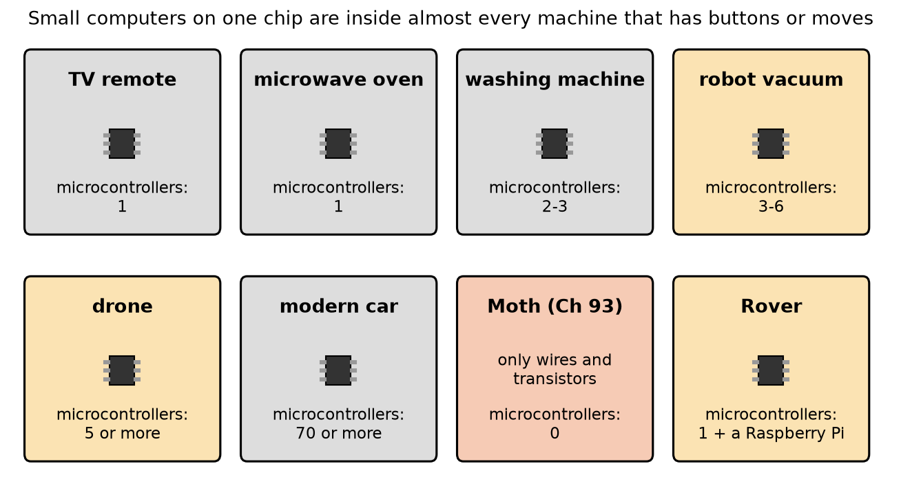
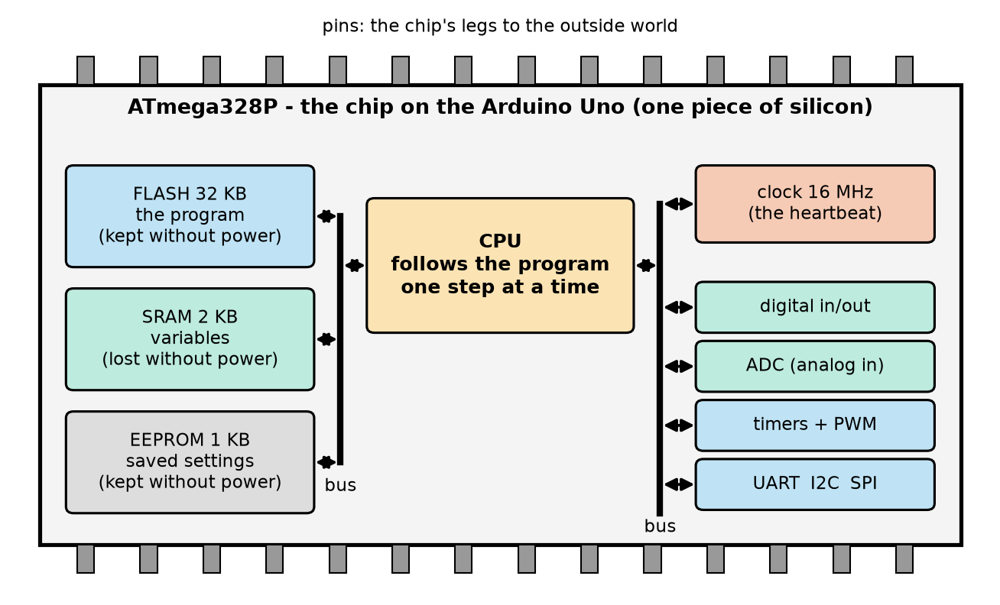
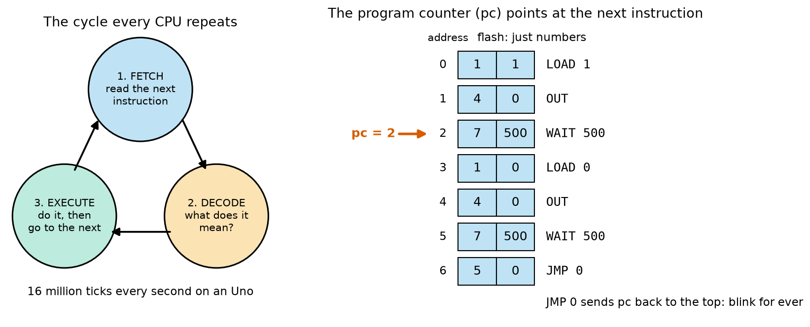
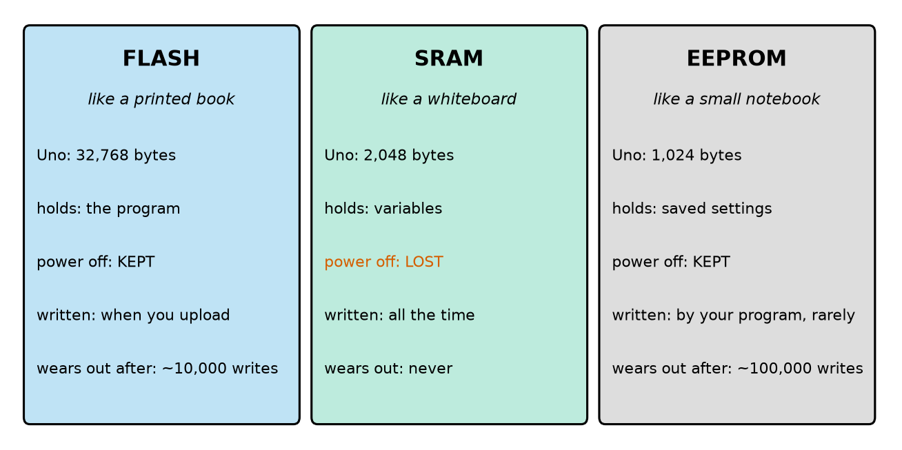
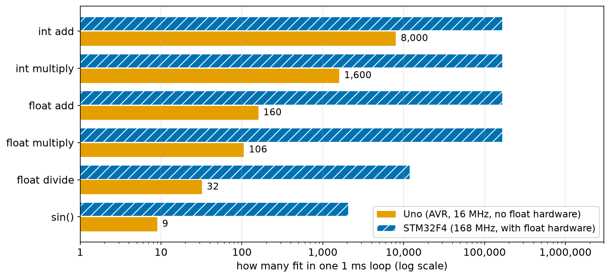
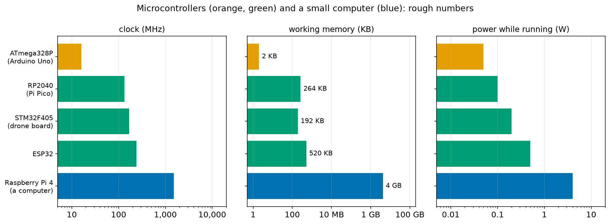
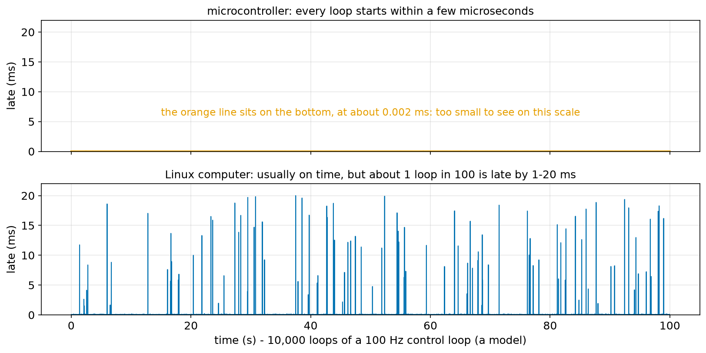
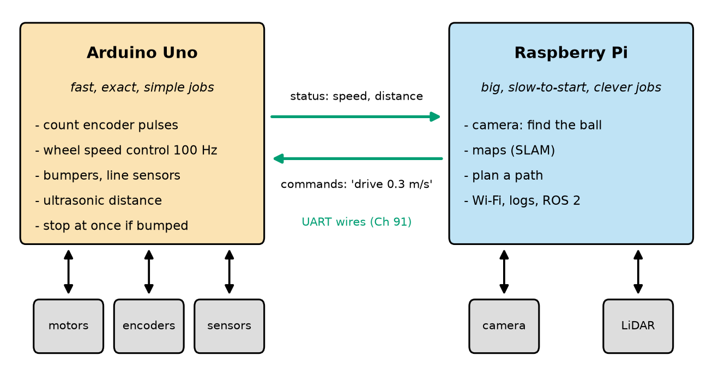

# Chapter 94 — What Is a Microcontroller?

> **Part 6 · Chapter 94 of 749**
> **You need:** Chapter 5 (the parts of a robot), Chapter 30 (time and loops), Chapter 31 (random numbers), Chapter 38 (powers of two), Chapter 91 (bits, bytes and logic levels) and Chapter 93 (Moth).
> **You will make:** a pretend microcontroller in Python that runs a blink program made only of numbers, a memory budget for Rover's Arduino, a "how much fits in one loop" calculator, a timing model that shows why robots keep a microcontroller next to a big computer, and a plan that splits Rover's jobs between its Arduino and its Raspberry Pi.

---

## What you will learn

- What a **microcontroller** is: a whole small computer on one chip, made to control a machine.
- What is inside one: the **CPU**, three kinds of memory (**flash**, **SRAM**, **EEPROM**), a **clock**, **pins** and **peripherals**.
- How a CPU runs a program: **fetch, decode, execute**, one small step per clock tick.
- How to make a **budget** of memory and time, so your program fits on a small chip.
- How a microcontroller differs from a computer like the **Raspberry Pi**, and why a good robot often has both.
- The main **families** of microcontrollers, and where each is used in real robots.

---

## New words in this chapter

| Word | Simple meaning |
|---|---|
| **microcontroller** (MCU) | A small computer on one chip, with memory and input/output pins, made to control a machine. |
| **CPU** | Central processing unit: the part that follows the program, one instruction at a time. |
| **instruction** | One tiny step the CPU knows how to do, such as "add these two numbers". |
| **program counter** (pc) | A number inside the CPU that says which instruction comes next. |
| **register** | A tiny, very fast storage box inside the CPU. |
| **flash memory** | Memory that holds the program. It keeps its contents when the power is off. |
| **SRAM** | The working memory for variables. It is fast, but it forgets everything when the power is off. |
| **EEPROM** | A small memory for settings that must survive a power cut. |
| **clock** | A part that ticks at a steady rate. Each tick moves the CPU one step forward. |
| **MHz** | Megahertz: a million ticks per second. |
| **peripheral** | A helper circuit inside the chip that does one job by itself, such as an ADC or a timer. |
| **firmware** | The program that lives inside a microcontroller's flash. |
| **real-time** | Doing a job not only correctly but also **on time**, every time. |
| **jitter** | How much the timing of a repeated job wobbles from one time to the next. |
| **single-board computer** | A whole computer on one small board, such as a Raspberry Pi. It runs an operating system. |

---

## 94.1 A computer on one chip

Think about Moth, the robot you built in Chapter 93. Its "brain" was two transistors and some resistors. Light came in at the eyes, current went out to the motors, and the wiring decided what happened. Moth was fast and simple. But it could only ever do **one thing**. To make it avoid walls, or follow a line, or stop after ten seconds, you would have to build a new circuit.

Now think about a microwave oven. You press "2", "0", "Start". It counts down from 20 seconds, shows the numbers, turns the heater on and off, beeps three times, and stops at once if you open the door. Nobody wired a special circuit for "20 seconds". Inside the oven there is a small chip that **follows a program**. Change the program and the same chip could run a washing machine.

📖 **New word: microcontroller** — a small computer on one chip, made to control a machine. It has a part that follows a program, memory to keep the program and its numbers, and **pins** (metal legs) that connect it to buttons, sensors, LEDs and motors. People often write **MCU**, short for **m**icro**c**ontroller **u**nit.

📖 **New word: firmware** — the program inside a microcontroller. It is called "firm" because it stays in the chip when the power is off, and it is not changed every day like the programs on your laptop.



*Figure 94.1 — Machines around us, and roughly how many microcontrollers each one has inside.*

**How to read this picture:** Each box is a machine; the small black chip means "there is at least one microcontroller inside". A TV remote or a microwave needs only one. A robot vacuum has several (one main chip, and small ones in the motor drivers and sensors). A modern car has seventy or more: one for the engine, one for each window, one for the brakes, one for the seats, and so on. Moth (red) is the odd one out: it has none, because its behaviour is fixed by wires. Rover (orange) has one Arduino, and later a Raspberry Pi as well.

🤖 **Robot connection.** From this chapter on, every robot in this course has at least one microcontroller. The robot's behaviour stops being a circuit and becomes a **program**: something you can read, test, change in seconds, and share. That is the biggest step in the whole course so far.

### What does "control" mean here?

Remember the four steps of a robot from Chapter 6: **sense, think, act**, and **repeat**. A microcontroller does all four:

```
   pins IN               inside the chip                pins OUT
 ┌──────────┐      ┌──────────────────────────┐      ┌──────────┐
 │ button   │ ───▶ │ read the pins            │      │ LED      │
 │ sensor   │ ───▶ │ follow the program       │ ───▶ │ motor    │
 │ encoder  │ ───▶ │ decide what to do        │ ───▶ │ buzzer   │
 └──────────┘      │ do it again, for ever    │      └──────────┘
                   └──────────────────────────┘
```

A microcontroller never "finishes". There is no desktop and no "quit" button. When the power comes on, it starts its program, and it runs the same loop until the power goes off: thousands of times per second, for years.

---

## 94.2 What is inside

A laptop has many separate chips: a processor, memory sticks, a disk, a graphics card. A microcontroller puts **all of it on one piece of silicon**, smaller than your fingernail. That makes it cheap (often under $2), small, and very low in power. It also makes it **small** in another way: much less memory and speed than a laptop.

The chip on the Arduino Uno, which Rover uses, is called the **ATmega328P**. Here is what is inside it.



*Figure 94.2 — The main parts inside the ATmega328P, all on one chip. The grey rectangles on the edges are the pins.*

**How to read this picture:** The orange box in the middle is the **CPU**, which follows the program. On the left are the three memories: **flash** (the program), **SRAM** (the variables) and **EEPROM** (saved settings). On the right are the **clock** and the **peripherals**: helper circuits for digital pins, analog inputs, timers, and talking to other chips. The thick black lines are **buses**: shared wires that carry numbers between the parts. The grey pins on the top and bottom edges connect it all to the outside world.

Let us meet each part.

📖 **New word: CPU** — the **c**entral **p**rocessing **u**nit. It reads the program one **instruction** at a time and does what each one says. It can add, subtract, compare two numbers, copy a number from one place to another, and jump to a different part of the program. That is almost all. Everything a robot does is built out of these tiny steps.

📖 **New word: register** — a tiny storage box **inside** the CPU. The ATmega328P has 32 of them, each holding one byte (Chapter 91: 8 bits, a number from 0 to 255). The CPU can only do arithmetic on numbers that are in registers, so numbers are copied in from memory, worked on, and copied back.

📖 **New word: clock** — a part that ticks at a steady rate, like a metronome. On the Uno it ticks **16 million times per second**: 16 **MHz** (megahertz; "mega" means a million). Each tick moves the CPU one step forward. On the Uno, the steady ticks come from a small vibrating part next to the chip, a **crystal** or a **resonator**, which is far more exact than anything a resistor and capacitor could make.

📖 **New word: peripheral** — a helper circuit inside the chip that does one job **by itself**, while the CPU does something else. The ADC measures voltages (Chapter 101). The timers count ticks and make PWM signals (Chapters 102 and 106). The UART, I2C and SPI circuits send and receive bits to other chips (Chapters 107–109). A peripheral is like a kitchen timer: you set it, walk away, and it rings when it is done.

The table gives the ATmega328P's main numbers. You will meet every one of them again in this part.

| Part | ATmega328P (Arduino Uno) | What it means |
|---|---|---|
| CPU | 8-bit AVR | Works on 8 bits (one byte) at a time |
| Clock | 16 MHz on the Uno (up to 20 MHz) | 16 million ticks per second |
| Flash | 32 KB (32,768 bytes); 0.5 KB is used by the bootloader (Chapter 95) | Room for the program |
| SRAM | 2 KB (2,048 bytes) | Room for all the variables |
| EEPROM | 1 KB (1,024 bytes) | Room for saved settings |
| Pins on the Uno | 14 digital (6 can do PWM) + 6 analog inputs | The chip's connections to the robot |
| ADC | 10 bits (0 to 1,023) | Chapter 91 and Chapter 101 |
| Timers | two 8-bit, one 16-bit | Chapters 103 and 106 |
| Supply | 1.8 V to 5.5 V; 5 V on the Uno | Logic levels from Chapter 91 |
| Current | about 10 mA for the chip at 16 MHz; about 50 mA for the whole Uno board | Chapter 89's battery maths |

🔢 **KB.** In memory sizes, 1 KB (kilobyte) is 2¹⁰ = 1,024 bytes, not 1,000 (Chapter 38: powers of two). So 32 KB = 32 × 1,024 = 32,768 bytes, and 2 KB = 2,048 bytes.

🧠 **A microcontroller is a CPU, memory, a clock and peripherals on one chip, joined to the world through pins.** It is small and slow next to a laptop, but it is cheap, uses very little power, starts in a moment, and does exactly what its program says, exactly on time.

---

## 94.3 How the CPU runs a program

You have written many Python programs. Python is easy for people to read. But a CPU cannot read Python, or any words at all. A CPU only understands **numbers**. Every program, in the end, becomes a long list of numbers in flash memory, and each number (or small group of numbers) is one **instruction**.

📖 **New word: instruction** — one tiny step that the CPU knows how to do. The ATmega328P knows about 130 different instructions. Examples: "copy this number into register 16", "add register 16 to register 17", "if the last result was zero, jump to address 200". Most of them take **one clock tick**.

How does the CPU know which instruction to do next? It keeps one special number: the **program counter**.

📖 **New word: program counter** — a number inside the CPU that holds the **address** (the position in flash) of the next instruction. After each instruction it goes up by one, so the instructions run in order, like your Python lines (Chapter 11). A **jump** instruction puts a new number into the program counter, so the CPU continues from somewhere else: that is how loops and `if` work at the lowest level.

The CPU repeats three steps for ever:

1. **Fetch**: read the instruction at the address in the program counter.
2. **Decode**: work out what the instruction means.
3. **Execute**: do it. Then move the program counter on, and go back to step 1.



*Figure 94.3 — Left: the cycle every CPU repeats. Right: a tiny program in flash. Each row is one instruction made of two numbers; the red arrow is the program counter.*

**How to read this picture:** On the left, follow the arrows round the circle: fetch, decode, execute, and back to fetch. On the right, the blue boxes are the flash memory; each row holds two numbers. The first number says *what* to do (1 means LOAD, 4 means OUT, 7 means WAIT, 5 means JMP), the second is a number to do it *with*. The words on the far right are only for us; the chip sees only the numbers. The program counter points at row 2, so "WAIT 500" is the next instruction. The last row, JMP 0, sends the program counter back to row 0, so the program runs for ever: a blinking LED.

### A pretend microcontroller in Python

The best way to understand fetch, decode, execute is to build a CPU. Our pretend CPU is much simpler than a real one. It has one register, **A**, one LED pin, and eight instructions:

| Number | Name | What it does |
|---|---|---|
| 0 | HALT | Stop. |
| 1 | LOAD k | Put the number k into A. |
| 2 | ADD k | Add k to A. |
| 3 | SUB k | Subtract k from A. |
| 4 | OUT | Copy A to the LED pin (1 = on, 0 = off). |
| 5 | JMP k | Jump: the next instruction is number k. |
| 6 | JNZ k | Jump to k, but only if A is **n**ot **z**ero. |
| 7 | WAIT k | Do nothing for k milliseconds. |

The program `toy_cpu.py` (in the Code section) holds the blink program as a list of 14 numbers and runs it. Here is the start of its output:

```
flash holds: 1 1 4 0 7 500 1 0 4 0 7 500 5 0
   0  pc=0  LOAD   1   A=1  LED=0  ticks=         1
   1  pc=1  OUT    0   A=1  LED=1  ticks=         2
   2  pc=2  WAIT 500   A=1  LED=1  ticks= 8,000,003
   3  pc=3  LOAD   0   A=0  LED=1  ticks= 8,000,004
```

Look at the first line. The whole blink program is just **fourteen numbers**. That is what a real microcontroller's flash holds too: when you "upload a program" to an Arduino (Chapter 95), you are sending it a long list of numbers like this.

Then look at the **ticks** column. LOAD and OUT take one tick each. WAIT 500 takes 8,000,000 ticks, because 500 ms at 16 million ticks per second is 0.5 × 16,000,000 = 8,000,000. The CPU spends almost all its time **waiting**. Keep that in mind: Chapter 103 shows how to use that waiting time for other jobs.

🔢 **One tick on the Uno = 1 ÷ 16,000,000 s = 0.0000000625 s = 62.5 nanoseconds** (a nanosecond is a billionth of a second). In the time a camera flash lasts (about 1 ms), the Uno does 16,000 ticks.

### From Python or C++ to numbers

Nobody writes programs as lists of numbers any more. You will write your Arduino programs in **C++** (Chapters 96 and 97), which looks a bit like Python. A program called a **compiler** turns your C++ into the CPU's instruction numbers. For example, this one line of C++:

```cpp
count = count + 1;
```

becomes a few instructions: load `count` from SRAM into a register, add 1, store it back. On the ATmega328P that takes about 4 to 6 ticks, well under half a microsecond.

💡 **Tip:** This is also why C++ is used on microcontrollers instead of Python. Python is run by another program (the Python interpreter) that reads your code while it runs; that needs far more memory than the Uno has, and is 10 to 100 times slower. C++ is turned into instruction numbers **before** it runs, so the chip runs it directly. (Some larger microcontrollers can run a small Python called MicroPython. The Uno cannot.)

---

## 94.4 Three kinds of memory

A microcontroller needs memory for three very different jobs, so it has three different kinds.



*Figure 94.4 — Flash, SRAM and EEPROM: what each holds on the Uno, whether it survives a power cut, and how often it can be written.*

**How to read this picture:** Read across each row. All three hold numbers, but they are different in size, in what they keep when the power goes off (only SRAM forgets, in red), and in how often they can be written. SRAM is written all the time and never wears out; flash and EEPROM wear out after many writes, so they are only written when needed.

📖 **New word: flash memory** — memory that holds the **program**. It is like a printed book: you read it all the time, but you only "print" it when you upload a new program. It keeps its contents for many years with no power. It wears out after about 10,000 rewrites, which is more uploads than you will ever do.

📖 **New word: SRAM** — **s**tatic **r**andom-**a**ccess **m**emory, the working memory. Every variable your program uses lives here: speeds, sensor readings, counters. It is like a whiteboard: fast to write, fast to read, and wiped clean when the power goes off. The Uno has only **2,048 bytes** of it. That is not a typing mistake: two thousand bytes, less than this paragraph takes as text.

📖 **New word: EEPROM** — **e**lectrically **e**rasable **p**rogrammable **r**ead-**o**nly **m**emory: a small notebook for things that must **survive** a power cut, such as a calibration number or a robot's name. Your program writes it on purpose, and rarely: each byte lasts about 100,000 writes. Writing one byte takes about 3.3 ms, very slow next to SRAM.

⚠️ **Careful: never write EEPROM in a fast loop.** A loop that saves a number to EEPROM 100 times per second wears out that byte in 100,000 ÷ 100 = 1,000 seconds: about 17 minutes. Save only when something changes, for example when the user finishes a calibration.

### A memory budget

On a laptop you almost never think about memory. On a microcontroller you must, because 2 KB runs out fast. Suppose Rover wants to keep its last 1,000 distance readings, to send them to your computer later. Each reading is an `int`, a whole number that takes 2 bytes on the Uno (Chapter 96). That is 2,000 bytes. Will it fit?

Not everything in SRAM is yours. The Arduino software itself uses some (about 190 bytes if you use the serial connection, mostly for two 64-byte buffers that hold characters going in and out, Chapter 100). Rover's own variables need some. And the program needs free space while it runs, for the **stack**: the scratch space that every function call uses for its numbers (Chapter 97). If the stack runs out of room, it silently writes over your variables, and the robot behaves strangely or restarts. A safe plan keeps a few hundred bytes free.

The program `memory_budget.py` adds it up:

```
Arduino core + Serial buffers          190 bytes
Rover's variables (speeds, state)       60 bytes
free space kept for the stack          300 bytes
left for a sensor log                 1498 bytes

one reading is a       fits   at 10 per second
byte (0-255)           1498           149.8 s
int (2 bytes)           749            74.9 s
float (4 bytes)         374            37.4 s
time + 2 distances      187            18.7 s

a log of 1000 ints needs 2000 bytes: too big by 502 bytes
```

The plan does not fit. Rover can keep about 749 `int` readings, which is 75 seconds of data at 10 readings per second. With `float`s (4 bytes each) it is only 37 seconds. The fixes are real engineering choices: keep fewer readings, store them as single bytes (0–255, enough for a distance in centimetres up to 2.55 m), or send them to the Raspberry Pi as they arrive instead of keeping them.

🧠 **On a microcontroller, memory is a budget.** Before you write the program, add up what it needs. The Arduino IDE helps: after every build it tells you how much flash and SRAM your program uses (Chapter 95).

---

## 94.5 The clock: how fast is fast?

16 million ticks per second sounds like a lot, and for many jobs it is. But a robot's control loop must finish its work **in time**, every time, before the next loop starts (Chapter 30). So the useful question is not "how fast is the chip?" but "**how much work fits in one loop?**"

🔢 **Ticks per loop = clock rate ÷ loop rate.**

- Uno, 1,000 loops per second: 16,000,000 ÷ 1,000 = **16,000 ticks** per loop.
- Uno, 8,000 loops per second (a drone's loop): 16,000,000 ÷ 8,000 = **2,000 ticks** per loop.

How many ticks does each kind of work cost? It depends very much on the kind of number. The ATmega328P works on 8 bits at a time and has hardware for whole numbers only. A decimal number (a `float`, Chapter 96) has to be handled by a small program of many instructions, so float maths is much slower. Bigger chips, such as the STM32F4 in many drone flight controllers, have a **floating-point unit** (FPU): hardware that does a float multiplication in a single tick.

The program `cycle_budget.py` uses rough tick costs to see how many of each operation fit in a 1 ms loop:

```
one loop at 1000 Hz lasts 1 ms

Uno (AVR, 16 MHz): 16,000 ticks per loop, one tick = 62.5 ns
  int add             2 ticks  ->  at most   8,000 per loop
  int multiply       10 ticks  ->  at most   1,600 per loop
  float add         100 ticks  ->  at most     160 per loop
  float multiply    150 ticks  ->  at most     106 per loop
  float divide      500 ticks  ->  at most      32 per loop
  sin()            1700 ticks  ->  at most       9 per loop

STM32F4 (168 MHz): 168,000 ticks per loop, one tick = 6.0 ns
  int add             1 ticks  ->  at most 168,000 per loop
  int multiply        1 ticks  ->  at most 168,000 per loop
  float add           1 ticks  ->  at most 168,000 per loop
  float multiply      1 ticks  ->  at most 168,000 per loop
  float divide       14 ticks  ->  at most  12,000 per loop
  sin()              80 ticks  ->  at most   2,100 per loop
```

(These costs are rough. The real numbers change with the compiler and the values, and every real program also spends ticks moving numbers between memory and registers. Use them to compare, not to plan to the last tick.)



*Figure 94.5 — The same numbers as a chart, on a log scale (Chapter 38): each grid line is ten times the one before.*

**How to read this picture:** Each pair of bars is one kind of operation. The orange bar is how many fit in one 1 ms loop on the Uno; the blue striped bar is the same for the STM32F4. The orange bars fall steeply from "int add" down to "sin()": the Uno can do 8,000 whole-number additions per loop but only 9 sines. The blue bars stay high because the STM32F4 is ten times faster **and** has float hardware.

🧠 **On a small microcontroller, use whole numbers when you can.** Rover's encoder counts, timings in milliseconds and ADC readings are all whole numbers. Keep them that way, and use `float` only where it really helps. Chapter 54 showed the other reason: floats also bring rounding errors.

🤖 **Robot connection.** A sine on the Uno costs 1,700 ticks, about 0.1 ms. Rover's odometry (Chapter 288) needs a sine and a cosine of its heading each loop: 0.2 ms, fine at 100 loops per second. A robot arm that needs 30 sines per loop at 1,000 Hz would need 30 × 1,700 = 51,000 ticks per 16,000-tick loop: impossible on an Uno. That is a job for a bigger chip.

---

## 94.6 Pins and peripherals: the chip's hands and ears

A pin is a metal leg of the chip. Inside, each pin is joined to several circuits, and your program chooses which one is connected. The same pin can be any of these:

| A pin can be… | What it does | Chapter |
|---|---|---|
| digital output | Drives the pin HIGH (5 V) or LOW (0 V): an LED, a transistor | 98 |
| digital input | Reads HIGH or LOW: a button, a bumper | 99 |
| analog input | Measures a voltage from 0 to 5 V as a number from 0 to 1,023 | 101 |
| PWM output | Switches on and off very fast to "dim" an LED or slow a motor | 102 |
| part of a bus | Sends or receives bits to another chip: UART, I2C, SPI | 107–109 |
| interrupt input | Calls a piece of your program the instant the pin changes | 105 |

Remember from Chapter 91 that the Uno's pins work with 5 V logic levels, and from Chapter 82 that each pin can supply only a little current: about **20 mA** is the safe working value (40 mA is the absolute maximum). A pin can light an LED through a resistor. It cannot drive a motor: for that you need a transistor (Chapter 87), a MOSFET (Chapter 88) or a motor driver (Chapter 141).

⚠️ **Careful: a microcontroller pin is not a power supply.** Connecting a motor straight to a pin can destroy the pin, or the whole chip, in a moment. The pin tells a transistor what to do, and the transistor carries the big current.

Peripherals are what make a small chip powerful. Without them, the CPU would have to do everything by itself: to send a letter to the computer at 9,600 bits per second, it would have to switch a pin every 104 µs, exactly on time, and could do nothing else. With the UART peripheral, the CPU hands over the letter in one tick, and the peripheral sends the bits by itself while the CPU carries on.

---

## 94.7 Microcontroller or computer?

Rover will get a Raspberry Pi later (Chapter 112 and stage 7 in Chapter 498). A Raspberry Pi is a **single-board computer**.

📖 **New word: single-board computer** — a whole computer on one small board: a fast processor, gigabytes of memory, a storage card, USB, video output and networking. It runs an **operating system**, usually Linux, just like a laptop. You can run Python on it, open a web browser, and plug in a camera.

So why not just use a Pi for everything? Compare them.



*Figure 94.6 — Clock speed, working memory and running power for four microcontrollers and one small computer, on log scales. The numbers are rough.*

**How to read this picture:** Each row is a chip or board. Orange is the Uno's ATmega328P; green are three bigger, modern microcontrollers; blue is the Raspberry Pi 4. Each panel has a log scale, so every grid line is ten times the one before. The Pi is about 100 times faster than the Uno, has about two million times more working memory (4 GB against 2 KB), and uses about 80 times more power.

| | Arduino Uno | Raspberry Pi 4 |
|---|---|---|
| Brain | 8-bit microcontroller, 16 MHz | 64-bit, four cores, 1.5 GHz |
| Working memory | 2 KB | 1 to 8 GB |
| Operating system | none: only your program | Linux, with hundreds of programs running |
| Time to start | well under a second | about 20 to 40 seconds |
| Power | about 0.25 W for the board | about 3 to 6 W |
| Analog inputs | 6 (10-bit ADC) | none |
| Pins | 5 V logic, 20 mA each | 3.3 V logic, not 5 V tolerant (Chapter 91) |
| If the power is cut | nothing is lost; restarts at once | the storage card can be damaged |
| Timing of a loop | the same every time, to a microsecond | usually good, but sometimes late by milliseconds |
| Camera, Wi-Fi, ROS 2 | no | yes |

The last row but one is the reason robots keep a microcontroller.

### Real-time: correct and on time

📖 **New word: real-time** — a job is real-time when it must be not only **correct** but also **on time**, every time. A wheel-speed controller that runs 100 times per second must run every 10 ms. A late answer is a wrong answer: if the robot's bumper is pressed and the motors stop 20 ms later than planned, the robot has already pushed harder into the wall.

📖 **New word: jitter** — how much the start time of a repeated job wobbles. A loop that should start every 10.000 ms but actually starts after 10.001, 9.999, 10.002 ms has very small jitter. One that sometimes starts after 25 ms has large jitter.

On the Uno, nothing runs except your program, so the timing of your loop is decided by your code alone. On a Pi, Linux shares the processor between hundreds of jobs: writing to the storage card, Wi-Fi, the desktop, other programs. Most of the time your loop gets its turn quickly. But now and then, it waits.

The program `jitter_compare.py` is a **model** of this, with typical numbers. It runs 10,000 loops of a 100 Hz control loop on each kind of machine and reports how late each one starts:

```
microcontroller  late by: typical  0.001 ms, 1 in 100 over  0.005 ms, worst   0.01 ms  -> worst extra drive   0.0 mm
Linux computer   late by: typical  0.034 ms, 1 in 100 over  1.966 ms, worst  19.99 ms  -> worst extra drive  10.0 mm
```



*Figure 94.7 — The lateness of every loop in the model, over 100 seconds.*

**How to read this picture:** Time runs left to right; each loop is one point, and its height is how late it started. The top panel is the microcontroller: its line sits on zero for the whole 100 seconds. The bottom panel is the Linux computer: almost every loop is on time too, but about once a second a loop is late by several milliseconds, up to 20 ms. Most of the time the two are equally good. The difference is in the **worst** case, and in a robot it is the worst case that breaks things.

The numbers in the model are typical, not exact: a Pi with nothing else running does better, and a busy one can do worse. Real-time Linux (Chapter 530) makes the worst case much smaller. But the lesson holds: if a job **must** happen within a millisecond, every time, put it on a microcontroller.

🧠 **A microcontroller is small but punctual; a computer is big but sometimes late.** Many robots use both: the microcontroller for fast, exact jobs close to the motors and sensors, and the computer for heavy thinking such as cameras, maps and planning. Application 1 below plans this split for Rover.

---

## 94.8 Families of microcontrollers

There are thousands of microcontroller models. They come in a few big families, and the Arduino software works with chips from most of them.

| Family | Example chip | Clock | SRAM | Good for | Where you will meet it |
|---|---|---|---|---|---|
| AVR (8-bit) | ATmega328P (Arduino Uno, Nano) | 16 MHz | 2 KB | Learning; simple robots; 5 V parts | This part, Rover |
| ARM Cortex-M0+ (32-bit) | RP2040 (Raspberry Pi Pico) | 133 MHz | 264 KB | Cheap, fast, two cores | Optional, many chapters |
| ARM Cortex-M4 (32-bit, FPU) | STM32F405 | 168 MHz | 192 KB | Float maths: drones, motor control | Part 30 |
| Xtensa (32-bit, Wi-Fi) | ESP32 | 240 MHz | 520 KB | Wireless robots; FreeRTOS | Part 26, Chapter 641 |

**8-bit or 32-bit?** This is how many bits the CPU works on in one step. An 8-bit CPU adds two numbers from 0 to 255 in one tick; adding two numbers up to 4 billion takes it several instructions. A 32-bit CPU does that in one tick. 32-bit chips are now cheap, fast and common. The 8-bit Uno is still the best chip to **learn** on: it is simple enough to understand completely, works at 5 V (so it is hard to damage), and it has huge amounts of help and examples.

**Boards and chips.** A microcontroller chip alone needs a few parts around it before it can run: a supply, a clock crystal, a reset button, a way to load the program. A **development board** such as the Arduino Uno puts all of these on a small board with a USB socket. The **Arduino Nano** (which Chapter 10's cleaning robot used) has the same ATmega328P chip as the Uno on a board small enough to plug into a breadboard. The **Arduino Mega** has a bigger chip, the ATmega2560, with 8 KB of SRAM and 54 digital pins. Whatever you learn on the Uno works on all of them.

---

## 94.9 The microcontroller is now Moth's brain

Let us end the theory by looking back at Moth. Moth's behaviour was fixed by its wiring: each eye drove the opposite motor through a transistor. With a microcontroller, the same robot becomes:

```
loop for ever:
    left  = read the left eye        (analog input, Chapter 101)
    right = read the right eye
    set the right motor speed from left    (PWM output, Chapter 102)
    set the left motor speed from right
```

Four lines do what Moth's whole circuit did. And now you can change the behaviour **without a soldering iron**: add a 13 kΩ bias by adding 30 to one number (Chapter 93's search fix), make Moth flee from light by swapping two lines, or make it stop after ten seconds with a timer. This flexibility is why almost every robot today is built around a microcontroller.

---

## Code

All the programs in this chapter are Python, so you can run them now. From Chapter 96 on, you will also write C++ for the real chip.

File `code/ch094/toy_cpu.py`:

```python
# toy_cpu.py - a pretend microcontroller: a program of numbers in "flash", run by fetch, decode, execute
NAMES = {0: "HALT", 1: "LOAD", 2: "ADD", 3: "SUB", 4: "OUT", 5: "JMP", 6: "JNZ", 7: "WAIT"}
CLOCK_HZ = 16_000_000                  # 16 million clock ticks per second, like the Arduino Uno

# The blink program. Each instruction is two numbers: what to do, and a number to do it with.
FLASH = [1, 1,       # 0: LOAD 1     put 1 in register A
         4, 0,       # 1: OUT        copy A to the LED pin (LED on)
         7, 500,     # 2: WAIT 500   wait 500 ms
         1, 0,       # 3: LOAD 0     put 0 in A
         4, 0,       # 4: OUT        LED off
         7, 500,     # 5: WAIT 500
         5, 0]       # 6: JMP 0      go back to instruction 0, for ever


def run(flash, max_steps):
    pc, a, led, cycles = 0, 0, 0, 0          # program counter, register A, LED pin, clock ticks so far
    for step in range(max_steps):
        op, arg = flash[2 * pc], flash[2 * pc + 1]       # FETCH: read two numbers from flash
        name = NAMES[op]                                  # DECODE: which instruction is it?
        next_pc = pc + 1
        if op == 0:                                       # EXECUTE
            print(f"{step:4d}  pc={pc}  HALT")
            break
        elif op == 1:
            a = arg
        elif op == 2:
            a = a + arg
        elif op == 3:
            a = a - arg
        elif op == 4:
            led = a
        elif op == 5:
            next_pc = arg
        elif op == 6 and a != 0:
            next_pc = arg
        elif op == 7:
            cycles += arg * CLOCK_HZ // 1000              # waiting 1 ms = 16,000 ticks
        cycles += 1                                       # every instruction itself takes one tick
        print(f"{step:4d}  pc={pc}  {name:4s} {arg:3d}   A={a}  LED={led}  ticks={cycles:>10,}")
        pc = next_pc
    print(f"time on a {CLOCK_HZ // 1_000_000} MHz clock: {cycles / CLOCK_HZ * 1000:.4f} ms")


print("flash holds:", " ".join(str(n) for n in FLASH))
run(FLASH, 14)
```

| Line | Code | What it does (simple English) |
|---|---|---|
| 1 | `# toy_cpu.py …` | A comment: what the program is for. |
| 2 | `NAMES = {0: "HALT", …}` | A dictionary (Chapter 22) from instruction numbers to names. The CPU does not need names; we use them only to print the trace. |
| 3 | `CLOCK_HZ = 16_000_000` | The clock rate. The underscores make the big number easy to read; Python ignores them. |
| 4 | (blank) | Spacing. |
| 5 | `# The blink program. …` | A comment that explains the layout of the flash list. |
| 6 | `FLASH = [1, 1, …` | The program, as a list (Chapter 21) of numbers. The first pair, 1 and 1, means LOAD 1. The comment after `#` says what each pair means. |
| 7–11 | `4, 0, …` to `7, 500,` | The other instructions: OUT, WAIT 500, LOAD 0, OUT, WAIT 500. OUT does not need a number, so its second number is 0. |
| 12 | `5, 0]` | JMP 0: go back to the first instruction. The `]` ends the list. |
| 13–14 | (blank) | Spacing. |
| 15 | `def run(flash, max_steps):` | A function (Chapter 23) that runs a program. `max_steps` stops it after that many instructions, so an endless program like blink does not run for ever. |
| 16 | `pc, a, led, cycles = 0, 0, 0, 0` | The CPU's state: program counter, register A, the LED pin, and the number of clock ticks so far. All start at 0, like a chip that has just been switched on. |
| 17 | `for step in range(max_steps):` | One pass of this loop is one fetch-decode-execute cycle. |
| 18 | `op, arg = flash[2 * pc], flash[2 * pc + 1]` | **Fetch.** Instruction number `pc` is stored at positions 2 × pc and 2 × pc + 1 of the list, because each instruction is two numbers. |
| 19 | `name = NAMES[op]` | **Decode** (for printing): look up the instruction's name. |
| 20 | `next_pc = pc + 1` | Normally, the next instruction is the one after this one. |
| 21 | `if op == 0:` | **Execute** starts here: a chain of `if`/`elif` (Chapter 18) picks what to do. 0 is HALT. |
| 22–23 | `print(…)`, `break` | Print that the CPU stopped, and leave the loop. |
| 24–25 | `elif op == 1: a = arg` | LOAD: put the number into register A. |
| 26–27 | `elif op == 2: a = a + arg` | ADD. |
| 28–29 | `elif op == 3: a = a - arg` | SUB. |
| 30–31 | `elif op == 4: led = a` | OUT: the LED pin copies register A. |
| 32–33 | `elif op == 5: next_pc = arg` | JMP: change where the next instruction comes from. |
| 34–35 | `elif op == 6 and a != 0: next_pc = arg` | JNZ: jump only if A is not zero. If A is zero, `next_pc` stays `pc + 1`. This one instruction is how every `if` and every loop works deep inside a real CPU. |
| 36–37 | `elif op == 7: cycles += …` | WAIT: add the ticks that pass while waiting. `arg` ms × 16,000,000 ticks per second ÷ 1,000 ms per second. `//` keeps it a whole number. |
| 38 | `cycles += 1` | Every instruction takes one tick of its own. |
| 39 | `print(…)` | One line of the trace: step number, program counter, instruction, A, LED and ticks. `:>10,` puts commas in the number and lines it up on the right in 10 spaces. |
| 40 | `pc = next_pc` | Move the program counter on, ready for the next fetch. |
| 41 | `print(f"time on a …")` | After the loop: the total time, ticks ÷ ticks per second, shown in milliseconds. |
| 42–43 | (blank) | Spacing. |
| 44 | `print("flash holds:", …)` | Show the program as the chip sees it: just numbers. `" ".join(…)` puts spaces between them (Chapter 15). |
| 45 | `run(FLASH, 14)` | Run 14 instructions: exactly two blinks. |

Output:

```
flash holds: 1 1 4 0 7 500 1 0 4 0 7 500 5 0
   0  pc=0  LOAD   1   A=1  LED=0  ticks=         1
   1  pc=1  OUT    0   A=1  LED=1  ticks=         2
   2  pc=2  WAIT 500   A=1  LED=1  ticks= 8,000,003
   3  pc=3  LOAD   0   A=0  LED=1  ticks= 8,000,004
   4  pc=4  OUT    0   A=0  LED=0  ticks= 8,000,005
   5  pc=5  WAIT 500   A=0  LED=0  ticks=16,000,006
   6  pc=6  JMP    0   A=0  LED=0  ticks=16,000,007
   7  pc=0  LOAD   1   A=1  LED=0  ticks=16,000,008
   8  pc=1  OUT    0   A=1  LED=1  ticks=16,000,009
   9  pc=2  WAIT 500   A=1  LED=1  ticks=24,000,010
  10  pc=3  LOAD   0   A=0  LED=1  ticks=24,000,011
  11  pc=4  OUT    0   A=0  LED=0  ticks=24,000,012
  12  pc=5  WAIT 500   A=0  LED=0  ticks=32,000,013
  13  pc=6  JMP    0   A=0  LED=0  ticks=32,000,014
time on a 16 MHz clock: 2000.0009 ms
```

Follow the `LED` column: 0, 1 (step 1), 1, 1, 0 (step 4), and so on: on for 500 ms, off for 500 ms. At step 6, JMP sends `pc` back to 0, and step 7 starts the same pattern again. Notice that LOAD 1 at step 0 changes A but not the LED; only OUT changes the pin. Two blinks take 2,000.0009 ms: 2 seconds of waiting plus 14 ticks of real work (0.0009 ms). The CPU is idle 99.9999% of the time.

File `code/ch094/memory_budget.py`:

```python
# memory_budget.py - will Rover's data fit in the Arduino Uno's 2,048 bytes of SRAM?
SRAM = 2048                     # bytes of working memory in the ATmega328P

used = {
    "Arduino core + Serial buffers": 190,      # what an almost empty sketch that uses Serial needs
    "Rover's variables (speeds, state)": 60,
    "free space kept for the stack": 300,      # function calls need room while they run (Chapter 97)
}
fixed = sum(used.values())
for name, size in used.items():
    print(f"{name:36s} {size:5d} bytes")
print(f"{'left for a sensor log':36s} {SRAM - fixed:5d} bytes")
print()

kinds = {"byte (0-255)": 1, "int (2 bytes)": 2, "float (4 bytes)": 4, "time + 2 distances": 8}
print(f"{'one reading is a':20s} {'fits':>6s} {'at 10 per second':>18s}")
for name, size in kinds.items():
    n = (SRAM - fixed) // size                 # how many whole readings fit
    print(f"{name:20s} {n:6d} {n / 10:15.1f} s")
print()

wanted = 1000                                   # Rover's first idea: keep the last 1,000 int readings
need = wanted * 2
print(f"a log of {wanted} ints needs {need} bytes: "
      f"{'fits' if need <= SRAM - fixed else f'too big by {need - (SRAM - fixed)} bytes'}")
```

| Line | Code | What it does (simple English) |
|---|---|---|
| 1 | `# memory_budget.py …` | A comment: what the program is for. |
| 2 | `SRAM = 2048` | The Uno's working memory: 2 KB = 2,048 bytes. |
| 3 | (blank) | Spacing. |
| 4 | `used = {` | A dictionary of the things that use SRAM before our log does. |
| 5 | `"Arduino core + Serial buffers": 190,` | The Arduino's own needs when the serial connection is used (mostly two 64-byte buffers). A rough, typical number. |
| 6 | `"Rover's variables …": 60,` | Room for Rover's own variables. |
| 7 | `"free space kept for the stack": 300,` | Space we leave empty on purpose, for function calls while the program runs. |
| 8 | `}` | Ends the dictionary. |
| 9 | `fixed = sum(used.values())` | Adds 190 + 60 + 300 = 550 bytes. |
| 10–11 | `for name, size in …: print(…)` | Print each item, the name padded to 36 characters so the numbers line up. |
| 12 | `print(f"{'left for a sensor log':36s} …")` | What is left: 2,048 − 550 = 1,498 bytes. |
| 13 | `print()` | An empty line. |
| 14 | (blank) | Spacing. |
| 15 | `kinds = {…}` | Four ways to store one reading, with their sizes in bytes. "time + 2 distances" is a 4-byte time and two 2-byte distances. |
| 16 | `print(…)` | The table heading. `:>6s` pushes text to the right of 6 spaces. |
| 17 | `for name, size in kinds.items():` | One row per kind of reading. |
| 18 | `n = (SRAM - fixed) // size` | How many whole readings fit. `//` divides and drops the remainder (Chapter 13): you cannot store half a reading. |
| 19 | `print(f"… {n / 10:15.1f} s")` | At 10 readings per second, `n` readings cover `n ÷ 10` seconds. |
| 20 | `print()` | An empty line. |
| 21 | (blank) | Spacing. |
| 22 | `wanted = 1000` | The first plan: keep 1,000 readings. |
| 23 | `need = wanted * 2` | Each `int` is 2 bytes. |
| 24–25 | `print(f"… {'fits' if … else f'too big by …'}")` | A conditional expression: print "fits" if it fits, otherwise how many bytes too many. The inner `f'…'` is an f-string inside an f-string, with different quotes so Python can tell them apart. |

The output is in section 94.4. The answer: 2,000 bytes needed, 1,498 available, too big by 502 bytes.

File `code/ch094/cycle_budget.py`:

```python
# cycle_budget.py - how much work fits in one control loop? (rough clock-tick costs of common operations)
CHIPS = {
    # name: (clock in Hz, {operation: rough clock ticks it takes})
    "Uno (AVR, 16 MHz)": (16_000_000, {"int add": 2, "int multiply": 10, "float add": 100,
                                       "float multiply": 150, "float divide": 500, "sin()": 1700}),
    "STM32F4 (168 MHz)": (168_000_000, {"int add": 1, "int multiply": 1, "float add": 1,
                                        "float multiply": 1, "float divide": 14, "sin()": 80}),
}
LOOP_HZ = 1000                       # a control loop that runs 1,000 times per second

print(f"one loop at {LOOP_HZ} Hz lasts {1000 / LOOP_HZ:g} ms")
for chip, (clock, cost) in CHIPS.items():
    ticks = clock // LOOP_HZ                      # clock ticks available in one loop
    print()
    print(f"{chip}: {ticks:,} ticks per loop, one tick = {1e9 / clock:.1f} ns")
    for op, c in cost.items():
        print(f"  {op:15s} {c:5d} ticks  ->  at most {ticks // c:7,} per loop")
```

| Line | Code | What it does (simple English) |
|---|---|---|
| 1 | `# cycle_budget.py …` | A comment: what the program is for. |
| 2 | `CHIPS = {` | A dictionary with one entry per chip. |
| 3 | `# name: (clock in Hz, {…})` | A comment explaining each entry: a tuple (Chapter 22) of the clock rate and another dictionary of tick costs. |
| 4–5 | `"Uno (AVR, 16 MHz)": (16_000_000, {…}),` | The Uno: 16 million ticks per second, and rough costs. The entry is split over two lines; Python allows that inside brackets. |
| 6–7 | `"STM32F4 (168 MHz)": (…),` | A drone-style chip with float hardware: most operations take 1 tick. |
| 8 | `}` | Ends the dictionary. |
| 9 | `LOOP_HZ = 1000` | The loop rate we are planning for. |
| 10 | (blank) | Spacing. |
| 11 | `print(f"one loop … {1000 / LOOP_HZ:g} ms")` | 1,000 ms ÷ 1,000 loops = 1 ms per loop. `:g` prints a number without needless zeros. |
| 12 | `for chip, (clock, cost) in CHIPS.items():` | Loop over the chips, unpacking each tuple into `clock` and `cost`. |
| 13 | `ticks = clock // LOOP_HZ` | Ticks in one loop: 16,000,000 ÷ 1,000 = 16,000 for the Uno. |
| 14 | `print()` | An empty line between chips. |
| 15 | `print(f"{chip}: … {1e9 / clock:.1f} ns")` | The ticks per loop, and the length of one tick in nanoseconds: 10⁹ ÷ 16,000,000 = 62.5 ns. |
| 16 | `for op, c in cost.items():` | One row per operation. |
| 17 | `print(f"… {ticks // c:7,} per loop")` | How many of that operation fit in one loop if the loop did nothing else. |

The output is in section 94.5.

File `code/ch094/jitter_compare.py`:

```python
# jitter_compare.py - a model of how late a 100 Hz control loop starts on a microcontroller and on a Linux computer
import random

random.seed(94)
LOOPS = 10_000                  # 100 seconds of loops at 100 Hz
SPEED = 0.5                     # Rover drives at 0.5 m/s


def late_mcu():
    return abs(random.gauss(0, 0.002))                    # ms: only a few microseconds, every time


def late_linux():
    late = abs(random.gauss(0, 0.05))                     # usually 50 microseconds or so
    if random.random() < 0.01:                            # but about 1 loop in 100, the system is busy
        late += random.uniform(1, 20)                     # (writing a file, Wi-Fi, another program)
    return late


for name, late in [("microcontroller", late_mcu), ("Linux computer", late_linux)]:
    times = sorted(late() for _ in range(LOOPS))
    middle, p99, worst = times[LOOPS // 2], times[int(LOOPS * 0.99)], times[-1]
    print(f"{name:16s} late by: typical {middle:6.3f} ms, 1 in 100 over {p99:6.3f} ms, worst {worst:6.2f} ms"
          f"  -> worst extra drive {worst / 1000 * SPEED * 1000:5.1f} mm")
```

| Line | Code | What it does (simple English) |
|---|---|---|
| 1 | `# jitter_compare.py …` | A comment: what the program is for. It is a **model**: the numbers are typical, not measured. |
| 2 | `import random` | Random numbers (Chapter 31). |
| 3 | (blank) | Spacing. |
| 4 | `random.seed(94)` | A fixed seed, so you get exactly the output below. |
| 5 | `LOOPS = 10_000` | 10,000 loops at 100 per second is 100 seconds. |
| 6 | `SPEED = 0.5` | Rover's speed, to turn lateness into distance. |
| 7–8 | (blank) | Spacing. |
| 9 | `def late_mcu():` | How late one loop starts on a microcontroller, in ms. |
| 10 | `return abs(random.gauss(0, 0.002))` | A tiny random lateness: a bell curve (Chapter 31) with a spread of 0.002 ms = 2 µs. `abs` makes it positive, since a loop cannot start early here. |
| 11–12 | (blank) | Spacing. |
| 13 | `def late_linux():` | How late one loop starts on a busy Linux computer. |
| 14 | `late = abs(random.gauss(0, 0.05))` | Usually a small lateness, about 50 µs. |
| 15 | `if random.random() < 0.01:` | With a chance of 1 in 100… |
| 16 | `late += random.uniform(1, 20)` | …add a long wait of 1 to 20 ms, because the system was doing something else. |
| 17 | `return late` | Give back the lateness. |
| 18–19 | (blank) | Spacing. |
| 20 | `for name, late in [(…), (…)]:` | Loop over the two machines. Functions can be stored in a list and called later (Chapter 24). |
| 21 | `times = sorted(late() for _ in range(LOOPS))` | Make 10,000 latenesses and sort them from smallest to largest. `_` is a name for a loop variable we do not use. |
| 22 | `middle, p99, worst = …` | Read three values from the sorted list: the middle one (typical), the one 99% of the way up (only 1 in 100 is worse), and the last (the worst). |
| 23–24 | `print(…)` | Print them, and the worst extra distance Rover drives before the late loop reacts: worst ms ÷ 1,000 × 0.5 m/s, then × 1,000 for millimetres. |

The output is in section 94.7. The typical lateness is tiny on both. The difference is in the worst case: 0.01 ms against 20 ms, which is 0.0 mm against 10 mm of extra driving at 0.5 m/s.

---

## Small examples

**Example 1.** A clock at 8 MHz ticks every 1 ÷ 8,000,000 s = 125 ns.

**Example 2.** At 16 MHz, a 10 ms loop (100 Hz) has 16,000,000 ÷ 100 = 160,000 ticks.

**Example 3.** 4 KB of SRAM is 4 × 1,024 = 4,096 bytes.

**Example 4.** A log of 300 `float` readings needs 300 × 4 = 1,200 bytes: it fits in the 1,498 bytes left on the Uno.

**Example 5.** Saving to one EEPROM byte 10 times per second wears it out after about 100,000 ÷ 10 = 10,000 seconds, under 3 hours.

**Example 6.** The toy CPU program `[1, 5, 2, 3, 4, 0, 0, 0]` is LOAD 5, ADD 3, OUT, HALT: the LED pin ends with the number 8.

**Example 7.** A robot driving at 1 m/s travels 1 × 0.020 = 0.02 m = 20 mm during a 20 ms delay.

**Example 8.** On the Uno, 50 float multiplications cost about 50 × 150 = 7,500 ticks: 7,500 ÷ 16,000,000 s = 0.47 ms.

---

## 🏭 Real robot applications

### Application 1 (worked in full) — 🤖 Splitting Rover's jobs between its Arduino and its Raspberry Pi

**1. The real problem.** Rover starts with only an Arduino Uno (stage 1, Chapter 281). Later it gets wheel encoders, five sensors, an ultrasonic distance sensor, and at stage 7 a camera to follow a coloured ball (Chapter 498). Can the Uno do all of this? If not, which jobs move to a Raspberry Pi, and which must stay on the Uno?



*Figure 94.8 — Rover's planned split: the Uno does fast, exact jobs close to the hardware; the Pi does heavy jobs; they talk through two UART wires.*

**How to read this picture:** The orange box is the Uno with its list of jobs, joined to the motors, encoders and sensors below it. The blue box is the Raspberry Pi, joined to the camera and (later) a LiDAR. The two green arrows are the UART wires you level-shifted in Chapter 91: status goes from the Uno to the Pi, and commands such as "drive at 0.3 m/s" come back. The italic lines say what each brain is good at.

**2. Why this theory.** Sections 94.4 and 94.5: every job costs **memory** and **ticks**, and the Uno has a fixed budget of both: 2,048 bytes and 16,000,000 ticks per second. Section 94.7: jobs that must be on time every time belong on the microcontroller.

**3. The numbers.** Rover's wheel has a diameter of 0.06589 m (Chapter 16), so one turn is π × 0.06589 = 0.207 m. Each wheel's encoder gives 540 pulses per turn (Chapter 47). At 0.5 m/s, each wheel turns 0.5 ÷ 0.207 = 2.42 times per second. Rough tick costs per job:

| Job | Rate | Ticks each time | Why |
|---|---|---|---|
| count one encoder pulse | each pulse | 80 | an interrupt (Chapter 105): enter, add 1, leave |
| wheel speed control, both wheels | 100 Hz | 3,000 | about 20 float operations |
| read 5 analog sensors | 100 Hz | 5 × 1,800 | one ADC reading takes about 112 µs = 1,792 ticks (Chapter 101) |
| ultrasonic distance | 20 Hz | 95,000 | the program waits for the echo: about 5.9 ms for a wall 1 m away (Chapter 119) |
| send status to the Pi | 50 Hz | 30 × 100 | 30 characters, about 100 ticks each to hand to the UART |

A camera picture of 320 × 240 pixels has 76,800 pixels, each 3 bytes (red, green, blue).

**4. The maths.** Encoder pulses per second, both wheels: 2 × 2.42 × 540 = 2,609. Load of each job = rate × ticks ÷ 16,000,000 × 100%. For the ultrasonic sensor: 20 × 95,000 ÷ 16,000,000 = 0.119 = 11.9%. For the camera, memory first: 76,800 × 3 = 230,400 bytes = 112 times the Uno's whole SRAM. Time: even a very simple test of each pixel (about 10 ticks) at 30 pictures per second is 76,800 × 30 × 10 = 23,040,000 ticks per second: 144% of everything the Uno has.

**5. The code.** File `code/ch094/rover_split.py`:

```python
# rover_split.py - which of Rover's jobs fit on the Arduino Uno, and which need the Raspberry Pi?
import math

CLOCK = 16_000_000                         # Uno clock ticks per second
SRAM = 2048                                # Uno working memory, bytes
WHEEL = math.pi * 0.06589                  # Rover's wheel goes 0.207 m per turn (Chapter 16)
ENCODER = 540                              # encoder ticks per wheel turn (Chapter 47)
SPEED = 0.5                                # m/s

pulses = 2 * SPEED / WHEEL * ENCODER       # both wheels' encoder pulses per second

jobs = [
    # (job, times per second, clock ticks each time - rough estimates)
    ("count encoder pulses", pulses, 80),
    ("wheel speed control x2", 100, 3_000),
    ("read 5 sensors (analog)", 100, 5 * 1_800),
    ("ultrasonic distance", 20, 95_000),
    ("send status to the Pi", 50, 30 * 100),
]
total = 0.0
print(f"{'job':26s} {'per s':>7s} {'ticks':>7s} {'CPU':>7s}")
for name, rate, ticks in jobs:
    load = rate * ticks / CLOCK * 100         # percent of all the Uno's clock ticks
    total += load
    print(f"{name:26s} {rate:7.0f} {ticks:7,} {load:6.1f}%")
print(f"{'total':42s} {total:6.1f}%")
print()

w, h, fps = 320, 240, 30                     # a small colour camera picture, 30 times per second
frame = w * h * 3                            # 3 bytes per pixel: red, green, blue
vision = w * h * fps * 10 / CLOCK * 100      # about 10 ticks per pixel for the simplest colour test
print(f"camera: one {w}x{h} picture = {frame:,} bytes = {frame / SRAM:.0f} x the Uno's SRAM")
print(f"camera: looking at every pixel {fps} times a second = {vision:.0f}% of the Uno's ticks")
```

| Line | Code | What it does (simple English) |
|---|---|---|
| 1 | `# rover_split.py …` | A comment: what the program is for. |
| 2 | `import math` | For `math.pi` (Chapter 26). |
| 3 | (blank) | Spacing. |
| 4–5 | `CLOCK = …`, `SRAM = …` | The Uno's two budgets: ticks per second and bytes. |
| 6 | `WHEEL = math.pi * 0.06589` | Distance per wheel turn: π × diameter = 0.207 m. |
| 7 | `ENCODER = 540` | Encoder pulses per wheel turn. |
| 8 | `SPEED = 0.5` | Rover's top cruising speed, m/s. |
| 9 | (blank) | Spacing. |
| 10 | `pulses = 2 * SPEED / WHEEL * ENCODER` | Turns per second (0.5 ÷ 0.207), times pulses per turn, times 2 wheels: 2,609 pulses per second. |
| 11 | (blank) | Spacing. |
| 12 | `jobs = [` | A list of tuples, one per job. |
| 13 | `# (job, times per second, …)` | A comment explaining each tuple. |
| 14–18 | `("count encoder pulses", pulses, 80), …` | The five jobs from the table in step 3. `5 * 1_800` and `30 * 100` let Python do the small multiplications for us. |
| 19 | `]` | Ends the list. |
| 20 | `total = 0.0` | A running total of the load. |
| 21 | `print(…)` | The table heading. |
| 22 | `for name, rate, ticks in jobs:` | Unpack each tuple into three names. |
| 23 | `load = rate * ticks / CLOCK * 100` | The fraction of all ticks this job uses, as a percentage. |
| 24 | `total += load` | Add it to the total. |
| 25 | `print(…)` | One row. `{ticks:7,}` puts commas in big numbers. |
| 26 | `print(f"{'total':42s} …")` | The total load, lined up under the CPU column. |
| 27 | `print()` | An empty line. |
| 28 | (blank) | Spacing. |
| 29 | `w, h, fps = 320, 240, 30` | A small camera picture, 30 times per second. |
| 30 | `frame = w * h * 3` | Bytes in one picture. |
| 31 | `vision = w * h * fps * 10 / CLOCK * 100` | Ticks per second to look at every pixel once (10 ticks each), as a percentage of the Uno's ticks. |
| 32 | `print(f"camera: one …")` | The memory result, compared with the Uno's SRAM. |
| 33 | `print(f"camera: looking …")` | The time result. |

Output:

```
job                          per s   ticks     CPU
count encoder pulses          2609      80    1.3%
wheel speed control x2         100   3,000    1.9%
read 5 sensors (analog)        100   9,000    5.6%
ultrasonic distance             20  95,000   11.9%
send status to the Pi           50   3,000    0.9%
total                                        21.6%

camera: one 320x240 picture = 230,400 bytes = 112 x the Uno's SRAM
camera: looking at every pixel 30 times a second = 144% of the Uno's ticks
```

**6. The result.** All of Rover's hardware jobs together use about **22%** of the Uno's ticks: it has plenty of time left. The biggest single cost is the ultrasonic sensor, and not because it is hard: the program just **waits** for the echo. (Chapter 119 measures it, and Chapter 105 shows how an interrupt could catch the echo instead of waiting, making that 11.9% almost zero.) The camera is impossible twice over: one picture does not fit in SRAM by a factor of 112, and looking at it needs more ticks than the Uno has. So the camera goes to the Pi, and the encoder counting and motor control **stay** on the Uno, where they are on time to the microsecond. This is Figure 94.8, and it is how Rover is built from stage 7 on.

Without this budget, a builder might try to put everything on the Pi, and find that the wheels sometimes miss encoder pulses when Linux is busy (Figure 94.7), so the odometry slowly drifts; or try to put everything on the Uno and find it cannot even hold one picture.

**7. Going further.** This split, a "real-time microcontroller" plus a "high-level computer", is in almost every serious robot. The TurtleBot 3 research robot pairs an OpenCR board (an STM32F7 microcontroller) for motors and IMU with a Raspberry Pi for ROS 2. Many robot vacuums pair a main processor for mapping with microcontrollers for the wheels and bumpers. ROS 2 even has a version for microcontrollers, micro-ROS, so the two brains can speak the same language (Part 27).

### Application 2 (worked in full) — 🚁 Can a chip keep a drone level? A flight controller's budget

**1. The real problem.** A quadcopter is not stable by itself: without constant correction it tips over in a fraction of a second. Its **flight controller** reads a gyroscope (which measures how fast the drone is rotating, Chapter 125) and adjusts the four motor speeds, thousands of times per second. Modern flight controllers run this loop 8,000 times per second. Could an Arduino Uno do it? This question decides which chip goes on a drone, and Chapter 641 builds our own flight controller on an ESP32.

**2. Why this theory.** Section 94.5: ticks per loop = clock rate ÷ loop rate, and float maths is about 100 times slower on a chip without an FPU. We count the float operations in one loop and compare.

**3. The numbers.** Loop rate 8,000 Hz, so each loop has 1 ÷ 8,000 s = 125 µs. Three axes (roll, pitch, yaw). For each axis: 1 multiply to turn the gyro reading into degrees per second; a filter to remove vibration noise (5 multiplies, 4 adds); a PID controller (Chapter 216: 3 multiplies, 4 adds). Then a **mixer** turns three axis commands into four motor speeds: 4 motors × 3 terms = 12 multiplies and 12 adds. Tick costs from section 94.5: the Uno 150 per multiply and 100 per add; the STM32F4 about 1 each.

**4. The maths.** Multiplies: 3 × 1 + 3 × 5 + 3 × 3 + 12 = 3 + 15 + 9 + 12 = **39**. Adds: 3 × 4 + 3 × 4 + 12 = **36**.
Uno: 39 × 150 + 36 × 100 = 5,850 + 3,600 = 9,450 ticks = 9,450 ÷ 16,000,000 s = **590.6 µs**, but the loop only has 125 µs.
A loop must also read the gyro, check the radio and send the motor signals, so a safe rule is to use **at most half** the time for this maths. Fastest safe loop rate = 0.5 × clock ÷ ticks. Uno: 0.5 × 16,000,000 ÷ 9,450 = **847 Hz**. STM32F4: 75 ticks, 0.5 × 168,000,000 ÷ 75 = 1,120,000 Hz.

**5. The code.** File `code/ch094/fc_budget.py`:

```python
# fc_budget.py - can a chip run a drone's 8 kHz stabilising loop? Count the float maths in one loop.
LOOP_HZ = 8000                                  # the gyro is read and the motors updated 8,000 times a second
AXES, MOTORS = 3, 4                             # roll, pitch, yaw; four propellers

mul = AXES * 1 + AXES * 5 + AXES * 3 + MOTORS * AXES   # scale gyro, filter, PID, mix
add = AXES * 4 + AXES * 4 + MOTORS * AXES               # filter, PID, mix
print(f"one loop: {mul} float multiplies and {add} float adds")

CHIPS = {"Uno (AVR, 16 MHz)": (16e6, 150, 100), "STM32F4 (168 MHz)": (168e6, 1, 1)}
for chip, (clock, t_mul, t_add) in CHIPS.items():
    ticks = mul * t_mul + add * t_add
    us = ticks / clock * 1e6                      # microseconds of maths per loop
    max_hz = 0.5 * clock / ticks                  # use at most half the time for this maths
    ok = "yes" if max_hz >= LOOP_HZ else "NO"
    print(f"{chip:18s} {ticks:6,.0f} ticks = {us:6.1f} us per loop (budget {1e6 / LOOP_HZ:.0f} us);"
          f" up to {max_hz:9,.0f} Hz -> {ok}")
```

| Line | Code | What it does (simple English) |
|---|---|---|
| 1 | `# fc_budget.py …` | A comment: what the program is for. |
| 2 | `LOOP_HZ = 8000` | The loop rate a modern flight controller uses. |
| 3 | `AXES, MOTORS = 3, 4` | Two numbers set in one line. |
| 4 | (blank) | Spacing. |
| 5 | `mul = AXES * 1 + AXES * 5 + AXES * 3 + MOTORS * AXES` | Count the multiplies from step 3: 39. |
| 6 | `add = AXES * 4 + AXES * 4 + MOTORS * AXES` | Count the adds: 36. |
| 7 | `print(…)` | Show the counts. |
| 8 | (blank) | Spacing. |
| 9 | `CHIPS = {…}` | Each chip: clock rate, ticks per multiply, ticks per add. `16e6` means 16 × 10⁶ (Chapter 38). |
| 10 | `for chip, (clock, t_mul, t_add) in CHIPS.items():` | One pass per chip. |
| 11 | `ticks = mul * t_mul + add * t_add` | Ticks of float maths in one loop. |
| 12 | `us = ticks / clock * 1e6` | The same as a time in microseconds. |
| 13 | `max_hz = 0.5 * clock / ticks` | The fastest loop rate if this maths may use half of every loop. |
| 14 | `ok = "yes" if … else "NO"` | Can it reach 8,000 Hz? |
| 15–16 | `print(…)` | One line per chip. `{ticks:6,.0f}` prints a float with commas and no decimals. |

Output:

```
one loop: 39 float multiplies and 36 float adds
Uno (AVR, 16 MHz)   9,450 ticks =  590.6 us per loop (budget 125 us); up to       847 Hz -> NO
STM32F4 (168 MHz)      75 ticks =    0.4 us per loop (budget 125 us); up to 1,120,000 Hz -> yes
```

**6. The result.** The Uno needs 590.6 µs for maths that must fit in 125 µs: almost five times too slow, and its fastest safe loop is about 850 Hz. The STM32F4 does the same maths in under half a microsecond and has plenty of time left for everything else. That is why flight controller boards use 32-bit chips with float hardware, and why their names say "F4", "F7" or "H7": the STM32 family they are built on. Could you make the Uno work? Early hobby flight controllers did use 8-bit AVR chips, by running slower loops (a few hundred hertz) and using whole-number maths only. They flew, but less smoothly.

**7. Going further.** Real flight controller software (Betaflight, PX4, ArduPilot; Part 30) does much more than this count: several filters per axis, a check of the battery, the radio, the GPS, and logging. On an STM32F4 it often uses a large part of the processor at 8 kHz. Chapter 620 shows how the motor commands are sent digitally (DShot), and Chapters 641–643 build a complete, simpler flight controller on an ESP32.

### Application 3 — 🚗 Seventy computers in one car

A modern car is full of microcontrollers: one controls the engine's fuel injection, one each for the anti-lock brakes, the airbags, the power steering, the windows, the seats, the lights and the dashboard; often more than seventy in all. Each is called an **ECU** (electronic control unit). Why not one big computer? Because of the same reasons as section 94.7. The airbag controller must decide in about 15 to 30 ms whether to fire, every time, whatever else is happening, and it must keep working if the radio crashes. Small separate microcontrollers are each simple enough to test completely, and a fault in one cannot slow down another. They talk to each other over **CAN** bus (Chapter 538), the same bus humanoid robots use for their joints. A self-driving car adds a powerful computer for cameras and planning, but the brakes and steering still obey microcontrollers that check every command: the Rover split of Application 1, at full scale.

### Application 4 — 🏠 Inside a robot vacuum

A robot vacuum cleaner has one main processor, often a small application processor running Linux, that builds the map of your house from its LiDAR or camera and plans the cleaning path. But the motors, bumpers, cliff sensors and battery are handled by one or more microcontrollers. The cliff sensors (infrared sensors that look down for a staircase edge) are checked hundreds of times per second, and if one sees a drop, the microcontroller stops the wheels **at once**, without asking the main processor. At a speed of 0.3 m/s, a 20 ms delay would carry the robot 6 mm further toward the stairs, and the drive wheels sit only a few centimetres behind the sensors. The safety reaction is kept on the punctual chip; the clever mapping on the big one.

### Application 5 — 🦾 A microcontroller in every joint

Robot arms and humanoid robots have a small microcontroller **inside every joint**. "Smart servos" such as the Dynamixel series, used in many research robots and small humanoids like Buddy (Part 32), each contain a 32-bit microcontroller, a motor driver, a position sensor and a temperature sensor. The microcontroller runs the joint's position control loop by itself, at about 1,000 to 10,000 times per second, and reports its position and temperature over a shared bus (Chapter 543). The main computer only sends setpoints, about 100 times per second, for all 18 or more joints. The same idea scales up to factory arms and full-size humanoids (Chapter 696), whose joint controllers talk over CAN or EtherCAT. Without this, one computer would need to run 20 to 40 fast control loops at once with perfect timing, which is exactly what section 94.7 says a big computer is bad at.

---

## 🔧 Hands-on lab

### Lab 94.1 — Find the parts of your Arduino (hardware, look only)

You need: an Arduino Uno (or a clone; this is Rover's board), a magnifying glass or your phone's camera zoom, and good light. No power, no USB cable. Only look; do not touch the board's metal parts with anything.

1. Hold the board with the USB socket on the left. Find the long chip with 28 legs in a socket (or, on some clones, a small square chip). Read the words printed on it: **ATMEGA328P** (perhaps with "-PU" or "-AU" after it). This is the microcontroller from Figure 94.2.
2. Find a small silver oval or a tiny three-legged blue or beige part near it marked "16.000" or "16M". This is the 16 MHz clock part.
3. Near the USB socket, find a second, smaller square chip. On an original Uno it says **ATMEGA16U2**: it is another microcontroller, whose only job is to turn USB into UART for the main chip. (Clones often use a CH340 chip instead.) So your Uno has **two** microcontrollers.
4. Near the round power socket, find a black chip with three legs and a metal tab: the 5 V regulator (Chapter 90).
5. Count the pins on the black headers along the edges: digital 0 to 13, analog A0 to A5, and the power pins (5V, 3.3V, GND, VIN).
6. Look closely at pins 3, 5, 6, 9, 10 and 11: each has a small **~** printed next to it. Those are the PWM pins (Chapter 102).

**What you should see:** An ATmega328P, a 16 MHz part, a USB chip (ATmega16U2 or CH340), a regulator, 14 digital pins with six marked ~, and 6 analog pins. Write the exact text from the main chip in your notebook; you will need to know your board in Chapter 95.

| If it does not work | Likely cause | Fix |
|---|---|---|
| The main chip says something else (e.g. ATmega2560) | You have a Mega, not an Uno | Everything in this part still works; your board has more pins and memory |
| The writing is too small to read | Normal; it is tiny | Use the phone camera zoomed in, with a light from the side |
| No 28-leg chip, only a small square one | An SMD Uno or a clone | The chip is the same ATmega328P in a smaller package |
| The USB chip says CH340 | A cheaper clone | It works; Chapter 95 shows how to install its driver |

**Challenge:** Find a broken electronic toy or remote control (with its batteries **removed**). Open it with an adult's help, and find the microcontroller. It may be a black blob of plastic on the board (a "chip on board", cheaper than a packaged chip). Count how many pins go to buttons and how many to LEDs.

### Lab 94.2 — Program the pretend CPU (simulation)

Copy `toy_cpu.py`.

1. Replace the blink program with a countdown: LOAD 3, OUT, SUB 1, JNZ 1, HALT. As numbers: `FLASH = [1, 3, 4, 0, 3, 1, 6, 1, 0, 0]`.
2. Change the last line to `run(FLASH, 20)` and run it.
3. Follow the `LED` column. Explain why the program stops.
4. Now change the JNZ's number from 1 to 0 (`6, 0`) and run it with `run(FLASH, 8)`. What happens, and why would it run for ever?

**What you should see (step 2):**

```
flash holds: 1 3 4 0 3 1 6 1 0 0
   0  pc=0  LOAD   3   A=3  LED=0  ticks=         1
   1  pc=1  OUT    0   A=3  LED=3  ticks=         2
   2  pc=2  SUB    1   A=2  LED=3  ticks=         3
   3  pc=3  JNZ    1   A=2  LED=3  ticks=         4
   4  pc=1  OUT    0   A=2  LED=2  ticks=         5
   5  pc=2  SUB    1   A=1  LED=2  ticks=         6
   6  pc=3  JNZ    1   A=1  LED=2  ticks=         7
   7  pc=1  OUT    0   A=1  LED=1  ticks=         8
   8  pc=2  SUB    1   A=0  LED=1  ticks=         9
   9  pc=3  JNZ    1   A=0  LED=1  ticks=        10
  10  pc=4  HALT
time on a 16 MHz clock: 0.0006 ms
```

The LED pin shows 3, 2, 1. At step 9, A is 0, so JNZ does **not** jump, and the program counter moves on to instruction 4: HALT. This is a `while` loop (Chapter 19) built from one jump instruction. In step 4, JNZ 0 jumps back to LOAD 3, which puts 3 into A again every time: A goes 3, 2, 3, 2, … and never reaches 0. That is an endless loop caused by jumping to the wrong place, a real bug that happens in real programs.

| If it does not work | Likely cause | Fix |
|---|---|---|
| `IndexError: list index out of range` | A jump to an instruction that does not exist, or an odd number of numbers in the list | Every instruction needs exactly two numbers; check the jump target |
| `KeyError` | An instruction number that is not in `NAMES` | Use only 0 to 7 |
| It prints the old blink program | You added the new list but did not remove the old one | Python uses the last `FLASH = …` it sees; keep only one |

**Challenge:** Write a toy program that blinks the LED exactly **three** times and then stops. Hint: keep the count in A, but you need A for the LED too. You cannot do it with only one register! Add a second register **B** to the CPU, with instructions `LOADB k` (8) and `DECB` (9, subtract 1 from B) and `JBNZ k` (10, jump if B is not zero). This is why real CPUs have 32 registers, not one.

### Lab 94.3 — Fit the log into SRAM (simulation)

Copy `memory_budget.py`.

1. Rover's builder decides to keep only 700 readings. Change `wanted = 1000` to `wanted = 700`. Does it fit?
2. Change it back. Now suppose a library you add later makes the Serial buffers bigger, using 128 more bytes. Add a line `"Serial buffers bigger (128 each)": 128,` to the `used` dictionary. How many `int` readings fit now?
3. Rover's distances are in centimetres, from 2 to 400. Can they be stored in a `byte` (0 to 255)? What would you lose?

**What you should see:** In step 1, the last line says `a log of 700 ints needs 1400 bytes: fits`. In step 2:

```
Arduino core + Serial buffers          190 bytes
Rover's variables (speeds, state)       60 bytes
free space kept for the stack          300 bytes
Serial buffers bigger (128 each)       128 bytes
left for a sensor log                 1370 bytes
```

and 685 `int` readings fit (68.5 s at 10 per second). One library change took away 64 readings without your log changing at all. In step 3: a byte can only hold 0 to 255, so any distance above 2.55 m would be wrong. You could store distance ÷ 2 (0 to 200 for 0 to 4 m, in 2 cm steps), losing half your resolution but keeping 1,370 readings.

| If it does not work | Likely cause | Fix |
|---|---|---|
| `SyntaxError` in the dictionary | A missing comma at the end of the line before your new line | Every entry ends with a comma |
| The new line does not show | You added it outside the `{ }` | Put it before the closing `}` |

**Challenge:** Add a fourth item: a 64-byte array for a short "message to the Pi". Then work out the largest number of `time + 2 distances` readings that still fit, and how many seconds of driving they cover at 20 readings per second.

---

## Common mistakes

⚠️ **Thinking a microcontroller is a small laptop.** It has no operating system, no disk and very little memory. It runs one program, and nothing else.

⚠️ **Forgetting that SRAM is tiny.** 2,048 bytes run out fast. A big array that is fine in Python can crash an Uno. Make a memory budget first.

⚠️ **Writing EEPROM in a loop.** It wears out after about 100,000 writes. Save only when a value changes.

⚠️ **Using `float` everywhere on an 8-bit chip.** Float maths is about 50 to 100 times slower than whole-number maths on the Uno. Use whole numbers for counts, times and readings.

⚠️ **Driving a motor straight from a pin.** A pin gives about 20 mA. Use a transistor, MOSFET or motor driver.

⚠️ **Putting a time-critical job on Linux and hoping.** Most loops are on time; now and then one is late by many milliseconds. Encoder counting and safety stops belong on the microcontroller.

⚠️ **Confusing the board and the chip.** "Arduino Uno" is the board; "ATmega328P" is the microcontroller on it. Datasheets and pin limits belong to the chip.

⚠️ **Mixing up 1 KB = 1,024 bytes with 1,000 bytes.** In memory sizes, kilo means 1,024.

---

## Practice

🏋️ **1.** Name the five main parts inside a microcontroller.

🏋️ **2.** Which memory holds (a) your program, (b) a variable that counts encoder pulses, (c) a calibration value that must survive a power cut?

🏋️ **3.** How long is one clock tick on a 20 MHz chip? On a 240 MHz ESP32?

🏋️ **4.** A loop must run 500 times per second on the Uno. How many ticks does each loop have?

🏋️ **5.** A program saves a value to EEPROM once per minute. Roughly how long until that byte wears out?

🏋️ **6.** What does the toy program `[1, 2, 2, 5, 4, 0, 0, 0]` do? What is on the LED pin at the end?

🏋️ **7.** Give two reasons why Rover's encoder counting should stay on the Arduino, not move to the Raspberry Pi.

🏋️ **8.** How many bytes is 8 KB? How many `float`s fit in it?

🏋️ **9.** A robot drives at 2 m/s. Its control loop is sometimes 15 ms late. How far does it drive in that time?

🏋️ **10.** Why is C++, not Python, used on the Uno? Give one reason.

🏋️ **11.** A drone loop runs at 8,000 Hz. In `cycle_budget.py`, change `LOOP_HZ` to 8000 and run it. How many float multiplications fit in one loop on the Uno, and how many sines?

---

## Answers

**1.** CPU, memory (flash, SRAM, EEPROM), clock, peripherals (ADC, timers, UART/I2C/SPI), and the pins that connect them to the outside.

**2.** (a) flash; (b) SRAM; (c) EEPROM.

**3.** 1 ÷ 20,000,000 s = 50 ns. 1 ÷ 240,000,000 s ≈ 4.2 ns.

**4.** 16,000,000 ÷ 500 = 32,000 ticks.

**5.** 100,000 writes × 1 minute = 100,000 minutes ≈ 1,667 hours ≈ 69 days. That is still too often for a robot that runs for years: save only when the value really changes.

**6.** LOAD 2, ADD 5, OUT, HALT. A = 2, then 7, the LED pin gets 7, and the CPU stops. The LED pin ends with **7**.

**7.** (1) The Uno counts every pulse on time, to the microsecond; on Linux a busy moment can delay the program by milliseconds, and pulses can be missed (section 94.7, Figure 94.7). (2) The Uno has interrupt pins and timers made for this, and it uses only about 1.3% of its ticks for it (Application 1), so it costs almost nothing. (Also: the Pi's pins are 3.3 V, and the encoders are 5 V parts.)

**8.** 8 × 1,024 = 8,192 bytes. 8,192 ÷ 4 = 2,048 floats.

**9.** 2 m/s × 0.015 s = 0.03 m = 30 mm.

**10.** Python needs an interpreter that is far too big for 2 KB of SRAM and 32 KB of flash, and it is 10 to 100 times slower. C++ is compiled into the CPU's own instructions before it runs.

**11.** The changed line is `LOOP_HZ = 8000`. Output:

```
one loop at 8000 Hz lasts 0.125 ms

Uno (AVR, 16 MHz): 2,000 ticks per loop, one tick = 62.5 ns
  int add             2 ticks  ->  at most   1,000 per loop
  int multiply       10 ticks  ->  at most     200 per loop
  float add         100 ticks  ->  at most      20 per loop
  float multiply    150 ticks  ->  at most      13 per loop
  float divide      500 ticks  ->  at most       4 per loop
  sin()            1700 ticks  ->  at most       1 per loop

STM32F4 (168 MHz): 21,000 ticks per loop, one tick = 6.0 ns
  int add             1 ticks  ->  at most  21,000 per loop
  int multiply        1 ticks  ->  at most  21,000 per loop
  float add           1 ticks  ->  at most  21,000 per loop
  float multiply      1 ticks  ->  at most  21,000 per loop
  float divide       14 ticks  ->  at most   1,500 per loop
  sin()              80 ticks  ->  at most     262 per loop
```

On the Uno, only **13** float multiplications or **1** sine fit in one loop, and that is if the loop does nothing else. Application 2 needed 39 multiplications and 36 adds: far too many. The STM32F4 fits 21,000.

---

## Summary

🧠 A **microcontroller** is a small computer on one chip: a **CPU**, **memory**, a **clock**, **peripherals** and **pins**. It runs one program, its **firmware**, for as long as it has power.

🧠 The CPU repeats **fetch, decode, execute**. A program is a list of **instruction** numbers in flash; the **program counter** says which comes next, and **jumps** make loops and `if`s.

🧠 **Flash** holds the program (kept without power), **SRAM** holds the variables (lost without power; only 2 KB on the Uno), and **EEPROM** holds settings that must survive (wears out after about 100,000 writes).

🧠 The Uno ticks **16 million times per second** (62.5 ns per tick). Plan work as **ticks per loop = clock ÷ loop rate**. On the Uno, whole-number maths is cheap and float maths is about 100 times dearer.

🧠 A pin can be a digital input or output, an analog input, PWM, part of a bus, or an interrupt. It gives only about **20 mA**: use transistors for anything bigger.

🧠 A **single-board computer** like the Raspberry Pi is much bigger and faster, but it runs Linux and is sometimes late by milliseconds. A microcontroller is **real-time**: small **jitter**, on time every time.

🧠 Good robots use **both**: the microcontroller for fast, exact jobs near the hardware, and the computer for cameras, maps and planning.

---

## Next chapter

Chapter 95 puts a real microcontroller on your desk: the **Arduino Uno board**. You will learn what every pin and part of the board is for, how to power it safely, install the **Arduino IDE**, upload your first program, read the memory report the IDE prints, and run the same program in the free **Wokwi** simulator in your web browser, with no hardware at all.
