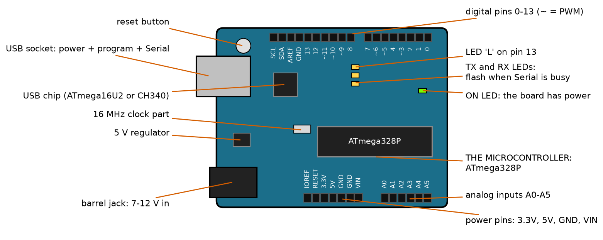
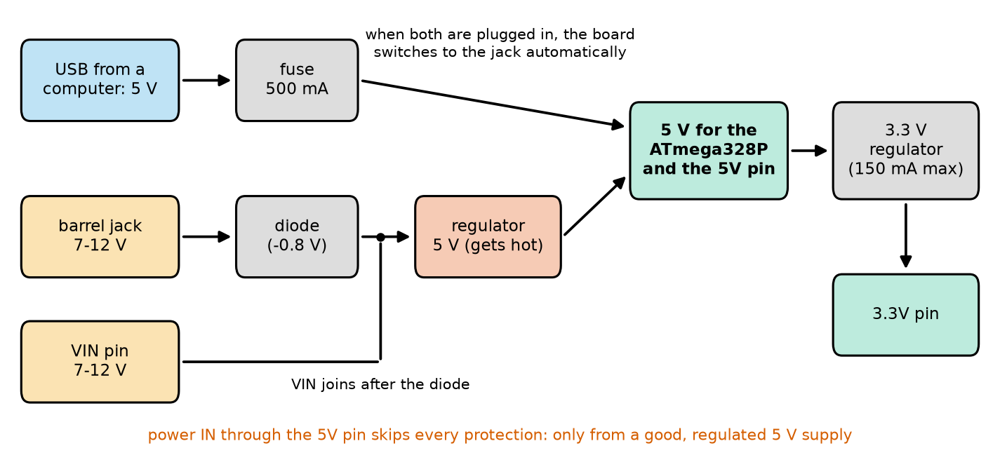
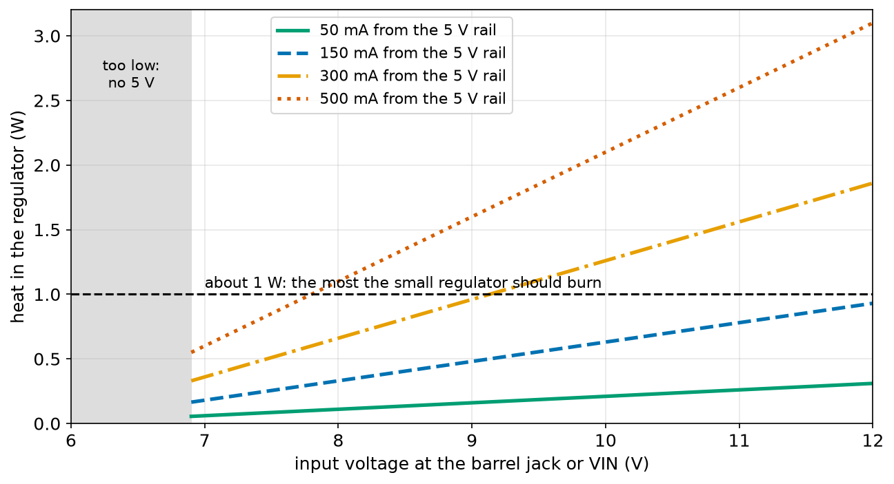
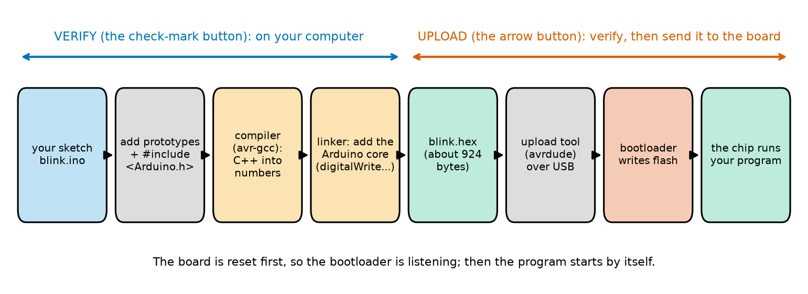
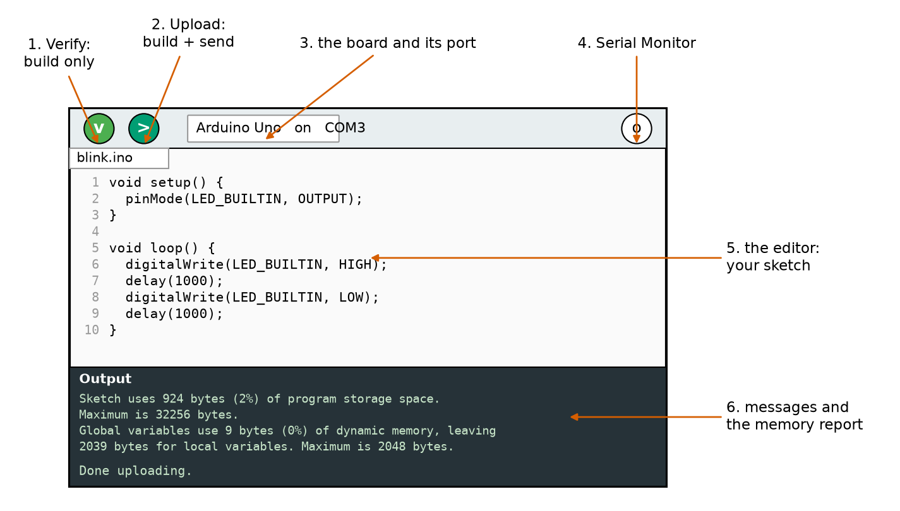
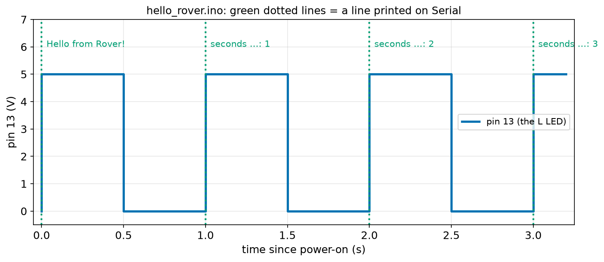
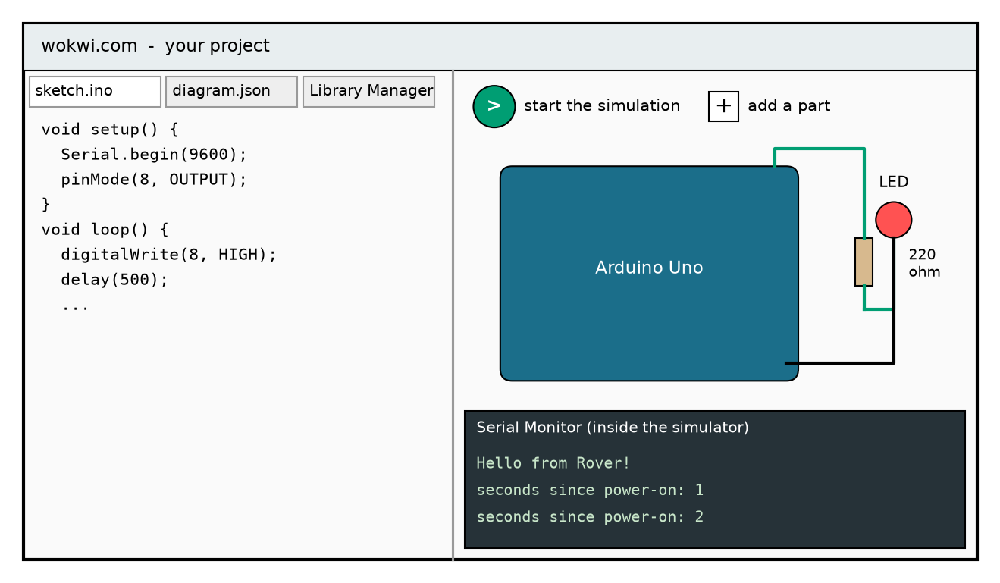
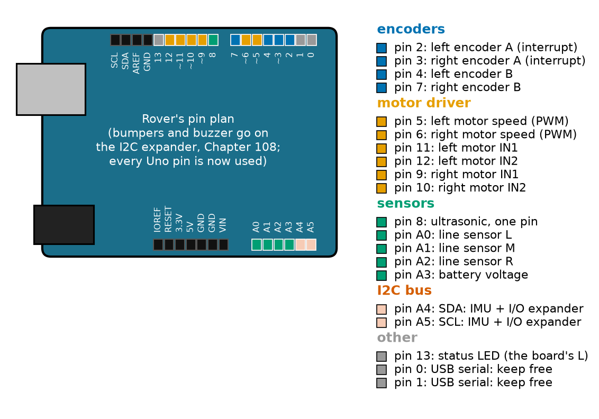

# Chapter 95 — The Arduino Board, the Arduino IDE and the Wokwi Simulator

> **Part 6 · Chapter 95 of 749**
> **You need:** Chapter 76 (heat and thermal resistance), Chapter 79 (voltage dividers), Chapter 86 (diodes), Chapter 90 (regulators and dropout), Chapter 91 (logic levels and the ADC) and Chapter 94 (what is inside a microcontroller).
> **You will make:** your first sketch running on a real Arduino Uno and in the Wokwi simulator, a check of how hot the Uno's regulator gets, a pin plan for Rover, a test that shows why Rover's Uno should not be powered through VIN, and a "PC test bench" that runs Arduino sketches on your computer.

---

## What you will learn

- What every part of the **Arduino Uno** board does: the chips, the LEDs, the buttons and every pin.
- The four ways to **power** the board, and the limits of each.
- What happens between pressing **Upload** and the LED blinking: the compiler, the **bootloader** and the upload tool.
- How to install the **Arduino IDE**, choose the board and port, and read its **memory report**.
- How to run the same sketch in the **Wokwi** simulator, in a web browser, with no hardware at all.
- How to plan which **pin** does which job, before you wire anything.

---

## New words in this chapter

| Word | Simple meaning |
|---|---|
| **Arduino** | A family of easy microcontroller boards, plus the free software to program them. |
| **sketch** | An Arduino program. It is saved in a file ending in `.ino`, in a folder with the same name. |
| **IDE** | Integrated development environment: one program to write, build and upload code. |
| **compile** | Turn a program written by a person into the numbers the CPU runs (Chapter 94). |
| **upload** | Send the compiled program from the computer into the board's flash memory. |
| **bootloader** | A small program kept at the end of flash that receives new programs over USB. |
| **port** | The name the computer gives to a connected board, such as `COM3` or `/dev/ttyACM0`. |
| **header** | A row of small sockets on the board's edge, where wires are plugged in. |
| **VIN** | The board's pin for an input voltage of 7–12 V that goes through its regulator. |
| **reset** | Restarting the microcontroller's program from the beginning. |
| **simulator** | A program that pretends to be the hardware, so you can test code without it. |
| **pin plan** | A table that says which pin does which job, made before wiring. |

---

## 95.1 Arduino: a board, a language and a community

In 2005, teachers at a design school in Ivrea, Italy, wanted their students (artists and designers, not engineers) to build interactive projects. The microcontroller boards of the time were expensive and hard to program. So they made their own: a cheap board with a USB socket, and a simple program to write code for it. They called it **Arduino**, after a café the team liked.

📖 **New word: Arduino** — the name of three things together: a family of **boards** (Uno, Nano, Mega and many more), the free **software** to program them (the Arduino IDE), and a huge **community** that shares code, libraries and help. Its designs are open: anyone may make and sell compatible boards, which is why you can buy an "Uno" from many makers.

📖 **New word: sketch** — an Arduino program. The name comes from the artists who first used it: a quick sketch of an idea. A sketch is saved in a file whose name ends in `.ino`, inside a folder with the same name (`blink/blink.ino`). It is written in C++ (Chapters 96 and 97).

The board in this course is the **Arduino Uno R3**, the most common board in the world for learning. It has the ATmega328P you met in Chapter 94. (Newer boards called **Uno R4** have a faster 32-bit chip in the same shape. Most sketches in this course work on them too; the few that use the ATmega328P's own registers, such as Chapter 106, say so.)

---

## 95.2 A tour of the Uno board

Take your Uno and hold it with the USB socket on the left (Lab 94.1 found the main parts). Here is everything on it.



*Figure 95.1 — The Arduino Uno R3 from above, USB socket on the left. The black rows along the top and bottom edges are the pin headers.*

**How to read this picture:** The board is drawn to scale (it is 68.6 mm × 53.3 mm). Each red line points from a label to a part. The big black chip is the ATmega328P, the microcontroller. The smaller chip near the USB socket is a second microcontroller whose only job is USB. Along the top edge are the digital pins 0 to 13 (a ~ before a number means that pin can do PWM, Chapter 102); along the bottom edge, the power pins and the six analog inputs.

📖 **New word: header** — a row of small sockets on the edge of the board. A jumper wire's pin fits snugly into each socket. The holes are 2.54 mm apart (one tenth of an inch), the same spacing as a breadboard (Chapter 80).

Here is what each part is for:

| Part | What it does |
|---|---|
| **USB socket** | Three jobs at once: 5 V power from the computer, uploading programs, and the Serial connection (Chapter 100). |
| **USB chip** (ATmega16U2, or CH340 on many clones) | Turns USB into the simple serial signals (UART, Chapter 107) that the ATmega328P understands. |
| **ATmega328P** | The microcontroller: your program runs here. |
| **16 MHz clock part** | The crystal or resonator that makes the 16 million ticks per second. |
| **Barrel jack** | A round socket for a 7–12 V supply, such as a wall adapter or a battery. |
| **5 V regulator** | Makes a steady 5 V from the barrel jack's voltage (Chapter 90). |
| **Reset button** | Restarts your program from the beginning, like switching the power off and on. |
| **ON LED** (green) | Lit when the board has power. |
| **L LED** (yellow) | Connected to pin 13 through a resistor; your sketch can switch it. |
| **TX and RX LEDs** | Flash when characters go to (TX) or come from (RX) the computer. |
| **Digital pins 0–13** | Inputs or outputs. Pins 0 and 1 are also the Serial connection to the USB chip. |
| **Analog pins A0–A5** | Inputs to the ADC (Chapter 101); they can also be digital pins. A4 and A5 are also I2C (Chapter 108). |
| **Power pins** | 5V, 3.3V, two GNDs, VIN, RESET, IOREF (section 95.3). |

⚠️ **Careful: pins 0 and 1 are not free.** They are connected to the USB chip. If you wire a sensor to them, uploading may fail and Serial messages will be garbled. Use them only when you know why (Chapter 107).

⚠️ **Careful: the underside of the board is bare metal.** Never put a powered Uno down on a metal table, a loose wire, or a screwdriver: the solder joints underneath would be shorted together. Put it on wood, plastic, or the plastic plate many kits include.

---

## 95.3 Powering the board

The Uno can be powered in four ways. Each has its own path through the board.



*Figure 95.2 — Power paths on the Uno. Every path ends at the green box: the 5 V that runs the ATmega328P and appears on the 5V pin.*

**How to read this picture:** Follow the arrows from left to right. USB power goes through a 500 mA fuse straight to the 5 V rail. The barrel jack goes through a protection diode (it blocks a supply plugged in backwards, Chapter 86) and then the 5 V regulator. The VIN pin joins this path **after** the diode, so VIN has no reverse protection. A small second regulator makes 3.3 V from the 5 V rail. The red line at the bottom is the warning for the fourth way.

| Way | Voltage | Limits | When to use it |
|---|---|---|---|
| **USB** | 5 V from the computer | about 500 mA for the whole board and everything you connect (a fuse on the board) | At your desk, while programming |
| **Barrel jack** | 7–12 V | the regulator gets hot (below) | A wall adapter or battery pack |
| **VIN pin** | 7–12 V | the same as the jack, and no reverse protection | A battery wired to the board |
| **5V pin** (power **in**) | exactly 5 V | no protection at all | Only from a good, regulated 5 V supply, such as Rover's own LDO (Chapter 90) |

The board can also **give** power to small parts: the 5V pin can supply a few hundred milliamps (the limit depends on how the board itself is powered), and the 3.3V pin about 150 mA at most. These pins are for sensors and small modules. **Never** power motors from them (Chapter 94: a pin is not a power supply, and neither is the 5V pin).

### How hot does the regulator get?

The regulator works like the linear regulators of Chapter 90: it turns the extra voltage into heat. Heat = (voltage it drops) × current (Chapter 76). The voltage it drops is the input minus the diode (about 0.8 V) minus 5 V. It also needs about 1.1 V of headroom (its **dropout**, Chapter 90), so the lowest input that still gives a full 5 V is 5 + 1.1 + 0.8 = **6.9 V**. That is where the "7 V minimum" on the board's datasheet comes from.

The program `uno_power.py` (in the Code section) works out the heat at three input voltages. A small regulator like this one on a board warms by roughly 100 °C for every watt, so it should not burn much more than about 1 W.

```
lowest input that still gives 5 V: 5 + 1.1 + 0.8 = 6.9 V

 input  current    heat  hotter by
    7 V    50 mA   0.06 W       6 C
    7 V   150 mA   0.18 W      18 C
    7 V   300 mA   0.36 W      36 C
    7 V   500 mA   0.60 W      60 C
        -> at 7 V, keep the 5 V current under about 833 mA
    9 V    50 mA   0.16 W      16 C
    9 V   150 mA   0.48 W      48 C
    9 V   300 mA   0.96 W      96 C
    9 V   500 mA   1.60 W     160 C  TOO HOT
        -> at 9 V, keep the 5 V current under about 313 mA
   12 V    50 mA   0.31 W      31 C
   12 V   150 mA   0.93 W      93 C
   12 V   300 mA   1.86 W     186 C  TOO HOT
   12 V   500 mA   3.10 W     310 C  TOO HOT
        -> at 12 V, keep the 5 V current under about 161 mA
```



*Figure 95.3 — The regulator's heat against the input voltage, for four currents drawn from the 5 V rail.*

**How to read this picture:** The horizontal axis is the voltage at the barrel jack or VIN; the vertical axis is the regulator's heat in watts. Each line is one current. Below 6.9 V (grey) there is not enough headroom for a full 5 V. Every line rises to the right: more input voltage means more to burn. Where a line crosses the dashed 1 W line, the regulator is too hot. A 12 V supply is fine for the bare board (green line) but too hot once you draw 300 mA.

🧠 **Use the lowest input voltage that works: 7 to 9 V.** A 12 V adapter "works", but it turns more power into heat and leaves less current for your parts. The real regulator protects itself by switching off when it overheats, and your robot then resets for no visible reason.

---

## 95.4 From sketch to running chip

You will press one button, **Upload**, and a few seconds later the board runs your program. Here is what happens in between.



*Figure 95.4 — The steps between your sketch and the running chip. Verify does the first four; Upload does all of them.*

**How to read this picture:** Read the boxes from left to right. The first four happen on your computer: the IDE adds a few lines to your sketch, the compiler turns C++ into instruction numbers (Chapter 94), and the linker adds the Arduino functions you used, such as `digitalWrite`. The result is a `.hex` file: Blink becomes about 924 bytes. The last three steps send it to the board, where the bootloader writes it into flash and the chip starts it.

📖 **New word: compile** — turn a program written by people into the CPU's instruction numbers. The program that does it is a **compiler**; for the ATmega328P it is called `avr-gcc`. It also checks your code: a missing `;` or a misspelt name stops the compile with an **error message**, and nothing is uploaded.

📖 **New word: upload** — send the compiled program from your computer into the board's flash. The IDE uses a tool called `avrdude` to do it over the USB cable.

📖 **New word: bootloader** — a small program, 512 bytes on the Uno, that lives at the end of flash and is never overwritten by your sketch. When the board **resets**, the bootloader runs first, for about half a second. If the computer starts sending a new program in that time, the bootloader receives it and writes it into flash. If not, it jumps to your program. That is why the board needs no special programmer: the bootloader is the programmer, inside the chip.

📖 **New word: reset** — restarting the program from the beginning. The reset button does it; so does switching the power off and on. And the IDE does it automatically before every upload: the USB chip gives the ATmega328P a short reset pulse, so the bootloader is listening when the program arrives. You can see this: the L LED flashes quickly a few times. That is the bootloader saying "I am here".

⚠️ **Careful: opening the Serial Monitor also resets the Uno.** The same reset pulse is sent whenever a program on the computer opens the port. Your sketch starts again from `setup()`. This is usually useful (you see the messages from the start), and it matters a lot in Chapter 111, when a Python program opens the port.

### The memory report

After every compile, the IDE prints a **memory report** at the bottom of the window. For Blink on an Uno it says something like this (the exact numbers change a little with the IDE version):

```
Sketch uses 924 bytes (2%) of program storage space. Maximum is 32256 bytes.
Global variables use 9 bytes (0%) of dynamic memory, leaving 2039 bytes for local variables. Maximum is 2048 bytes.
```

"Program storage space" is **flash**: 32,256 bytes = 32,768 minus the 512-byte bootloader. "Dynamic memory" is **SRAM** (Chapter 94): 2,048 bytes, of which Blink uses only 9 for its global variables. "Local variables" are the ones that live on the stack while functions run. The IDE warns you in orange when dynamic memory goes over about 75%, because the stack needs the rest.

🧠 **Read the memory report every time.** It is your memory budget (Chapter 94), measured for free.

---

## 95.5 Installing the Arduino IDE and uploading Blink

📖 **New word: IDE** — an **i**ntegrated **d**evelopment **e**nvironment: one program in which you write code, build it, upload it and see its messages.

1. Go to **arduino.cc**, open **Software**, and download **Arduino IDE 2** for your system (Windows, macOS or Linux). Install it like any other program. It is free.
2. Plug the Uno into the computer with a USB cable. The green ON LED lights. A new board often already runs Blink, so the L LED may be blinking.
3. Start the IDE. At the top, open the board menu (it may say "Select Board") and choose **Arduino Uno** on its port.

📖 **New word: port** — the name the computer gives to the connection with the board. On Windows it is `COM` and a number (`COM3`, `COM5`, …); on Linux `/dev/ttyACM0` or `/dev/ttyUSB0`; on macOS `/dev/cu.usbmodem…` or `/dev/cu.usbserial…`. If you are not sure which port is the Uno, unplug it, look at the list, plug it in again, and see which name appears.

4. Open **File → Examples → 01.Basics → Blink**. A new window opens with the Blink sketch.
5. Press **Verify** (the check-mark button). After some seconds the message area says "Done compiling" and shows the memory report.
6. Press **Upload** (the arrow button). The TX and RX LEDs flicker, the L LED flashes quickly (the bootloader), and then it blinks: one second on, one second off.



*Figure 95.5 — A simplified drawing of the Arduino IDE 2 window, with the six parts you use most.*

**How to read this picture:** The numbered red arrows point to: (1) Verify, which only builds; (2) Upload, which builds and sends; (3) the board and port you chose; (4) the Serial Monitor button, at the top right; (5) the editor, where your sketch is, with line numbers on the left; (6) the dark message area at the bottom, with the memory report and "Done uploading."

Here is the Blink sketch, with our own comments (the example in the IDE has longer ones):

File `code/ch095/blink/blink.ino`:

```cpp
// blink.ino - the classic first sketch: the board's LED on for one second, off for one second
void setup() {
  pinMode(LED_BUILTIN, OUTPUT);        // pin 13 becomes an output
}

void loop() {
  digitalWrite(LED_BUILTIN, HIGH);     // 5 V on pin 13: the LED lights
  delay(1000);                         // wait one second
  digitalWrite(LED_BUILTIN, LOW);      // 0 V on pin 13: the LED goes out
  delay(1000);
}
```

You will learn every symbol here in Chapters 96 and 98. For now, the table gives the meaning of each line.

| Line | Code | What it does (simple English) |
|---|---|---|
| 1 | `// blink.ino - …` | A comment. In C++, `//` starts a comment, like `#` in Python. |
| 2 | `void setup() {` | The start of `setup`, a function the board runs **once** when it starts or resets. `{` opens its body. |
| 3 | `pinMode(LED_BUILTIN, OUTPUT);` | Make pin 13 (the L LED's pin, called `LED_BUILTIN`) an output. Every C++ statement ends with `;`. |
| 4 | `}` | The end of `setup`. |
| 5 | (blank) | Spacing. |
| 6 | `void loop() {` | The start of `loop`, a function the board runs **again and again for ever**, right after `setup`. |
| 7 | `digitalWrite(LED_BUILTIN, HIGH);` | Put 5 V on pin 13: the LED lights. |
| 8 | `delay(1000);` | Wait 1,000 milliseconds. |
| 9 | `digitalWrite(LED_BUILTIN, LOW);` | Put 0 V on pin 13: the LED goes out. |
| 10 | `delay(1000);` | Wait another second. |
| 11 | `}` | The end of `loop`. The board immediately runs `loop` again from line 7. |

Notice what is **not** here: no "repeat for ever" loop like Chapter 30's `while True:`. The Arduino software calls `loop()` again and again for you. Inside, it is the toy CPU's `JMP 0` from Chapter 94.

🧠 **Every sketch has `setup()` (runs once) and `loop()` (runs for ever).** This is the sense–think–act loop of Chapter 6, built into the board.

### Your first own sketch

Now a sketch of our own that also talks to the computer. Open **File → New Sketch**, type this in (or copy it from the code folder), save it as `hello_rover`, and upload it.

File `code/ch095/hello_rover/hello_rover.ino`:

```cpp
// hello_rover.ino - Rover's first sketch: say hello, blink the board's LED, count the seconds
void setup() {
  Serial.begin(9600);                  // start talking to the computer at 9600 bits per second
  Serial.println("Hello from Rover!");
  pinMode(LED_BUILTIN, OUTPUT);        // the small LED marked "L" on the board (pin 13)
}

void loop() {
  digitalWrite(LED_BUILTIN, HIGH);     // LED on
  delay(500);                          // wait 500 ms
  digitalWrite(LED_BUILTIN, LOW);      // LED off
  delay(500);
  Serial.print("seconds since power-on: ");
  Serial.println(millis() / 1000);
}
```

| Line | Code | What it does (simple English) |
|---|---|---|
| 1 | `// hello_rover.ino - …` | A comment: what the sketch does. |
| 2 | `void setup() {` | Runs once at the start. |
| 3 | `Serial.begin(9600);` | Start the Serial connection to the computer at 9,600 bits per second. The Serial Monitor must use the same speed (Chapter 100). |
| 4 | `Serial.println("Hello from Rover!");` | Send this text to the computer, then a new line (`println` = print line). Text in C++ goes in double quotes. |
| 5 | `pinMode(LED_BUILTIN, OUTPUT);` | Pin 13 becomes an output. |
| 6 | `}` | End of `setup`. |
| 7 | (blank) | Spacing. |
| 8 | `void loop() {` | Runs for ever. |
| 9 | `digitalWrite(LED_BUILTIN, HIGH);` | LED on. |
| 10 | `delay(500);` | Wait half a second. |
| 11 | `digitalWrite(LED_BUILTIN, LOW);` | LED off. |
| 12 | `delay(500);` | Wait half a second. |
| 13 | `Serial.print("seconds since power-on: ");` | Send this text, **without** a new line, so the number comes after it on the same line. |
| 14 | `Serial.println(millis() / 1000);` | `millis()` is the number of milliseconds since the board started (Chapter 103). Divided by 1,000, it is seconds. `/` between two whole numbers drops the remainder, like Python's `//`, so 1,500 ÷ 1,000 gives 1 (Chapter 96). |
| 15 | `}` | End of `loop`. |

After uploading, press the **Serial Monitor** button (top right). At the bottom of the Serial Monitor, set the speed to **9600 baud**. You see:

```
Hello from Rover!
seconds since power-on: 1
seconds since power-on: 2
seconds since power-on: 3
```

and a new line every second, while the L LED blinks. If you see strange symbols instead, the speed in the Serial Monitor does not match the 9600 in the sketch.



*Figure 95.6 — What hello_rover.ino does in its first 3.2 seconds: the voltage on pin 13 (blue) and the moments a line is printed (green), from the PC test bench in section 95.7.*

**How to read this picture:** Time runs left to right. The blue line is pin 13: 5 V (LED on) for half a second, then 0 V (off) for half a second. The green dotted lines mark the moments the sketch prints. "Hello from Rover!" comes at time 0, from `setup()`; after that, one line comes each time `loop()` reaches its end, just as the LED goes off and comes on again.

---

## 95.6 Wokwi: an Arduino in your web browser

📖 **New word: simulator** — a program that pretends to be the hardware. A good simulator runs your **real** sketch, unchanged, and shows what the board would do: LEDs light up, the Serial Monitor shows messages, buttons can be clicked.

**Wokwi** (wokwi.com) is a free Arduino simulator that runs in a web browser. You need no hardware and nothing to install, only an internet connection (and a free account if you want to save your projects). Every sketch in this course runs in Wokwi.



*Figure 95.7 — A simplified drawing of a Wokwi project: the sketch on the left, the simulated circuit on the right, and the simulated Serial Monitor below it.*

**How to read this picture:** The left half is the code editor, with tabs for the sketch (`sketch.ino`), the wiring (`diagram.json`, which Wokwi writes for you when you draw wires) and the libraries. The right half is the simulated circuit: an Uno, a red LED and a 220 Ω resistor wired to pin 8. The green button starts the simulation; the "+" button adds parts. Below, the Serial Monitor shows what the sketch prints, exactly as on a real board.

How to run `hello_rover.ino` in Wokwi:

1. Go to **wokwi.com**, and choose **Arduino Uno** under "Start a new project".
2. Delete the text in `sketch.ino` and paste in `hello_rover.ino`.
3. Press the green **Start the simulation** button. The simulated L LED blinks, and the Serial Monitor appears below the board with "Hello from Rover!".

To add a part, press **+**, type its name ("LED", "resistor", "pushbutton", "potentiometer"), and drag it next to the board. To draw a wire, click on one pin and then on another. Click on a part to change its settings, such as a resistor's value or an LED's colour. Lab 95.2 builds the external LED of Figure 95.7.

What a simulator can and cannot do:

| Wokwi shows you… | Wokwi does **not** show you… |
|---|---|
| whether your sketch's logic is right | an LED burning out because you forgot its resistor |
| what the Serial Monitor prints | a pin damaged by too much current |
| how buttons, sensors and displays respond | a loose wire, a dead battery or a noisy motor |
| problems in seconds, with no parts | the real timing of every instruction (it is close, not exact) |

🧠 **Simulate first, then build.** A simulator finds mistakes in your **program** quickly and safely. Only real hardware finds mistakes in your **wiring and electricity**. Good robot builders use both.

---

## 95.7 The PC test bench: sketches on your own computer

Every sketch output printed in this book was produced by running the sketch on a PC. The folder `code/common/arduino_sim/` holds a small "Arduino on the PC" that we wrote for this course. It is not needed: Wokwi and a real board give you everything. But if you have a C++ compiler (`g++`) on your computer, it lets you run a sketch in a second, print the exact time of every pin change, and feed in pretend buttons and sensors.

It has three files:

| File | What it is |
|---|---|
| `Arduino.h` | Pretends to be the Uno: a clock, 20 pins, an ADC, PWM, interrupts and Serial with its real 64-byte buffers and the real time each character takes. |
| `run.h` | Runs a sketch: `setup()` once, then `loop()` again and again, for a set time. |
| `simrun.py` | Builds a test file with `g++` and runs it. |

A test file includes the sketch and says how long to run it. File `code/ch095/pc_tests/test_hello_rover.cpp`:

```cpp
// test_hello_rover.cpp - run hello_rover.ino on the PC test bench for 3.2 seconds
#include "run.h"
#include "../hello_rover/hello_rover.ino"

int main() {
  sim::trace_pins = true;      // show every change of an output pin, with the time
  sim::serial_time = true;     // show the time in front of each line the sketch prints
  sim::run_ms(3200);
}
```

| Line | Code | What it does (simple English) |
|---|---|---|
| 1 | `// test_hello_rover.cpp - …` | A comment: what this test does. |
| 2 | `#include "run.h"` | Bring in the test bench (it brings in `Arduino.h` too). `#include` is C++'s way of saying "put that file's text here" (Chapter 110). |
| 3 | `#include "../hello_rover/hello_rover.ino"` | Bring in the sketch itself, unchanged. `..` means "the folder above". |
| 4 | (blank) | Spacing. |
| 5 | `int main() {` | On a PC, every C++ program starts in a function called `main`. (On the Arduino, `main` is hidden inside the Arduino software; it calls `setup` and `loop`.) |
| 6 | `sim::trace_pins = true;` | Turn on printing of pin changes. `sim::` means "the one in the simulation's part of the code". |
| 7 | `sim::serial_time = true;` | Put the simulated time in front of each printed line. |
| 8 | `sim::run_ms(3200);` | Run the sketch for 3,200 ms of **simulated** time (it takes much less real time). |
| 9 | `}` | End of `main`. |

Run it from the `code/ch095` folder:

```
python ../common/arduino_sim/simrun.py pc_tests/test_hello_rover.cpp
```

Output:

```
[   0.0000 s] Hello from Rover!
[   0.0001 s] pin 13 -> HIGH
[   0.5001 s] pin 13 -> LOW
[   1.0001 s] seconds since power-on: 1
[   1.0002 s] pin 13 -> HIGH
[   1.5002 s] pin 13 -> LOW
[   2.0003 s] seconds since power-on: 2
[   2.0004 s] pin 13 -> HIGH
[   2.5004 s] pin 13 -> LOW
[   3.0004 s] seconds since power-on: 3
[   3.0005 s] pin 13 -> HIGH
```

This is Figure 95.6 as text. Look closely at the times: each pass of `loop()` takes not 1.0000 s but about 1.0001 s, because `digitalWrite` and `Serial.print` take a little time too (a few microseconds each). After 3 seconds the program is 0.4 ms behind a perfect clock. Chapter 103 shows why this matters for robots, and how `millis()` fixes it.

⚠️ **Careful: the test bench is a model, like Wokwi.** Its timings are close to a real Uno, not exact. And it has one important difference that Chapter 96 explains: on a PC, a C++ `int` holds much bigger numbers than on the Uno.

---

## 95.8 When the upload fails

Everyone sees upload errors. The message at the bottom of the IDE usually tells you what is wrong, once you know how to read it.

| What you see | What it means | Fix |
|---|---|---|
| No port in the board menu | The computer does not see the board | Try another USB cable: many cheap cables are **charge-only** and have no data wires. Try another USB socket. |
| Port appears, but `avrdude: stk500_recv(): programmer is not responding` | The bootloader did not answer | Check the board type is **Arduino Uno**. Unplug anything on pins 0 and 1. Press reset just as "Uploading…" appears. |
| `Access is denied` or `port busy` | Another program has the port open | Close other Serial Monitors, Python programs (Chapter 111) or a second IDE window. |
| Clone board, no port at all on Windows or macOS | The CH340 USB chip needs a driver | Install the CH340 driver from the chip maker's website, then plug in again. |
| `'Serial' was not declared` or `expected ';' before …` | A mistake in the sketch | This is a **compile** error: the upload never started. Read the line number in the message (Chapter 96). |
| Uploads, but nothing happens | The sketch runs, but does something you did not expect | Add `Serial.println` lines to see what it is doing (Chapter 100). |

💡 **Tip:** Turn on **File → Preferences → Show verbose output during upload** when something is wrong. The long messages show every step of Figure 95.4, so you can see which one failed.

---

## Code

File `code/ch095/uno_power.py`:

```python
# uno_power.py - how hot does the Uno's 5 V regulator get when the board is powered from the barrel jack or VIN?
DIODE = 0.8                  # V lost in the reverse-protection diode (Chapter 86)
DROPOUT = 1.1                # V the regulator needs between its input and its 5 V output (Chapter 90)
THETA = 100.0                # the small regulator on the board: about 100 C per watt (Chapter 76)
SAFE_W = 1.0                 # keep the regulator's heat under about 1 W

print(f"lowest input that still gives 5 V: 5 + {DROPOUT} + {DIODE} = {5 + DROPOUT + DIODE:.1f} V")
print()
print(f"{'input':>6s} {'current':>8s} {'heat':>7s} {'hotter by':>10s}")
for v_in in [7.0, 9.0, 12.0]:
    for ma in [50, 150, 300, 500]:              # 50 mA is the bare board; the rest is your LEDs, sensors...
        heat = (v_in - DIODE - 5.0) * ma / 1000   # the regulator burns the extra voltage times the current
        note = "" if heat <= SAFE_W else "  TOO HOT"
        print(f"{v_in:5.0f} V {ma:5d} mA {heat:6.2f} W {heat * THETA:7.0f} C{note}")
    max_ma = SAFE_W / (v_in - DIODE - 5.0) * 1000
    print(f"        -> at {v_in:.0f} V, keep the 5 V current under about {max_ma:.0f} mA")
```

| Line | Code | What it does (simple English) |
|---|---|---|
| 1 | `# uno_power.py …` | A comment: what the program is for. |
| 2 | `DIODE = 0.8` | Volts lost in the protection diode. |
| 3 | `DROPOUT = 1.1` | The regulator's dropout: the headroom it needs. |
| 4 | `THETA = 100.0` | Thermal resistance: about 100 °C warmer for each watt (Chapter 76). A rough value for a small regulator soldered to a board. |
| 5 | `SAFE_W = 1.0` | Our limit for the heat. |
| 6 | (blank) | Spacing. |
| 7 | `print(f"lowest input …")` | The lowest input that still gives 5 V: 5 + 1.1 + 0.8 = 6.9 V. `:.1f` shows one decimal. |
| 8 | `print()` | An empty line. |
| 9 | `print(…)` | The table heading, each word pushed right (`>`) in a fixed width. |
| 10 | `for v_in in [7.0, 9.0, 12.0]:` | Three input voltages. |
| 11 | `for ma in [50, 150, 300, 500]:` | For each, four currents from the 5 V rail, in milliamps. |
| 12 | `heat = (v_in - DIODE - 5.0) * ma / 1000` | Heat = voltage dropped × current. `/ 1000` turns mA into A. |
| 13 | `note = "" if heat <= SAFE_W else "  TOO HOT"` | A warning only when the heat is above the limit. |
| 14 | `print(…)` | One row: voltage, current, heat and temperature rise (heat × 100). |
| 15 | `max_ma = SAFE_W / (v_in - DIODE - 5.0) * 1000` | The current that gives exactly 1 W: 1 ÷ voltage dropped, in mA. |
| 16 | `print(f"        -> at …")` | Print that limit under each voltage's rows. |

The output is in section 95.3. At 9 V and 300 mA, the regulator burns 0.96 W and is about 96 °C hotter than the room: right at the limit. At 12 V, only about 160 mA is safe.

---

## Small examples

**Example 1.** A 9 V battery on the barrel jack with the bare board (50 mA): heat = (9 − 0.8 − 5) × 0.05 = 0.16 W. Fine.

**Example 2.** The same board at 12 V with a 200 mA sensor load: (12 − 5.8) × 0.25 = 1.55 W. Too hot.

**Example 3.** A 6 V supply on the barrel jack: below 6.9 V, so the 5 V rail is only about 6 − 1.9 = 4.1 V.

**Example 4.** The Uno's flash for your sketch: 32,768 − 512 = 32,256 bytes. A 924-byte sketch uses 924 ÷ 32,256 = 2.9%; the IDE rounds down to 2%.

**Example 5.** `millis() / 1000` when `millis()` is 2,999 gives 2, not 2.999: whole-number division drops the remainder.

**Example 6.** At 9,600 bits per second, with 10 bits per character (Chapter 107), one character takes 10 ÷ 9,600 = 1.04 ms. The 27 characters of "seconds since power-on: 1" plus the end of line take about 28 ms.

**Example 7.** An Uno on USB, powering a sensor board that draws 120 mA: board 50 + 120 = 170 mA, well under the 500 mA fuse.

**Example 8.** Pins on the Uno you can use freely: 2 to 13 and A0 to A5 = 12 + 6 = **18** pins.

---

## 🏭 Real robot applications

### Application 1 (worked in full) — 🤖 Rover's pin plan

**1. The real problem.** Over the next parts, Rover gets two motors through a motor driver, two wheel encoders, two bumpers, three line sensors, an ultrasonic sensor, a battery monitor, an IMU, and a status LED. Every one of them needs one or more pins on the Uno. Some jobs need special pins: encoders need interrupt pins, motor speeds need PWM pins, line sensors need analog pins, and the IMU needs the I2C pins. Will it all fit, and which wire goes where?

📖 **New word: pin plan** — a table that says which pin does which job. You make it **before** wiring, because moving a wire later means changing the code, the wiring and the drawings.

**2. Why this theory.** Section 95.2: the Uno has 18 free pins, and each has its own abilities. Pins 0 and 1 belong to USB. Pin 13 has the L LED and its resistor attached, which pulls an input towards 0 V, so it is safe only as an output.

**3. The numbers.** Rover's needs, by kind of pin:

| Kind | Needs | Uno pins that can do it |
|---|---|---|
| interrupt | 2 (encoder A channels) | 2, 3 |
| I2C | 2 (IMU) | A4, A5 |
| analog | 4 (3 line sensors, battery) | A0–A5 |
| PWM | 2 (motor speeds) | 3, 5, 6, 9, 10, 11 |
| digital input | 5 (2 encoder B channels, 2 bumpers, ultrasonic echo) | 2–12, A0–A5 |
| digital output | 7 (4 motor direction, driver standby, ultrasonic trigger, status LED) | 2–13, A0–A5 |
| **total** | **22** | **18** |

**4. The maths.** 22 needs, 18 pins: we are short by 22 − 18 = **4 pins** before we even start. The order of choosing also matters. If an ordinary input takes pin 3 first, an encoder later has nowhere to go. So we place the **rarest** kinds first (interrupt, I2C, analog, PWM), and for each job we take the free pin that **can do the fewest other things**, keeping the flexible pins for later.

**5. The code.** File `code/ch095/pin_planner.py`:

```python
# pin_planner.py - give each of Rover's wires a pin on the Arduino Uno, following the rules of each pin
PINS = {                                   # Uno pin: what it can do
    0: {"usb"}, 1: {"usb"},                # pins 0 and 1 carry USB serial: keep them free
    2: {"in", "out", "interrupt"}, 3: {"in", "out", "interrupt", "pwm"},
    4: {"in", "out"}, 5: {"in", "out", "pwm"}, 6: {"in", "out", "pwm"}, 7: {"in", "out"}, 8: {"in", "out"},
    9: {"in", "out", "pwm"}, 10: {"in", "out", "pwm"}, 11: {"in", "out", "pwm"}, 12: {"in", "out"},
    13: {"out"},                           # the board's "L" LED hangs on pin 13: use it only as an output
    "A0": {"in", "out", "analog"}, "A1": {"in", "out", "analog"}, "A2": {"in", "out", "analog"},
    "A3": {"in", "out", "analog"}, "A4": {"in", "out", "analog", "i2c"}, "A5": {"in", "out", "analog", "i2c"},
}
NEEDS = [                                  # (what Rover connects, the kind of pin it needs)
    ("left encoder A", "interrupt"), ("right encoder A", "interrupt"),
    ("IMU SDA", "i2c"), ("IMU SCL", "i2c"),
    ("line sensor L", "analog"), ("line sensor M", "analog"), ("line sensor R", "analog"), ("battery voltage", "analog"),
    ("left motor speed", "pwm"), ("right motor speed", "pwm"),
    ("left encoder B", "in"), ("right encoder B", "in"), ("left bumper", "in"), ("right bumper", "in"),
    ("ultrasonic echo", "in"), ("ultrasonic trigger", "out"), ("status LED", "out"),
    ("left motor IN1", "out"), ("left motor IN2", "out"),
    ("right motor IN1", "out"), ("right motor IN2", "out"), ("driver standby", "out"),
]

free = dict(PINS)
plan, missing = [], []
for name, kind in NEEDS:                   # the rarest kinds come first in NEEDS, so they get first choice
    choices = [p for p, can in free.items() if kind in can]
    choices.sort(key=lambda p: len(free[p]))       # take the pin that can do the fewest other things
    if choices:
        pin = choices[0]
        plan.append((name, kind, pin))
        del free[pin]
    else:
        missing.append(name)

for name, kind, pin in plan:
    print(f"{name:20s} {kind:10s} -> pin {pin}")
print(f"\nused {len(plan)} pins; left free: {[p for p in free if 'usb' not in free[p]]}")
if missing:
    print(f"NOT ENOUGH PINS for {len(missing)} needs: {', '.join(missing)}")
```

| Line | Code | What it does (simple English) |
|---|---|---|
| 1 | `# pin_planner.py …` | A comment: what the program is for. |
| 2 | `PINS = {` | A dictionary (Chapter 22): each Uno pin, and the **set** of things it can do. A set is written with `{ }` and holds each item once; `"pwm" in {"in", "pwm"}` is `True`. |
| 3 | `0: {"usb"}, 1: {"usb"},` | Pins 0 and 1 can only be "usb", which no need asks for, so they are never given out. |
| 4–6 | `2: {…}, …, 12: {…},` | The digital pins. 2 and 3 can do interrupts; 3, 5, 6, 9, 10 and 11 can do PWM. |
| 7 | `13: {"out"},` | Pin 13: outputs only, because of the L LED. |
| 8–9 | `"A0": {…}, …` | The analog pins; A4 and A5 can also do I2C. Their keys are strings, the others are numbers; a dictionary may mix them. |
| 10 | `}` | Ends the dictionary. |
| 11 | `NEEDS = [` | A list of tuples: each job and the kind of pin it needs. |
| 12–19 | `("left encoder A", "interrupt"), …` | Rover's 22 needs, the rarest kinds first. |
| 20 | `]` | Ends the list. |
| 21 | (blank) | Spacing. |
| 22 | `free = dict(PINS)` | A **copy** of the pin dictionary. We remove pins from the copy as we give them out, and `PINS` stays whole. |
| 23 | `plan, missing = [], []` | Two empty lists: the jobs that got a pin, and the jobs that did not. |
| 24 | `for name, kind in NEEDS:` | Take the jobs in order. |
| 25 | `choices = [p for p, can in free.items() if kind in can]` | A list comprehension: every free pin whose set includes this kind. |
| 26 | `choices.sort(key=lambda p: len(free[p]))` | Sort the choices so the pin with the **fewest** abilities comes first. `lambda p: …` is a tiny unnamed function (Chapter 24) that gives each pin its sort key. |
| 27 | `if choices:` | An empty list counts as `False`, so this means "if there is at least one pin". |
| 28 | `pin = choices[0]` | Take the least flexible pin. |
| 29 | `plan.append((name, kind, pin))` | Record the decision. |
| 30 | `del free[pin]` | That pin is no longer free. |
| 31–32 | `else: missing.append(name)` | No pin can do it: write the job down as missing. |
| 33 | (blank) | Spacing. |
| 34–35 | `for … in plan: print(…)` | Print the plan, one job per line. |
| 36 | `print(f"\nused …")` | `\n` is a new line. The list comprehension shows the free pins that are not USB pins. |
| 37–38 | `if missing: print(…)` | If anything did not fit, say so. `', '.join(missing)` puts the names in one line with commas. |

Output:

```
left encoder A       interrupt  -> pin 2
right encoder A      interrupt  -> pin 3
IMU SDA              i2c        -> pin A4
IMU SCL              i2c        -> pin A5
line sensor L        analog     -> pin A0
line sensor M        analog     -> pin A1
line sensor R        analog     -> pin A2
battery voltage      analog     -> pin A3
left motor speed     pwm        -> pin 5
right motor speed    pwm        -> pin 6
left encoder B       in         -> pin 4
right encoder B      in         -> pin 7
left bumper          in         -> pin 8
right bumper         in         -> pin 12
ultrasonic echo      in         -> pin 9
ultrasonic trigger   out        -> pin 13
status LED           out        -> pin 10
left motor IN1       out        -> pin 11

used 18 pins; left free: []
NOT ENOUGH PINS for 4 needs: left motor IN2, right motor IN1, right motor IN2, driver standby
```

**6. The result.** As the count said, 4 jobs do not fit. The fixes are real design choices, each saving pins:

| Fix | Pins saved | What we give up |
|---|---|---|
| Wire the motor driver's **standby** pin straight to 5 V | 1 | The Uno cannot put the driver to sleep (it can still stop the motors) |
| Use the ultrasonic sensor in **one-pin mode** (trigger and echo on the same pin, which its library supports) | 1 | Nothing important |
| Move the **two bumpers** and the **status LED** to an **I2C I/O expander** (a small chip that adds 8 inputs or outputs and shares the IMU's two I2C wires, Chapter 108) | 3 | Bumpers are read every few milliseconds over I2C, not instantly |

That saves 5 pins: one more than needed. Lab 95.3 runs the planner with these changes; it places everything and leaves pin 11 free. One last human decision: the planner put "left motor IN1" on pin 13. But the bootloader flashes pin 13 at every reset (section 95.4), so the left motor could twitch whenever Rover starts. We move IN1 to the spare pin 11 by hand, and give pin 13 to the status LED (the board's own L LED, which needs no wire at all), instead of moving that LED to the expander. Figure 95.8 is the final plan.



*Figure 95.8 — Rover's final pin plan. The coloured squares on the board are the pins in use; the list on the right says what each one does.*

**How to read this picture:** Each colour is one group of jobs: blue for the encoders, orange for the motor driver, green for sensors, pink for the I2C bus, grey for the rest. Find a coloured square on the board's edge, then find the same colour in the list. Every one of the 18 usable pins is now coloured: Rover has no pins left. The bumpers do not appear because they live on the I2C expander, behind pins A4 and A5.

Without a pin plan, builders find these problems late: an encoder on a pin without interrupts loses counts, a motor twitches at every reset, or the last sensor has nowhere to go after everything is soldered.

**7. Going further.** Real products do the same, in more detail: a microcontroller's datasheet has a large table of every pin's possible jobs, and chip makers offer free tools (such as STM32CubeMX) that assign pins automatically and warn about conflicts, just like our planner. When pins run out, engineers use I/O expanders, shift registers (Chapter 109), or a bigger chip. The Arduino Mega, with 54 digital pins, exists mostly for this reason: 3D printers use it because they have many motors, heaters and switches.

### Application 2 (worked in full) — 🤖 Why Rover's Uno is not powered through VIN

**1. The real problem.** Rover's battery gives 8.4 V when full and 6.0 V when empty (Chapter 90). The easiest way to power the Uno is to connect the battery to VIN, using the board's own regulator. Chapter 90 instead gave Rover its own low-dropout regulator (LDO), feeding a clean 5 V into the 5V pin. Was that extra part worth it? Rover also measures its battery on pin A3, through a divider of two equal resistors (Chapter 79), to know when to go home.

**2. Why this theory.** Section 95.3: the VIN path needs 6.9 V to give a full 5 V. Chapter 91: the Uno's ADC measures a voltage **compared with its own 5 V supply**. If the 5 V rail sags, every ADC reading changes, even when the measured voltage does not.

**3. The numbers.** VIN path: diode 0.8 V + dropout 1.1 V. Rover's LDO: dropout 0.3 V (Chapter 90). Divider: A3 sees half the battery voltage. The sketch converts a reading back to volts as `count × 5.0 ÷ 1024 × 2`, believing the rail is exactly 5.0 V. The ATmega328P is only guaranteed to run at 16 MHz with a supply of at least 4.5 V.

**4. The maths.** At a battery of 6.3 V through VIN: rail = 6.3 − 0.8 − 1.1 = 4.4 V. A3 sees 6.3 × 0.5 = 3.15 V. The ADC count = 3.15 ÷ 4.4 × 1,024 = 733. The sketch then computes 733 × 5.0 ÷ 1,024 × 2 = **7.16 V**. The battery is nearly empty, but the sketch thinks it is more than half full. Through the LDO: rail = min(5.0, 6.3 − 0.3) = 5.0 V; count = 3.15 ÷ 5.0 × 1,024 = 645; reading = 645 × 5 ÷ 1,024 × 2 = 6.30 V. Correct.

**5. The code.** File `code/ch095/rover_vin.py`:

```python
# rover_vin.py - power Rover's Uno through VIN, or from Rover's own LDO into the 5V pin?
# Watch the 5 V rail as the battery empties, and what a sagging rail does to the battery reading.
DIODE, DROPOUT = 0.8, 1.1          # the Uno's own path from VIN: diode, then the regulator (uno_power.py)
LDO_DROPOUT = 0.3                  # Rover's low-dropout regulator (Chapter 90)
DIVIDER = 0.5                      # the battery is read on A3 through two equal resistors (Chapter 79)


def rail(v_bat, path):
    if path == "VIN":
        return min(5.0, v_bat - DIODE - DROPOUT)     # out of headroom: the rail follows the battery down
    return min(5.0, v_bat - LDO_DROPOUT)


def battery_reading(v_bat, v_ref):
    count = int(v_bat * DIVIDER / v_ref * 1024)      # the ADC compares A3 with its own 5 V rail (Chapter 91)
    return count * 5.0 / 1024 / DIVIDER              # the sketch believes the rail is exactly 5.0 V


print(f"{'battery':>8s} | {'VIN rail':>8s} {'sketch reads':>12s} | {'LDO rail':>8s} {'sketch reads':>12s}")
for v_bat in [8.4, 7.8, 7.2, 6.9, 6.6, 6.3, 6.0]:
    cols = []
    for path in ["VIN", "LDO"]:
        r = rail(v_bat, path)
        cols.append(f"{r:7.2f} V {battery_reading(v_bat, r):11.2f} V")
    warn = "  <- below 4.5 V: the chip is out of spec at 16 MHz" if rail(v_bat, "VIN") < 4.5 else ""
    print(f"{v_bat:7.1f} V | {cols[0]} | {cols[1]}{warn}")
```

| Line | Code | What it does (simple English) |
|---|---|---|
| 1–2 | `# rover_vin.py …` | Comments: what the program compares. |
| 3 | `DIODE, DROPOUT = 0.8, 1.1` | The VIN path's two losses, the same as `uno_power.py`. |
| 4 | `LDO_DROPOUT = 0.3` | Rover's LDO needs only 0.3 V of headroom. |
| 5 | `DIVIDER = 0.5` | Two equal resistors: A3 sees half the battery voltage. |
| 6–7 | (blank) | Spacing. |
| 8 | `def rail(v_bat, path):` | A function: the 5 V rail's real voltage for this battery voltage and power path. |
| 9–10 | `if path == "VIN": return min(5.0, …)` | The regulator gives 5.0 V if it can; with too little headroom, the rail is the battery minus the losses. `min` picks the smaller. |
| 11 | `return min(5.0, v_bat - LDO_DROPOUT)` | The same for the LDO path. |
| 12–13 | (blank) | Spacing. |
| 14 | `def battery_reading(v_bat, v_ref):` | What the sketch will **believe** the battery voltage is. |
| 15 | `count = int(v_bat * DIVIDER / v_ref * 1024)` | The ADC's count: A3's voltage as a fraction of the real reference, times 1,024 (Chapter 91), rounded down. |
| 16 | `return count * 5.0 / 1024 / DIVIDER` | The sketch's conversion back to volts, assuming the reference is 5.0 V. |
| 17–18 | (blank) | Spacing. |
| 19 | `print(…)` | The table heading. |
| 20 | `for v_bat in [8.4, …, 6.0]:` | The battery from full to empty. |
| 21 | `cols = []` | The two halves of this row. |
| 22 | `for path in ["VIN", "LDO"]:` | Both ways of powering the Uno. |
| 23 | `r = rail(v_bat, path)` | The rail's voltage. |
| 24 | `cols.append(f"…")` | The rail and what the sketch reads, formatted. |
| 25 | `warn = "…" if … else ""` | A warning when the VIN rail is below 4.5 V. |
| 26 | `print(…)` | One row of the table. |

Output:

```
 battery | VIN rail sketch reads | LDO rail sketch reads
    8.4 V |    5.00 V        8.40 V |    5.00 V        8.40 V
    7.8 V |    5.00 V        7.79 V |    5.00 V        7.79 V
    7.2 V |    5.00 V        7.20 V |    5.00 V        7.20 V
    6.9 V |    5.00 V        6.89 V |    5.00 V        6.89 V
    6.6 V |    4.70 V        7.01 V |    5.00 V        6.59 V
    6.3 V |    4.40 V        7.16 V |    5.00 V        6.30 V  <- below 4.5 V: the chip is out of spec at 16 MHz
    6.0 V |    4.10 V        7.31 V |    5.00 V        6.00 V  <- below 4.5 V: the chip is out of spec at 16 MHz
```

**6. The result.** Through VIN, everything is fine down to 6.9 V. Below that, two bad things happen together. First, the sketch's battery reading goes **up** while the real battery goes down: 7.01, 7.16, 7.31 V, so Rover's "low battery, go home" check never fires. Second, below 6.5 V the ATmega328P runs on less than 4.5 V, outside what its datasheet promises at 16 MHz: it may still work on your desk and then fail in the cold. Through Rover's own LDO, the rail stays at 5.00 V to the very end and the readings are right (within one ADC step). The extra regulator from Chapter 90 was worth it.

**7. Going further.** Careful designs do not trust the supply as a reference at all. The ATmega328P has a built-in 1.1 V reference (Chapter 101) that does not change with the supply, and a trick that measures the supply voltage itself against it. Battery-powered products use a separate precision reference chip, or a "fuel gauge" chip that counts the charge going in and out (Chapter 89).

### Application 3 — 🖨️ 3D printers run on Arduino

Many hobby 3D printers were built on an **Arduino Mega** with a "RAMPS" board on top, running the free **Marlin** firmware (Marlin still runs on many printers, now often on 32-bit boards). A 3D printer is a robot: three or four stepper motors move the print head and push plastic, thermistors (Chapter 79) measure the nozzle at about 200 °C and the bed at about 60 °C, a PID controller (Chapter 216) holds those temperatures, and limit switches (Chapter 115) find the home position. The Mega's 54 digital pins are what make it possible: the motors alone need 3 pins each (step, direction, enable). Its pin plan is published like Figure 95.8, and the firmware reads it from one file, so the same code fits many boards. The Mega has only 8 KB of SRAM and no float hardware, which is one reason printers moved to 32-bit chips for smooth, fast curves.

### Application 4 — 🚁 ArduPilot started on an Arduino

The **ArduPilot** autopilot, which today flies drones, planes, boats and rovers all over the world (Part 30), began in 2009 as Arduino code. Its first popular boards, the "APM" series, used the ATmega2560 (the Mega's chip) with a gyroscope, an accelerometer, a barometer and a GPS. It flew, with careful whole-number maths and loop rates of a few hundred hertz, but as Application 2 of Chapter 94 showed, an 8-bit chip has little room for more. The project moved to 32-bit boards (Pixhawk, with STM32 chips) around 2013. Many of today's ArduPilot developers started exactly where you are now: with an Uno and Blink.

### Application 5 — 🏭 Testing robot firmware in a simulator

Companies that build robots and other machines test their firmware in simulators before it touches hardware, much like Wokwi and our PC test bench. The code for a motor controller is run thousands of times with simulated sensors, including impossible ones (a broken encoder, a sensor stuck at zero, a battery that drops suddenly) to check that the robot reacts safely. These tests run automatically every time a programmer changes the code, a practice called **continuous integration**, and a change that breaks a test is not allowed into the product. Wokwi itself offers this for Arduino and ESP32 projects. The cheapest place to find a bug is in a simulator; the most expensive is in a robot in a customer's home. Chapter 205's simulated noisy sensors and Part 28's robot simulators grow from the same idea.

---

## 🔧 Hands-on lab

### Lab 95.1 — Upload Blink and change it (hardware)

You need: an Arduino Uno, its USB cable, and a computer with the Arduino IDE 2 installed (section 95.5).

1. Upload Blink (section 95.5). Write down the memory report from the message area.
2. Change both `delay(1000)` lines to `delay(200)`. Upload. The LED blinks five times faster.
3. Change the first to `delay(50)` and the second to `delay(950)`. Upload. What do you see?
4. Remove the `;` at the end of a `delay` line. Press Verify. Read the error message: which line does it name?
5. Put the `;` back. Press the board's reset button while watching the L LED.

**What you should see:** In step 1, a memory report like section 95.4's (about 924 bytes and 9 bytes on a recent IDE). In step 3, a short flash once per second, like a heartbeat monitor. In step 4, an error such as `expected ';' before '}' token` with a line number: often the line **after** the one with the missing `;`, because that is where the compiler noticed. In step 5, the L LED flashes quickly a few times (the bootloader), then Blink starts again.

| If it does not work | Likely cause | Fix |
|---|---|---|
| No port to choose | Charge-only cable, or a missing CH340 driver | Try another cable; install the driver (section 95.8) |
| `programmer is not responding` | Wrong board selected, or something wired to pins 0/1 | Choose Arduino Uno; unplug pins 0 and 1 |
| The LED blinks at the old speed | The upload did not happen, only Verify | Press Upload (the arrow), and wait for "Done uploading" |
| Changes seem to do nothing | You edited a different window or a read-only example | Use **File → Save As** to save Blink as your own sketch first |

**Challenge:** Make the LED blink the letter "S" in Morse code (three short flashes) followed by a long pause, using only what is in Blink. How long is your `loop()`? Count the `delay` values.

### Lab 95.2 — An external LED in Wokwi (simulation)

You need: a web browser.

1. Start a new Arduino Uno project on wokwi.com. Paste in `hello_rover.ino`.
2. Change both `LED_BUILTIN` in `loop()` and the one in `setup()` to `8`.
3. Press **+**, add an **LED** and a **resistor**. Click the resistor and set its value to 220 Ω.
4. Wire: pin 8 → resistor → the LED's **anode** (the bent, longer leg, marked A when you point at it); the LED's **cathode** (C) → GND. This is Chapter 82's LED circuit.
5. Start the simulation.

**What you should see:** The red LED blinks once per second (half a second on, half off), the board's own L LED stays dark, and the Serial Monitor shows "Hello from Rover!" and then the seconds, as in section 95.5.

| If it does not work | Likely cause | Fix |
|---|---|---|
| The LED never lights | LED wired backwards | The anode (A) goes towards pin 8, the cathode (C) to GND |
| The board's L LED still blinks | A `LED_BUILTIN` left in the sketch | Change all three to `8` |
| Nothing in the Serial Monitor | The simulation is not running | Press the green start button; the monitor appears below the board |
| Wire not connected | You clicked near, not on, the pin | Click exactly on the pin end; it turns green when connected |

**Challenge:** Add a second LED on pin 9 that is on when the first is off. Then try removing the resistor and starting again: does Wokwi warn you? (A real LED without a resistor would be damaged, Chapter 82. A simulator does not always show electrical mistakes, section 95.6.)

### Lab 95.3 — Make Rover's pins fit (simulation)

Copy `pin_planner.py`.

1. Apply the three fixes from Application 1. In `NEEDS`: delete `("left bumper", "in"), ("right bumper", "in"),`; replace `("ultrasonic echo", "in"), ("ultrasonic trigger", "out"), ("status LED", "out"),` with `("ultrasonic trig+echo", "in"),`; and delete `("driver standby", "out"),`.
2. Run it. Which pin is free?
3. Rover now wants a buzzer for warning beeps (an output). Add `("buzzer", "out"),` at the end of `NEEDS`, and run it again.

**What you should see (step 2):**

```
left encoder A       interrupt  -> pin 2
right encoder A      interrupt  -> pin 3
IMU SDA              i2c        -> pin A4
IMU SCL              i2c        -> pin A5
line sensor L        analog     -> pin A0
line sensor M        analog     -> pin A1
line sensor R        analog     -> pin A2
battery voltage      analog     -> pin A3
left motor speed     pwm        -> pin 5
right motor speed    pwm        -> pin 6
left encoder B       in         -> pin 4
right encoder B      in         -> pin 7
ultrasonic trig+echo in         -> pin 8
left motor IN1       out        -> pin 13
left motor IN2       out        -> pin 12
right motor IN1      out        -> pin 9
right motor IN2      out        -> pin 10

used 17 pins; left free: [11]
```

Everything fits, with pin 11 free. In step 3 the buzzer takes pin 11 and the last line says `used 18 pins; left free: []`. But there is a hidden problem the planner does not know: the Arduino `tone()` function that makes buzzer sounds uses the chip's **Timer2**, which also makes the PWM on pins 3 and **11** (Chapter 106). A buzzer on pin 11 works, but it is a warning sign. Rover's final plan (Figure 95.8) puts the buzzer on the I2C expander too.

| If it does not work | Likely cause | Fix |
|---|---|---|
| `SyntaxError` | A missing comma between tuples, or a missing `)` | Each tuple is `("name", "kind"),` |
| The plan still says 4 missing | You edited a different copy of the file | Run the file you changed |
| A need goes to pin 0 or 1 | You gave it the kind `"usb"` | Use only `in`, `out`, `pwm`, `analog`, `interrupt` or `i2c` |

**Challenge:** Change the planner so that it never gives pin 13 to a motor pin (because of the reset flashes), while still allowing the status LED there. Hint: give pin 13 a special kind, `"led"`, and change the status LED's kind to match.

---

## Common mistakes

⚠️ **Wiring sensors to pins 0 and 1.** They carry USB serial. Uploads fail and messages turn into garbage.

⚠️ **Using a charge-only USB cable.** The board lights up, but no port appears. Keep one known-good data cable with your kit.

⚠️ **Forgetting to select the board and port.** The upload goes nowhere, or to the wrong board.

⚠️ **A different speed in the Serial Monitor and in `Serial.begin`.** You see random symbols. Both must say the same number.

⚠️ **Powering the board from 12 V and then adding parts.** The regulator overheats and switches off; the robot resets for no visible reason. Use 7–9 V, or a separate 5 V supply.

⚠️ **Feeding the 5V pin from an unregulated source.** There is no protection on that path: 6 V there can damage the chip.

⚠️ **Putting a powered board on a metal surface.** The bare solder joints underneath short together.

⚠️ **Trusting the simulator for electrical questions.** Wokwi checks your program, not your currents and voltages.

⚠️ **Forgetting that opening the Serial Monitor resets the board.** The sketch restarts from `setup()`.

---

## Practice

🏋️ **1.** Name the three jobs of the Uno's USB socket.

🏋️ **2.** Why does the Uno need a 7 V minimum on the barrel jack? Give the numbers.

🏋️ **3.** A 9 V adapter powers an Uno that feeds 250 mA to sensors and LEDs (plus 50 mA for the board itself). How much heat does the regulator make? Is it safe?

🏋️ **4.** What is the bootloader, and why does the board reset before each upload?

🏋️ **5.** The memory report says "Global variables use 1,700 bytes (83%) of dynamic memory". Why is that a problem, even though it is under 100%?

🏋️ **6.** Which Uno pins can do PWM? Which can do interrupts? Which are I2C?

🏋️ **7.** Give two things Wokwi can show you and two things it cannot.

🏋️ **8.** You see `Access is denied` when uploading. What is the most likely cause?

🏋️ **9.** In `hello_rover.ino`, what does `millis() / 1000` give when `millis()` is 4,999?

🏋️ **10.** Rover's battery is at 6.6 V and the Uno is powered through VIN. Using the table in Application 2, what does the battery check read, and why is it wrong?

🏋️ **11.** Write a sketch `heartbeat.ino` that flashes the L LED twice quickly (100 ms on, 100 ms off, 100 ms on), then stays off for 700 ms, and repeats. Run it in Wokwi or on the PC test bench. When does each flash start?

---

## Answers

**1.** Power (5 V from the computer), uploading programs, and the Serial connection to the computer.

**2.** The board's protection diode loses about 0.8 V and the regulator needs about 1.1 V of headroom (dropout): 5 + 1.1 + 0.8 = 6.9 V, so about 7 V.

**3.** Total current 300 mA. Heat = (9 − 0.8 − 5) × 0.3 = 0.96 W: about 96 °C above the room. It is right at the 1 W limit: risky. Use a 7 V supply, or a separate 5 V regulator for the sensors.

**4.** A small program at the end of flash that runs first after every reset, listens for a new program over USB for about half a second, and writes it into flash. The IDE resets the board so that the bootloader is running and listening when the new program arrives.

**5.** Only 2,048 − 1,700 = 348 bytes are left for the stack (local variables and function calls). When the stack runs out it overwrites global variables, and the program misbehaves or restarts (Chapter 94).

**6.** PWM: 3, 5, 6, 9, 10, 11 (marked ~). Interrupts: 2 and 3. I2C: A4 (SDA) and A5 (SCL).

**7.** It can show whether the program's logic is right, what it prints, and how buttons and sensors respond. It cannot show an LED burning out without a resistor, a pin damaged by too much current, or loose wires and noisy motors.

**8.** Another program has the port open: a second IDE window's Serial Monitor, a Python program (Chapter 111), or a terminal. Close it and upload again.

**9.** 4: whole-number division drops the remainder (4,999 ÷ 1,000 = 4.999 → 4).

**10.** It reads 7.01 V. Through VIN at 6.6 V the 5 V rail is only 4.70 V, and the ADC compares the battery with that sagging rail, so the count is too high; the sketch still multiplies by 5.0 V, so the result is too high.

**11.**

```cpp
// heartbeat.ino - two quick flashes, then a pause, like a heartbeat
void setup() {
  pinMode(LED_BUILTIN, OUTPUT);
}

void loop() {
  digitalWrite(LED_BUILTIN, HIGH);
  delay(100);
  digitalWrite(LED_BUILTIN, LOW);
  delay(100);
  digitalWrite(LED_BUILTIN, HIGH);
  delay(100);
  digitalWrite(LED_BUILTIN, LOW);
  delay(700);
}
```

On the PC test bench (`pc_tests/test_heartbeat.cpp`, run for 2 seconds):

```
[   0.0000 s] pin 13 -> HIGH
[   0.1000 s] pin 13 -> LOW
[   0.2000 s] pin 13 -> HIGH
[   0.3000 s] pin 13 -> LOW
[   1.0000 s] pin 13 -> HIGH
[   1.1000 s] pin 13 -> LOW
[   1.2000 s] pin 13 -> HIGH
[   1.3000 s] pin 13 -> LOW
```

The flashes start at 0.0 and 0.2 s, then 1.0 and 1.2 s: one heartbeat per second, because 100 + 100 + 100 + 700 = 1,000 ms.

---

## Summary

🧠 **Arduino** is a family of boards, a free IDE and a community. A program is a **sketch** (`.ino`) with `setup()` (runs once) and `loop()` (runs for ever).

🧠 The **Uno** has an ATmega328P, a USB chip, a 16 MHz clock, a 5 V regulator, a reset button, four LEDs, 14 digital pins (6 PWM, 2 interrupt) and 6 analog pins. Pins 0 and 1 belong to USB; pin 13 has the L LED.

🧠 Power it from **USB** (5 V, 500 mA fuse), the **barrel jack** or **VIN** (7–12 V, best 7–9 V, the regulator burns the rest as heat), or a **regulated 5 V** into the 5V pin.

🧠 **Upload** = compile (C++ into numbers) + reset + the **bootloader** writes flash. Read the **memory report** every time.

🧠 **Wokwi** runs your sketch in a browser: perfect for checking programs, useless for checking electricity. Simulate first, then build.

🧠 Make a **pin plan** before wiring. Rover needs 22 pin jobs on 18 pins; wiring choices and an I2C expander make it fit.

🧠 Do not power Rover's Uno through VIN from its battery: below 6.9 V the 5 V rail sags, the ADC reference sags with it, and the battery reading goes **up** as the battery dies.

---

## Next chapter

Chapter 96 teaches the language of your sketches: **C++ for Arduino, part 1**. You will learn what `setup` and `loop` really are, how to make **variables** and why every one needs a **type**, why an `int` on the Uno stops at 32,767, how whole-number and decimal maths differ, and how to see every value with `Serial.println`, all compared side by side with the Python you already know.
