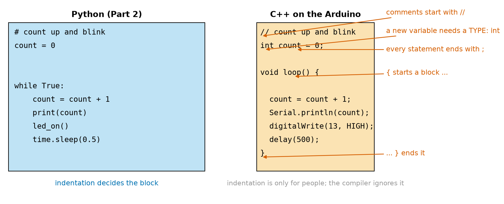
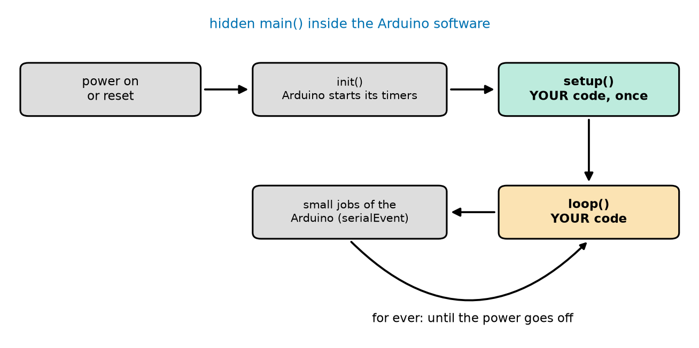
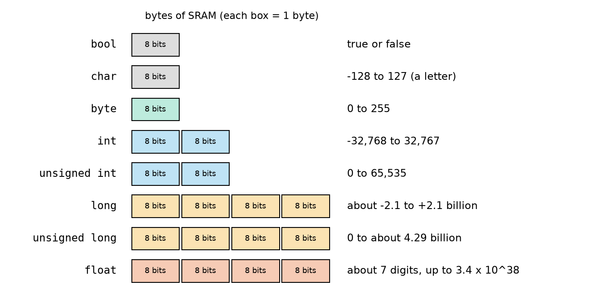
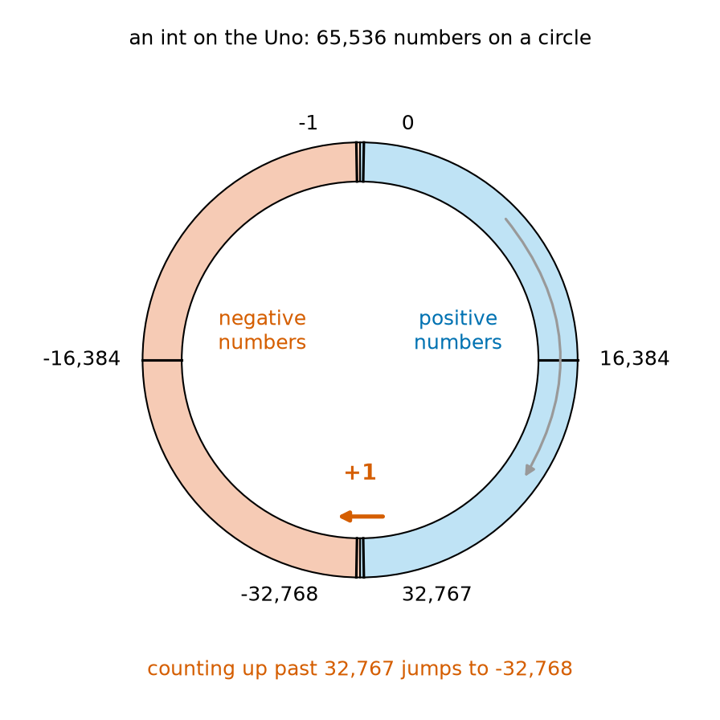
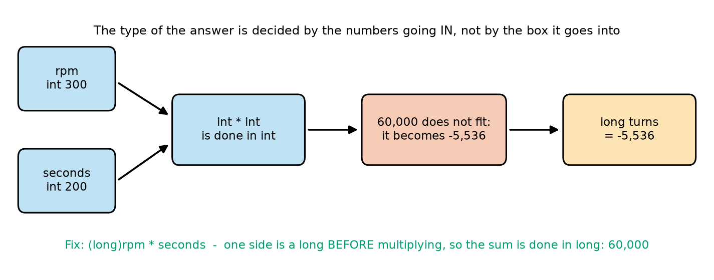
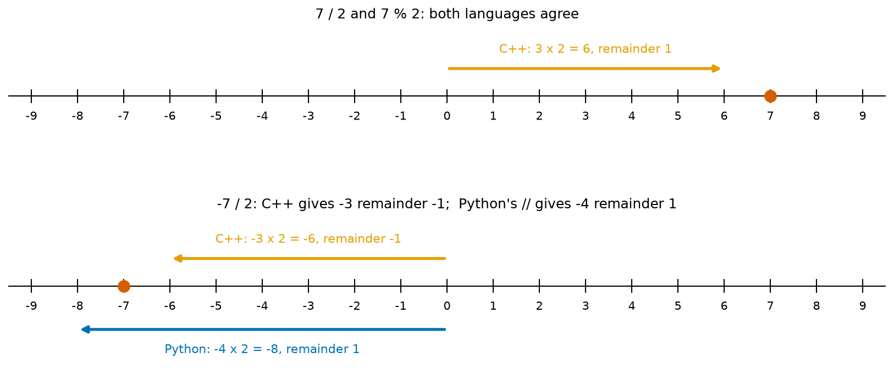
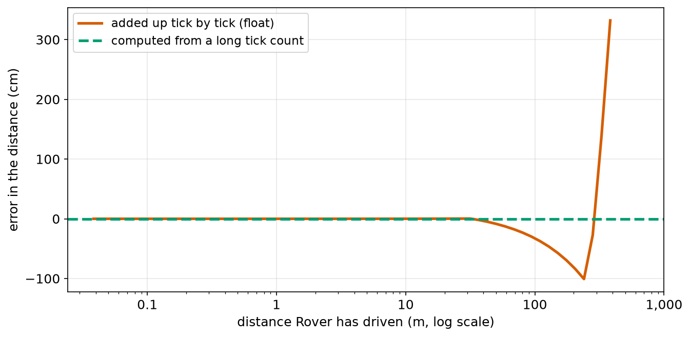
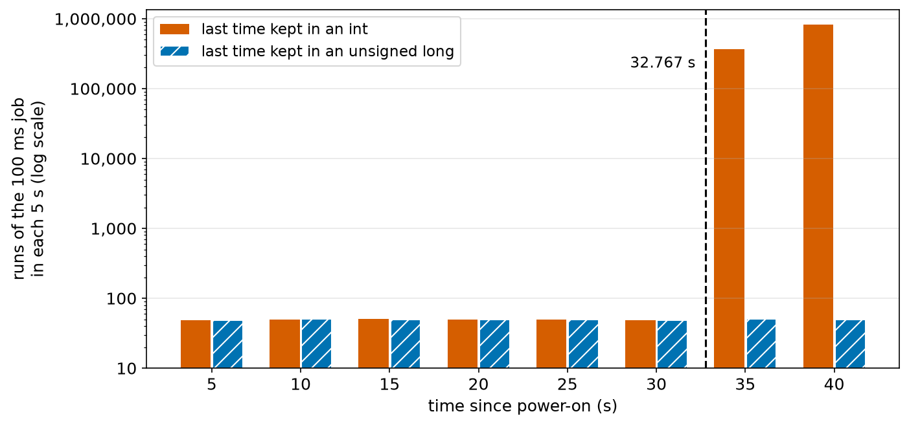

# Chapter 96 — C++ for Arduino, Part 1: `setup`, `loop`, Variables, Types

> **Part 6 · Chapter 96 of 749**
> **You need:** Chapter 13 (numbers and arithmetic in Python), Chapter 14 (variables), Chapter 38 (powers of two), Chapter 47 (wrapping angles), Chapter 54 (error and rounding in computers), Chapter 91 (bits and bytes) and Chapter 95 (uploading a sketch, the Serial Monitor, the PC test bench).
> **You will make:** a tour of every basic C++ type on the Uno, a sketch that shows numbers overflowing, a sketch that shows how C++ divides, a counter that shows where variables live, and two real Rover bugs found and fixed: a tick counter that goes negative after 12.6 m, and a timer that goes wild after 32.8 seconds.

---

## What you will learn

- How a C++ sketch differs from a Python program: **types**, **semicolons**, **braces** and comments.
- What `setup()` and `loop()` really are, and what calls them.
- How to **declare** a variable, and how to choose its **type**: `bool`, `char`, `byte`, `int`, `long`, `unsigned`, `float`.
- Why an `int` on the Uno stops at **32,767**, what **overflow** does, and how to avoid it.
- How whole-number **division** and the **remainder** work in C++, and where they differ from Python.
- What a **float** can and cannot hold on the Uno.
- The difference between **global** and **local** variables, and how to make **constants**.

---

## New words in this chapter

| Word | Simple meaning |
|---|---|
| **C++** | The programming language used for Arduino sketches. It is compiled before it runs. |
| **statement** | One instruction in a program. In C++ each one ends with `;`. |
| **block** | A group of statements between `{` and `}`. |
| **declare** | Tell the compiler a variable's type and name before using it: `int speed;`. |
| **type** | What kind of value a variable holds, and how many bytes it takes. |
| **integer** | A whole number, with no decimal point. |
| **signed / unsigned** | Signed numbers can be negative; unsigned numbers cannot, so they reach twice as high. |
| **overflow** | What happens when a result is too big for its type: it wraps around to the other end. |
| **cast** | Changing a value to another type on purpose: `(long)rpm`. |
| **float** | A number with a decimal point, about 7 digits exact. |
| **global variable** | A variable made outside every function. It lives as long as the program runs. |
| **local variable** | A variable made inside a function or block. It is made again each time and lost at the end. |
| **constant** | A named value that the program may not change: `const int LED_PIN = 13;`. |
| **void** | "Nothing": a function marked `void` gives no value back. |

---

## 96.1 From Python to C++

You already know how to program. Everything you learned in Part 2 (variables, `if`, loops, functions, lists) exists in C++ too. What changes is the **grammar**, and one big idea: in C++, every value has a **type** that is fixed before the program runs.

📖 **New word: C++** — the language of Arduino sketches. It was made in the 1980s by adding new features to an older language called C. It is **compiled** (Chapter 95): the whole sketch is turned into instruction numbers before it runs, so the compiler must know, for every variable, exactly how many bytes it takes and how to add, compare or print it. That is why C++ asks you for types.



*Figure 96.1 — A small counting program in Python (left) and in C++ for the Arduino (right).*

**How to read this picture:** Read the two boxes line by line; they do the same job. On the right, the red arrows point to the four things that are new: comments start with `//` instead of `#`; a new variable needs a **type** (`int`) the first time; every statement ends with `;`; and blocks are marked with `{` and `}` instead of indentation. Python's `while True:` loop is gone, because the Arduino calls `loop()` again and again for you (section 96.2).

Here is a table of the differences you will meet first:

| Idea | Python | C++ on the Arduino |
|---|---|---|
| Comment | `# like this` | `// like this` or `/* like this */` |
| New variable | `speed = 120` | `int speed = 120;` |
| Change it | `speed = 150` | `speed = 150;` |
| End of a statement | end of the line | `;` |
| A block | indentation after `:` | `{ … }` (indentation is only for people) |
| Text | `"Rover"` or `'Rover'` | `"Rover"` (double quotes); `'R'` is one character |
| True and false | `True`, `False` | `true`, `false` |
| And, or, not | `and`, `or`, `not` | `&&`, `||`, `!` (Chapter 97) |
| Whole-number division | `7 // 2` gives 3 | `7 / 2` gives 3 |
| Decimal division | `7 / 2` gives 3.5 | `7.0 / 2` gives 3.5 |
| Print | `print(x)` | `Serial.println(x);` |
| Swap two values | `a, b = b, a` | `int temp = a; a = b; b = temp;` |

📖 **New word: statement** — one instruction: `speed = 150;`, `delay(500);`, `Serial.println(x);`. In C++ every statement ends with a semicolon, because C++ does not care about lines at all: you could put three statements on one line, or one statement over three lines. The `;` is how the compiler knows where each one ends.

📖 **New word: block** — a group of statements between `{` and `}`. A function's body is a block; so is the body of an `if` or a loop (Chapter 97). Indentation inside a block is only to help **people** read it; the compiler ignores it completely. Indent anyway: four or two spaces per level, the same everywhere.

⚠️ **Careful: C++ is case-sensitive, like Python.** `Serial`, `serial` and `SERIAL` are three different names. `digitalwrite(13, HIGH);` is an error; it must be `digitalWrite`.

Remember the swap from Chapter 14? C++ has no one-line `a, b = b, a`, so you use the "spare box" way you learned there: copy one value into a temporary variable first. Small example 7 shows it.

---

## 96.2 What `setup()` and `loop()` really are

In Chapter 95 you learned the rule: `setup()` runs once, `loop()` runs for ever. Now let us see why.

Every C++ program starts in a function called `main`. On the Arduino, `main` is written for you, hidden inside the Arduino software. Simplified, it is:

```cpp
int main() {
  init();               // the Arduino's own start-up: timers, the ADC, PWM
  setup();              // YOUR function: runs once
  for (;;) {            // "for ever"
    loop();             // YOUR function: runs again and again
    serialEventRun();   // a small Arduino job between your loops
  }
}
```

So `setup` and `loop` are just two **functions** (Chapter 23) that you write and the hidden `main` calls.



*Figure 96.2 — What happens from the moment the board is powered on.*

**How to read this picture:** Follow the arrows. After power-on or reset, the Arduino's own `init()` starts its timers (that is how `millis()` and `delay()` work). Then your `setup()` (green) runs once. Then your `loop()` (orange) runs, a small Arduino job runs, and the curved arrow goes back to `loop()`: for ever, until the power goes off. The grey boxes are the Arduino's; the coloured ones are yours.

Look again at how they are written:

```cpp
void setup() {
}
```

📖 **New word: void** — "nothing". A function's definition starts with the **type of value it gives back**. `setup` and `loop` give nothing back, so their type is `void`. (A function that gives back a whole number would start with `int`; Chapter 97.) The empty `()` means they take no inputs. The `{ }` hold their body.

💡 **Tip:** Both `setup()` and `loop()` must exist in every sketch, even if one is empty. If you delete `loop()`, the compile fails with an error like `undefined reference to 'loop'`: the hidden `main` is looking for it.

🧠 **The Arduino calls your `setup()` once and your `loop()` for ever.** There is nothing magic about them: they are ordinary functions with special names.

---

## 96.3 Comments, and two kinds of mistakes

C++ has two kinds of comments:

```cpp
// A comment to the end of the line, like Python's #
/* A comment that can go
   over several lines */
```

When you press Verify, two kinds of mistakes can appear. Knowing which is which saves a lot of time.

| Kind | When it shows | Example | What you see |
|---|---|---|---|
| **compile error** | when you press Verify or Upload | a missing `;`, a misspelt name, a missing `}` | red text in the message area; nothing is uploaded |
| **run-time bug** | while the sketch runs | an `int` that overflows; dividing in the wrong order | no message at all: the sketch runs but does the wrong thing |

Compile errors are your friends: the compiler finds them for you, with a line number. The message's line number is where the compiler **noticed** the problem; a missing `;` is usually reported on the **next** line. Run-time bugs are harder: the compiler is happy, and the robot is wrong. Most of this chapter is about avoiding the run-time bugs that come from **types**.

---

## 96.4 Variables need a type

📖 **New word: declare** — to tell the compiler a new variable's type and name, before you use it. In Python, a variable is made the first time you give it a value. In C++, you must say what kind of box it is:

```cpp
int speed = 120;       // declare an int called speed, and give it the value 120
speed = 150;           // later: change it (no type this time)
```

If you write `speed = 150;` without ever declaring `speed`, the compiler stops with `'speed' was not declared in this scope`. If you declare it twice, it says `redeclaration of 'int speed'`.

📖 **New word: type** — what kind of value a variable holds, and so how many bytes of SRAM it takes (Chapter 94) and which numbers fit in it. A variable's type never changes. If you put a value of another type into it, C++ converts the value to fit the box, sometimes losing part of it (section 96.8).

The sketch `types_tour.ino` (in the Code section) makes one variable of each basic type and prints its size with `sizeof`, which gives the number of bytes. Its output on the Uno:

```
bool          1 byte(s)  1
char          1 byte(s)  R
byte          1 byte(s)  200
int           2 byte(s)  -1500
unsigned int  2 byte(s)  60000
long          4 byte(s)  -2000000
unsigned long 4 byte(s)  4000000000
float         4 byte(s)  7.42
the letter R is the number 82
```



*Figure 96.3 — Each basic type on the Uno, drawn as the bytes of SRAM it takes, with the values it can hold.*

**How to read this picture:** Each row is one type. Each coloured box is one byte (8 bits, Chapter 91). The more boxes, the bigger the numbers it can hold and the more memory it uses: `bool`, `char` and `byte` take 1 byte; `int` 2; `long` and `float` 4. On the right is the range of values. Notice that `int` and `unsigned int` have the same two bytes, but cover different numbers.

Here is each type, and when to use it:

| Type | Bytes | Holds | Use it for |
|---|---|---|---|
| `bool` | 1 | `true` or `false` | flags: "is the bumper pressed?" |
| `char` | 1 | one character such as `'R'` (really a number from −128 to 127) | single letters, commands |
| `byte` | 1 | 0 to 255 | small positive numbers, raw data bytes |
| `int` | 2 | −32,768 to 32,767 | most small whole numbers: pin numbers, speeds, ADC readings |
| `unsigned int` | 2 | 0 to 65,535 | whole numbers that are never negative and may pass 32,767 |
| `long` | 4 | −2,147,483,648 to 2,147,483,647 | big counts: encoder ticks, distances in millimetres |
| `unsigned long` | 4 | 0 to 4,294,967,295 | **times from `millis()` and `micros()`** |
| `float` | 4 | about ±3.4 × 10³⁸, about 7 exact digits | measurements with decimals: volts, metres |

🔢 **Where do these limits come from?** From Chapter 38 and Chapter 91: n bits give 2ⁿ values. An `int` has 16 bits: 2¹⁶ = 65,536 values. Unsigned, they are 0 to 65,535. Signed, half are negative: −32,768 to 32,767. A `long` has 32 bits: 2³² = 4,294,967,296 values.

📖 **New word: signed / unsigned** — a **signed** type can hold negative numbers; it uses its top bit to say "negative or not". An **unsigned** type cannot be negative, so it uses all its bits for size and reaches twice as high. `int` is signed; `unsigned int` is not.

📖 **New word: integer** — a whole number: `bool`, `char`, `byte`, `int`, `long` and their unsigned versions are all **integer types**. Only `float` (and `double`) hold decimals.

💡 **Tip: types with the size in their name.** The same word can mean different sizes on different chips: an `int` is 2 bytes on the Uno but 4 bytes on an ESP32 or a Raspberry Pi Pico. When the exact size matters, use the types that say it: `int8_t`, `int16_t`, `int32_t` (signed, 8, 16 or 32 bits) and `uint8_t`, `uint16_t`, `uint32_t` (unsigned). `byte` is the same as `uint8_t`. You will see these in libraries and in sensor code (Application 5).

⚠️ **Careful: `'R'` and `"R"` are different.** Single quotes make one `char`, which is really a number: the letter R is 82 in the ASCII table (the last line of the output). Double quotes make a piece of **text** (a string), even if it has only one letter in it.

---

## 96.5 Overflow: when a number does not fit

A car's odometer has five or six digits. After 99,999 km it shows 00,000 again: there is no room for a sixth digit. Numbers in a microcontroller are the same. Every type has a fixed number of bits, and when a result is too big, the extra is simply lost.

📖 **New word: overflow** — what happens when the result of a sum is too big (or too small) for its type. The value **wraps around** to the other end of the range, with no error message and no warning.



*Figure 96.4 — The 65,536 values of a 16-bit int placed on a circle.*

**How to read this picture:** Start at 0 at the top. Counting up goes clockwise (the grey arrow) through the positive numbers (blue): 16,384 on the right, 32,767 at the bottom. One more step (+1, the red arrow) does not go to 32,768, which does not exist; it lands on −32,768, the most negative number, and keeps counting up from there through the negative numbers (pink) back to −1 and 0. Overflow is just going round the circle.

The sketch `overflow.ino` shows it. Its output on the Uno:

```
32767 + 1 as an int:   -32768
255 + 1 as a byte:     0
300 * 200 into a long: -5536
(long)300 * 200:       60000
0 - 1 as unsigned int: 65535
```

The first two lines are the circle. A `byte` wraps from 255 to 0. An `unsigned int` wraps the other way: 0 − 1 is 65,535.

### The most common overflow bug

The third line is the one that catches everyone. `rpm` and `seconds` are `int`s: 300 and 200. Their product is 60,000. The program stores it in a `long`, which can easily hold 60,000. Yet it prints −5,536. Why?



*Figure 96.5 — Why storing `rpm * seconds` in a `long` does not help.*

**How to read this picture:** Follow the arrows from left to right. Both inputs are `int`s (blue), so C++ does the multiplication **as an int**. 60,000 does not fit in an int, so it wraps around the circle to −5,536 (red). Only then is the result put into the `long` (orange), which stores −5,536 faithfully. The green line at the bottom is the fix.

🔢 **Where does −5,536 come from?** Going round the circle: 60,000 − 65,536 = −5,536.

🧠 **The type of a calculation is decided by the numbers going in, not by the box the answer goes into.** If any part might be big, make one of the inputs big **first**: `(long)rpm * seconds`.

📖 **New word: cast** — changing a value to another type on purpose, by writing the type in brackets in front of it: `(long)rpm`, `(float)a`, `(int)2.7`. When one side of `*` is a `long`, C++ turns the other side into a `long` too, and does the whole sum in 32 bits.

The same trick works with numbers you type: a number followed by `L` is a `long`, and one followed by `UL` is an `unsigned long`. `analogRead(A0) * 5000 / 1023` overflows on the Uno, because a reading like 819 times 5,000 is 4,095,000; but `analogRead(A0) * 5000L / 1023` is done in long and gives the right answer (Chapter 101 uses this).

⚠️ **Careful: Python never overflows; C++ on the Uno overflows all the time.** Chapter 54 warned about this. Python's whole numbers grow as big as they need to. An Uno's `int` cannot. Before you choose `int`, ask: "Could this ever be bigger than 32,767, even in the middle of a calculation?"

---

## 96.6 Whole-number division and the remainder

In Python, `7 / 2` is 3.5 and `7 // 2` is 3. In C++, it depends on the **types**: if both sides are integers, `/` is whole-number division and the remainder is dropped. If either side is a `float`, it is normal division.

The sketch `maths.ino` shows the rules. Output:

```
7 / 2        = 3
7 % 2        = 1
-7 / 2       = -3
-7 % 360     = -7
float = 7/2  = 3.00
(float)7 / 2 = 3.50
7 / 2.0      = 3.50
2.0 / 3      = 0.6667
int from 2.7 = 2, rounded = 3
-30 degrees wrapped = 330
```

Line by line:

- `7 / 2` is 3 and `7 % 2` is 1: the `%` operator gives the **remainder**, as in Python.
- `-7 / 2` is −3. C++ always rounds **towards zero**. Python's `-7 // 2` gives −4, because Python rounds **down**.
- `-7 % 360` is −7. In C++ the remainder has the **same sign as the number divided**. Python gives 353. This is the difference Chapter 47 warned about.
- `float half = a / b;` gives 3.00, not 3.50! The division `a / b` is done first, between two `int`s, so it gives 3, and only then is 3 put into the float. The same rule as section 96.5: the inputs decide.
- `(float)a / b` gives 3.50, because a cast makes one side a float first. So does `a / 2.0`, because `2.0` is a float (a number with a decimal point).
- `Serial.println(2.0 / 3, 4)` prints 4 decimal places. Without the 4, `Serial.println` prints a float with 2.



*Figure 96.6 — Dividing by 2 shown on a number line: the red dot is the number divided, the arrows are the whole-number answers times 2.*

**How to read this picture:** In the top line, 7 ÷ 2: both languages step 3 twos (to 6), leaving a remainder of 1. In the bottom line, −7 ÷ 2: C++ (orange) steps −3 twos (to −6) and leaves a remainder of −1, staying on the zero side of −7. Python's `//` (blue) steps −4 twos (to −8) and leaves a remainder of +1. Both are "correct"; they just round differently. When you translate maths from Python to C++, negative numbers are where it changes.

🤖 **Robot link: wrapping a heading.** Rover's heading should always be between 0 and 359 degrees. In Python, `heading % 360` does it (Chapter 47). In C++ it fails for negatives: −30 % 360 is −30. The safe C++ way is `(heading % 360 + 360) % 360`: −30 % 360 = −30, + 360 = 330, % 360 = **330**. The last line of the output shows it.

🔢 **Rounding.** Putting a float into an int **cuts off** the decimals: `int cut = 2.7;` gives 2 (and −2.7 gives −2). To round to the nearest whole number, add 0.5 first: `(int)(2.7 + 0.5)` gives 3. (For negative numbers, subtract 0.5 instead, or use the `round()` function.)

---

## 96.7 Floats on the Uno

📖 **New word: float** — a type for numbers with a decimal point, such as 7.42 or 0.000383. It is stored in 4 bytes as a number of about 7 digits and a power of two (the "floating point" moves to where it is needed, Chapter 54).

Three facts about floats on the Uno:

1. **About 7 exact digits, and no more.** `float big = 123456789;` stores 123456792. And 16,777,216 + 1 is still 16,777,216 as a float: the gap between neighbouring floats at that size is 2. Small numbers have small gaps; big numbers have big gaps.
2. **`double` is the same as `float` on the Uno.** On a laptop, `double` has 8 bytes and about 16 digits. On the Uno, `double` is only another name for the 4-byte float. Writing `double` does not buy you any accuracy here (it does on an ESP32).
3. **Floats are slow on the Uno.** Chapter 94 measured about 100 to 150 clock ticks per float add or multiply, against 2 for an int add. A few floats per loop are fine; thousands are not.

And one warning that comes straight from Chapter 54:

⚠️ **Careful: never test floats with `==`.** After a calculation, a float is very rarely *exactly* the value you expect. Instead of `if (volts == 7.4)`, test whether it is close enough: `if (abs(volts - 7.4) < 0.01)`.

🧠 **Integers are exact but limited; floats are big but approximate.** Count things (ticks, milliseconds, ADC readings) in integers. Use floats only for measured quantities with decimals, and only after the counting is done. Application 1 shows why.

---

## 96.8 Where a variable lives: global and local

Where you declare a variable decides how long it lives.

📖 **New word: global variable** — a variable declared **outside** every function, usually at the top of the sketch. It is made once, before `setup()` runs, and it keeps its value for as long as the board is on. Every function can use it.

📖 **New word: local variable** — a variable declared **inside** a function or a block. It is made when the program reaches its declaration and **destroyed** at the end of the block. If the function runs again, it is made again, from scratch.

This matters a lot in `loop()`, because `loop()` ends and starts again thousands of times. The sketch `counter.ino` counts with one of each. Output (2 seconds):

```
global: 1   local: 1
global: 2   local: 1
global: 3   local: 1
global: 4   local: 1
```

The global counter goes 1, 2, 3, 4. The local one is always 1: on every pass of `loop()`, `int localCount = 0;` makes a brand-new variable with the value 0, adds 1, prints 1, and then the variable disappears at the `}`.

🧠 **Anything that must be remembered from one `loop()` to the next (a count, a "last time", a state) must be global.** Things that are only needed during one pass (a reading you are about to use) should be local, so other parts of the program cannot change them by mistake. (Chapter 97 shows a third way, `static`, and explains where local variables live: on the stack of Chapter 94.)

⚠️ **Careful: a local and a global with the same name.** If you declare `int count = 0;` at the top **and** `int count = 0;` inside `loop()`, the one inside `loop()` hides the global one completely. Your sketch then counts in a local variable that is reset every time, and the global never changes. The compiler allows it, without a warning. Use different names.

---

## 96.9 Constants

📖 **New word: constant** — a named value that may not change while the program runs. Put `const` before the type:

```cpp
const int LED_PIN = 13;           // the status LED's pin
const float WHEEL_M = 0.207;      // distance per wheel turn, metres
```

If any line later tries `LED_PIN = 12;`, the compiler stops with `assignment of read-only variable 'LED_PIN'`. Constants make sketches easier to read (`digitalWrite(LED_PIN, HIGH)` says what it means) and easier to change (move the LED to pin 8 by changing one line). They cost no SRAM at all on the Uno for small values: the compiler puts the number straight into the instructions.

You will also see this older way in many sketches:

```cpp
#define LED_PIN 13                // no type, no = and no ;
```

`#define` does a simple text replacement before the compiler runs: everywhere the sketch says `LED_PIN`, it puts `13`. It works, but it has no type, and its mistakes give confusing messages. Prefer `const`.

**Naming.** The usual Arduino style is:

| What | Style | Examples |
|---|---|---|
| variables and functions | `camelCase`: first word small, later words start with a capital | `speed`, `leftTicks`, `lastReport` |
| constants | `UPPER_CASE` with underscores | `LED_PIN`, `METERS_PER_TICK` |

(This is different from Python's `snake_case` for variables. Follow the style of the language you are writing.)

---

## Code

Every output in this chapter comes from the PC test bench of Chapter 95, with its **Uno int** setting turned on: the test file includes `avr_int.h`, and the bench then gives `int` the Uno's 16 bits. You get the same output in Wokwi or on a real Uno.

File `code/ch096/types_tour/types_tour.ino`:

```cpp
// types_tour.ino - every basic type on the Uno: how many bytes it takes, and the numbers it can hold
void setup() {
  Serial.begin(9600);

  bool ready = true;                   // true or false
  char letter = 'R';                   // one character (really a small number)
  byte level = 200;                    // a whole number from 0 to 255
  int speed = -1500;                   // a whole number from -32768 to 32767
  unsigned int count = 60000;          // a whole number from 0 to 65535
  long ticks = -2000000;               // a whole number of about +- 2 billion
  unsigned long ms = 4000000000UL;     // a whole number from 0 to about 4.29 billion
  float volts = 7.42;                  // a number with a decimal point, about 7 digits

  Serial.print("bool          ");  Serial.print(sizeof(ready));  Serial.print(" byte(s)  ");  Serial.println(ready);
  Serial.print("char          ");  Serial.print(sizeof(letter)); Serial.print(" byte(s)  ");  Serial.println(letter);
  Serial.print("byte          ");  Serial.print(sizeof(level));  Serial.print(" byte(s)  ");  Serial.println(level);
  Serial.print("int           ");  Serial.print(sizeof(speed));  Serial.print(" byte(s)  ");  Serial.println(speed);
  Serial.print("unsigned int  ");  Serial.print(sizeof(count));  Serial.print(" byte(s)  ");  Serial.println(count);
  Serial.print("long          ");  Serial.print(sizeof(ticks));  Serial.print(" byte(s)  ");  Serial.println(ticks);
  Serial.print("unsigned long ");  Serial.print(sizeof(ms));     Serial.print(" byte(s)  ");  Serial.println(ms);
  Serial.print("float         ");  Serial.print(sizeof(volts));  Serial.print(" byte(s)  ");  Serial.println(volts);
  Serial.print("the letter R is the number ");
  Serial.println((int)letter);
}

void loop() {
}
```

| Line | Code | What it does (simple English) |
|---|---|---|
| 1 | `// types_tour.ino - …` | A comment: what the sketch does. |
| 2 | `void setup() {` | Everything happens once, in `setup`. |
| 3 | `Serial.begin(9600);` | Start Serial at 9,600 bits per second. |
| 4 | (blank) | Spacing. |
| 5 | `bool ready = true;` | Declare a `bool` called `ready` and give it `true`. |
| 6 | `char letter = 'R';` | A `char` holding the letter R. Single quotes make one character. |
| 7 | `byte level = 200;` | A `byte`: 200 fits in 0 to 255. |
| 8 | `int speed = -1500;` | An `int` can be negative. |
| 9 | `unsigned int count = 60000;` | 60,000 is too big for an `int` but fits in an `unsigned int`. |
| 10 | `long ticks = -2000000;` | Two million needs a `long`. |
| 11 | `unsigned long ms = 4000000000UL;` | Four billion needs an `unsigned long`. `UL` tells the compiler the number itself is an unsigned long. |
| 12 | `float volts = 7.42;` | A number with decimals. |
| 13 | (blank) | Spacing. |
| 14 | `Serial.print("bool  …"); … Serial.println(ready);` | Four statements on one line (C++ allows it, because `;` ends each one). They print the name, the size from `sizeof`, the words " byte(s)", and the value. A `bool` prints as 1 for true. |
| 15–21 | the same for each type | One line per type. A `char` prints as its letter; a `float` prints with 2 decimals. |
| 22 | `Serial.print("the letter R is the number ");` | Text before the number. |
| 23 | `Serial.println((int)letter);` | A cast to `int` prints the `char` as its number: 82. |
| 24 | `}` | End of `setup`. |
| 25 | (blank) | Spacing. |
| 26–27 | `void loop() { }` | An empty `loop`: nothing to repeat, but it must exist. |

The output is in section 96.4. Notice that the sketch takes about half a second to print everything: at 9,600 bits per second, each character takes about 1 ms (Chapter 100).

File `code/ch096/overflow/overflow.ino`:

```cpp
// overflow.ino - what happens when a number does not fit in its type
void setup() {
  Serial.begin(9600);

  int big = 32767;                     // the largest int on the Uno
  big = big + 1;
  Serial.print("32767 + 1 as an int:   ");
  Serial.println(big);

  byte b = 255;
  b = b + 1;
  Serial.print("255 + 1 as a byte:     ");
  Serial.println(b);

  int rpm = 300;
  int seconds = 200;
  long turns = rpm * seconds;          // the multiplication is done in int, THEN stored in the long
  Serial.print("300 * 200 into a long: ");
  Serial.println(turns);

  long turnsFixed = (long)rpm * seconds;   // make one side a long first: now it is done in long
  Serial.print("(long)300 * 200:       ");
  Serial.println(turnsFixed);

  unsigned int u = 0;
  u = u - 1;
  Serial.print("0 - 1 as unsigned int: ");
  Serial.println(u);
}

void loop() {
}
```

| Line | Code | What it does (simple English) |
|---|---|---|
| 1 | `// overflow.ino - …` | A comment. |
| 2–3 | `void setup() {`, `Serial.begin(9600);` | Start, and open Serial. |
| 4 | (blank) | Spacing. |
| 5 | `int big = 32767;` | The largest `int`. |
| 6 | `big = big + 1;` | One more: it wraps around to −32,768 (Figure 96.4). |
| 7–8 | `Serial.print(…); Serial.println(big);` | Print a label and the value. |
| 9 | (blank) | Spacing. |
| 10–11 | `byte b = 255;`, `b = b + 1;` | The largest `byte`, plus one: wraps to 0. |
| 12–13 | `Serial.print(…); Serial.println(b);` | Print it. |
| 14 | (blank) | Spacing. |
| 15–16 | `int rpm = 300;`, `int seconds = 200;` | Two ordinary `int`s. |
| 17 | `long turns = rpm * seconds;` | The bug: `int * int` is done as an `int` and overflows **before** it is stored. |
| 18–19 | `Serial.print(…); Serial.println(turns);` | Prints −5,536. |
| 20 | (blank) | Spacing. |
| 21 | `long turnsFixed = (long)rpm * seconds;` | The fix: cast `rpm` to `long` first, so the whole product is done in `long`. |
| 22–23 | `Serial.print(…); Serial.println(turnsFixed);` | Prints 60,000. |
| 24 | (blank) | Spacing. |
| 25–26 | `unsigned int u = 0;`, `u = u - 1;` | An unsigned number below zero wraps to the top: 65,535. |
| 27–28 | `Serial.print(…); Serial.println(u);` | Print it. |
| 29 | `}` | End of `setup`. |
| 30–32 | `void loop() { }` | Empty `loop`. |

The output is in section 96.5.

File `code/ch096/maths/maths.ino`:

```cpp
// maths.ino - whole-number and decimal maths on the Uno
void setup() {
  Serial.begin(9600);
  int a = 7;
  int b = 2;

  Serial.print("7 / 2        = ");  Serial.println(a / b);        // whole numbers: the remainder is dropped
  Serial.print("7 % 2        = ");  Serial.println(a % b);        // the remainder
  Serial.print("-7 / 2       = ");  Serial.println(-a / b);       // rounds towards zero
  Serial.print("-7 % 360     = ");  Serial.println(-a % 360);     // C++ keeps the sign (Python gives 353)

  float half = a / b;                                             // the division happens BEFORE the float
  Serial.print("float = 7/2  = ");  Serial.println(half);
  float half2 = (float)a / b;                                     // make one side a float first
  Serial.print("(float)7 / 2 = ");  Serial.println(half2);
  Serial.print("7 / 2.0      = ");  Serial.println(a / 2.0);
  Serial.print("2.0 / 3      = ");  Serial.println(2.0 / 3, 4);   // 4 decimal places

  int cut = 2.7;                                                  // a float into an int: the decimals are cut off
  int rounded = (int)(2.7 + 0.5);                                 // add 0.5 first to round
  Serial.print("int from 2.7 = ");  Serial.print(cut);
  Serial.print(", rounded = ");     Serial.println(rounded);

  int heading = -30;
  int wrapped = (heading % 360 + 360) % 360;                      // always 0 to 359, even for negatives
  Serial.print("-30 degrees wrapped = ");  Serial.println(wrapped);
}

void loop() {
}
```

| Line | Code | What it does (simple English) |
|---|---|---|
| 1 | `// maths.ino - …` | A comment. |
| 2–3 | `void setup() {`, `Serial.begin(9600);` | Start, and open Serial. |
| 4–5 | `int a = 7;`, `int b = 2;` | Two integers to divide. |
| 6 | (blank) | Spacing. |
| 7 | `… Serial.println(a / b);` | Integer division: 3. |
| 8 | `… Serial.println(a % b);` | The remainder: 1. |
| 9 | `… Serial.println(-a / b);` | −7 ÷ 2 rounds towards zero: −3. |
| 10 | `… Serial.println(-a % 360);` | The remainder keeps the sign of −7: −7. |
| 11 | (blank) | Spacing. |
| 12 | `float half = a / b;` | `a / b` is done in int (3), then stored as 3.00. |
| 13 | `… Serial.println(half);` | Prints 3.00. |
| 14 | `float half2 = (float)a / b;` | The cast makes it a float division: 3.5. |
| 15 | `… Serial.println(half2);` | Prints 3.50. |
| 16 | `… Serial.println(a / 2.0);` | `2.0` is a float, so this is float division too. |
| 17 | `… Serial.println(2.0 / 3, 4);` | The second number in `println` is how many decimal places to print. |
| 18 | (blank) | Spacing. |
| 19 | `int cut = 2.7;` | A float into an int: the decimals are cut off, giving 2. |
| 20 | `int rounded = (int)(2.7 + 0.5);` | 3.2, cut to 3: rounded. |
| 21–22 | `Serial.print(…)…` | Print both on one line. |
| 23 | (blank) | Spacing. |
| 24 | `int heading = -30;` | A heading 30° to the right of zero. |
| 25 | `int wrapped = (heading % 360 + 360) % 360;` | Wrap any whole-degree heading into 0 to 359: here 330. |
| 26 | `… Serial.println(wrapped);` | Print it. |
| 27 | `}` | End of `setup`. |
| 28–30 | `void loop() { }` | Empty `loop`. |

The output is in section 96.6.

File `code/ch096/counter/counter.ino`:

```cpp
// counter.ino - a variable made inside loop() is made again every time loop() runs
int globalCount = 0;                   // made once, before setup(); it keeps its value

void setup() {
  Serial.begin(9600);
}

void loop() {
  int localCount = 0;                  // made again, and set to 0, on every pass of loop()
  globalCount = globalCount + 1;
  localCount = localCount + 1;
  Serial.print("global: ");
  Serial.print(globalCount);
  Serial.print("   local: ");
  Serial.println(localCount);
  delay(500);
}
```

| Line | Code | What it does (simple English) |
|---|---|---|
| 1 | `// counter.ino - …` | A comment. |
| 2 | `int globalCount = 0;` | A **global** variable: outside every function, made once. |
| 3 | (blank) | Spacing. |
| 4–6 | `void setup() { Serial.begin(9600); }` | Open Serial. |
| 7 | (blank) | Spacing. |
| 8 | `void loop() {` | Runs again and again. |
| 9 | `int localCount = 0;` | A **local** variable: made, with the value 0, every time this line runs. |
| 10 | `globalCount = globalCount + 1;` | The global goes up by one and remembers it. |
| 11 | `localCount = localCount + 1;` | The local goes from 0 to 1, every time. |
| 12–15 | `Serial.print(…)…` | Print both on one line. |
| 16 | `delay(500);` | Wait half a second, so we can read it. |
| 17 | `}` | End of `loop`: `localCount` is destroyed here. |

The output is in section 96.8.

---

## Small examples

**Example 1.** `int x = 40000;` on the Uno stores 40,000 − 65,536 = −25,536.

**Example 2.** `byte b = 300;` stores 300 − 256 = 44.

**Example 3.** `long ms = 60 * 1000;` looks fine, because 60,000 fits in a `long`. But `60 * 1000` is done in int, so `ms` gets −5,536. Write `60 * 1000L` or `60000L`.

**Example 4.** `int volts = 7.9;` stores 7: the decimals are cut off, not rounded.

**Example 5.** `float ratio = 3 / 4;` stores 0.00; `float ratio = 3.0 / 4;` stores 0.75.

**Example 6.** `25 % 7` is 4 in both languages; `-25 % 7` is −4 in C++ and 3 in Python.

**Example 7.** A swap in C++:

```cpp
int left = 80;
int right = 120;
int temp = left;      // keep left's value in a spare box
left = right;         // left is now 120
right = temp;         // right gets the old left: 80
```

**Example 8.** The encoder tick count after 12.6 m of driving (32,767 ticks) is the last one an `int` can hold; Application 1 shows what comes next.

---

## 🏭 Real robot applications

### Application 1 (worked in full) — 🤖 Rover's odometry: which type holds the count?

**1. The real problem.** Rover counts the pulses of its wheel encoders (Chapters 47 and 122) to know how far it has driven. Each wheel turn is 540 ticks and moves Rover 0.207 m. A delivery robot might drive a few hundred metres in a day. Which type should hold the tick count, and how should the distance in metres be worked out: by adding a tiny distance at every tick, or by multiplying the count at the end?

**2. Why this theory.** Section 96.5: an `int` overflows at 32,767. Section 96.7: a `float` has only about 7 exact digits, so adding a very small number to a big one loses part of the small one.

**3. The numbers.** Distance per tick = 0.207 ÷ 540 = 0.000383 m (0.383 mm). The test drive is one million ticks: 1,000,000 × 0.000383 = 383.3 m.

**4. The maths.** An `int` overflows after 32,767 ticks: 32,767 × 0.000383 = **12.56 m**. After that it counts from −32,768. A `long` holds up to 2,147,483,647 ticks: 2,147,483,647 × 0.000383 = 823,000 m, which is 823 km; enough.

For the float sum: near 100 m, a float's neighbouring values are about 0.0000076 m apart (2⁻¹⁷); near 300 m, about 0.0000305 m (2⁻¹⁵). Adding 0.000383 m to 300 m must round the result to the nearest available float, so each step adds 0.000366 or 0.000397 instead of 0.000383: an error of about 4% **on every tick**. The errors do not cancel out, because at a given size the rounding goes the same way each time.

**5. The code.** The sketch uses a `for` loop and an `if` to pretend to drive a million ticks; they work like Python's `for` and `if`, and Chapter 97 teaches them properly. `||` means "or". File `code/ch096/odometry/odometry.ino`:

```cpp
// odometry.ino - Rover counts encoder ticks: which type should hold the count, and the distance?
const float METERS_PER_TICK = 0.207f / 540;   // one wheel turn = 0.207 m = 540 ticks (Chapters 16 and 47)

int ticksInt = 0;                      // the WRONG type for a tick count
long ticksLong = 0;                    // the right type
float distanceAdded = 0;               // the WRONG way to get the distance: add a tiny step at every tick

void setup() {
  Serial.begin(9600);
  Serial.println("ticks      int count   long count   from count (m)   added up (m)");
  for (long n = 1; n <= 1000000; n++) {           // pretend Rover drives one million ticks
    ticksInt++;
    ticksLong++;
    distanceAdded = distanceAdded + METERS_PER_TICK;
    if (n == 32767 || n == 32768 || n == 100000 || n == 1000000) {
      Serial.print(n);
      Serial.print("      ");
      Serial.print(ticksInt);
      Serial.print("      ");
      Serial.print(ticksLong);
      Serial.print("      ");
      Serial.print(ticksLong * METERS_PER_TICK, 3);
      Serial.print("      ");
      Serial.println(distanceAdded, 3);
    }
  }
}

void loop() {
}
```

| Line | Code | What it does (simple English) |
|---|---|---|
| 1 | `// odometry.ino - …` | A comment. |
| 2 | `const float METERS_PER_TICK = 0.207f / 540;` | A constant: metres per tick. The `f` makes 0.207 a float. |
| 3 | (blank) | Spacing. |
| 4 | `int ticksInt = 0;` | A tick counter in the wrong type. |
| 5 | `long ticksLong = 0;` | The same counter in the right type. |
| 6 | `float distanceAdded = 0;` | A distance made by adding one step per tick. |
| 7 | (blank) | Spacing. |
| 8–9 | `void setup() {`, `Serial.begin(9600);` | Start. |
| 10 | `Serial.println("ticks …");` | The table heading. |
| 11 | `for (long n = 1; n <= 1000000; n++) {` | Repeat a million times with n = 1, 2, 3, …, 1,000,000, like Python's `for n in range(1, 1000001):`. `n` must be a `long`: an `int` could never reach a million. |
| 12 | `ticksInt++;` | `++` adds 1: the same as `ticksInt = ticksInt + 1;`. |
| 13 | `ticksLong++;` | The same for the long counter. |
| 14 | `distanceAdded = distanceAdded + METERS_PER_TICK;` | The float distance grows by one step. |
| 15 | `if (n == 32767 \|\| n == 32768 \|\| …) {` | Only print at four interesting moments. `==` compares, `\|\|` means "or". |
| 16–24 | `Serial.print(n); …` | Print the tick number, both counters, the distance from the long count, and the added-up distance, each with 3 decimals. |
| 25 | `}` | End of the `if`. |
| 26 | `}` | End of the `for`. |
| 27 | `}` | End of `setup`. |
| 28–30 | `void loop() { }` | Empty `loop`. |

Output:

```
ticks      int count   long count   from count (m)   added up (m)
32767      32767      32767      12.561      12.562
32768      -32768      32768      12.561      12.562
100000      -31072      100000      38.333      38.306
1000000      16960      1000000      383.333      386.654
```

(On a real Uno the million float additions take several seconds; the output is the same.)



*Figure 96.7 — How wrong the added-up float distance is, as Rover drives further (computed with the same 4-byte floats as the Uno).*

**How to read this picture:** The horizontal axis is the true distance on a log scale; the vertical axis is the error in centimetres. The green dashed line is the distance worked out from the `long` count: always right (0 error). The red line is the added-up float. It is fine for the first 30 m, then drifts 1 m short by about 240 m, and then (when the gap between floats doubles, at 256 m) starts rounding the other way and races to 3.3 m too long. Its error does not even grow smoothly; it depends on how each tiny step happens to round at each size.

**6. The result.** The `int` counter is correct until 32,767 ticks (12.56 m) and then goes negative: Rover would think it had suddenly jumped 25 m backwards. After a million ticks it shows 16,960, which is meaningless. The `long` counter is always right. The added-up float is 2.7 cm wrong at 38 m and **3.3 m wrong at 383 m**, almost 1%. The distance from the count, 1,000,000 × 0.000383, is right to the last digit printed.

So Rover's rule: **count in a `long`, and convert to metres only when you need metres**, with one multiplication. This is section 96.7's rule: integers for counting, floats only after the counting is done.

**7. Going further.** Real robot firmware often keeps the count in a 32-bit integer and sends the **raw count** to the main computer, which converts it with 64-bit doubles. ROS 2's odometry (Part 27) uses doubles everywhere. When even 32 bits might overflow (a factory conveyor's encoder that runs for years), firmware uses 64-bit counters or handles the wrap-around carefully, using the same subtraction trick as `millis()` in Chapter 103.

### Application 2 (worked in full) — 🤖 The 32.8-second bug: a timer kept in an `int`

**1. The real problem.** A sketch must run a job every 100 ms, for example reading Rover's line sensors. It remembers the time of the last run and checks `millis() - last >= 100`. A beginner keeps `last` in an `int`. It works perfectly on the desk, for a minute of testing. Then, out on the floor, the robot starts behaving strangely about half a minute after power-on. Why?

**2. Why this theory.** Section 96.4: `millis()` gives an `unsigned long`. Section 96.5: an `int` can only hold up to 32,767. After 32,767 ms, `millis()` no longer fits in an `int`.

**3. The numbers.** 32,767 ms = **32.767 s**. At t = 32,800 ms, storing `millis()` in an int gives 32,800 − 65,536 = −32,736.

**4. The maths.** In `millis() - lastBad`, C++ must subtract an `int` from an `unsigned long`, so it first turns the int into an unsigned long. −32,736 as an unsigned long is 4,294,934,560 (it wraps around a 32-bit circle). Then 32,850 − 4,294,934,560 wraps around again to 32,850 + 32,736 = 65,586. That is far more than 100, so the test is true, and the job runs. On the next pass it stores a negative number again, the test is true again, and so on, on **every single pass** of `loop()`.

**5. The code.** File `code/ch096/timer_bug/timer_bug.ino` runs the job both ways and reports every 5 seconds (it uses `if`, which Chapter 97 teaches; it works like Python's `if`):

```cpp
// timer_bug.ino - a job that should run every 100 ms, timed with an int (wrong) and an unsigned long (right)
int lastBad = 0;                       // WRONG: millis() stops fitting in an int after 32.767 seconds
unsigned long lastGood = 0;            // right: the same type that millis() gives
long badRuns = 0;                      // how many times each job ran in the last 5 seconds
long goodRuns = 0;
unsigned long lastReport = 0;

void setup() {
  Serial.begin(9600);
}

void loop() {
  if (millis() - lastBad >= 100) {     // is it 100 ms since the last time?
    lastBad = millis();
    badRuns++;
  }
  if (millis() - lastGood >= 100) {
    lastGood = millis();
    goodRuns++;
  }
  if (millis() - lastReport >= 5000) { // every 5 seconds, report and start counting again
    lastReport = millis();
    Serial.print(lastReport / 1000);
    Serial.print(" s: int timer ran ");
    Serial.print(badRuns);
    Serial.print(" times, unsigned long timer ran ");
    Serial.print(goodRuns);
    Serial.println(" times");
    badRuns = 0;
    goodRuns = 0;
  }
}
```

| Line | Code | What it does (simple English) |
|---|---|---|
| 1 | `// timer_bug.ino - …` | A comment. |
| 2 | `int lastBad = 0;` | The time of the last run, in the wrong type. Global, so it is remembered between passes (section 96.8). |
| 3 | `unsigned long lastGood = 0;` | The same in the right type. |
| 4–5 | `long badRuns = 0;`, `long goodRuns = 0;` | How often each job ran since the last report. |
| 6 | `unsigned long lastReport = 0;` | When we last printed a report. |
| 7 | (blank) | Spacing. |
| 8–10 | `void setup() { Serial.begin(9600); }` | Open Serial. |
| 11 | (blank) | Spacing. |
| 12 | `void loop() {` | Runs again and again, very fast. |
| 13 | `if (millis() - lastBad >= 100) {` | "Has 100 ms passed since the last run?" — the `int` version. |
| 14 | `lastBad = millis();` | Remember now as the last run. After 32.767 s, this stores a wrapped, negative number. |
| 15 | `badRuns++;` | Count the run. |
| 16 | `}` | End of the `if`. |
| 17–20 | the same with `lastGood` | The correct version. |
| 21 | `if (millis() - lastReport >= 5000) {` | Every 5 seconds… |
| 22 | `lastReport = millis();` | …remember when… |
| 23–28 | `Serial.print(…)…` | …print the time in seconds and both counts… |
| 29–30 | `badRuns = 0;`, `goodRuns = 0;` | …and start counting again. |
| 31 | `}` | End of the `if`. |
| 32 | `}` | End of `loop`. |

Output on the PC test bench, 45 seconds:

```
5 s: int timer ran 49 times, unsigned long timer ran 49 times
10 s: int timer ran 50 times, unsigned long timer ran 51 times
15 s: int timer ran 51 times, unsigned long timer ran 50 times
20 s: int timer ran 50 times, unsigned long timer ran 50 times
25 s: int timer ran 50 times, unsigned long timer ran 50 times
30 s: int timer ran 49 times, unsigned long timer ran 49 times
35 s: int timer ran 366692 times, unsigned long timer ran 51 times
40 s: int timer ran 832791 times, unsigned long timer ran 50 times
```



*Figure 96.8 — How often each version of the 100 ms job ran in each 5-second window (log scale).*

**How to read this picture:** Each pair of bars is one 5-second report: red for the `int` timer, blue for the `unsigned long` one. Up to 30 s both run about 50 times, as they should (5 s ÷ 100 ms = 50; 49 or 51 when a run falls just inside or outside a window). The dashed line is 32.767 s. After it, the red bar jumps to hundreds of thousands: the vertical scale is logarithmic, so the jump is a factor of more than 10,000.

**6. The result.** For 32.8 seconds the two versions agree exactly; any desk test shorter than half a minute passes. Then the `int` version runs its "every 100 ms" job on every pass of `loop()`, here about 166,000 times per second (on a real Uno the number depends on how fast its loop runs, but it is always far too many). If the job sends a message, the serial line floods; if it changes a motor speed, the motor control goes wild; if it counts something, the count is ruined. The fix is one word: keep every time from `millis()` in an `unsigned long`. Chapter 103 builds all of Rover's timing on this rule.

**7. Going further.** The same kind of bug has hit real aircraft. In 2015 the US aviation authority (FAA) ordered airlines to restart the Boeing 787's electrical system at least every 248 days: a software counter in its generator control units, counting hundredths of a second in a signed 32-bit integer, would overflow after 2³¹ ÷ 100 s = 248.5 days and could switch off all electrical power. The fix was a software update; the lesson is the one above. **Always ask how long the counter will run, and what happens when it wraps.**

### Application 3 — 🚀 Ariane 5: a number too big for its type

On 4 June 1996 the first Ariane 5 rocket broke up 37 seconds after lift-off. Its inertial reference software, reused from the smaller Ariane 4, converted a horizontal velocity value from a 64-bit float into a **16-bit signed integer**, exactly the size of an Uno's `int`. On Ariane 4 the value always fitted. Ariane 5 was faster, so the value passed 32,767; the conversion failed, the computer shut down with an error, the backup computer (running the same code) had already failed the same way, and the rocket steered itself off course. The loss is usually quoted at several hundred million dollars. The code had been carefully tested, but only with Ariane 4's numbers. The lesson for every robot builder: when you reuse code on a faster or bigger machine, **check every type's range against the new machine's numbers**.

### Application 4 — 🛡️ The clock that drifted: adding small steps

In February 1991, a Patriot air-defence battery in Dhahran failed to intercept an incoming missile, and 28 soldiers were killed. Its computer counted time in tenths of a second and multiplied by 0.1, stored in a 24-bit fixed-point number. 0.1 cannot be stored exactly in binary (Chapter 54), and the small error, about 0.000000095 s per tick, had been adding up while the system ran for about 100 hours: by then the clock was 0.34 s off. In 0.34 s the incoming missile moved more than half a kilometre, so the radar looked in the wrong place. A software fix had been written but had not yet reached that battery. It is Application 1's lesson at its most serious: a tiny error added at every step becomes a large error, and the safe design converts from an exact integer count instead of adding up approximate steps.

### Application 5 — 🚁 Sensor values that arrive as 16-bit integers

Drones, balancing robots and humanoids measure their rotation with an IMU such as the MPU-6050 (Chapters 125 and 127). Its gyroscope gives each reading as a **16-bit signed integer**, sent as two bytes: at its most sensitive setting, 131 counts mean 1 degree per second, so the range is −32,768 ÷ 131 to 32,767 ÷ 131, about ±250 °/s. Firmware joins the two bytes into an `int16_t` (not `int`, so the same code also works on a 32-bit ESP32, where `int` is 4 bytes, section 96.4), then divides by 131.0 to get degrees per second as a float. Two classic bugs come from types: joining the bytes into an **unsigned** type, which turns a rotation of −1 °/s into about +499 °/s; and using the gyro at too sensitive a setting for a fast drone, so its 16-bit value overflows during a flip, which the flight controller sees as a sudden spin the other way. Flight controllers therefore choose a larger range (±2,000 °/s) and treat full-scale readings as suspicious.

---

## 🔧 Hands-on lab

### Lab 96.1 — See the types and the overflows (hardware or Wokwi)

You need: an Uno with the IDE, or a Wokwi project (Chapter 95).

1. Upload `types_tour.ino`. Open the Serial Monitor at 9600 baud. Compare with section 96.4.
2. Upload `overflow.ino`. Compare with section 96.5.
3. In `overflow.ino`, change line 5 to `long big = 32767;`. Upload again.
4. Change line 17 to `long turns = rpm * 200L;`. Upload again.
5. Turn on compiler warnings (**File → Preferences → Compiler warnings: All**). Change line 10 to `byte b = 300;` and press Verify. Read the message area carefully.

**What you should see:** Steps 1 and 2 match the outputs in this chapter exactly. In step 3 the first line becomes `32767 + 1 as an int:   32768`: a long has room. In step 4 the third line becomes 60000, because `200L` is a long, so the product is done in long. In step 5 the sketch still compiles, but the compiler prints an orange **warning**: `unsigned conversion from 'int' to 'byte' {aka 'unsigned char'} changes value from '300' to '44' [-Woverflow]`. A warning is not an error: it uploads anyway. Read warnings; they are often bugs.

| If it does not work | Likely cause | Fix |
|---|---|---|
| Strange symbols in the Serial Monitor | The baud setting is not 9600 | Set the Serial Monitor to 9600 baud |
| Nothing printed | The Serial Monitor was opened before the upload finished | Close it and open it again; the board resets and prints from the start |
| No warning in step 5 | Warnings are still switched off (the IDE's default is "None") | **File → Preferences → Compiler warnings: All**, then Verify again |
| Different sizes, e.g. `int 4 byte(s)` | Your board is not an Uno (an ESP32, Uno R4 or Pico) | Correct for that board: on 32-bit chips `int` is 4 bytes. Use `int16_t` when you need 16 bits exactly |

**Challenge:** Make the sketch print the largest `unsigned long`, 4,294,967,295, then add 1 and print it again. Before you run it, write down what you expect.

### Lab 96.2 — Watch the 32.8-second bug (Wokwi or PC test bench)

1. Run `timer_bug.ino` in Wokwi and watch the Serial Monitor for 45 seconds. (Or, with `g++`: `python ../common/arduino_sim/simrun.py pc_tests/test_timer_bug.cpp` from `code/ch096`.)
2. Change line 2 to `long lastBad = 0;` and run it again for 41 seconds.

**What you should see:** In step 1, the output of Application 2: about 50 runs per window for both, until the report at 35 s, where the int timer jumps to hundreds of thousands. (In Wokwi the exact big number is different, because the simulated loop runs at a different speed; it is still enormous.) In step 2 the bug is gone:

```
30 s: int timer ran 49 times, unsigned long timer ran 49 times
35 s: int timer ran 50 times, unsigned long timer ran 51 times
40 s: int timer ran 51 times, unsigned long timer ran 50 times
```

(The label still says "int timer", because we only changed the type.) A `long` holds times up to 2,147,483,647 ms, about 24.9 days, so it fixes this demo. `unsigned long` is still the right type: it is what `millis()` gives, and it works for 49.7 days and, with the subtraction trick of Chapter 103, for ever.

| If it does not work | Likely cause | Fix |
|---|---|---|
| The jump never happens | You stopped before 33 seconds | Wait for the 35 s report |
| The jump happens in step 2 too | You changed `lastGood` instead of `lastBad` | Change line 2 only |
| Wokwi runs slower than real time | Your computer is busy | Wokwi shows the simulated time at the top; wait for 35 simulated seconds |

**Challenge:** Change the job to run every 1,000 ms instead of 100 ms (both `if`s). Does the bug still start at 32.8 s? Explain why the interval does not matter.

### Lab 96.3 — Distance in millimetres, with no floats at all (simulation)

Copy `odometry.ino`.

1. Replace line 24 with these three lines, which add a fourth number: the distance in whole **millimetres**, worked out with integers only:

```cpp
      Serial.print(distanceAdded, 3);
      Serial.print("      ");
      Serial.println(ticksLong * 207 / 540);
```

2. Run it. Compare the last column with "from count (m)".
3. Why does it work to multiply by 207 **before** dividing by 540? What happens if you write `ticksLong / 540 * 207`?

**What you should see:**

```
ticks      int count   long count   from count (m)   added up (m)
32767      32767      32767      12.561      12.562      12560
32768      -32768      32768      12.561      12.562      12561
100000      -31072      100000      38.333      38.306      38333
1000000      16960      1000000      383.333      386.654      383333
```

The millimetres agree with the float from the count: 383,333 mm = 383.333 m. Integer maths gives an exact, fast answer if you multiply first and divide last. `ticksLong / 540 * 207` divides first: 1,000,000 ÷ 540 = 1,851 (the remainder is lost) × 207 = 383,157 mm, 176 mm too short. And the multiplication must not overflow: 1,000,000 × 207 = 207,000,000, which fits easily in a `long` (up to 2,147,483,647); it would not fit in an `int`.

| If it does not work | Likely cause | Fix |
|---|---|---|
| The new column is huge and negative | `ticksInt` instead of `ticksLong` | Use the `long` counter |
| A compile error after your change | The old line 24 is still there, or a `;` is missing | Line 24 is replaced, not kept |

**Challenge:** Find the largest number of ticks for which `ticksLong * 207` still fits in a `long`. How many kilometres is that? Is it enough for Rover?

---

## Common mistakes

⚠️ **Forgetting the `;`.** The error is usually reported on the next line.

⚠️ **Using a variable without declaring it.** `'speed' was not declared in this scope`.

⚠️ **Keeping `millis()` in an `int`.** It breaks after 32.8 seconds. Times are `unsigned long`.

⚠️ **Counting encoder ticks in an `int`.** It overflows after 32,767 ticks (12.6 m for Rover). Use `long`.

⚠️ **Thinking a `long` result box fixes an `int` calculation.** `long x = a * b;` still overflows if `a` and `b` are ints. Cast first: `(long)a * b`.

⚠️ **Dividing integers and expecting decimals.** `3 / 4` is 0. Use `3.0 / 4` or a cast.

⚠️ **Using `%` on negative numbers as in Python.** `-30 % 360` is −30 in C++. Use `(x % 360 + 360) % 360`.

⚠️ **Comparing floats with `==`.** Test whether they are close enough instead.

⚠️ **Declaring a counter inside `loop()`.** It is reset to its start value on every pass. Make it global.

⚠️ **Assuming `int` is 2 bytes on every board.** It is 4 on an ESP32 or a Pico. Use `int16_t` and friends when the size matters.

---

## Practice

🏋️ **1.** Rewrite this Python in C++ for an Uno: `speed = 120` then `speed = speed + 30` then `print(speed)`.

🏋️ **2.** Which type would you choose for (a) an LED's brightness from 0 to 255, (b) a battery voltage like 7.42, (c) the time from `millis()`, (d) Rover's encoder ticks, (e) "is the bumper pressed?".

🏋️ **3.** What does `int x = 33000;` store on an Uno?

🏋️ **4.** What do these print on an Uno: (a) `Serial.println(9 / 4);` (b) `Serial.println(9 % 4);` (c) `Serial.println(9 / 4.0);` (d) `Serial.println(-9 % 4);`?

🏋️ **5.** Find the bug: `long ms = 120 * 1000;` What is stored? Fix it two ways.

🏋️ **6.** Why does `float avg = total / count;` give a whole number, when `total` and `count` are `int`s? Fix it.

🏋️ **7.** A heading of −90 degrees must be turned into 0 to 359. Show the C++ expression and every step.

🏋️ **8.** A sketch counts button presses with `int presses = 0;` written inside `loop()`. It always prints 0 or 1. Why?

🏋️ **9.** How many bytes of SRAM do these take together: `int a; long b; float c; byte d; bool e;`?

🏋️ **10.** After how many seconds does `millis()` overflow an `int`? A `long`? An `unsigned long`? Give the `long` and `unsigned long` answers in days.

🏋️ **11.** Write a sketch `time_split.ino` that turns 100,000 seconds into hours, minutes and seconds using `/` and `%`, and prints `100000 s = 27 h 46 min 40 s`. Which type must hold 100,000, and why?

---

## Answers

**1.**

```cpp
int speed = 120;
speed = speed + 30;
Serial.println(speed);       // after Serial.begin(9600); in setup()
```

It prints 150.

**2.** (a) `byte`; (b) `float`; (c) `unsigned long`; (d) `long`; (e) `bool`.

**3.** 33,000 − 65,536 = **−32,536**.

**4.** (a) 2; (b) 1; (c) 2.25; (d) −1 (the sign of −9; Python would give 3).

**5.** `120 * 1000` is done in int, and 120,000 does not fit. Going round the 65,536 circle: 120,000 − 65,536 = 54,464, which is still above 32,767, so as a signed int it is 54,464 − 65,536 = **−11,072**. That is what `ms` gets. (The compiler warns: `integer overflow in expression`.) Fixes: `long ms = 120 * 1000L;` or `long ms = 120000L;`.

**6.** `total / count` is integer division, done before the result goes into the float. Fix: `float avg = (float)total / count;`.

**7.** `(heading % 360 + 360) % 360`: −90 % 360 = −90; −90 + 360 = 270; 270 % 360 = **270**.

**8.** A variable declared inside `loop()` is local: it is made again with the value 0 on every pass. Declare it once, outside every function, as a global.

**9.** 2 + 4 + 4 + 1 + 1 = **12 bytes**.

**10.** `int`: 32,767 ms = 32.8 s. `long`: 2,147,483,647 ms = 2,147,483.6 s ≈ **24.9 days**. `unsigned long`: 4,294,967,295 ms ≈ 4,294,967 s ≈ **49.7 days**.

**11.**

```cpp
// time_split.ino - turn a number of seconds into hours, minutes and seconds
void setup() {
  Serial.begin(9600);
  long total = 100000;                 // seconds (too big for an int)
  long hours = total / 3600;           // 3,600 seconds in an hour
  long minutes = (total % 3600) / 60;  // what is left after the hours, in whole minutes
  long seconds = total % 60;           // what is left after the minutes
  Serial.print(total);
  Serial.print(" s = ");
  Serial.print(hours);
  Serial.print(" h ");
  Serial.print(minutes);
  Serial.print(" min ");
  Serial.print(seconds);
  Serial.println(" s");
}

void loop() {
}
```

Output (PC test bench, Uno int):

```
100000 s = 27 h 46 min 40 s
```

100,000 ÷ 3,600 = 27 (remainder 2,800); 2,800 ÷ 60 = 46 (remainder 40). `total` must be a `long`, because 100,000 is more than an `int`'s 32,767.

---

## Summary

🧠 C++ statements end with **`;`**, blocks use **`{ }`**, comments use **`//`**, and every variable is **declared** with a **type** before it is used.

🧠 `setup()` and `loop()` are ordinary **`void`** functions that a hidden `main()` calls: `setup` once, `loop` for ever.

🧠 Uno types: `bool`/`char`/`byte` 1 byte, **`int` 2 bytes (−32,768 to 32,767)**, `long` and `float` 4 bytes. Times from `millis()` are **`unsigned long`**. On 32-bit boards `int` is 4 bytes; `int16_t`-style names say the size.

🧠 **Overflow** wraps silently around the type's range. The **inputs** decide the type of a calculation: `(long)a * b` and `1000L`, not just a `long` result box.

🧠 Integer **`/`** drops the remainder and rounds towards zero; **`%`** keeps the sign of the number divided. Wrap angles with `(x % 360 + 360) % 360`.

🧠 **Floats** have about 7 digits; `double` is the same as `float` on the Uno; never compare floats with `==`. Count in integers; convert to floats at the end.

🧠 **Global** variables live for ever; **local** ones are made again on every pass of `loop()`. Use `const` for **constants**.

---

## Next chapter

Chapter 97 is **C++ for Arduino, part 2**: `if` and `else`, comparisons and `&&`, `||` and `!`, `while` and `for` loops, `switch`, your own **functions** with parameters and return types, **arrays** (C++'s fixed-size lists), and the `static` keyword. With them, you will write Rover's first sensor-reading and decision code.
