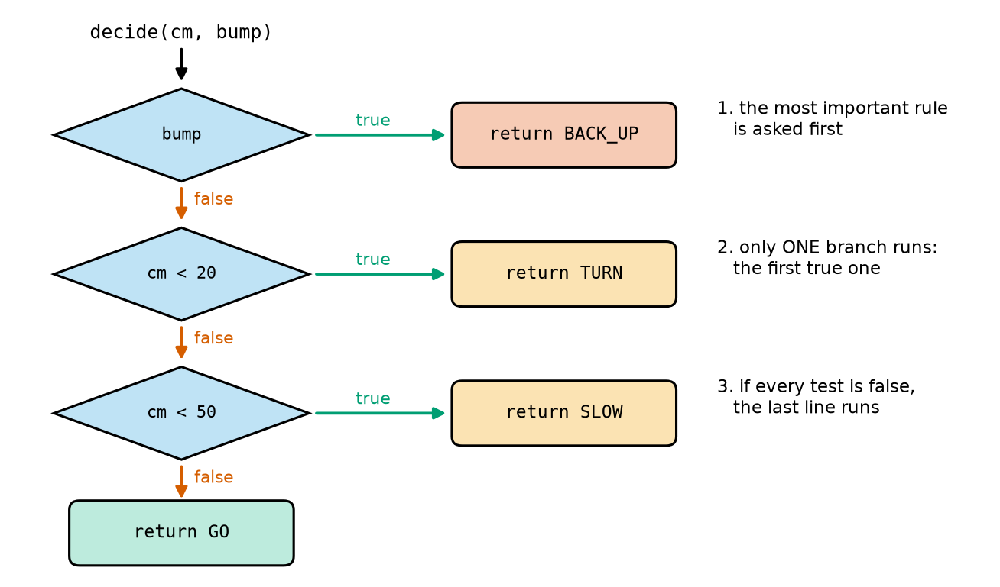
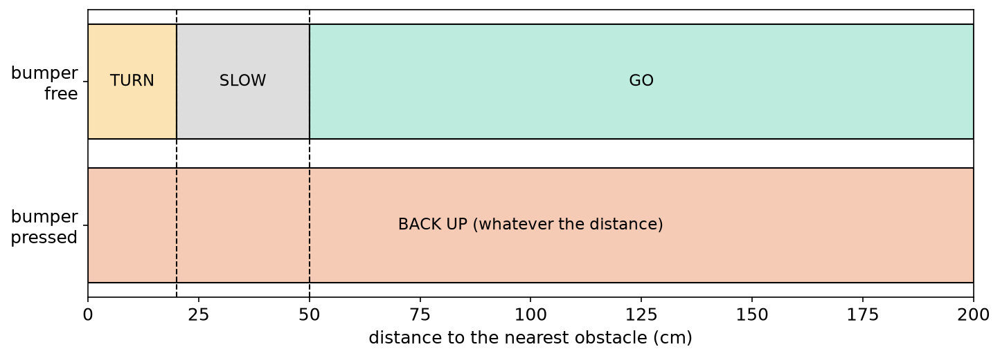
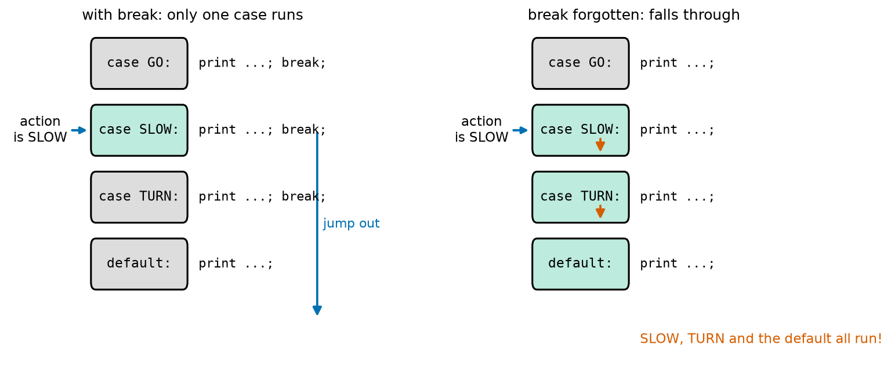
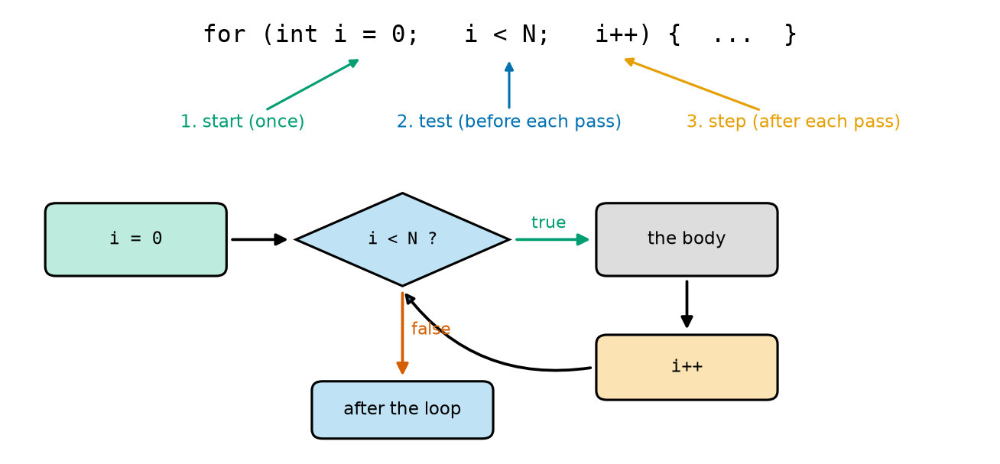
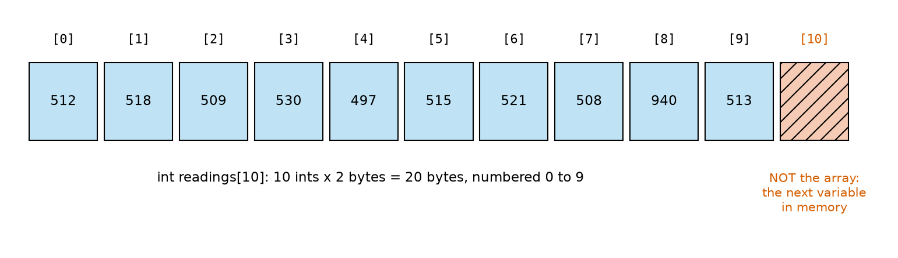
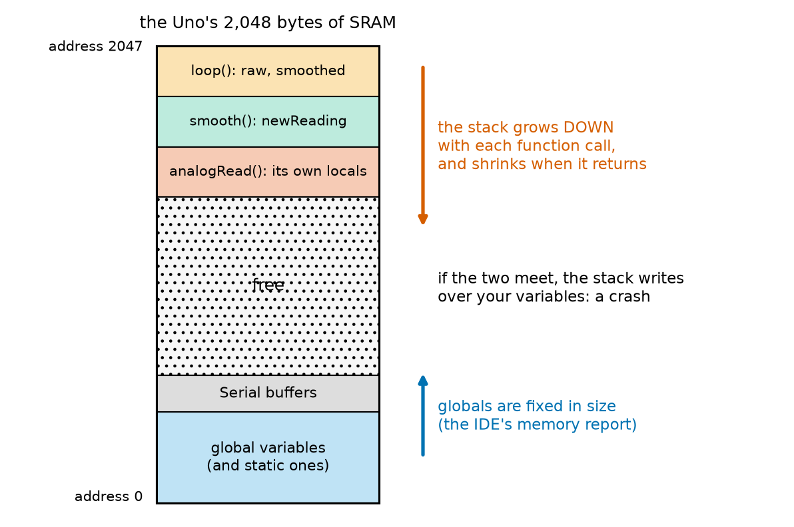
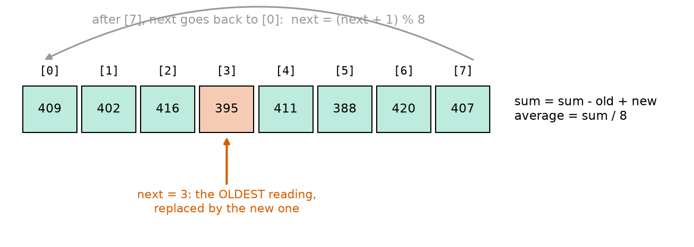
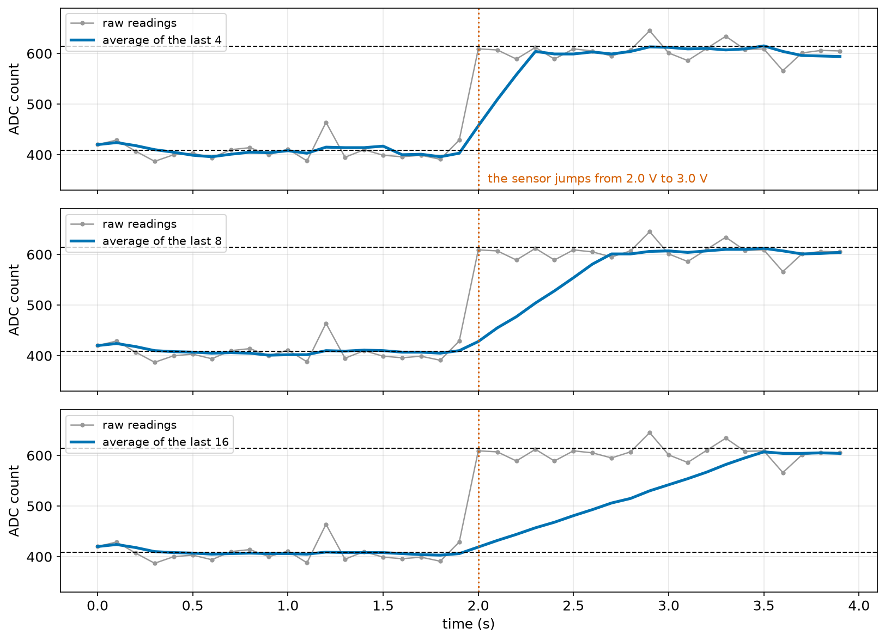

# Chapter 97 — C++ for Arduino, Part 2: `if`, Loops, Functions, Arrays

> **Part 6 · Chapter 97 of 749**
> **You need:** Chapter 17 (booleans), Chapter 18 (`if`), Chapter 19 (`while`), Chapter 20 (`for`), Chapter 21 (lists), Chapters 23–24 (functions), Chapter 31 (noise and averaging), Chapter 94 (SRAM and the stack) and Chapter 96 (C++ types, global and local variables).
> **You will make:** Rover's first decision function, a sketch that finds the sum, average and largest of an array of readings, a moving average that smooths a noisy sensor, and a "wait for the start button, but never for ever" function.

---

## What you will learn

- How to make decisions with **`if`**, **`else if`** and **`else`**, and how to combine tests with **`&&`**, **`||`** and **`!`**.
- How to choose between many cases with **`switch`**, and why every case needs a **`break`**.
- How to repeat with **`while`**, **`do … while`** and **`for`**, and how to leave a loop with **`break`** and **`continue`**.
- How to write your own **functions**: return types, parameters and `return`.
- How to keep many values in an **array**, and why C++ never checks that you stay inside it.
- What **`static`** does to a local variable, and how the **stack** holds every function's variables.

---

## New words in this chapter

| Word | Simple meaning |
|---|---|
| **condition** | A test that is either true or false, such as `cm < 20`. |
| **branch** | One of the paths an `if` can take. |
| **switch** | A statement that jumps to the `case` matching a value. |
| **fall through** | Running on into the next `case` because `break` is missing. |
| **loop body** | The statements a loop repeats. |
| **parameter** | A variable in a function's definition that receives a value when the function is called. |
| **argument** | The value you pass to a function when you call it. |
| **return type** | The type of the value a function gives back (`void` if none). |
| **array** | A fixed number of values of one type, stored side by side and numbered from 0. |
| **index** | The number of one element of an array: `readings[3]`. |
| **out of bounds** | Using an index that is not inside the array. |
| **static** | A local variable that is made only once and keeps its value between calls. |
| **stack** | The part of SRAM where function calls keep their local variables while they run. |
| **moving average** | The average of only the last few readings, updated with each new one. |
| **timeout** | A limit on how long a program will wait for something. |

---

## 97.1 Decisions: `if`, `else if`, `else`

You met decisions in Chapter 18. The C++ version has the same idea and almost the same words; only the punctuation changes.

| Python | C++ |
|---|---|
| `if cm < 20:` | `if (cm < 20) {` |
| `elif cm < 50:` | `} else if (cm < 50) {` |
| `else:` | `} else {` |
| (indented block) | (statements between `{` and `}`) |

📖 **New word: condition** — the test in the brackets after `if`. It must be true or false. The comparison operators are the same as Python's: `==` (equal), `!=` (not equal), `<`, `>`, `<=`, `>=`.

Here is the heart of Rover's first decision function (the whole sketch is in the Code section):

```cpp
int decide(int cm, bool bump) {
  if (bump) {
    return BACK_UP;
  } else if (cm < 20) {
    return TURN;
  } else if (cm < 50) {
    return SLOW;
  }
  return GO;
}
```



*Figure 97.1 — How `decide()` chooses an action: the conditions are asked from top to bottom.*

**How to read this picture:** Start at the top with a distance and a bumper reading. Each blue diamond is one condition. If it is true (green arrow), that branch returns its action and the function ends. If it is false (red arrow), the next diamond is asked. If all three are false, the bottom line, `return GO`, runs. The notes on the right are the three rules of every `if` chain.

📖 **New word: branch** — one of the paths through an `if` chain. Only **one** branch runs: the first whose condition is true. That is why the **order** of the conditions matters. The bumper is checked first because touching something is the most urgent situation. If `cm < 50` came before `cm < 20`, a robot 12 cm from a wall would only slow down, because 12 < 50 is true and the chain would stop there. (Lab 97.1 shows this kind of bug.)



*Figure 97.2 — The action `decide()` chooses for every distance from 0 to 200 cm, with the bumper free (top) and pressed (bottom).*

**How to read this picture:** The horizontal axis is the distance to the obstacle. In the top row (bumper free), the action changes at the dashed lines: TURN below 20 cm, SLOW from 20 to just under 50 cm, GO from 50 cm on. In the bottom row (bumper pressed), the action is always BACK UP: the first rule wins whatever the distance. A map like this is a good way to check a decision function before it ever drives a motor.

⚠️ **Careful: `=` is not `==`.** `if (cm = 20)` does not compare: it **puts** 20 into `cm`, and since 20 is not zero, the condition is always true. The compiler accepts it (with a warning if warnings are on, Lab 96.1). Python would refuse this line; C++ does not. Read every `if` twice.

⚠️ **Careful: always use braces.** C++ lets you leave out `{ }` when a branch has one statement:

```cpp
if (bump)
  stopMotors();
  beep();          // looks like part of the if, but runs EVERY time
```

The indentation lies: only `stopMotors();` belongs to the `if`. Write the braces every time and this bug cannot happen.

---

## 97.2 Combining conditions: `&&`, `||`, `!`

Chapter 17 taught `and`, `or` and `not`. C++ writes them as symbols:

| Python | C++ | True when… |
|---|---|---|
| `a and b` | `a && b` | both are true |
| `a or b` | `a \|\| b` | at least one is true |
| `not a` | `!a` | `a` is false |

Small examples:

```cpp
if (cm >= 20 && cm < 50) { … }          // between 20 and 50
if (leftBump || rightBump) { … }         // either bumper
if (!batteryLow && cm > 30) { … }        // battery fine AND the way is clear
```

🔢 **Short-circuit.** Like Python, C++ stops checking as soon as the answer is known. In `a && b`, if `a` is false, `b` is never even looked at; in `a || b`, if `a` is true, `b` is skipped. This is useful for safety: `if (count > 0 && total / count > 500)` never divides by zero, because when `count` is 0 the division is skipped.

⚠️ **Careful: `&` and `|` (single) are different operators.** They work on the individual bits of numbers (Chapter 105 uses them). `if (a & b)` compiles, but it does not mean "a and b". Use the doubled `&&` and `||` for conditions.

⚠️ **Careful: `20 < cm < 50` does not work in C++.** Python allows it; C++ reads it as `(20 < cm) < 50`, which is `true < 50` or `false < 50` — always true. Write `cm > 20 && cm < 50`.

---

## 97.3 Many cases: `switch`

When a variable can have one of several known values, a `switch` is clearer than a long `if` chain. Rover prints each action's name with one:

```cpp
switch (action) {
  case GO:
    Serial.println("GO: full speed");
    break;
  case SLOW:
    Serial.println("SLOW: half speed");
    break;
  default:
    Serial.println("unknown action");
}
```

📖 **New word: switch** — a statement that compares a whole number (or a `char`) with each `case` and **jumps** to the one that matches. If none matches, it jumps to `default:`. The case values must be fixed numbers or constants, not variables.

📖 **New word: fall through** — what happens when a case has no `break`: after its statements, the program simply **carries on** into the next case's statements, and the next, until it meets a `break` or the end of the `switch`.



*Figure 97.3 — The same `switch` with `action` equal to SLOW. Left: every case ends with `break`. Right: the `break`s were forgotten.*

**How to read this picture:** The blue arrow on each side shows where the `switch` jumps: to `case SLOW:`. The green boxes are the cases whose statements run. On the left, `break` jumps straight out (the long blue arrow), so only SLOW's line runs. On the right, with no `break`, the program falls through the orange arrows into TURN and then the default: three lines are printed instead of one.

🧠 **End every `case` with `break;`.** (Falling through is occasionally done on purpose, to let two cases share code. If you ever do it, write a comment saying so.)

---

## 97.4 Repeating: `while` and `do … while`

```cpp
while (condition) {
  // the loop body: repeated while the condition is true
}
```

📖 **New word: loop body** — the statements between the braces that a loop repeats. A `while` loop asks its condition **before** each pass. If it is false the first time, the body never runs.

A `do … while` loop asks **after** each pass, so its body always runs at least once:

```cpp
do {
  reading = analogRead(A0);
} while (reading > 1000);     // read again while the reading looks like a glitch
```

(Note the `;` after the `while (…)` here: a `do … while` is the one loop that needs it.)

`break` leaves a loop at once; `continue` skips the rest of this pass and goes on with the next one. Both work in all C++ loops, as in Python (Chapter 19).

⚠️ **Careful: a `while` loop inside `loop()` stops everything else.** While it waits, the Arduino does nothing but ask its condition: no other sensor is read, no motor is updated, no message is printed. A `while (digitalRead(BUTTON) == HIGH) { }` that waits for a button will wait **for ever** if the button is broken. Every waiting loop in a robot needs a way out: a **timeout** (Application 2), and later, a better design that never waits at all (Chapter 103).

---

## 97.5 Counting: `for`

A C++ `for` loop puts three things in its brackets, separated by `;`:

```cpp
for (int i = 0; i < N; i++) {
  // the body
}
```



*Figure 97.4 — What happens in what order in a `for` loop.*

**How to read this picture:** The top line is the loop, with its three parts. Below, follow the arrows: the **start** `i = 0` runs once. Then the **test** `i < N` is asked; if it is true, the body runs, then the **step** `i++` (add 1 to `i`), and the curved arrow goes back to the test. When the test is false, the loop ends. So the body runs with i = 0, 1, …, N − 1: exactly N times.

This is the same as Python's `for i in range(N):`. To count down, change the three parts: `for (int i = 9; i >= 0; i--)`. To count in steps of 5: `i = i + 5` (or `i += 5`) as the step.

🔢 **`++` and `--`.** `i++` adds 1 to `i`; `i--` subtracts 1. `x += 5` adds 5 (the same as `x = x + 5`), and `-=`, `*=`, `/=` work the same way. These short forms are used everywhere in Arduino code.

⚠️ **Careful: choose the counter's type.** On the Uno, `for (int i = 0; i < 40000; i++)` never ends: `i` can never reach 40,000, because it overflows at 32,767 and goes negative (Chapter 96). Use a `long` for big counts.

---

## 97.6 Your own functions

You wrote functions in Python (Chapters 23 and 24). In C++, a function's first line says three things: what it **gives back**, its **name**, and what it **takes**.

```cpp
long total(int values[], int n) {
  long sum = 0;
  for (int i = 0; i < n; i++) {
    sum = sum + values[i];
  }
  return sum;
}
```

📖 **New word: return type** — the type before the name: `long` here, because the sum of many readings can pass 32,767. A function that gives nothing back has the return type `void` (like `setup` and `loop`). A function with any other return type **must** end with `return` and a value of that type.

📖 **New word: parameter** — a variable in the function's brackets, with its type: `int cm`, `bool bump`. Each one is a **local** variable of the function (Chapter 96) that is filled in when the function is called.

📖 **New word: argument** — the value you give when you call the function: in `decide(45, false)`, 45 and `false` are the arguments. They are **copied** into the parameters. If the function changes `cm`, the caller's variable does not change. (Arrays are the exception: section 97.7.)

You can call a function inside an expression, or pass one function's result straight into another, as Rover's sketch does:

```cpp
printAction(decide(distances[i], bumped[i]));
```

First `decide(…)` runs and returns a number; then that number is passed to `printAction`.

💡 **Tip: write a function above the place where you first use it.** C++ reads a file from top to bottom, and normally a function must be known before it is called. The Arduino IDE quietly adds the missing declarations to every sketch for you (Chapter 95's "add prototypes" step), so sketches usually compile in any order. But code outside a sketch (a library, Chapter 110, or our PC test bench) does not get this help. Putting helper functions above `setup()` works everywhere, so all sketches in this course do it.

🧠 **A good function does one job, has a name that says what the job is, and is short enough to see at once.** `decide()` decides; `printAction()` prints. Neither knows about the other, so each is easy to test and to change.

---

## 97.7 Arrays: many values under one name

📖 **New word: array** — a fixed number of values of one type, stored side by side in memory, under one name. It is C++'s version of a Python list, with two big differences: its **size is fixed** when it is made, and all its values have the **same type**.

```cpp
const int N = 10;
int readings[N] = {512, 518, 509, 530, 497, 515, 521, 508, 940, 513};
```

📖 **New word: index** — the number of one element. As in Python, indexes start at **0**: `readings[0]` is 512, the first; `readings[9]` is 513, the last. An array of N elements has indexes 0 to N − 1.



*Figure 97.5 — `int readings[10]` in the Uno's SRAM: ten 2-byte ints side by side, and what lies just past the end.*

**How to read this picture:** Each blue box is one element, with its index above it. They sit next to each other in memory: 10 ints × 2 bytes = 20 bytes (the sketch's `sizeof(readings)` prints exactly 20). The striped red box after `[9]` is **not** part of the array: it is whatever variable the compiler put next in memory.

📖 **New word: out of bounds** — using an index outside 0 to N − 1. Python stops with `IndexError`. **C++ does not check.** `readings[10] = 0;` simply writes 0 into the memory just after the array, which belongs to some other variable. That variable changes "by itself", and the bug shows up far from the line that caused it. On a robot, it might be the motor speed or a timer.

🧠 **In C++, you must keep every index inside the array yourself.** Always use the size constant in loops: `for (int i = 0; i < N; i++)`, never `i <= N`.

Arrays have no `len()`. Keep the size in a constant, as above. (You may see `sizeof(readings) / sizeof(readings[0])`: the array's bytes divided by one element's bytes, 20 ÷ 2 = 10.)

**Passing an array to a function.** Write the parameter with empty brackets, and pass the size as a separate parameter, because the function cannot find it out by itself:

```cpp
int largest(int values[], int n) { … }
…
largest(readings, N)
```

Unlike other parameters, an array is **not** copied: the function works on the caller's own array. (Copying ten ints would waste time and SRAM.) So a function **can** change the elements of an array you pass it. If it should not, write `const int values[]`, and the compiler will stop any change.

---

## 97.8 `static`, and where local variables live

📖 **New word: stack** — the part of SRAM where running functions keep their local variables (Chapter 94). When a function is called, a block of stack memory is set aside for its parameters, its local variables and the address to go back to when it finishes. When it returns, that block is freed for the next call.



*Figure 97.6 — How the Uno's 2,048 bytes of SRAM are used while `loop()` calls `smooth()`, which is running while `analogRead()` runs.*

**How to read this picture:** The tall box is the whole SRAM, address 0 at the bottom and 2,047 at the top. Globals, `static` variables and the Serial buffers sit at the bottom, in a fixed space (the IDE's memory report counts them). The stack starts at the top and grows **down**: `loop()`'s locals first, then each called function's block below the one that called it. When a function returns, its block disappears. The dotted space between is free. If the stack ever grows down into the globals, it overwrites them, and the program crashes or behaves strangely.

This is why Chapter 94's memory budget kept 300 bytes free "for the stack". Two habits keep the stack small:

- Do not make big arrays **local**. `int samples[500];` inside a function takes 1,000 bytes of stack every time the function runs. Make big arrays global (they then appear in the memory report, so you can see them).
- Do not let a function call itself (**recursion**) many times. Each call adds another block. Python stops at about 1,000 calls with an error; the Uno has no such guard and runs out of memory long before.

📖 **New word: static** — a word you put before a **local** variable to make it live as long as a global: it is made and set to its start value only **once**, the first time, and it keeps its value between calls. But, unlike a global, only its own function can see it. It lives with the globals, not on the stack.

```cpp
int countCalls() {
  static int calls = 0;     // made once; NOT reset to 0 on each call
  calls++;
  return calls;             // 1, then 2, then 3, ...
}
```

Compare Chapter 96's `counter.ino`, where `int localCount = 0;` inside `loop()` was reset on every pass. With `static int localCount = 0;` it would count 1, 2, 3, 4 like the global. Application 1 uses `static` to give a function its own memory of past readings, without any globals.

---

## Code

All outputs come from the PC test bench with the Uno's 16-bit `int` (Chapter 96).

File `code/ch097/rover_decide/rover_decide.ino`:

```cpp
// rover_decide.ino - Rover's first decisions: what to do for each distance and bumper reading
const int GO = 0;                      // the four actions, as numbers with names
const int SLOW = 1;
const int TURN = 2;
const int BACK_UP = 3;

const int N = 7;                       // seven test situations
int distances[N] = {150, 80, 45, 25, 12, 60, 30};             // distance to the nearest obstacle, cm
bool bumped[N] = {false, false, false, false, false, true, false};

int decide(int cm, bool bump) {
  if (bump) {
    return BACK_UP;                    // touching something: the most important rule comes first
  } else if (cm < 20) {
    return TURN;                       // very close: turn away
  } else if (cm < 50) {
    return SLOW;                       // close: slow down
  }
  return GO;                           // nothing near
}

void printAction(int action) {
  switch (action) {
    case GO:
      Serial.println("GO: full speed");
      break;
    case SLOW:
      Serial.println("SLOW: half speed");
      break;
    case TURN:
      Serial.println("TURN: spin left");
      break;
    case BACK_UP:
      Serial.println("BACK UP: reverse for 0.5 s");
      break;
    default:
      Serial.println("unknown action");
  }
}

void setup() {
  Serial.begin(9600);
  for (int i = 0; i < N; i++) {
    Serial.print("distance ");
    Serial.print(distances[i]);
    Serial.print(" cm, bumper ");
    if (bumped[i]) {
      Serial.print("pressed");
    } else {
      Serial.print("free   ");
    }
    Serial.print(" -> ");
    printAction(decide(distances[i], bumped[i]));
  }
}

void loop() {
}
```

| Line | Code | What it does (simple English) |
|---|---|---|
| 1 | `// rover_decide.ino - …` | A comment. |
| 2–5 | `const int GO = 0;` … `const int BACK_UP = 3;` | Give each action a number and a name. The rest of the sketch uses the names, so it reads like English. |
| 6 | (blank) | Spacing. |
| 7 | `const int N = 7;` | The number of test situations. |
| 8 | `int distances[N] = {…};` | An array of 7 distances in centimetres. The `{ }` list fills it, element 0 first. |
| 9 | `bool bumped[N] = {…};` | An array of 7 bumper readings, in the same order: situation 5 has the bumper pressed. |
| 10 | (blank) | Spacing. |
| 11 | `int decide(int cm, bool bump) {` | A function that takes a distance and a bumper state, and returns an action (an `int`). |
| 12–13 | `if (bump) { return BACK_UP; }` | First rule: touching something. `return` ends the function at once. |
| 14–15 | `} else if (cm < 20) { return TURN;` | Second rule, asked only if the first was false. |
| 16–17 | `} else if (cm < 50) { return SLOW;` | Third rule. |
| 18 | `}` | End of the `if` chain. |
| 19 | `return GO;` | Reached only if all three conditions were false. |
| 20 | `}` | End of `decide`. |
| 21 | (blank) | Spacing. |
| 22 | `void printAction(int action) {` | A function that prints an action's name; it returns nothing. |
| 23 | `switch (action) {` | Jump to the `case` that matches `action`. |
| 24–26 | `case GO: Serial.println(…); break;` | If the action is GO, print its line, then leave the `switch`. |
| 27–35 | the same for SLOW, TURN and BACK_UP | One case per action, each ending with `break`. |
| 36–37 | `default: Serial.println("unknown action");` | Any other number: should never happen, but it is good to know if it does. |
| 38 | `}` | End of the `switch`. |
| 39 | `}` | End of `printAction`. |
| 40 | (blank) | Spacing. |
| 41–42 | `void setup() {`, `Serial.begin(9600);` | Start. |
| 43 | `for (int i = 0; i < N; i++) {` | Go through the situations: i = 0 to 6. |
| 44–46 | `Serial.print("distance "); …` | Print the distance from the array. |
| 47–51 | `if (bumped[i]) { … } else { … }` | Print "pressed" or "free" (with spaces so the columns line up). |
| 52 | `Serial.print(" -> ");` | An arrow. |
| 53 | `printAction(decide(distances[i], bumped[i]));` | Decide, then print the decision. |
| 54 | `}` | End of the `for`. |
| 55 | `}` | End of `setup`. |
| 56–58 | `void loop() { }` | Nothing to repeat. |

Output:

```
distance 150 cm, bumper free    -> GO: full speed
distance 80 cm, bumper free    -> GO: full speed
distance 45 cm, bumper free    -> SLOW: half speed
distance 25 cm, bumper free    -> SLOW: half speed
distance 12 cm, bumper free    -> TURN: spin left
distance 60 cm, bumper pressed -> BACK UP: reverse for 0.5 s
distance 30 cm, bumper free    -> SLOW: half speed
```

Every line matches Figure 97.2. The sixth shows the order of the rules at work: at 60 cm the distance alone would say GO, but the bumper rule comes first.

File `code/ch097/sensor_stats/sensor_stats.ino`:

```cpp
// sensor_stats.ino - an array of readings, and functions that work on it
const int N = 10;
int readings[N] = {512, 518, 509, 530, 497, 515, 521, 508, 940, 513};   // one reading is a glitch

long total(int values[], int n) {
  long sum = 0;                        // a long: ten readings of up to 1023 can pass 32,767
  for (int i = 0; i < n; i++) {
    sum = sum + values[i];
  }
  return sum;
}

int largest(int values[], int n) {
  int best = values[0];                // start with the first one
  for (int i = 1; i < n; i++) {
    if (values[i] > best) {
      best = values[i];                // found a bigger one
    }
  }
  return best;
}

void setup() {
  Serial.begin(9600);
  Serial.print("bytes in the array: ");
  Serial.println(sizeof(readings));
  Serial.print("first: ");
  Serial.print(readings[0]);
  Serial.print("   last: ");
  Serial.println(readings[N - 1]);
  Serial.print("sum: ");
  Serial.print(total(readings, N));
  Serial.print("   average: ");
  Serial.print((float)total(readings, N) / N);
  Serial.print("   largest: ");
  Serial.println(largest(readings, N));

  long sum = 0;                        // the average again, without the glitch
  int used = 0;
  for (int i = 0; i < N; i++) {
    if (readings[i] > 900) {
      continue;                        // skip this one and go on with the next i
    }
    sum = sum + readings[i];
    used++;
  }
  Serial.print("without readings over 900: ");
  Serial.print(used);
  Serial.print(" readings, average ");
  Serial.println((float)sum / used);
}

void loop() {
}
```

| Line | Code | What it does (simple English) |
|---|---|---|
| 1 | `// sensor_stats.ino - …` | A comment. |
| 2 | `const int N = 10;` | The array's size, as a constant. |
| 3 | `int readings[N] = {…};` | Ten ADC readings; the ninth (940) is a glitch. |
| 4 | (blank) | Spacing. |
| 5 | `long total(int values[], int n) {` | A function that adds up an array. It receives the array and its size. |
| 6 | `long sum = 0;` | A `long`, because 10 × 1,023 = 10,230 is fine, but 40 readings could pass 32,767. |
| 7–9 | `for (…) { sum = sum + values[i]; }` | Add each element. |
| 10 | `return sum;` | Give back the total. |
| 11 | `}` | End of `total`. |
| 12 | (blank) | Spacing. |
| 13 | `int largest(int values[], int n) {` | A function that finds the biggest element. |
| 14 | `int best = values[0];` | Start with the first element as "the biggest so far". |
| 15 | `for (int i = 1; i < n; i++) {` | Look at the rest, from index 1. |
| 16–18 | `if (values[i] > best) { best = values[i]; }` | A bigger one replaces the best so far. |
| 19 | `}` | End of the `for`. |
| 20 | `return best;` | Give back the biggest. |
| 21 | `}` | End of `largest`. |
| 22 | (blank) | Spacing. |
| 23–24 | `void setup() {`, `Serial.begin(9600);` | Start. |
| 25–26 | `Serial.print(…); Serial.println(sizeof(readings));` | The array's size in bytes: 10 × 2 = 20. |
| 27–30 | `readings[0]` … `readings[N - 1]` | The first and last elements. The last index is N − 1 = 9, not N. |
| 31–32 | `Serial.print(total(readings, N));` | The sum. |
| 33–34 | `Serial.print((float)total(readings, N) / N);` | The average. The cast makes it a float division (Chapter 96). |
| 35–36 | `Serial.println(largest(readings, N));` | The largest. |
| 37 | (blank) | Spacing. |
| 38–39 | `long sum = 0;`, `int used = 0;` | A new sum, and how many readings went into it. |
| 40 | `for (int i = 0; i < N; i++) {` | Go through all readings again. |
| 41–43 | `if (readings[i] > 900) { continue; }` | A glitch: skip the rest of this pass, so it is not added. |
| 44–45 | `sum = sum + readings[i];`, `used++;` | Add a good reading, and count it. |
| 46 | `}` | End of the `for`. |
| 47–50 | `Serial.print(…)…` | How many readings were used, and their average. |
| 51 | `}` | End of `setup`. |
| 52–54 | `void loop() { }` | Nothing to repeat. |

Output:

```
bytes in the array: 20
first: 512   last: 513
sum: 5563   average: 556.30   largest: 940
without readings over 900: 9 readings, average 513.67
```

One glitch moved the average from about 514 to 556: a 42-count error from one bad reading in ten. Skipping readings that cannot be true (a sensor that never reads above 900 when it is working) is the simplest defence. Chapter 114 looks at better ones, such as the median.

---

## Small examples

**Example 1.** `if (x > 10 && x < 20)` is true for x = 15, false for x = 25 and false for x = 5.

**Example 2.** `if (!done)` is the same as `if (done == false)`.

**Example 3.** `for (int i = 0; i < 5; i++)` runs 5 times, with i = 0, 1, 2, 3, 4. After it, `i` no longer exists (it was declared in the loop).

**Example 4.** `for (int i = 10; i > 0; i -= 2)` runs with i = 10, 8, 6, 4, 2: 5 times.

**Example 5.** `int speeds[4] = {0, 85, 170, 255};` — `speeds[3]` is 255; `speeds[4]` is out of bounds.

**Example 6.** `int a[5] = {1, 2};` makes a[0] = 1, a[1] = 2 and the other three 0.

**Example 7.**

```cpp
float average(int a, int b) {
  return (a + b) / 2.0;          // 2.0, so the division keeps decimals
}
```

`average(3, 4)` returns 3.5.

**Example 8.** A function `void stopMotors()` takes nothing and gives nothing back; it is called as `stopMotors();` with empty brackets. Forgetting the brackets (`stopMotors;`) compiles but does nothing.

---

## 🏭 Real robot applications

### Application 1 (worked in full) — 🤖 Smoothing Rover's noisy distance sensor with a moving average

**1. The real problem.** Rover's distance sensors are noisy (Chapter 31): an infrared distance sensor read through the ADC jumps by tens of counts from one reading to the next even when nothing moves. Rover's `decide()` compares the distance with 20 cm and 50 cm; a jumpy reading near 50 cm makes Rover flip between GO and SLOW many times a second. We want a steadier reading that still follows real changes quickly.

**2. Why this theory.** Chapter 31: averaging N readings with independent noise divides the noise by about √N. An **array** can hold the last N readings, and a **static** local variable lets a function keep them from one call to the next without any globals.

📖 **New word: moving average** — the average of only the **last N** readings. Each new reading pushes out the oldest one, so the average "moves" along with time.

**3. The numbers.** The sensor gives 2.0 V (ADC count 409), with noise of 0.1 V (about 20 counts, one standard deviation). At t = 2 s an obstacle comes closer and the voltage jumps to 3.0 V (count 614). Rover reads 10 times per second. Window N = 8.

**4. The maths.** Expected noise after averaging: 20 ÷ √8 = 20 ÷ 2.83 = **7.1 counts**. But averaging also slows the response: after a jump, the average needs N readings to fully catch up, because it still holds old readings: 8 readings at 10 per second = **0.8 s**.

The trick that makes it fast: do not add up all 8 readings every time. Keep a running **sum**. Each time, subtract the oldest reading and add the newest: one subtraction and one addition, whatever N is. The readings are kept in a **ring**: an array with a `next` index that goes 0, 1, …, 7, then back to 0.



*Figure 97.7 — The 8-element array `history` holding the last 8 readings, with `next` pointing at the oldest.*

**How to read this picture:** The green boxes are the last 8 readings. The red one, at index 3, is the **oldest**: `next` points at it, because it is the next to be replaced. A new reading goes into box 3, the sum loses the old value and gains the new one, and `next` moves to 4. The grey arc shows that after box 7, `next` wraps round to box 0: `(next + 1) % 8`.

**5. The code.** File `code/ch097/moving_average/moving_average.ino`:

```cpp
// moving_average.ino - smooth a noisy distance sensor by averaging its last 8 readings
const int SENSOR_PIN = A0;
const int WINDOW = 8;                  // how many readings to average

int smooth(int newReading) {
  static int history[WINDOW];          // static: kept from one call to the next; starts as all zeros
  static int next = 0;                 // where the next reading will go
  static int count = 0;                // how many readings we have so far (up to WINDOW)
  static long sum = 0;                 // the sum of the readings in history
  sum = sum - history[next] + newReading;   // take out the oldest reading, put in the newest
  history[next] = newReading;
  next = (next + 1) % WINDOW;          // go round the ring: 0, 1, ... 7, 0, 1, ...
  if (count < WINDOW) {
    count++;
  }
  return sum / count;
}

void setup() {
  Serial.begin(9600);
}

void loop() {
  int raw = analogRead(SENSOR_PIN);
  int smoothed = smooth(raw);
  Serial.print(raw);                   // two numbers on a line, for the Serial Plotter (Chapter 100)
  Serial.print(" ");
  Serial.println(smoothed);
  delay(100);                          // 10 readings per second
}
```

| Line | Code | What it does (simple English) |
|---|---|---|
| 1 | `// moving_average.ino - …` | A comment. |
| 2 | `const int SENSOR_PIN = A0;` | The sensor is on analog pin A0 (Chapter 101). |
| 3 | `const int WINDOW = 8;` | How many readings to average. |
| 4 | (blank) | Spacing. |
| 5 | `int smooth(int newReading) {` | Takes the newest reading, returns the smoothed value. |
| 6 | `static int history[WINDOW];` | The ring of the last 8 readings. `static`: made once, kept between calls. Static and global arrays start as all zeros. |
| 7 | `static int next = 0;` | The index of the oldest reading, which is the next to be replaced. |
| 8 | `static int count = 0;` | How many real readings we have, so the first averages are not pulled down by the starting zeros. |
| 9 | `static long sum = 0;` | The running sum. A `long`, because 8 × 1,023 = 8,184 fits in an int, but a larger window might not. |
| 10 | `sum = sum - history[next] + newReading;` | Remove the oldest reading from the sum and add the newest. (At the start the "oldest" is a zero, which removes nothing.) |
| 11 | `history[next] = newReading;` | Store the newest reading where the oldest was. |
| 12 | `next = (next + 1) % WINDOW;` | Move on by one, wrapping from 7 back to 0. |
| 13–15 | `if (count < WINDOW) { count++; }` | Count real readings until the ring is full. |
| 16 | `return sum / count;` | The average of the readings so far: integer division is fine here (we only need whole counts). |
| 17 | `}` | End of `smooth`. |
| 18 | (blank) | Spacing. |
| 19–21 | `void setup() { Serial.begin(9600); }` | Start. |
| 22 | (blank) | Spacing. |
| 23 | `void loop() {` | Every pass: one reading. |
| 24 | `int raw = analogRead(SENSOR_PIN);` | Read the sensor: 0 to 1,023 (Chapter 101). |
| 25 | `int smoothed = smooth(raw);` | Smooth it. |
| 26–28 | `Serial.print(raw); …` | Print both numbers on one line, separated by a space. |
| 29 | `delay(100);` | 10 readings per second. |
| 30 | `}` | End of `loop`. |

The test file `pc_tests/test_moving_average.cpp` connects a pretend sensor to A0: 2.0 V with 0.1 V of random noise, jumping to 3.0 V at t = 2 s. The first lines of the output:

```
420 420
429 424
407 418
387 410
400 408
403 407
394 405
410 406
```

and around the jump (the 20th reading is the last before it):

```
429 410
609 428
607 455
589 477
612 504
589 528
609 554
605 581
595 601
607 601
```

Running the same pretend sensor at a steady 2.0 V for 200 seconds on the bench and measuring the spread of the numbers (their standard deviation, Chapter 31) gives the real noise reduction, for three window sizes:

| Window N | Raw noise (counts) | Smoothed noise | Reduction | √N | Readings to catch up after the jump |
|---|---|---|---|---|---|
| 4 | 20.8 | 10.5 | 1.99× | 2.00 | 3 |
| 8 | 20.8 | 7.6 | 2.73× | 2.83 | 7 |
| 16 | 20.8 | 5.6 | 3.74× | 4.00 | 14 |



*Figure 97.8 — The raw readings (grey dots) and the moving average (blue) for windows of 4, 8 and 16, from the PC test bench. The dashed lines are the true values, 409 and 614.*

**How to read this picture:** Time runs left to right; the red dotted line is the moment the sensor jumps. Before it, the grey dots jump about by ±20 counts while the blue line stays much closer to 409; the wider the window, the flatter the blue line. After the jump, the grey dots are at 614 at once, but the blue line climbs as a ramp, because the window still holds old readings. With 4 readings it catches up in about 0.3 s; with 16, it takes about 1.4 s.

**6. The result.** The measured reductions (1.99, 2.73, 3.74) match √N (2.00, 2.83, 4.00) closely: the theory of Chapter 31 works on the real sketch. But each halving of the noise costs a doubling of the delay. For Rover at 0.3 m/s, a 0.7 s delay (N = 8) means the robot moves 0.3 × 0.7 = 0.21 m before the smoothed distance shows a new obstacle fully, so N = 8 is too slow for the 20 cm TURN rule; N = 4 (0.09 m) is a better choice there. For a slowly changing reading, such as the battery voltage, N = 16 or more is fine. **Smoothing is always a trade between noise and delay.**

**7. Going further.** A moving average treats the last N readings equally and forgets everything older. A popular alternative keeps no array at all: the **exponential filter** `smoothed = smoothed + 0.2 × (raw − smoothed)` (Chapter 114), which weights recent readings most. Real robots also reject impossible readings first (as `sensor_stats.ino` did), use the **median** of a few readings against single glitches, and later use the Kalman filter (Chapters 416–419), which knows how fast the robot is moving and so does not lag behind it.

### Application 2 (worked in full) — 🤖 Never wait for ever: a start button with a timeout

**1. The real problem.** Rover should wait at the start line until someone presses its start button. The simplest code is `while (digitalRead(BUTTON_PIN) == HIGH) { }`: wait while the button is not pressed. But if the button's wire comes loose, or no one is there, the robot waits **for ever**, doing nothing else at all, not even reporting that something is wrong. A robot must never be stuck in a loop that might not end.

**2. Why this theory.** Section 97.4: a `while` loop blocks everything else until its condition is false. A **timeout** adds a second way out.

📖 **New word: timeout** — a limit on how long a program will wait. When the time is up, it stops waiting and does something sensible instead: tries again, reports an error, or goes to a safe state.

**3. The numbers.** The button is on pin 2, with the Uno's internal pull-up resistor (Chapter 83: the pin reads HIGH when the button is not pressed and LOW when it is; Chapter 99 explains `INPUT_PULLUP`). Timeout: 3,000 ms. Times from `millis()` are `unsigned long` (Chapter 96).

**4. The maths.** The loop measures how long it has waited as `millis() - start`, and gives up when that reaches 3,000. Each pass of the loop takes a few microseconds (a `digitalRead` and a `millis()`), so the timeout is accurate to well under 1 ms.

**5. The code.** File `code/ch097/wait_timeout/wait_timeout.ino`:

```cpp
// wait_timeout.ino - wait for the start button, but never for ever
const int BUTTON_PIN = 2;
const unsigned long TIMEOUT_MS = 3000;

bool waitForButton(unsigned long timeoutMs) {
  unsigned long start = millis();
  while (digitalRead(BUTTON_PIN) == HIGH) {      // HIGH = not pressed (a pull-up, Chapter 83)
    if (millis() - start >= timeoutMs) {
      return false;                              // waited long enough: give up
    }
  }
  return true;                                   // the button was pressed
}

void setup() {
  Serial.begin(9600);
  pinMode(BUTTON_PIN, INPUT_PULLUP);
  Serial.println("press the start button within 3 seconds");
  if (waitForButton(TIMEOUT_MS)) {
    Serial.print("started at ");
    Serial.print(millis());
    Serial.println(" ms");
  } else {
    Serial.println("no button: staying parked");
  }
}

void loop() {
}
```

| Line | Code | What it does (simple English) |
|---|---|---|
| 1 | `// wait_timeout.ino - …` | A comment. |
| 2 | `const int BUTTON_PIN = 2;` | The button's pin. |
| 3 | `const unsigned long TIMEOUT_MS = 3000;` | The timeout, in the same type as `millis()`. |
| 4 | (blank) | Spacing. |
| 5 | `bool waitForButton(unsigned long timeoutMs) {` | A function that waits, and **returns** whether the button was pressed: `true` or `false`. |
| 6 | `unsigned long start = millis();` | Remember when we started waiting. |
| 7 | `while (digitalRead(BUTTON_PIN) == HIGH) {` | Keep looping while the button is not pressed. |
| 8 | `if (millis() - start >= timeoutMs) {` | Has the timeout passed? |
| 9 | `return false;` | Yes: leave the function, and the loop, at once, with the answer "not pressed". |
| 10 | `}` | End of the `if`. |
| 11 | `}` | End of the `while`. We get here only when the pin went LOW. |
| 12 | `return true;` | The button was pressed. |
| 13 | `}` | End of `waitForButton`. |
| 14 | (blank) | Spacing. |
| 15–16 | `void setup() {`, `Serial.begin(9600);` | Start. |
| 17 | `pinMode(BUTTON_PIN, INPUT_PULLUP);` | Make pin 2 an input with its pull-up resistor on (Chapter 99). |
| 18 | `Serial.println(…);` | Tell the user what to do. |
| 19 | `if (waitForButton(TIMEOUT_MS)) {` | Wait; the `if` uses the returned `true` or `false`. |
| 20–22 | `Serial.print("started at "); …` | Pressed: report when. |
| 23–25 | `} else { Serial.println(…); }` | Not pressed in time: stay in a safe state and say so. |
| 26 | `}` | End of `setup`. |
| 27–29 | `void loop() { }` | Nothing more in this demo. |

The test file runs it twice: once with the button pressed at 1.234 s, and once with nobody pressing it. Output, pressed:

```
press the start button within 3 seconds
started at 1234 ms
```

Output, never pressed:

```
press the start button within 3 seconds
no button: staying parked
```

**6. The result.** When the button is pressed, the function notices within microseconds (1,234 ms on the dot) and Rover starts. When it is not, the function gives up after 3 seconds and the sketch goes on in a known, safe state, with a message saying why. The same pattern (`start = millis()`, then "give up when `millis() - start` is too big") belongs around **every** wait in a robot: waiting for a sensor's answer, for an echo, for a message from the Raspberry Pi, for a motor to reach a position. The Arduino's own `pulseIn()`, which waits for the ultrasonic sensor's echo (Chapter 119), has a timeout parameter for exactly this reason.

**7. Going further.** A timeout makes a wait **safe**, but the robot still does nothing else while it waits. Chapter 103 removes the waiting loop completely: `loop()` checks the button once per pass and goes on with its other jobs, and Chapter 104 organises those jobs as a state machine with a "waiting at the start" state. Real robots also have a **watchdog** (Chapter 7, and Application 5 below): a hardware timer that resets the whole processor if the program ever stops checking in.

### Application 3 — 🤖 A line follower's decision table with `switch`

A line-following robot (Rover at stage 4, Chapter 294) has three light sensors under its front: left, middle and right. Each says 1 (over the black line) or 0 (over the white floor). Combine the three into one number, `pattern = left * 4 + middle * 2 + right` (0 to 7, three bits, Chapter 91), and a `switch` becomes a complete decision table: `case 2:` (only the middle sees the line, 0-1-0) → go straight; `case 6:` (1-1-0) and `case 4:` (1-0-0) → steer left, more for 4; `case 3:` and `case 1:` → steer right; `case 7:` (all black) → a crossing: count it; `case 0:` (all white) → the line is lost: turn back the way it was last seen. Each of the 8 cases is one line of code that can be read, tested and changed on its own, and the `default:` catches impossible values. Industrial line-following carts in warehouses and factories use exactly this kind of table, with more sensors (8 or 16, as a byte or an `unsigned int`) and a PID controller (Chapter 216) for smooth steering.

### Application 4 — 🏭 Checking a robot arm's joint limits with an array

A six-joint factory arm (like Six, Chapter 370) has a minimum and maximum angle for every joint: past them, it would hit itself or tear its cables. The controller keeps the limits in two arrays, `int lowLimit[6]` and `int highLimit[6]`, the commanded angles in a third, and before every move it runs one loop: `for (int j = 0; j < 6; j++) { if (angle[j] < lowLimit[j] || angle[j] > highLimit[j]) { refuse = true; } }`. One loop protects all six joints, and adding a seventh joint is a change of one constant. Real arm controllers do this check thousands of times per second on the planned path, not only the target, and also limit speeds and torques the same way; it is one of the safety functions that standards for industrial robots require (Chapter 744). An off-by-one bug here (`j <= 6`) would read a "limit" from whatever memory lies after the array, which is exactly why section 97.7 insists on `j < N`.

### Application 5 — 🚀 Mars Pathfinder and the watchdog that saved it

In July 1997, a few days after landing on Mars, NASA's Pathfinder lander began resetting itself again and again, losing data each time. Its software watched itself with a **watchdog**: a check that one important job had finished in time, and a reset of the whole computer if it had not. The cause turned out to be a subtle timing problem between tasks of different priority, called priority inversion (Chapter 529): a high-priority job was stuck waiting for something held by a low-priority one. Engineers on Earth reproduced the fault on a copy of the hardware, found it in the logs, and sent a one-line change to the spacecraft that switched on an existing fix. The watchdog did exactly what Application 2's timeout does at a larger scale: it refused to let the system wait for ever, and put it back into a known state each time, which kept the mission alive until the bug was found.

---

## 🔧 Hands-on lab

### Lab 97.1 — Add a STOP rule, and see why order matters (simulation or hardware)

Copy `rover_decide.ino`.

1. Add a fifth action: `const int STOP = 4;` under the others, and a case for it in `printAction` (before `default:`) that prints `STOP: too close to turn`.
2. Change the last distance in the array from 30 to 6.
3. Add the rule `} else if (cm < 8) { return STOP;` **after** the `cm < 20` rule (between it and `cm < 50`). Run it.
4. Now move the rule so it comes **before** `cm < 20`. Run it again.

**What you should see:** In step 3 the last line is

```
distance 6 cm, bumper free    -> TURN: spin left
```

The STOP rule never runs: 6 < 20 is true, so the TURN branch wins and the chain stops there. In step 4:

```
distance 6 cm, bumper free    -> STOP: too close to turn
```

A rule that is "inside" another rule (every distance under 8 is also under 20) must come **first**. The compiler cannot catch this; only testing can.

| If it does not work | Likely cause | Fix |
|---|---|---|
| `'STOP' was not declared in this scope` | The constant is below the functions that use it | Put `const int STOP = 4;` with the other constants at the top |
| It prints `unknown action` | No `case STOP:` in the `switch` | Add the case, with its `break;` |
| Two lines printed for one situation | A missing `break` (fall-through) | Every case ends with `break;` |

**Challenge:** Make the SLOW rule also depend on the battery: add a `bool batteryLow` parameter, and SLOW (instead of GO) whenever the battery is low and the way is clear. Which operator do you need?

### Lab 97.2 — Choose the smoothing window (simulation)

1. Run `moving_average.ino` in Wokwi with a potentiometer on A0 (middle pin to A0, the outer pins to 5V and GND), and open the **Serial Plotter** instead of the Serial Monitor. Turn the potentiometer quickly. (On the PC test bench: `python ../common/arduino_sim/simrun.py pc_tests/test_moving_average.cpp`.)
2. Change `WINDOW` to 4, then to 16, and repeat.
3. Using the table in Application 1, choose a window for (a) Rover's front distance sensor at 0.3 m/s, (b) the battery voltage, read once per second.

**What you should see:** Two lines in the plotter: the raw reading and the smoothed one. When you turn the knob quickly, the smoothed line follows as a ramp lasting about N readings: short for 4, long for 16. A Wokwi potentiometer is not noisy, so the noise reduction is easier to see on the bench, where the numbers match Application 1's table. For (a), N = 4 (about 0.3 s delay at 10 readings per second); for (b), N = 16 or more (16 seconds of delay is no problem for a battery, which changes over minutes).

| If it does not work | Likely cause | Fix |
|---|---|---|
| The plotter shows one line only | Only one number per line, or a comma missing | Print `raw`, a space, then `smoothed` with `println` |
| The smoothed value starts near 0 and climbs | `count` is not used: dividing by `WINDOW` from the start | Keep the `count` lines (13–15) and divide by `count` |
| Values jump to strange negative numbers | `sum` is an `int` and overflowed with a big window | Keep `sum` a `long` |

**Challenge:** Change `smooth()` into an exponential filter with no array: `static float s = 0; s = s + 0.25 * (newReading - s); return s;`. Compare its noise and its delay with N = 8.

### Lab 97.3 — A start button with a timeout (Wokwi or hardware)

You need: a pushbutton (in Wokwi, the "pushbutton" part), two jumper wires.

1. Wire the button between pin 2 and GND. No resistor: `INPUT_PULLUP` turns on the chip's own (Chapter 83).
2. Upload `wait_timeout.ino`, open the Serial Monitor, and press the button within 3 seconds.
3. Press reset, and this time do not press the button.
4. Change `TIMEOUT_MS` to 10000 and try again. Then pull out the button's wire to pin 2 and reset: what happens?

**What you should see:** In step 2, `started at …` with the time you pressed, in milliseconds. In step 3, after 3 seconds, `no button: staying parked`. In step 4, the same after 10 seconds, and with the wire pulled out the pin floats high through the pull-up, so the sketch waits 10 s and parks: a broken wire is handled safely.

| If it does not work | Likely cause | Fix |
|---|---|---|
| It starts at once, without pressing | The button is wired between pin 2 and 5V, or is always pressed | Wire it between pin 2 and **GND** |
| Nothing happens when you press | The button's two legs used are always connected inside it | Use legs on opposite corners of the button |
| Always "no button" | The wire goes to a different pin | Check pin 2, or change `BUTTON_PIN` |

**Challenge:** Give the user three chances: wait 3 s, print "still waiting (2 tries left)", and so on, then park after the third. Use a `for` loop around the call to `waitForButton`.

---

## Common mistakes

⚠️ **`if (x = 5)` instead of `if (x == 5)`.** It assigns 5 and is always true.

⚠️ **Leaving out the braces.** Only the first statement belongs to the `if`; the indentation lies.

⚠️ **Writing `20 < x < 50`.** It is always true in C++. Write `x > 20 && x < 50`.

⚠️ **A `case` without `break`.** The program falls through into the next case.

⚠️ **Rules in the wrong order in an `if` chain.** The first true condition wins; put the most specific rules first.

⚠️ **`for (int i = 0; i <= N; i++)` over an array of N.** The last pass reads `a[N]`, which is out of bounds. Use `i < N`.

⚠️ **Writing past the end of an array.** C++ does not stop you; another variable is silently changed.

⚠️ **A `while` loop that waits with no timeout.** One broken wire and the robot is stuck for ever.

⚠️ **A function with a return type but no `return`.** The caller gets a random value. Turn on compiler warnings (Lab 96.1): they report it.

⚠️ **Big arrays as local variables.** They take stack space on every call. Make them global or `static`.

⚠️ **Forgetting that arrays passed to a function are not copied.** The function can change the caller's array.

---

## Practice

🏋️ **1.** Write an `if` that sets `speed` to 0 if `cm` is less than 10, to 128 if it is from 10 to 39, and to 255 otherwise.

🏋️ **2.** Which values of `cm` make `cm < 20 || cm > 100` true? And `!(cm < 20)`?

🏋️ **3.** Rewrite with `&&`: "the battery is not low, and the left bumper and the right bumper are both free".

🏋️ **4.** What does this print when `action` is 1, and why?

```cpp
switch (action) {
  case 1: Serial.println("one");
  case 2: Serial.println("two"); break;
  case 3: Serial.println("three");
}
```

🏋️ **5.** How many times does each loop run? (a) `for (int i = 0; i < 12; i++)` (b) `for (int i = 1; i <= 12; i++)` (c) `for (int i = 100; i > 0; i -= 25)` (d) `for (int i = 0; i < 40000; i++)` on an Uno.

🏋️ **6.** Write a function `int clampSpeed(int s)` that returns `s` limited to the range −255 to 255.

🏋️ **7.** `int a[5];` — which indexes are allowed? What happens with `a[5] = 9;`?

🏋️ **8.** What is the difference between `static int n = 0;` inside a function and `int n = 0;` inside the same function?

🏋️ **9.** A moving average of 10 readings is taken at 20 readings per second. Roughly how much is the noise reduced, and how long does it take to catch up after a sudden change?

🏋️ **10.** Why is `while (digitalRead(2) == HIGH) { }` dangerous on a robot? How do you make it safe?

🏋️ **11.** Add a function `int smallest(int values[], int n)` to `sensor_stats.ino`, and print its result after the largest. What does it print?

---

## Answers

**1.**

```cpp
if (cm < 10) {
  speed = 0;
} else if (cm < 40) {
  speed = 128;
} else {
  speed = 255;
}
```

The second test can be just `cm < 40`, because we only get there when `cm` is 10 or more.

**2.** `cm < 20 || cm > 100`: every value below 20 or above 100 (true for 5 and 150, false for 50). `!(cm < 20)`: every value of 20 or more.

**3.** `if (!batteryLow && !leftBump && !rightBump) { … }`

**4.** It prints `one` and then `two`. Case 1 has no `break`, so it falls through into case 2, whose `break` then stops it.

**5.** (a) 12 (i = 0 to 11). (b) 12 (i = 1 to 12). (c) 4 (100, 75, 50, 25). (d) for ever: `i` overflows from 32,767 to −32,768 and never reaches 40,000. Use `long i`.

**6.**

```cpp
int clampSpeed(int s) {
  if (s > 255) {
    return 255;
  } else if (s < -255) {
    return -255;
  }
  return s;
}
```

(Arduino also has `constrain(s, -255, 255)`, which does the same.)

**7.** 0 to 4. `a[5] = 9;` writes into the memory just after the array, changing some other variable, with no error.

**8.** The `static` one is made once and keeps its value between calls (1, 2, 3, … if you add 1 each time). The plain one is made again, with the value 0, on every call.

**9.** By about √10 ≈ 3.2 times. It needs about 10 readings to catch up: 10 ÷ 20 = 0.5 s.

**10.** If the button is broken or no one presses it, the loop never ends and the robot does nothing else, for ever. Add a timeout: remember `start = millis()` and leave the loop when `millis() - start` passes a limit (Application 2).

**11.**

```cpp
int smallest(int values[], int n) {
  int best = values[0];
  for (int i = 1; i < n; i++) {
    if (values[i] < best) {
      best = values[i];
    }
  }
  return best;
}
```

Put it above `setup()`, and after the line that prints the largest add:

```cpp
  Serial.print("smallest: ");
  Serial.println(smallest(readings, N));
```

Output (PC test bench):

```
bytes in the array: 20
first: 512   last: 513
sum: 5563   average: 556.30   largest: 940
smallest: 497
without readings over 900: 9 readings, average 513.67
```

It prints `smallest: 497`, the fifth reading.

---

## Summary

🧠 `if (…) { } else if (…) { } else { }` runs **only the first** true branch, so the most important or most specific rule goes first. Always use braces; never confuse `=` with `==`.

🧠 Combine conditions with **`&&`**, **`||`**, **`!`**. They short-circuit. Write ranges as `x > 20 && x < 50`.

🧠 **`switch`** jumps to the matching `case`; end every case with **`break`** or it **falls through**.

🧠 **`while`** asks first, **`do … while`** asks after, **`for (start; test; step)`** counts. Every wait needs a **timeout**; better still, do not wait at all (Chapter 103).

🧠 A **function** = return type + name + parameters. Arguments are **copied** into parameters; arrays are not copied.

🧠 An **array** has a fixed size and indexes 0 to N − 1. **C++ never checks the bounds**: keep `i < N` yourself.

🧠 Local variables live on the **stack**, which grows with every call; **`static`** locals live with the globals and keep their values. A **moving average** in a static ring buffer reduces noise by about √N, at the cost of about N readings of delay.

---

## Next chapter

Chapter 98 makes something happen in the real world: **Blink, digital output**. You will learn what `pinMode` and `digitalWrite` really do inside the chip, how much current a pin can give, how to drive an LED, a buzzer and a transistor from a pin, how to blink patterns, and how to give Rover its first status lights.
