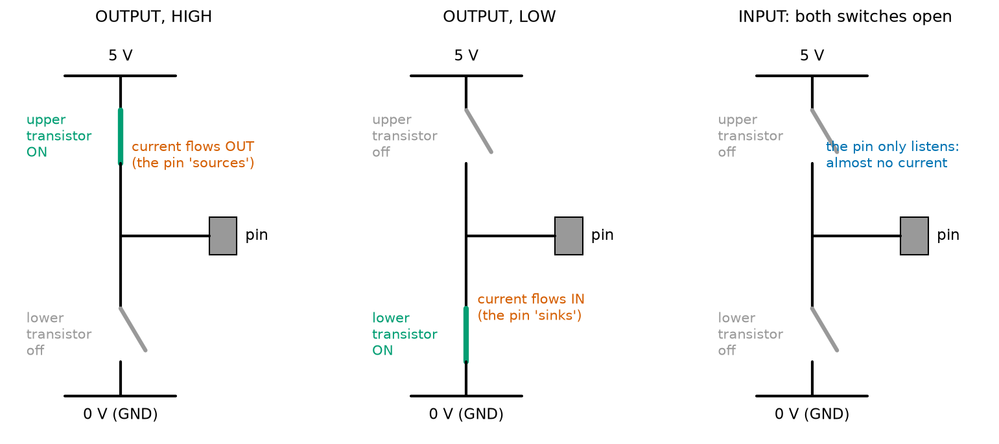
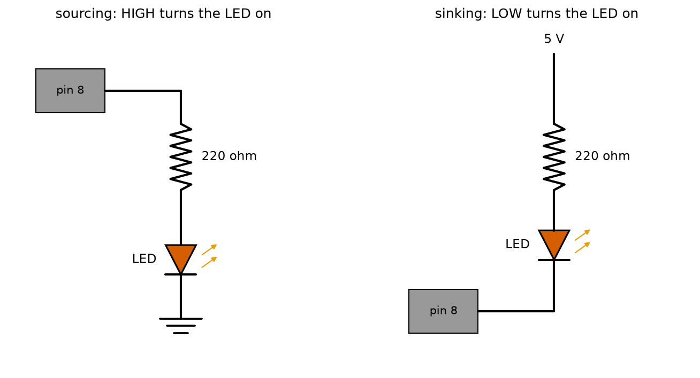
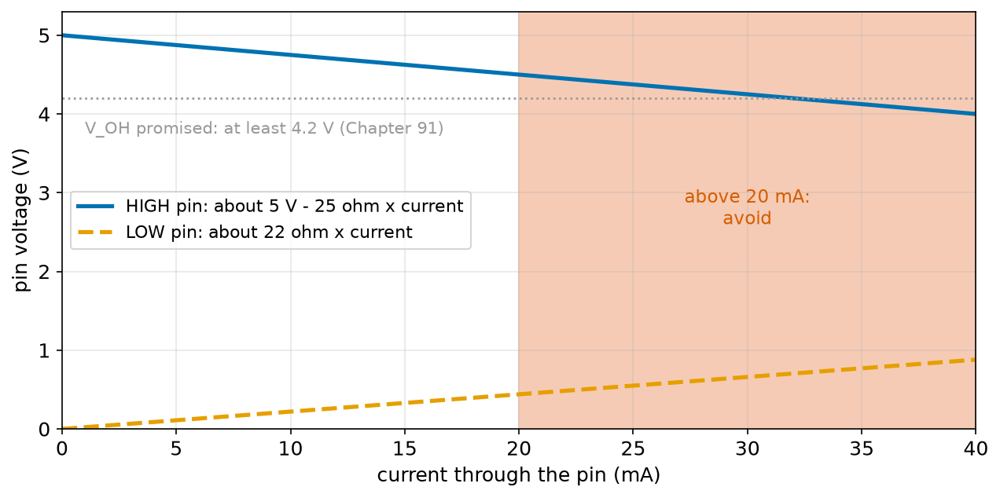
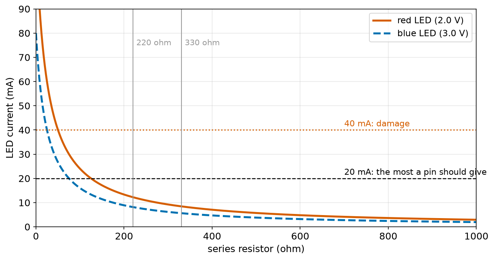
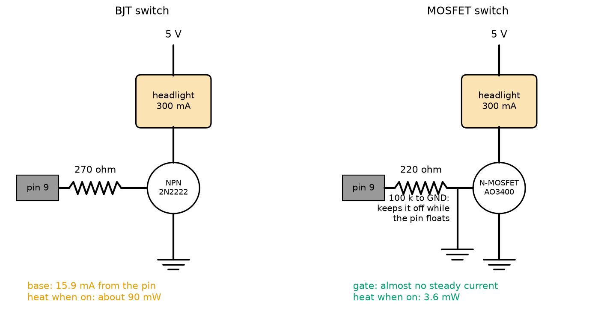
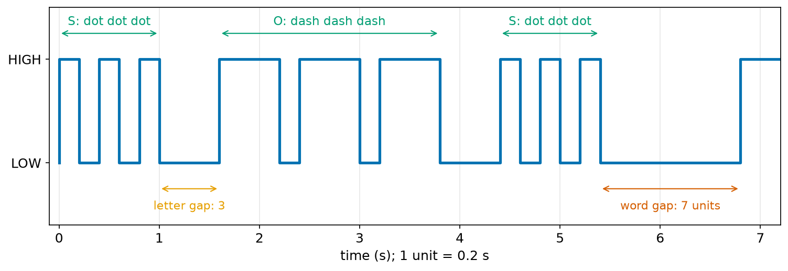
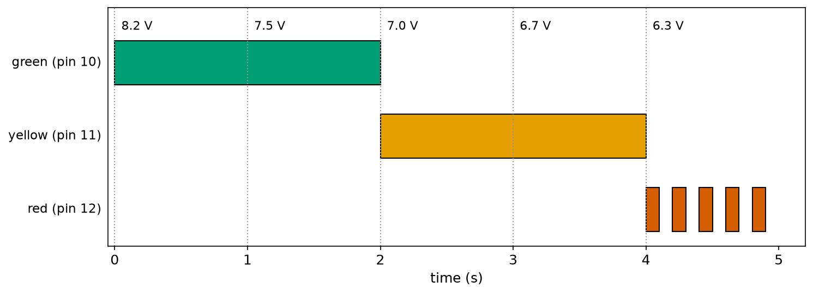
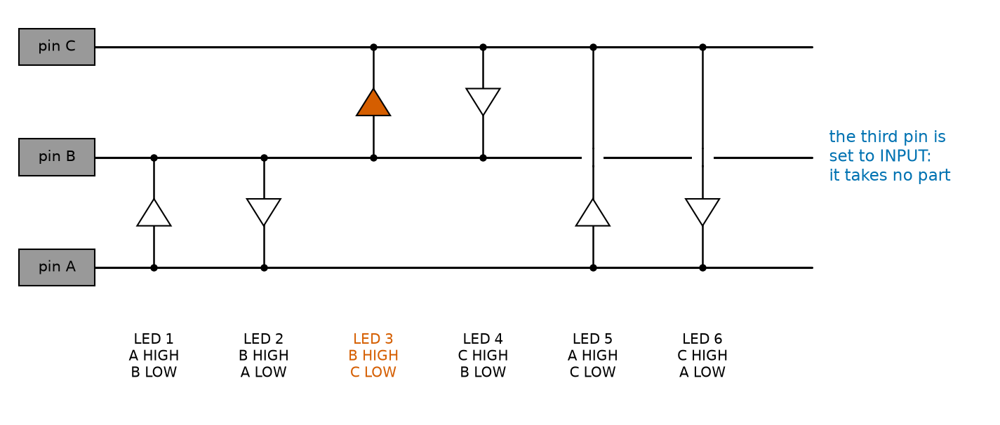

# Chapter 98 — Blink: Digital Output

> **Part 6 · Chapter 98 of 749**
> **You need:** Chapter 75 (Ohm's law), Chapter 82 (LEDs and resistors), Chapter 86 (flyback diodes), Chapter 87 (BJT switches), Chapter 88 (MOSFETs), Chapter 91 (logic levels), Chapters 95–97 (the Uno, and C++ for Arduino).
> **You will make:** an LED blinking on a pin of your choice, SOS in Morse code built from arrays and functions, Rover's three battery status lights, and a design for switching a 300 mA headlight from a pin with a transistor or a MOSFET.

---

## What you will learn

- What `pinMode` and `digitalWrite` really do inside the chip.
- How an output pin **sources** and **sinks** current, and how much it can safely give.
- How to choose an LED's resistor when the pin's own voltage sags.
- How to switch loads bigger than 20 mA with a **transistor** or a **MOSFET**.
- How to build blink **patterns** from functions and arrays.
- What a pin does at **power-up**, and why it matters for motors.

---

## New words in this chapter

| Word | Simple meaning |
|---|---|
| **digital output** | A pin that the program drives HIGH (5 V) or LOW (0 V). |
| **source** | A pin sources current when it is HIGH and current flows out of it. |
| **sink** | A pin sinks current when it is LOW and current flows into it. |
| **active-high / active-low** | A device that turns on when its pin is HIGH / when it is LOW. |
| **register** | A small memory location inside the chip that controls hardware (also used in Chapter 94 for the CPU's boxes). |
| **high impedance** | The state of an input pin: it lets almost no current flow in or out. |
| **forced beta** | The ratio of collector to base current you design for, so a transistor is surely fully on. |
| **logic-level MOSFET** | A MOSFET that switches fully on with only 4.5 V (or less) on its gate. |
| **status light** | An LED that tells people what a machine is doing. |
| **charlieplexing** | A trick that drives many LEDs from a few pins by using HIGH, LOW and INPUT. |

---

## 98.1 Blink, again, with your own LED

Chapter 95's Blink used the board's own L LED on pin 13. Now we put an LED on **any** pin. Remember Chapter 82: an LED always needs a resistor in series, or the current is limited only by luck.

Wire it like this, on a breadboard (Chapter 80):

```
 Uno pin 8 ──── 220 Ω ────▶|──── GND
                         LED
              (long leg, the anode, towards the resistor)
```

And upload this sketch (it is in the Code section with its table):

```cpp
const int LED_PIN = 8;

void setup() {
  pinMode(LED_PIN, OUTPUT);
}

void loop() {
  digitalWrite(LED_PIN, HIGH);
  delay(300);
  digitalWrite(LED_PIN, LOW);
  delay(700);
}
```

📖 **New word: digital output** — a pin that your program drives to one of two levels: **HIGH** (close to 5 V on the Uno) or **LOW** (close to 0 V). `pinMode(pin, OUTPUT)` makes a pin an output; `digitalWrite(pin, HIGH)` or `digitalWrite(pin, LOW)` sets its level. The level stays until you change it: you do not have to keep writing it.

The LED flashes on for 0.3 s and off for 0.7 s. Simple. But to use outputs safely on a robot, we need to know what is happening inside the pin.

---

## 98.2 Inside an output pin

Inside the ATmega328P, every pin has two transistors (MOSFETs, Chapter 88), one above the other: an upper one between the pin and 5 V, and a lower one between the pin and ground. Your program decides which one is on.



*Figure 98.1 — The two switches inside every pin, in its three states.*

**How to read this picture:** In each panel, the 5 V line is at the top and ground at the bottom; the pin is the grey square on the right. Green means a transistor is on. Left: OUTPUT HIGH, the upper transistor connects the pin to 5 V. Middle: OUTPUT LOW, the lower transistor connects it to ground. Right: INPUT, both are off, and the pin is connected to neither; it only "listens". The two are never on together, which would short 5 V to ground inside the chip.

📖 **New word: register** — a small memory location inside the chip that controls hardware directly. Each group of 8 pins (a **port**) has three registers on the ATmega328P:

| Register | One bit per pin | Set by |
|---|---|---|
| **DDR** (data direction) | 1 = output, 0 = input | `pinMode()` |
| **PORT** | for an output: 1 = HIGH, 0 = LOW; for an input: 1 = pull-up on | `digitalWrite()` |
| **PIN** | reading it gives the level on the pin now | `digitalRead()` (Chapter 99) |

Uno pins 0–7 are port D, pins 8–13 are port B, and A0–A5 are port C. Pin 13, for example, is bit 5 of port B (written PB5). `pinMode(13, OUTPUT)` sets bit 5 of `DDRB` to 1; `digitalWrite(13, HIGH)` sets bit 5 of `PORTB` to 1. The Arduino functions do these jobs for you, with a table that turns a pin number into a port and a bit.

💡 **Tip: speed.** `digitalWrite` looks up its table and checks a few things each time, so it takes a few microseconds (around 50 to 80 clock ticks). Writing the register yourself, `PORTB |= (1 << 5);`, takes one or two ticks: 62.5 to 125 ns. Most of the time `digitalWrite` is fast enough and much easier to read. Chapters 105 and 106 use the registers when every tick counts.

📖 **New word: high impedance** — the state of a pin set to INPUT: both transistors off, so almost no current can flow in or out (less than a microamp). "Impedance" is a general word for how hard it is for current to flow.

---

## 98.3 Source and sink: two ways to light an LED

📖 **New word: source** — when a pin is HIGH and current flows **out** of it, through your LED, to ground, the pin is **sourcing** current.

📖 **New word: sink** — when a pin is LOW and current flows **into** it from 5 V through your LED, the pin is **sinking** current.



*Figure 98.2 — Two ways to wire an LED to pin 8.*

**How to read this picture:** Left: the pin, a resistor and the LED go to ground. Writing HIGH makes current flow out of the pin, down through the LED: it lights. Right: the LED and resistor come from 5 V and end at the pin. Writing LOW pulls the bottom of the LED to 0 V, so current flows down through the LED and into the pin: it lights when the pin is LOW. Both work equally well on the Uno.

📖 **New word: active-high / active-low** — a device is **active-high** if HIGH turns it on (left circuit), and **active-low** if LOW turns it on (right circuit). Many ready-made modules are active-low, especially relay boards: `digitalWrite(RELAY_PIN, LOW)` switches the relay **on**. Read the module's description, and put the answer in a constant so the code says what it means:

```cpp
const int RELAY_ON = LOW;        // this relay board is active-low
digitalWrite(RELAY_PIN, RELAY_ON);
```

---

## 98.4 How much current can a pin give?

Chapter 94 gave the limit: about **20 mA** per pin for normal use, **40 mA** absolute maximum (damage above it), and **200 mA** for the whole chip together. Chapter 82 taught how to choose an LED's resistor: R = (supply − LED voltage) ÷ current. There is one more thing to add now.

The pin's own transistors are not perfect switches: each acts like a small resistor, about **25 Ω**. So when the pin gives current, its own voltage drops a little. At 20 mA, a HIGH pin is about 5 − 25 × 0.020 = **4.5 V**, not 5 V.



*Figure 98.3 — An Uno pin's voltage against the current through it: HIGH (blue) and LOW (orange). Rough straight-line values from the shape of the datasheet's curves at 5 V.*

**How to read this picture:** With no current, a HIGH pin is at 5 V and a LOW pin at 0 V. As the current grows, the HIGH pin's voltage falls and the LOW pin's voltage rises, by about 0.5 V at 20 mA. The pink area, above 20 mA, is where the pin gets warm and its voltage can fall below the 4.2 V that the logic levels of Chapter 91 promise. Stay to the left of it.

🔢 **LED current with the pin's resistance.** I = (5 − V_LED) ÷ (R + 25). For a red LED (2.0 V) and 220 Ω: I = 3.0 ÷ 245 = 0.0122 A = **12.2 mA**. The pin's voltage: 5 − 25 × 0.0122 = **4.69 V**.

The program `led_current.py` (in the Code section) tries several resistors:

```
LED      resistor  current  pin volts  verdict
red          0 ohm  120.0 mA     2.00 V  DAMAGE
red        100 ohm   24.0 mA     4.40 V  too much
red        220 ohm   12.2 mA     4.69 V  ok
red        330 ohm    8.5 mA     4.79 V  ok
red       1000 ohm    2.9 mA     4.93 V  ok
blue         0 ohm   80.0 mA     3.00 V  DAMAGE
blue       100 ohm   16.0 mA     4.60 V  ok
blue       220 ohm    8.2 mA     4.80 V  ok
blue       330 ohm    5.6 mA     4.86 V  ok
blue      1000 ohm    2.0 mA     4.95 V  ok

Rover's 5 status LEDs all on: 44.1 mA (the whole chip may give at most 200 mA)
```



*Figure 98.4 — The LED current for every resistor from 0 to 1,000 Ω, for a red and a blue LED.*

**How to read this picture:** The horizontal axis is the resistor in series with the LED; the vertical axis is the current. Both curves fall as the resistor grows. The black dashed line is the 20 mA limit and the red dotted line the 40 mA damage line. With no resistor at all (the left edge), both LEDs pass far more than 40 mA. With 220 Ω (the grey line), a red LED takes about 12 mA: a good, bright, safe value. With 330 Ω, 8.5 mA: still easily visible, and kinder to the pin.

⚠️ **Careful: an LED with no resistor will damage the pin, the LED or both.** The "0 ohm" rows above are not real numbers: the current would be limited only by the pin's damaged transistor. Always use a resistor: 220 Ω to 1 kΩ for an indicator LED on 5 V.

🧠 **A pin is a signal, not a power supply.** Up to about 20 mA (an LED, a small buzzer, the input of another chip): connect it directly. More than that: use a transistor or a MOSFET (section 98.5).

---

## 98.5 Switching bigger loads

Rover will have a 5 V LED headlight that draws 300 mA, fifteen times what a pin may give. Chapter 87 showed the answer: let the pin control a **transistor**, and let the transistor carry the big current.



*Figure 98.5 — The headlight switched by an NPN transistor (left) and by an N-channel MOSFET (right). The pin only drives the base or the gate.*

**How to read this picture:** In both circuits the headlight sits between 5 V and the transistor, and the transistor connects it to ground when the pin says so. Left: pin 9 drives the BJT's base through a 270 Ω resistor; the base needs 15.9 mA from the pin. Right: pin 9 drives the MOSFET's gate through 220 Ω, and a 100 kΩ resistor to ground keeps the MOSFET off before the program starts (section 98.7). The coloured notes compare the pin current and the heat in each transistor.

### With a BJT

A BJT's collector current is up to β (beta, about 100 for a 2N2222) times its base current (Chapter 87). But to be sure the transistor is **fully** on (saturated, with only about 0.3 V across it), we give it much more base current than the minimum.

📖 **New word: forced beta** — the ratio we **design** for: collector current ÷ base current. A forced beta of 10 to 20 makes sure the transistor is fully on, even if its real β is low.

The program `switch_design.py` works it out for the 300 mA headlight:

```
BJT (2N2222): the base current must be large enough to switch it fully on (Chapter 87)
  forced beta 10: base  30.0 mA, base resistor    143 ohm -> TOO MUCH for the pin
  forced beta 20: base  15.0 mA, base resistor    287 ohm -> ok
  forced beta 50: base   6.0 mA, base resistor    717 ohm -> ok
  heat in the BJT when on: 0.3 V x 0.3 A = 90 mW

Logic-level MOSFET (e.g. AO3400): the gate takes almost no steady current (Chapter 88)
  heat in the MOSFET when on: 0.3 A^2 x 0.04 ohm = 3.6 mW
  gate resistor 220 ohm: peak pin current 23 mA for about 308 ns while the gate charges, then 0 mA
```

🔢 With a forced beta of 20: base current = 300 ÷ 20 = 15 mA; base resistor = (5 − 0.7) ÷ 0.015 = 287 Ω. The nearest common value below it is 270 Ω, which gives (5 − 0.7) ÷ 270 = 15.9 mA. That works, but it uses most of the pin's 20 mA. A forced beta of 50 would be gentler on the pin, but at 300 mA a 2N2222's real β can fall to about 40, so it might not switch fully on, and then it would get hot.

### With a MOSFET

A MOSFET's gate is like a tiny capacitor: once it is charged, **no** current flows into it (Chapter 88). So the pin's current problem disappears.

📖 **New word: logic-level MOSFET** — a MOSFET that is fully on with only 4.5 V (or less) on its gate, so a 5 V or even a 3.3 V pin can drive it directly. Many common MOSFETs (such as the IRF540) need 10 V on the gate to be fully on, and are only half on from a 5 V pin: they get hot. Check the datasheet for "R_DS(on) at V_GS = 4.5 V".

The AO3400 has about 0.04 Ω when on at 4.5 V. Heat = I² × R = 0.3² × 0.04 = **3.6 mW**: 25 times less than the BJT's 90 mW. The 220 Ω gate resistor limits the brief current that charges the gate (about 23 mA for 0.3 µs) so the pin is not stressed.

🧠 **For loads above about 100 mA, prefer a logic-level MOSFET.** It needs no steady current from the pin and wastes almost nothing. For small loads (a 30 mA buzzer), a BJT such as the 2N2222 with a 1 kΩ base resistor is cheap and fine.

⚠️ **Careful: motors, relays and solenoids need a flyback diode.** When they are switched off, their coil makes a voltage spike that can destroy the transistor (Chapter 86). An LED headlight does not need one; a relay coil does.

---

## 98.6 Blink patterns from functions and arrays

A single blinking LED can say a lot if it blinks in **patterns**. Chapter 97's tools make patterns easy: a function for one flash, an array for the pattern.

The best-known pattern is SOS in Morse code: three short flashes, three long, three short. Morse code has exact timing rules, all in **units**:

| Element | Length |
|---|---|
| dot (short flash) | 1 unit |
| dash (long flash) | 3 units |
| gap inside a letter | 1 unit |
| gap between letters | 3 units |
| gap between words | 7 units |

The sketch `sos.ino` (in the Code section) stores each letter as an array of flash lengths, `{1, 1, 1}` for S and `{3, 3, 3}` for O, and one function plays any letter. With a unit of 200 ms, one SOS takes 5 + 3 + 11 + 3 + 5 + 7 = 34 units = **6.8 s**.



*Figure 98.6 — The voltage on pin 8 while `sos.ino` runs, from the PC test bench.*

**How to read this picture:** HIGH is the LED on. The first group is three short pulses of 0.2 s (S), then three long pulses of 0.6 s (O), then three short again. Between letters there is a 0.6 s gap (orange arrow), and at the end a 1.4 s word gap (red arrow) before the pattern repeats at 6.8 s. Every edge happens exactly where the Morse rules say.

🤖 **Robot link.** Robots use blink patterns all the time, because an LED is cheap and works when there is no screen: "one flash every 2 seconds = ready", "fast flashing = error", "two flashes, pause, two flashes = sensor 2 has failed". The pattern of flashes is a small message (Application 1).

---

## 98.7 What a pin does before your program runs

When the Uno is powered on or reset, **every pin is an input** (high impedance, section 98.2) until your sketch's `pinMode` makes it an output. That takes the bootloader's half second plus the time until `setup()` reaches that line (Chapter 95). During that time, whatever is connected to the pin sees a **floating** input, not a clean LOW.

For an LED, that does not matter. For a motor driver, it can: a floating input picks up noise (Chapter 83) and may read as "on", and the motor twitches at every reset. The fix is in hardware: a **pull-down resistor** (10 kΩ to 100 kΩ) from the driver's input to ground holds it LOW until the pin takes over. That is the 100 kΩ in Figure 98.5. And remember Chapter 95: the bootloader flashes pin 13 at every reset, so pin 13 must never control anything that moves.

🧠 **Design every output so that "pin floating" and "pin LOW" both mean "safe and off".** Use pull-down resistors on anything that moves, and give important outputs their safe value as the first thing in `setup()`.

---

## Code

All sketch outputs come from the PC test bench with the Uno's 16-bit `int` and pin tracing on.

File `code/ch098/blink_external/blink_external.ino`:

```cpp
// blink_external.ino - blink an LED on pin 8 (through a 220 ohm resistor), and say what the pin is doing
const int LED_PIN = 8;
const int ON_MS = 300;
const int OFF_MS = 700;

void setup() {
  Serial.begin(9600);
  pinMode(LED_PIN, OUTPUT);            // pin 8 becomes an output: LOW (0 V) until we change it
}

void loop() {
  digitalWrite(LED_PIN, HIGH);         // 5 V: current flows through the resistor and the LED
  Serial.println("LED on");
  delay(ON_MS);
  digitalWrite(LED_PIN, LOW);          // 0 V: no current, LED off
  Serial.println("LED off");
  delay(OFF_MS);
}
```

| Line | Code | What it does (simple English) |
|---|---|---|
| 1 | `// blink_external.ino - …` | A comment. |
| 2 | `const int LED_PIN = 8;` | The LED's pin, as a constant: change one line to move it. |
| 3–4 | `const int ON_MS = 300;`, `const int OFF_MS = 700;` | How long the LED is on and off, in ms. |
| 5 | (blank) | Spacing. |
| 6 | `void setup() {` | Runs once. |
| 7 | `Serial.begin(9600);` | Open Serial, so the sketch can report. |
| 8 | `pinMode(LED_PIN, OUTPUT);` | Make pin 8 an output. It starts LOW. |
| 9 | `}` | End of `setup`. |
| 10 | (blank) | Spacing. |
| 11 | `void loop() {` | Runs for ever. |
| 12 | `digitalWrite(LED_PIN, HIGH);` | Pin 8 to 5 V: the LED lights. |
| 13 | `Serial.println("LED on");` | Report it. |
| 14 | `delay(ON_MS);` | Stay on for 300 ms. |
| 15 | `digitalWrite(LED_PIN, LOW);` | Pin 8 to 0 V: the LED goes out. |
| 16 | `Serial.println("LED off");` | Report it. |
| 17 | `delay(OFF_MS);` | Stay off for 700 ms. |
| 18 | `}` | End of `loop`: start again. |

Output (2.1 seconds; the lines starting with "pin" come from the test bench, the others from the sketch):

```
[   0.0000 s] pin 8 -> HIGH
[   0.0000 s] LED on
[   0.3000 s] pin 8 -> LOW
[   0.3001 s] LED off
[   1.0001 s] pin 8 -> HIGH
[   1.0001 s] LED on
[   1.3001 s] pin 8 -> LOW
[   1.3001 s] LED off
[   2.0002 s] pin 8 -> HIGH
[   2.0002 s] LED on
```

On for 0.3 s, off for 0.7 s, once per second. The extra 0.0001 s per pass is the time `Serial.println` takes to hand its characters to the serial hardware.

File `code/ch098/sos/sos.ino`:

```cpp
// sos.ino - blink SOS in Morse code: three short flashes, three long, three short
const int LED_PIN = 8;
const int UNIT = 200;                  // ms: the length of one dot; a dash is 3 units

const int S_CODE[3] = {1, 1, 1};       // S = dot dot dot (lengths in units)
const int O_CODE[3] = {3, 3, 3};       // O = dash dash dash

void flash(int units) {
  digitalWrite(LED_PIN, HIGH);
  delay(units * UNIT);
  digitalWrite(LED_PIN, LOW);
  delay(UNIT);                         // a one-unit gap after every dot or dash
}

void letter(const int code[], int n) {
  for (int i = 0; i < n; i++) {
    flash(code[i]);
  }
  delay(2 * UNIT);                     // the gap between letters is 3 units: 1 already waited, 2 more
}

void setup() {
  pinMode(LED_PIN, OUTPUT);
}

void loop() {
  letter(S_CODE, 3);
  letter(O_CODE, 3);
  letter(S_CODE, 3);
  delay(4 * UNIT);                     // the gap between words is 7 units: 3 already waited, 4 more
}
```

| Line | Code | What it does (simple English) |
|---|---|---|
| 1 | `// sos.ino - …` | A comment. |
| 2 | `const int LED_PIN = 8;` | The LED's pin. |
| 3 | `const int UNIT = 200;` | One Morse unit: 200 ms. Change it to make the whole pattern faster or slower. |
| 4 | (blank) | Spacing. |
| 5 | `const int S_CODE[3] = {1, 1, 1};` | A constant array: the letter S as three flash lengths of 1 unit. |
| 6 | `const int O_CODE[3] = {3, 3, 3};` | O as three flashes of 3 units. |
| 7 | (blank) | Spacing. |
| 8 | `void flash(int units) {` | One flash, `units` long. |
| 9 | `digitalWrite(LED_PIN, HIGH);` | LED on. |
| 10 | `delay(units * UNIT);` | Stay on: 200 ms for a dot, 600 ms for a dash. |
| 11 | `digitalWrite(LED_PIN, LOW);` | LED off. |
| 12 | `delay(UNIT);` | The 1-unit gap that follows every dot or dash. |
| 13 | `}` | End of `flash`. |
| 14 | (blank) | Spacing. |
| 15 | `void letter(const int code[], int n) {` | Play one letter. `const` promises not to change the array (Chapter 97). |
| 16–18 | `for (…) { flash(code[i]); }` | One flash per element. |
| 19 | `delay(2 * UNIT);` | Make the gap up to 3 units after the letter (1 was already waited inside `flash`). |
| 20 | `}` | End of `letter`. |
| 21 | (blank) | Spacing. |
| 22–24 | `void setup() { pinMode(LED_PIN, OUTPUT); }` | The pin becomes an output. |
| 25 | (blank) | Spacing. |
| 26 | `void loop() {` | Runs for ever. |
| 27–29 | `letter(S_CODE, 3);` … | S, O, S. |
| 30 | `delay(4 * UNIT);` | Make the gap up to 7 units before repeating. |
| 31 | `}` | End of `loop`. |

Output (7 seconds, pin changes):

```
[   0.0000 s] pin 8 -> HIGH
[   0.2000 s] pin 8 -> LOW
[   0.4000 s] pin 8 -> HIGH
[   0.6000 s] pin 8 -> LOW
[   0.8000 s] pin 8 -> HIGH
[   1.0000 s] pin 8 -> LOW
[   1.6000 s] pin 8 -> HIGH
[   2.2000 s] pin 8 -> LOW
[   2.4000 s] pin 8 -> HIGH
[   3.0000 s] pin 8 -> LOW
[   3.2000 s] pin 8 -> HIGH
[   3.8000 s] pin 8 -> LOW
[   4.4001 s] pin 8 -> HIGH
[   4.6001 s] pin 8 -> LOW
[   4.8001 s] pin 8 -> HIGH
[   5.0001 s] pin 8 -> LOW
[   5.2001 s] pin 8 -> HIGH
[   5.4001 s] pin 8 -> LOW
[   6.8001 s] pin 8 -> HIGH
```

This is Figure 98.6 as text: dots of 0.2 s, dashes of 0.6 s, a 0.6 s gap between letters (1.0 → 1.6 s) and a 1.4 s gap before the repeat at 6.8 s.

File `code/ch098/led_current.py`:

```python
# led_current.py - an LED on an Uno pin: how much current flows, and is the pin safe?
# The pin's output acts like a 5 V source with about 25 ohms inside it (its output transistor, Chapter 88).
V_PIN = 5.0
R_PIN = 25.0                      # ohms inside the pin when it drives HIGH (rough, from the datasheet's curves)
V_LED = {"red": 2.0, "yellow": 2.1, "green": 2.2, "blue": 3.0}   # LED forward voltages (Chapter 82)
PIN_SAFE, PIN_MAX = 20.0, 40.0    # mA: recommended and absolute maximum for one pin

print(f"{'LED':7s} {'resistor':>9s} {'current':>8s} {'pin volts':>10s}  verdict")
for colour in ["red", "blue"]:
    for r in [0, 100, 220, 330, 1000]:
        i = (V_PIN - V_LED[colour]) / (r + R_PIN)          # Ohm's law round the loop (Chapter 75)
        ma = i * 1000
        v_out = V_PIN - i * R_PIN                          # the pin's own voltage sags as current flows
        verdict = "DAMAGE" if ma > PIN_MAX else ("too much" if ma > PIN_SAFE else "ok")
        print(f"{colour:7s} {r:6d} ohm {ma:6.1f} mA {v_out:8.2f} V  {verdict}")
print()

leds = [("green", 220), ("yellow", 220), ("red", 220), ("blue", 330), ("board L", 1000)]
total = 0.0
for colour, r in leds:
    v = V_LED.get(colour, 2.0)
    total += (V_PIN - v) / (r + R_PIN) * 1000
print(f"Rover's 5 status LEDs all on: {total:.1f} mA (the whole chip may give at most 200 mA)")
```

| Line | Code | What it does (simple English) |
|---|---|---|
| 1–2 | `# led_current.py …` | Comments: what the program models. |
| 3 | `V_PIN = 5.0` | The pin's voltage with no current. |
| 4 | `R_PIN = 25.0` | The pin's own resistance (section 98.4). |
| 5 | `V_LED = {…}` | A dictionary of LED forward voltages by colour (Chapter 82). |
| 6 | `PIN_SAFE, PIN_MAX = 20.0, 40.0` | The two current limits in mA. |
| 7 | (blank) | Spacing. |
| 8 | `print(…)` | The table heading. |
| 9–10 | `for colour …:`, `for r …:` | Two colours, five resistors each. |
| 11 | `i = (V_PIN - V_LED[colour]) / (r + R_PIN)` | The current: the voltage left for the resistors, divided by both resistors in series. |
| 12 | `ma = i * 1000` | In milliamps. |
| 13 | `v_out = V_PIN - i * R_PIN` | The pin's voltage, lowered by the drop across its own resistance. |
| 14 | `verdict = …` | "DAMAGE" above 40 mA, "too much" above 20 mA, otherwise "ok". |
| 15 | `print(…)` | One row. |
| 16 | `print()` | An empty line. |
| 17 | (blank) | Spacing. |
| 18 | `leds = [(…), …]` | Rover's five status LEDs and their resistors. |
| 19 | `total = 0.0` | A running total. |
| 20–22 | `for colour, r in leds: …` | Add each LED's current. `V_LED.get(colour, 2.0)` gives 2.0 V for a colour not in the dictionary (the board's L LED). |
| 23 | `print(…)` | The total, against the chip's 200 mA limit. |

The output is in section 98.4.

---

## Small examples

**Example 1.** A green LED (2.2 V) with 330 Ω: I = (5 − 2.2) ÷ (330 + 25) = 7.9 mA.

**Example 2.** For about 10 mA through a red LED: R = (5 − 2.0) ÷ 0.010 − 25 = 275 Ω; use 270 Ω.

**Example 3.** Ten LEDs at 12 mA each, all on: 120 mA. Under the chip's 200 mA, but the datasheet also limits the total of each group of neighbouring pins, so spread them over pins 2–7 and 8–13 rather than putting them all on one port.

**Example 4.** An active-low relay module on pin 7: `digitalWrite(7, LOW)` switches it **on**.

**Example 5.** A 2N2222 switching a 100 mA buzzer with forced beta 20: base current 5 mA; base resistor (5 − 0.7) ÷ 0.005 = 860 Ω; use 820 Ω.

**Example 6.** A MOSFET with 0.1 Ω on-resistance switching 2 A: heat = 2² × 0.1 = 0.4 W. Fine with a small heat sink, too warm without one in a TO-92 package (Chapter 76).

**Example 7.** The Morse letter K is dash-dot-dash: `{3, 1, 3}`: 3 + 1 + 1 + 1 + 3 + 1 = 10 units including the gaps after each flash, then 2 more for the letter gap.

**Example 8.** Pin 13 is bit 5 of port B, so `PORTB |= (1 << 5);` sets pin 13 HIGH in one tick.

---

## 🏭 Real robot applications

### Application 1 (worked in full) — 🤖 Rover's battery status lights

**1. The real problem.** Rover runs on a battery that gives 8.4 V when full and 6.0 V when empty (Chapter 90). The person watching Rover needs to know, at a glance and from across the room, whether the battery is fine, getting low, or so low that Rover must go home now. A screen is too small to read at 3 m; three coloured LEDs are not.

**2. Why this theory.** Sections 98.1–98.4: one pin per LED, each with its resistor, all within the pin and chip limits. Section 98.6: a **flashing** light draws the eye far more than a steady one, so the most urgent state should flash. Chapter 97's `if` chain chooses the state.

📖 **New word: status light** — an LED whose colour and pattern tell people what a machine is doing. Good status lights follow two rules: one meaning per colour, and the more urgent the message, the more the light moves.

**3. The numbers.** Three LEDs: green on pin 10, yellow on pin 11, red on pin 12, each with 220 Ω. (On the breadboard; in Rover's final pin plan, Figure 95.8, they move to the I2C expander.) Battery bands: 7.2 V or more = fine (green, steady); 6.6 to 7.2 V = low (yellow, steady); below 6.6 V = go home (red, flashing 5 times a second).

**4. The maths.** Currents (from `led_current.py`'s model): green (5 − 2.2) ÷ 245 = 11.4 mA, yellow 11.8 mA, red 12.2 mA. Only one LED is on at a time, so at most 12.2 mA: far inside every limit. Red flashing at 5 Hz: 100 ms on, 100 ms off.

**5. The code.** The test sketch plays five battery readings, one second each. File `code/ch098/status_leds/status_leds.ino`:

```cpp
// status_leds.ino - Rover's battery lights: green = fine, yellow = low, red flashing = go home now
const int GREEN_PIN = 10;
const int YELLOW_PIN = 11;
const int RED_PIN = 12;

const int N = 5;                       // five test readings, from a full to an almost empty battery
float batteryVolts[N] = {8.2, 7.5, 7.0, 6.7, 6.3};

void setLights(bool green, bool yellow, bool red) {
  digitalWrite(GREEN_PIN, green);      // true is HIGH, false is LOW
  digitalWrite(YELLOW_PIN, yellow);
  digitalWrite(RED_PIN, red);
}

void showBattery(float volts) {
  if (volts >= 7.2) {
    setLights(true, false, false);     // fine: green on, steady
    delay(1000);
  } else if (volts >= 6.6) {
    setLights(false, true, false);     // low: yellow on, steady
    delay(1000);
  } else {
    for (int i = 0; i < 5; i++) {      // empty: red flashes 5 times a second, for one second
      setLights(false, false, true);
      delay(100);
      setLights(false, false, false);
      delay(100);
    }
  }
}

void setup() {
  Serial.begin(9600);
  pinMode(GREEN_PIN, OUTPUT);
  pinMode(YELLOW_PIN, OUTPUT);
  pinMode(RED_PIN, OUTPUT);
  for (int i = 0; i < N; i++) {
    Serial.print("battery ");
    Serial.print(batteryVolts[i]);
    Serial.println(" V");
    showBattery(batteryVolts[i]);
  }
  setLights(false, false, false);      // all off at the end
}

void loop() {
}
```

| Line | Code | What it does (simple English) |
|---|---|---|
| 1 | `// status_leds.ino - …` | A comment. |
| 2–4 | `const int GREEN_PIN = 10;` … | The three LED pins. |
| 5 | (blank) | Spacing. |
| 6 | `const int N = 5;` | Five test readings. |
| 7 | `float batteryVolts[N] = {…};` | The readings, from full to nearly empty. (Chapter 101 reads the real battery.) |
| 8 | (blank) | Spacing. |
| 9 | `void setLights(bool green, bool yellow, bool red) {` | Set all three LEDs at once. |
| 10–12 | `digitalWrite(GREEN_PIN, green);` … | `true` counts as HIGH (1) and `false` as LOW (0), so a `bool` can be written straight to a pin. |
| 13 | `}` | End of `setLights`. |
| 14 | (blank) | Spacing. |
| 15 | `void showBattery(float volts) {` | Show one reading for about a second. |
| 16–18 | `if (volts >= 7.2) { setLights(true, false, false); delay(1000);` | Fine: green, steady. |
| 19–21 | `} else if (volts >= 6.6) { … }` | Low: yellow, steady. |
| 22 | `} else {` | Below 6.6 V. |
| 23–28 | `for (int i = 0; i < 5; i++) { … }` | Five times: red on 100 ms, all off 100 ms. |
| 29 | `}` | End of the `if` chain. |
| 30 | `}` | End of `showBattery`. |
| 31 | (blank) | Spacing. |
| 32–36 | `void setup() { Serial.begin(9600); pinMode(…) …` | Open Serial; make the three pins outputs. |
| 37 | `for (int i = 0; i < N; i++) {` | Go through the test readings. |
| 38–40 | `Serial.print("battery "); …` | Print the reading, with two decimals. |
| 41 | `showBattery(batteryVolts[i]);` | Show it on the lights. |
| 42 | `}` | End of the `for`. |
| 43 | `setLights(false, false, false);` | All off when done. |
| 44 | `}` | End of `setup`. |
| 45–47 | `void loop() { }` | Nothing to repeat in this test. |

Output (6 seconds; pin lines appear only when a pin **changes**):

```
[   0.0000 s] battery 8.20 V
[   0.0001 s] pin 10 -> HIGH
[   1.0001 s] battery 7.50 V
[   2.0002 s] battery 7.00 V
[   2.0003 s] pin 10 -> LOW
[   2.0003 s] pin 11 -> HIGH
[   3.0003 s] battery 6.70 V
[   4.0004 s] battery 6.30 V
[   4.0005 s] pin 11 -> LOW
[   4.0005 s] pin 12 -> HIGH
[   4.1005 s] pin 12 -> LOW
[   4.2005 s] pin 12 -> HIGH
[   4.3005 s] pin 12 -> LOW
[   4.4005 s] pin 12 -> HIGH
[   4.5005 s] pin 12 -> LOW
[   4.6005 s] pin 12 -> HIGH
[   4.7005 s] pin 12 -> LOW
[   4.8006 s] pin 12 -> HIGH
[   4.9006 s] pin 12 -> LOW
```



*Figure 98.7 — Which light is on during each test reading.*

**How to read this picture:** Time runs left to right; the dotted lines mark the five readings, labelled at the top. Each row is one LED, and a coloured bar means "on". Green stays on for the first two readings (8.2 and 7.5 V, both above 7.2 V). Yellow takes over for 7.0 and 6.7 V. At 6.3 V, the red LED flashes five times in one second.

**6. The result.** The lights do exactly what the rules say, with at most 12 mA from one pin. Notice two things in the output. First, between 0 and 2 s there is no "pin" line at 1 s: writing HIGH to a pin that is already HIGH changes nothing (and costs nothing). Second, during the red flashing, the sketch can do **nothing else**: each `delay(100)` stops the whole program. A real Rover must keep driving, reading sensors and checking its bumpers while the light flashes. Chapter 103 rewrites this with `millis()`, so the flashing runs **alongside** everything else.

**7. Going further.** Real battery indicators add **hysteresis** (Chapter 91): once yellow, stay yellow until the battery is above 7.3 V, not 7.2 V, so a battery near the line does not make the lights flicker between green and yellow as the motors' current makes its voltage dip. Many products use a single RGB LED (three LEDs in one package, one pin each) to show all three colours, and phones and drones replace the bands with a percentage from a fuel-gauge chip (Chapter 89).

### Application 2 (worked in full) — 🤖 Switching Rover's 300 mA headlight from a pin

**1. The real problem.** For driving in the dark (and for the camera at stage 7), Rover gets a white LED headlight module: 5 V, 300 mA. The Uno must switch it on and off. A pin can give 20 mA.

**2. Why this theory.** Section 98.4: a pin is a signal. Section 98.5 and Chapters 87–88: a BJT or MOSFET lets a small signal control a large current. Section 98.7: the light must stay off while the pin floats at reset.

**3. The numbers.** Load: 300 mA at 5 V. Pin: 5 V, 20 mA safe. 2N2222: V_BE = 0.7 V, V_CE(sat) ≈ 0.3 V at 300 mA, real β at 300 mA can fall to about 40. AO3400 MOSFET: R_DS(on) ≈ 0.04 Ω at V_GS = 4.5 V, gate charge about 7 nC.

**4. The maths.** BJT, forced beta 20: I_B = 0.3 ÷ 20 = 15 mA; R_B = (5 − 0.7) ÷ 0.015 = 287 Ω → use 270 Ω (15.9 mA). Heat: 0.3 V × 0.3 A = 90 mW. MOSFET: heat = 0.3² × 0.04 = 3.6 mW. Gate resistor 220 Ω: peak current 5 ÷ 220 = 23 mA, for only Q ÷ I = 7 nC ÷ 0.023 A ≈ 0.3 µs.

**5. The code.** File `code/ch098/switch_design.py`:

```python
# switch_design.py - a pin cannot drive a 300 mA headlight. Design a BJT switch and a MOSFET switch for it.
V_PIN, V_BE = 5.0, 0.7
LOAD_A = 0.30                       # Rover's LED headlight: 5 V, 300 mA
PIN_SAFE_MA = 20.0

print("BJT (2N2222): the base current must be large enough to switch it fully on (Chapter 87)")
for forced_beta in [10, 20, 50]:    # how many times bigger the collector current is than the base current
    i_b = LOAD_A / forced_beta
    r_b = (V_PIN - V_BE) / i_b      # the base resistor that gives this base current
    pin_ok = "ok" if i_b * 1000 <= PIN_SAFE_MA else "TOO MUCH for the pin"
    print(f"  forced beta {forced_beta:2d}: base {i_b * 1000:5.1f} mA, base resistor {r_b:6.0f} ohm -> {pin_ok}")
v_ce_sat = 0.3                      # the BJT's voltage when fully on, at 300 mA
print(f"  heat in the BJT when on: {v_ce_sat} V x {LOAD_A} A = {v_ce_sat * LOAD_A * 1000:.0f} mW")
print()

print("Logic-level MOSFET (e.g. AO3400): the gate takes almost no steady current (Chapter 88)")
r_ds_on = 0.04                      # ohms when the gate is at 4.5 V or more
print(f"  heat in the MOSFET when on: {LOAD_A} A^2 x {r_ds_on} ohm = {LOAD_A ** 2 * r_ds_on * 1000:.1f} mW")
q_gate, r_gate = 7e-9, 220          # gate charge and a 220 ohm resistor in series with the gate
i_peak = V_PIN / r_gate
print(f"  gate resistor {r_gate} ohm: peak pin current {i_peak * 1000:.0f} mA for about "
      f"{q_gate / i_peak * 1e9:.0f} ns while the gate charges, then 0 mA")
```

| Line | Code | What it does (simple English) |
|---|---|---|
| 1 | `# switch_design.py …` | A comment. |
| 2 | `V_PIN, V_BE = 5.0, 0.7` | The pin's voltage and the BJT's base–emitter voltage. |
| 3 | `LOAD_A = 0.30` | The headlight's current in amps. |
| 4 | `PIN_SAFE_MA = 20.0` | The pin's safe current. |
| 5 | (blank) | Spacing. |
| 6 | `print("BJT …")` | A heading. |
| 7 | `for forced_beta in [10, 20, 50]:` | Try three design ratios. |
| 8 | `i_b = LOAD_A / forced_beta` | The base current needed. |
| 9 | `r_b = (V_PIN - V_BE) / i_b` | The base resistor: the voltage across it divided by the current through it (Ohm's law). |
| 10 | `pin_ok = …` | Is that base current safe for the pin? |
| 11 | `print(…)` | One row. |
| 12 | `v_ce_sat = 0.3` | The BJT's voltage when fully on. |
| 13 | `print(…)` | Its heat: voltage × current. |
| 14 | `print()` | An empty line. |
| 15 | (blank) | Spacing. |
| 16 | `print("Logic-level MOSFET …")` | A heading. |
| 17 | `r_ds_on = 0.04` | The MOSFET's resistance when on. |
| 18 | `print(…)` | Its heat: I² × R (Chapter 76). `**` means "to the power of". |
| 19 | `q_gate, r_gate = 7e-9, 220` | The gate's charge (7 nanocoulombs) and the gate resistor. |
| 20 | `i_peak = V_PIN / r_gate` | The largest current while the gate charges. |
| 21–22 | `print(…)` | The peak current, and how long it lasts: charge ÷ current, in nanoseconds. |

The output is in section 98.5. To switch the headlight, the sketch needs nothing new: `pinMode(9, OUTPUT); digitalWrite(9, HIGH);` turns it on, whichever transistor is used.

**6. The result.** Both designs work. The BJT needs 15.9 mA from the pin, most of the pin's budget, and turns 90 mW into heat: a 2N2222 in its small TO-92 case warms by about 0.09 × 200 = 18 °C (Chapter 76's 200 °C/W). The logic-level MOSFET needs no steady current from the pin at all and wastes 3.6 mW, 25 times less; with its 100 kΩ pull-down it also stays safely off at reset. Rover uses the MOSFET. Without a transistor, the pin would try to give 300 mA, its voltage would collapse, and the pin (or the whole port) would be damaged within moments.

**7. Going further.** Lights, pumps and fans on robots are switched exactly like this, usually with one MOSFET per load on a small "driver board". When the load is on the **high** side (the switch must be between the battery and the load, for example when the load's other end is bolted to a metal frame that is ground), a P-channel MOSFET or a ready-made "high-side switch" chip is used instead. Motors that must run in **both** directions need four switches in an H-bridge (Chapter 139).

### Application 3 — 🏭 Stack lights on factory machines

Walk through any factory and you will see **stack lights** (also called signal towers or andon lights): towers of coloured lamps on top of robots and machines, visible from across the hall. Their colours have standard meanings, set by the machine-safety standard IEC 60204-1: **red** = emergency or dangerous state, **yellow** = abnormal condition, needs attention soon; **blue** = an operator must act; **green** = normal operation. Flashing usually means "more urgent than steady". Each lamp is a 24 V LED module, switched exactly like Rover's headlight: a microcontroller or PLC output drives a transistor that carries the lamp's current. Because the meanings are standard, a worker who has never seen this robot knows at once that a flashing red tower means "stay away", which is the whole point of Application 1's rules, at factory scale.

### Application 4 — 🚁 Drone status LEDs

Flight controllers have no screen in the air, so they speak through LEDs. A typical set of patterns: a slow blink while the drone is starting and checking its sensors, a different colour or pattern when it is ready but **disarmed** (motors cannot spin), and a steady light when **armed** (the propellers may start at any moment), with fast flashing for errors such as a failed sensor or a low battery. Many also have a buzzer, switched by a transistor like Section 98.5's. The armed light is a safety device: people must never approach an armed drone, and the light is often the only warning. Patterns are also used on the ground: a drone that refuses to arm explains why with its blinks, decoded from the manual, in the same way as Rover's "two flashes = sensor 2 failed".

### Application 5 — 💡 Charlieplexing: many LEDs from a few pins

A pin has three states, not two: HIGH, LOW and INPUT (high impedance). **Charlieplexing** uses all three to drive many LEDs from few pins. Connect an LED between every pair of pins, in both directions: with 3 pins there are 3 × 2 = 6 LEDs. To light one LED, set its anode's pin HIGH, its cathode's pin LOW, and every other pin to INPUT, so no other LED has a path for current. To show several at once, light them one after another very quickly (each for a millisecond or so); the eye sees them all lit.



*Figure 98.8 — Three pins driving six LEDs. LED 3 is lit: pin B HIGH, pin C LOW, pin A set to INPUT.*

**How to read this picture:** The three horizontal lines are the wires from pins A, B and C. Each triangle is an LED, connected between two of the wires (the dots), pointing the way current flows. LEDs 5 and 6 connect A and C; their wires cross pin B's line without touching it. Below each LED is what the pins must do to light it. Only the orange LED 3 has HIGH on its anode and LOW on its cathode; pin A is an input, so LEDs 1, 2, 5 and 6 have no path, and LED 4 points the wrong way.

With n pins you get n × (n − 1) LEDs: 11 pins give 110. The Arduino Uno R4 WiFi uses this method for its built-in 12 × 8 LED matrix (96 LEDs) on a small number of the chip's pins. The cost is brightness (each LED is on for only part of the time) and software work: the LEDs must be refreshed hundreds of times per second, which needs the timer methods of Chapters 103 and 106.

---

## 🔧 Hands-on lab

### Lab 98.1 — Measure your LED's current (hardware)

You need: an Uno, a breadboard, a red LED, a 220 Ω and a 1 kΩ resistor, jumper wires, and the multimeter (Chapter 81).

1. Wire pin 8 → 220 Ω → LED (long leg first) → GND, as in section 98.1. Upload `blink_external.ino` with **both** delays changed to 5000 (5 s on, 5 s off), so you have time to measure.
2. While the LED is on, measure the voltage from pin 8 to GND, and across the resistor.
3. Work out the current: I = (voltage across the resistor) ÷ 220.
4. Repeat with the 1 kΩ resistor.

**What you should see:** With 220 Ω, the pin is about 4.6–4.8 V (not 5.0 V: section 98.4), the resistor has about 2.6–2.8 V across it, and the current is about 12 mA, close to the model's 12.2 mA. With 1 kΩ, the pin is almost exactly 5 V and the current about 3 mA; the LED is dimmer but clearly visible. Your exact numbers depend on your LED's forward voltage and your board.

| If it does not work | Likely cause | Fix |
|---|---|---|
| The LED never lights | LED backwards, or in the wrong breadboard row | Long leg (anode) towards the resistor and pin; check the rows (Chapter 80) |
| The pin reads 5 V but the LED is dark | The wire is not on pin 8, or `LED_PIN` is not 8 | Check both |
| The resistor reads 0 V | No current: an open circuit | Look for a missing GND connection |
| The voltages change while you measure | You measured during the off time | Use the 5 s delays |

**Challenge:** Wire a second LED the "sinking" way (5 V → 220 Ω → LED → pin 7, Figure 98.2) and change the sketch so the two LEDs are always opposite: one on while the other is off. Which `digitalWrite` value lights the sinking LED?

### Lab 98.2 — Your own Morse message (simulation or hardware)

Copy `sos.ino`.

1. Look up your initials in a Morse code table. Make an array for each letter (1 for a dot, 3 for a dash), as `S_CODE` and `O_CODE` are.
2. Change `loop()` to play your letters, with the right sizes in the calls.
3. Run it in Wokwi with an LED on pin 8 (or on the bench), and time one full message.

**What you should see:** Your initials blinking, with a pause before each repeat. Check the timing against the rules: a dot is 1 unit, a dash 3, and the whole message is (sum of all flash lengths) + (one unit after each flash) + (2 more units after each letter) + 4 units at the end. Practice 11 does this for "HI".

| If it does not work | Likely cause | Fix |
|---|---|---|
| Dots and dashes all look the same | `flash()` ignores its parameter | Line 10 must be `delay(units * UNIT);` |
| A letter plays too few flashes | The size in the call is wrong | `letter(X_CODE, n)` with n = the number of elements |
| Compile error `too many initializers` | More values in `{ }` than the size in `[ ]` | Make the size match |

**Challenge:** Store a whole word as one array of letters' codes is hard with what you know; instead, write a function `void word3(const int a[], int na, const int b[], int nb, const int c[], int nc)` that plays three letters and the word gap.

### Lab 98.3 — A buzzer through a transistor (hardware)

You need: an active 5 V buzzer (it beeps by itself when powered; about 30 mA), a 2N2222 (or BC547) NPN transistor, a 1 kΩ resistor, jumper wires, the multimeter.

1. Wire: 5 V → buzzer (+) → buzzer (−) → transistor collector; emitter → GND; pin 9 → 1 kΩ → base (Chapter 87 shows the legs).
2. Upload `blink_external.ino` with `LED_PIN` changed to 9.
3. Measure the voltage across the 1 kΩ resistor while the buzzer sounds, and work out the base current.

**What you should see:** The buzzer beeps 0.3 s on, 0.7 s off. The base resistor has about 4.2–4.3 V across it: a base current of about 4.3 mA, well inside the pin's 20 mA. With a forced beta of about 30 ÷ 4.3 ≈ 7, the transistor is fully on.

| If it does not work | Likely cause | Fix |
|---|---|---|
| Buzzer always on | Collector and emitter swapped, or a short | Check the transistor's legs against its datasheet |
| Buzzer never sounds | A passive buzzer (needs a tone signal), or reversed | Use an active buzzer, + towards 5 V; or try `tone(9, 2000)` (Chapter 102) |
| The transistor gets hot | It is not fully on: the base resistor is too big | Use 1 kΩ or less; check 0.7 V between base and emitter |

**Challenge:** Make the buzzer beep the SOS pattern. Then, from the datasheet of your transistor, find its minimum β at 30 mA and check that 4.3 mA of base current is at least 3 times more than needed.

---

## Common mistakes

⚠️ **An LED with no resistor.** It can destroy the LED and the pin. Always 220 Ω to 1 kΩ.

⚠️ **Driving a motor, relay or big lamp straight from a pin.** A pin gives about 20 mA. Use a transistor or a logic-level MOSFET.

⚠️ **Forgetting `pinMode(pin, OUTPUT)`.** `digitalWrite(pin, HIGH)` on an input only turns on its weak pull-up resistor: an LED glows very faintly instead of lighting properly.

⚠️ **A standard MOSFET (needs 10 V on the gate) driven from 5 V.** It is only half on, and gets hot. Use a logic-level type.

⚠️ **No flyback diode on a relay or motor.** The turn-off spike kills the transistor.

⚠️ **Assuming active-high.** Many relay modules are active-low: LOW means on.

⚠️ **Nothing holding a power switch off at reset.** Pins float until `pinMode`; add a pull-down resistor on anything that moves.

⚠️ **Using pin 13 for something that moves.** The bootloader flashes it at every reset.

⚠️ **Too many LEDs on at once.** Add up the currents: the whole chip may give at most 200 mA.

---

## Practice

🏋️ **1.** What do `pinMode(7, OUTPUT)` and `digitalWrite(7, HIGH)` change inside the chip?

🏋️ **2.** A blue LED (3.0 V) is on a pin with 150 Ω. Using the pin's 25 Ω, find the current. Is it safe?

🏋️ **3.** You want 5 mA through a green LED (2.2 V). What resistor do you need, counting the pin's 25 Ω?

🏋️ **4.** An LED is wired 5 V → 330 Ω → LED → pin 4. What must the sketch write to light it?

🏋️ **5.** Why does a HIGH pin giving 20 mA measure about 4.5 V, not 5 V?

🏋️ **6.** A fan draws 150 mA. Design a 2N2222 switch with a forced beta of 20: base current and base resistor.

🏋️ **7.** Why is a logic-level MOSFET better than a BJT for a 2 A pump? Give two reasons.

🏋️ **8.** What does a pin do between power-on and the `pinMode` line? Why does it matter for a motor driver?

🏋️ **9.** How long is the Morse word "SOS" with a unit of 100 ms?

🏋️ **10.** How many LEDs can 4 pins drive by charlieplexing?

🏋️ **11.** Change `sos.ino` to blink "HI" (H = four dots, I = two dots). How long is one message, and when does it repeat?

---

## Answers

**1.** `pinMode(7, OUTPUT)` sets bit 7 of the DDRD register (pin 7 is bit 7 of port D) to 1: the pin's output transistors are enabled. `digitalWrite(7, HIGH)` sets bit 7 of PORTD to 1: the upper transistor connects the pin to 5 V.

**2.** I = (5 − 3.0) ÷ (150 + 25) = 11.4 mA. Safe.

**3.** R = (5 − 2.2) ÷ 0.005 − 25 = 560 − 25 = 535 Ω. Use 560 Ω (giving about 4.8 mA).

**4.** LOW (the pin sinks the current; the LED is active-low).

**5.** The pin's upper transistor has about 25 Ω of resistance; 20 mA through it drops 25 × 0.020 = 0.5 V.

**6.** I_B = 150 ÷ 20 = 7.5 mA. R_B = (5 − 0.7) ÷ 0.0075 = 573 Ω; use 560 Ω (7.7 mA).

**7.** (1) A BJT would need 2 A ÷ 20 = 100 mA of base current, far more than a pin can give; a MOSFET gate needs almost none. (2) A BJT at 2 A has about 0.5–1 V across it, so 1–2 W of heat; a logic-level MOSFET with 0.04 Ω wastes 2² × 0.04 = 0.16 W.

**8.** It is an input (high impedance, floating). A floating input on a motor driver can read as "on", so the motor may twitch at every reset. A pull-down resistor holds it LOW until the sketch takes over.

**9.** 34 units × 100 ms = **3.4 s**.

**10.** 4 × 3 = **12** LEDs.

**11.** The changed lines:

```cpp
const int H_CODE[4] = {1, 1, 1, 1};    // H = dot dot dot dot
const int I_CODE[2] = {1, 1};          // I = dot dot
```

and in `loop()`:

```cpp
  letter(H_CODE, 4);
  letter(I_CODE, 2);
  delay(4 * UNIT);
```

PC test bench output (4.1 s):

```
[   0.0000 s] pin 8 -> HIGH
[   0.2000 s] pin 8 -> LOW
[   0.4000 s] pin 8 -> HIGH
[   0.6000 s] pin 8 -> LOW
[   0.8000 s] pin 8 -> HIGH
[   1.0000 s] pin 8 -> LOW
[   1.2000 s] pin 8 -> HIGH
[   1.4000 s] pin 8 -> LOW
[   2.0000 s] pin 8 -> HIGH
[   2.2000 s] pin 8 -> LOW
[   2.4000 s] pin 8 -> HIGH
[   2.6000 s] pin 8 -> LOW
[   4.0001 s] pin 8 -> HIGH
```

H: 4 × 2 units + 2 = 10 units; I: 2 × 2 + 2 = 6 units; word gap 4 more: 20 units = **4.0 s**. It repeats at 4.0 s.

---

## Summary

🧠 `pinMode(pin, OUTPUT)` sets a bit in the **DDR** register; `digitalWrite` sets a bit in the **PORT** register. Inside, two transistors connect the pin to 5 V (HIGH) or ground (LOW); as an INPUT, both are off (**high impedance**).

🧠 A pin **sources** current when HIGH and **sinks** it when LOW. Devices can be **active-high** or **active-low**.

🧠 A pin gives about **20 mA** safely (40 mA absolute maximum, 200 mA for the whole chip), and its voltage sags by about 25 Ω × the current. LED resistor: **R = (5 − V_LED) ÷ I − 25**; 220 Ω gives about 12 mA for a red LED.

🧠 Bigger loads need a switch: a **BJT** with a base resistor sized for a **forced beta** of 10–20, or, better above 100 mA, a **logic-level MOSFET**. Coils need a flyback diode.

🧠 Blink **patterns** made from functions and arrays carry messages; flashing is for urgent messages.

🧠 Pins are **inputs until `pinMode`**: use pull-down resistors on anything that moves, and keep pin 13 for lights.

---

## Next chapter

Chapter 99 turns pins around: **Reading buttons: digital input and debouncing**. You will read a button with `digitalRead`, use the chip's internal pull-up resistors, see why one press can look like ten (contact bounce), write a debounce that accepts a change only after it has been steady for 5 ms, detect the moment of a press, and wire Rover's bumpers.
