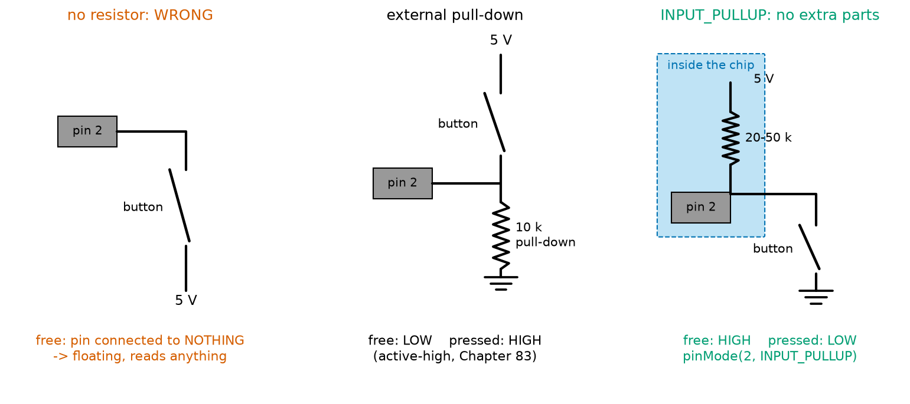
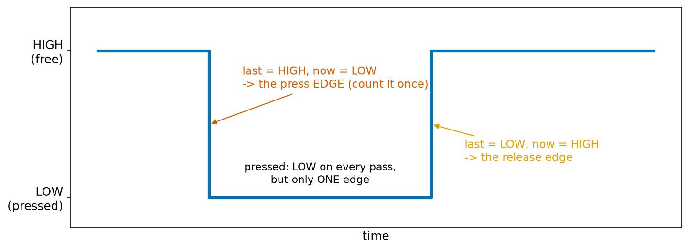
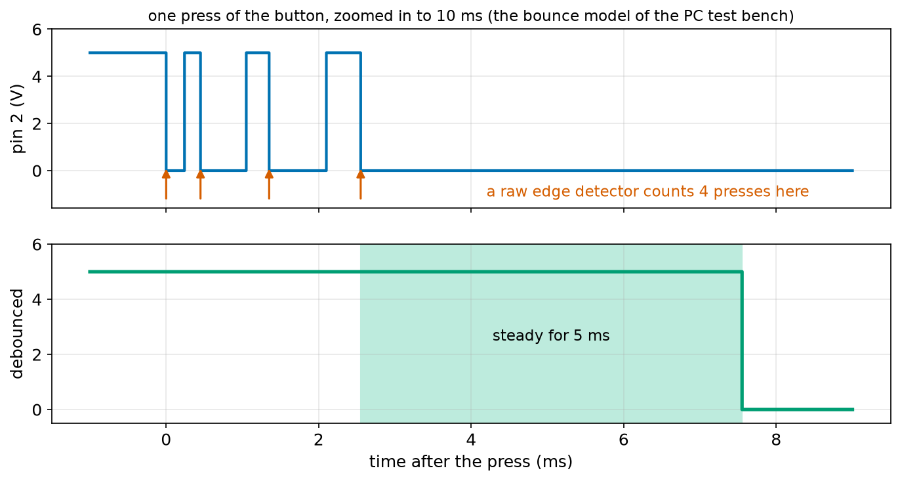
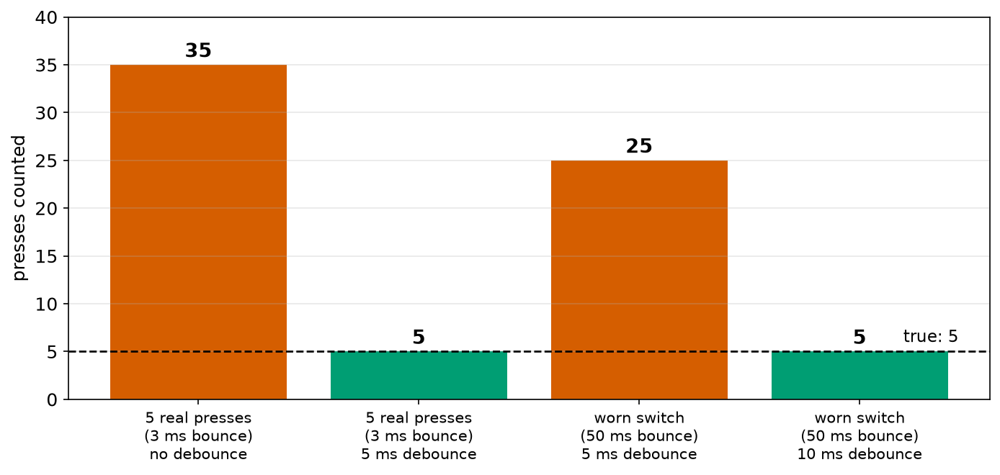
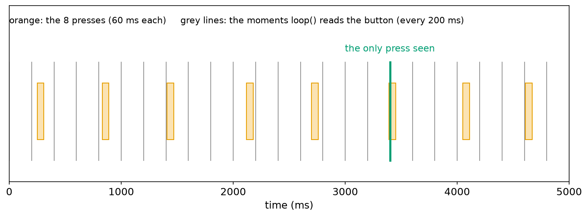
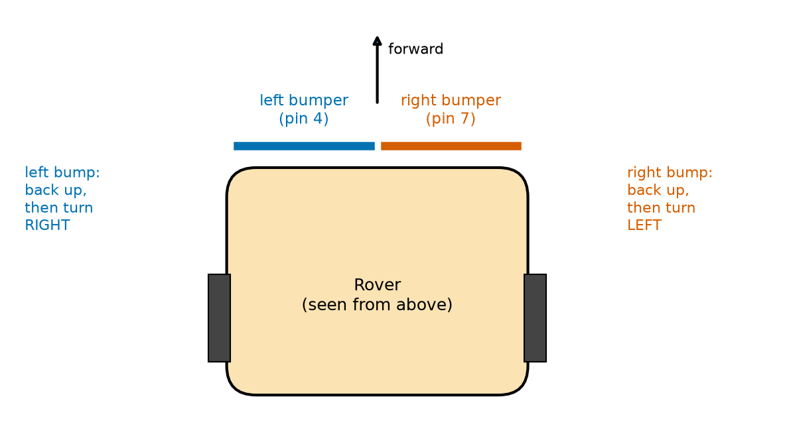
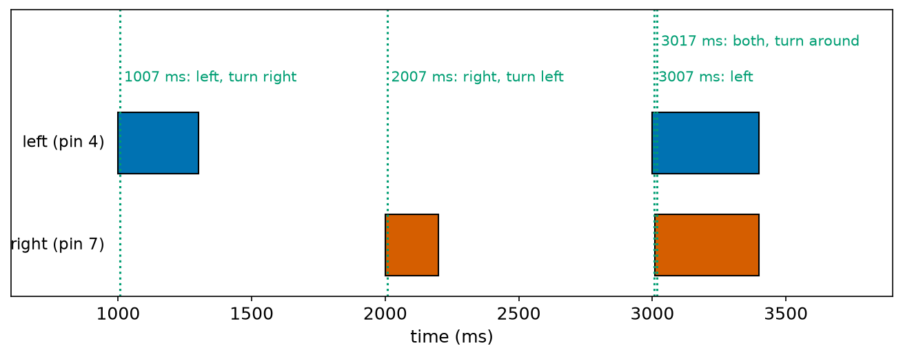

# Chapter 99 — Reading Buttons: Digital Input and Debouncing

> **Part 6 · Chapter 99 of 749**
> **You need:** Chapter 83 (switches, pull-up and pull-down resistors, contact bounce), Chapter 91 (logic levels and Schmitt triggers), Chapters 96–97 (C++ types, `if`, arrays, functions) and Chapter 98 (what is inside a pin).
> **You will make:** a sketch that shows a button's state, a test of a pin with nothing connected, a press counter that counts 35 presses for 5 real ones, a debounced counter that counts exactly 5, Rover's two bumpers with a turn decision, and a check of how often a robot must look at its switches.

---

## What you will learn

- How `digitalRead` reads a pin, and what a **floating** input does.
- How to use the chip's built-in **pull-up** resistors with `INPUT_PULLUP`, and why a pressed button then reads LOW.
- How to turn a **level** ("is it pressed?") into an **event** ("it was just pressed"): **edge detection**.
- Why one press looks like many (**contact bounce**), and how to **debounce** it in code.
- How fast a loop must be to see every press: **polling** and its limits.
- How to read Rover's **bumpers** and decide which way to turn.

---

## New words in this chapter

| Word | Simple meaning |
|---|---|
| **digital input** | A pin that the program reads as HIGH or LOW. |
| **floating** | An input connected to nothing: its reading is random. |
| **pull-up resistor** | A resistor that holds an input HIGH when nothing else drives it. |
| **internal pull-up** | A pull-up resistor inside the chip, switched on by `INPUT_PULLUP`. |
| **level** | What a signal is now: HIGH or LOW. |
| **edge** | The moment a signal changes: a falling edge (HIGH to LOW) or a rising edge (LOW to HIGH). |
| **event** | Something that happens once, such as "the button was just pressed". |
| **contact bounce** | The quick on-off-on chatter of switch contacts when they close or open. |
| **debounce** | Ignore the chatter: accept a new level only after it has been steady for a while. |
| **polling** | Reading an input again and again in a loop to see when it changes. |
| **bumper** | A switch on the front of a robot that closes when the robot touches something. |

---

## 99.1 Reading a pin: `digitalRead`

In Chapter 98, a pin **spoke**: `digitalWrite` set it HIGH or LOW. Now a pin **listens**.

📖 **New word: digital input** — a pin set with `pinMode(pin, INPUT)` (or `INPUT_PULLUP`, section 99.2). Both its output transistors are off (Figure 98.1, right), so the outside world decides its voltage. `digitalRead(pin)` looks at that voltage and returns `HIGH` (1) or `LOW` (0), using the Uno's logic levels from Chapter 91: above about 3.0 V is HIGH, below about 1.5 V is LOW.

`digitalRead` returns an `int`, so you can store it, compare it, or use it in an `if`:

```cpp
int level = digitalRead(2);
if (level == LOW) {
  // the button is pressed (with the wiring of section 99.2)
}
```

---

## 99.2 Never leave an input floating: pull-ups

Chapter 83 taught the most important rule of digital inputs. A switch can only **connect** two things; when it is open, it connects nothing. If a pin is joined only to a switch, then while the switch is open the pin is connected to **nothing at all**.

📖 **New word: floating** — an input pin connected to nothing. It has almost no current flowing in or out (high impedance, Chapter 98), so the tiniest stray charge decides its voltage: your hand nearby, a wire acting as an aerial for the 50 Hz mains hum, the last level it had. Its reading is random.

The sketch `floating.ino` reads pin 7, with nothing connected, 20 times. On the PC test bench (which gives a floating pin random levels, to imitate noise):

```
0 0 0 1 0 0 1 1 0 0 1 1 1 0 0 1 0 1 1 0 
```

On a real Uno the pattern is different every time: often a run of 1s, then 0s when your finger comes near the wire, or a fast 1-0-1-0 that follows the mains. That is the danger: a floating input may **seem** to work on your desk and then fail on the robot. A floating bumper input could make Rover think it is hitting a wall in open space, or not notice a real wall.

The fix is a resistor that holds the pin at a known level when the switch is open (Chapter 83).

📖 **New word: pull-up resistor** — a resistor from the pin to 5 V. With the switch open, it "pulls" the pin up to HIGH; the switch, connected from the pin to ground, pulls it down to LOW when pressed. The resistor is large (10 kΩ to 50 kΩ), so when the switch is pressed only a tiny current flows: 5 V ÷ 10 kΩ = 0.5 mA.

📖 **New word: internal pull-up** — the ATmega328P has a pull-up resistor of about 20 kΩ to 50 kΩ **inside** every pin. `pinMode(pin, INPUT_PULLUP)` switches it on. Then you only need the button, wired from the pin to GND: no extra resistor at all.



*Figure 99.1 — Left: a button with no resistor leaves the pin floating whenever the button is free. Middle: an external pull-down resistor (Chapter 83). Right: `INPUT_PULLUP` uses the resistor inside the chip (shaded blue), with the button to ground.*

**How to read this picture:** Follow the pin in each panel to see what it is connected to when the button is open. Left: nothing, so it floats (red: wrong). Middle: the 10 kΩ resistor holds it at ground, so free = LOW and pressed = HIGH. Right: the chip's own 20–50 kΩ resistor holds it at 5 V, so free = HIGH and pressed = LOW. The right-hand wiring needs the fewest parts, which is why almost every Arduino button and bumper uses it.

⚠️ **Careful: with `INPUT_PULLUP`, pressed means LOW.** This surprises everyone the first time. The button pulls the pin to ground. So the test for "pressed" is `digitalRead(pin) == LOW`. Write it in one place, in a well-named function or constant, so the rest of the sketch can think in "pressed" and "free".

The sketch `button_basic.ino` (in the Code section) prints the button's state every 100 ms. With the button pressed from 0.25 s to 0.55 s:

```
free
free
free
pressed
pressed
pressed
free
free
```

🤖 **Robot link: why LOW = pressed is also safer.** If the wire from a bumper to the Uno breaks, an `INPUT_PULLUP` pin reads HIGH: "free". The robot keeps driving, which is not safe for a bumper. Chapter 83 showed the answer for critical switches: use a **normally closed** switch, which is closed when free and opens when pressed, so a broken wire looks the same as a press, and the robot stops. Rover's bumpers in this chapter use the simpler normally open wiring; safety-critical stops use normally closed (Application 3).

---

## 99.3 From levels to events: edge detection

`digitalRead` tells you the button's **level** now. But most programs care about **events**: "start when the button is **pressed**", "count each **press**".

📖 **New word: level** — the state of a signal at this moment: HIGH or LOW.

📖 **New word: edge** — the moment a signal **changes**. HIGH to LOW is a **falling edge**; LOW to HIGH is a **rising edge**. With `INPUT_PULLUP`, a press is a falling edge and a release is a rising edge.

📖 **New word: event** — something that happens once. A held button is pressed for a whole second, but it was pressed only **once**: one event, one falling edge.

`loop()` runs thousands of times per second. If it counted "pressed" on every pass, a one-second press would count thousands of times. The trick is to **remember the last level** and compare:

```cpp
int level = digitalRead(BUTTON_PIN);
if (lastLevel == HIGH && level == LOW) {   // was free, is now pressed: a falling edge
  presses++;
}
lastLevel = level;                          // remember for next time
```



*Figure 99.2 — A button's level over time. The level is LOW for the whole press, but there is only one falling edge and one rising edge.*

**How to read this picture:** The blue line is the level on the pin: HIGH while free, LOW while pressed. On every pass of `loop()` during the press, `level` is LOW. Only on the one pass where `lastLevel` is still HIGH and `level` is LOW (red arrow) does the test say "a new press". The orange arrow is the release edge, found with `lastLevel == LOW && level == HIGH`.

🧠 **To turn a level into an event, compare it with the level you saw last time.** `lastLevel` must be a global (or `static`) so it survives from one pass of `loop()` to the next (Chapters 96 and 97).

---

## 99.4 Contact bounce: one press, many edges

The sketch `count_raw.ino` uses exactly the edge detector above to count presses. The PC test bench presses the button five times, for 200 ms each, and gives the button the same **bounce** as a real switch. Output (one line per second):

```
presses counted: 7
presses counted: 14
presses counted: 25
presses counted: 35
presses counted: 35
```

Five presses, 35 counted. The program is right; the switch is the problem.

📖 **New word: contact bounce** — when the metal contacts of a switch close, they hit each other and spring apart again, several times, before they settle: like a ball dropped on the floor. For a few milliseconds the pin goes LOW, HIGH, LOW, HIGH… (Chapter 83 measured it). The same happens when they open. A typical small push button bounces for 1 to 5 ms; a worn or large switch can bounce for 20 ms or more.



*Figure 99.3 — Top: the voltage on the pin during the first 10 ms of one press, with the bounce model of the PC test bench. Bottom: the debounced level (section 99.5).*

**How to read this picture:** Time is in **milliseconds** after the contacts first touch. In the top panel the level falls at 0 ms but jumps back up three times before it stays LOW at about 2.5 ms. Each red arrow is a falling edge, and a raw edge detector counts every one: 4 "presses" for one press. The release bounces too, adding 3 more falling edges: 7 per press, and 5 × 7 = 35. The bottom panel is the cure: one clean change, 5 ms after the last bounce.

Why does the program see every bounce? Because it is fast. One pass of `count_raw.ino`'s `loop()` takes a few microseconds; the shortest bounce lasts 0.2 ms, which is about 50 passes. A human cannot press a button for less than about 50 ms, but a microcontroller notices events thousands of times shorter.

---

## 99.5 Debouncing in code

📖 **New word: debounce** — to ignore the chatter of a bouncing switch. The idea from Chapter 83: **accept a new level only after the pin has shown it steadily for a few milliseconds** (5 ms is typical). Bounces never stay still that long; a real press does.

The sketch keeps three things (all global, so they last between passes):

| Variable | Meaning |
|---|---|
| `lastReading` | the raw level on the previous pass |
| `lastChange` | the time (from `millis()`) when the raw level last changed |
| `stableLevel` | the debounced level: what we believe the button is doing |

And it does two things on every pass:

1. If the raw reading is different from the last one, the pin is still moving: write down the time (`lastChange = millis()`).
2. If the reading has not changed for at least 5 ms **and** it is different from `stableLevel`, accept it: `stableLevel = reading`. If the new stable level is LOW, that is one real press.

The sketch `debounce.ino`, with exactly the same five bouncing presses:

```
presses counted: 1
presses counted: 2
presses counted: 4
presses counted: 5
presses counted: 5
```

Five presses, five counted. (The third line jumps by 2 because two presses happened between the reports at 2 s and 3 s: at 2.1 s and 2.9 s.)



*Figure 99.4 — Presses counted in four tests on the PC test bench. Red: wrong counts. Green: right counts. The dashed line is the true number, 5.*

**How to read this picture:** The first two bars are the same five presses with a normal 3 ms bounce: 35 without debouncing, 5 with it. The last two bars are a worn switch that bounces for 50 ms (Lab 99.2): its quiet gaps inside the bounce last up to 7.5 ms, longer than the 5 ms debounce, so 5 ms is no longer enough and it counts 25. A 10 ms debounce counts 5 again.

🔢 **Choosing the debounce time.** It must be longer than the longest "quiet" gap inside the bounce, and shorter than the shortest real press (about 50 ms for a human finger). 5 ms suits most small buttons; 10–20 ms suits big switches, limit switches and worn contacts. The cost is delay: the program notices a press 5 to 20 ms late, which no person can feel.

💡 **Tip: debouncing in hardware.** Chapter 91 showed the other way: an RC filter (a resistor and a 100 nF capacitor, Chapter 84) smooths the bounce into a slow curve, and a Schmitt-trigger input (Chapter 91) turns the curve into one clean edge. Hardware debouncing costs two parts per button; software debouncing costs nothing but a few lines. Many products use both for important switches.

---

## 99.6 Polling: how fast must the loop look?

📖 **New word: polling** — reading an input again and again, in a loop, to see when it changes. All the sketches in this chapter poll: `loop()` calls `digitalRead` on every pass.

Polling only works if the loop looks **often enough**. A press that starts and ends between two readings is never seen. The sketch `slow_poll.ino` pretends the rest of the robot's work takes 200 ms per pass (`delay(200)`), and reads the button once per pass. The test bench gives it 8 quick presses of 60 ms each:

```
3400 ms: press seen, total 1
```

One press seen out of eight. With `WORK_MS = 0`, the same test sees all eight:

```
250 ms: press seen, total 1
830 ms: press seen, total 2
1410 ms: press seen, total 3
2120 ms: press seen, total 4
2700 ms: press seen, total 5
3390 ms: press seen, total 6
4050 ms: press seen, total 7
4610 ms: press seen, total 8
```



*Figure 99.5 — The 8 presses (orange boxes, 60 ms each) and the moments the slow loop reads the button (grey lines, every 200 ms).*

**How to read this picture:** Time runs left to right over 5 seconds. A press is seen only if a grey line falls **inside** an orange box. Only one does, at 3.4 s (green). The other seven presses fall entirely between two readings, and the program never knows they happened.

🧠 **A polling loop can only see events that last longer than one pass of the loop.** Keep `loop()` fast: no long `delay()`s. Chapter 103 shows how to do slow jobs without slowing the loop, and Chapter 105 shows **interrupts**, which catch an edge the instant it happens, however busy the loop is.

---

## Code

All outputs come from the PC test bench with the Uno's 16-bit `int`. The test files in `code/ch099/pc_tests/` describe the pretend buttons; `sim_inputs.h` in `code/common/arduino_sim/` makes a button that bounces 7 times in 3 ms whenever it is pressed or released.

File `code/ch099/button_basic/button_basic.ino`:

```cpp
// button_basic.ino - read a button on pin 2 ten times a second and show its state
const int BUTTON_PIN = 2;              // button between pin 2 and GND

void setup() {
  Serial.begin(9600);
  pinMode(BUTTON_PIN, INPUT_PULLUP);   // input, with the chip's own pull-up resistor switched on
}

void loop() {
  int level = digitalRead(BUTTON_PIN); // HIGH or LOW
  if (level == LOW) {
    Serial.println("pressed");         // LOW = the button connects the pin to GND
  } else {
    Serial.println("free");            // HIGH = the pull-up holds the pin at 5 V
  }
  delay(100);
}
```

| Line | Code | What it does (simple English) |
|---|---|---|
| 1 | `// button_basic.ino - …` | A comment. |
| 2 | `const int BUTTON_PIN = 2;` | The button is between pin 2 and GND. |
| 3 | (blank) | Spacing. |
| 4 | `void setup() {` | Runs once. |
| 5 | `Serial.begin(9600);` | Open Serial. |
| 6 | `pinMode(BUTTON_PIN, INPUT_PULLUP);` | Make pin 2 an input and switch on its internal pull-up resistor. |
| 7 | `}` | End of `setup`. |
| 8 | (blank) | Spacing. |
| 9 | `void loop() {` | Runs for ever. |
| 10 | `int level = digitalRead(BUTTON_PIN);` | Read the pin: `HIGH` or `LOW`. |
| 11–12 | `if (level == LOW) { Serial.println("pressed");` | LOW means the button connects the pin to ground: pressed. |
| 13–14 | `} else { Serial.println("free");` | HIGH: the pull-up holds the pin up: free. |
| 15 | `}` | End of the `if`. |
| 16 | `delay(100);` | Ten readings per second, so the screen is readable. |
| 17 | `}` | End of `loop`. |

The output is in section 99.2.

File `code/ch099/floating/floating.ino`:

```cpp
// floating.ino - read a pin with NOTHING connected to it: what does it say?
const int PIN = 7;                     // leave pin 7 empty

void setup() {
  Serial.begin(9600);
  pinMode(PIN, INPUT);                 // a plain input: no pull-up, no pull-down
  for (int i = 0; i < 20; i++) {
    Serial.print(digitalRead(PIN));    // 1 or 0
    Serial.print(" ");
    delay(50);
  }
  Serial.println();
}

void loop() {
}
```

| Line | Code | What it does (simple English) |
|---|---|---|
| 1 | `// floating.ino - …` | A comment. |
| 2 | `const int PIN = 7;` | Pin 7, with nothing connected to it. |
| 3 | (blank) | Spacing. |
| 4–5 | `void setup() {`, `Serial.begin(9600);` | Start. |
| 6 | `pinMode(PIN, INPUT);` | A plain input: the pull-up stays off. |
| 7 | `for (int i = 0; i < 20; i++) {` | Twenty readings. |
| 8 | `Serial.print(digitalRead(PIN));` | Print 1 for HIGH or 0 for LOW. |
| 9 | `Serial.print(" ");` | A space between readings. |
| 10 | `delay(50);` | 50 ms between readings. |
| 11 | `}` | End of the `for`. |
| 12 | `Serial.println();` | End the line. |
| 13 | `}` | End of `setup`. |
| 14–16 | `void loop() { }` | Nothing more. |

The output is in section 99.2. Change line 6 to `pinMode(PIN, INPUT_PULLUP);` and every reading becomes 1.

File `code/ch099/count_raw/count_raw.ino`:

```cpp
// count_raw.ino - count button presses by watching for HIGH-to-LOW changes, with no debouncing
const int BUTTON_PIN = 2;

int lastLevel = HIGH;                  // the level on the previous pass of loop()
long presses = 0;
unsigned long lastReport = 0;

void setup() {
  Serial.begin(9600);
  pinMode(BUTTON_PIN, INPUT_PULLUP);
}

void loop() {
  int level = digitalRead(BUTTON_PIN);
  if (lastLevel == HIGH && level == LOW) {   // it WAS free and IS now pressed: an edge
    presses++;
  }
  lastLevel = level;                   // remember this level for the next pass

  if (millis() - lastReport >= 1000) {
    lastReport = millis();
    Serial.print("presses counted: ");
    Serial.println(presses);
  }
}
```

| Line | Code | What it does (simple English) |
|---|---|---|
| 1 | `// count_raw.ino - …` | A comment. |
| 2 | `const int BUTTON_PIN = 2;` | The button's pin. |
| 3 | (blank) | Spacing. |
| 4 | `int lastLevel = HIGH;` | The level seen on the previous pass. It starts as HIGH (free). Global, so it is remembered. |
| 5 | `long presses = 0;` | The count. |
| 6 | `unsigned long lastReport = 0;` | When we last printed (a time from `millis()`, so `unsigned long`, Chapter 96). |
| 7 | (blank) | Spacing. |
| 8–11 | `void setup() { … }` | Open Serial; pin 2 as an input with its pull-up. |
| 12 | (blank) | Spacing. |
| 13 | `void loop() {` | Runs very fast, again and again. |
| 14 | `int level = digitalRead(BUTTON_PIN);` | The level now. |
| 15 | `if (lastLevel == HIGH && level == LOW) {` | A falling edge: it was HIGH last time and is LOW now. |
| 16 | `presses++;` | Count it. |
| 17 | `}` | End of the `if`. |
| 18 | `lastLevel = level;` | Remember this level for the next pass. |
| 19 | (blank) | Spacing. |
| 20 | `if (millis() - lastReport >= 1000) {` | Once per second (the pattern from Chapter 96's timer)… |
| 21–23 | `lastReport = millis(); Serial.print(…); Serial.println(presses);` | …print the count. |
| 24 | `}` | End of the `if`. |
| 25 | `}` | End of `loop`. |

The output is in section 99.4: 35 for 5 presses.

File `code/ch099/debounce/debounce.ino`:

```cpp
// debounce.ino - count button presses, accepting a new level only after it has been steady for 5 ms
const int BUTTON_PIN = 2;
const unsigned long DEBOUNCE_MS = 5;

int lastReading = HIGH;                // the raw level on the previous pass
unsigned long lastChange = 0;          // when the raw level last changed
int stableLevel = HIGH;                // the debounced level: what we believe the button is doing
long presses = 0;
unsigned long lastReport = 0;

void setup() {
  Serial.begin(9600);
  pinMode(BUTTON_PIN, INPUT_PULLUP);
}

void loop() {
  int reading = digitalRead(BUTTON_PIN);
  if (reading != lastReading) {        // the raw level moved: start timing again
    lastChange = millis();
    lastReading = reading;
  }
  if (millis() - lastChange >= DEBOUNCE_MS && reading != stableLevel) {
    stableLevel = reading;             // steady for 5 ms: accept the new level
    if (stableLevel == LOW) {
      presses++;                       // a real press (an edge of the debounced level)
    }
  }

  if (millis() - lastReport >= 1000) {
    lastReport = millis();
    Serial.print("presses counted: ");
    Serial.println(presses);
  }
}
```

| Line | Code | What it does (simple English) |
|---|---|---|
| 1 | `// debounce.ino - …` | A comment. |
| 2 | `const int BUTTON_PIN = 2;` | The button's pin. |
| 3 | `const unsigned long DEBOUNCE_MS = 5;` | How long a new level must stay before we believe it. The same type as `millis()`. |
| 4 | (blank) | Spacing. |
| 5 | `int lastReading = HIGH;` | The raw level seen on the previous pass. |
| 6 | `unsigned long lastChange = 0;` | When the raw level last changed. |
| 7 | `int stableLevel = HIGH;` | The debounced level. Starts as free. |
| 8 | `long presses = 0;` | The count of real presses. |
| 9 | `unsigned long lastReport = 0;` | For the once-a-second report. |
| 10 | (blank) | Spacing. |
| 11–14 | `void setup() { … }` | Open Serial; pin 2 as an input with its pull-up. |
| 15 | (blank) | Spacing. |
| 16 | `void loop() {` | Runs very fast. |
| 17 | `int reading = digitalRead(BUTTON_PIN);` | The raw level now: it may be bouncing. |
| 18 | `if (reading != lastReading) {` | Different from last pass? Then the pin is moving (perhaps bouncing). |
| 19 | `lastChange = millis();` | Start the "steady" timer again from now. |
| 20 | `lastReading = reading;` | Remember the new raw level. |
| 21 | `}` | End of the `if`. |
| 22 | `if (millis() - lastChange >= DEBOUNCE_MS && reading != stableLevel) {` | Two conditions: no change for 5 ms, **and** the level differs from what we believed. |
| 23 | `stableLevel = reading;` | Accept it: the button really has changed. |
| 24–26 | `if (stableLevel == LOW) { presses++; }` | If the new stable level is LOW, it is a real press: count it once. A release (HIGH) is accepted but not counted. |
| 27 | `}` | End of the `if`. |
| 28 | (blank) | Spacing. |
| 29–33 | `if (millis() - lastReport >= 1000) { … }` | Print the count once per second. |
| 34 | `}` | End of `loop`. |

The output is in section 99.5: 5 for 5 presses.

---

## Small examples

**Example 1.** With `INPUT_PULLUP` and a button to GND: free reads 1 (HIGH), pressed reads 0 (LOW).

**Example 2.** With an external 10 kΩ pull-down and a button to 5 V: free reads 0, pressed reads 1.

**Example 3.** A pressed button with a 10 kΩ pull-up wastes 5 ÷ 10,000 = 0.5 mA; with the internal pull-up (about 35 kΩ), about 0.14 mA.

**Example 4.** `lastLevel == HIGH && level == LOW` is a falling edge (a press with a pull-up); `lastLevel == LOW && level == HIGH` is a rising edge (a release).

**Example 5.** A button held for 2 seconds gives one press event, but about 2 × 100,000 "pressed" levels in a loop running 100,000 times per second.

**Example 6.** A switch bounces for 4 ms with quiet gaps of up to 1 ms: a 5 ms debounce is enough.

**Example 7.** A loop that takes 50 ms per pass is only sure to see presses longer than 50 ms.

**Example 8.** Rover at 0.3 m/s with a 10 ms loop drives 0.3 × 0.010 = 3 mm before it notices a bump.

---

## 🏭 Real robot applications

### Application 1 (worked in full) — 🤖 Rover's bumpers: which way to turn

**1. The real problem.** Rover's front has two bumper switches, left and right (Chapter 83 designed them). When Rover touches something, it must back up and turn **away** from the side it hit: a left bump means "the obstacle is on the left, turn right". If both are hit, the obstacle is straight ahead: turn around. Each bumper bounces like any switch, and a bounce must not be mistaken for a second bump.

📖 **New word: bumper** — a switch, usually a long lever or a sprung plate on the front of a robot, that closes when the robot touches something. It is the last line of defence: it only works after contact.

**2. Why this theory.** Section 99.2: `INPUT_PULLUP`, pressed = LOW. Section 99.5: debouncing. Section 99.3: we act on the **event** (a new press), not on the level, so one bump gives one turn. Chapter 97: arrays let one function debounce any number of bumpers.



*Figure 99.6 — Rover from above with its two bumpers, and what it does after each kind of bump.*

**How to read this picture:** The forward arrow points the way Rover drives. The blue bar is the left bumper (pin 4), the red bar the right bumper (pin 7); each is a switch to ground. The text on each side says the reaction: a bump on one side makes Rover back up and turn towards the **other** side.

**3. The numbers.** Pins 4 (left) and 7 (right), `INPUT_PULLUP`. (On the finished Rover they move to the I2C expander of Figure 95.8; Chapter 108 reads them there.) Debounce 5 ms. The test: a left bump at 1.0 s, a right bump at 2.0 s, and both at once at 3.0 s, where the right switch closes 10 ms after the left, because real obstacles never touch both bumpers at exactly the same instant.

**4. The maths.** Each bumper is reported 5 ms after its last bounce: the bounce lasts about 2.5 ms, so the event comes about 7 ms after first contact. At 0.3 m/s, Rover moves 0.3 × 0.007 = 2.1 mm in that time: harmless for a sprung bumper with about 10 mm of travel. In the "both" case, the left event comes at about 3,007 ms and the right one at about 3,017 ms.

**5. The code.** File `code/ch099/bumpers/bumpers.ino`:

```cpp
// bumpers.ino - Rover's two bumpers, debounced; decide which way to turn after a bump
const int N = 2;
const int BUMPER_PIN[N] = {4, 7};      // [0] = left bumper, [1] = right bumper (switches to GND)
const unsigned long DEBOUNCE_MS = 5;

int lastReading[N] = {HIGH, HIGH};
unsigned long lastChange[N] = {0, 0};
int stableLevel[N] = {HIGH, HIGH};

// Debounce bumper i. Returns true only at the moment a new, real press is accepted.
bool newPress(int i) {
  int reading = digitalRead(BUMPER_PIN[i]);
  if (reading != lastReading[i]) {
    lastChange[i] = millis();
    lastReading[i] = reading;
  }
  if (millis() - lastChange[i] >= DEBOUNCE_MS && reading != stableLevel[i]) {
    stableLevel[i] = reading;
    return stableLevel[i] == LOW;      // true for a press, false for a release
  }
  return false;
}

void setup() {
  Serial.begin(9600);
  for (int i = 0; i < N; i++) {
    pinMode(BUMPER_PIN[i], INPUT_PULLUP);
  }
}

void loop() {
  bool leftNew = newPress(0);
  bool rightNew = newPress(1);
  if (leftNew || rightNew) {
    bool left = stableLevel[0] == LOW;   // which bumpers are pressed right now?
    bool right = stableLevel[1] == LOW;
    Serial.print(millis());
    Serial.print(" ms: ");
    if (left && right) {
      Serial.println("both bumpers: back up, turn around");
    } else if (left) {
      Serial.println("left bumper: back up, turn right");
    } else {
      Serial.println("right bumper: back up, turn left");
    }
  }
}
```

| Line | Code | What it does (simple English) |
|---|---|---|
| 1 | `// bumpers.ino - …` | A comment. |
| 2 | `const int N = 2;` | Two bumpers. |
| 3 | `const int BUMPER_PIN[N] = {4, 7};` | Their pins: index 0 is the left bumper, index 1 the right. |
| 4 | `const unsigned long DEBOUNCE_MS = 5;` | The debounce time. |
| 5 | (blank) | Spacing. |
| 6–8 | `int lastReading[N] …`, `unsigned long lastChange[N] …`, `int stableLevel[N] …` | `debounce.ino`'s three variables, now as arrays: one element per bumper. |
| 9 | (blank) | Spacing. |
| 10 | `// Debounce bumper i. …` | A comment describing the function. |
| 11 | `bool newPress(int i) {` | Debounce bumper number `i`. Returns `true` only on the one pass where a new press is accepted. |
| 12 | `int reading = digitalRead(BUMPER_PIN[i]);` | Read this bumper's pin. |
| 13–16 | `if (reading != lastReading[i]) { … }` | It moved: restart its timer. |
| 17 | `if (millis() - lastChange[i] >= DEBOUNCE_MS && reading != stableLevel[i]) {` | Steady for 5 ms and different from what we believed. |
| 18 | `stableLevel[i] = reading;` | Accept it. |
| 19 | `return stableLevel[i] == LOW;` | `true` if it is a press, `false` if a release. |
| 20 | `}` | End of the `if`. |
| 21 | `return false;` | Nothing new this pass. |
| 22 | `}` | End of `newPress`. |
| 23 | (blank) | Spacing. |
| 24–29 | `void setup() { … }` | Open Serial; a loop sets both pins to `INPUT_PULLUP`. |
| 30 | (blank) | Spacing. |
| 31 | `void loop() {` | Runs very fast. |
| 32–33 | `bool leftNew = newPress(0);`, `bool rightNew = newPress(1);` | Debounce both bumpers on **every** pass. Both calls must happen each time, so their timers stay correct; that is why they are not put inside the `if`. |
| 34 | `if (leftNew \|\| rightNew) {` | A new bump on either side. |
| 35–36 | `bool left = …`, `bool right = …` | Which bumpers are pressed **now** (one may have been pressed earlier and still be held). |
| 37–38 | `Serial.print(millis()); …` | Print the time. |
| 39–45 | `if (left && right) … else if (left) … else …` | Choose the reaction. Both: turn around. Left only: turn right. Otherwise (right only): turn left. |
| 46 | `}` | End of the `if`. |
| 47 | `}` | End of `loop`. |

Output (4 seconds on the PC test bench):

```
1007 ms: left bumper: back up, turn right
2007 ms: right bumper: back up, turn left
3007 ms: left bumper: back up, turn right
3017 ms: both bumpers: back up, turn around
```



*Figure 99.7 — When each bumper was pressed (coloured bars) and when the sketch reacted (green dotted lines).*

**How to read this picture:** The blue bars are the left bumper's presses, the orange bars the right's. Each green dotted line is one printed decision, just after the start of a press. At 3 s there are two lines close together: the left bumper's event at 3,007 ms and, 10 ms later, the right one's, when both are pressed.

**6. The result.** Every bump gives exactly one decision, 7 ms after contact, and no bounce ever causes a second one. The "both" case shows a real-world detail: because the two switches closed 10 ms apart, Rover first decides "turn right" and 10 ms later changes its mind to "turn around". A real Rover handles this by waiting a short time (say 30 ms) after the first bump before choosing, to see whether the other bumper follows; or, simpler, by always backing up first (which is right in every case) and choosing the turn only when the back-up is finished. Chapter 104 builds that as a state machine.

**7. Going further.** Robot vacuum cleaners use exactly this design: a sprung front bumper with a switch (or an optical sensor) on each side, read many times per second, and the side that was hit decides the turn. Better ones add more sensing positions along the bumper, so they know the angle of the wall, and slow down before contact using infrared or LiDAR distance sensors (Chapters 118–120), so the bumper becomes the backup rather than the main sensor.

### Application 2 (worked in full) — 🏭 How often must a machine look at its limit switch?

**1. The real problem.** A machine moving along an axis (a 3D printer's print head, a factory arm's joint, Rover's front) has a switch at the end of its travel. When the switch closes, the motor must stop. But the program only notices the switch when it reads it. How far does the machine move between the moment the switch closes and the moment the program sees it, and how short a press can it miss?

**2. Why this theory.** Section 99.6: a polling loop reads each input once per pass. In the worst case, the switch closes just after a reading, and is seen one whole pass later.

**3. The numbers.** Rover driving into a wall: 300 mm/s. A 3D printer homing its head: 50 mm/s. A factory arm joint near its limit: 500 mm/s at the tool. Loop periods: 1, 10, 50 and 200 ms.

**4. The maths.** Worst-case extra travel = speed × loop period. Rover with a 200 ms loop: 300 × 0.2 = **60 mm**: it pushes 6 cm further into the wall before it even knows. With a 1 ms loop: 300 × 0.001 = 0.3 mm. A loop is only **sure** to see a press that lasts longer than one pass.

**5. The code.** File `code/ch099/poll_budget.py`:

```python
# poll_budget.py - how often must a robot look at a switch? Worst-case travel between two readings.
machines = [
    # (name, speed in mm per second)
    ("Rover driving into a wall", 300),
    ("3D printer head homing", 50),
    ("factory arm joint near its limit", 500),
]
loop_ms = [1, 10, 50, 200]                 # time between two readings of the switch

print(f"{'machine':34s}" + "".join(f"{f'{t} ms loop':>12s}" for t in loop_ms))
for name, speed in machines:
    extra = [speed * t / 1000 for t in loop_ms]      # distance moved while the switch is pressed but not yet read
    print(f"{name:34s}" + "".join(f"{e:9.1f} mm" for e in extra))
print()
for t in loop_ms:
    print(f"a {t:3d} ms loop is only sure to see a press that lasts longer than {t} ms")
```

| Line | Code | What it does (simple English) |
|---|---|---|
| 1 | `# poll_budget.py …` | A comment. |
| 2–7 | `machines = [ … ]` | Three machines and their speeds, as a list of tuples. |
| 8 | `loop_ms = [1, 10, 50, 200]` | Four loop periods to compare. |
| 9 | (blank) | Spacing. |
| 10 | `print(f"{'machine':34s}" + "".join(…))` | The heading: "machine" padded to 34 characters, then one column title per loop period. `"".join(…)` glues the titles together. |
| 11 | `for name, speed in machines:` | One row per machine. |
| 12 | `extra = [speed * t / 1000 for t in loop_ms]` | A list comprehension: the worst-case travel for each loop period, speed (mm/s) × period (s). |
| 13 | `print(…)` | The row. |
| 14 | `print()` | An empty line. |
| 15–16 | `for t in loop_ms: print(…)` | The shortest press each loop is sure to see. |

Output:

```
machine                              1 ms loop  10 ms loop  50 ms loop 200 ms loop
Rover driving into a wall               0.3 mm      3.0 mm     15.0 mm     60.0 mm
3D printer head homing                  0.1 mm      0.5 mm      2.5 mm     10.0 mm
factory arm joint near its limit        0.5 mm      5.0 mm     25.0 mm    100.0 mm

a   1 ms loop is only sure to see a press that lasts longer than 1 ms
a  10 ms loop is only sure to see a press that lasts longer than 10 ms
a  50 ms loop is only sure to see a press that lasts longer than 50 ms
a 200 ms loop is only sure to see a press that lasts longer than 200 ms
```

And the sketch `slow_poll.ino` (in the Code folder; it is Section 99.6's test) shows the second danger: with a 200 ms loop, it saw only 1 of 8 presses lasting 60 ms (Figure 99.5).

**6. The result.** With a 200 ms loop, Rover pushes up to 6 cm further into a wall, and a factory arm could move 10 cm past its limit, enough to break something. A 1 ms loop makes all three harmless (half a millimetre at most). The lesson: **a robot's loop must be fast**, and long `delay()`s are the enemy. A loop that blinks an LED with `delay(500)` is a loop that ignores its bumpers for half a second. Chapter 103 removes those delays, and Chapter 105 catches the most important switches with interrupts, so they are seen within microseconds whatever the loop is doing.

**7. Going further.** Real machines never rely only on software for the end of travel. A 3D printer's firmware reads its endstops in a fast timer interrupt and also slows down when it homes. Factory machines have a second, hardware limit switch further out that cuts the motor power directly, with no program involved (Chapter 744): if the software is late, crashed or wrong, the hardware still stops the axis.

### Application 3 — 🏭 Emergency stop buttons: normally closed, two channels

The big red emergency stop (e-stop) button on every industrial robot (Chapter 7) is a switch, but it is read very differently from Rover's bumpers. First, it is **normally closed** (Chapter 83): pressing it **opens** the circuit. A broken wire also opens the circuit, so it is read as "stop", never as "everything is fine". Second, it has **two** separate contacts (two channels), wired to two separate inputs, and the safety controller checks that both agree; if one channel says "pressed" and the other says "free" for more than a moment, that itself is treated as a fault and the robot stops. Third, the e-stop does not only ask the program to stop: it also cuts the motor power in hardware through a safety relay. The program's job is to notice, record what happened and refuse to restart until a person resets it. Debouncing still matters, but in the safe direction: any "stop" is acted on at once, and only a "free" signal must be steady before it is believed.

### Application 4 — 🎮 Keypads: 16 buttons on 8 pins

Robot control panels, alarm keypads and vending machines often have a 4 × 4 keypad: 16 buttons. Giving each its own pin would use 16 pins. Instead, the buttons sit where 4 **row** wires cross 4 **column** wires, and the program **scans**: it sets one row LOW at a time (the others as inputs with pull-ups) and reads the 4 columns; a LOW column means the button at that crossing is pressed. Four rows × four reads = one full scan of all 16 buttons with 8 pins, repeated every few milliseconds. Each button is debounced exactly as in section 99.5, using arrays of 16 timers and states. When several buttons are pressed at once, current can sneak through a third button and make a "ghost" press appear; keypads that must read many keys together (music keyboards, gaming keyboards) add a diode at each button to stop it.

### Application 5 — 🤖 When polling is too slow: encoder signals

Rover's wheel encoders (Chapter 122) are also digital inputs: each gives a square wave that goes LOW and HIGH as the wheel turns. At 0.5 m/s, each wheel gives about 1,300 pulses per second (Chapter 94, Application 1), so each LOW or HIGH lasts only about 1 ÷ (2 × 1,300) = 0.38 ms. Section 99.6's rule says a polling loop sees every change only if each pass takes well under 0.38 ms. A loop that also reads 5 analog sensors (about 0.56 ms, Chapter 101) and prints a status line cannot do that; it would miss pulses, and Rover's odometry would slowly fall behind the real distance. And unlike a button press, a missed encoder pulse cannot be "debounced" back: it is simply lost. This is the job **interrupts** were made for (Chapter 105): the chip's hardware notices each edge on pins 2 and 3 the instant it happens and runs a tiny counting function, whatever `loop()` is doing.

---

## 🔧 Hands-on lab

### Lab 99.1 — Read a button, and see a floating pin (hardware or Wokwi)

You need: an Uno (or Wokwi), a push button, jumper wires; for step 4, a 20 cm loose wire.

1. Wire the button between pin 2 and GND (use two legs on opposite corners of the button). Upload `button_basic.ino` and open the Serial Monitor. Press and release.
2. Change `INPUT_PULLUP` to `INPUT` in line 6 and upload again. Press and release; then take your hand away and watch.
3. Put `INPUT_PULLUP` back.
4. Upload `floating.ino` with a 20 cm wire plugged into pin 7 and nothing on its other end. Run it twice: once with your hand far away, once holding the wire's free end.

**What you should see:** In step 1, "free" while released and "pressed" while you hold it. In step 2, "pressed" still works (the button pulls the pin to ground), but "free" turns into a random mix of "free" and "pressed", especially when you touch or move near the wires: the pin floats. In step 4, the pattern of 1s and 0s changes when you hold the wire; often it becomes a fast 1 0 1 0 pattern as your body brings in the 50 Hz mains hum. (In Wokwi, a floating pin is simulated more simply and may read steadily; the effect is clearest on real hardware.)

| If it does not work | Likely cause | Fix |
|---|---|---|
| Always "pressed" | The button's two legs used are always joined inside it | Use legs on opposite corners, or turn the button 90° |
| Always "free" | The button is not on pin 2, or not to GND | Check both wires |
| Random text in the monitor | Wrong baud rate | 9600 in the Serial Monitor |

**Challenge:** Add an LED (Chapter 98) on pin 8 that lights while the button is pressed. Then make it **toggle**: each press switches it on or off. You will need edge detection (section 99.3), and you will see bounce: sometimes one press toggles twice. Lab 99.2 fixes it.

### Lab 99.2 — Count presses, then debounce a worn switch (simulation or hardware)

1. Run `count_raw.ino` and then `debounce.ino`, either on the PC test bench (`python ../common/arduino_sim/simrun.py pc_tests/test_count_raw.cpp` from `code/ch099`) or on a real Uno with a button on pin 2, pressing exactly 5 times.
2. A worn switch bounces for 50 ms instead of 3. On the bench, give every press in `pc_tests/test_debounce.cpp` a 50 ms bounce: change the end of the press list from `{3700, 3900}})` to `{3700, 3900}}, 50.0)` (the `50.0` is the bounce time in ms), and run it.
3. Change `DEBOUNCE_MS` to 10 and run it again.

**What you should see:** In step 1, the raw counter gives 35 on the bench (on real hardware, anywhere from 5 to 20 or more, depending on your button) and the debounced one gives exactly 5. In step 2: `presses counted: 25` at the end. The worn switch has quiet gaps of 5 and 7.5 ms inside its bounce, as long as or longer than the debounce time, so each press is accepted as 5 presses. In step 3, with 10 ms: `presses counted: 5` again. The debounce time must be longer than the longest quiet gap in the bounce.

| If it does not work | Likely cause | Fix |
|---|---|---|
| The raw counter counts exactly 5 on real hardware | Your button bounces very little (some do) | Try another button, or tap it lightly and quickly |
| The debounced count misses presses | `DEBOUNCE_MS` is longer than your presses | Use 5–20 ms, never more than 50 |
| A compile error in the test file | The brackets around the press list | Exactly `{3700, 3900}}, 50.0)` at the end of the list |

**Challenge:** Measure how long your real button bounces: in `count_raw.ino`, store `micros()` at the first falling edge and at the last change, and print the difference after each press.

### Lab 99.3 — Bumpers on a breadboard (hardware or Wokwi)

You need: two push buttons (or two microswitches with levers, like real bumpers), jumper wires; an Uno or Wokwi.

1. Wire one button between pin 4 and GND (left bumper) and one between pin 7 and GND (right bumper).
2. Upload `bumpers.ino` and open the Serial Monitor.
3. Press left, then right, then both together.
4. Hold the left button down and press the right one a few times.

**What you should see:** One line per press: "left bumper: back up, turn right", "right bumper: back up, turn left". Pressing both "together" usually gives two lines, a few milliseconds apart (as in Application 1): first one side, then "both bumpers". In step 4, each press of the right button prints "both bumpers", because the left one is still held.

| If it does not work | Likely cause | Fix |
|---|---|---|
| A line repeats while the button is held | `newPress` returns true for the level, not the event | Check line 17's `reading != stableLevel[i]` |
| The sides are swapped | The buttons are on the wrong pins | Left on 4, right on 7, or swap the numbers in `BUMPER_PIN` |
| Nothing at all | A pin is not set to `INPUT_PULLUP` | Check the `for` loop in `setup()` |

**Challenge:** Implement Application 1's improvement: after the first bump, wait 30 ms (use `millis()`, not `delay()`) and only then decide, so that a "both" bump gives only one line, "both bumpers".

---

## Common mistakes

⚠️ **A floating input.** A button with no pull-up or pull-down reads randomly when free. Use `INPUT_PULLUP`.

⚠️ **Forgetting that pressed = LOW with `INPUT_PULLUP`.** Test `== LOW` for "pressed".

⚠️ **Counting levels instead of edges.** One press then counts thousands of times. Compare with the last level.

⚠️ **No debouncing.** One press counts many times. Accept a change only after it has been steady for 5 ms (10–20 ms for big or worn switches).

⚠️ **A debounce time shorter than the switch's bounce gaps.** Measure, or use 10 ms for unknown switches.

⚠️ **`lastLevel` as a local variable inside `loop()`.** It is reset every pass, so no edge is ever found. Make it global or `static`.

⚠️ **Long `delay()`s in a loop that reads switches.** Short presses are missed and reactions come late.

⚠️ **Reading a safety switch normally open.** A broken wire then looks like "everything is fine". Safety switches are normally closed.

⚠️ **Calling a debounce function only sometimes.** Its timer must see every pass; call it on every pass of `loop()`, then decide what to do with the result.

---

## Practice

🏋️ **1.** What does `digitalRead` return for a pin at 4.1 V? At 0.8 V? At 2.3 V (Chapter 91)?

🏋️ **2.** Draw (in words) the wiring for a button that reads HIGH when pressed, using an external resistor. Which value would you choose?

🏋️ **3.** Why does a pressed button read LOW with `INPUT_PULLUP`?

🏋️ **4.** A button is held down for 3 seconds. How many falling edges should a perfect, bounce-free button give? How many "LOW" readings does a loop running 50,000 times per second see?

🏋️ **5.** Write the `if` that detects a **release** with `INPUT_PULLUP`.

🏋️ **6.** A switch bounces for 8 ms, and the longest quiet gap in the bounce is 3 ms. Is a 5 ms debounce enough? What delay does it add to each press?

🏋️ **7.** In `debounce.ino`, what goes wrong if `lastChange` is declared inside `loop()`?

🏋️ **8.** A robot's loop takes 30 ms. It drives at 0.5 m/s. How far can it move after its bumper closes before it notices?

🏋️ **9.** Why is an e-stop wired normally closed, while Rover's bumpers in this chapter are normally open?

🏋️ **10.** A 4 × 4 keypad uses 8 pins. How many pins would a 6 × 8 keypad need, and how many buttons does it have?

🏋️ **11.** Change `slow_poll.ino` so that `WORK_MS` is 0, and run it on the PC test bench with the same test. How many presses does it see now, and why?

---

## Answers

**1.** 4.1 V: HIGH (above 3.0 V). 0.8 V: LOW (below 1.5 V). 2.3 V: between the two thresholds: undefined, it may read either (Chapter 91).

**2.** 5 V → button → pin, and a pull-down resistor from the pin to GND. 10 kΩ is a good value: strong enough to hold the pin LOW against noise, weak enough to waste only 0.5 mA when pressed.

**3.** The internal resistor pulls the pin up to 5 V when the button is free. The button connects the pin straight to ground, which is much stronger than the 20–50 kΩ resistor, so the pin goes to 0 V: LOW.

**4.** One falling edge. About 3 × 50,000 = 150,000 LOW readings.

**5.** `if (lastLevel == LOW && level == HIGH) { … }`

**6.** Yes: 5 ms is longer than the longest quiet gap (3 ms), so no gap inside the bounce is accepted. It adds about 5 ms after the last bounce: about 8 + 5 = 13 ms after first contact in the worst case.

**7.** It would be made again, with the value 0, on every pass; `millis() - lastChange` would then be the whole time since power-on, always more than 5 ms, so every bounce would be accepted at once: no debouncing at all.

**8.** 0.5 m/s × 0.030 s = 0.015 m = **15 mm**.

**9.** With normally closed wiring, a broken wire opens the circuit, which looks exactly like a press: "stop". That is the safe failure for an e-stop. For a simple bumper the risk is accepted, and normally open wiring with `INPUT_PULLUP` needs no extra parts; Application 3 shows the safety-critical way.

**10.** 6 + 8 = **14 pins** for 6 × 8 = **48 buttons**.

**11.** The changed line: `const unsigned long WORK_MS = 0;`. PC test bench output:

```
250 ms: press seen, total 1
830 ms: press seen, total 2
1410 ms: press seen, total 3
2120 ms: press seen, total 4
2700 ms: press seen, total 5
3390 ms: press seen, total 6
4050 ms: press seen, total 7
4610 ms: press seen, total 8
```

All **8**: each pass now takes only microseconds, so every 60 ms press is read thousands of times. (These test presses are clean, without bounce; a real button would also need the debounce of section 99.5.)

---

## Summary

🧠 `pinMode(pin, INPUT_PULLUP)` + a button to GND is the standard wiring: **free = HIGH, pressed = LOW**. A pin connected to nothing **floats** and reads randomly.

🧠 `digitalRead` gives the **level**; programs usually want **events**. Find an **edge** by comparing the level with the **last** level (kept in a global).

🧠 Switch contacts **bounce** for a few milliseconds, so one press gives several edges. **Debounce**: accept a new level only after it has been steady for 5 ms (10–20 ms for worn or large switches).

🧠 **Polling** sees only events longer than one pass of the loop. Keep `loop()` fast; long `delay()`s make robots late and blind.

🧠 Rover's bumpers: two debounced inputs, one decision per new bump, turn away from the side that was hit.

🧠 Safety switches are **normally closed** (and often two-channel), so a broken wire means "stop".

---

## Next chapter

Chapter 100 is about **the Serial Monitor: talking to the computer**. You will learn what really happens when you call `Serial.print`, why printing can slow your loop down, how to choose the speed (baud rate), how to print numbers and text neatly, how to draw live graphs with the Serial Plotter, and how to type commands that your sketch reads and obeys.
