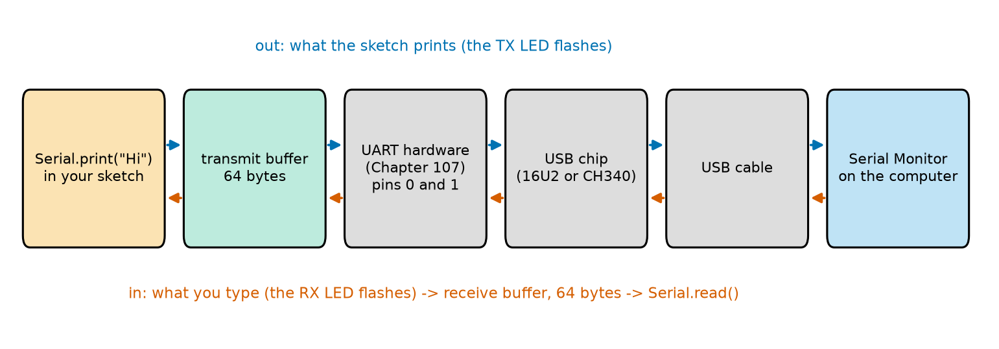
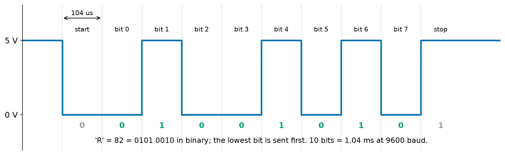
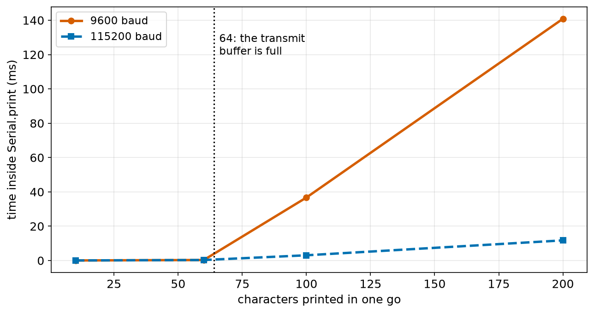
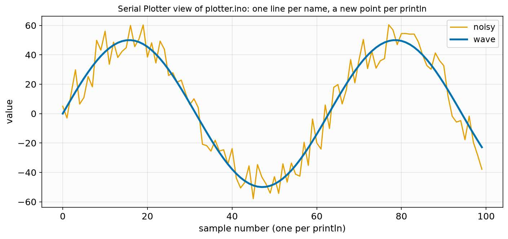
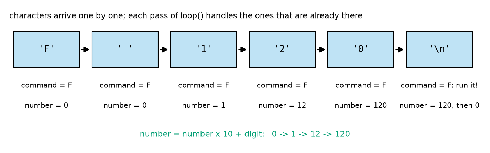
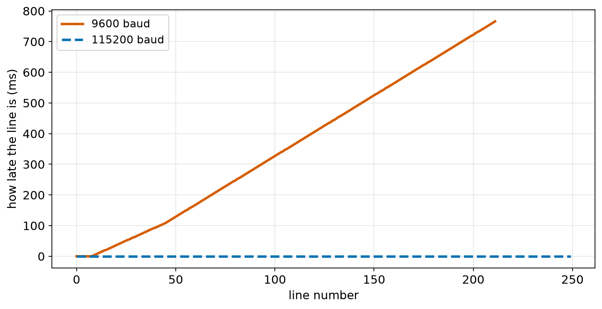
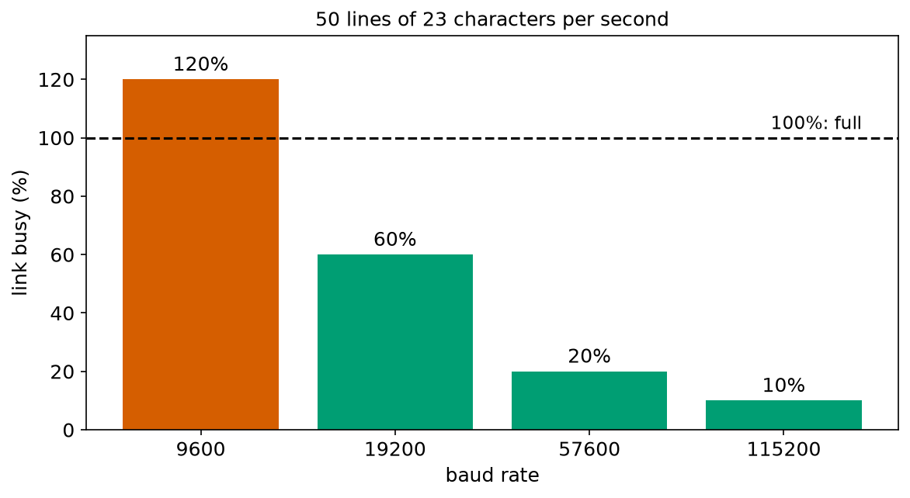

# Chapter 100 — The Serial Monitor: Talking to the Computer

> **Part 6 · Chapter 100 of 749**
> **You need:** Chapter 15 (strings), Chapter 91 (bits and bytes), Chapter 94 (SRAM), Chapters 95–97 (uploading, C++ types, `if`, `switch`, `while`) and Chapter 99 (edges and polling).
> **You will make:** a measurement of how long `Serial.print` really takes, a two-line graph in the Serial Plotter, a command console that drives a pretend Rover from your keyboard without ever stopping its loop, and a sensor logger, with a calculation of which baud rate it needs.

---

## What you will learn

- What happens to the characters between `Serial.print` and the Serial Monitor.
- What the **baud rate** is, how long one character takes, and what goes wrong when the two ends disagree.
- How to print numbers in different forms, and how text is stored as **ASCII** codes.
- Why printing can make your loop slow, and how the 64-byte **buffers** decide when.
- How to draw live graphs with the **Serial Plotter**.
- How to read what the user types, one character at a time, **without** stopping the robot.

---

## New words in this chapter

| Word | Simple meaning |
|---|---|
| **serial** | Sending data one bit after another down one wire. |
| **baud rate** | How many bits per second a serial link sends. |
| **ASCII** | The table that gives every letter, digit and sign a number from 0 to 127. |
| **buffer** | A small memory that holds characters waiting to be sent or read. |
| **blocking** | A function that makes the program wait until it has finished. |
| **line ending** | The invisible characters at the end of a line: newline (`\n`, 10) and carriage return (`\r`, 13). |
| **Serial Plotter** | A window in the Arduino IDE that draws the numbers a sketch prints as moving graphs. |
| **parse** | Read text and work out what it means: "F 120" → command F, number 120. |
| **CSV** | Comma-separated values: one line of text per record, values separated by commas. |
| **telemetry** | Data a robot sends home about itself while it works. |

---

## 100.1 What Serial really is

You have used `Serial.println` since Chapter 95. Now let us follow one character on its whole journey.

📖 **New word: serial** — sending data one bit after another, down a single wire. (The opposite, **parallel**, uses one wire per bit and sends 8 bits at once; it needs many more wires.) The ATmega328P has a serial peripheral called a **UART** (Chapter 107) on pins 0 (RX, receive) and 1 (TX, transmit). On the Uno, those two pins go to the USB chip, which passes the characters to your computer over the USB cable.



*Figure 100.1 — From `Serial.print` to the Serial Monitor (blue arrows), and from your keyboard back to `Serial.read` (orange arrows).*

**How to read this picture:** Start at the left. `Serial.print("Hi")` does not send anything itself: it drops the two characters into the **transmit buffer**, a 64-byte waiting room in SRAM, and returns. The UART hardware takes them from the buffer one by one and sends their bits out on pin 1; the TX LED flashes. The USB chip carries them to the computer, where the Serial Monitor shows them. What you type goes the other way, into a 64-byte **receive buffer**, where it waits until your sketch calls `Serial.read()`.

📖 **New word: buffer** — a small memory that holds data waiting for its turn. The two Serial buffers are why `Serial.begin` costs about 150 bytes of SRAM (Chapter 94's memory budget): 64 + 64 bytes, plus a few for bookkeeping.

---

## 100.2 The baud rate: how fast the bits go

📖 **New word: baud rate** — how many bits per second the serial link sends. `Serial.begin(9600)` means 9,600 bits per second. Both ends must use **exactly the same** rate, because there is no clock wire: the receiver times each bit by its own clock (Chapter 107).

Each character is sent as **10 bits**: a start bit (always 0), the 8 data bits of the character, and a stop bit (always 1).



*Figure 100.2 — The voltage on the TX pin while the letter R is sent at 9600 baud.*

**How to read this picture:** Time runs left to right; each dotted column is one bit, 104 µs long. The line rests at 5 V. The start bit pulls it to 0 V, which tells the receiver "a character is coming". Then come the 8 data bits of R, lowest bit first (green numbers), and the stop bit returns the line to 5 V. R is number 82, which is 01010010 in binary; read backwards it is the 0 1 0 0 1 0 1 0 you see. The whole character takes 10 bits × 104 µs = 1.04 ms.

🔢 **Characters per second = baud ÷ 10.**

| Baud | Bit time | One character | Characters per second |
|---|---|---|---|
| 9,600 | 104 µs | 1.04 ms | 960 |
| 57,600 | 17.4 µs | 0.17 ms | 5,760 |
| 115,200 | 8.7 µs | 0.087 ms | 11,520 |

⚠️ **Careful: a baud mismatch prints garbage.** If the sketch says `Serial.begin(115200)` and the Serial Monitor is set to 9600, the computer times the bits 12 times too slowly and reads nonsense: strange symbols, or nothing at all. It is the most common Serial problem. The baud setting is at the bottom right of the Serial Monitor; make it match the sketch.

💡 **Tip: use 115200.** 9600 is the old default, and many examples use it, but it is slow (section 100.4). The Uno handles 115200 perfectly over USB. From now on, most sketches in this course use 115200.

---

## 100.3 Printing numbers and text

`Serial.print` sends text **without** a new line; `Serial.println` adds one at the end. Both accept many kinds of values:

| Code | Prints |
|---|---|
| `Serial.print(42);` | `42` |
| `Serial.print(-7);` | `-7` |
| `Serial.print(3.14159);` | `3.14` (floats: 2 decimal places by default) |
| `Serial.print(3.14159, 4);` | `3.1416` (4 decimal places) |
| `Serial.print(255, HEX);` | `FF` (base 16) |
| `Serial.print(5, BIN);` | `101` (base 2) |
| `Serial.print('R');` | `R` (one character) |
| `Serial.print((int)'R');` | `82` (the character's number) |
| `Serial.print("speed: ");` | `speed: ` (text) |

To print several values on one line, use several `print`s and one `println` at the end, as all our sketches do. (Arduino's `Serial.print` has no f-strings like Python's.)

📖 **New word: ASCII** — the **A**merican **S**tandard **C**ode for **I**nformation **I**nterchange: the table that gives every letter, digit and sign a number. Serial sends only numbers (bytes); ASCII says which number means which character. A few to remember:

| Character | ASCII number | Notes |
|---|---|---|
| `'0'` … `'9'` | 48 … 57 | the digits are in order, so `'7' - '0'` is 7 |
| `'A'` … `'Z'` | 65 … 90 | capital letters |
| `'a'` … `'z'` | 97 … 122 | small letters: capital + 32 |
| `' '` | 32 | the space |
| `'\n'` | 10 | newline: "go to the next line" |
| `'\r'` | 13 | carriage return: "go back to the start of the line" |

So `Serial.print(42)` really sends two bytes: 52 (`'4'`) and 50 (`'2'`). `Serial.println` adds 13 and 10 at the end.

💡 **Tip: text in quotes uses SRAM.** On the Uno, every piece of text in quotes, like `"speed: "`, is copied from flash into SRAM when the board starts, and stays there. A sketch with many long messages can use hundreds of bytes of SRAM this way. Wrap fixed messages in `F()`, `Serial.print(F("speed: "));`, and they are read straight from flash, using no SRAM at all. The memory report (Chapter 95) shows the difference.

---

## 100.4 Printing takes time: the transmit buffer

`Serial.print` puts characters into the 64-byte transmit buffer and returns. The UART empties the buffer by itself, at the baud rate. So:

- If there is room in the buffer, `print` returns almost at once: it only copies the characters (a few microseconds each).
- If the buffer is **full**, `print` must **wait** for the UART to send characters and make room. It is now **blocking**.

📖 **New word: blocking** — a function that makes the program wait until it has finished. While it waits, nothing else happens: no sensor is read, no bumper is checked.

The sketch `print_cost.ino` (in the Code section) measures how long printing 10, 60, 100 and 200 characters takes, starting each time with an empty buffer. On the PC test bench, which models the buffer and the baud rate:

```
10 characters: print took 53 us
60 characters: print took 303 us
100 characters: print took 36701 us
200 characters: print took 140847 us
```

and with `BAUD = 115200`:

```
10 characters: print took 53 us
60 characters: print took 303 us
100 characters: print took 3064 us
200 characters: print took 11746 us
```



*Figure 100.3 — The time spent inside `Serial.print` for different amounts of text, at two baud rates (PC test bench).*

**How to read this picture:** Up to 64 characters (the dotted line), both lines lie on the floor: the characters fit in the buffer, and printing costs only about 5 µs per character. Past 64, every extra character must wait for the wire: about 1.04 ms each at 9600 baud (red line, steep) and 0.087 ms each at 115200 (blue, gentle).

🔢 At 9600 baud: 100 characters = 64 into the buffer at once + 36 that each wait about 1.04 ms: 36 × 1.04 ≈ 37.5 ms. The bench measured 36.7 ms (a few characters had already left during the copying).

🧠 **Printing is free while the buffer has room, and very expensive when it is full.** A robot loop that prints more than the link can carry ends up waiting for the wire on every pass. Use 115200 baud, print short lines, and do not print on every pass of a fast loop: print every 100 ms, or only when something changes. Application 2 shows a logger that fell behind for exactly this reason.

---

## 100.5 The Serial Plotter: live graphs

📖 **New word: Serial Plotter** — a window in the Arduino IDE (**Tools → Serial Plotter**, or the button next to the Serial Monitor's) that draws the numbers your sketch prints as moving graphs. Close the Serial Monitor first: only one window can use the port at a time.

The rules are simple:

- Print the values of one moment on **one line**, separated by commas or spaces, and end the line with `println`.
- Give each value a name with `name:value`, and the plotter labels its line.

```cpp
Serial.print("wave:");
Serial.print(wave);
Serial.print(",");
Serial.print("noisy:");
Serial.println(noisy);
```

The sketch `plotter.ino` prints a slow wave and a noisy copy of it, 50 times per second. Its first lines on the bench:

```
wave:0.00,noisy:5.00
wave:4.99,noisy:-3.01
wave:9.93,noisy:13.93
wave:14.78,noisy:29.78
wave:19.47,noisy:6.47
```



*Figure 100.4 — The 100 lines printed by `plotter.ino` in its first 2 seconds, drawn as the Serial Plotter would.*

**How to read this picture:** The horizontal axis counts the lines printed (one point per `println`); the vertical axis is the value. The blue line is the clean wave; the orange line is the same wave with random noise added, jumping up to 15 above or below it. Seen as numbers, the noise is hard to judge; seen as a graph, it is obvious at once.

🤖 **Robot link.** The Serial Plotter is one of the best tools for tuning a robot. Print a sensor's raw and filtered values (Chapter 97's moving average), or a wheel's setpoint and measured speed (Part 12), and you **see** the noise, the lag and the overshoot while the robot runs.

---

## 100.6 Reading what you type

The Serial Monitor has a text box at the top. What you type there is sent to the board when you press Enter, followed by a **line ending**.

📖 **New word: line ending** — the invisible character(s) the Serial Monitor adds at the end of each line you send. A menu next to the baud rate chooses: **No line ending**, **Newline** (`\n`), **Carriage return** (`\r`), or **Both NL & CR** (`\r\n`). Our command sketch expects at least a Newline; with "No line ending" it would never know the line was finished.

On the sketch's side, two functions do the reading:

| Function | What it does |
|---|---|
| `Serial.available()` | How many characters are waiting in the receive buffer (0 if none). It never waits. |
| `Serial.read()` | Takes the oldest waiting character out of the buffer and returns it (or −1 if there is none). |

⚠️ **Careful: some easy-looking functions block.** `Serial.readStringUntil('\n')` and `Serial.parseInt()` wait until the line is complete, or until a **timeout** of 1 second passes. While they wait, the robot does nothing. And characters typed slowly arrive one at a time: at 115200 baud a whole line arrives in about a millisecond, but `loop()` may run thousands of times in between. A robot sketch must **never** stop to wait for a person.

The robot way is to handle, on every pass of `loop()`, whatever characters have already arrived, and to remember where you are in the line between passes:

```cpp
while (Serial.available() > 0) {     // only the characters already here; never wait
  char c = Serial.read();
  // ... use c ...
}
```

📖 **New word: parse** — to read text and work out what it means. The command "F 120" must become: command = `'F'`, number = 120. The digits arrive one by one as **characters**: `'1'`, `'2'`, `'0'`. Each digit's value is its ASCII code minus the code of `'0'`: `'2' - '0'` = 50 − 48 = 2. To build the number, multiply what you have by 10 and add the new digit:

```
start:        number = 0
'1' arrives:  number = 0 × 10 + 1 = 1
'2' arrives:  number = 1 × 10 + 2 = 12
'0' arrives:  number = 12 × 10 + 0 = 120
```



*Figure 100.5 — The characters of the command "F 120" arriving one by one, and what the sketch remembers after each one.*

**How to read this picture:** Each blue box is one character, in the order it arrives. Under it are the two remembered values after that character is handled. The first letter becomes the command; the space is ignored; each digit grows the number; the newline (`'\n'`) means "the line is finished": the command runs, and both values are reset for the next line.

This is how `commands.ino` (Application 1) works. It is a few lines longer than `readStringUntil`, but it never blocks: between characters, `loop()` is free to do everything else.

💡 **Tip: Arduino `String` and the 2 KB of SRAM.** Arduino has a `String` type (like Python's strings) that grows as you add to it. It is easy to use, but every time a `String` grows it asks for a new piece of SRAM, and on a 2,048-byte chip, many small pieces can leave the memory full of holes until a request fails and the program misbehaves. For robots that run for hours, the character-by-character way above, which uses a few fixed variables, is the safe choice.

---

## Code

All outputs come from the PC test bench with the Uno's 16-bit `int`. The bench sends characters at the real baud rate, and models the 64-byte buffers.

File `code/ch100/print_cost/print_cost.ino`:

```cpp
// print_cost.ino - how long does Serial.print take? Time it with micros() for different amounts of text
const long BAUD = 9600;                // try 115200

void printCost(int chars) {
  Serial.flush();                      // wait until everything earlier has been sent: start empty
  unsigned long start = micros();
  for (int i = 0; i < chars; i++) {
    Serial.print('x');                 // one character
  }
  unsigned long took = micros() - start;
  Serial.println();
  Serial.print(chars);
  Serial.print(" characters: print took ");
  Serial.print(took);
  Serial.println(" us");
}

void setup() {
  Serial.begin(BAUD);
  printCost(10);
  printCost(60);
  printCost(100);
  printCost(200);
}

void loop() {
}
```

| Line | Code | What it does (simple English) |
|---|---|---|
| 1 | `// print_cost.ino - …` | A comment. |
| 2 | `const long BAUD = 9600;` | The baud rate. A `long`, because 115200 does not fit in an `int`. |
| 3 | (blank) | Spacing. |
| 4 | `void printCost(int chars) {` | Time how long it takes to print `chars` characters. |
| 5 | `Serial.flush();` | Wait until the transmit buffer is completely empty, so every test starts the same way. |
| 6 | `unsigned long start = micros();` | The time now, in microseconds. |
| 7–9 | `for (…) { Serial.print('x'); }` | Print one `x` per pass. |
| 10 | `unsigned long took = micros() - start;` | How long the printing took. |
| 11 | `Serial.println();` | End the line of x's. |
| 12–15 | `Serial.print(chars); …` | Report: how many characters and how many microseconds. (This report itself takes time, but after the measurement.) |
| 16 | `}` | End of `printCost`. |
| 17 | (blank) | Spacing. |
| 18–24 | `void setup() { Serial.begin(BAUD); printCost(10); … }` | Open Serial and run four tests. |
| 25–27 | `void loop() { }` | Nothing to repeat. |

The output (without the lines of x's) is in section 100.4.

File `code/ch100/plotter/plotter.ino`:

```cpp
// plotter.ino - send two signals to the Serial Plotter: a slow wave, and a noisy copy of it
float angle = 0;

void setup() {
  Serial.begin(115200);
  randomSeed(100);
}

void loop() {
  float wave = 50 * sin(angle);                     // a wave between -50 and +50
  float noisy = wave + random(-15, 16);             // the same wave with up to 15 of noise added
  Serial.print("wave:");                            // "name:value" gives each line a name in the plotter
  Serial.print(wave);
  Serial.print(",");                                // a comma (or a space) between values
  Serial.print("noisy:");
  Serial.println(noisy);                            // a new line ends one set of values
  angle = angle + 0.1;
  delay(20);                                        // 50 sets of values per second
}
```

| Line | Code | What it does (simple English) |
|---|---|---|
| 1 | `// plotter.ino - …` | A comment. |
| 2 | `float angle = 0;` | The angle of the wave, in radians (Chapter 47). Global, so it grows from pass to pass. |
| 3 | (blank) | Spacing. |
| 4–7 | `void setup() { Serial.begin(115200); randomSeed(100); }` | Fast Serial. `randomSeed` fixes the starting point of Arduino's random numbers, like Python's `random.seed` (Chapter 31). |
| 8 | (blank) | Spacing. |
| 9 | `void loop() {` | 50 times per second. |
| 10 | `float wave = 50 * sin(angle);` | A sine wave from −50 to +50. Arduino has `sin` built in. |
| 11 | `float noisy = wave + random(-15, 16);` | `random(-15, 16)` gives a whole number from −15 to 15 (the upper limit is not included, like Python's `range`). |
| 12 | `Serial.print("wave:");` | The first value's name. |
| 13 | `Serial.print(wave);` | Its value (2 decimals). |
| 14 | `Serial.print(",");` | A separator. |
| 15–16 | `Serial.print("noisy:"); Serial.println(noisy);` | The second value, and the end of the line. |
| 17 | `angle = angle + 0.1;` | Move along the wave. |
| 18 | `delay(20);` | 20 ms per line: 50 lines per second. |
| 19 | `}` | End of `loop`. |

The first lines are in section 100.5.

---

## Small examples

**Example 1.** At 57,600 baud, one character takes 10 ÷ 57,600 s = 0.17 ms.

**Example 2.** `Serial.println("OK")` sends 4 bytes: `'O'`, `'K'`, 13, 10.

**Example 3.** `Serial.print(200, HEX)` prints `C8`; `Serial.print(200, BIN)` prints `11001000`.

**Example 4.** `'9' - '0'` is 57 − 48 = 9. `'a' - 'A'` is 97 − 65 = 32.

**Example 5.** A loop prints a 30-character line every 10 ms: 3,000 characters per second. At 9600 baud (960 per second) it falls behind; at 115200 (11,520 per second) it uses 26% of the link.

**Example 6.** Typing "B 45" and Enter with "Both NL & CR" sends 6 characters: `B`, space, `4`, `5`, 13, 10.

**Example 7.** `F("Hello")` keeps the 6 bytes of "Hello" (with its ending zero) in flash instead of SRAM.

**Example 8.** In the Serial Plotter, `Serial.println(x)` alone draws one line; `Serial.print(x); Serial.print(" "); Serial.println(y);` draws two.

---

## 🏭 Real robot applications

### Application 1 (worked in full) — 🤖 Rover's command console

**1. The real problem.** While Rover is on the desk, you want to test it from the laptop: "drive forward at speed 120", "back up at 80", "stop", "what is your speed?". The commands come from a person, so they arrive slowly, may be mistyped, and may contain impossible numbers. And Rover must keep doing its other jobs (reading bumpers, Chapter 99) the whole time: the console must never make `loop()` wait.

**2. Why this theory.** Section 100.6: read only the characters that have already arrived, remember the partly read command between passes, and run it when the line ending comes. Chapter 97's `switch` chooses what to do. Chapter 96: `constrain` keeps a number in range.

**3. The numbers.** Commands: `F n` (forward at n), `B n` (backward at n), `S` (stop), `?` (report). Speeds 0–255 (the PWM range of Chapter 102). Baud 115200: a 6-character command arrives in 6 × 0.087 = 0.5 ms.

**4. The maths.** The parser's rules, for each character `c`:

| If `c` is… | then… |
|---|---|
| `'\n'` | the line is finished: run the command (if there is one), then reset |
| a digit `'0'`–`'9'` | `number = number × 10 + (c − '0')`; remember that a number was seen |
| anything else except space and `'\r'`, while no command letter is stored yet | it is the command letter |
| anything else | ignore it |

Checks before running: F and B need a number; any number is limited to 0–255 ("F 900" → 255).

**5. The code.** File `code/ch100/commands/commands.ino`:

```cpp
// commands.ino - drive a pretend Rover by typing commands: F 120, B 80, S, ?
// F n = forward at speed n, B n = backward at speed n, S = stop, ? = report. Speeds are 0 to 255.
char command = 0;                      // the letter of the command being read (0 = none yet)
long number = 0;                       // the number after it, built digit by digit
bool hasNumber = false;
int speed = 0;                         // Rover's pretend speed: positive = forward, negative = backward

void runCommand() {
  if ((command == 'F' || command == 'B') && !hasNumber) {
    Serial.println("error: F and B need a speed, e.g. F 120");
    return;
  }
  int n = constrain(number, 0, 255);   // never trust a number typed by a person
  switch (command) {
    case 'F':
      speed = n;
      Serial.print("forward at ");
      Serial.println(speed);
      break;
    case 'B':
      speed = -n;
      Serial.print("backward at ");
      Serial.println(n);
      break;
    case 'S':
      speed = 0;
      Serial.println("stop");
      break;
    case '?':
      Serial.print("speed is ");
      Serial.println(speed);
      break;
    default:
      Serial.print("unknown command: ");
      Serial.println(command);
  }
}

void setup() {
  Serial.begin(115200);
  Serial.println("ready: F n, B n, S, ?");
}

void loop() {
  while (Serial.available() > 0) {     // handle every character that has arrived; never wait
    char c = Serial.read();
    if (c == '\n') {                   // the end of a line: run the command
      if (command != 0) {
        runCommand();
      }
      command = 0;                     // get ready for the next line
      number = 0;
      hasNumber = false;
    } else if (c >= '0' && c <= '9') {
      number = number * 10 + (c - '0');   // one more digit: '7' - '0' is 7
      hasNumber = true;
    } else if (c != ' ' && c != '\r' && command == 0) {
      command = c;                     // the first letter on the line is the command
    }
  }
  // the rest of Rover's work would go here: this loop never stops to wait for the user
}
```

| Line | Code | What it does (simple English) |
|---|---|---|
| 1–2 | `// commands.ino - …` | Comments: the commands it understands. |
| 3 | `char command = 0;` | The command letter of the line being read. 0 (the number zero, not the character `'0'`) means "none yet". |
| 4 | `long number = 0;` | The number being built, digit by digit. A `long`, so a long string of digits cannot overflow quickly. |
| 5 | `bool hasNumber = false;` | Whether any digit has been seen on this line. |
| 6 | `int speed = 0;` | Rover's pretend speed. |
| 7 | (blank) | Spacing. |
| 8 | `void runCommand() {` | Carry out a finished command. |
| 9–12 | `if ((command == 'F' \|\| command == 'B') && !hasNumber) { … return; }` | F or B without a number: report an error and stop here. |
| 13 | `int n = constrain(number, 0, 255);` | Limit the number to 0–255 (Chapter 95's `constrain`). |
| 14 | `switch (command) {` | Choose by the command letter (Chapter 97). A `char` works in a `switch`. |
| 15–19 | `case 'F': speed = n; …` | Forward: set the speed, report it. |
| 20–24 | `case 'B': speed = -n; …` | Backward: a negative speed. |
| 25–28 | `case 'S': speed = 0; …` | Stop. |
| 29–32 | `case '?': …` | Report the speed. |
| 33–35 | `default: …` | Any other letter: say so, instead of silently doing nothing. |
| 36 | `}` | End of the `switch`. |
| 37 | `}` | End of `runCommand`. |
| 38 | (blank) | Spacing. |
| 39–42 | `void setup() { Serial.begin(115200); Serial.println(…); }` | Start, and tell the user which commands exist. |
| 43 | (blank) | Spacing. |
| 44 | `void loop() {` | Runs very fast. |
| 45 | `while (Serial.available() > 0) {` | Handle every character already waiting, then go on. If none is waiting, skip straight past. |
| 46 | `char c = Serial.read();` | Take the oldest character. |
| 47 | `if (c == '\n') {` | The end of the line. |
| 48–50 | `if (command != 0) { runCommand(); }` | Run it, unless the line was empty. |
| 51–53 | `command = 0; number = 0; hasNumber = false;` | Reset for the next line. |
| 54–56 | `} else if (c >= '0' && c <= '9') { number = number * 10 + (c - '0'); hasNumber = true;` | A digit: grow the number (Figure 100.5). |
| 57–58 | `} else if (c != ' ' && c != '\r' && command == 0) { command = c;` | The first other character on the line is the command. Spaces and carriage returns are skipped. |
| 59 | `}` | End of the `if` chain. |
| 60 | `}` | End of the `while`. |
| 61 | `// the rest of Rover's work …` | A reminder: other jobs go here, and they run on every pass. |
| 62 | `}` | End of `loop`. |

The test file types seven commands, one per second (Serial Monitor set to "Newline"). Output:

```
[   0.0000 s] ready: F n, B n, S, ?
[   0.5005 s] forward at 120
[   1.5002 s] speed is 120
[   2.5004 s] backward at 80
[   3.5002 s] error: F and B need a speed, e.g. F 120
[   4.5004 s] unknown command: X
[   5.5005 s] forward at 255
[   6.5002 s] stop
```

**6. The result.** Every command is answered within half a millisecond of its last character arriving (the 0.5 ms after each whole second). The mistakes are handled politely: "F" alone gets a helpful error, "X 5" is reported as unknown, and "F 900" is limited to 255 instead of being passed to the motors. Between characters, `loop()` keeps running freely; nothing ever waits. This console is a tool you will keep using: in later chapters it sets PID gains (Part 12), starts tests, and asks Rover for its sensor readings, all without re-uploading.

**7. Going further.** Real robots use the same idea with more care. Commands often start with a special character and end with a **checksum** (Chapter 107) so damaged lines are rejected; numbers can be negative or have decimals; and the robot answers every command with "ok" or an error, so the computer knows it was understood. Chapter 111 replaces the person with a Python program that sends the commands.

### Application 2 (worked in full) — 🤖 Logging Rover's sensors: which baud rate?

**1. The real problem.** To tune Rover, you want a record of what it did: every 20 ms (50 times per second), the time, both wheel speeds, the battery voltage and the front distance, sent to the computer as text and saved to a file for a spreadsheet or for Python (Chapter 33).

📖 **New word: CSV** — **c**omma-**s**eparated **v**alues: one line of text per record, with the values separated by commas. The first line usually names the columns. Python, spreadsheets and the Serial Plotter all read it easily.

**2. Why this theory.** Section 100.2: a link carries baud ÷ 10 characters per second. Section 100.4: once the transmit buffer is full, every `print` waits. If the log needs more characters per second than the link carries, the sketch slows down and the data arrives later and later.

**3. The numbers.** A typical line, `4962,304,299,7408,101`, is 21 characters plus `\r\n`: 23 characters. 50 lines per second = 50 × 23 = 1,150 characters per second.

**4. The maths.** At 9600 baud the link carries 960 characters per second, so it can send at most 960 ÷ 23 = **41.7 lines per second**, less than the 50 we want. Each second, the log falls 50 − 41.7 = 8.3 lines behind. At 115200 baud: 11,520 ÷ 23 = 500 lines per second; 50 lines use only 10% of the link.

**5. The code.** File `code/ch100/serial_budget.py` does the sums for four baud rates:

```python
# serial_budget.py - how many log lines per second can a serial link carry at each baud rate?
LINE_CHARS = 23                 # "4962,304,299,7408,101" plus the 2 end-of-line characters (\r\n)
WANTED = 50                     # lines per second Rover wants to send
BITS_PER_CHAR = 10              # 8 data bits + a start bit + a stop bit (Chapter 107)

print(f"one line = {LINE_CHARS} characters; Rover wants {WANTED} lines per second")
print(f"{'baud':>7s} {'chars/s':>8s} {'lines/s max':>12s} {'link busy':>10s}  verdict")
for baud in [9600, 19200, 57600, 115200]:
    chars_per_s = baud / BITS_PER_CHAR
    max_lines = chars_per_s / LINE_CHARS
    busy = WANTED * LINE_CHARS / chars_per_s * 100       # percent of the link's time used
    verdict = "falls behind" if busy > 100 else ("tight" if busy > 70 else "ok")
    print(f"{baud:7d} {chars_per_s:8.0f} {max_lines:12.1f} {busy:9.0f}%  {verdict}")
print()

binary = 2 + 5 * 2 + 1           # two start bytes, five 2-byte numbers, a checksum byte (Chapter 107)
print(f"the same 5 numbers sent as binary: {binary} bytes instead of {LINE_CHARS} characters "
      f"({LINE_CHARS / binary:.1f} x less to send)")
```

| Line | Code | What it does (simple English) |
|---|---|---|
| 1 | `# serial_budget.py …` | A comment. |
| 2–4 | `LINE_CHARS = 23` … `BITS_PER_CHAR = 10` | The line length, the wanted rate, and the 10 bits per character. |
| 5 | (blank) | Spacing. |
| 6–7 | `print(…)` | The heading. |
| 8 | `for baud in […]:` | Four common baud rates. |
| 9 | `chars_per_s = baud / BITS_PER_CHAR` | Characters per second. |
| 10 | `max_lines = chars_per_s / LINE_CHARS` | The most lines per second the link can carry. |
| 11 | `busy = …` | The share of the link's time our log needs, in percent. |
| 12 | `verdict = …` | Over 100%: it cannot keep up. Over 70%: too little room for other messages. |
| 13 | `print(…)` | One row. |
| 14 | `print()` | An empty line. |
| 15 | (blank) | Spacing. |
| 16 | `binary = 2 + 5 * 2 + 1` | The same five numbers as raw bytes: two start bytes to mark the beginning, 2 bytes per number, 1 checksum byte. |
| 17–18 | `print(…)` | Compare the sizes. |

Output:

```
one line = 23 characters; Rover wants 50 lines per second
   baud  chars/s  lines/s max  link busy  verdict
   9600      960         41.7       120%  falls behind
  19200     1920         83.5        60%  ok
  57600     5760        250.4        20%  ok
 115200    11520        500.9        10%  ok

the same 5 numbers sent as binary: 13 bytes instead of 23 characters (1.8 x less to send)
```

And the logger itself, `log_csv.ino` (in the Code folder), prints one line whenever one is due, every 20 ms. Run on the bench for 5 seconds at both baud rates, its first lines are the same:

```
time_ms,left_mm_s,right_mm_s,battery_mv,front_cm
0,300,295,7412,150
20,302,299,7412,150
40,305,303,7412,150
```

But at 9600 baud it printed only **212** lines in 5 seconds instead of 250, and its last lines were:

```
4938,301,307,7408,101
4962,304,299,7408,101
```

The 212th line should have been sent at 4,220 ms; it was sent at 4,962 ms. At 115200 baud: all 250 lines, each exactly on time, the last at 4,980 ms.



*Figure 100.6 — How late each log line was, compared with when it was due (PC test bench).*

**How to read this picture:** The horizontal axis is the line number; the vertical axis is how many milliseconds late the line was. At 115200 baud (blue dashed) every line is on time: the line stays at 0. At 9600 baud (red), the first few lines go into the empty buffer on time; once the buffer is full, every line has to wait for the wire, and the delay grows steadily, by about 3.6 ms per line, to more than 0.7 s after 5 seconds.



*Figure 100.7 — The share of the serial link that Rover's log needs, at four baud rates (`serial_budget.py`).*

**How to read this picture:** Each bar is one baud rate; its height is the percentage of the link's time the log would use. Above the dashed 100% line, the link cannot keep up (red). 19200 baud already works; 115200 leaves 90% of the link free for other messages.

**6. The result.** The calculation (41.7 lines per second at most) and the bench (212 lines in 5 seconds = 42.4 per second) agree. At 9600 baud the logger does not crash or print errors: it just quietly falls behind, so the "live" data on your screen is older and older, and, worse, the sketch spends most of its time waiting inside `Serial.print`, so its other jobs run late too. At 115200 the same log uses 10% of the link. Rover logs at 115200.

**7. Going further.** When even 115200 is not enough, robots send **binary** data instead of text (the last line of the output: 13 bytes instead of 23), use faster links (USB at its full speed with a 32-bit board, or Wi-Fi), or log to an SD card on the robot itself and copy the file afterwards. Drone flight controllers log hundreds of values, thousands of times per second, to onboard flash memory for exactly this reason (Chapter 639).

### Application 3 — 🖨️ 3D printers and CNC machines obey text over serial

A 3D printer or a CNC milling machine is a robot that is driven by text commands over a serial link, very much like Application 1. The computer sends **G-code**, one line per command: `G28` (go home), `G1 X10 Y20 F3000` (move in a straight line to x = 10 mm, y = 20 mm at 3,000 mm per minute), `M104 S200` (heat the nozzle to 200 °C). Popular printer firmware such as Marlin parses each line character by character, exactly as section 100.6 does, and answers `ok` when it has accepted the command, so the computer knows it may send the next one; that way the printer's small receive buffer never overflows. Common baud rates are 115200 or 250000. A typical print is hundreds of thousands of lines, so the printer's parser and its serial link run for hours without a single mistake.

### Application 4 — 🚁 Drone telemetry: binary messages over a radio

A drone sends its position, height, battery and status to the ground station while it flies: its **telemetry**. Many hobby and professional drones use the MAVLink protocol over small telemetry radios that behave like a serial cable, typically at 57,600 baud. MAVLink messages are **binary**, not text: each starts with a fixed start byte, then the message length, its type, the values as raw bytes, and a 2-byte checksum. A position message that would be 60 or more characters of text is about 40 bytes of binary, and the checksum lets the receiver throw away any message damaged by radio noise. Application 2's last line is the same idea: when the link is slow or the data is a lot, binary beats text.

📖 **New word: telemetry** — data a robot sends home about itself while it works: where it is, how fast it moves, how full its battery is, whether anything is wrong.

### Application 5 — 🏠 Commanding a robot vacuum over its serial port

Some robot vacuums have a documented serial port so that other computers can control them; iRobot's Roomba and Create robots, for example, have an "Open Interface" that accepts single-byte command codes at 115,200 baud: one code to start the interface, one to drive with given wheel speeds, one to ask for the bumper and cliff sensors, which the robot answers with a packet of bytes. University robotics courses have used it for years: a small computer such as a Raspberry Pi (Chapter 112) rides on top of the vacuum and sends it commands, while the vacuum's own microcontroller still runs its safety reflexes (stopping at a cliff edge) on its own. It is Rover's split brain from Chapter 94, joined by exactly the kind of serial link this chapter teaches.

---

## 🔧 Hands-on lab

### Lab 100.1 — Garbage, then speed (hardware)

You need: an Uno with USB.

1. Upload `print_cost.ino` (with `BAUD = 9600`). Open the Serial Monitor at **9600**. Compare your numbers with section 100.4.
2. Set the Serial Monitor to **115200** without changing the sketch, and press the board's reset button.
3. Change `BAUD` to 115200, upload, and set the Serial Monitor to 115200.

**What you should see:** In step 1, numbers close to the bench's: tens of microseconds for 10 and 60 characters, about 37 ms for 100 and about 140 ms for 200. In step 2: garbage, or nothing, because the two ends disagree about the speed. In step 3: the 100- and 200-character times shrink to about 3 ms and 12 ms. (A real Uno spends a little more or less than the bench's 5 µs per character on the copying; the waiting times are set by the baud rate and match closely.)

| If it does not work | Likely cause | Fix |
|---|---|---|
| Nothing appears | The Serial Monitor opened before the upload finished | Close and reopen it; the board resets and starts again |
| The numbers are huge for every size | The buffer was not empty at the start | Keep the `Serial.flush()` on line 5 |
| "Port busy" when uploading | The Serial Monitor (or Plotter) holds the port | Close it while uploading, or let the IDE close it |

**Challenge:** Wrap the long text on line 13 in `F()`: `Serial.print(F(" characters: print took "));`. Compare the "Global variables use … bytes" line of the memory report before and after.

### Lab 100.2 — Draw your sensor in the Serial Plotter (hardware or Wokwi)

You need: the Uno or Wokwi; optional: a potentiometer on A0 (middle pin to A0, outer pins to 5V and GND).

1. Upload `plotter.ino` and open **Tools → Serial Plotter** (close the Serial Monitor first). Set it to 115200.
2. Add a third value: `Serial.print(",zero:"); Serial.print(0);` before the `println` (and change `println(noisy)` to `print(noisy)`, then add `Serial.println();` at the end).
3. If you have a potentiometer, add a fourth value: `analogRead(A0) / 10` (Chapter 101), and turn the knob.

**What you should see:** Two wavy lines (one smooth, one noisy) moving across the window, then a flat line at zero, and with the potentiometer a fourth line that follows your hand. The plotter's legend shows the names.

| If it does not work | Likely cause | Fix |
|---|---|---|
| One line only, or values jumping between lines | A missing separator or `println` in the wrong place | One `println` per set of values, at the very end |
| The Plotter will not open | The Serial Monitor is open | Close it first |
| Lines in the wrong colours or names | `name:value` typed with spaces, e.g. `wave: 5` | Write `wave:` directly followed by the value |

**Challenge:** Plot Chapter 97's moving average: read A0, smooth it with `smooth()`, and print `raw` and `smoothed` with names. Turn the knob fast and watch the smoothed line lag behind.

### Lab 100.3 — Extend Rover's console (simulation or hardware)

Copy `commands.ino`.

1. Upload it, open the Serial Monitor at 115200 with **Newline** line endings, and try all four commands, plus some mistakes.
2. Set the line-ending menu to **No line ending** and send `F 50`. What happens? Switch back to Newline.
3. Add a command `L n` that turns the board's LED on (`L 1`) or off (`L 0`): add `pinMode(LED_BUILTIN, OUTPUT);` to `setup()`, and a new `case 'L':` before `default:`.

**What you should see:** In step 1, the same answers as Application 1. In step 2, nothing at all: the command is waiting in the sketch for a newline that never comes. When you switch back to Newline and send the next command, the two run together as one confused line, e.g. "F 50F 60" becomes F 5060 limited to 255. In step 3, see Practice 11 and its answer.

| If it does not work | Likely cause | Fix |
|---|---|---|
| Every command says "unknown command" with an odd symbol | The baud rate is wrong: the letters arrive garbled | 115200 in both places |
| Commands run twice | Line ending "Both NL & CR" and `'\r'` not skipped | Keep the `c != '\r'` test on line 57 |
| `L 1` turns the LED on but `L 0` does not turn it off | `digitalWrite(LED_BUILTIN, n)` with n = 0 is LOW: check the case is reached | Make sure `case 'L':` ends with `break;` |

**Challenge:** Make the console accept lower-case letters too (`f 120`). Hint: the ASCII difference between `'a'` and `'A'` is 32.

---

## Common mistakes

⚠️ **Different baud rates in the sketch and the Serial Monitor.** You see garbage or nothing.

⚠️ **Printing too much, too often.** Once the 64-byte buffer is full, every `print` waits for the wire and the whole loop slows down. Use 115200 and print less.

⚠️ **Using 9600 for logging.** It carries only 960 characters per second.

⚠️ **Blocking reads in a robot loop.** `readStringUntil`, `parseInt` and `readString` wait up to a second. Read the characters that are there, and go on.

⚠️ **Forgetting the line ending.** With "No line ending", a sketch that waits for `'\n'` never runs the command.

⚠️ **Treating digits as numbers.** The character `'7'` is 55, not 7. Subtract `'0'`.

⚠️ **Trusting typed numbers.** Limit them with `constrain` before they reach a motor.

⚠️ **Many long messages without `F()`.** On the Uno, each one uses SRAM for the whole run.

⚠️ **Opening the Serial Monitor and the Plotter at once, or keeping one open while another program uses the port.** Only one program can use the port.

---

## Practice

🏋️ **1.** How long does it take to send the 12 characters of `"Hello Rover\n"` at 9600 baud? At 115200?

🏋️ **2.** What do these print? (a) `Serial.print(100, HEX);` (b) `Serial.print(6, BIN);` (c) `Serial.print(2.0 / 3, 3);` (d) `Serial.print((int)'A');`

🏋️ **3.** How many bytes does `Serial.println(1234)` send? Which ones?

🏋️ **4.** A sketch prints 50 characters every 100 ms at 9600 baud. Does it fall behind? What share of the link does it use?

🏋️ **5.** Why does `print` return quickly for the first 64 characters and slowly afterwards?

🏋️ **6.** What must a sketch print so that the Serial Plotter draws three lines named `left`, `right` and `goal`?

🏋️ **7.** Work out `number` step by step as the characters `'3'`, `'0'`, `'5'` arrive, starting from 0.

🏋️ **8.** Why should a robot not use `Serial.parseInt()` in its main loop?

🏋️ **9.** A user types `F -50`. What does `commands.ino` do with the minus sign, and what speed does Rover get?

🏋️ **10.** Give two reasons why drones send telemetry as binary rather than text.

🏋️ **11.** Add a command `L n` to `commands.ino` that switches the board's LED: `L 1` on, `L 0` off. Test it with the PC test bench or the Serial Monitor.

---

## Answers

**1.** 12 × 1.04 ms = 12.5 ms at 9600; 12 × 0.087 ms = 1.04 ms at 115200.

**2.** (a) `64` (100 in base 16). (b) `110`. (c) `0.667`. (d) `65`.

**3.** 6 bytes: `'1'` (49), `'2'` (50), `'3'` (51), `'4'` (52), then 13 and 10.

**4.** 50 characters × 10 per second = 500 characters per second, out of 960: 52% of the link. It keeps up, but leaves little room for anything else.

**5.** The first 64 characters fit in the transmit buffer, so `print` only copies them and returns; the UART sends them later by itself. When the buffer is full, `print` has to wait for the UART to send characters and make room: about 1.04 ms per character at 9600.

**6.** One line per moment, for example: `Serial.print("left:"); Serial.print(l); Serial.print(",right:"); Serial.print(r); Serial.print(",goal:"); Serial.println(g);`

**7.** 0 → 0 × 10 + 3 = **3** → 3 × 10 + 0 = **30** → 30 × 10 + 5 = **305**.

**8.** It blocks: it waits for digits until a timeout (1 second by default). During that time the robot reads no sensors and runs no control loop.

**9.** The minus sign is not a digit, and the command letter is already stored, so it is ignored (line 57's last condition). The number becomes 50, and Rover drives **forward** at 50. (A better console would treat `-` as a sign, or reject it.)

**10.** Binary is shorter (fewer bytes for the same values, so more messages fit through a slow radio), and it is quicker for both ends to handle: no turning numbers into digits and back. (Also: a binary message has a fixed layout and a checksum, so damaged messages are easy to detect.)

**11.** In `setup()` add `pinMode(LED_BUILTIN, OUTPUT);`, and before `default:` add:

```cpp
    case 'L':
      digitalWrite(LED_BUILTIN, n > 0);   // L 1 = on, L 0 = off
      Serial.print("LED ");
      Serial.println(n > 0 ? "on" : "off");
      break;
```

`n > 0` is `true` (HIGH) for `L 1` and `false` (LOW) for `L 0`. `n > 0 ? "on" : "off"` is C++'s short "if": it means "on" if `n > 0` is true, otherwise "off", like Python's `"on" if n > 0 else "off"`. PC test bench output with `L 1` at 0.5 s and `L 0` at 1.5 s:

```
[   0.0000 s] ready: F n, B n, S, ?, L n
[   0.5004 s] pin 13 -> HIGH
[   0.5004 s] LED on
[   1.5004 s] pin 13 -> LOW
[   1.5004 s] LED off
```

---

## Summary

🧠 `Serial.print` puts characters into a 64-byte **transmit buffer**; the UART sends them bit by bit at the **baud rate**: 10 bits per character, so **baud ÷ 10 characters per second**. Both ends must use the same baud rate.

🧠 Printing is cheap while the buffer has room and **blocking** when it is full. Use **115200**, print short lines, and not on every pass.

🧠 Text travels as **ASCII** numbers; digits are `'0'` (48) to `'9'` (57), so a digit's value is `c - '0'`. `println` adds `\r\n`. `F()` keeps fixed text out of SRAM.

🧠 The **Serial Plotter** draws `name:value` pairs printed on one line per moment.

🧠 Read input **without waiting**: handle the characters that `Serial.available()` says are there, remember the partial line between passes, and **parse** it when the line ending arrives. Check and limit every typed number.

🧠 Work out a log's character rate before choosing a baud rate; when text is too slow, robots send **binary**.

---

## Next chapter

Chapter 101 reads the world in shades instead of in HIGH and LOW: **Analog input, the ADC**. You will learn how `analogRead` turns a voltage into a number from 0 to 1,023, how long it takes, how to turn the number back into volts, centimetres or degrees, how to read a potentiometer, a light sensor and Rover's battery, and why the ADC's reference voltage matters so much.
